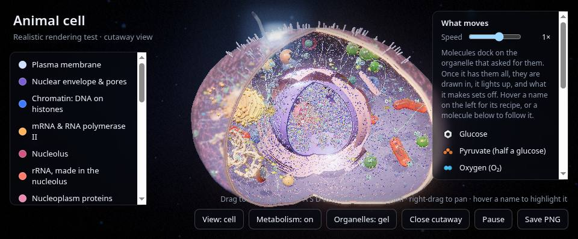
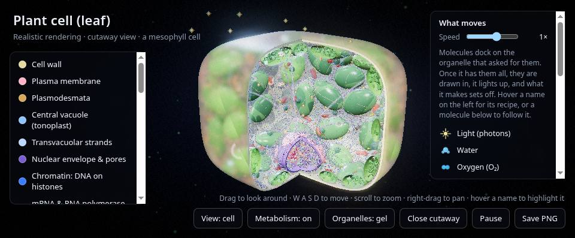
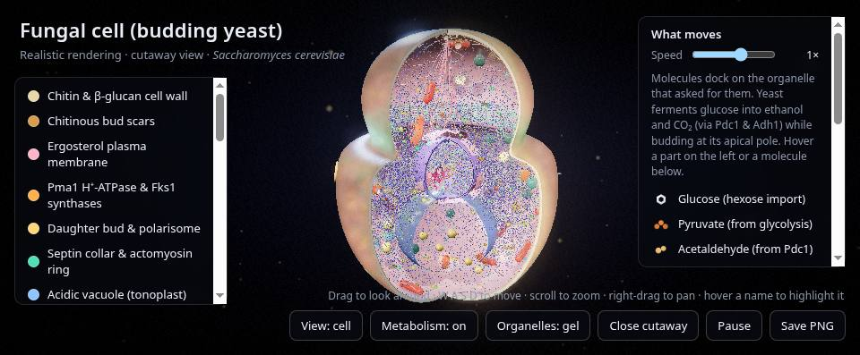
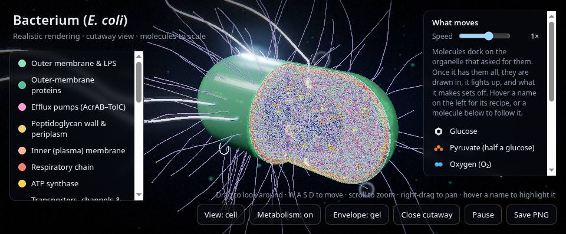
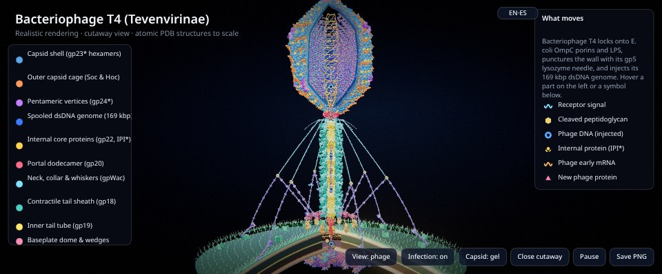

# BEXONIA Learn Biology — Interactive 3D Eukaryotic & Prokaryotic Cell & Virus Explorer

**Live Platform:** [https://learn.bexonia.com](https://learn.bexonia.com) · **License:** [MIT](LICENSE)

An open-source, interactive **3D cellular & molecular biology library** built with Three.js and WebGL. Explore **eukaryotic cells** (*Animal*, *Plant*, and *Fungal Yeast*), **prokaryotic cells** (*Escherichia coli* bacteria), and **viruses** (*Bacteriophage T4*, *SARS-CoV-2 Coronavirus*, *HIV-1 Retrovirus*, *Human Adenovirus*, and *Tobacco Mosaic Virus*)—from whole cells and virions down to organelles, macromolecular complexes, DNA/RNA, and experimental atomic structures from the Protein Data Bank (RCSB PDB). Every model includes chaptered **guided tours**, subtitles, narrator hooks, cutaway/open/closed structural views, and real-time animated metabolism.

---

## Biological Domains & Searchable Keywords

- **Eukaryotes & Eukaryotic Cells (`1 unit = 1 µm`):** Animal Cell (*Homo sapiens*), Plant Cell (*Leaf Mesophyll*), Fungal Cell (*Budding Yeast Saccharomyces cerevisiae*), Nucleus, Nuclear Pore Complex, Chromatin, Nucleosomes, Histones, Nucleolus, Mitochondria, Cristae, Chloroplasts, Thylakoid Grana, Endoplasmic Reticulum (Rough & Smooth ER), Golgi Apparatus, Central Vacuole, Tonoplast, Lysosomes, Peroxisomes, Centrosome, Spindle Pole Body (SPB), Septin Ring, Chitin & Cellulose Cell Walls, Plasmodesmata, Primary Cilium.
- **Prokaryotes & Bacterial Cells (`1 unit = 100 nm`):** Gram-Negative Bacterium (*Escherichia coli*), Outer Membrane (LPS), Peptidoglycan Cell Wall, Periplasm, Inner Plasma Membrane, Circular Chromosome Nucleoid & Plectonemes, 70S Ribosome Polysomes, Replisome, AcrAB–TolC Efflux Pumps, Bacterial Flagellar Motor, SecYEG, BAM & Lpt Bridges.
- **Viruses & Virology (`1 unit = 10 nm`):** Complex Head–Tail Myovirus (*Bacteriophage T4*), Enveloped Betacoronavirus (*SARS-CoV-2*), Enveloped Lentivirus/Retrovirus (*HIV-1*), Non-Enveloped Icosahedral dsDNA Virus (*Human Adenovirus*), Helical Rod Plant Tobamovirus (*Tobacco Mosaic Virus / TMV*), Viral Capsids, Contractile Tail Sheath, Spike Trimers, Fullerene Cone, Reverse Transcriptase, RdRp, Integrase.

---

## Main Cells & Viruses Preview

| Animal Cell (*Homo sapiens*) | Plant Cell (*Leaf Mesophyll*) |
| :---: | :---: |
|  |  |
| **Fungal Cell (*Saccharomyces cerevisiae*)** | **Prokaryotic Cell (*Escherichia coli*)** |
|  |  |

<p align="center">
  <strong>Bacteriophage T4 Infecting <em>E. coli</em> (True Atomic Scale)</strong><br/>
  
</p>

---

## Interactive Models & Pages

| File | Description | Manual |
| :--- | :--- | :--- |
| [`cell_explorer.html`](cell_explorer.html) | **Main 3D Explorer (`learn.bexonia.com`):** Organized into two collapsible sidebar menus (**Cells** and **Viruses**) with interactive **Guided Tours** (`cell_explorer.html#tour`) across all 10 root models. Flies the camera to each structure, highlights parts with leader-line tags, plays synchronized subtitles & narrator hooks, and drills down into a recursive tree of 191 levels from cells and viruses down to individual molecules and atoms. | [docs/cell_explorer_manual.md](docs/cell_explorer_manual.md) |
| [`animal_cell_realistic.html`](animal_cell_realistic.html) | **Realistic Animal Cell:** Cutaway mammalian cell (`1 unit = 1 µm`) with a nucleus built molecule-by-molecule (46 chromosomes wrapped on histones, mRNA transcription, rRNA in the nucleolus), rough/smooth ER, Golgi apparatus, hollow-cristae mitochondria, lysosomes, peroxisomes, centrosome, primary cilium, and animated metabolic recipes (`1/8×` to `4×` speed). | [docs/animal_cell_realistic_manual.md](docs/animal_cell_realistic_manual.md) |
| [`plant_cell_realistic.html`](plant_cell_realistic.html) | **Realistic Plant Cell (Leaf Mesophyll):** Cutaway plant cell (`1 unit = 1 µm`) featuring a cellulose/pectin cell wall, central vacuole with tonoplast, chloroplasts with stacked thylakoid grana, transvacuolar cytoplasmic streaming, plasmodesmata, and true-scale molecular close-ups of the thylakoid granum and cell wall (Photosystems I & II, Cytochrome $b_6f$, ATP synthase, RuBisCO, Cellulose synthase). | [docs/plant_cell_realistic_manual.md](docs/plant_cell_realistic_manual.md) |
| [`fungal_cell_realistic.html`](fungal_cell_realistic.html) | **Realistic Fungal Cell (Budding Yeast *S. cerevisiae*):** Mother cell with emerging daughter bud (`1 unit = 1 µm`), 3-layered chitin + $\beta$-1,3/$\beta$-1,6-glucan + mannoprotein cell wall, crater-like chitinous bud scars, ergosterol plasma membrane with `Pma1` $\text{H}^+$-ATPases (PDB `3B8C`), septin hourglass collar (`Cdc3–Cdc10–Cdc12`, PDB `2QAG`) and actomyosin ring at the mother–bud neck, closed-mitosis nucleus with embedded Spindle Pole Body (SPB), acidic polyphosphate vacuole, Woronin bodies, ER with `Erg11` (PDB `4LXJ`), and cytosolic alcoholic fermentation (`Pdc1` PDB `1PYD` + `Adh1` PDB `4W6Z`). | [docs/fungal_cell_realistic_manual.md](docs/fungal_cell_realistic_manual.md) |
| [`prokaryote_cell_realistic.html`](prokaryote_cell_realistic.html) | **Realistic Bacterium (*E. coli*):** Cutaway Gram-negative rod at true scale (`1 unit = 100 nm`) with inner/outer membranes, peptidoglycan, LPS, the complete 4.6 Mb circular chromosome folded into plectonemes (drawn base-pair by base-pair on zoom), coupled transcription–translation polysomes, replisome, AcrAB–TolC efflux pumps, rotary flagellar motors, and 32 experimental PDB structures. | [docs/prokaryote_cell_realistic_manual.md](docs/prokaryote_cell_realistic_manual.md) |
| [`bacteriophage_realistic.html`](bacteriophage_realistic.html) | **Realistic Bacteriophage T4:** Complex dsDNA myovirus infecting *E. coli* at true scale (`1 unit = 10 nm`) with prolate icosahedral capsid (`gp23*`, `Soc`, `Hoc`, `gp24*`, PDB `5VF3`), coaxially spooled 169 kbp dsDNA genome, `gp20` portal dodecamer (PDB `3JA7`), contractile `gp18` tail sheath (PDB `3J2M`), hexagonal baseplate with `gp27–gp5` needle (PDB `1K28`), hinged long tail fibers (`gp34–gp37`, PDB `2XGF`) bound to `OmpF` porins (PDB `2OMF`), and animated DNA injection. | [docs/bacteriophage_realistic_manual.md](docs/bacteriophage_realistic_manual.md) |
| [`coronavirus_realistic.html`](coronavirus_realistic.html) | **Realistic SARS-CoV-2 Coronavirus:** Enveloped `(+)ssRNA` betacoronavirus (`1 unit = 10 nm`) with 48 Spike (`S`) trimers (PDB `6VXX`), Membrane (`M`) dimers, pentameric Envelope (`E`) viroporins (PDB `5X29`), 29.9 kb `(+)ssRNA` wound on 40 Nucleocapsid (`N`) oligomers (PDB `6VYO`), host `ACE2` receptors (PDB `1R42`), and `RdRp` replicase complexes (`nsp12–nsp7–nsp8`, PDB `6M71`), with **Open / Cutaway / Closed** envelope protein shell modes. | [docs/bacteriophage_realistic_manual.md](docs/bacteriophage_realistic_manual.md) |
| [`hiv_realistic.html`](hiv_realistic.html) | **Realistic HIV-1 Retrovirus:** Enveloped diploid `(+)ssRNA` retrovirus (`1 unit = 10 nm`) fusing with a $\text{CD4}^+$ T-cell: `Env` `gp120/gp41` spikes (PDB `4TVP`), `p17` Matrix (`MA`) shell (PDB `1HIW`), fullerene-cone capsid of `p24` `CA` hexamers (PDB `3H4E`) & 12 vertex pentamers (PDB `3P05`), Reverse Transcriptase (PDB `1RTD`), and Integrase (PDB `1EX4`), with **Open / Cutaway / Closed** envelope & capsid modes. | [docs/bacteriophage_realistic_manual.md](docs/bacteriophage_realistic_manual.md) |
| [`adenovirus_realistic.html`](adenovirus_realistic.html) | **Realistic Human Adenovirus:** Non-enveloped pseudo-$T=25$ icosahedral dsDNA virus (`1 unit = 10 nm`) with 240 Hexon II trimers (PDB `1P30`), cement proteins (`IIIa`, `VI`, `VIII`, `IX`), 12 vertex Penton bases (PDB `1X9T`) and projecting Fiber knobs (PDB `1QIU`) docked onto host `CAR` and $\alpha_v\beta_5$ integrins, with **Open / Cutaway / Closed** icosahedral shell modes. | [docs/bacteriophage_realistic_manual.md](docs/bacteriophage_realistic_manual.md) |
| [`tmv_realistic.html`](tmv_realistic.html) | **Realistic Tobacco Mosaic Virus (TMV):** Helical rod `(+)ssRNA` plant virus (`1 unit = 10 nm`) with right-handed Coat Protein helix (`16⅓` subunits/turn, 2.3 nm pitch, PDB `2TMV`), 6.4 kb `(+)ssRNA`, 20S assembly discs, co-translational 80S ribosome uncoating, and 30 kDa Movement Protein gating plasmodesmata. | [docs/bacteriophage_realistic_manual.md](docs/bacteriophage_realistic_manual.md) |
| [`molecules_preview.html`](molecules_preview.html), [`dna_styles.html`](dna_styles.html), [`eukaryotic_cell_3d.html`](eukaryotic_cell_3d.html), [`prokaryotic_cell_3d.html`](prokaryotic_cell_3d.html) | Standalone molecular style studies and textbook-figure previews. | — |

---

## Local Development

Serve the repository locally with the included zero-dependency Python HTTP server:

```bash
python3 tools/serve.py "$(pwd)" 8765
```

Then open `http://localhost:8765/cell_explorer.html` in your browser.

---

## Architecture & Container Packaging (`learn.bexonia.com`)

```text
GitHub Actions (ubuntu-latest)
  -> Builds & smoke-tests OCI image (nginx:1.27-alpine + static WebGL assets)
  -> Publishes ghcr.io/bexonia/learn-biology:main (:latest, :sha-<commit>)
```

- **Automated CI/CD ([`.github/workflows/deploy.yml`](.github/workflows/deploy.yml)):** Runs on GitHub-hosted `ubuntu-latest` runners on every pull request and push to `main`, validates all static HTML/JS pages and guided tours, builds and smoke-tests the [`Dockerfile`](Dockerfile) (`nginx:1.27-alpine`), and publishes `ghcr.io/bexonia/learn-biology:main` on merge to `main`.
- **Platform Infrastructure (`bexonia/infra`):** Kubernetes deployment (`bexonia-learn`), Traefik `IngressRoute` (`learn.bexonia.com`), and Cloudflare DNS/Tunnel routing are managed declaratively in the private platform infrastructure repository, which pulls `ghcr.io/bexonia/learn-biology:main` in-cluster with zero static secrets in this public repository.
- **Version History:** The legacy v1 Blender + Molecular Nodes + React/Three.js pipeline and all 140 Python generator scripts are preserved under lightweight tag **`v1`** (`git checkout v1`).

---

## Documentation for Contributors & Agents

- [AGENTS.md](AGENTS.md) — Entry point, architecture map, and engineering rules.
- [docs/how_to_build_a_cell_or_organelle.md](docs/how_to_build_a_cell_or_organelle.md) — Step-by-step guide to building and composing new cells, viruses, and organelles.
- [docs/cell_explorer_manual.md](docs/cell_explorer_manual.md) — Recursive tree, tags, camera framing, and guided tour engine (§12).
- [docs/tutorial_mode_spec.md](docs/tutorial_mode_spec.md) — Guided tour specification, subtitle cues, and narrator audio hook.
- [tools/README.md](tools/README.md) — Downloading, coarse-graining, and embedding experimental RCSB PDB structures byte-for-byte.
