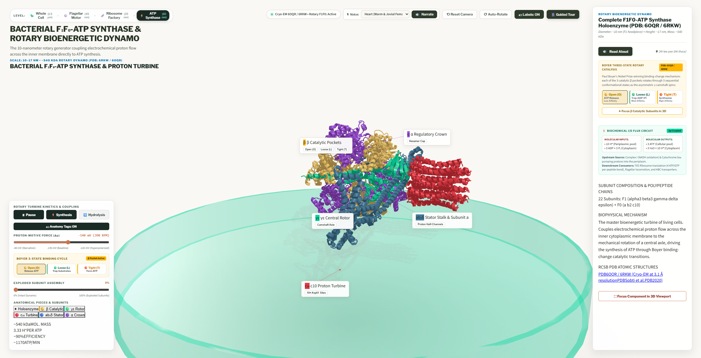

# 🧬 Learn Biology — Interactive 3D Cell & Nanomachines

An open, interactive 3D platform designed to **teach the principles of biology to everyone** in an intuitive, visual, and exploratory way. Discover the micro-architecture of life—from the whole prokaryotic cell down to the atomic Cryo-EM rotor nanomachines that propel bacteria.


---

## 🎯 Educational Mission

Traditional biology textbooks show flat, two-dimensional diagrams that make cellular life seem static. In reality, a single bacterium is an active, ultra-dense biochemical factory governed by biophysical forces, molecular motors, and selective membranes.

**Learn Biology** brings these structures to life with:
* **Interactive 3D Cutaways:** Orbit, pan, and zoom through cellular envelopes, peptidoglycan walls, plasma membranes, ribosomes, plasmids, and the circular nucleoid DNA.
* **Multi-Scale Educational Levels (13 Interactive 3D Scenarios Built):**
  * **Level 1 — Whole Cell ($1.5\,\mu\text{m}$):** Observe the bacterium in 3/4 perspective with responsive leader line annotations anchored directly to the capsule, outer membrane, peptidoglycan wall, periplasm, plasma membrane, cytoplasm, ribosomes, plasmids, and the circular nucleoid DNA.
  * **Level 2 — Flagellar Rotary Motor ($45\,\text{nm}$, PDB `7CGO`):** Inspect nature's rotary engine with dynamic CCW (run) and CW (tumble) rotation, MotAB stator proton streaming, and an **exploded view slider**.
  * **Level 3 — Bacterial 70S Ribosome Translation Factory ($25\,\text{nm}$, PDB `7K00`):** Explore the macromolecular 2.5 MDa ribozyme machine, step-by-step mRNA elongation kinetics (A, P, and E tRNA sites), EF-Tu / EF-G GTPase ratcheting, polypeptide exit tunnel, and subunit disassembly.
  * **Level 4 — Bacterial $F_1F_0$-ATP Synthase & Rotary Bioenergetic Dynamo ($10\,\text{nm}$, PDB `6OQR`):** Explore the 540 kDa rotary machine coupling periplasmic proton-motive force ($\Delta p \approx -140\,\text{mV}$) to mechanical drive shaft rotation and Paul Boyer's three-state binding-change cycle ($\text{Open} \to \text{Loose} \to \text{Tight}$).
  * **Level 5 — Respiratory Complex I Proton Pump ($18\,\text{nm}$, PDB `4HEA`):** Inspect L-shaped NADH:ubiquinone oxidoreductase with FMN hydride transfer, the 7 Fe-S cubane electron wire, ubiquinone reduction, and the 4-channel antiporter piston drive.
  * **Level 6 — SecYEG Protein Translocon & SecA ATPase ($12\,\text{nm}$, PDB `3J46`):** Observe the hourglass transmembrane channel, SecA two-helix finger power-stroke, helical plug displacement, and the lateral gate partitioning transmembrane helices into the lipid bilayer.
  * **Level 7 — BAM $\beta$-Barrel Assembly Machine ($14\,\text{nm}$, PDB `5D0O`):** Explore the outer-membrane $\beta$-barrel folder (BamABCDE), the unstable BamA $\beta1\text{–}\beta16$ lateral seam, membrane thinning, and substrate budding.
  * **Level 8 — LptA–G Trans-Envelope LPS Bridge ($22\,\text{nm}$, PDB `5IV9`/`4Q35`):** Trace lipopolysaccharide extraction from the inner membrane via the $\text{LptB}_2\text{FGC}$ ABC transporter across the periplasmic $\text{LptA}$ $\beta$-jellyroll slide to the outer-membrane $\text{LptDE}$ translocon.
  * **Level 9 — Bacterial RNA Polymerase Holoenzyme ($15\,\text{nm}$, PDB `6ALH`):** Inspect $\sigma^{70}$ promoter recognition (`-35`/`-10` elements), transcription bubble melting, the $\text{Mg}^{2+}$ catalytic triad, and abortive-to-productive elongation with rifampicin inhibition.
  * **Level 10 — DNA Polymerase III Replisome ($24\,\text{nm}$, PDB `5FKV`):** Explore DnaB helicase unwinding, DnaG primase RNA priming, asymmetric leading/lagging trombone synthesis, $\beta_2$ sliding clamps, and the $\tau_3\delta\delta'\chi\psi$ clamp loader.
  * **Level 11 — DNA Gyrase Topoisomerase II ($16\,\text{nm}$, PDB `6RKW`):** Watch $\text{GyrA}_2\text{GyrB}_2$ wrap a positive DNA supercoil, cleave the double-stranded G-segment gate, pass the T-segment via ATP hydrolysis, and respond to fluoroquinolone (ciprofloxacin) trapping.
  * **Level 12 — FtsZ Z-Ring Cytokinetic Divisome ($30\,\text{nm}$, PDB `6UNX`):** Observe GTP-driven FtsZ protofilament treadmilling, FtsA/ZipA membrane tethering, MinCDE polar oscillation, and FtsWI septal peptidoglycan constriction.
  * **Level 13 — MreB Rod-Shape Elongasome ($20\,\text{nm}$, PDB `4CZJ`):** Explore antiparallel ATP-actin-like MreB double protofilaments sensing negative membrane curvature to guide the RodA–PBP2 circumferential cell-wall synthesis complex.
* **Client-Side Neural Voice Narration & Live Subtitles:** Integrated text-to-speech powered by Kokoro-82M running directly in the browser via ONNX Runtime Web—reading scientific explanations aloud with real-time closed captions and animated soundwave HUD previewing speech 0.5s in advance.
* **Cinematic Guided Tours & Explanatory Traces:** Guided pedagogical walkthroughs directing students through each organelle, macromolecular subunit, and catalytic step.




---

## 🏗️ Architecture & Technology Stack

Learn Biology is engineered to be **100% client-side, zero-install, and zero-backend**:

```
                       [ Student's Browser ]
                                 │
                 ┌───────────────┴───────────────┐
                 ▼                               ▼
         [ Visual Layer ]                [ Logic & Compute ]
    • React 19 + TypeScript + Vite  • Rust WebAssembly (orbit_engine.wasm)
    • Three.js WebGL (PBR materials)  - Camera orbit momentum & damping
    • SVG Leader Lines Overlay        - 3D-to-2D screen coordinate projection
    • 3D Geometry Sources:          • 13 Scene Controllers (client/src/core/):
      - prokaryote_cell.blend         - cellViewer.ts (Whole Cell)
      - scripts/generate_*.py (13x)   - flagellarMotor.ts, ribosomeTranslation.ts
                                      - atpSynthase.ts, respiratoryComplexI.ts
                                      - secYEGTranslocon.ts, bamComplex.ts
                                      - lptBridge.ts, rnaPolymerase.ts
                                      - dnaReplisome.ts, dnaGyrase.ts
                                      - ftsZDivisome.ts, mreBElongasome.ts
                                    • Kokoro-82M TTS & Live Subtitles
                                 │
                                 ▼
              [ Browser Hardware Abstraction ]
         Google ANGLE (Almost Native Graphics Layer Engine)
         Translates WebGL into native OS GPU backends:
         • Windows: DirectX 11 / Direct3D 12
         • macOS:   Apple Metal
         • Linux:   Vulkan 1.3
                                 │
                                 ▼
                     [ Physical GPU Hardware ]
```

---

## 🚀 Quick Start (Running Locally)

The client application is built with React 19, TypeScript, and Vite, managed with **`pnpm`**:

### 1. Install Dependencies & Launch Dev Server

```powershell
cd client
pnpm install
pnpm run dev
```

### 2. Open in Your Browser
Navigate to **`http://localhost:5173/`** in Google Chrome, Microsoft Edge, Mozilla Firefox, or Apple Safari.

---

## 🛠️ Building Assets from Source

To keep the repository clean and avoid git binary bloat, compiled `.glb` 3D files and `.wasm` binaries are built on demand from source.

Run the automated one-command build script:

```powershell
python build_assets.py
```

This script:
1. **Compiles the Rust WebAssembly Engine:**
   Runs `rustc --target wasm32-unknown-unknown -O --crate-type=cdylib src/lib.rs -o wasm/orbit_engine.wasm`.
2. **Exports the 3D Cell & Nanomachine Geometry from Blender:**
   Executes Blender headlessly across the procedural generators in [`scripts/`](file:///scripts/) to generate the `.glb` models in `client/public/models/`.

---

## 📁 Repository Structure

```
learn-biology/
├── client/                      # React 19 + TypeScript + Vite interactive web app
│   ├── src/                     # Components, hooks, types, and 13 Three.js scene controllers
│   ├── public/                  # 3D GLB models, WASM binaries, and audio models
│   ├── package.json             # Project manifest (pnpm package manager)
│   └── pnpm-lock.yaml           # Deterministic pnpm dependency lockfile
├── readme_images/               # Curated pedagogical screenshots for documentation
│   ├── prokaryote_cell_overview.png
│   ├── flagellar_motor_tail.png
│   ├── ribosome_translation_factory.png
│   └── atp_synthase_rotary_dynamo.png
├── assets/                      # Reference diagrams and scientific blueprints
├── models/                      # Output directory for generated 3D models
├── wasm/                        # Output directory for compiled WebAssembly binary
├── build_assets.py              # One-command asset compiler (Blender + Rust WASM)
├── scripts/                     # Procedural Blender 5.2 Python generators (13 scenes)
│   ├── generate_primer_cell_hq.py          # Level 1: Whole Cell (1.5 µm) cutaway
│   ├── generate_7cgo_flagellar_motor.py    # Level 2: Flagellar Motor & Stators (45 nm)
│   ├── generate_7k00_assembled_pieces.py   # Level 3: 70S Translating Ribosome (25 nm)
│   ├── generate_6oqr_atp_synthase.py       # Level 4: F1F0-ATP Synthase (10 nm)
│   ├── generate_4hea_complex_i.py          # Level 5: Respiratory Complex I (18 nm)
│   ├── generate_3j46_secyeg.py             # Level 6: SecYEG Protein Translocon (12 nm)
│   ├── generate_5d0o_bam_complex.py        # Level 7: BAM β-Barrel Machine (14 nm)
│   ├── generate_lpt_bridge.py              # Level 8: LptA–G LPS Bridge (22 nm)
│   ├── generate_6alh_rnap.py               # Level 9: RNA Polymerase Holoenzyme (15 nm)
│   ├── generate_5fkv_pol_iii_replisome.py  # Level 10: DNA Pol III Replisome (24 nm)
│   ├── generate_6rkw_dna_gyrase.py         # Level 11: DNA Gyrase Topoisomerase II (16 nm)
│   ├── generate_6unx_ftsz_divisome.py      # Level 12: FtsZ Cytokinetic Z-Ring (30 nm)
│   └── generate_4czj_mreb_elongasome.py    # Level 13: MreB Rod-Shape Elongasome (20 nm)
├── CELLULAR_ELEMENTS_CATALOG.md # Master registry of prokaryotic structures & flux networks
├── CELLULAR_INSPECTOR_BLUEPRINT.md # 8-step engineering protocol for 3D cellular inspectors
├── roadmap/                     # Isolated per-element execution folders & checkbox tracker
│   ├── README.md                # Master [x] / [ ] progress tracker & agent execution guide
│   ├── 00_OPEN_SOURCE_TOOLCHAIN_SPEC.md # RCSB PDB, PubChem, RDKit, Blender & Molecular Nodes spec
│   └── 01_..16_*/README.md      # 16 self-contained element execution specifications
├── prokaryote_cell.blend        # Blender master source scene
├── src/
│   └── lib.rs                   # Rust source code for WASM orbit & projection math
├── .agents/                     # Antigravity agent skills, rules & MCP config
└── AGENTS.md                    # Guidelines for Antigravity AI agents
```

---

## 🗺️ Prokaryotic Cell Modeling Status & Pending Roadmap

### ✅ Implemented Scenarios (Levels 1–13)
| Level | Scenario ID | Biological Structure / Nanomachine | PDB Reference | Status |
| :--- | :--- | :--- | :--- | :--- |
| **L1** | `cell` | Whole Prokaryotic Cell Cutaway ($1.5\,\mu\text{m}$) | Procedural + Cryo-ET | ✅ Built |
| **L2** | `motor` | Flagellar Rotary Motor & Stator Ring | `7CGO` | ✅ Built |
| **L3** | `ribosome` | 70S Translating Ribosome & Polysome | `7K00` | ✅ Built |
| **L4** | `atp_synthase` | $F_1F_0$-ATP Synthase Bioenergetic Dynamo | `6OQR` / `6RKW` | ✅ Built |
| **L5** | `complex_i` | Respiratory Complex I Proton Pump | `4HEA` | ✅ Built |
| **L6** | `secyeg` | SecYEG Translocon & SecA ATPase | `3J46` | ✅ Built |
| **L7** | `bam` | BAM $\beta$-Barrel Assembly Machine | `5D0O` | ✅ Built |
| **L8** | `lpt` | LptA–G Trans-Envelope LPS Bridge | `5IV9` / `4Q35` | ✅ Built |
| **L9** | `rnap` | Bacterial RNA Polymerase Holoenzyme | `6ALH` | ✅ Built |
| **L10** | `pol_iii` | DNA Polymerase III Replisome | `5FKV` | ✅ Built |
| **L11** | `gyrase` | DNA Gyrase Topoisomerase II | `6RKW` | ✅ Built |
| **L12** | `ftsz` | FtsZ Cytokinetic Divisome Ring | `6UNX` | ✅ Built |
| **L13** | `mreb` | MreB Rod-Shape Elongasome | `4CZJ` | ✅ Built |

### ⏳ Pending Prokaryotic Targets & Biology Primer Expansions
1. **Biology Primer Visual Suite Completions (`primer_fig3`, `fig4`, `fig7`, `fig8`):**
   - **Coupled Transcription–Translation Expressome (`6X9Q`):** Physical RNAP–NusG–70S ribosome coupling on nascent mRNA emerging from the nucleoid + **Eukaryotic Comparison** inset (*Figure 4*).
   - **Comparing Prokaryotic Cell Envelopes (*Figure 7*):** Side-by-side 3D comparison of **Gram-Negative** (Outer LPS + thin peptidoglycan + inner membrane), **Gram-Positive** (thick multi-layered peptidoglycan + teichoic & lipoteichoic acids), and **Archaeal** (crystalline protein **S-Layer** + ether-linked isoprenoid membrane).
   - **4 Modes of Prokaryotic Movement (*Figure 8*):** Adding **Type IV Pilus Retraction (Twitching Motility, `PilB`/`PilT`)**, **Focal-Adhesion Gliding Motility (`GldLM`)**, and the **ATP-driven Archaeal Archaellum** alongside bacterial flagellar swimming.
   - **3D Icosahedral Bacterial Microcompartment (Carboxysome / BMC, `7O04`):** In-situ 3D cut-open proteinaceous organelle shell inside the Whole Cell cytoplasm and standalone 3D inspector (*Figure 3*).
2. **Whole-Cell Organelle Drill-Downs (`CELLULAR_ELEMENTS_CATALOG.md` Phases 1–4):**
   - **Chemosensory Receptor Array (`chemosensory_mcp`, `6S1K`):** Transmembrane MCP trimers-of-dimers + CheA/CheW histidine kinase baseplate signaling `CheY-P` to the flagellar C-ring.
   - **Type 1 Fimbriae & Catch-Bond Adhesin (`pili_fimbriae`, `6GTO`/`1TR7`):** FimD usher-chaperone assembly and FimH shear-enhanced mannose catch-bond.
   - **Curli Extracellular Amyloid Biofilm Fibers (`curli_fibers`, `4B0M`):** CsgG outer-membrane nonameric channel and CsgA cross-$\beta$ amyloid biofilm matrix.
   - **Nucleoid-Associated Proteins (`nucleoid`, `1P71`/`6O6S`):** HU, H-NS, and Fis architectural DNA bending, bridging, and topological domain insulation.
   - **Chaperone Quality Control (`groel_groes` `1AON` & `chaperones` `2KHO`/`4JNE`):** GroEL–GroES barrel nano-cage, DnaK/DnaJ/GrpE HSP70 cycle, and ribosome-bound Trigger Factor.
   - **RNA Degradosome (`rna_degradosome`, `5M3P`):** RNase E tetrameric scaffold with PNPase, RhlB helicase, and enolase for rapid mRNA turnover.
   - **Metabolic & Periplasmic Hubs:** Pyruvate Dehydrogenase E1–E2–E3 megacomplex (`1EAE`), Cytochrome $bo_3$ terminal ubiquinol oxidase (`6WTI`), SurA periplasmic chaperone (`1M5Y`), MalE–MalFGK$_2$ maltose ABC transporter (`1OMP`/`2R6G`), and OmpF trimeric porin (`2OMF`).
3. **Defense, Efflux, Horizontal Gene Transfer & Survival Systems:**
   - **Tripartite Multidrug Efflux Pump (`AcrAB-TolC`, `5V5S`)** & **Braun's Lipoprotein (`Lpp`, `1EQ7`)** envelope staples.
   - **Bacterial Secretion & Conjugation:** Conjugative F-Pilus / Type IV Secretion System (`7OKO`), Type III Secretion Injectisome (`7AH9`), and Type VI Contractile Spear.
   - **CRISPR-Cas Adaptive Immunity (`1VY8` Cascade / `4OO8` Cas9)** & Restriction-Modification endonucleases (`1ERI`).
   - **Cytoplasmic Storage Granules** (glycogen, polyphosphate volutin, PHB carbonosomes, gas vesicles, magnetosomes) and **Gram-Positive Endospores**.
   - **Level 5 & Level 6 Monomer / Atomic Bond Views:** Interactive inspection of Lipid II, $\text{Mg}^{2+}\cdot\text{ATP}$, phospholipids, planar peptide bonds, Watson-Crick H-bonds, and Grotthuss proton wires.

---

## 🎨 Biophysical Color Taxonomy

The visual style follows strict biophysical coloring conventions:
* **Outer Membrane LPS:** Deep Marine Blue (`#0077B6`)
* **Peptidoglycan Cell Wall:** Warm Terracotta (`#E76F51`)
* **Inner Plasma Membrane:** Vivid Jade / Seafoam Green (`#06D6A0`)
* **C-Ring Switch Complex:** Vibrant Orange (`#FF7B00`)
* **Central Drive Shaft & Stators:** Golden Amber (`#FFD166`)
* **Universal Joint Hook:** Royal Violet (`#9D4EDD`)

---

## 📜 License

This project is licensed under the MIT License — free for educational, academic, and non-commercial use worldwide.
