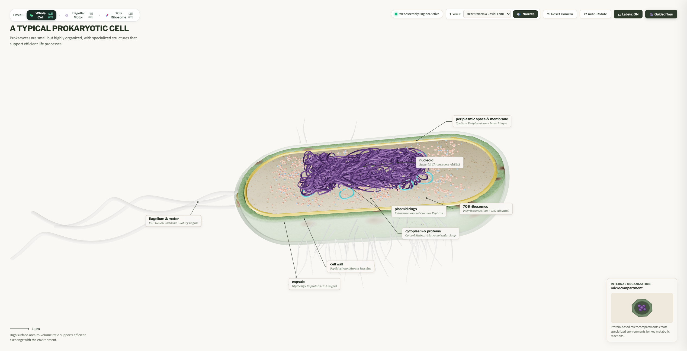
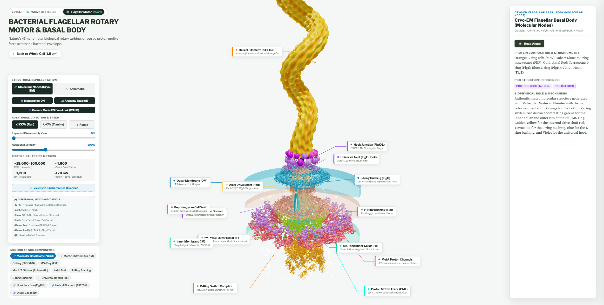
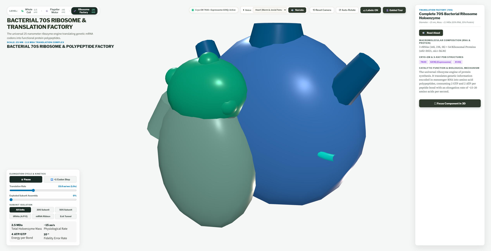

# 🧬 Learn Biology — Interactive 3D Cell & Nanomachines

An open, interactive 3D platform designed to **teach the principles of biology to everyone** in an intuitive, visual, and exploratory way. Discover the micro-architecture of life—from the whole prokaryotic cell down to the atomic Cryo-EM rotor nanomachines that propel bacteria.



---

## 🎯 Educational Mission

Traditional biology textbooks show flat, two-dimensional diagrams that make cellular life seem static. In reality, a single bacterium is an active, ultra-dense biochemical factory governed by biophysical forces, molecular motors, and selective membranes.

**Learn Biology** brings these structures to life with:
* **Interactive 3D Cutaways:** Orbit, pan, and zoom through cellular envelopes, peptidoglycan walls, plasma membranes, ribosomes, plasmids, and the circular nucleoid DNA.
* **Tri-Scale Educational Levels:**
  * **Level 1 — Whole Cell ($1.5\,\mu\text{m}$):** Observe the bacterium in 3/4 perspective with responsive leader line annotations anchored directly to the cell envelopes, peptidoglycan walls, plasma membrane, ribosomes, plasmids, and the circular nucleoid DNA.
  * **Level 2 — Flagellar Rotary Motor ($45\,\text{nm}$):** Inspect nature's rotary engine with dynamic CCW (run) and CW (tumble) rotation, proton motive force streaming, and an **exploded view slider**.
  * **Level 3 — Bacterial 70S Ribosome Translation Factory ($25\,\text{nm}$):** Explore the macromolecular 2.5 MDa ribozyme machine, step-by-step mRNA elongation kinetics (A, P, and E tRNA sites), codon translocation, polypeptide exit tunnel, and subunit disassembly.
* **Client-Side Neural Voice Narration:** Integrated text-to-speech powered by Kokoro-82M running directly in the browser via ONNX Runtime Web—reading scientific explanations aloud with warm, natural voices.
* **Cinematic Guided Tour:** A 9-step pedagogical walkthrough guiding students through each organelle and structure step-by-step.





---

## 🏗️ Architecture & Technology Stack

Learn Biology is engineered to be **100% client-side, zero-install, and zero-backend**:

```
                       [ Student's Browser ]
                                 │
                 ┌───────────────┴───────────────┐
                 ▼                               ▼
         [ Visual Layer ]                [ Logic & Compute ]
    • React 19 + TypeScript + Vite  • Rust WebAssembly (orbit_engine.wasm)
    • Three.js WebGL (PBR materials)  - Camera orbit momentum & damping
    • SVG Leader Lines Overlay        - 3D-to-2D screen coordinate projection
    • 3D Geometry Sources:          • Scene Controllers:
      - prokaryote_cell.blend         - cellViewer.js (Whole Cell)
      - generate_primer_cell_hq.py    - flagellarMotor.js (Rotary Motor)
                                      - ribosomeTranslation.js (Ribosome)
                                    • Kokoro-82M TTS (voiceService.js)
                                 │
                                 ▼
              [ Browser Hardware Abstraction ]
         Google ANGLE (Almost Native Graphics Layer Engine)
         Translates WebGL into native OS GPU backends:
         • Windows: DirectX 11 / Direct3D 12
         • macOS:   Apple Metal
         • Linux:   Vulkan 1.3
                                 │
                                 ▼
                     [ Physical GPU Hardware ]
```

---

## 🚀 Quick Start (Running Locally)

The client application is built with React 19, TypeScript, and Vite, managed with **`pnpm`**:

### 1. Install Dependencies & Launch Dev Server

```powershell
cd client
pnpm install
pnpm run dev
```

### 2. Open in Your Browser
Navigate to **`http://localhost:5173/`** in Google Chrome, Microsoft Edge, Mozilla Firefox, or Apple Safari.

---

## 🛠️ Building Assets from Source

To keep the repository clean and avoid git binary bloat, compiled `.glb` 3D files and `.wasm` binaries are built on demand from source.

Run the automated one-command build script:

```powershell
python build_assets.py
```

This script:
1. **Compiles the Rust WebAssembly Engine:**
   Runs `rustc --target wasm32-unknown-unknown -O --crate-type=cdylib src/lib.rs -o wasm/orbit_engine.wasm`.
2. **Exports the 3D Cell Geometry from Blender:**
   Executes Blender headlessly using [`generate_primer_cell_hq.py`](file:///generate_primer_cell_hq.py) and [`prokaryote_cell.blend`](file:///prokaryote_cell.blend) to generate `prokaryote_cell.glb`.

---

## 📁 Repository Structure

```
learn-biology/
├── client/                      # React 19 + TypeScript + Vite interactive web app
│   ├── src/                     # Components, hooks, types, and Three.js scenes
│   ├── public/                  # 3D GLB models, WASM binaries, and audio models
│   ├── package.json             # Project manifest (pnpm package manager)
│   └── pnpm-lock.yaml           # Deterministic pnpm dependency lockfile
├── readme_images/               # Curated pedagogical screenshots for documentation
│   ├── prokaryote_cell_overview.png
│   ├── flagellar_motor_tail.png
│   └── ribosome_translation_factory.png
├── assets/                      # Reference diagrams and scientific blueprints
├── models/                      # Output directory for generated 3D models
├── wasm/                        # Output directory for compiled WebAssembly binary
├── build_assets.py              # One-command asset compiler (Blender + Rust WASM)
├── generate_primer_cell_hq.py   # Procedural Blender 5.2 Python generator
├── prokaryote_cell.blend        # Blender master source scene
├── src/
│   └── lib.rs                   # Rust source code for WASM orbit & projection math
├── .agents/                     # Antigravity agent skills, rules & MCP config
└── AGENTS.md                    # Guidelines for Antigravity AI agents
```

---

## 🎨 Biophysical Color Taxonomy

The visual style follows strict biophysical coloring conventions:
* **Outer Membrane LPS:** Deep Marine Blue (`#0077B6`)
* **Peptidoglycan Cell Wall:** Warm Terracotta (`#E76F51`)
* **Inner Plasma Membrane:** Vivid Jade / Seafoam Green (`#06D6A0`)
* **C-Ring Switch Complex:** Vibrant Orange (`#FF7B00`)
* **Central Drive Shaft & Stators:** Golden Amber (`#FFD166`)
* **Universal Joint Hook:** Royal Violet (`#9D4EDD`)

---

## 📜 License

This project is licensed under the MIT License — free for educational, academic, and non-commercial use worldwide.
