# 🧬 Eukaryote Explorer 3D — Master Interactive Tutorial & Multi-Scale Roadmap

Welcome to the **Eukaryote Explorer** roadmap inside [`learn-biology/eukaryote/`](../README.md).

Just like the 29-scenario **Prokaryote Explorer**, this roadmap is designed as a **fluid, playable, multi-scale 3D biological adventure**—part interactive video game, part living textbook—where the user starts at the whole-cell overview ($10\text{--}100\,\mu\text{m}$) and dives continuously inward through the extracellular matrix, plasma membrane, cytoskeleton highways, endomembrane organelles, mitochondria, chloroplasts, nuclear pore complexes, chromatin loops, DNA/RNA topological rings, and 80S ribosomes all the way down to individual monomers and atomic bonds ($0.1\,\text{nm}$).

> **Purpose of This Document:**
> This file is the **master inventory of all 36 Eukaryotic scenarios**, organized in a natural **"Outside-In, Macro-to-Atomic" exploration order** with concise descriptions of what each structure is, how its pieces fit together, and how the player interacts with it. Each entry below serves as the seed specification for deep structural research (RCSB PDB / EMDB / RDKit) and 3D scene generation in the next phase.

---

## 🎮 Interactive Exploration Flow ("Outside-In" Player Journey)

```mermaid
flowchart LR
    T1["Tier 1: Whole Cell & Kingdoms (01–02)"] --> T2["Tier 2: ECM, Plasma Membrane & Endocytosis (03–08)"]
    T2 --> T3["Tier 3: Cytoskeleton & Molecular Walkers (09–12)"]
    T3 --> T4["Tier 4: Endomembrane Secretory & Degradative System (13–18)"]
    T4 --> T5["Tier 5: Mitochondria & Chloroplasts (19–25)"]
    T5 --> T6["Tier 6: Nucleus, NPC, Chromatin & Spliceosome (26–31)"]
    T6 --> T7["Tier 7: 80S Ribosomes, RNAi, Proteasome & Mitosis (32–35)"]
    T7 --> T8["Tier 8: DNA/RNA Rings, Monomers & Quantum Bonds (36)"]
```

---

## 🗺️ Complete 36-Element Eukaryotic Roadmap

### Tier 1 — Macro-Scale Whole-Cell Overviews & Kingdom Comparison ($10\text{--}100\,\mu\text{m}$)

1. **`01_eukaryotic_animal_cell` — Whole Animal Cell 3/4 Cutaway & Interactive Organelle Atlas**
   - **What It Is & How It's Built:** The master $20\,\mu\text{m}$ 3D hub scene featuring a surgical 3/4 cutaway of a mammalian cell. Exposes the plasma membrane, microvilli, nucleus, nucleolus, rough & smooth ER, Golgi stacks, mitochondria, lysosomes, peroxisomes, centrosome with radiating microtubules, cortical actin mesh, and trafficking vesicles.
   - **Interactive Gameplay:** Clicking any glowing organelle pill orbits the camera into that compartment and opens its Inspector Drawer with a 1-click **"Dive Into 3D Nanomachine"** portal to the scenarios below.

2. **`02_kingdom_cell_comparison` — Comparative Eukaryotes: Animal vs. Plant vs. Fungal Cell Envelopes & Organelles**
   - **What It Is & How It's Built:** Side-by-side 3D comparison of the three major eukaryotic cell architectures:
     - *Animal:* Flexible cholesterol-rich plasma membrane coated by extracellular matrix (collagen + integrins).
     - *Plant:* Rigid woven cellulose microfibril + hemicellulose + pectin cell wall, intercellular plasmodesmata tunnels, chloroplasts, and a giant central vacuole.
     - *Fungal:* Cross-linked $\beta$-glucan + chitin cell wall, mannoprotein outer layer, and ergosterol-containing plasma membrane.
   - **Interactive Gameplay:** Toggle turgor pressure, osmotic tonicity (hypertonic plasmolysis vs. hypotonic turgidity), and antifungal/herbicide cell-wall inhibitors.

---

### Tier 2 — Cell Surface, Extracellular Matrix, Plasma Membrane & Vesicle Entry ($10\text{--}200\,\text{nm}$)

3. **`03_ecm_integrin_focal_adhesion` — Extracellular Matrix (ECM), Collagen Triple Helix & Integrin Focal Adhesion**
   - **What It Is & How It's Built:** Shows how the cell anchors to the outside world. Outside: cross-striated Collagen triple-helix fibrils, hydrated proteoglycan brushes, and fibronectin dimers (RGD motif). Across the membrane: $\alpha/\beta$ Integrin heterodimers switching from bent (inactive) to extended (active) conformation. Inside: Talin rod and Vinculin clutching onto cytoplasmic F-actin stress fibers.
   - **Interactive Gameplay:** Pull on the ECM to watch mechanical tension unfold Talin and recruit Vinculin ("mechanotransduction").

4. **`04_plasma_membrane_lipid_raft` — Eukaryotic Plasma Membrane, Cholesterol Stiffening Rings & Glycocalyx**
   - **What It Is & How It's Built:** Asymmetric phospholipid bilayer (outer leaflet: phosphatidylcholine, sphingomyelin, ganglioside glycolipids with branched sugar trees; inner leaflet: negatively charged phosphatidylserine and $\text{PIP}_2$). Rigid four-ring **cholesterol** molecules intercalate between acyl tails to form ordered lipid rafts alongside GPI-anchored proteins and caveolin curves.
   - **Interactive Gameplay:** Adjust temperature and cholesterol percentage to see membrane fluidity vs. liquid-ordered raft phase separation.

5. **`05_ion_channels_na_k_pump` — $\text{Na}^+/\text{K}^+$-ATPase Electrogenic Pump & Voltage-Gated $\text{K}^+/\text{Na}^+$ Channels**
   - **What It Is & How It's Built:** Two neighbor membrane machines that power cellular electricity:
     - *$\text{Na}^+/\text{K}^+$-ATPase ($E_1/E_2$ P-type pump):* Uses 1 ATP to pump $3\,\text{Na}^+$ out and $2\,\text{K}^+$ in.
     - *Tetrameric $\text{K}^+$ Channel:* 4-fold symmetric pore with voltage-sensing S4 paddles and the atomic carbonyl oxygen selectivity filter that strips water from $\text{K}^+$ ions.
   - **Interactive Gameplay:** Trigger a membrane depolarization wave and watch the voltage sensors snap open and the inactivation ball plug the pore.

6. **`06_gpcr_rtk_signaling` — GPCR 7-Transmembrane Receptor, Heterotrimeric G-Protein & RTK Dimerization**
   - **What It Is & How It's Built:** How extracellular hormones/neurotransmitters transmit signals across the membrane without entering the cell:
     - *GPCR Pathway:* 7-TM $\alpha$-helical barrel binds ligand $\to$ activates heterotrimeric $G_{\alpha\beta\gamma}$ $\to$ $G_\alpha\text{-GTP}$ dissociates to stimulate Adenylyl Cyclase (ATP $\to$ cyclic AMP ring) $\to$ $\beta$-arrestin desensitization.
     - *RTK Pathway:* Growth factor dimerizes two Receptor Tyrosine Kinases $\to$ trans-autophosphorylation of cytoplasmic tails $\to$ Grb2/SOS activates Ras-GTP.
   - **Interactive Gameplay:** Dock adrenaline or EGF ligand and trace the relay of second messengers into the cytosol.

7. **`07_clathrin_endocytosis_snare` — Clathrin Triskelion Cage, Dynamin Scission Ring & SNARE Membrane Fusion**
   - **What It Is & How It's Built:** Complete vesicle budding and fusion cycle:
     - *Endocytosis:* AP2 adaptors cluster cargo receptors; three-legged **Clathrin triskelions** self-assemble into a polyhedral pentagon/hexagon soccer-ball cage; a helical **Dynamin GTPase collar ring** wraps the membrane neck and constricts to pinch off the vesicle.
     - *Exocytosis / Fusion:* Vesicle v-SNARE (synaptobrevin) and target membrane t-SNAREs (syntaxin + SNAP-25) wind into a tight 4-helix bundle zipper that pulls two lipid bilayers together until they fuse.
   - **Interactive Gameplay:** Scrub the endocytosis/fusion slider from flat membrane pit $\to$ clathrin cage $\to$ dynamin pinch-off $\to$ SNARE zipper fusion.

8. **`08_cell_junctions_plasmodesmata` — Intercellular Junctions: Tight, Adherens, Desmosomes, Gap Junction Connexons & Plant Plasmodesmata**
   - **What It Is & How It's Built:** How eukaryotic cells weld into tissues and share molecules: Claudin/Occludin tight junction seals, E-cadherin calcium-dependent adherens zippers, Desmosome plaques anchored to keratin, hexameric **Connexon (Gap Junction) rings** forming direct cell-to-cell pores, and plant **Plasmodesmata** tunnels lined by plasma membrane with a central ER desmotubule.
   - **Interactive Gameplay:** Flood cytosolic $\text{Ca}^{2+}$ or drop pH to watch hexameric gap-junction connexon rings twist shut to isolate a damaged cell.

---

### Tier 3 — Cytoskeleton Highways, Cilia & Molecular Walkers ($20\text{--}500\,\text{nm}$)

9. **`09_actin_myosin_sarcomere` — F-Actin Double-Helical Microfilaments, Arp2/3 Branching & Myosin Power Stroke**
   - **What It Is & How It's Built:** Polar double-stranded helical F-actin filament polymerized from ATP-bound G-actin monomers; **Arp2/3 complex** nucleating $70^\circ$ dendritic branches at the leading edge; Tropomyosin/Troponin regulatory cables; and **Myosin II / Myosin V** motor heads executing the ATP hydrolysis cocking and $\text{P}_i$-release lever-arm power stroke.
   - **Interactive Gameplay:** Control $\text{Ca}^{2+}$ and ATP levels to watch Myosin heads walk along actin filaments and slide sarcomere filaments together.

10. **`10_microtubules_centrosome_motors` — Microtubule 13-Protofilament Hollow Tube, Centrosome ($\gamma$-TuRC) & Kinesin / Dynein Walkers**
    - **What It Is & How It's Built:** Hollow $25\,\text{nm}$ cylinder built from 13 parallel protofilaments of $\alpha/\beta$-tubulin heterodimers nucleated from the **$\gamma$-Tubulin Ring Complex ($\gamma$-TuRC)** and $9\times 3$ centriole barrel at the centrosome. Features both molecular cargo trucks walking along the outer lattice:
      - *Kinesin-1:* Two-headed dimer walking hand-over-hand in $8\,\text{nm}$ steps toward the $(+)$-end.
      - *Cytoplasmic Dynein–Dynactin:* Giant **AAA+ hexameric motor ring** with coiled-coil stalk walking toward the $(-)$-end carrying a membrane vesicle.
    - **Interactive Gameplay:** Trigger GTP-cap loss ("microtubule catastrophe" peeling protofilaments outward like ram's horns) vs. GTP rescue, and race Kinesin vs. Dynein along the tube.

11. **`11_intermediate_filaments_lamins` — Intermediate Filaments: Coiled-Coil Keratin Ropes & Nuclear Lamin Meshwork**
    - **What It Is & How It's Built:** Non-polar, rope-like $10\,\text{nm}$ filaments built without nucleotide hydrolysis: $\alpha$-helical monomers $\to$ parallel coiled-coil dimers $\to$ antiparallel staggered tetramers $\to$ 8-tetramer unit-length filaments compacted into high-tensile cables (cytoplasmic Keratin/Vimentin and nuclear Lamin A/C).
    - **Interactive Gameplay:** Apply mechanical stretch to compare how brittle microtubules snap while intermediate filaments stretch and stiffen.

12. **`12_eukaryotic_cilium_axoneme` — Eukaryotic $9+2$ Motile Cilium / Flagellum Axoneme & Intraflagellar Transport (IFT)**
    - **What It Is & How It's Built:** Radically different from the bacterial rotary flagellum: a membrane-sheathed **$9+2$ microtubule axoneme ring** ($9$ outer A/B microtubule doublets surrounding a central pair of singlet microtubules), connected by radial spokes and nexin-dynein regulatory links. Outer and inner **axonemal dynein arms** walk along adjacent doublets, converting sliding into sinusoidal bending waves, while IFT trains haul cargo up and down the shaft.
    - **Interactive Gameplay:** Toggle outer/inner dynein arm firing to switch between ciliary power/recovery strokes and symmetric flagellar waves.

---

### Tier 4 — The Endomembrane Secretory & Degradative System ($50\,\text{nm}\text{--}2\,\mu\text{m}$)

13. **`13_rough_er_sec61_ost` — Rough Endoplasmic Reticulum, Signal Recognition Particle (SRP), Sec61 Translocon & N-Glycosylation**
    - **What It Is & How It's Built:** Co-translational protein entry into the secretory pathway: an 80S ribosome translating a hydrophobic signal peptide is paused by the **Signal Recognition Particle (SRP)**, docked onto the ER membrane **SRP Receptor**, and handed off to the hourglass **Sec61 channel** (with BiP Hsp70 chaperone pulling from the ER lumen and **Oligosaccharyltransferase [OST]** transferring a 14-sugar $\text{Glc}_3\text{Man}_9\text{GlcNAc}_2$ tree from dolichol onto Asn residues).
    - **Interactive Gameplay:** Switch between soluble luminal protein secretion (signal peptidase cleavage) and transmembrane helix lateral gate insertion into the ER bilayer.

14. **`14_smooth_er_ca_pump_lipids` — Smooth ER Tubular Network, SERCA $\text{Ca}^{2+}$-ATPase Pump & Lipid Biogenesis**
    - **What It Is & How It's Built:** Ribosome-free curved membrane tubules shaped by Reticulons. Houses the **SERCA $\text{Ca}^{2+}$ pump** (refilling ER calcium stores), **IP$_3$ Receptor / Ryanodine Receptor** tetrameric calcium release channels, Cytochrome P450 monooxygenases detoxifying xenobiotics, and the oligomeric **Seipin ring** nucleating nascent neutral lipid droplets between bilayer leaflets.
    - **Interactive Gameplay:** Trigger an $\text{IP}_3$ signaling pulse to release a $\text{Ca}^{2+}$ wave from the ER lumen, then watch SERCA pump it back in.

15. **`15_golgi_coatomer_trafficking` — Golgi Apparatus Cisternae Stack (Cis $\to$ Medial $\to$ Trans) & COPII / COPI Vesicle Coats**
    - **What It Is & How It's Built:** Flattened stack of polarized membrane cisternae (Cis-Golgi network $\to$ Medial $\to$ Trans-Golgi network) flanked by two coat protein cages:
      - *COPII Cage (Sar1-GTP + Sec23/24 + Sec13/31 cuboctahedral lattice):* Buds anterograde cargo from the ER exit site to the Cis-Golgi.
      - *COPI Coat (Arf1-GTP + heptameric coatomer):* Retrieves escaped ER-resident proteins (KDEL receptor) backward from Golgi to ER.
    - **Interactive Gameplay:** Follow a glycoprotein traveling from Cis to Trans as Golgi glycosidases and glycosyltransferases remodel its sugar tree and Mannose-6-Phosphate tags sort lysosomal enzymes.

16. **`16_lysosome_v_atpase_autophagy` — Lysosome, Rotary V-ATPase Proton Pump ($\text{pH } 4.5$) & Autophagosome (LC3) Fusion**
    - **What It Is & How It's Built:** The cell's acidic recycling chamber. Features a heavily glycosylated LAMP1/LAMP2 inner glycocalyx shield (preventing self-digestion), the multi-subunit **Vacuolar $V_1V_O$-ATPase rotary proton pump** burning cytosolic ATP to pump $\text{H}^+$ into the lumen ($\text{pH } 4.5\text{--}5.0$), 50+ acid hydrolases (cathepsins, nucleases, lipases), and a double-membrane **Autophagosome** studded with lipidated **LC3-II** fusing to digest damaged organelles.
    - **Interactive Gameplay:** Adjust $V$-ATPase ATP supply or add bafilomycin inhibitor to see how luminal pH controls acid hydrolase activity.

17. **`17_peroxisome_catalase_beta_ox` — Peroxisome, PEX5/PEX14 Importomer, Fatty Acid $\beta$-Oxidation & Tetrameric Heme Catalase**
    - **What It Is & How It's Built:** Single-membrane oxidative organelle featuring a dense crystalline core. Includes the **ABCD1** very-long-chain fatty acid ABC transporter, the **PEX5/PEX14** receptor pore that imports fully folded PTS1-tagged proteins, $\beta$-oxidation enzymes shortening fatty acyl-CoA chains, and tetrameric **Heme Catalase** neutralizing toxic hydrogen peroxide ($2\,\text{H}_2\text{O}_2 \to 2\,\text{H}_2\text{O} + \text{O}_2$).
    - **Interactive Gameplay:** Increase fatty acid import and watch $\text{H}_2\text{O}_2$ generation balanced by Catalase oxygen evolution.

18. **`18_plant_vacuole_tonoplast` — Plant Central Vacuole, Tonoplast Aquaporin Tetramers & Osmotic Turgor Engine**
    - **What It Is & How It's Built:** Specialized plant/fungal storage and hydrostatic organelle occupying up to $80\%$ of plant cell volume. Bounded by the **Tonoplast** membrane containing tetrameric **TIP Aquaporin** water channels, $V$-ATPase and $\text{H}^+$-Pyrophosphatase proton pumps, and anthocyanin pigment / ion antiporters.
    - **Interactive Gameplay:** Vary extracellular water potential to see aquaporin water flux expand the vacuole and press the plasma membrane against the cellulose cell wall.

---

### Tier 5 — Endosymbiotic Bioenergetic Powerhouses: Mitochondria & Chloroplasts ($20\,\text{nm}\text{--}3\,\mu\text{m}$)

19. **`19_mitochondrion_cristae_mtdna` — Whole Mitochondrion Cutaway: Double Membrane, MICOS Cristae, MatrixTCA & Circular mtDNA Ring**
    - **What It Is & How It's Built:** Complete double-membrane powerhouse cutaway showing:
      - *Outer Membrane:* Packed with $\beta$-barrel **VDAC** porins and TOM import complexes.
      - *Inner Membrane & Cristae:* Impermeable cardiolipin-rich membrane folded into tubular/lamellar cristae stabilized at their necks by the **MICOS** complex.
      - *Mitochondrial Matrix:* Contains the TCA/Krebs cycle enzymes, 55S mammalian mitoribosomes, and the **16,569 bp closed circular double-stranded Mitochondrial DNA (mtDNA) ring** packaged by TFAM histone-like proteins into mitochondrial nucleoids.
    - **Interactive Gameplay:** Peel back the outer and inner membranes to inspect cristae junctions, TCA NADH generation, and the circular mtDNA D-loop replication ring.

20. **`20_mitochondrial_respirasome_etc` — Mitochondrial Respiratory Supercomplex ($\text{I}_1\text{III}_2\text{IV}_1$ Respirasome) & Cytochrome $c$ Shuttle**
    - **What It Is & How It's Built:** The eukaryotic inner-membrane electron transport chain assembled into a single $1.7\,\text{MDa}$ **Respirasome**:
      - *Mammalian Complex I (45 subunits):* L-shaped NADH:ubiquinone oxidoreductase with 8 Fe-S clusters and 4 proton-pumping channels.
      - *Complex II (Succinate Dehydrogenase):* Links the TCA cycle directly to ubiquinone ($Q_{10}$) via FAD and heme $b$.
      - *Complex $\text{III}_2$ (Cytochrome $bc_1$ Dimer):* Executes the Q-cycle via the swinging Rieske Fe-S head domain to reduce soluble **Cytochrome $c$**.
      - *Complex IV (Cytochrome $c$ Oxidase):* Uses $\text{Cu}_A$, heme $a$, and the binuclear heme $a_3/\text{Cu}_B$ center to reduce $\text{O}_2 \to 2\,\text{H}_2\text{O}$.
    - **Interactive Gameplay:** Trace electrons from NADH and Succinate through Ubiquinone and Cytochrome $c$ to $\text{O}_2$ while protons pump into the cristae lumen.

21. **`21_mitochondrial_atp_synthase_dimer` — V-Shaped Mitochondrial $F_1F_O$-ATP Synthase Dimer & ADP/ATP Translocase (AAC)**
    - **What It Is & How It's Built:** Unlike monomeric bacterial ATP synthase, mitochondrial **$F_1F_O$-ATP Synthase forms V-shaped dimers** ($\sim 86^\circ$ angle via subunits $e, g, b$) in rows along cristae edges, physically bending the inner membrane to trap protons! Paired with the **ADP/ATP Carrier (AAC / ANT)** and **Phosphate Carrier (PiC)** in the inner membrane.
    - **Interactive Gameplay:** Adjust cristae $\Delta \Psi_m$ ($-180\,\text{mV}$) to spin the dual $c_8$-ring rotors, synthesize ATP in the $\alpha_3\beta_3$ heads, and export ATP to the cytosol via AAC.

22. **`22_mitochondrial_tim_tom_apoptosis` — TOM/TIM23 Protein Import, Drp1 Fission Ring & BAX/BAK–Apoptosome Wheel**
    - **What It Is & How It's Built:** Three dynamic life-and-death machines on the mitochondrial membranes:
      - *TOM40–TIM23 Import Bridge:* Threads nuclear-encoded mitochondrial preproteins across both membranes into the matrix (powered by $\Delta\Psi_m$ and mtHsp70).
      - *Drp1 Helical Fission Ring:* Cytosolic Dynamin-related protein 1 oligomers wrapping around the mitochondrion to divide it.
      - *Intrinsic Apoptosis Pore & Apoptosome Wheel:* **BAX/BAK** oligomerize into a toroidal outer-membrane macropore, releasing Cytochrome $c$ into the cytosol to assemble the **heptameric 7-spoked Apaf-1 + Caspase-9 Apoptosome wheel**.
    - **Interactive Gameplay:** Switch between healthy protein import/fission mode and pro-apoptotic BAX pore formation + Apoptosome wheel assembly.

23. **`23_chloroplast_thylakoid_cpdna` — Whole Plant Chloroplast Cutaway: TOC/TIC Envelope, Stroma, Grana Thylakoids & Circular cpDNA Ring**
    - **What It Is & How It's Built:** Complete photosynthetic plastid cutaway showing the outer and inner envelope membranes (with **TOC/TIC** protein import translocons), the aqueous **Stroma**, stacked **Thylakoid Grana** disks interconnected by stromal lamellae, plastoglobules, 70S chlororibosomes, and the **120–160 kb circular double-stranded Chloroplast DNA (cpDNA) ring**.
    - **Interactive Gameplay:** Zoom from the whole chloroplast into a grana stack or the circular cpDNA genome ring.

24. **`24_photosystem_ii_i_z_scheme` — Thylakoid Light Reactions: Photosystem II ($\text{Mn}_4\text{CaO}_5$ Water-Splitting), Cytochrome $b_6f$, Photosystem I & $CF_1CF_O$-ATP Synthase**
    - **What It Is & How It's Built:** Complete thylakoid membrane Z-scheme chain:
      - *Photosystem II + LHCII Antenna:* Absorbs $680\,\text{nm}$ photons to drive the $\text{Mn}_4\text{CaO}_5$ oxygen-evolving complex through the $S_0\to S_4$ Kok cycle, splitting $2\,\text{H}_2\text{O} \to \text{O}_2 + 4\,\text{H}^+ + 4\,e^-$.
      - *Plastoquinone & Cytochrome $b_6f$:* Pumps protons into the thylakoid lumen and reduces copper-containing **Plastocyanin**.
      - *Photosystem I ($P700$) & Ferredoxin–NADP$^+$ Reductase (FNR):* Produces stromal **NADPH**, while luminal $\text{H}^+$ drives the **$CF_1CF_O$-ATP Synthase** rotor.
    - **Interactive Gameplay:** Control photon wavelength/intensity to drive water splitting, oxygen bubble evolution, and stromal ATP + NADPH synthesis.

25. **`25_calvin_cycle_rubisco_16mer` — Stromal Carbon Fixation: $L_8S_8$ Hexadecameric RuBisCO Barrel & RuBisCO Activase AAA+ Ring**
    - **What It Is & How It's Built:** The most abundant enzyme on Earth inside the chloroplast stroma: the 16-subunit **$L_8S_8$ RuBisCO barrel** (8 large chloroplast-encoded catalytic subunits + 8 small nuclear-encoded subunits) coordinating $\text{Mg}^{2+}$ and carbamylated Lys201 to fix $\text{CO}_2$ onto ribulose-1,5-bisphosphate (RuBP), paired with the hexameric **RuBisCO Activase AAA+ ring** that remodels inhibited catalytic sites.
    - **Interactive Gameplay:** Adjust the stromal $\text{CO}_2 / \text{O}_2$ ratio to compare productive **Calvin Cycle Carboxylation** ($2\times\text{3-PGA}$) against wasteful **Photorespiration Oxygenation** ($\text{2-PG}$).

---

### Tier 6 — The Nucleus, Nuclear Pore Complex, Chromatin Loops & RNA Processing ($2\,\text{nm}\text{--}5\,\mu\text{m}$)

26. **`26_nucleus_envelope_nucleolus` — Whole Nucleus Cutaway: Double Nuclear Envelope, Lamina Mesh, Chromatin Territories & Nucleolus**
    - **What It Is & How It's Built:** The $5\text{--}10\,\mu\text{m}$ command center of the eukaryotic cell. Features the double nuclear membrane (outer membrane studded with 80S ribosomes and continuous with the rough ER; inner membrane lined by the fibrous **Nuclear Lamina** meshwork), **Nuclear Pore Complexes** perforating both bilayers, decondensed active **Euchromatin** vs. condensed peripheral **Heterochromatin**, and the phase-separated **Nucleolus** (Fibrillar Center, Dense Fibrillar Component, and Granular Component where Pol I transcribes rDNA and pre-40S/pre-60S ribosomal subunits assemble).
    - **Interactive Gameplay:** Peel open the nuclear envelope and lamina to explore chromosome territories, Cajal bodies, and the nucleolar ribosome factory.

27. **`27_nuclear_pore_complex_npc` — Nuclear Pore Complex (NPC) — 120 MDa Octagonal Gatekeeper & Ran-GTP Transport Cycle**
    - **What It Is & How It's Built:** One of the largest macromolecular machines in biology ($\sim 1,000$ nucleoporin proteins, $120\,\text{MDa}$, $120\,\text{nm}$ diameter):
      - *8-Fold Symmetric Core Scaffold:* Cytoplasmic ring, inner pore ring anchored in the nuclear envelope fusion pore, and nuclear ring.
      - *Cytoplasmic Filaments & Nuclear Basket:* 8 flexible fibrils on the cytosolic face and an 8-rod cage converging into a distal ring on the nuclear face.
      - *Central FG-Repeat Hydrogel Mesh:* Phenylalanine-Glycine (FG) intrinsically disordered repeats filling the central channel as a selective phase barrier.
      - *Importin-$\alpha/\beta$ & Ran-GTP/GDP Switch:* Shuttles NLS-tagged proteins into the nucleus and exports mRNPs and pre-ribosomes out.
    - **Interactive Gameplay:** Send small molecules ($<40\,\text{kDa}$, passive diffusion) vs. large NLS-cargo bound to Importin-$\beta$ dissolving through the FG-hydrogel mesh and releasing upon nuclear Ran-GTP binding.

28. **`28_chromatin_nucleosome_cohesin_rings` — Hierarchical DNA Packaging: B-DNA $\to$ Histone Nucleosome Core (`1AOI`) $\to$ Cohesin / Condensin SMC Rings $\to$ Mitotic Chromosome**
    - **What It Is & How It's Built:** Explains how $2\,\text{meters}$ of human DNA fits inside a $6\,\mu\text{m}$ nucleus across 5 structural levels:
      1. *Naked B-DNA Double Helix ($2\,\text{nm}$)*
      2. *Nucleosome Core Particle ($11\,\text{nm}$, PDB `1AOI`):* $147\,\text{bp}$ of DNA wrapped $1.65$ left-handed superhelical turns around the **Histone Octamer** ($2\times\text{H2A, H2B, H3, H4}$) sealed by linker histone **H1** ("beads-on-a-string").
      3. *Epigenetic Histone Tail Code & Readers/Writers:* Protruding N-terminal H3/H4 tails modified by **HAT** (acetylation $\to$ open euchromatin) vs. **HDAC / PRC2** (H3K27me3 methylation $\to$ compacted heterochromatin), plus **SWI/SNF (BAF)** ATP-dependent nucleosome sliding remodelers.
      4. *Topological Loop Extrusion Rings ($50\text{--}300\,\text{nm}$):* Giant ring-shaped **Cohesin** ($\text{SMC1–SMC3–Rad21}$) and **Condensin** ($\text{SMC2–SMC4}$) complexes extruding chromatin loops anchored at convergent **CTCF** boundaries (TADs).
      5. *Condensed Metaphase Sister Chromatids ($700\text{--}1400\,\text{nm}$)*.
    - **Interactive Gameplay:** Zoom continuously from a whole mitotic X-chromosome down to Cohesin rings extruding DNA loops, down to a single Histone Octamer where you can toggle lysine acetylation/methylation to loosen or tighten DNA wrapping.

29. **`29_eukaryotic_replisome_cmg_pcna` — Eukaryotic DNA Replication Fork: CMG Helicase Ring, PCNA Sliding Clamp Ring, Pol $\epsilon/\delta/\alpha$ & Telomerase**
    - **What It Is & How It's Built:** Complete eukaryotic S-phase replication machinery:
      - *CMG Helicase Ring (Cdc45 + **MCM2–7 AAA+ Hexameric Ring** + GINS):* Encircles the leading strand template to unwind parental B-DNA, assisted by **Topoisomerase I/II** ahead of the fork.
      - *Polymerase Switching & **PCNA Trimeric Sliding Clamp Ring**:* **Pol $\alpha$–Primase** synthesizes the hybrid RNA-DNA primer; the **RFC Clamp Loader** opens and snaps the **3-subunit PCNA Ring** around DNA; **Pol $\epsilon$** synthesizes the continuous leading strand while **Pol $\delta$** + **FEN1** + **DNA Ligase I** synthesize and seal Okazaki fragments coated by **RPA**.
      - *Parental Histone Recycling (FACT Chaperone) & **Telomerase RNP**:* Telomerase reverse transcriptase (TERT) uses its built-in **TERC RNA template** to add $\text{TTAGGG}$ repeats to 3' chromosome ends, protected by the **Shelterin T-loop ring**.
    - **Interactive Gameplay:** Run the replication fork, watch the PCNA ring clamp onto Okazaki fragments, and switch to chromosome ends to solve the "end-replication problem" with Telomerase.

30. **`30_pol_ii_mediator_preinitiation` — Eukaryotic Transcription: RNA Polymerase II, TBP Promoter Bend, TFIIH & Giant Mediator Coactivator**
    - **What It Is & How It's Built:** How enhancers and promoters launch gene transcription in eukaryotes:
      - *TFIID / TBP Saddle:* **TATA-Binding Protein (TBP)** inserts phenylalanine wedges into the minor groove, bending promoter DNA by nearly $90^\circ$, joined by TFIIA/B/E/F.
      - *TFIIH Helicase & Kinase:* XPB translocase melts the transcription bubble while CDK7 phosphorylates Ser5 on the **Pol II C-Terminal Domain (CTD)** tail.
      - *12-Subunit RNA Polymerase II + 26-Subunit Mediator Bridge:* Enhancer-bound transcription factors loop chromatin via the **Mediator** complex to trigger Pol II promoter escape and elongation.
    - **Interactive Gameplay:** Loop a distal enhancer onto the Mediator head, melt the TATA box, phosphorylate the Pol II CTD tail, and transcribe nascent pre-mRNA.

31. **`31_spliceosome_rna_lariat_rings` — Pre-mRNA Processing: 5' $\text{m}^7\text{G}$ Cap, Spliceosome (`U1–U6` snRNP), Intron Lariat RNA Ring, circRNA Rings & RNA Exosome Barrel**
    - **What It Is & How It's Built:** Showcases the extraordinary world of **eukaryotic RNA rings, loops, and ribonucleoprotein barrels**:
      - *5' Capping & 3' Polyadenylation (CPSF / Poly(A) Polymerase):* Adds the inverted 7-methylguanosine ($\text{m}^7\text{GpppN}$) cap and $200\text{-nt}$ poly(A) tail.
      - *The Dynamic Spliceosome (`U1, U2, U4/U6.U5` snRNPs):* Each snRNP is built around a **heptameric Sm or Lsm protein ring** encircling snRNA. Catalyzes two transesterification steps: the branch-point Adenosine $2'\text{-OH}$ attacks the $5'$ splice site to form a covalently closed **$2'\text{–}5'$ Branched Intron Lariat RNA Ring**, followed by exon-exon ligation!
      - *Back-Spliced **Circular RNA (circRNA) Rings**:* Covalently closed single-stranded exon RNA rings resistant to exonucleases that act as miRNA sponges.
      - *Nuclear **RNA Exosome Ring ($\text{Exo9–Rrp44/Rrp6}$)**:* Barrel-shaped 9-subunit ring that threads and degrades excised intron RNA after lariat debranching.
    - **Interactive Gameplay:** Step through the spliceosome cycle ($E \to A \to B \to B^{\text{act}} \to C \to P$), watch the intron fold into a $2'\text{–}5'$ lariat ring, toggle **Alternative Splicing** exon skipping, or trigger back-splicing into a closed **circRNA ring**.

---

### Tier 7 — Cytoplasmic Translation Loops, RNA Silencing, Proteostasis & Cell Division ($10\text{--}100\,\text{nm}$)

32. **`32_eukaryotic_80s_ribosome_polyrna_loop` — Eukaryotic 80S Ribosome ($40\text{S} + 60\text{S}$) & Closed-Loop Circular Polysome mRNA Ring**
    - **What It Is & How It's Built:** Contrasts eukaryotic translation directly against the bacterial 70S ribosome:
      - *80S Ribosome ($4.3\text{--}5.5\,\text{MDa}$):* Small **40S subunit** ($18\text{S}$ rRNA + 33 proteins) + Large **60S subunit** ($28\text{S}, 5.8\text{S}, 5\text{S}$ rRNA + 47 proteins) with large eukaryotic rRNA expansion tentacles, A/P/E-site tRNAs, eEF1A/eEF2 elongation factors, and eRF1/eRF3 termination factors.
      - *The Eukaryotic **Closed-Loop Circular mRNA Polysome Ring**:* Unlike linear bacterial mRNA, eukaryotic mRNA forms a physical **ring**: the 5' $\text{m}^7\text{G}$ cap binds **eIF4E $\to$ eIF4G**, which bridges directly to **PABP (Poly(A)-Binding Protein)** on the 3' poly(A) tail—allowing terminating 80S ribosomes to recycle immediately back to the 5' start codon!
    - **Interactive Gameplay:** Watch multiple 80S ribosomes circulate around the closed-loop mRNA ring while synthesizing polypeptides, and compare $43\text{S}$ cap-scanning initiation vs. viral IRES hijacking.

33. **`33_risc_argonaute_dicer_rna_silencing` — Post-Transcriptional Gene Silencing: Drosha/DGCR8, Dicer dsRNA Molecular Ruler & Argonaute-2 (RISC)**
    - **What It Is & How It's Built:** How small non-coding RNAs (miRNA & siRNA) police cytoplasmic mRNAs:
      - *Nuclear Drosha–DGCR8 Microprocessor:* Crops primary miRNA hairpins.
      - *Cytoplasmic Dicer:* L-shaped RNase III enzyme that measures $21\text{--}22\,\text{bp}$ from the $3'$ overhang ("molecular ruler") to dice double-stranded RNA.
      - *Argonaute-2 (AGO2 / RISC Complex):* Bilobed PAZ + MID + PIWI endonuclease holding a single-stranded guide RNA; base-pairing with a target mRNA either slices the mRNA via the RNase H-like PIWI domain or recruits GW182/CCR4-NOT deadenylase.
    - **Interactive Gameplay:** Load a guide siRNA or miRNA into Argonaute-2 and test perfect complementarity (catalytic mRNA slicing) vs. seed-only pairing (translational repression).

34. **`34_chaperonin_tric_26s_proteasome` — Eukaryotic Proteostasis: TRiC/CCT 16-Subunit Folding Ring & 26S Ubiquitin–Proteasome Barrel**
    - **What It Is & How It's Built:** How the eukaryotic cytosol folds complex proteins and destroys misfolded/short-lived ones:
      - *TRiC / CCT Chaperonin Cage:* Back-to-back **octameric double-ring barrel** (16 subunits, Group II chaperonin with built-in helical iris lid) essential for folding Actin and Tubulin.
      - *Ubiquitin E1–E2–E3 Cascade & The 2.5 MDa **26S Proteasome**:* Chains of 76-residue Ubiquitin (linked via Lys48) target doomed proteins to the **19S Regulatory Particle** (deubiquitinases + **hexameric AAA+ Rpt1–6 unfoldase ring**), which mechanically unfolds and threads the polypeptide into the **20S Core Particle** ($\alpha_7\beta_7\beta_7\alpha_7$ stacked 4-ring barrel with chymotrypsin-, trypsin-, and caspase-like $\beta$-active sites).
    - **Interactive Gameplay:** Tag a misfolded protein with a K48 polyubiquitin chain, dock it on the 19S cap, watch the AAA+ ring unfold and thread it into the 20S proteolytic rings, and release short peptides.

35. **`35_mitotic_spindle_kinetochore_escrt` — Cell Cycle & Mitosis: Cyclin B–CDK1 Switch, Kinetochore–Microtubule Ndc80 Catch-Bond & ESCRT-III Abscission Spiral**
    - **What It Is & How It's Built:** The molecular machinery of eukaryotic chromosome segregation and cytokinesis:
      - *Centromere CENP-A Nucleosome & Outer Kinetochore (**Ndc80 / Ska Complex**):* Multi-layer protein plaque on centromeric chromatin that grips depolymerizing spindle microtubule plus-ends, monitored by the **Mad2–Cdc20 Spindle Assembly Checkpoint (SAC)** until biorientation tension is achieved.
      - *APC/C Ubiquitin Ligase & Separase:* Destroys Cyclin B and Securin so Separase cleaves the **Cohesin ring** holding sister chromatids together (Anaphase).
      - *Actomyosin Contractile Ring & **ESCRT-III Helical Spiral**:* Pinches the plasma membrane cleavage furrow and severs the final intercellular midbody bridge.
    - **Interactive Gameplay:** Attach spindle microtubules to both sister kinetochores to satisfy the Mad2 tension checkpoint, trigger Cohesin ring cleavage, and constrict the ESCRT-III spiral.

---

### Tier 8 — Sub-Nanometer Monomers, DNA/RNA Rings & Quantum Bonds ($0.1\text{--}2\,\text{nm}$)

36. **`36_eukaryotic_monomers_dna_rna_rings` — Level 5 & 6 Biomolecular Building Blocks: Nucleic Acid Rings & Helices, Epigenetic Bases, Sterols, Inositols & Quantum Bonds**
    - **What It Is & How It's Built:** All-atom CPK ball-and-stick and orbital/bond comparison gallery built with experimental crystallography and RDKit MMFF94 force-field conformers:
      1. *Nucleic Acid Topologies & Rings:* Side-by-side atomic comparison of **B-DNA** (wider major groove, C2'-endo deoxyribose) vs. **A-RNA** ($2'\text{-OH}$ ribose forcing C3'-endo pucker), **Closed Circular DNA / circRNA Topological Mini-Rings** (linking number $Lk = Tw + Wr$), **Telomeric G-Quadruplex** Hoogsteen guanine tetrads stabilized by central $\text{K}^+$ ions, and the 3D L-shaped **tRNA** cloverleaf.
      2. *Epigenetic & Modified Nucleosides:* **5-Methylcytosine ($5\text{mC}$)** in CpG islands, **$N^6$-Methyladenosine ($\text{m}^6\text{A}$)** in mRNA, and the **$5'\text{ m}^7\text{GpppN}$ Triphosphate Cap** bridge.
      3. *Eukaryotic Signature Lipids & Second Messengers:* Four-ring planar **Cholesterol**, **Sphingomyelin**, and **$\text{PIP}_2$ (Phosphatidylinositol 4,5-bisphosphate)** cleaved into diacylglycerol (DAG) and the six-carbon phosphorylated **Inositol 1,4,5-trisphosphate ($\text{IP}_3$) ring**.
      4. *Post-Translational Amino Acid Modifications & Quantum Bonds:* Phosphotyrosine / Phosphoserine, Acetyl-lysine vs. Trimethyl-lysine, Disulfide bridges ($\text{Cys–S–S–Cys}$), peptide resonance ($\omega = 180^\circ$), Watson–Crick hydrogen bonds, and $3.4\,\text{Å}$ aromatic $\pi\text{–}\pi$ base stacking.
    - **Interactive Gameplay:** Inspect bond lengths, angles, partial charges, ribose $2'\text{-OH}$ steric hindrance (why RNA is less stable than DNA), and epigenetic methyl tags at $1\,\text{Å}$ resolution.

---

## 📋 Summary Matrix of All 36 Eukaryotic Scenarios

| # | Scenario ID | Scale Tier | Primary Biological Focus | Key Rings, Helices & Macromolecular Pieces |
| :--- | :--- | :--- | :--- | :--- |
| **01** | `eukaryotic_animal_cell` | $20\,\mu\text{m}$ | Whole Animal Cell 3/4 Cutaway Hub | Plasma membrane, Nucleus, ER, Golgi, Mitochondria, Lysosome, Cytoskeleton |
| **02** | `kingdom_cell_comparison` | $10\text{--}50\,\mu\text{m}$ | Animal vs. Plant vs. Fungal Cell | ECM/Collagen vs. Cellulose Wall/Vacuole/Chloroplast vs. Chitin Wall |
| **03** | `ecm_integrin_focal_adhesion` | $50\text{--}200\,\text{nm}$ | ECM & Mechanotransduction | Collagen triple helix, Fibronectin, $\alpha/\beta$ Integrin, Talin, Vinculin, F-Actin |
| **04** | `plasma_membrane_lipid_raft` | $5\text{--}30\,\text{nm}$ | Asymmetric Bilayer & Lipid Rafts | PC, Sphingomyelin, PS, **Cholesterol 4-ring sterol**, Glycolipid glycocalyx |
| **05** | `ion_channels_na_k_pump` | $8\text{--}15\,\text{nm}$ | Membrane Bioelectricity | $\text{Na}^+/\text{K}^+$-ATPase pump, Tetrameric Voltage-Gated $\text{K}^+$ channel pore |
| **06** | `gpcr_rtk_signaling` | $10\text{--}25\,\text{nm}$ | Transmembrane Signal Transduction | 7-TM GPCR, $G_{\alpha\beta\gamma}$, Adenylyl Cyclase (**cAMP ring**), RTK dimer, Ras |
| **07** | `clathrin_endocytosis_snare` | $30\text{--}100\,\text{nm}$ | Vesicle Budding & Fusion | Clathrin triskelion soccer-ball cage, **Dynamin GTPase scission ring**, SNARE 4-helix zipper |
| **08** | `cell_junctions_plasmodesmata` | $15\text{--}80\,\text{nm}$ | Tissue Adhesion & Cell-Cell Pores | Tight claudins, Cadherin zippers, **Hexameric Connexon Gap Junction ring**, Plasmodesmata |
| **09** | `actin_myosin_sarcomere` | $10\text{--}100\,\text{nm}$ | Actin Cortex & Contractile Force | F-Actin double helix, Arp2/3 $70^\circ$ branch, Tropomyosin/Troponin, Myosin II/V |
| **10** | `microtubules_centrosome_motors` | $25\text{--}250\,\text{nm}$ | Microtubule Tracks & Motor Trucks | 13-protofilament tube, **$\gamma$-TuRC nucleation ring**, $9\times 3$ Centriole, Kinesin-1, **Dynein AAA+ ring** |
| **11** | `intermediate_filaments_lamins` | $10\text{--}60\,\text{nm}$ | Tensile Ropes & Nuclear Cage | Coiled-coil dimers, staggered tetramers, Keratin/Vimentin cables, Nuclear Lamin A/C |
| **12** | `eukaryotic_cilium_axoneme` | $250\,\text{nm}$ | Motile Cilia & Flagella | **$9+2$ Microtubule Doublet Axoneme Ring**, Axonemal Dynein arms, Radial spokes, IFT trains |
| **13** | `rough_er_sec61_ost` | $15\text{--}40\,\text{nm}$ | Co-Translational ER Import | 80S Ribosome, SRP + SRP Receptor, **Sec61 Translocon pore**, OST N-glycosylation enzyme |
| **14** | `smooth_er_ca_pump_lipids` | $15\text{--}60\,\text{nm}$ | Calcium Storage & Lipid Biogenesis | Reticulon curves, SERCA $\text{Ca}^{2+}$ pump, $\text{IP}_3\text{R}$ channel, **Seipin lipid-droplet ring** |
| **15** | `golgi_coatomer_trafficking` | $50\text{--}500\,\text{nm}$ | Protein Sorting & Glycan Maturation | Cis/Medial/Trans Golgi stack, **COPII cage**, **COPI coatomer**, KDEL & M6P receptors |
| **16** | `lysosome_v_atpase_autophagy` | $20\text{--}200\,\text{nm}$ | Acidic Digestion & Autophagy | **Rotary $V_1V_O$-ATPase proton pump ($c$-ring)**, LAMP glycocalyx, Cathepsins, LC3 Autophagosome |
| **17** | `peroxisome_catalase_beta_ox` | $20\text{--}200\,\text{nm}$ | Peroxide Detox & $\beta$-Oxidation | ABCD fatty-acid transporter, PEX5/14 importomer, $\beta$-oxidation enzymes, Tetrameric **Catalase** |
| **18** | `plant_vacuole_tonoplast` | $20\,\text{nm}\text{--}10\,\mu\text{m}$ | Plant Turgor & Water Channels | Tonoplast bilayer, Tetrameric **TIP Aquaporin**, $\text{H}^+$-PPase, Anthocyanin/Ion antiporters |
| **19** | `mitochondrion_cristae_mtdna` | $0.5\text{--}2\,\mu\text{m}$ | Whole Mitochondrion & mtDNA | VDAC porins, MICOS cristae junctions, TCA matrix, **Circular 16.6 kb mtDNA Nucleoid Ring**, 55S Mitoribosome |
| **20** | `mitochondrial_respirasome_etc` | $15\text{--}30\,\text{nm}$ | Electron Transport Supercomplex | Complex I (45 subunits), Complex II, Complex $\text{III}_2$, Cytochrome $c$, Complex IV |
| **21** | `mitochondrial_atp_synthase_dimer` | $20\text{--}35\,\text{nm}$ | Cristae-Bending Rotary ATP Synthase | **V-Shaped $F_1F_O$-ATP Synthase Dimer** ($c_8$ rotor rings), ADP/ATP Carrier (AAC) |
| **22** | `mitochondrial_tim_tom_apoptosis` | $15\text{--}50\,\text{nm}$ | Protein Import, Fission & Apoptosis | **TOM40/TIM23 barrels**, **Drp1 fission ring**, **BAX/BAK pore ring**, **7-Spoked Apoptosome Wheel** |
| **23** | `chloroplast_thylakoid_cpdna` | $2\text{--}5\,\mu\text{m}$ | Whole Chloroplast & cpDNA | TOC/TIC envelope, Stroma, Thylakoid Grana stacks, **Circular 150 kb cpDNA Ring** |
| **24** | `photosystem_ii_i_z_scheme` | $15\text{--}40\,\text{nm}$ | Photosynthetic Light Reactions | PSII ($\text{Mn}_4\text{CaO}_5$ water splitter), LHCII, Cyt $b_6f$, Plastocyanin, PSI, $CF_1CF_O$-ATP Synthase |
| **25** | `calvin_cycle_rubisco_16mer` | $12\text{--}20\,\text{nm}$ | Carbon Fixation in Stroma | **$L_8S_8$ Hexadecameric RuBisCO Barrel**, **Hexameric AAA+ RuBisCO Activase Ring** |
| **26** | `nucleus_envelope_nucleolus` | $5\text{--}10\,\mu\text{m}$ | Whole Nucleus & Nucleolar Factory | Double nuclear membrane, Lamin mesh, Euchromatin/Heterochromatin, Phase-separated Nucleolus |
| **27** | `nuclear_pore_complex_npc` | $120\,\text{nm}$ | Nuclear–Cytoplasmic Gatekeeper | **8-Fold Octagonal NPC Rings** (Cytoplasmic, Inner, Nuclear), FG-hydrogel mesh, Nuclear Basket, Importin/Ran-GTP |
| **28** | `chromatin_nucleosome_cohesin_rings` | $2\text{--}1400\,\text{nm}$ | DNA $\to$ Nucleosome $\to$ Chromosome | B-DNA, **Histone Octamer Nucleosome (`1AOI`)**, H3/H4 epigenetic tails, **Cohesin & Condensin SMC Rings**, CTCF |
| **29** | `eukaryotic_replisome_cmg_pcna` | $15\text{--}35\,\text{nm}$ | DNA Replication & Telomeres | **CMG (MCM2–7) Helicase Ring**, **PCNA Trimeric Sliding Clamp Ring**, Pol $\epsilon/\delta/\alpha$, RFC, **Telomerase RNP** |
| **30** | `pol_ii_mediator_preinitiation` | $20\text{--}40\,\text{nm}$ | Gene Transcription Initiation | **RNA Polymerase II**, TBP $90^\circ$ DNA saddle, TFIIH helicase/kinase, 26-subunit **Mediator** bridge |
| **31** | `spliceosome_rna_lariat_rings` | $15\text{--}30\,\text{nm}$ | RNA Splicing, Lariats & circRNA | Spliceosome (`U1–U6` snRNPs with **Sm/Lsm rings**), **$2'\text{–}5'$ Intron Lariat RNA Ring**, **Closed circRNA Ring**, **RNA Exosome Barrel** |
| **32** | `eukaryotic_80s_ribosome_polyrna_loop` | $28\text{--}80\,\text{nm}$ | Translation & Circular mRNA Loop | **80S Ribosome ($40\text{S}+60\text{S}$)**, **eIF4E–eIF4G–PABP Circularized mRNA Polysome Ring**, tRNAs, eEF1A/eEF2 |
| **33** | `risc_argonaute_dicer_rna_silencing` | $10\text{--}20\,\text{nm}$ | miRNA / siRNA Gene Silencing | Drosha–DGCR8, **Dicer dsRNA ruler**, **Argonaute-2 (RISC)** with guide miRNA/siRNA |
| **34** | `chaperonin_tric_26s_proteasome` | $16\text{--}45\,\text{nm}$ | Protein Folding & Degradation | **TRiC/CCT 16-subunit double ring**, Ubiquitin chain, **26S Proteasome** (**19S AAA+ ring** + **20S $\alpha_7\beta_7\beta_7\alpha_7$ barrel**) |
| **35** | `mitotic_spindle_kinetochore_escrt` | $25\text{--}200\,\text{nm}$ | Mitosis, Kinetochore & Abscission | CENP-A nucleosome, **Ndc80 Kinetochore**, Mad2 SAC, Separase cleaving **Cohesin ring**, **ESCRT-III spiral** |
| **36** | `eukaryotic_monomers_dna_rna_rings` | $0.1\text{--}3\,\text{nm}$ | Monomers, DNA/RNA Rings & Bonds | B-DNA vs. A-RNA, **Circular DNA/circRNA topological rings**, **G-Quadruplex**, $5\text{mC}/\text{m}^6\text{A}$, Cholesterol, $\text{IP}_3$ ring |

---

---

## 📂 Complete 36-Folder Biophysical Manuals & Visual Reference Index

All **36 Eukaryotic Scenarios (`01` through `36`)** are implemented (`[x]`), exported to decomposed 3D `.glb` models via **Blender 5.2 + Molecular Nodes + RDKit**, wired into the live Three.js WebGL Explorer (`?domain=eukaryote`), and verified side-by-side against their expected biological reference plates:

| # | Status | Element Folder & Manual | Scenario Title | Primary PDBs | 3D Model & Generator | Visual Verification Plates |
| :--- | :---: | :--- | :--- | :--- | :--- | :--- |
| **01** | `[x]` | [**`01_eukaryotic_animal_cell`**](./roadmap/01_eukaryotic_animal_cell/README.md) | Whole Animal Cell 3/4 Cutaway & Interactive Organelle Atlas | [4V6X](https://www.rcsb.org/structure/4V6X) / [5GUP](https://www.rcsb.org/structure/5GUP) | [`eukaryotic_animal_cell.glb`](./roadmap/01_eukaryotic_animal_cell/eukaryotic_animal_cell.glb) · [`generate_01_eukaryotic_animal_cell.py`](./roadmap/01_eukaryotic_animal_cell/generate_01_eukaryotic_animal_cell.py) | [Expected](./roadmap/01_eukaryotic_animal_cell/expected_eukaryotic_animal_cell.png) · [Assembled 0%](./verification/01_eukaryotic_animal_cell/browser_eukaryotic_animal_cell_assembled.png) · [Exploded 75%](./verification/01_eukaryotic_animal_cell/browser_eukaryotic_animal_cell_exploded.png) · [**Comparison Plate**](./verification/01_eukaryotic_animal_cell/comparison_eukaryotic_animal_cell.png) · [MP4](./verification/01_eukaryotic_animal_cell/comparison_eukaryotic_animal_cell.mp4) |
| **02** | `[x]` | [**`02_kingdom_cell_comparison`**](./roadmap/02_kingdom_cell_comparison/README.md) | Comparative Eukaryotes: Animal vs. Plant vs. Fungal Cell Envelopes & Organelles | [4HG6](https://www.rcsb.org/structure/4HG6) / [7R04](https://www.rcsb.org/structure/7R04) | [`kingdom_cell_comparison.glb`](./roadmap/02_kingdom_cell_comparison/kingdom_cell_comparison.glb) · [`generate_02_kingdom_cell_comparison.py`](./roadmap/02_kingdom_cell_comparison/generate_02_kingdom_cell_comparison.py) | [Expected](./roadmap/02_kingdom_cell_comparison/expected_kingdom_cell_comparison.png) · [Assembled 0%](./verification/02_kingdom_cell_comparison/browser_kingdom_cell_comparison_assembled.png) · [Exploded 75%](./verification/02_kingdom_cell_comparison/browser_kingdom_cell_comparison_exploded.png) · [**Comparison Plate**](./verification/02_kingdom_cell_comparison/comparison_kingdom_cell_comparison.png) · [MP4](./verification/02_kingdom_cell_comparison/comparison_kingdom_cell_comparison.mp4) |
| **03** | `[x]` | [**`03_ecm_integrin_focal_adhesion`**](./roadmap/03_ecm_integrin_focal_adhesion/README.md) | Extracellular Matrix (ECM), Collagen Triple Helix & Integrin Focal Adhesion | [3VI4](https://www.rcsb.org/structure/3VI4) / [1BKV](https://www.rcsb.org/structure/1BKV) | [`ecm_integrin_focal_adhesion.glb`](./roadmap/03_ecm_integrin_focal_adhesion/ecm_integrin_focal_adhesion.glb) · [`generate_03_ecm_integrin_focal_adhesion.py`](./roadmap/03_ecm_integrin_focal_adhesion/generate_03_ecm_integrin_focal_adhesion.py) | [Expected](./roadmap/03_ecm_integrin_focal_adhesion/expected_ecm_integrin_focal_adhesion.png) · [Assembled 0%](./verification/03_ecm_integrin_focal_adhesion/browser_ecm_integrin_focal_adhesion_assembled.png) · [Exploded 75%](./verification/03_ecm_integrin_focal_adhesion/browser_ecm_integrin_focal_adhesion_exploded.png) · [**Comparison Plate**](./verification/03_ecm_integrin_focal_adhesion/comparison_ecm_integrin_focal_adhesion.png) · [MP4](./verification/03_ecm_integrin_focal_adhesion/comparison_ecm_integrin_focal_adhesion.mp4) |
| **04** | `[x]` | [**`04_plasma_membrane_lipid_raft`**](./roadmap/04_plasma_membrane_lipid_raft/README.md) | Eukaryotic Plasma Membrane, Cholesterol Stiffening Rings & Glycocalyx | [7CBT](https://www.rcsb.org/structure/7CBT) / [7VGI](https://www.rcsb.org/structure/7VGI) | [`plasma_membrane_lipid_raft.glb`](./roadmap/04_plasma_membrane_lipid_raft/plasma_membrane_lipid_raft.glb) · [`generate_04_plasma_membrane_lipid_raft.py`](./roadmap/04_plasma_membrane_lipid_raft/generate_04_plasma_membrane_lipid_raft.py) | [Expected](./roadmap/04_plasma_membrane_lipid_raft/expected_plasma_membrane_lipid_raft.png) · [Assembled 0%](./verification/04_plasma_membrane_lipid_raft/browser_plasma_membrane_lipid_raft_assembled.png) · [Exploded 75%](./verification/04_plasma_membrane_lipid_raft/browser_plasma_membrane_lipid_raft_exploded.png) · [**Comparison Plate**](./verification/04_plasma_membrane_lipid_raft/comparison_plasma_membrane_lipid_raft.png) · [MP4](./verification/04_plasma_membrane_lipid_raft/comparison_plasma_membrane_lipid_raft.mp4) |
| **05** | `[x]` | [**`05_ion_channels_na_k_pump`**](./roadmap/05_ion_channels_na_k_pump/README.md) | Na⁺/K⁺-ATPase Electrogenic Pump & Voltage-Gated K⁺/Na⁺ Ion Channels | [2ZXE](https://www.rcsb.org/structure/2ZXE) / [1BL8](https://www.rcsb.org/structure/1BL8) | [`ion_channels_na_k_pump.glb`](./roadmap/05_ion_channels_na_k_pump/ion_channels_na_k_pump.glb) · [`generate_05_ion_channels_na_k_pump.py`](./roadmap/05_ion_channels_na_k_pump/generate_05_ion_channels_na_k_pump.py) | [Expected](./roadmap/05_ion_channels_na_k_pump/expected_ion_channels_na_k_pump.png) · [Assembled 0%](./verification/05_ion_channels_na_k_pump/browser_ion_channels_na_k_pump_assembled.png) · [Exploded 75%](./verification/05_ion_channels_na_k_pump/browser_ion_channels_na_k_pump_exploded.png) · [**Comparison Plate**](./verification/05_ion_channels_na_k_pump/comparison_ion_channels_na_k_pump.png) · [MP4](./verification/05_ion_channels_na_k_pump/comparison_ion_channels_na_k_pump.mp4) |
| **06** | `[x]` | [**`06_gpcr_rtk_signaling`**](./roadmap/06_gpcr_rtk_signaling/README.md) | GPCR 7-Transmembrane Receptor, Heterotrimeric G-Protein & RTK Dimerization | [3SN6](https://www.rcsb.org/structure/3SN6) / [8H36](https://www.rcsb.org/structure/8H36) | [`gpcr_rtk_signaling.glb`](./roadmap/06_gpcr_rtk_signaling/gpcr_rtk_signaling.glb) · [`generate_06_gpcr_rtk_signaling.py`](./roadmap/06_gpcr_rtk_signaling/generate_06_gpcr_rtk_signaling.py) | [Expected](./roadmap/06_gpcr_rtk_signaling/expected_gpcr_rtk_signaling.png) · [Assembled 0%](./verification/06_gpcr_rtk_signaling/browser_gpcr_rtk_signaling_assembled.png) · [Exploded 75%](./verification/06_gpcr_rtk_signaling/browser_gpcr_rtk_signaling_exploded.png) · [**Comparison Plate**](./verification/06_gpcr_rtk_signaling/comparison_gpcr_rtk_signaling.png) · [MP4](./verification/06_gpcr_rtk_signaling/comparison_gpcr_rtk_signaling.mp4) |
| **07** | `[x]` | [**`07_clathrin_endocytosis_snare`**](./roadmap/07_clathrin_endocytosis_snare/README.md) | Clathrin Triskelion Cage, Dynamin Scission Ring & SNARE Membrane Fusion | [1XI4](https://www.rcsb.org/structure/1XI4) / [1SFC](https://www.rcsb.org/structure/1SFC) | [`clathrin_endocytosis_snare.glb`](./roadmap/07_clathrin_endocytosis_snare/clathrin_endocytosis_snare.glb) · [`generate_07_clathrin_endocytosis_snare.py`](./roadmap/07_clathrin_endocytosis_snare/generate_07_clathrin_endocytosis_snare.py) | [Expected](./roadmap/07_clathrin_endocytosis_snare/expected_clathrin_endocytosis_snare.png) · [Assembled 0%](./verification/07_clathrin_endocytosis_snare/browser_clathrin_endocytosis_snare_assembled.png) · [Exploded 75%](./verification/07_clathrin_endocytosis_snare/browser_clathrin_endocytosis_snare_exploded.png) · [**Comparison Plate**](./verification/07_clathrin_endocytosis_snare/comparison_clathrin_endocytosis_snare.png) · [MP4](./verification/07_clathrin_endocytosis_snare/comparison_clathrin_endocytosis_snare.mp4) |
| **08** | `[x]` | [**`08_cell_junctions_plasmodesmata`**](./roadmap/08_cell_junctions_plasmodesmata/README.md) | Intercellular Junctions: Tight, Adherens, Desmosomes, Gap Junction Connexons & Plant Plasmodesmata | [2ZW3](https://www.rcsb.org/structure/2ZW3) / [3Q2V](https://www.rcsb.org/structure/3Q2V) | [`cell_junctions_plasmodesmata.glb`](./roadmap/08_cell_junctions_plasmodesmata/cell_junctions_plasmodesmata.glb) · [`generate_08_cell_junctions_plasmodesmata.py`](./roadmap/08_cell_junctions_plasmodesmata/generate_08_cell_junctions_plasmodesmata.py) | [Expected](./roadmap/08_cell_junctions_plasmodesmata/expected_cell_junctions_plasmodesmata.png) · [Assembled 0%](./verification/08_cell_junctions_plasmodesmata/browser_cell_junctions_plasmodesmata_assembled.png) · [Exploded 75%](./verification/08_cell_junctions_plasmodesmata/browser_cell_junctions_plasmodesmata_exploded.png) · [**Comparison Plate**](./verification/08_cell_junctions_plasmodesmata/comparison_cell_junctions_plasmodesmata.png) · [MP4](./verification/08_cell_junctions_plasmodesmata/comparison_cell_junctions_plasmodesmata.mp4) |
| **09** | `[x]` | [**`09_actin_myosin_sarcomere`**](./roadmap/09_actin_myosin_sarcomere/README.md) | F-Actin Double-Helical Microfilaments, Arp2/3 Branching & Myosin Power Stroke | [6X5Z](https://www.rcsb.org/structure/6X5Z) / [6UHC](https://www.rcsb.org/structure/6UHC) | [`actin_myosin_sarcomere.glb`](./roadmap/09_actin_myosin_sarcomere/actin_myosin_sarcomere.glb) · [`generate_09_actin_myosin_sarcomere.py`](./roadmap/09_actin_myosin_sarcomere/generate_09_actin_myosin_sarcomere.py) | [Expected](./roadmap/09_actin_myosin_sarcomere/expected_actin_myosin_sarcomere.png) · [Assembled 0%](./verification/09_actin_myosin_sarcomere/browser_actin_myosin_sarcomere_assembled.png) · [Exploded 75%](./verification/09_actin_myosin_sarcomere/browser_actin_myosin_sarcomere_exploded.png) · [**Comparison Plate**](./verification/09_actin_myosin_sarcomere/comparison_actin_myosin_sarcomere.png) · [MP4](./verification/09_actin_myosin_sarcomere/comparison_actin_myosin_sarcomere.mp4) |
| **10** | `[x]` | [**`10_microtubules_centrosome_motors`**](./roadmap/10_microtubules_centrosome_motors/README.md) | Microtubule 13-Protofilament Hollow Tube, Centrosome (γ-TuRC) & Kinesin / Dynein Walkers | [6U42](https://www.rcsb.org/structure/6U42) / [4HNA](https://www.rcsb.org/structure/4HNA) | [`microtubules_centrosome_motors.glb`](./roadmap/10_microtubules_centrosome_motors/microtubules_centrosome_motors.glb) · [`generate_10_microtubules_centrosome_motors.py`](./roadmap/10_microtubules_centrosome_motors/generate_10_microtubules_centrosome_motors.py) | [Expected](./roadmap/10_microtubules_centrosome_motors/expected_microtubules_centrosome_motors.png) · [Assembled 0%](./verification/10_microtubules_centrosome_motors/browser_microtubules_centrosome_motors_assembled.png) · [Exploded 75%](./verification/10_microtubules_centrosome_motors/browser_microtubules_centrosome_motors_exploded.png) · [**Comparison Plate**](./verification/10_microtubules_centrosome_motors/comparison_microtubules_centrosome_motors.png) · [MP4](./verification/10_microtubules_centrosome_motors/comparison_microtubules_centrosome_motors.mp4) |
| **11** | `[x]` | [**`11_intermediate_filaments_lamins`**](./roadmap/11_intermediate_filaments_lamins/README.md) | Intermediate Filaments: Coiled-Coil Keratin Ropes & Nuclear Lamin Meshwork | [6JLB](https://www.rcsb.org/structure/6JLB) / [3TNU](https://www.rcsb.org/structure/3TNU) | [`intermediate_filaments_lamins.glb`](./roadmap/11_intermediate_filaments_lamins/intermediate_filaments_lamins.glb) · [`generate_11_intermediate_filaments_lamins.py`](./roadmap/11_intermediate_filaments_lamins/generate_11_intermediate_filaments_lamins.py) | [Expected](./roadmap/11_intermediate_filaments_lamins/expected_intermediate_filaments_lamins.png) · [Assembled 0%](./verification/11_intermediate_filaments_lamins/browser_intermediate_filaments_lamins_assembled.png) · [Exploded 75%](./verification/11_intermediate_filaments_lamins/browser_intermediate_filaments_lamins_exploded.png) · [**Comparison Plate**](./verification/11_intermediate_filaments_lamins/comparison_intermediate_filaments_lamins.png) · [MP4](./verification/11_intermediate_filaments_lamins/comparison_intermediate_filaments_lamins.mp4) |
| **12** | `[x]` | [**`12_eukaryotic_cilium_axoneme`**](./roadmap/12_eukaryotic_cilium_axoneme/README.md) | Eukaryotic 9+2 Motile Cilium / Flagellum Axoneme & Intraflagellar Transport (IFT) | [8J07](https://www.rcsb.org/structure/8J07) / [8B6X](https://www.rcsb.org/structure/8B6X) | [`eukaryotic_cilium_axoneme.glb`](./roadmap/12_eukaryotic_cilium_axoneme/eukaryotic_cilium_axoneme.glb) · [`generate_12_eukaryotic_cilium_axoneme.py`](./roadmap/12_eukaryotic_cilium_axoneme/generate_12_eukaryotic_cilium_axoneme.py) | [Expected](./roadmap/12_eukaryotic_cilium_axoneme/expected_eukaryotic_cilium_axoneme.png) · [Assembled 0%](./verification/12_eukaryotic_cilium_axoneme/browser_eukaryotic_cilium_axoneme_assembled.png) · [Exploded 75%](./verification/12_eukaryotic_cilium_axoneme/browser_eukaryotic_cilium_axoneme_exploded.png) · [**Comparison Plate**](./verification/12_eukaryotic_cilium_axoneme/comparison_eukaryotic_cilium_axoneme.png) · [MP4](./verification/12_eukaryotic_cilium_axoneme/comparison_eukaryotic_cilium_axoneme.mp4) |
| **13** | `[x]` | [**`13_rough_er_sec61_ost`**](./roadmap/13_rough_er_sec61_ost/README.md) | Rough Endoplasmic Reticulum, Signal Recognition Particle (SRP), Sec61 Translocon & N-Glycosylation | [7K5I](https://www.rcsb.org/structure/7K5I) / [7O7F](https://www.rcsb.org/structure/7O7F) | [`rough_er_sec61_ost.glb`](./roadmap/13_rough_er_sec61_ost/rough_er_sec61_ost.glb) · [`generate_13_rough_er_sec61_ost.py`](./roadmap/13_rough_er_sec61_ost/generate_13_rough_er_sec61_ost.py) | [Expected](./roadmap/13_rough_er_sec61_ost/expected_rough_er_sec61_ost.png) · [Assembled 0%](./verification/13_rough_er_sec61_ost/browser_rough_er_sec61_ost_assembled.png) · [Exploded 75%](./verification/13_rough_er_sec61_ost/browser_rough_er_sec61_ost_exploded.png) · [**Comparison Plate**](./verification/13_rough_er_sec61_ost/comparison_rough_er_sec61_ost.png) · [MP4](./verification/13_rough_er_sec61_ost/comparison_rough_er_sec61_ost.mp4) |
| **14** | `[x]` | [**`14_smooth_er_ca_pump_lipids`**](./roadmap/14_smooth_er_ca_pump_lipids/README.md) | Smooth ER Tubular Network, SERCA Ca²⁺-ATPase Pump & Lipid Biogenesis | [1SU4](https://www.rcsb.org/structure/1SU4) / [6U8A](https://www.rcsb.org/structure/6U8A) | [`smooth_er_ca_pump_lipids.glb`](./roadmap/14_smooth_er_ca_pump_lipids/smooth_er_ca_pump_lipids.glb) · [`generate_14_smooth_er_ca_pump_lipids.py`](./roadmap/14_smooth_er_ca_pump_lipids/generate_14_smooth_er_ca_pump_lipids.py) | [Expected](./roadmap/14_smooth_er_ca_pump_lipids/expected_smooth_er_ca_pump_lipids.png) · [Assembled 0%](./verification/14_smooth_er_ca_pump_lipids/browser_smooth_er_ca_pump_lipids_assembled.png) · [Exploded 75%](./verification/14_smooth_er_ca_pump_lipids/browser_smooth_er_ca_pump_lipids_exploded.png) · [**Comparison Plate**](./verification/14_smooth_er_ca_pump_lipids/comparison_smooth_er_ca_pump_lipids.png) · [MP4](./verification/14_smooth_er_ca_pump_lipids/comparison_smooth_er_ca_pump_lipids.mp4) |
| **15** | `[x]` | [**`15_golgi_coatomer_trafficking`**](./roadmap/15_golgi_coatomer_trafficking/README.md) | Golgi Apparatus Cisternae Stack (Cis → Medial → Trans) & COPII / COPI Vesicle Coats | [2P3E](https://www.rcsb.org/structure/2P3E) / [5A1U](https://www.rcsb.org/structure/5A1U) | [`golgi_coatomer_trafficking.glb`](./roadmap/15_golgi_coatomer_trafficking/golgi_coatomer_trafficking.glb) · [`generate_15_golgi_coatomer_trafficking.py`](./roadmap/15_golgi_coatomer_trafficking/generate_15_golgi_coatomer_trafficking.py) | [Expected](./roadmap/15_golgi_coatomer_trafficking/expected_golgi_coatomer_trafficking.png) · [Assembled 0%](./verification/15_golgi_coatomer_trafficking/browser_golgi_coatomer_trafficking_assembled.png) · [Exploded 75%](./verification/15_golgi_coatomer_trafficking/browser_golgi_coatomer_trafficking_exploded.png) · [**Comparison Plate**](./verification/15_golgi_coatomer_trafficking/comparison_golgi_coatomer_trafficking.png) · [MP4](./verification/15_golgi_coatomer_trafficking/comparison_golgi_coatomer_trafficking.mp4) |
| **16** | `[x]` | [**`16_lysosome_v_atpase_autophagy`**](./roadmap/16_lysosome_v_atpase_autophagy/README.md) | Lysosome, Rotary V-ATPase Proton Pump (pH 4.5) & Autophagosome (LC3) Fusion | [6WM2](https://www.rcsb.org/structure/6WM2) / [7K2V](https://www.rcsb.org/structure/7K2V) | [`lysosome_v_atpase_autophagy.glb`](./roadmap/16_lysosome_v_atpase_autophagy/lysosome_v_atpase_autophagy.glb) · [`generate_16_lysosome_v_atpase_autophagy.py`](./roadmap/16_lysosome_v_atpase_autophagy/generate_16_lysosome_v_atpase_autophagy.py) | [Expected](./roadmap/16_lysosome_v_atpase_autophagy/expected_lysosome_v_atpase_autophagy.png) · [Assembled 0%](./verification/16_lysosome_v_atpase_autophagy/browser_lysosome_v_atpase_autophagy_assembled.png) · [Exploded 75%](./verification/16_lysosome_v_atpase_autophagy/browser_lysosome_v_atpase_autophagy_exploded.png) · [**Comparison Plate**](./verification/16_lysosome_v_atpase_autophagy/comparison_lysosome_v_atpase_autophagy.png) · [MP4](./verification/16_lysosome_v_atpase_autophagy/comparison_lysosome_v_atpase_autophagy.mp4) |
| **17** | `[x]` | [**`17_peroxisome_catalase_beta_ox`**](./roadmap/17_peroxisome_catalase_beta_ox/README.md) | Peroxisome, PEX5/PEX14 Importomer, Fatty Acid β-Oxidation & Tetrameric Heme Catalase | [1DGF](https://www.rcsb.org/structure/1DGF) / [7N5K](https://www.rcsb.org/structure/7N5K) | [`peroxisome_catalase_beta_ox.glb`](./roadmap/17_peroxisome_catalase_beta_ox/peroxisome_catalase_beta_ox.glb) · [`generate_17_peroxisome_catalase_beta_ox.py`](./roadmap/17_peroxisome_catalase_beta_ox/generate_17_peroxisome_catalase_beta_ox.py) | [Expected](./roadmap/17_peroxisome_catalase_beta_ox/expected_peroxisome_catalase_beta_ox.png) · [Assembled 0%](./verification/17_peroxisome_catalase_beta_ox/browser_peroxisome_catalase_beta_ox_assembled.png) · [Exploded 75%](./verification/17_peroxisome_catalase_beta_ox/browser_peroxisome_catalase_beta_ox_exploded.png) · [**Comparison Plate**](./verification/17_peroxisome_catalase_beta_ox/comparison_peroxisome_catalase_beta_ox.png) · [MP4](./verification/17_peroxisome_catalase_beta_ox/comparison_peroxisome_catalase_beta_ox.mp4) |
| **18** | `[x]` | [**`18_plant_vacuole_tonoplast`**](./roadmap/18_plant_vacuole_tonoplast/README.md) | Plant Central Vacuole, Tonoplast Aquaporin Tetramers & Osmotic Turgor Engine | [5I32](https://www.rcsb.org/structure/5I32) / [4A01](https://www.rcsb.org/structure/4A01) | [`plant_vacuole_tonoplast.glb`](./roadmap/18_plant_vacuole_tonoplast/plant_vacuole_tonoplast.glb) · [`generate_18_plant_vacuole_tonoplast.py`](./roadmap/18_plant_vacuole_tonoplast/generate_18_plant_vacuole_tonoplast.py) | [Expected](./roadmap/18_plant_vacuole_tonoplast/expected_plant_vacuole_tonoplast.png) · [Assembled 0%](./verification/18_plant_vacuole_tonoplast/browser_plant_vacuole_tonoplast_assembled.png) · [Exploded 75%](./verification/18_plant_vacuole_tonoplast/browser_plant_vacuole_tonoplast_exploded.png) · [**Comparison Plate**](./verification/18_plant_vacuole_tonoplast/comparison_plant_vacuole_tonoplast.png) · [MP4](./verification/18_plant_vacuole_tonoplast/comparison_plant_vacuole_tonoplast.mp4) |
| **19** | `[x]` | [**`19_mitochondrion_cristae_mtdna`**](./roadmap/19_mitochondrion_cristae_mtdna/README.md) | Whole Mitochondrion Cutaway: Double Membrane, MICOS Cristae, Matrix TCA & Circular mtDNA Ring | [3EMN](https://www.rcsb.org/structure/3EMN) / [3TMM](https://www.rcsb.org/structure/3TMM) | [`mitochondrion_cristae_mtdna.glb`](./roadmap/19_mitochondrion_cristae_mtdna/mitochondrion_cristae_mtdna.glb) · [`generate_19_mitochondrion_cristae_mtdna.py`](./roadmap/19_mitochondrion_cristae_mtdna/generate_19_mitochondrion_cristae_mtdna.py) | [Expected](./roadmap/19_mitochondrion_cristae_mtdna/expected_mitochondrion_cristae_mtdna.png) · [Assembled 0%](./verification/19_mitochondrion_cristae_mtdna/browser_mitochondrion_cristae_mtdna_assembled.png) · [Exploded 75%](./verification/19_mitochondrion_cristae_mtdna/browser_mitochondrion_cristae_mtdna_exploded.png) · [**Comparison Plate**](./verification/19_mitochondrion_cristae_mtdna/comparison_mitochondrion_cristae_mtdna.png) · [MP4](./verification/19_mitochondrion_cristae_mtdna/comparison_mitochondrion_cristae_mtdna.mp4) |
| **20** | `[x]` | [**`20_mitochondrial_respirasome_etc`**](./roadmap/20_mitochondrial_respirasome_etc/README.md) | Mitochondrial Respiratory Supercomplex (I₁III₂IV₁ Respirasome) & Cytochrome c Shuttle | [5XTE](https://www.rcsb.org/structure/5XTE) / [1ZOY](https://www.rcsb.org/structure/1ZOY) | [`mitochondrial_respirasome_etc.glb`](./roadmap/20_mitochondrial_respirasome_etc/mitochondrial_respirasome_etc.glb) · [`generate_20_mitochondrial_respirasome_etc.py`](./roadmap/20_mitochondrial_respirasome_etc/generate_20_mitochondrial_respirasome_etc.py) | [Expected](./roadmap/20_mitochondrial_respirasome_etc/expected_mitochondrial_respirasome_etc.png) · [Assembled 0%](./verification/20_mitochondrial_respirasome_etc/browser_mitochondrial_respirasome_etc_assembled.png) · [Exploded 75%](./verification/20_mitochondrial_respirasome_etc/browser_mitochondrial_respirasome_etc_exploded.png) · [**Comparison Plate**](./verification/20_mitochondrial_respirasome_etc/comparison_mitochondrial_respirasome_etc.png) · [MP4](./verification/20_mitochondrial_respirasome_etc/comparison_mitochondrial_respirasome_etc.mp4) |
| **21** | `[x]` | [**`21_mitochondrial_atp_synthase_dimer`**](./roadmap/21_mitochondrial_atp_synthase_dimer/README.md) | V-Shaped Mitochondrial F₁Fo-ATP Synthase Dimer & ADP/ATP Translocase (AAC) | [6ZQN](https://www.rcsb.org/structure/6ZQN) / [1OKC](https://www.rcsb.org/structure/1OKC) | [`mitochondrial_atp_synthase_dimer.glb`](./roadmap/21_mitochondrial_atp_synthase_dimer/mitochondrial_atp_synthase_dimer.glb) · [`generate_21_mitochondrial_atp_synthase_dimer.py`](./roadmap/21_mitochondrial_atp_synthase_dimer/generate_21_mitochondrial_atp_synthase_dimer.py) | [Expected](./roadmap/21_mitochondrial_atp_synthase_dimer/expected_mitochondrial_atp_synthase_dimer.png) · [Assembled 0%](./verification/21_mitochondrial_atp_synthase_dimer/browser_mitochondrial_atp_synthase_dimer_assembled.png) · [Exploded 75%](./verification/21_mitochondrial_atp_synthase_dimer/browser_mitochondrial_atp_synthase_dimer_exploded.png) · [**Comparison Plate**](./verification/21_mitochondrial_atp_synthase_dimer/comparison_mitochondrial_atp_synthase_dimer.png) · [MP4](./verification/21_mitochondrial_atp_synthase_dimer/comparison_mitochondrial_atp_synthase_dimer.mp4) |
| **22** | `[x]` | [**`22_mitochondrial_tim_tom_apoptosis`**](./roadmap/22_mitochondrial_tim_tom_apoptosis/README.md) | TOM/TIM23 Protein Import, Drp1 Fission Ring & BAX/BAK–Apoptosome Wheel | [7CP9](https://www.rcsb.org/structure/7CP9) / [3J2T](https://www.rcsb.org/structure/3J2T) | [`mitochondrial_tim_tom_apoptosis.glb`](./roadmap/22_mitochondrial_tim_tom_apoptosis/mitochondrial_tim_tom_apoptosis.glb) · [`generate_22_mitochondrial_tim_tom_apoptosis.py`](./roadmap/22_mitochondrial_tim_tom_apoptosis/generate_22_mitochondrial_tim_tom_apoptosis.py) | [Expected](./roadmap/22_mitochondrial_tim_tom_apoptosis/expected_mitochondrial_tim_tom_apoptosis.png) · [Assembled 0%](./verification/22_mitochondrial_tim_tom_apoptosis/browser_mitochondrial_tim_tom_apoptosis_assembled.png) · [Exploded 75%](./verification/22_mitochondrial_tim_tom_apoptosis/browser_mitochondrial_tim_tom_apoptosis_exploded.png) · [**Comparison Plate**](./verification/22_mitochondrial_tim_tom_apoptosis/comparison_mitochondrial_tim_tom_apoptosis.png) · [MP4](./verification/22_mitochondrial_tim_tom_apoptosis/comparison_mitochondrial_tim_tom_apoptosis.mp4) |
| **23** | `[x]` | [**`23_chloroplast_thylakoid_cpdna`**](./roadmap/23_chloroplast_thylakoid_cpdna/README.md) | Whole Plant Chloroplast Cutaway: TOC/TIC Envelope, Stroma, Grana Thylakoids & Circular cpDNA Ring | [7VCF](https://www.rcsb.org/structure/7VCF) / [5MMJ](https://www.rcsb.org/structure/5MMJ) | [`chloroplast_thylakoid_cpdna.glb`](./roadmap/23_chloroplast_thylakoid_cpdna/chloroplast_thylakoid_cpdna.glb) · [`generate_23_chloroplast_thylakoid_cpdna.py`](./roadmap/23_chloroplast_thylakoid_cpdna/generate_23_chloroplast_thylakoid_cpdna.py) | [Expected](./roadmap/23_chloroplast_thylakoid_cpdna/expected_chloroplast_thylakoid_cpdna.png) · [Assembled 0%](./verification/23_chloroplast_thylakoid_cpdna/browser_chloroplast_thylakoid_cpdna_assembled.png) · [Exploded 75%](./verification/23_chloroplast_thylakoid_cpdna/browser_chloroplast_thylakoid_cpdna_exploded.png) · [**Comparison Plate**](./verification/23_chloroplast_thylakoid_cpdna/comparison_chloroplast_thylakoid_cpdna.png) · [MP4](./verification/23_chloroplast_thylakoid_cpdna/comparison_chloroplast_thylakoid_cpdna.mp4) |
| **24** | `[x]` | [**`24_photosystem_ii_i_z_scheme`**](./roadmap/24_photosystem_ii_i_z_scheme/README.md) | Thylakoid Light Reactions: Photosystem II (Mn₄CaO₅ Water-Splitting), Cytochrome b₆f, Photosystem I & CF₁CFo-ATP Synthase | [5XNL](https://www.rcsb.org/structure/5XNL) / [5ZJI](https://www.rcsb.org/structure/5ZJI) | [`photosystem_ii_i_z_scheme.glb`](./roadmap/24_photosystem_ii_i_z_scheme/photosystem_ii_i_z_scheme.glb) · [`generate_24_photosystem_ii_i_z_scheme.py`](./roadmap/24_photosystem_ii_i_z_scheme/generate_24_photosystem_ii_i_z_scheme.py) | [Expected](./roadmap/24_photosystem_ii_i_z_scheme/expected_photosystem_ii_i_z_scheme.png) · [Assembled 0%](./verification/24_photosystem_ii_i_z_scheme/browser_photosystem_ii_i_z_scheme_assembled.png) · [Exploded 75%](./verification/24_photosystem_ii_i_z_scheme/browser_photosystem_ii_i_z_scheme_exploded.png) · [**Comparison Plate**](./verification/24_photosystem_ii_i_z_scheme/comparison_photosystem_ii_i_z_scheme.png) · [MP4](./verification/24_photosystem_ii_i_z_scheme/comparison_photosystem_ii_i_z_scheme.mp4) |
| **25** | `[x]` | [**`25_calvin_cycle_rubisco_16mer`**](./roadmap/25_calvin_cycle_rubisco_16mer/README.md) | The Calvin–Benson Cycle & RuBisCO Hexadecamer (L₈S₈ Carbon Fixation vs. Photorespiration) | [1RBL](https://www.rcsb.org/structure/1RBL) / [3ZUH](https://www.rcsb.org/structure/3ZUH) | [`calvin_cycle_rubisco_16mer.glb`](./roadmap/25_calvin_cycle_rubisco_16mer/calvin_cycle_rubisco_16mer.glb) · [`generate_25_calvin_cycle_rubisco_16mer.py`](./roadmap/25_calvin_cycle_rubisco_16mer/generate_25_calvin_cycle_rubisco_16mer.py) | [Expected](./roadmap/25_calvin_cycle_rubisco_16mer/expected_calvin_cycle_rubisco_16mer.png) · [Assembled 0%](./verification/25_calvin_cycle_rubisco_16mer/browser_calvin_cycle_rubisco_16mer_assembled.png) · [Exploded 75%](./verification/25_calvin_cycle_rubisco_16mer/browser_calvin_cycle_rubisco_16mer_exploded.png) · [**Comparison Plate**](./verification/25_calvin_cycle_rubisco_16mer/comparison_calvin_cycle_rubisco_16mer.png) · [MP4](./verification/25_calvin_cycle_rubisco_16mer/comparison_calvin_cycle_rubisco_16mer.mp4) |
| **26** | `[x]` | [**`26_nucleus_envelope_nucleolus`**](./roadmap/26_nucleus_envelope_nucleolus/README.md) | The Nucleus: Double Nuclear Envelope, Nuclear Lamina Meshwork, Chromatin Territories & Tripartite Nucleolus | [7R5K](https://www.rcsb.org/structure/7R5K) / [6L8Q](https://www.rcsb.org/structure/6L8Q) | [`nucleus_envelope_nucleolus.glb`](./roadmap/26_nucleus_envelope_nucleolus/nucleus_envelope_nucleolus.glb) · [`generate_26_nucleus_envelope_nucleolus.py`](./roadmap/26_nucleus_envelope_nucleolus/generate_26_nucleus_envelope_nucleolus.py) | [Expected](./roadmap/26_nucleus_envelope_nucleolus/expected_nucleus_envelope_nucleolus.png) · [Assembled 0%](./verification/26_nucleus_envelope_nucleolus/browser_nucleus_envelope_nucleolus_assembled.png) · [Exploded 75%](./verification/26_nucleus_envelope_nucleolus/browser_nucleus_envelope_nucleolus_exploded.png) · [**Comparison Plate**](./verification/26_nucleus_envelope_nucleolus/comparison_nucleus_envelope_nucleolus.png) · [MP4](./verification/26_nucleus_envelope_nucleolus/comparison_nucleus_envelope_nucleolus.mp4) |
| **27** | `[x]` | [**`27_nuclear_pore_complex_npc`**](./roadmap/27_nuclear_pore_complex_npc/README.md) | The Nuclear Pore Complex (NPC): 120 MDa Octagonal Gate, FG-Repeat Hydrogel & RanGTP/RanGDP Transport Cycle | [7R5K](https://www.rcsb.org/structure/7R5K) / [1IBR](https://www.rcsb.org/structure/1IBR) | [`nuclear_pore_complex_npc.glb`](./roadmap/27_nuclear_pore_complex_npc/nuclear_pore_complex_npc.glb) · [`generate_27_nuclear_pore_complex_npc.py`](./roadmap/27_nuclear_pore_complex_npc/generate_27_nuclear_pore_complex_npc.py) | [Expected](./roadmap/27_nuclear_pore_complex_npc/expected_nuclear_pore_complex_npc.png) · [Assembled 0%](./verification/27_nuclear_pore_complex_npc/browser_nuclear_pore_complex_npc_assembled.png) · [Exploded 75%](./verification/27_nuclear_pore_complex_npc/browser_nuclear_pore_complex_npc_exploded.png) · [**Comparison Plate**](./verification/27_nuclear_pore_complex_npc/comparison_nuclear_pore_complex_npc.png) · [MP4](./verification/27_nuclear_pore_complex_npc/comparison_nuclear_pore_complex_npc.mp4) |
| **28** | `[x]` | [**`28_chromatin_nucleosome_cohesin_rings`**](./roadmap/28_chromatin_nucleosome_cohesin_rings/README.md) | Chromatin Architecture: Nucleosome Histone Octamer, Epigenetic Tails, CTCF & Cohesin/Condensin Loop-Extrusion Rings | [1AOI](https://www.rcsb.org/structure/1AOI) / [6WG3](https://www.rcsb.org/structure/6WG3) | [`chromatin_nucleosome_cohesin_rings.glb`](./roadmap/28_chromatin_nucleosome_cohesin_rings/chromatin_nucleosome_cohesin_rings.glb) · [`generate_28_chromatin_nucleosome_cohesin_rings.py`](./roadmap/28_chromatin_nucleosome_cohesin_rings/generate_28_chromatin_nucleosome_cohesin_rings.py) | [Expected](./roadmap/28_chromatin_nucleosome_cohesin_rings/expected_chromatin_nucleosome_cohesin_rings.png) · [Assembled 0%](./verification/28_chromatin_nucleosome_cohesin_rings/browser_chromatin_nucleosome_cohesin_rings_assembled.png) · [Exploded 75%](./verification/28_chromatin_nucleosome_cohesin_rings/browser_chromatin_nucleosome_cohesin_rings_exploded.png) · [**Comparison Plate**](./verification/28_chromatin_nucleosome_cohesin_rings/comparison_chromatin_nucleosome_cohesin_rings.png) · [MP4](./verification/28_chromatin_nucleosome_cohesin_rings/comparison_chromatin_nucleosome_cohesin_rings.mp4) |
| **29** | `[x]` | [**`29_eukaryotic_replisome_cmg_pcna`**](./roadmap/29_eukaryotic_replisome_cmg_pcna/README.md) | The Eukaryotic Replisome: CMG Helicase (Cdc45–MCM2-7–GINS), Pol ε/δ/α, RFC & homotrimeric PCNA Sliding Clamp Rings | [6UOM](https://www.rcsb.org/structure/6UOM) / [1PLQ](https://www.rcsb.org/structure/1PLQ) | [`eukaryotic_replisome_cmg_pcna.glb`](./roadmap/29_eukaryotic_replisome_cmg_pcna/eukaryotic_replisome_cmg_pcna.glb) · [`generate_29_eukaryotic_replisome_cmg_pcna.py`](./roadmap/29_eukaryotic_replisome_cmg_pcna/generate_29_eukaryotic_replisome_cmg_pcna.py) | [Expected](./roadmap/29_eukaryotic_replisome_cmg_pcna/expected_eukaryotic_replisome_cmg_pcna.png) · [Assembled 0%](./verification/29_eukaryotic_replisome_cmg_pcna/browser_eukaryotic_replisome_cmg_pcna_assembled.png) · [Exploded 75%](./verification/29_eukaryotic_replisome_cmg_pcna/browser_eukaryotic_replisome_cmg_pcna_exploded.png) · [**Comparison Plate**](./verification/29_eukaryotic_replisome_cmg_pcna/comparison_eukaryotic_replisome_cmg_pcna.png) · [MP4](./verification/29_eukaryotic_replisome_cmg_pcna/comparison_eukaryotic_replisome_cmg_pcna.mp4) |
| **30** | `[x]` | [**`30_pol_ii_mediator_preinitiation`**](./roadmap/30_pol_ii_mediator_preinitiation/README.md) | Transcription Factory: RNA Polymerase II, 26-Subunit Mediator Bridge, TFIID/TFIIH Pre-Initiation Complex & 5'-Capping | [7LBM](https://www.rcsb.org/structure/7LBM) / [1YTB](https://www.rcsb.org/structure/1YTB) | [`pol_ii_mediator_preinitiation.glb`](./roadmap/30_pol_ii_mediator_preinitiation/pol_ii_mediator_preinitiation.glb) · [`generate_30_pol_ii_mediator_preinitiation.py`](./roadmap/30_pol_ii_mediator_preinitiation/generate_30_pol_ii_mediator_preinitiation.py) | [Expected](./roadmap/30_pol_ii_mediator_preinitiation/expected_pol_ii_mediator_preinitiation.png) · [Assembled 0%](./verification/30_pol_ii_mediator_preinitiation/browser_pol_ii_mediator_preinitiation_assembled.png) · [Exploded 75%](./verification/30_pol_ii_mediator_preinitiation/browser_pol_ii_mediator_preinitiation_exploded.png) · [**Comparison Plate**](./verification/30_pol_ii_mediator_preinitiation/comparison_pol_ii_mediator_preinitiation.png) · [MP4](./verification/30_pol_ii_mediator_preinitiation/comparison_pol_ii_mediator_preinitiation.mp4) |
| **31** | `[x]` | [**`31_spliceosome_rna_lariat_rings`**](./roadmap/31_spliceosome_rna_lariat_rings/README.md) | The Spliceosome (U1–U6 snRNPs): Intron Excision, RNA Lariat Rings, Exon Ligation & Exon Junction Complex (EJC) | [5Z56](https://www.rcsb.org/structure/5Z56) / [2P89](https://www.rcsb.org/structure/2P89) | [`spliceosome_rna_lariat_rings.glb`](./roadmap/31_spliceosome_rna_lariat_rings/spliceosome_rna_lariat_rings.glb) · [`generate_31_spliceosome_rna_lariat_rings.py`](./roadmap/31_spliceosome_rna_lariat_rings/generate_31_spliceosome_rna_lariat_rings.py) | [Expected](./roadmap/31_spliceosome_rna_lariat_rings/expected_spliceosome_rna_lariat_rings.png) · [Assembled 0%](./verification/31_spliceosome_rna_lariat_rings/browser_spliceosome_rna_lariat_rings_assembled.png) · [Exploded 75%](./verification/31_spliceosome_rna_lariat_rings/browser_spliceosome_rna_lariat_rings_exploded.png) · [**Comparison Plate**](./verification/31_spliceosome_rna_lariat_rings/comparison_spliceosome_rna_lariat_rings.png) · [MP4](./verification/31_spliceosome_rna_lariat_rings/comparison_spliceosome_rna_lariat_rings.mp4) |
| **32** | `[x]` | [**`32_eukaryotic_80s_ribosome_polyrna_loop`**](./roadmap/32_eukaryotic_80s_ribosome_polyrna_loop/README.md) | Cytoplasmic Translation: The 80S Ribosome (60S + 40S) & Circular Closed-Loop Polysome (m⁷G–eIF4E–eIF4G–PABP–PolyA) | [4V6X](https://www.rcsb.org/structure/4V6X) / [7QP6](https://www.rcsb.org/structure/7QP6) | [`eukaryotic_80s_ribosome_polyrna_loop.glb`](./roadmap/32_eukaryotic_80s_ribosome_polyrna_loop/eukaryotic_80s_ribosome_polyrna_loop.glb) · [`generate_32_eukaryotic_80s_ribosome_polyrna_loop.py`](./roadmap/32_eukaryotic_80s_ribosome_polyrna_loop/generate_32_eukaryotic_80s_ribosome_polyrna_loop.py) | [Expected](./roadmap/32_eukaryotic_80s_ribosome_polyrna_loop/expected_eukaryotic_80s_ribosome_polyrna_loop.png) · [Assembled 0%](./verification/32_eukaryotic_80s_ribosome_polyrna_loop/browser_eukaryotic_80s_ribosome_polyrna_loop_assembled.png) · [Exploded 75%](./verification/32_eukaryotic_80s_ribosome_polyrna_loop/browser_eukaryotic_80s_ribosome_polyrna_loop_exploded.png) · [**Comparison Plate**](./verification/32_eukaryotic_80s_ribosome_polyrna_loop/comparison_eukaryotic_80s_ribosome_polyrna_loop.png) · [MP4](./verification/32_eukaryotic_80s_ribosome_polyrna_loop/comparison_eukaryotic_80s_ribosome_polyrna_loop.mp4) |
| **33** | `[x]` | [**`33_risc_argonaute_dicer_rna_silencing`**](./roadmap/33_risc_argonaute_dicer_rna_silencing/README.md) | RNA Interference (RNAi) & Post-Transcriptional Silencing: Dicer Molecular Ruler, Argonaute-2 (RISC) & GW182 | [4W5N](https://www.rcsb.org/structure/4W5N) / [5ZAL](https://www.rcsb.org/structure/5ZAL) | [`risc_argonaute_dicer_rna_silencing.glb`](./roadmap/33_risc_argonaute_dicer_rna_silencing/risc_argonaute_dicer_rna_silencing.glb) · [`generate_33_risc_argonaute_dicer_rna_silencing.py`](./roadmap/33_risc_argonaute_dicer_rna_silencing/generate_33_risc_argonaute_dicer_rna_silencing.py) | [Expected](./roadmap/33_risc_argonaute_dicer_rna_silencing/expected_risc_argonaute_dicer_rna_silencing.png) · [Assembled 0%](./verification/33_risc_argonaute_dicer_rna_silencing/browser_risc_argonaute_dicer_rna_silencing_assembled.png) · [Exploded 75%](./verification/33_risc_argonaute_dicer_rna_silencing/browser_risc_argonaute_dicer_rna_silencing_exploded.png) · [**Comparison Plate**](./verification/33_risc_argonaute_dicer_rna_silencing/comparison_risc_argonaute_dicer_rna_silencing.png) · [MP4](./verification/33_risc_argonaute_dicer_rna_silencing/comparison_risc_argonaute_dicer_rna_silencing.mp4) |
| **34** | `[x]` | [**`34_chaperonin_tric_26s_proteasome`**](./roadmap/34_chaperonin_tric_26s_proteasome/README.md) | Eukaryotic Proteostasis: TRiC/CCT Chaperonin Folding Cage, E1–E2–E3 Ubiquitin Cascade & The 26S Proteasome | [7LUM](https://www.rcsb.org/structure/7LUM) / [6MSB](https://www.rcsb.org/structure/6MSB) | [`chaperonin_tric_26s_proteasome.glb`](./roadmap/34_chaperonin_tric_26s_proteasome/chaperonin_tric_26s_proteasome.glb) · [`generate_34_chaperonin_tric_26s_proteasome.py`](./roadmap/34_chaperonin_tric_26s_proteasome/generate_34_chaperonin_tric_26s_proteasome.py) | [Expected](./roadmap/34_chaperonin_tric_26s_proteasome/expected_chaperonin_tric_26s_proteasome.png) · [Assembled 0%](./verification/34_chaperonin_tric_26s_proteasome/browser_chaperonin_tric_26s_proteasome_assembled.png) · [Exploded 75%](./verification/34_chaperonin_tric_26s_proteasome/browser_chaperonin_tric_26s_proteasome_exploded.png) · [**Comparison Plate**](./verification/34_chaperonin_tric_26s_proteasome/comparison_chaperonin_tric_26s_proteasome.png) · [MP4](./verification/34_chaperonin_tric_26s_proteasome/comparison_chaperonin_tric_26s_proteasome.mp4) |
| **35** | `[x]` | [**`35_mitotic_spindle_kinetochore_escrt`**](./roadmap/35_mitotic_spindle_kinetochore_escrt/README.md) | Eukaryotic Cell Division (Mitosis & Cytokinesis): Bipolar Centrosome Spindle, Ndc80 Kinetochore, APC/C & ESCRT-III Abscission | [5TCS](https://www.rcsb.org/structure/5TCS) / [6VME](https://www.rcsb.org/structure/6VME) | [`mitotic_spindle_kinetochore_escrt.glb`](./roadmap/35_mitotic_spindle_kinetochore_escrt/mitotic_spindle_kinetochore_escrt.glb) · [`generate_35_mitotic_spindle_kinetochore_escrt.py`](./roadmap/35_mitotic_spindle_kinetochore_escrt/generate_35_mitotic_spindle_kinetochore_escrt.py) | [Expected](./roadmap/35_mitotic_spindle_kinetochore_escrt/expected_mitotic_spindle_kinetochore_escrt.png) · [Assembled 0%](./verification/35_mitotic_spindle_kinetochore_escrt/browser_mitotic_spindle_kinetochore_escrt_assembled.png) · [Exploded 75%](./verification/35_mitotic_spindle_kinetochore_escrt/browser_mitotic_spindle_kinetochore_escrt_exploded.png) · [**Comparison Plate**](./verification/35_mitotic_spindle_kinetochore_escrt/comparison_mitotic_spindle_kinetochore_escrt.png) · [MP4](./verification/35_mitotic_spindle_kinetochore_escrt/comparison_mitotic_spindle_kinetochore_escrt.mp4) |
| **36** | `[x]` | [**`36_eukaryotic_monomers_dna_rna_rings`**](./roadmap/36_eukaryotic_monomers_dna_rna_rings/README.md) | The Atomic & Monomeric Foundation: B-DNA vs. A-RNA Helices, Purine/Pyrimidine Rings, 5-MeC, m⁷G Cap, ATP & Cholesterol | [1BNA](https://www.rcsb.org/structure/1BNA) / [1EHZ](https://www.rcsb.org/structure/1EHZ) | [`eukaryotic_monomers_dna_rna_rings.glb`](./roadmap/36_eukaryotic_monomers_dna_rna_rings/eukaryotic_monomers_dna_rna_rings.glb) · [`generate_36_eukaryotic_monomers_dna_rna_rings.py`](./roadmap/36_eukaryotic_monomers_dna_rna_rings/generate_36_eukaryotic_monomers_dna_rna_rings.py) | [Expected](./roadmap/36_eukaryotic_monomers_dna_rna_rings/expected_eukaryotic_monomers_dna_rna_rings.png) · [Assembled 0%](./verification/36_eukaryotic_monomers_dna_rna_rings/browser_eukaryotic_monomers_dna_rna_rings_assembled.png) · [Exploded 75%](./verification/36_eukaryotic_monomers_dna_rna_rings/browser_eukaryotic_monomers_dna_rna_rings_exploded.png) · [**Comparison Plate**](./verification/36_eukaryotic_monomers_dna_rna_rings/comparison_eukaryotic_monomers_dna_rna_rings.png) · [MP4](./verification/36_eukaryotic_monomers_dna_rna_rings/comparison_eukaryotic_monomers_dna_rna_rings.mp4) |
