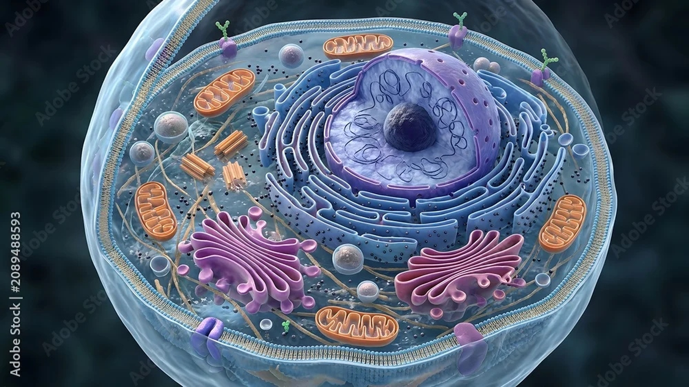
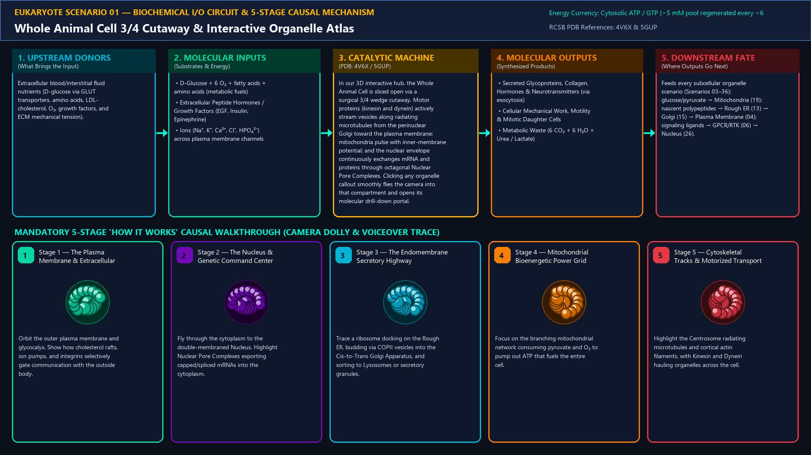
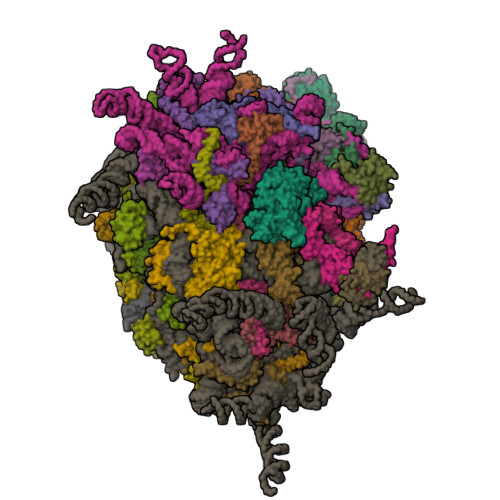
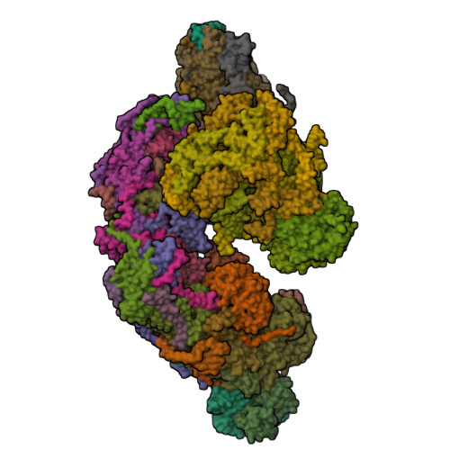
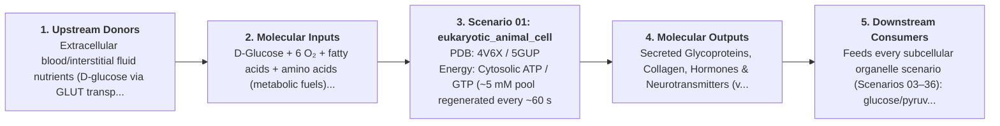

# Scenario 01 — Whole Animal Cell 3/4 Cutaway & Interactive Organelle Atlas

> **Roadmap Tier:** Tier 1 — Macro-Scale Whole-Cell Overviews ($10\text{--}100\,\mu\text{m}$)  
> **Scenario ID:** `01_eukaryotic_animal_cell`  
> **Biophysical Scale:** 20 µm × 15 µm (Volume ~ 4,000 µm³)  
> **Functional Category:** Macro-Scale Compartmentalized Eukaryotic Cell  
> **Primary RCSB PDB Structures:** [`4V6X`](https://www.rcsb.org/structure/4V6X) (Human 80S Ribosome Cryo-EM (4V6X)) · [`5GUP`](https://www.rcsb.org/structure/5GUP) (Human Nuclear Pore Complex Scaffold (5GUP))

---

## 1. Visual & Artistic Representations (Manual Verification Reference Plates)

The following four visual reference plates are stored directly inside this folder (`./`) so you can inspect both the **expected 3D scene decomposition**, the **biochemical I/O circuit & 5-stage mechanism**, and the **experimental cryo-EM / X-ray structures** during manual verification:

### 1.1 Expected 3D Scene & Subunit Decomposition Blueprint (`expected_eukaryotic_animal_cell.png`)

### 1.2 Biochemical I/O Circuit & 5-Stage Causal Mechanism (`mechanism_eukaryotic_animal_cell.png`)

### 1.3 Experimental RCSB PDB Structural References (`rcsb_4V6X.jpg` & `rcsb_5GUP.jpg`)
| Primary Structure [`4V6X`](https://www.rcsb.org/structure/4V6X) | Companion / Partner Structure [`5GUP`](https://www.rcsb.org/structure/5GUP) |
| :---: | :---: |
|  |  |
| **Human 80S Ribosome Cryo-EM (4V6X)** | **Human Nuclear Pore Complex Scaffold (5GUP)** |

---

## 2. Biophysical & Molecular Behavior Overview

Unlike a prokaryotic cell where transcription, translation, and metabolism occur in a single shared cytoplasmic compartment, the eukaryotic animal cell is a ~20 µm metropolis partitioned into specialized membrane-bound organelles. A cholesterol-stiffened plasma membrane encloses the cytosol, while the double-membraned Nucleus sequesters the linear chromosomal genome, the Endoplasmic Reticulum (ER) and Golgi Apparatus form a continuous secretory assembly line, Mitochondria generate ATP via oxidative phosphorylation, Lysosomes and Peroxisomes handle acidic recycling and peroxide detoxification, and a three-polymer Cytoskeleton (actin, microtubules, intermediate filaments) provides mechanical architecture and motorized highway tracks.

### How It Behaves in the Interactive 3D Scene
In our 3D interactive hub, the Whole Animal Cell is sliced open via a surgical 3/4 wedge cutaway. Motor proteins (kinesin and dynein) actively stream vesicles along radiating microtubules from the perinuclear Golgi toward the plasma membrane; mitochondria pulse with inner-membrane potential; and the nuclear envelope continuously exchanges mRNA and proteins through octagonal Nuclear Pore Complexes. Clicking any organelle callout smoothly flies the camera into that compartment and opens its molecular drill-down portal.

---

## 3. Complete Biochemical I/O & Inter-Element Iteration

This section defines **what brings the input** to this machine (*Upstream Donors*), **what goes in** (*Molecular Inputs*), **what it makes** (*Molecular Outputs*), and **how it iterates with downstream systems** (*Downstream Consumers*):

- **Upstream Donors (What Brings the Input):**  
  Extracellular blood/interstitial fluid nutrients (D-glucose via GLUT transporters, amino acids, LDL-cholesterol, O₂, growth factors, and ECM mechanical tension).
- **Molecular Inputs (Substrates, Signals & Co-Factors):**
  - D-Glucose + 6 O₂ + fatty acids + amino acids (metabolic fuels)
  - Extracellular Peptide Hormones / Growth Factors (EGF, Insulin, Epinephrine)
  - Ions (Na⁺, K⁺, Ca²⁺, Cl⁻, HPO₄²⁻) across plasma membrane channels
- **Molecular Outputs (Synthesized / Translocated Products):**
  - Secreted Glycoproteins, Collagen, Hormones & Neurotransmitters (via exocytosis)
  - Cellular Mechanical Work, Motility & Mitotic Daughter Cells
  - Metabolic Waste (6 CO₂ + 6 H₂O + Urea / Lactate)
- **Downstream Consumers & Cross-Element Iteration:**  
  Feeds every subcellular organelle scenario (Scenarios 03–36): glucose/pyruvate → Mitochondria (19); nascent polypeptides → Rough ER (13) → Golgi (15) → Plasma Membrane (04); signaling ligands → GPCR/RTK (06) → Nucleus (26).
- **Thermodynamic Energy Currency:** `Cytosolic ATP / GTP (~5 mM pool regenerated every ~60 seconds by Mitochondria) + Plasma Membrane ΔΨ (-70 mV)`
- **Biophysical Turnover / Kinetics ($k_{\text{cat}}$):** `~2 × 10⁹ ATP molecules hydrolyzed and resynthesized per second per cell`

---

## 4. 3D Subunit Decomposition (`Piece_<ID>_*`) & Color Taxonomy

To support continuous **Exploded View (`setExplodedProgress(0.0 → 1.0)`)**, raycast hover inspection, and subpill lock-on targeting, this scenario is decomposed into **6 functional 3D submeshes**:

| # | 3D Submesh ID (`Piece_*`) | Biological & Structural Role | RCSB PDB / Chain Source | Color Taxonomy (`#Hex`) | Exploded Vector $\vec{v}_{\text{dissoc}}$ |
| :--- | :--- | :--- | :--- | :--- | :--- |
| **1** | `Piece_Cell_PlasmaMembrane` | Plasma Membrane & Microvilli Cutaway Shell | `Lipid Bilayer + Glycocalyx` | `#06D6A0` (Inner/Plasma Membrane Jade) | `(0.0, -4.0, -6.0)` |
| **2** | `Piece_Cell_Nucleus` | Double-Membraned Nucleus, Lamina & Nucleolus | `5GUP / 1AOI Chromatin Core` | `#7209B7` (Nuclear Royal Purple) | `(0.0, +4.5, 0.0)` |
| **3** | `Piece_Cell_RoughSmoothER` | Perinuclear Rough & Smooth Endoplasmic Reticulum | `6W6L Sec61 + Sheet/Tubule Mesh` | `#00B4D8` (Endomembrane Cerulean) | `(-5.0, +2.0, +3.0)` |
| **4** | `Piece_Cell_GolgiStack` | Golgi Apparatus Cis–Medial–Trans Ribbon | `Cisternal Stack + COP Vesicles` | `#F77F00` (Golgi Warm Amber) | `(-6.5, -1.5, +4.5)` |
| **5** | `Piece_Cell_Mitochondria` | Mitochondrial Network (Cristae & Matrix) | `5XTE / 6ZSC Respirasome` | `#E63946` (Bioenergetic Crimson) | `(+6.0, +1.5, +3.5)` |
| **6** | `Piece_Cell_LysosomePeroxisome` | Lysosomes (pH 4.5) & Peroxisomes | `6WM2 V-ATPase + 1DGF Catalase` | `#FFB703` (Catalytic Gold) | `(+5.5, -3.0, +4.0)` |
| **7** | `Piece_Cell_CytoskeletonCentrosome` | Centrosome (9×3 Centrioles), Microtubules & Actin Cortex | `6U42 γ-TuRC + 3J8Y Tubulin` | `#3A86FF` (Cytoskeletal Cobalt Blue) | `(+2.5, +5.5, -4.5)` |

---

## 5. Interactive HUD Simulation Controls (`iterationControls`)

| Control ID | HUD Label | Biophysical Permutations & Interactive Behavior |
| :--- | :--- | :--- |
| `cutaway_depth` | **Envelope & Organelle Cutaway Peel** | 0% to 100% (peels plasma membrane, cortex, ER, and nuclear envelope) |
| `metabolic_flux_speed` | **Vesicle Trafficking & ATP Flux Speed** | 0.0x to 3.0x real-time cytoplasmic streaming |
| `highlight_system` | **Organelle System Filter** | All · Genetic (Nucleus/Ribosomes) · Secretory (ER/Golgi/Lysosome) · Bioenergetic (Mitochondria) · Cytoskeleton |

---

## 6. Mandatory 5-Stage "How It Works" Explanatory Trace

- **Stage 1 — The Plasma Membrane & Extracellular Interface:** Orbit the outer plasma membrane and glycocalyx. Show how cholesterol rafts, ion pumps, and integrins selectively gate communication with the outside body.
- **Stage 2 — The Nucleus & Genetic Command Center:** Fly through the cytoplasm to the double-membraned Nucleus. Highlight Nuclear Pore Complexes exporting capped/spliced mRNAs into the cytoplasm.
- **Stage 3 — The Endomembrane Secretory Highway:** Trace a ribosome docking on the Rough ER, budding via COPII vesicles into the Cis-to-Trans Golgi Apparatus, and sorting to Lysosomes or secretory granules.
- **Stage 4 — Mitochondrial Bioenergetic Power Grid:** Focus on the branching mitochondrial network consuming pyruvate and O₂ to pump out ATP that fuels the entire cell.
- **Stage 5 — Cytoskeletal Tracks & Motorized Transport:** Highlight the Centrosome radiating microtubules and cortical actin filaments, with Kinesin and Dynein hauling organelles across the cell.

---

## 7. Curated Online Resources & Structural References

- [NCBI Bookshelf — Molecular Biology of the Cell (Alberts): Visualizing Cells](https://www.ncbi.nlm.nih.gov/books/NBK26857/)
- [RCSB PDB-101 — Cellular Landscapes by David Goodsell](https://pdb101.rcsb.org/sci-art/goodsell-gallery)
- [Allen Institute for Cell Science — 3D Cell Viewer](https://www.allencell.org/3d-cell-viewer.html)
- [RCSB PDB Structure 4V6X — Human 80S Ribosome](https://www.rcsb.org/structure/4V6X)
