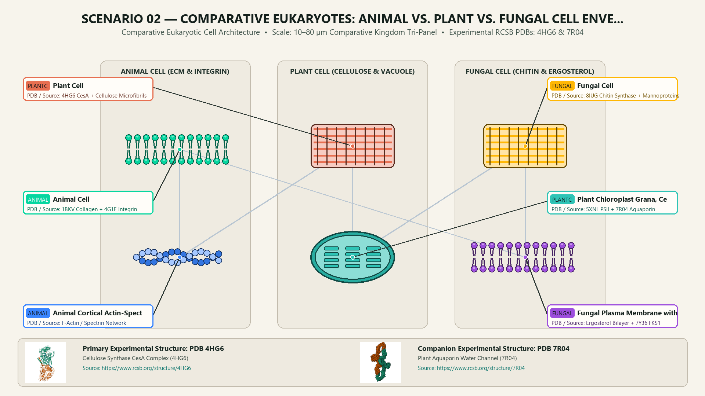
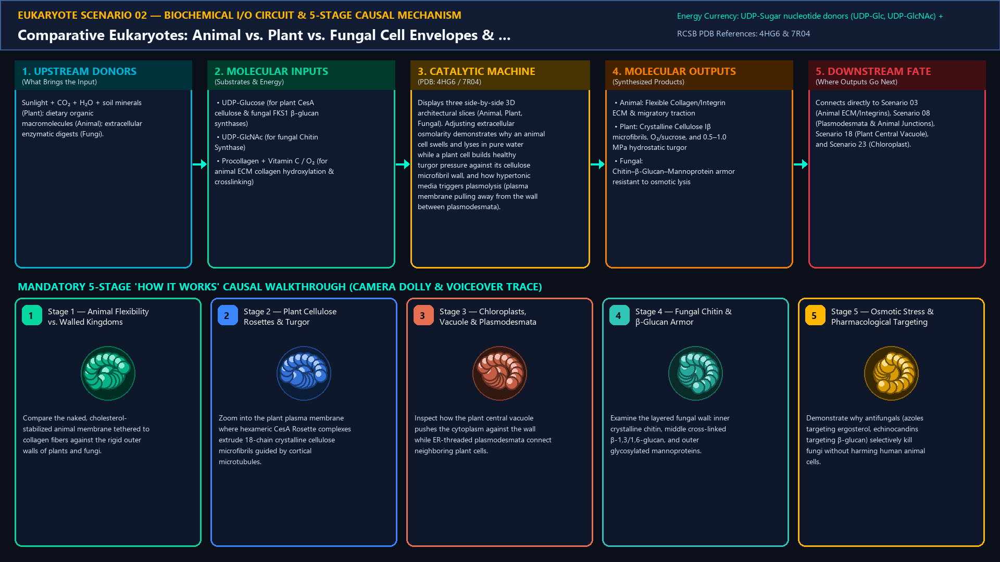
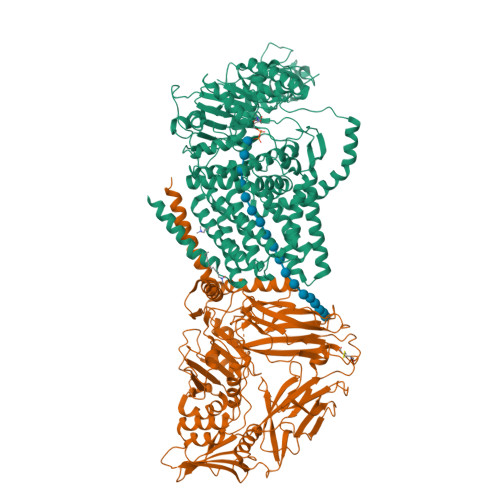
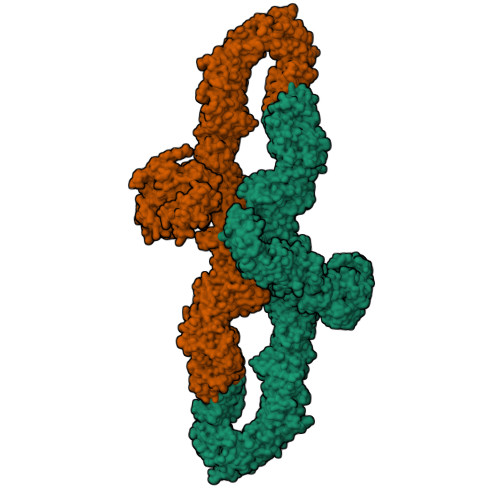
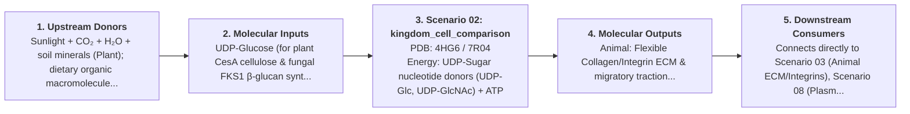
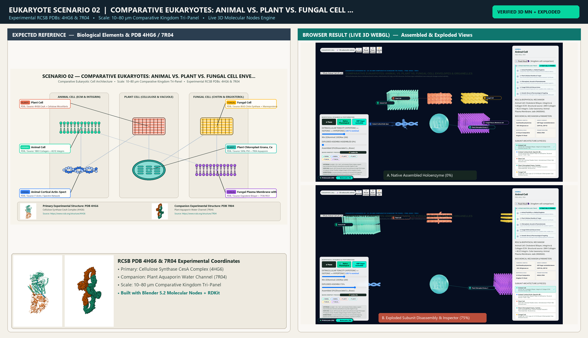

# Scenario 02 — Comparative Eukaryotes: Animal vs. Plant vs. Fungal Cell Envelopes & Organelles

> **Roadmap Tier:** Tier 1 — Macro-Scale Whole-Cell Overviews ($10\text{--}100\,\mu\text{m}$)  
> **Scenario ID:** `02_kingdom_cell_comparison`  
> **Biophysical Scale:** 10–80 µm Comparative Kingdom Tri-Panel  
> **Functional Category:** Comparative Eukaryotic Cell Architecture  
> **Primary RCSB PDB Structures:** [`4HG6`](https://www.rcsb.org/structure/4HG6) (Cellulose Synthase CesA Complex (4HG6)) · [`7R04`](https://www.rcsb.org/structure/7R04) (Plant Aquaporin Water Channel (7R04))

---

## 1. Visual & Artistic Representations (Manual Verification Reference Plates)

The following four visual reference plates are stored directly inside this folder (`./`) so you can inspect both the **expected 3D scene decomposition**, the **biochemical I/O circuit & 5-stage mechanism**, and the **experimental cryo-EM / X-ray structures** during manual verification:

### 1.1 Expected 3D Scene & Subunit Decomposition Blueprint (`expected_kingdom_cell_comparison.png`)

### 1.2 Biochemical I/O Circuit & 5-Stage Causal Mechanism (`mechanism_kingdom_cell_comparison.png`)

### 1.3 Experimental RCSB PDB Structural References (`rcsb_4HG6.jpg` & `rcsb_7R04.jpg`)
| Primary Structure [`4HG6`](https://www.rcsb.org/structure/4HG6) | Companion / Partner Structure [`7R04`](https://www.rcsb.org/structure/7R04) |
| :---: | :---: |
|  |  |
| **Cellulose Synthase CesA Complex (4HG6)** | **Plant Aquaporin Water Channel (7R04)** |

---

## 2. Biophysical & Molecular Behavior Overview

While all eukaryotes share a membrane-bound nucleus, mitochondria, ER, Golgi, and 80S ribosomes, the three major multicellular/crown eukaryotic lineages evolved radically different outer envelopes and specialized organelles to match their lifestyles: (1) Animal cells lack a cell wall, relying on a flexible cholesterol-rich membrane tethered to an extracellular collagen/fibronectin matrix via integrins for motility and phagocytosis; (2) Plant cells encase themselves in a rigid crystalline Cellulose + Hemicellulose + Pectin cell wall pierced by cytoplasmic Plasmodesmata bridges, powered by photosynthetic Chloroplasts and inflated by a central Turgor Vacuole occupying up to 80% of cell volume; (3) Fungal cells build a tough cross-linked β-(1,3)/β-(1,6)-Glucan and Chitin cell wall over an Ergosterol-stiffened plasma membrane.

### How It Behaves in the Interactive 3D Scene
Displays three side-by-side 3D architectural slices (Animal, Plant, Fungal). Adjusting extracellular osmolarity demonstrates why an animal cell swells and lyses in pure water while a plant cell builds healthy turgor pressure against its cellulose microfibril wall, and how hypertonic media triggers plasmolysis (plasma membrane pulling away from the wall between plasmodesmata).

---

## 3. Complete Biochemical I/O & Inter-Element Iteration

This section defines **what brings the input** to this machine (*Upstream Donors*), **what goes in** (*Molecular Inputs*), **what it makes** (*Molecular Outputs*), and **how it iterates with downstream systems** (*Downstream Consumers*):

- **Upstream Donors (What Brings the Input):**  
  Sunlight + CO₂ + H₂O + soil minerals (Plant); dietary organic macromolecules (Animal); extracellular enzymatic digests (Fungi).
- **Molecular Inputs (Substrates, Signals & Co-Factors):**
  - UDP-Glucose (for plant CesA cellulose & fungal FKS1 β-glucan synthases)
  - UDP-GlcNAc (for fungal Chitin Synthase)
  - Procollagen + Vitamin C / O₂ (for animal ECM collagen hydroxylation & crosslinking)
- **Molecular Outputs (Synthesized / Translocated Products):**
  - Animal: Flexible Collagen/Integrin ECM & migratory traction
  - Plant: Crystalline Cellulose Iβ microfibrils, O₂/sucrose, and 0.5–1.0 MPa hydrostatic turgor
  - Fungal: Chitin–β-Glucan–Mannoprotein armor resistant to osmotic lysis
- **Downstream Consumers & Cross-Element Iteration:**  
  Connects directly to Scenario 03 (Animal ECM/Integrins), Scenario 08 (Plasmodesmata & Animal Junctions), Scenario 18 (Plant Central Vacuole), and Scenario 23 (Chloroplast).
- **Thermodynamic Energy Currency:** `UDP-Sugar nucleotide donors (UDP-Glc, UDP-GlcNAc) + ATP + Osmotic Water Potential (Ψw = Ψs + Ψp)`
- **Biophysical Turnover / Kinetics ($k_{\text{cat}}$):** `CesA Rosette polymerizes ~300–500 glucose units/min per cellulose strand`

---

## 4. 3D Subunit Decomposition (`Piece_<ID>_*`) & Color Taxonomy

To support continuous **Exploded View (`setExplodedProgress(0.0 → 1.0)`)**, raycast hover inspection, and subpill lock-on targeting, this scenario is decomposed into **6 functional 3D submeshes**:

| # | 3D Submesh ID (`Piece_*`) | Biological & Structural Role | RCSB PDB / Chain Source | Color Taxonomy (`#Hex`) | Exploded Vector $\vec{v}_{\text{dissoc}}$ |
| :--- | :--- | :--- | :--- | :--- | :--- |
| **1** | `Piece_King_AnimalECM` | Animal Cell: Cholesterol Bilayer, Integrins & Collagen ECM | `1BKV Collagen + 4G1E Integrin` | `#06D6A0` (Animal Plasma Membrane Jade) | `(-7.0, +3.0, 0.0)` |
| **2** | `Piece_King_AnimalCortex` | Animal Cortical Actin-Spectrin Mesh & Centrosome | `F-Actin / Spectrin Network` | `#3A86FF` (Cortical Blue) | `(-7.0, -3.5, 0.0)` |
| **3** | `Piece_King_PlantCellWall` | Plant Cell: Cellulose Rosette (CesA), Hemicellulose & Pectin Wall | `4HG6 CesA + Cellulose Microfibrils` | `#E76F51` (Cell Wall Terracotta) | `(0.0, +4.0, 0.0)` |
| **4** | `Piece_King_PlantChloroVacuole` | Plant Chloroplast Grana, Central Tonoplast Vacuole & Plasmodesmata | `5XNL PSII + 7R04 Aquaporin` | `#2EC4B6` (Photosynthetic Teal) | `(0.0, -3.5, 0.0)` |
| **5** | `Piece_King_FungalChitinWall` | Fungal Cell: Chitin Layer, β-1,3/1,6-Glucan & Mannoprotein Coat | `8IUG Chitin Synthase + Mannoproteins` | `#FFB703` (Chitin Amber Gold) | `(+7.0, +4.0, 0.0)` |
| **6** | `Piece_King_FungalErgosterolPM` | Fungal Plasma Membrane with Ergosterol & FKS1 Synthase | `Ergosterol Bilayer + 7Y36 FKS1` | `#9D4EDD` (Fungal Violet) | `(+7.0, -3.5, 0.0)` |

---

## 5. Interactive HUD Simulation Controls (`iterationControls`)

| Control ID | HUD Label | Biophysical Permutations & Interactive Behavior |
| :--- | :--- | :--- |
| `osmotic_tonicity` | **Extracellular Tonicity (Hypotonic ↔ Isotonic ↔ Hypertonic)** | -1.0 (Hypotonic Lysis/Turgor) to +1.0 (Hypertonic Crenation/Plasmolysis) |
| `kingdom_focus` | **Kingdom Spotlight** | All Three · Animal (ECM) · Plant (Cellulose/Vacuole) · Fungal (Chitin/Ergosterol) |
| `antifungal_echinocandin` | **Cell-Wall Inhibitor Toggle** | Simulates Echinocandin (blocks Fungal β-glucan) or Isoxaben (blocks Plant Cellulose) |

---

## 6. Mandatory 5-Stage "How It Works" Explanatory Trace

- **Stage 1 — Animal Flexibility vs. Walled Kingdoms:** Compare the naked, cholesterol-stabilized animal membrane tethered to collagen fibers against the rigid outer walls of plants and fungi.
- **Stage 2 — Plant Cellulose Rosettes & Turgor:** Zoom into the plant plasma membrane where hexameric CesA Rosette complexes extrude 18-chain crystalline cellulose microfibrils guided by cortical microtubules.
- **Stage 3 — Chloroplasts, Vacuole & Plasmodesmata:** Inspect how the plant central vacuole pushes the cytoplasm against the wall while ER-threaded plasmodesmata connect neighboring plant cells.
- **Stage 4 — Fungal Chitin & β-Glucan Armor:** Examine the layered fungal wall: inner crystalline chitin, middle cross-linked β-1,3/1,6-glucan, and outer glycosylated mannoproteins.
- **Stage 5 — Osmotic Stress & Pharmacological Targeting:** Demonstrate why antifungals (azoles targeting ergosterol, echinocandins targeting β-glucan) selectively kill fungi without harming human animal cells.

---

## 7. Curated Online Resources & Structural References

- [NCBI Bookshelf — Molecular Biology of the Cell: The Plant Cell Wall](https://www.ncbi.nlm.nih.gov/books/NBK26928/)
- [RCSB PDB Structure 4HG6 — Cellulose Synthase Complex](https://www.rcsb.org/structure/4HG6)
- [RCSB PDB-101 — Molecule of the Month: Cellulose Synthase](https://pdb101.rcsb.org/motm/242)
- [Nature Reviews Microbiology — Architecture of the Fungal Cell Wall](https://www.nature.com/articles/nrmicro.2017.109)

## 12. 3D Implementation & Visual Verification Assets

- **Status:** `[x] Implemented, Exported to 3D GLB & Visually Verified`
- **3D Model Asset (`.glb`):** [`kingdom_cell_comparison.glb`](./kingdom_cell_comparison.glb) (also mirrored in `eukaryote/models/kingdom_cell_comparison.glb` and `client/public/eukaryote/models/kingdom_cell_comparison.glb`)
- **Blender 5.2 + Molecular Nodes Generator Script:** [`generate_02_kingdom_cell_comparison.py`](./generate_02_kingdom_cell_comparison.py)
- **Live WebGL Assembled Capture (`0%`):** [`browser_kingdom_cell_comparison_assembled.png`](../../verification/02_kingdom_cell_comparison/browser_kingdom_cell_comparison_assembled.png)
- **Live WebGL Exploded Capture (`75%`):** [`browser_kingdom_cell_comparison_exploded.png`](../../verification/02_kingdom_cell_comparison/browser_kingdom_cell_comparison_exploded.png)
- **Side-by-Side Input vs. Output Comparison Plate (`2400×1380`):** [`comparison_kingdom_cell_comparison.png`](../../verification/02_kingdom_cell_comparison/comparison_kingdom_cell_comparison.png)
- **Animated Side-by-Side Comparison Video (`1920×1080 MP4`):** [`comparison_kingdom_cell_comparison.mp4`](../../verification/02_kingdom_cell_comparison/comparison_kingdom_cell_comparison.mp4)

