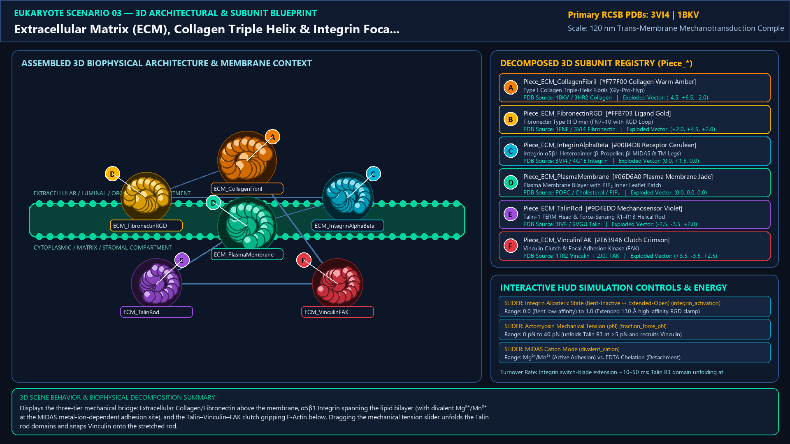
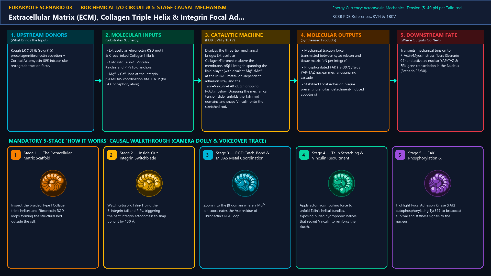
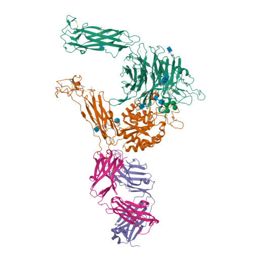
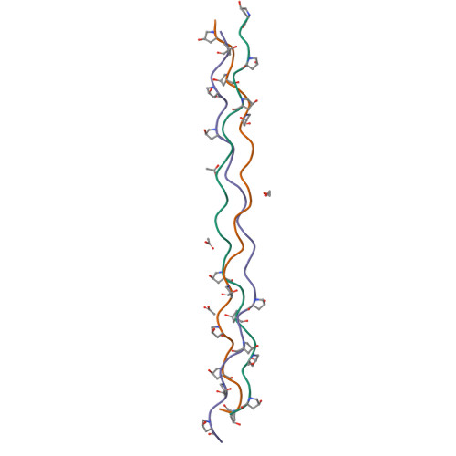
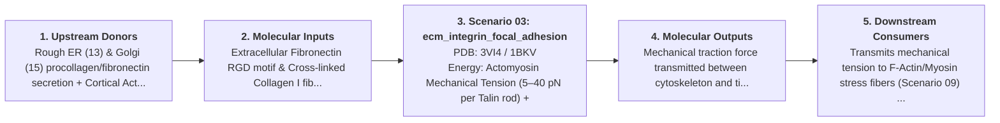
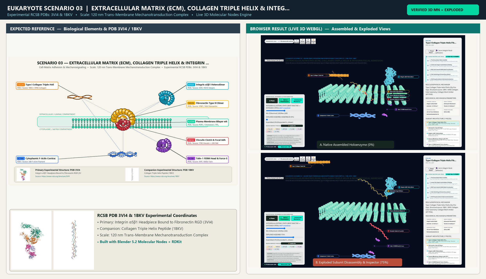

# Scenario 03 — Extracellular Matrix (ECM), Collagen Triple Helix & Integrin Focal Adhesion

> **Roadmap Tier:** Tier 2 — Cell Surface, ECM & Plasma Membrane ($10\text{--}200\,\text{nm}$)  
> **Scenario ID:** `03_ecm_integrin_focal_adhesion`  
> **Biophysical Scale:** 120 nm Trans-Membrane Mechanotransduction Complex  
> **Functional Category:** Cell-Matrix Adhesion & Mechanosignaling  
> **Primary RCSB PDB Structures:** [`3VI4`](https://www.rcsb.org/structure/3VI4) (Integrin α5β1 Headpiece Bound to Fibronectin RGD (3VI4)) · [`1BKV`](https://www.rcsb.org/structure/1BKV) (Collagen Triple Helix Peptide (1BKV))

---

## 1. Visual & Artistic Representations (Manual Verification Reference Plates)

The following four visual reference plates are stored directly inside this folder (`./`) so you can inspect both the **expected 3D scene decomposition**, the **biochemical I/O circuit & 5-stage mechanism**, and the **experimental cryo-EM / X-ray structures** during manual verification:

### 1.1 Expected 3D Scene & Subunit Decomposition Blueprint (`expected_ecm_integrin_focal_adhesion.png`)

### 1.2 Biochemical I/O Circuit & 5-Stage Causal Mechanism (`mechanism_ecm_integrin_focal_adhesion.png`)

### 1.3 Experimental RCSB PDB Structural References (`rcsb_3VI4.jpg` & `rcsb_1BKV.jpg`)
| Primary Structure [`3VI4`](https://www.rcsb.org/structure/3VI4) | Companion / Partner Structure [`1BKV`](https://www.rcsb.org/structure/1BKV) |
| :---: | :---: |
|  |  |
| **Integrin α5β1 Headpiece Bound to Fibronectin RGD (3VI4)** | **Collagen Triple Helix Peptide (1BKV)** |

---

## 2. Biophysical & Molecular Behavior Overview

Animal cells weave an intricate Extracellular Matrix (ECM) dominated by Type I/IV Collagen triple helices (Gly-X-Y repeats with hydroxyproline), elastic Fibronectin dimers, and hydrated Proteoglycan glycosaminoglycan brushes. Across the plasma membrane, heterodimeric α/β Integrins act as two-way allosteric mechanical clutches: in their resting bent-closed state they have low affinity, but upon inside-out Talin binding (or outside-in binding to the Arg-Gly-Asp [RGD] loop of Fibronectin), the Integrin legs swing open by 130 Å. Inside the cell, tensile force unfolds α-helical bundles in Talin, exposing cryptic binding sites that recruit Vinculin, Paxillin, and Focal Adhesion Kinase (FAK) to lock onto contractile F-actin stress fibers.

### How It Behaves in the Interactive 3D Scene
Displays the three-tier mechanical bridge: Extracellular Collagen/Fibronectin above the membrane, α5β1 Integrin spanning the lipid bilayer (with divalent Mg²⁺/Mn²⁺ at the MIDAS metal-ion-dependent adhesion site), and the Talin–Vinculin–FAK clutch gripping F-Actin below. Dragging the mechanical tension slider unfolds the Talin rod domains and snaps Vinculin onto the stretched rod.

---

## 3. Complete Biochemical I/O & Inter-Element Iteration

This section defines **what brings the input** to this machine (*Upstream Donors*), **what goes in** (*Molecular Inputs*), **what it makes** (*Molecular Outputs*), and **how it iterates with downstream systems** (*Downstream Consumers*):

- **Upstream Donors (What Brings the Input):**  
  Rough ER (13) & Golgi (15) procollagen/fibronectin secretion + Cortical Actomyosin (09) intracellular retrograde traction force.
- **Molecular Inputs (Substrates, Signals & Co-Factors):**
  - Extracellular Fibronectin RGD motif & Cross-linked Collagen I fibrils
  - Cytosolic Talin-1, Vinculin, Kindlin, and PIP₂ lipid anchors
  - Mg²⁺ / Ca²⁺ ions at the Integrin β-I MIDAS coordination site + ATP (for FAK phosphorylation)
- **Molecular Outputs (Synthesized / Translocated Products):**
  - Mechanical traction force transmitted between cytoskeleton and tissue matrix (pN per integrin)
  - Phosphorylated FAK (Tyr397) / Src / YAP-TAZ nuclear mechanosignaling cascade
  - Stabilized Focal Adhesion plaque preventing anoikis (detachment-induced apoptosis)
- **Downstream Consumers & Cross-Element Iteration:**  
  Transmits mechanical tension to F-Actin/Myosin stress fibers (Scenario 09) and activates nuclear YAP/TAZ & ERK gene transcription in the Nucleus (Scenario 26/30).
- **Thermodynamic Energy Currency:** `Actomyosin Mechanical Tension (5–40 pN per Talin rod) + ATP (Focal Adhesion Kinase autophosphorylation)`
- **Biophysical Turnover / Kinetics ($k_{\text{cat}}$):** `Integrin switch-blade extension ~10–50 ms; Talin R3 domain unfolding at ~5 pN force threshold`

---

## 4. 3D Subunit Decomposition (`Piece_<ID>_*`) & Color Taxonomy

To support continuous **Exploded View (`setExplodedProgress(0.0 → 1.0)`)**, raycast hover inspection, and subpill lock-on targeting, this scenario is decomposed into **6 functional 3D submeshes**:

| # | 3D Submesh ID (`Piece_*`) | Biological & Structural Role | RCSB PDB / Chain Source | Color Taxonomy (`#Hex`) | Exploded Vector $\vec{v}_{\text{dissoc}}$ |
| :--- | :--- | :--- | :--- | :--- | :--- |
| **1** | `Piece_ECM_CollagenFibril` | Type I Collagen Triple-Helix Fibrils (Gly-Pro-Hyp) | `1BKV / 3HR2 Collagen` | `#F77F00` (Collagen Warm Amber) | `(-4.5, +6.5, -2.0)` |
| **2** | `Piece_ECM_FibronectinRGD` | Fibronectin Type III Dimer (FN7–10 with RGD Loop) | `1FNF / 3VI4 Fibronectin` | `#FFB703` (Ligand Gold) | `(+2.0, +4.5, +2.0)` |
| **3** | `Piece_ECM_IntegrinAlphaBeta` | Integrin α5β1 Heterodimer (β-Propeller, βI MIDAS & TM Legs) | `3VI4 / 4G1E Integrin` | `#00B4D8` (Receptor Cerulean) | `(0.0, +1.5, 0.0)` |
| **4** | `Piece_ECM_PlasmaMembrane` | Plasma Membrane Bilayer with PIP₂ Inner Leaflet Patch | `POPC / Cholesterol / PIP₂` | `#06D6A0` (Plasma Membrane Jade) | `(0.0, 0.0, 0.0)` |
| **5** | `Piece_ECM_TalinRod` | Talin-1 FERM Head & Force-Sensing R1–R13 Helical Rod | `3IVF / 6VGU Talin` | `#9D4EDD` (Mechanosensor Violet) | `(-2.5, -3.5, +2.0)` |
| **6** | `Piece_ECM_VinculinFAK` | Vinculin Clutch & Focal Adhesion Kinase (FAK) | `1TR2 Vinculin + 2J0J FAK` | `#E63946` (Clutch Crimson) | `(+3.5, -3.5, +2.5)` |
| **7** | `Piece_ECM_ActinStressFiber` | Cytoplasmic F-Actin Contractile Stress Fiber | `3J8I F-Actin Filament` | `#3A86FF` (Actin Cobalt Blue) | `(0.0, -6.5, -2.0)` |

---

## 5. Interactive HUD Simulation Controls (`iterationControls`)

| Control ID | HUD Label | Biophysical Permutations & Interactive Behavior |
| :--- | :--- | :--- |
| `integrin_activation` | **Integrin Allosteric State (Bent-Inactive ↔ Extended-Open)** | 0.0 (Bent low-affinity) to 1.0 (Extended 130 Å high-affinity RGD clamp) |
| `traction_force_pN` | **Actomyosin Mechanical Tension (pN)** | 0 pN to 40 pN (unfolds Talin R3 at >5 pN and recruits Vinculin) |
| `divalent_cation` | **MIDAS Cation Mode** | Mg²⁺/Mn²⁺ (Active Adhesion) vs. EDTA Chelation (Detachment) |

---

## 6. Mandatory 5-Stage "How It Works" Explanatory Trace

- **Stage 1 — The Extracellular Matrix Scaffold:** Inspect the braided Type I Collagen triple helices and Fibronectin RGD loops forming the structural bed outside the cell.
- **Stage 2 — Inside-Out Integrin Switchblade Unfolding:** Watch cytosolic Talin-1 bind the β-integrin tail and PIP₂, triggering the bent integrin ectodomain to snap upright by 130 Å.
- **Stage 3 — RGD Catch-Bond & MIDAS Metal Coordination:** Zoom into the βI domain where a Mg²⁺ ion coordinates the Asp residue of Fibronectin's RGD loop.
- **Stage 4 — Talin Stretching & Vinculin Recruitment:** Apply actomyosin pulling force to unfold Talin's helical bundles, exposing buried hydrophobic helices that recruit Vinculin to reinforce the clutch.
- **Stage 5 — FAK Phosphorylation & Mechanotransduction:** Highlight Focal Adhesion Kinase (FAK) autophosphorylating Tyr397 to broadcast survival and stiffness signals to the nucleus.

---

## 7. Curated Online Resources & Structural References

- [RCSB PDB-101 — Molecule of the Month: Integrin](https://pdb101.rcsb.org/motm/134)
- [RCSB PDB-101 — Molecule of the Month: Collagen](https://pdb101.rcsb.org/motm/4)
- [RCSB PDB Structure 3VI4 — Integrin α5β1 Headpiece with RGD](https://www.rcsb.org/structure/3VI4)
- [Nature Reviews Molecular Cell Biology — Integrin Mechanotransduction](https://www.nature.com/articles/nrm.2016.78)

## 12. 3D Implementation & Visual Verification Assets

- **Status:** `[x] Implemented, Exported to 3D GLB & Visually Verified`
- **3D Model Asset (`.glb`):** [`ecm_integrin_focal_adhesion.glb`](./ecm_integrin_focal_adhesion.glb) (also mirrored in `eukaryote/models/ecm_integrin_focal_adhesion.glb` and `client/public/eukaryote/models/ecm_integrin_focal_adhesion.glb`)
- **Blender 5.2 + Molecular Nodes Generator Script:** [`generate_03_ecm_integrin_focal_adhesion.py`](./generate_03_ecm_integrin_focal_adhesion.py)
- **Live WebGL Assembled Capture (`0%`):** [`browser_ecm_integrin_focal_adhesion_assembled.png`](../../verification/03_ecm_integrin_focal_adhesion/browser_ecm_integrin_focal_adhesion_assembled.png)
- **Live WebGL Exploded Capture (`75%`):** [`browser_ecm_integrin_focal_adhesion_exploded.png`](../../verification/03_ecm_integrin_focal_adhesion/browser_ecm_integrin_focal_adhesion_exploded.png)
- **Side-by-Side Input vs. Output Comparison Plate (`2400×1380`):** [`comparison_ecm_integrin_focal_adhesion.png`](../../verification/03_ecm_integrin_focal_adhesion/comparison_ecm_integrin_focal_adhesion.png)
- **Animated Side-by-Side Comparison Video (`1920×1080 MP4`):** [`comparison_ecm_integrin_focal_adhesion.mp4`](../../verification/03_ecm_integrin_focal_adhesion/comparison_ecm_integrin_focal_adhesion.mp4)

