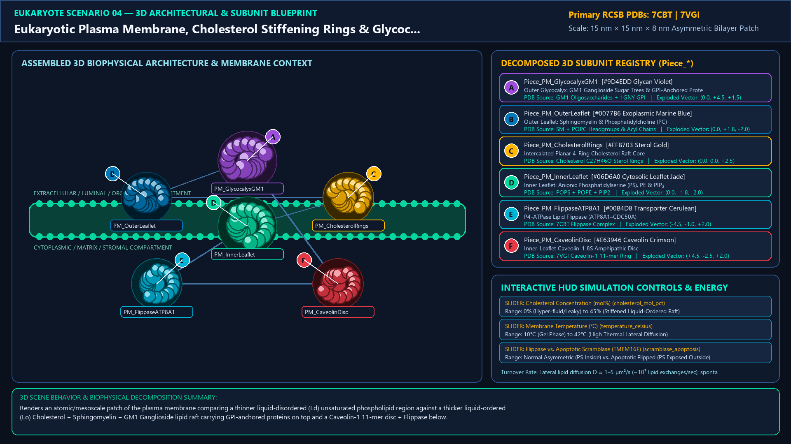
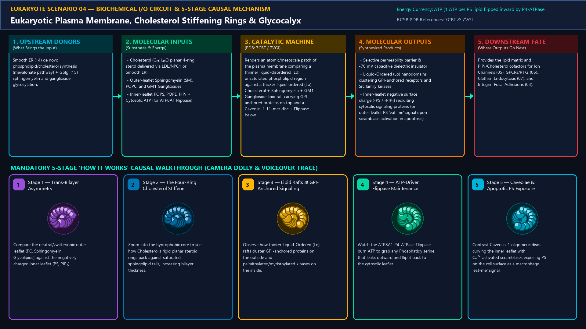
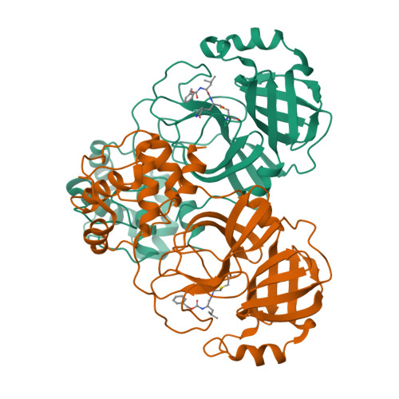
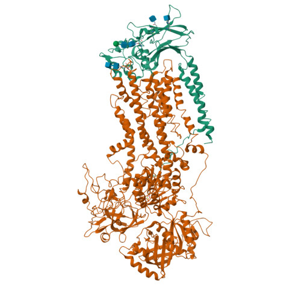
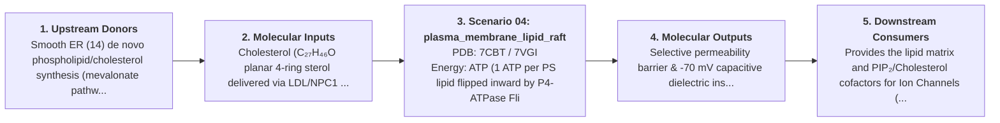
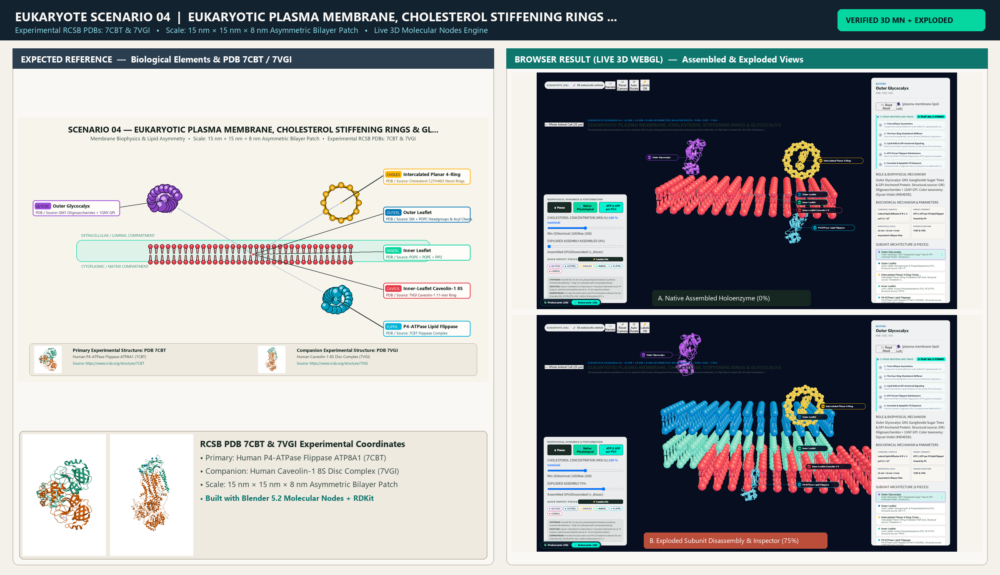

# Scenario 04 — Eukaryotic Plasma Membrane, Cholesterol Stiffening Rings & Glycocalyx

> **Roadmap Tier:** Tier 2 — Cell Surface, ECM & Plasma Membrane ($10\text{--}200\,\text{nm}$)  
> **Scenario ID:** `04_plasma_membrane_lipid_raft`  
> **Biophysical Scale:** 15 nm × 15 nm × 8 nm Asymmetric Bilayer Patch  
> **Functional Category:** Membrane Biophysics & Lipid Asymmetry  
> **Primary RCSB PDB Structures:** [`7CBT`](https://www.rcsb.org/structure/7CBT) (Human P4-ATPase Flippase ATP8A1 (7CBT)) · [`7VGI`](https://www.rcsb.org/structure/7VGI) (Human Caveolin-1 8S Disc Complex (7VGI))

---

## 1. Visual & Artistic Representations (Manual Verification Reference Plates)

The following four visual reference plates are stored directly inside this folder (`./`) so you can inspect both the **expected 3D scene decomposition**, the **biochemical I/O circuit & 5-stage mechanism**, and the **experimental cryo-EM / X-ray structures** during manual verification:

### 1.1 Expected 3D Scene & Subunit Decomposition Blueprint (`expected_plasma_membrane_lipid_raft.png`)

### 1.2 Biochemical I/O Circuit & 5-Stage Causal Mechanism (`mechanism_plasma_membrane_lipid_raft.png`)

### 1.3 Experimental RCSB PDB Structural References (`rcsb_7CBT.jpg` & `rcsb_7VGI.jpg`)
| Primary Structure [`7CBT`](https://www.rcsb.org/structure/7CBT) | Companion / Partner Structure [`7VGI`](https://www.rcsb.org/structure/7VGI) |
| :---: | :---: |
|  |  |
| **Human P4-ATPase Flippase ATP8A1 (7CBT)** | **Human Caveolin-1 8S Disc Complex (7VGI)** |

---

## 2. Biophysical & Molecular Behavior Overview

The eukaryotic plasma membrane is a 5 nm dynamic fluid mosaic distinguished from bacterial membranes by three hallmarks: (1) High Sterol Content (30–40 mol% Cholesterol in animals, Ergosterol in fungi, Sitosterol in plants), whose planar four-ring steroid nucleus intercalates alongside saturated sphingolipid acyl chains to form thicker, liquid-ordered (Lo) Lipid Rafts; (2) Strict Trans-Bilayer Asymmetry maintained by ATP-dependent P4-ATPase Flippases, which keep Sphingomyelin (SM), Phosphatidylcholine (PC), and Ganglioside Glycolipids (GM1) in the outer leaflet while confining negatively charged Phosphatidylserine (PS), Phosphatidylethanolamine (PE), and PIP₂ to the cytosolic leaflet; and (3) a dense outer Glycocalyx carbohydrate canopy.

### How It Behaves in the Interactive 3D Scene
Renders an atomic/mesoscale patch of the plasma membrane comparing a thinner liquid-disordered (Ld) unsaturated phospholipid region against a thicker liquid-ordered (Lo) Cholesterol + Sphingomyelin + GM1 Ganglioside lipid raft carrying GPI-anchored proteins on top and a Caveolin-1 11-mer disc + Flippase below.

---

## 3. Complete Biochemical I/O & Inter-Element Iteration

This section defines **what brings the input** to this machine (*Upstream Donors*), **what goes in** (*Molecular Inputs*), **what it makes** (*Molecular Outputs*), and **how it iterates with downstream systems** (*Downstream Consumers*):

- **Upstream Donors (What Brings the Input):**  
  Smooth ER (14) de novo phospholipid/cholesterol synthesis (mevalonate pathway) + Golgi (15) sphingomyelin and ganglioside glycosylation.
- **Molecular Inputs (Substrates, Signals & Co-Factors):**
  - Cholesterol (C₂₇H₄₆O planar 4-ring sterol delivered via LDL/NPC1 or Smooth ER)
  - Outer-leaflet Sphingomyelin (SM), POPC, and GM1 Gangliosides
  - Inner-leaflet POPS, POPE, PIP₂ + Cytosolic ATP (for ATP8A1 Flippase)
- **Molecular Outputs (Synthesized / Translocated Products):**
  - Selective permeability barrier & -70 mV capacitive dielectric insulator
  - Liquid-Ordered (Lo) nanodomains clustering GPI-anchored receptors and Src family kinases
  - Inner-leaflet negative surface charge (-PS / -PIP₂) recruiting cytosolic signaling proteins (or outer-leaflet PS 'eat-me' signal upon scramblase activation in apoptosis)
- **Downstream Consumers & Cross-Element Iteration:**  
  Provides the lipid matrix and PIP₂/Cholesterol cofactors for Ion Channels (05), GPCRs/RTKs (06), Clathrin Endocytosis (07), and Integrin Focal Adhesions (03).
- **Thermodynamic Energy Currency:** `ATP (1 ATP per PS lipid flipped inward by P4-ATPase Flippase) + Hydrophobic Effect & Van der Waals Sterol Packing`
- **Biophysical Turnover / Kinetics ($k_{\text{cat}}$):** `Lateral lipid diffusion D ≈ 1–5 µm²/s (~10⁷ lipid exchanges/sec); spontaneous flip-flop t₁/₂ > hours without flippase`

---

## 4. 3D Subunit Decomposition (`Piece_<ID>_*`) & Color Taxonomy

To support continuous **Exploded View (`setExplodedProgress(0.0 → 1.0)`)**, raycast hover inspection, and subpill lock-on targeting, this scenario is decomposed into **6 functional 3D submeshes**:

| # | 3D Submesh ID (`Piece_*`) | Biological & Structural Role | RCSB PDB / Chain Source | Color Taxonomy (`#Hex`) | Exploded Vector $\vec{v}_{\text{dissoc}}$ |
| :--- | :--- | :--- | :--- | :--- | :--- |
| **1** | `Piece_PM_GlycocalyxGM1` | Outer Glycocalyx: GM1 Ganglioside Sugar Trees & GPI-Anchored Protein | `GM1 Oligosaccharides + 1GNY GPI` | `#9D4EDD` (Glycan Violet) | `(0.0, +4.5, +1.5)` |
| **2** | `Piece_PM_OuterLeaflet` | Outer Leaflet: Sphingomyelin & Phosphatidylcholine (PC) | `SM + POPC Headgroups & Acyl Chains` | `#0077B6` (Exoplasmic Marine Blue) | `(0.0, +1.8, -2.0)` |
| **3** | `Piece_PM_CholesterolRings` | Intercalated Planar 4-Ring Cholesterol Raft Core | `Cholesterol C27H46O Sterol Rings` | `#FFB703` (Sterol Gold) | `(0.0, 0.0, +2.5)` |
| **4** | `Piece_PM_InnerLeaflet` | Inner Leaflet: Anionic Phosphatidylserine (PS), PE & PIP₂ | `POPS + POPE + PIP2` | `#06D6A0` (Cytosolic Leaflet Jade) | `(0.0, -1.8, -2.0)` |
| **5** | `Piece_PM_FlippaseATP8A1` | P4-ATPase Lipid Flippase (ATP8A1–CDC50A) | `7CBT Flippase Complex` | `#00B4D8` (Transporter Cerulean) | `(-4.5, -1.0, +2.0)` |
| **6** | `Piece_PM_CaveolinDisc` | Inner-Leaflet Caveolin-1 8S Amphipathic Disc | `7VGI Caveolin-1 11-mer Ring` | `#E63946` (Caveolin Crimson) | `(+4.5, -2.5, +2.0)` |

---

## 5. Interactive HUD Simulation Controls (`iterationControls`)

| Control ID | HUD Label | Biophysical Permutations & Interactive Behavior |
| :--- | :--- | :--- |
| `cholesterol_mol_pct` | **Cholesterol Concentration (mol%)** | 0% (Hyper-fluid/Leaky) to 45% (Stiffened Liquid-Ordered Raft) |
| `temperature_celsius` | **Membrane Temperature (°C)** | 10°C (Gel Phase) to 42°C (High Thermal Lateral Diffusion) |
| `scramblase_apoptosis` | **Flippase vs. Apoptotic Scramblase (TMEM16F)** | Normal Asymmetric (PS Inside) vs. Apoptotic Flipped (PS Exposed Outside) |

---

## 6. Mandatory 5-Stage "How It Works" Explanatory Trace

- **Stage 1 — Trans-Bilayer Asymmetry:** Compare the neutral/zwitterionic outer leaflet (PC, Sphingomyelin, Glycolipids) against the negatively charged inner leaflet (PS, PIP₂).
- **Stage 2 — The Four-Ring Cholesterol Stiffener:** Zoom into the hydrophobic core to see how Cholesterol's rigid planar steroid rings pack against saturated sphingolipid tails, increasing bilayer thickness.
- **Stage 3 — Lipid Rafts & GPI-Anchored Signaling:** Observe how thicker Liquid-Ordered (Lo) rafts cluster GPI-anchored proteins on the outside and palmitoylated/myristoylated kinases on the inside.
- **Stage 4 — ATP-Driven Flippase Maintenance:** Watch the ATP8A1 P4-ATPase Flippase burn ATP to grab any Phosphatidylserine that leaks outward and flip it back to the cytosolic leaflet.
- **Stage 5 — Caveolae & Apoptotic PS Exposure:** Contrast Caveolin-1 oligomeric discs curving the inner leaflet with Ca²⁺-activated scramblases exposing PS on the cell surface as a macrophage 'eat-me' signal.

---

## 7. Curated Online Resources & Structural References

- [NCBI Bookshelf — Molecular Biology of the Cell: The Lipid Bilayer](https://www.ncbi.nlm.nih.gov/books/NBK26871/)
- [RCSB PDB Structure 7CBT — Human P4-ATPase Lipid Flippase ATP8A1](https://www.rcsb.org/structure/7CBT)
- [RCSB PDB Structure 7VGI — Human Caveolin-1 8S Complex](https://www.rcsb.org/structure/7VGI)
- [Nature Reviews Molecular Cell Biology — Lipid Rafts & Membrane Organization](https://www.nature.com/articles/nrm.2017.16)

## 12. 3D Implementation & Visual Verification Assets

- **Status:** `[x] Implemented, Exported to 3D GLB & Visually Verified`
- **3D Model Asset (`.glb`):** [`plasma_membrane_lipid_raft.glb`](./plasma_membrane_lipid_raft.glb) (also mirrored in `eukaryote/models/plasma_membrane_lipid_raft.glb` and `client/public/eukaryote/models/plasma_membrane_lipid_raft.glb`)
- **Blender 5.2 + Molecular Nodes Generator Script:** [`generate_04_plasma_membrane_lipid_raft.py`](./generate_04_plasma_membrane_lipid_raft.py)
- **Live WebGL Assembled Capture (`0%`):** [`browser_plasma_membrane_lipid_raft_assembled.png`](../../verification/04_plasma_membrane_lipid_raft/browser_plasma_membrane_lipid_raft_assembled.png)
- **Live WebGL Exploded Capture (`75%`):** [`browser_plasma_membrane_lipid_raft_exploded.png`](../../verification/04_plasma_membrane_lipid_raft/browser_plasma_membrane_lipid_raft_exploded.png)
- **Side-by-Side Input vs. Output Comparison Plate (`2400×1380`):** [`comparison_plasma_membrane_lipid_raft.png`](../../verification/04_plasma_membrane_lipid_raft/comparison_plasma_membrane_lipid_raft.png)
- **Animated Side-by-Side Comparison Video (`1920×1080 MP4`):** [`comparison_plasma_membrane_lipid_raft.mp4`](../../verification/04_plasma_membrane_lipid_raft/comparison_plasma_membrane_lipid_raft.mp4)

