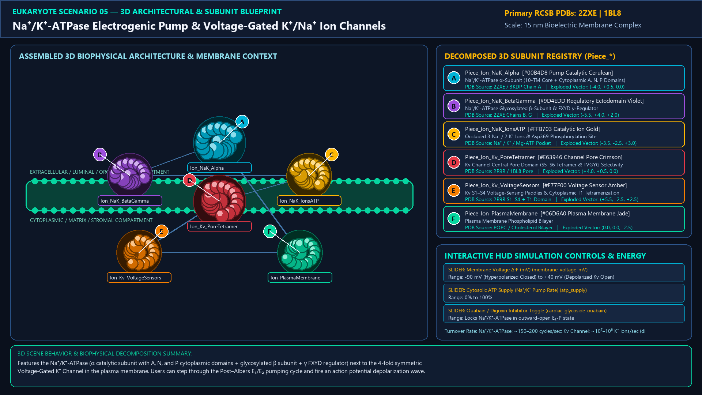
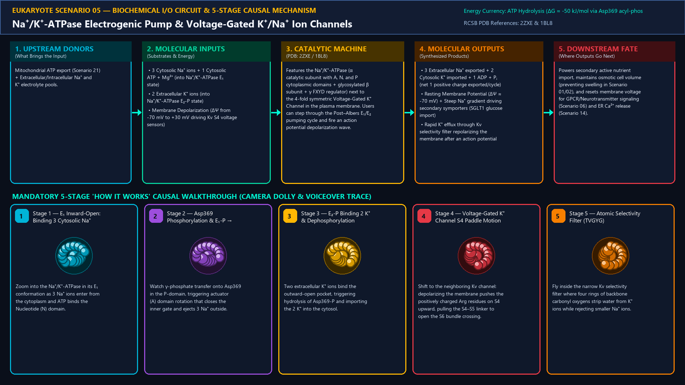
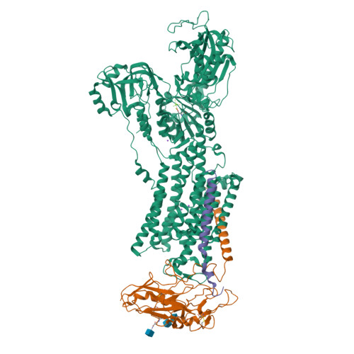
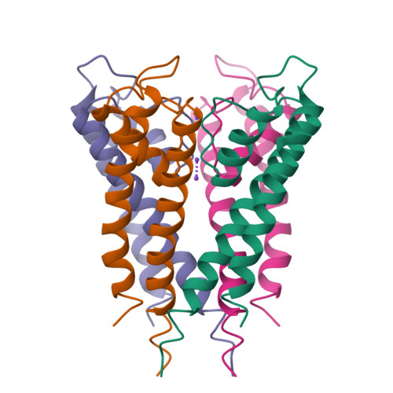
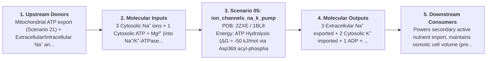

# Scenario 05 — Na⁺/K⁺-ATPase Electrogenic Pump & Voltage-Gated K⁺/Na⁺ Ion Channels

> **Roadmap Tier:** Tier 2 — Cell Surface, ECM & Plasma Membrane ($10\text{--}200\,\text{nm}$)  
> **Scenario ID:** `05_ion_channels_na_k_pump`  
> **Biophysical Scale:** 15 nm Bioelectric Membrane Complex  
> **Functional Category:** Membrane Bioelectricity & Ion Homeostasis  
> **Primary RCSB PDB Structures:** [`2ZXE`](https://www.rcsb.org/structure/2ZXE) (Na⁺/K⁺-ATPase αβγ Pump Complex (2ZXE)) · [`1BL8`](https://www.rcsb.org/structure/1BL8) (K⁺ Channel Selectivity Filter (1BL8 / 2R9R))

---

## 1. Visual & Artistic Representations (Manual Verification Reference Plates)

The following four visual reference plates are stored directly inside this folder (`./`) so you can inspect both the **expected 3D scene decomposition**, the **biochemical I/O circuit & 5-stage mechanism**, and the **experimental cryo-EM / X-ray structures** during manual verification:

### 1.1 Expected 3D Scene & Subunit Decomposition Blueprint (`expected_ion_channels_na_k_pump.png`)

### 1.2 Biochemical I/O Circuit & 5-Stage Causal Mechanism (`mechanism_ion_channels_na_k_pump.png`)

### 1.3 Experimental RCSB PDB Structural References (`rcsb_2ZXE.jpg` & `rcsb_1BL8.jpg`)
| Primary Structure [`2ZXE`](https://www.rcsb.org/structure/2ZXE) | Companion / Partner Structure [`1BL8`](https://www.rcsb.org/structure/1BL8) |
| :---: | :---: |
|  |  |
| **Na⁺/K⁺-ATPase αβγ Pump Complex (2ZXE)** | **K⁺ Channel Selectivity Filter (1BL8 / 2R9R)** |

---

## 2. Biophysical & Molecular Behavior Overview

Every eukaryotic animal cell is an electrical battery (~ -70 mV resting potential) charged by the Na⁺/K⁺-ATPase (Sodium-Potassium Pump), which consumes up to 25% of all human body ATP (and 70% in neurons!). Alternating between its inward-open E₁ state (high affinity for 3 cytosolic Na⁺ + ATP phosphorylation of Asp369) and outward-open E₂-P state (releasing 3 Na⁺ outside, binding 2 extracellular K⁺, and dephosphorylating to import 2 K⁺), it maintains low intracellular Na⁺ (~12 mM vs. 145 mM outside) and high intracellular K⁺ (~140 mM vs. 4 mM outside). Alongside it sits the tetrameric Voltage-Gated K⁺ Channel (Kv), whose four S4 arginine-rich voltage-sensor paddles slide upward upon depolarization to open the intracellular gate, streaming K⁺ ions at 10⁸ ions/sec through the atomic TVGYG carbonyl selectivity filter that perfectly mimics the hydration shell of K⁺ but is too wide to dehydrate Na⁺.

### How It Behaves in the Interactive 3D Scene
Features the Na⁺/K⁺-ATPase (α catalytic subunit with A, N, and P cytoplasmic domains + glycosylated β subunit + γ FXYD regulator) next to the 4-fold symmetric Voltage-Gated K⁺ Channel in the plasma membrane. Users can step through the Post–Albers E₁/E₂ pumping cycle and fire an action potential depolarization wave.

---

## 3. Complete Biochemical I/O & Inter-Element Iteration

This section defines **what brings the input** to this machine (*Upstream Donors*), **what goes in** (*Molecular Inputs*), **what it makes** (*Molecular Outputs*), and **how it iterates with downstream systems** (*Downstream Consumers*):

- **Upstream Donors (What Brings the Input):**  
  Mitochondrial ATP export (Scenario 21) + Extracellular/Intracellular Na⁺ and K⁺ electrolyte pools.
- **Molecular Inputs (Substrates, Signals & Co-Factors):**
  - 3 Cytosolic Na⁺ ions + 1 Cytosolic ATP + Mg²⁺ (into Na⁺/K⁺-ATPase E₁ state)
  - 2 Extracellular K⁺ ions (into Na⁺/K⁺-ATPase E₂-P state)
  - Membrane Depolarization (ΔΨ from -70 mV to +30 mV driving Kv S4 voltage sensors)
- **Molecular Outputs (Synthesized / Translocated Products):**
  - 3 Extracellular Na⁺ exported + 2 Cytosolic K⁺ imported + 1 ADP + Pᵢ (net 1 positive charge exported/cycle)
  - Resting Membrane Potential (ΔΨ ≈ -70 mV) + Steep Na⁺ gradient driving secondary symporters (SGLT1 glucose import)
  - Rapid K⁺ efflux through Kv selectivity filter repolarizing the membrane after an action potential
- **Downstream Consumers & Cross-Element Iteration:**  
  Powers secondary active nutrient import, maintains osmotic cell volume (preventing swelling in Scenario 01/02), and resets membrane voltage for GPCR/Neurotransmitter signaling (Scenario 06) and ER Ca²⁺ release (Scenario 14).
- **Thermodynamic Energy Currency:** `ATP Hydrolysis (ΔG ≈ -50 kJ/mol via Asp369 acyl-phosphate intermediate) ↔ Electrochemical Gradients Δμ_Na+ & Δμ_K+`
- **Biophysical Turnover / Kinetics ($k_{\text{cat}}$):** `Na⁺/K⁺-ATPase: ~150–200 cycles/sec; Kv Channel: ~10⁷–10⁸ K⁺ ions/sec (diffusion-limited)`

---

## 4. 3D Subunit Decomposition (`Piece_<ID>_*`) & Color Taxonomy

To support continuous **Exploded View (`setExplodedProgress(0.0 → 1.0)`)**, raycast hover inspection, and subpill lock-on targeting, this scenario is decomposed into **6 functional 3D submeshes**:

| # | 3D Submesh ID (`Piece_*`) | Biological & Structural Role | RCSB PDB / Chain Source | Color Taxonomy (`#Hex`) | Exploded Vector $\vec{v}_{\text{dissoc}}$ |
| :--- | :--- | :--- | :--- | :--- | :--- |
| **1** | `Piece_Ion_NaK_Alpha` | Na⁺/K⁺-ATPase α-Subunit (10-TM Core + Cytoplasmic A, N, P Domains) | `2ZXE / 3KDP Chain A` | `#00B4D8` (Pump Catalytic Cerulean) | `(-4.0, +0.5, 0.0)` |
| **2** | `Piece_Ion_NaK_BetaGamma` | Na⁺/K⁺-ATPase Glycosylated β-Subunit & FXYD γ-Regulator | `2ZXE Chains B, G` | `#9D4EDD` (Regulatory Ectodomain Violet) | `(-5.5, +4.0, +2.0)` |
| **3** | `Piece_Ion_NaK_IonsATP` | Occluded 3 Na⁺ / 2 K⁺ Ions & Asp369 Phosphorylation Site | `Na⁺ / K⁺ / Mg-ATP Pocket` | `#FFB703` (Catalytic Ion Gold) | `(-3.5, -2.5, +3.0)` |
| **4** | `Piece_Ion_Kv_PoreTetramer` | Kv Channel Central Pore Domain (S5–S6 Tetramer & TVGYG Selectivity Filter) | `2R9R / 1BL8 Pore` | `#E63946` (Channel Pore Crimson) | `(+4.0, +0.5, 0.0)` |
| **5** | `Piece_Ion_Kv_VoltageSensors` | Kv S1–S4 Voltage-Sensing Paddles & Cytoplasmic T1 Tetramerization Ring | `2R9R S1–S4 + T1 Domain` | `#F77F00` (Voltage Sensor Amber) | `(+5.5, -2.5, +2.5)` |
| **6** | `Piece_Ion_PlasmaMembrane` | Plasma Membrane Phospholipid Bilayer | `POPC / Cholesterol Bilayer` | `#06D6A0` (Plasma Membrane Jade) | `(0.0, 0.0, -2.5)` |

---

## 5. Interactive HUD Simulation Controls (`iterationControls`)

| Control ID | HUD Label | Biophysical Permutations & Interactive Behavior |
| :--- | :--- | :--- |
| `membrane_voltage_mV` | **Membrane Voltage ΔΨ (mV)** | -90 mV (Hyperpolarized Closed) to +40 mV (Depolarized Kv Open) |
| `atp_supply` | **Cytosolic ATP Supply (Na⁺/K⁺ Pump Rate)** | 0% to 100% |
| `cardiac_glycoside_ouabain` | **Ouabain / Digoxin Inhibitor Toggle** | Locks Na⁺/K⁺-ATPase in outward-open E₂-P state |

---

## 6. Mandatory 5-Stage "How It Works" Explanatory Trace

- **Stage 1 — E₁ Inward-Open: Binding 3 Cytosolic Na⁺:** Zoom into the Na⁺/K⁺-ATPase in its E₁ conformation as 3 Na⁺ ions enter from the cytoplasm and ATP binds the Nucleotide (N) domain.
- **Stage 2 — Asp369 Phosphorylation & E₁-P → E₂-P Switch:** Watch γ-phosphate transfer onto Asp369 in the P-domain, triggering actuator (A) domain rotation that closes the inner gate and ejects 3 Na⁺ outside.
- **Stage 3 — E₂-P Binding 2 K⁺ & Dephosphorylation:** Two extracellular K⁺ ions bind the outward-open pocket, triggering hydrolysis of Asp369-P and importing the 2 K⁺ into the cytosol.
- **Stage 4 — Voltage-Gated K⁺ Channel S4 Paddle Motion:** Shift to the neighboring Kv channel: depolarizing the membrane pushes the positively charged Arg residues on S4 upward, pulling the S4–S5 linker to open the S6 bundle crossing.
- **Stage 5 — Atomic Selectivity Filter (TVGYG):** Fly inside the narrow Kv selectivity filter where four rings of backbone carbonyl oxygens strip water from K⁺ ions while rejecting smaller Na⁺ ions.

---

## 7. Curated Online Resources & Structural References

- [RCSB PDB-101 — Molecule of the Month: Sodium-Potassium Pump](https://pdb101.rcsb.org/motm/118)
- [RCSB PDB-101 — Molecule of the Month: Potassium Channels](https://pdb101.rcsb.org/motm/38)
- [RCSB PDB Structure 2ZXE — Sodium-Potassium Pump](https://www.rcsb.org/structure/2ZXE)
- [RCSB PDB Structure 2R9R — Voltage-Gated Potassium Channel Kv1.2/2.1](https://www.rcsb.org/structure/2R9R)
