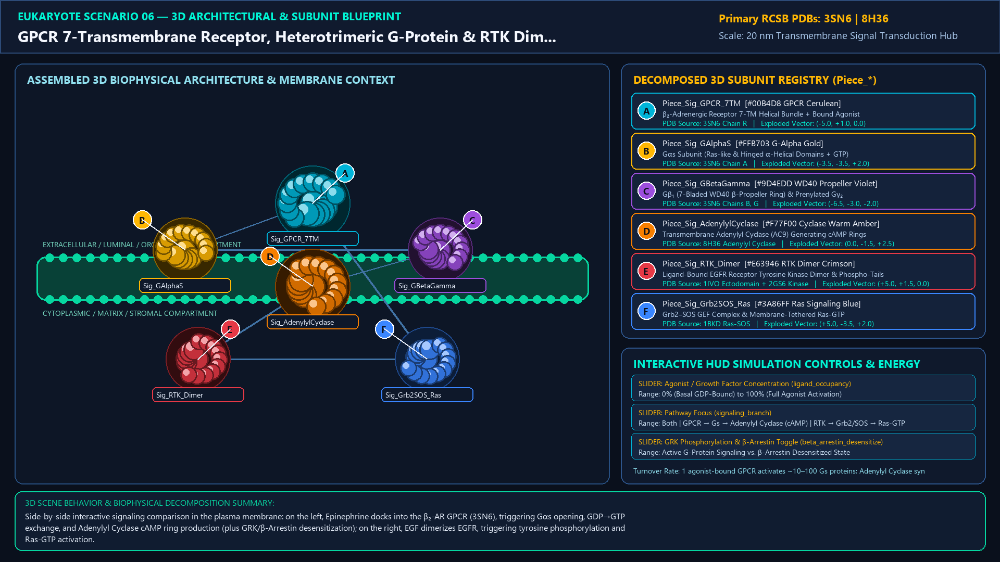
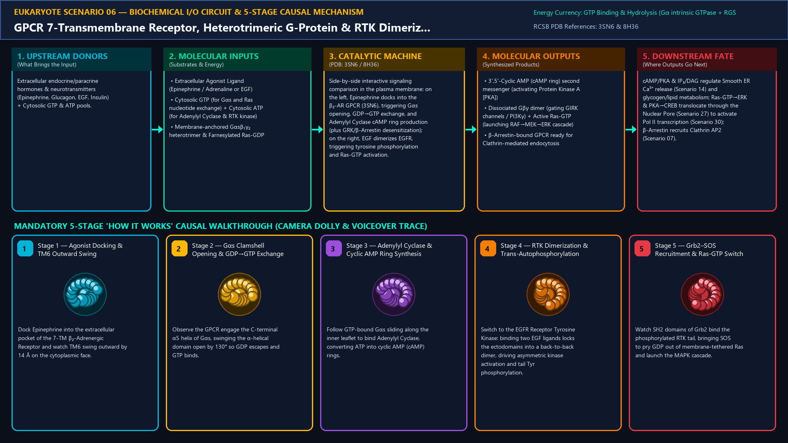
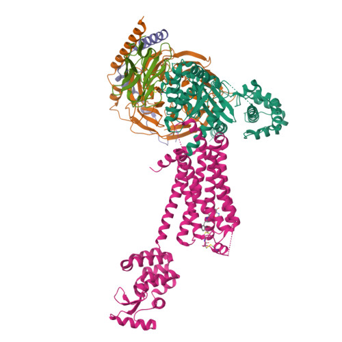
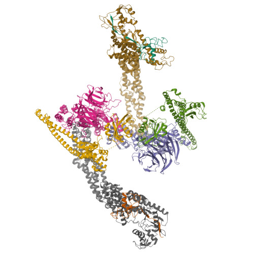
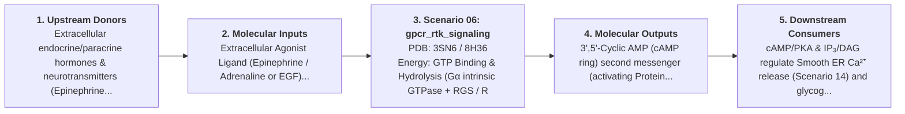

# Scenario 06 — GPCR 7-Transmembrane Receptor, Heterotrimeric G-Protein & RTK Dimerization

> **Roadmap Tier:** Tier 2 — Cell Surface, ECM & Plasma Membrane ($10\text{--}200\,\text{nm}$)  
> **Scenario ID:** `06_gpcr_rtk_signaling`  
> **Biophysical Scale:** 20 nm Transmembrane Signal Transduction Hub  
> **Functional Category:** Signal Transduction & Second Messengers  
> **Primary RCSB PDB Structures:** [`3SN6`](https://www.rcsb.org/structure/3SN6) (β₂-Adrenergic Receptor–Gs Protein Complex (3SN6)) · [`8H36`](https://www.rcsb.org/structure/8H36) (Transmembrane Adenylyl Cyclase–Gsα Complex (8H36 / 1IVO))

---

## 1. Visual & Artistic Representations (Manual Verification Reference Plates)

The following four visual reference plates are stored directly inside this folder (`./`) so you can inspect both the **expected 3D scene decomposition**, the **biochemical I/O circuit & 5-stage mechanism**, and the **experimental cryo-EM / X-ray structures** during manual verification:

### 1.1 Expected 3D Scene & Subunit Decomposition Blueprint (`expected_gpcr_rtk_signaling.png`)

### 1.2 Biochemical I/O Circuit & 5-Stage Causal Mechanism (`mechanism_gpcr_rtk_signaling.png`)

### 1.3 Experimental RCSB PDB Structural References (`rcsb_3SN6.jpg` & `rcsb_8H36.jpg`)
| Primary Structure [`3SN6`](https://www.rcsb.org/structure/3SN6) | Companion / Partner Structure [`8H36`](https://www.rcsb.org/structure/8H36) |
| :---: | :---: |
|  |  |
| **β₂-Adrenergic Receptor–Gs Protein Complex (3SN6)** | **Transmembrane Adenylyl Cyclase–Gsα Complex (8H36 / 1IVO)** |

---

## 2. Biophysical & Molecular Behavior Overview

Eukaryotic cells sense hormones, neurotransmitters, odorants, and photons via two dominant plasma-membrane receptor classes: (1) G-Protein-Coupled Receptors (GPCRs, >800 in humans), whose 7 transmembrane α-helices (TM1–TM7) undergo an outward 14 Å swing of TM6 upon agonist binding. This cytosolic cleft engages the Heterotrimeric G-Protein (Gαβγ), prying open the Gα Ras-like and helical domains to eject GDP and bind GTP. Gαs-GTP dissociates from Gβγ and activates transmembrane Adenylyl Cyclase, cyclizing ATP into the cyclic AMP (cAMP) second-messenger ring; (2) Receptor Tyrosine Kinases (RTKs like EGFR/Insulin Receptor), where ligand-induced ectodomain dimerization brings two cytoplasmic kinase domains into an asymmetric dimer for trans-autophosphorylation of tyrosine tails, recruiting SH2/PTB adaptors (Grb2–SOS) to load Ras with GTP.

### How It Behaves in the Interactive 3D Scene
Side-by-side interactive signaling comparison in the plasma membrane: on the left, Epinephrine docks into the β₂-AR GPCR (3SN6), triggering Gαs opening, GDP→GTP exchange, and Adenylyl Cyclase cAMP ring production (plus GRK/β-Arrestin desensitization); on the right, EGF dimerizes EGFR, triggering tyrosine phosphorylation and Ras-GTP activation.

---

## 3. Complete Biochemical I/O & Inter-Element Iteration

This section defines **what brings the input** to this machine (*Upstream Donors*), **what goes in** (*Molecular Inputs*), **what it makes** (*Molecular Outputs*), and **how it iterates with downstream systems** (*Downstream Consumers*):

- **Upstream Donors (What Brings the Input):**  
  Extracellular endocrine/paracrine hormones & neurotransmitters (Epinephrine, Glucagon, EGF, Insulin) + Cytosolic GTP & ATP pools.
- **Molecular Inputs (Substrates, Signals & Co-Factors):**
  - Extracellular Agonist Ligand (Epinephrine / Adrenaline or EGF)
  - Cytosolic GTP (for Gαs and Ras nucleotide exchange) + Cytosolic ATP (for Adenylyl Cyclase & RTK kinase)
  - Membrane-anchored Gαsβ₁γ₂ heterotrimer & Farnesylated Ras-GDP
- **Molecular Outputs (Synthesized / Translocated Products):**
  - 3',5'-Cyclic AMP (cAMP ring) second messenger (activating Protein Kinase A [PKA])
  - Dissociated Gβγ dimer (gating GIRK channels / PI3Kγ) + Active Ras-GTP (launching RAF→MEK→ERK cascade)
  - β-Arrestin-bound GPCR ready for Clathrin-mediated endocytosis
- **Downstream Consumers & Cross-Element Iteration:**  
  cAMP/PKA & IP₃/DAG regulate Smooth ER Ca²⁺ release (Scenario 14) and glycogen/lipid metabolism; Ras-GTP→ERK & PKA→CREB translocate through the Nuclear Pore (Scenario 27) to activate Pol II transcription (Scenario 30); β-Arrestin recruits Clathrin AP2 (Scenario 07).
- **Thermodynamic Energy Currency:** `GTP Binding & Hydrolysis (Gα intrinsic GTPase + RGS / Ras + GAP) + ATP Cyclization (ATP → cAMP + PPᵢ)`
- **Biophysical Turnover / Kinetics ($k_{\text{cat}}$):** `1 agonist-bound GPCR activates ~10–100 Gs proteins; Adenylyl Cyclase synthesizes ~1,000 cAMP molecules/sec`

---

## 4. 3D Subunit Decomposition (`Piece_<ID>_*`) & Color Taxonomy

To support continuous **Exploded View (`setExplodedProgress(0.0 → 1.0)`)**, raycast hover inspection, and subpill lock-on targeting, this scenario is decomposed into **6 functional 3D submeshes**:

| # | 3D Submesh ID (`Piece_*`) | Biological & Structural Role | RCSB PDB / Chain Source | Color Taxonomy (`#Hex`) | Exploded Vector $\vec{v}_{\text{dissoc}}$ |
| :--- | :--- | :--- | :--- | :--- | :--- |
| **1** | `Piece_Sig_GPCR_7TM` | β₂-Adrenergic Receptor 7-TM Helical Bundle + Bound Agonist | `3SN6 Chain R` | `#00B4D8` (GPCR Cerulean) | `(-5.0, +1.0, 0.0)` |
| **2** | `Piece_Sig_GAlphaS` | Gαs Subunit (Ras-like & Hinged α-Helical Domains + GTP) | `3SN6 Chain A` | `#FFB703` (G-Alpha Gold) | `(-3.5, -3.5, +2.0)` |
| **3** | `Piece_Sig_GBetaGamma` | Gβ₁ (7-Bladed WD40 β-Propeller Ring) & Prenylated Gγ₂ | `3SN6 Chains B, G` | `#9D4EDD` (WD40 Propeller Violet) | `(-6.5, -3.0, -2.0)` |
| **4** | `Piece_Sig_AdenylylCyclase` | Transmembrane Adenylyl Cyclase (AC9) Generating cAMP Rings | `8H36 Adenylyl Cyclase` | `#F77F00` (Cyclase Warm Amber) | `(0.0, -1.5, +2.5)` |
| **5** | `Piece_Sig_RTK_Dimer` | Ligand-Bound EGFR Receptor Tyrosine Kinase Dimer & Phospho-Tails | `1IVO Ectodomain + 2GS6 Kinase` | `#E63946` (RTK Dimer Crimson) | `(+5.0, +1.5, 0.0)` |
| **6** | `Piece_Sig_Grb2SOS_Ras` | Grb2–SOS GEF Complex & Membrane-Tethered Ras-GTP | `1BKD Ras-SOS` | `#3A86FF` (Ras Signaling Blue) | `(+5.0, -3.5, +2.0)` |
| **7** | `Piece_Sig_PlasmaMembrane` | Plasma Membrane Phospholipid Bilayer | `POPC / Cholesterol Bilayer` | `#06D6A0` (Plasma Membrane Jade) | `(0.0, 0.0, -2.5)` |

---

## 5. Interactive HUD Simulation Controls (`iterationControls`)

| Control ID | HUD Label | Biophysical Permutations & Interactive Behavior |
| :--- | :--- | :--- |
| `ligand_occupancy` | **Agonist / Growth Factor Concentration** | 0% (Basal GDP-Bound) to 100% (Full Agonist Activation) |
| `signaling_branch` | **Pathway Focus** | Both · GPCR → Gs → Adenylyl Cyclase (cAMP) · RTK → Grb2/SOS → Ras-GTP |
| `beta_arrestin_desensitize` | **GRK Phosphorylation & β-Arrestin Toggle** | Active G-Protein Signaling vs. β-Arrestin Desensitized State |

---

## 6. Mandatory 5-Stage "How It Works" Explanatory Trace

- **Stage 1 — Agonist Docking & TM6 Outward Swing:** Dock Epinephrine into the extracellular pocket of the 7-TM β₂-Adrenergic Receptor and watch TM6 swing outward by 14 Å on the cytoplasmic face.
- **Stage 2 — Gαs Clamshell Opening & GDP→GTP Exchange:** Observe the GPCR engage the C-terminal α5 helix of Gαs, swinging the α-helical domain open by 130° so GDP escapes and GTP binds.
- **Stage 3 — Adenylyl Cyclase & Cyclic AMP Ring Synthesis:** Follow GTP-bound Gαs sliding along the inner leaflet to bind Adenylyl Cyclase, converting ATP into cyclic AMP (cAMP) rings.
- **Stage 4 — RTK Dimerization & Trans-Autophosphorylation:** Switch to the EGFR Receptor Tyrosine Kinase: binding two EGF ligands locks the ectodomains into a back-to-back dimer, driving asymmetric kinase activation and tail Tyr phosphorylation.
- **Stage 5 — Grb2–SOS Recruitment & Ras-GTP Switch:** Watch SH2 domains of Grb2 bind the phosphorylated RTK tail, bringing SOS to pry GDP out of membrane-tethered Ras and launch the MAPK cascade.

---

## 7. Curated Online Resources & Structural References

- [RCSB PDB-101 — Molecule of the Month: G Proteins & GPCRs](https://pdb101.rcsb.org/motm/58)
- [RCSB PDB-101 — Molecule of the Month: Epidermal Growth Factor](https://pdb101.rcsb.org/motm/126)
- [RCSB PDB Structure 3SN6 — Nobel-Prize β₂-AR–Gs Complex](https://www.rcsb.org/structure/3SN6)
- [RCSB PDB Structure 8H36 — Human Adenylyl Cyclase AC9](https://www.rcsb.org/structure/8H36)
