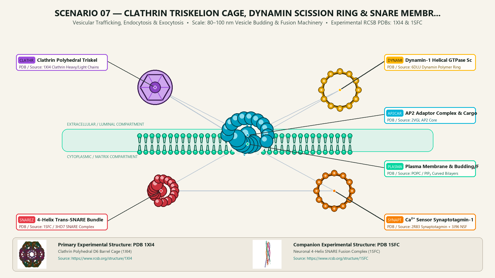
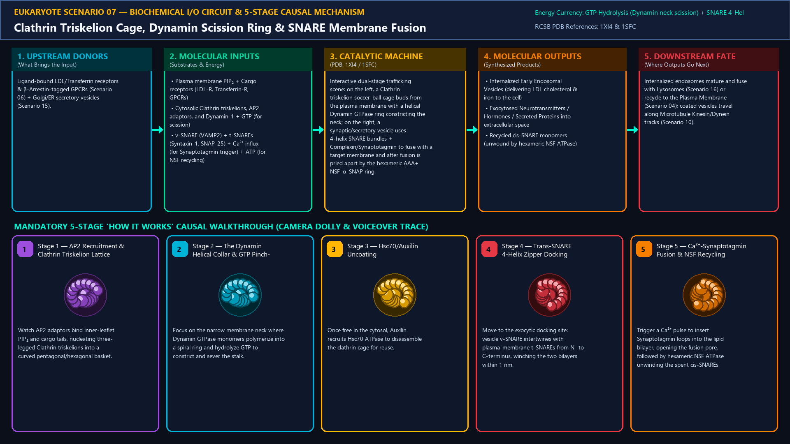
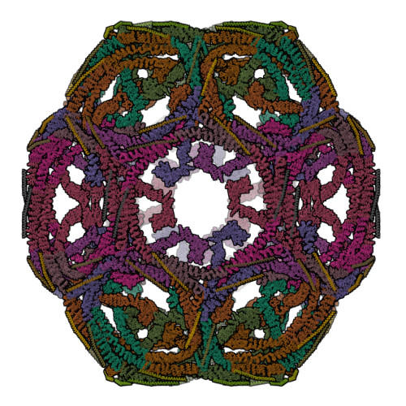
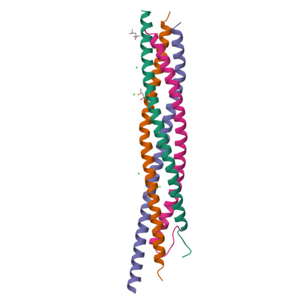
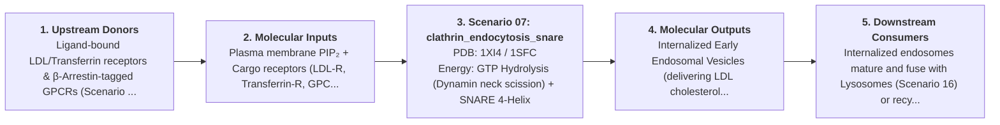

# Scenario 07 — Clathrin Triskelion Cage, Dynamin Scission Ring & SNARE Membrane Fusion

> **Roadmap Tier:** Tier 2 — Cell Surface, ECM & Plasma Membrane ($10\text{--}200\,\text{nm}$)  
> **Scenario ID:** `07_clathrin_endocytosis_snare`  
> **Biophysical Scale:** 80–100 nm Vesicle Budding & Fusion Machinery  
> **Functional Category:** Vesicular Trafficking, Endocytosis & Exocytosis  
> **Primary RCSB PDB Structures:** [`1XI4`](https://www.rcsb.org/structure/1XI4) (Clathrin Polyhedral D6 Barrel Cage (1XI4)) · [`1SFC`](https://www.rcsb.org/structure/1SFC) (Neuronal 4-Helix SNARE Fusion Complex (1SFC))

---

## 1. Visual & Artistic Representations (Manual Verification Reference Plates)

The following four visual reference plates are stored directly inside this folder (`./`) so you can inspect both the **expected 3D scene decomposition**, the **biochemical I/O circuit & 5-stage mechanism**, and the **experimental cryo-EM / X-ray structures** during manual verification:

### 1.1 Expected 3D Scene & Subunit Decomposition Blueprint (`expected_clathrin_endocytosis_snare.png`)

### 1.2 Biochemical I/O Circuit & 5-Stage Causal Mechanism (`mechanism_clathrin_endocytosis_snare.png`)

### 1.3 Experimental RCSB PDB Structural References (`rcsb_1XI4.jpg` & `rcsb_1SFC.jpg`)
| Primary Structure [`1XI4`](https://www.rcsb.org/structure/1XI4) | Companion / Partner Structure [`1SFC`](https://www.rcsb.org/structure/1SFC) |
| :---: | :---: |
|  |  |
| **Clathrin Polyhedral D6 Barrel Cage (1XI4)** | **Neuronal 4-Helix SNARE Fusion Complex (1SFC)** |

---

## 2. Biophysical & Molecular Behavior Overview

Eukaryotic cells continuously internalize receptors/nutrients (Endocytosis) and secrete neurotransmitters/proteins (Exocytosis) via two opposing mechanical masterpieces: (1) Clathrin-Mediated Endocytosis: Heterotetrameric AP2 adaptors bind inner-leaflet PIP₂ and cargo sorting signals (YXXΦ), recruiting three-legged Clathrin Triskelions (3 heavy chains + 3 light chains) that polymerize into a curved polyhedral lattice of hexagons and 12 pentagons. Once invaginated into a deeply constricted neck, the mechanochemical GTPase Dynamin self-assembles into a helical collar ring around the lipid stalk and hydrolyzes GTP to twist and sever the vesicle free; (2) SNARE-Mediated Fusion: After Hsc70/Auxilin uncoats the vesicle, vesicle v-SNARE (Synaptobrevin/VAMP2) pairs with target-membrane t-SNAREs (Syntaxin-1 + SNAP-25) to wind from N-terminus to C-terminus into an ultra-stable 4-helix bundle zipper (releasing ~35 k_BT of mechanical energy), overcoming hydration repulsion to fuse the two bilayers upon Ca²⁺–Synaptotagmin trigger.

### How It Behaves in the Interactive 3D Scene
Interactive dual-stage trafficking scene: on the left, a Clathrin triskelion soccer-ball cage buds from the plasma membrane with a helical Dynamin GTPase ring constricting the neck; on the right, a synaptic/secretory vesicle uses 4-helix SNARE bundles + Complexin/Synaptotagmin to fuse with a target membrane and after fusion is pried apart by the hexameric AAA+ NSF–α-SNAP ring.

---

## 3. Complete Biochemical I/O & Inter-Element Iteration

This section defines **what brings the input** to this machine (*Upstream Donors*), **what goes in** (*Molecular Inputs*), **what it makes** (*Molecular Outputs*), and **how it iterates with downstream systems** (*Downstream Consumers*):

- **Upstream Donors (What Brings the Input):**  
  Ligand-bound LDL/Transferrin receptors & β-Arrestin-tagged GPCRs (Scenario 06) + Golgi/ER secretory vesicles (Scenario 15).
- **Molecular Inputs (Substrates, Signals & Co-Factors):**
  - Plasma membrane PIP₂ + Cargo receptors (LDL-R, Transferrin-R, GPCRs)
  - Cytosolic Clathrin triskelions, AP2 adaptors, and Dynamin-1 + GTP (for scission)
  - v-SNARE (VAMP2) + t-SNAREs (Syntaxin-1, SNAP-25) + Ca²⁺ influx (for Synaptotagmin trigger) + ATP (for NSF recycling)
- **Molecular Outputs (Synthesized / Translocated Products):**
  - Internalized Early Endosomal Vesicles (delivering LDL cholesterol & iron to the cell)
  - Exocytosed Neurotransmitters / Hormones / Secreted Proteins into extracellular space
  - Recycled cis-SNARE monomers (unwound by hexameric NSF ATPase)
- **Downstream Consumers & Cross-Element Iteration:**  
  Internalized endosomes mature and fuse with Lysosomes (Scenario 16) or recycle to the Plasma Membrane (Scenario 04); coated vesicles travel along Microtubule Kinesin/Dynein tracks (Scenario 10).
- **Thermodynamic Energy Currency:** `GTP Hydrolysis (Dynamin neck scission) + SNARE 4-Helix Zipper Folding Energy (~65 k_BT) + ATP Hydrolysis (Hsc70 uncoating & NSF SNARE disassembly)`
- **Biophysical Turnover / Kinetics ($k_{\text{cat}}$):** `Clathrin pit matures in ~30–60 s; Dynamin scission in ~100 ms; Ca²⁺-triggered SNARE synaptic fusion in <1 ms`

---

## 4. 3D Subunit Decomposition (`Piece_<ID>_*`) & Color Taxonomy

To support continuous **Exploded View (`setExplodedProgress(0.0 → 1.0)`)**, raycast hover inspection, and subpill lock-on targeting, this scenario is decomposed into **6 functional 3D submeshes**:

| # | 3D Submesh ID (`Piece_*`) | Biological & Structural Role | RCSB PDB / Chain Source | Color Taxonomy (`#Hex`) | Exploded Vector $\vec{v}_{\text{dissoc}}$ |
| :--- | :--- | :--- | :--- | :--- | :--- |
| **1** | `Piece_Ves_ClathrinCage` | Clathrin Polyhedral Triskelion Cage (Hexagons & 12 Pentagons) | `1XI4 Clathrin Heavy/Light Chains` | `#9D4EDD` (Clathrin Cage Violet) | `(-5.0, -4.5, 0.0)` |
| **2** | `Piece_Ves_AP2Cargo` | AP2 Adaptor Complex & Cargo Receptor (LDL/Transferrin) | `2VGL AP2 Core` | `#00B4D8` (Adaptor Cerulean) | `(-5.0, -2.0, +2.0)` |
| **3** | `Piece_Ves_DynaminRing` | Dynamin-1 Helical GTPase Scission Collar Ring | `6DLU Dynamin Polymer Ring` | `#FFB703` (GTPase Ring Gold) | `(-5.0, -0.5, 0.0)` |
| **4** | `Piece_Ves_SNAREZipper` | 4-Helix Trans-SNARE Bundle (Synaptobrevin, Syntaxin-1, SNAP-25) | `1SFC / 3HD7 SNARE Complex` | `#E63946` (SNARE Zipper Crimson) | `(+4.5, -1.5, +1.5)` |
| **5** | `Piece_Ves_SynaptotagminNSF` | Ca²⁺ Sensor Synaptotagmin-1 & Hexameric AAA+ NSF Unwindase Ring | `2R83 Synaptotagmin + 3J96 NSF` | `#F77F00` (AAA+ Ring Warm Amber) | `(+5.0, -4.0, -2.0)` |
| **6** | `Piece_Ves_PlasmaMembrane` | Plasma Membrane & Budding/Fusing Vesicle Bilayers | `POPC / PIP₂ Curved Bilayers` | `#06D6A0` (Membrane Jade) | `(0.0, +1.5, 0.0)` |

---

## 5. Interactive HUD Simulation Controls (`iterationControls`)

| Control ID | HUD Label | Biophysical Permutations & Interactive Behavior |
| :--- | :--- | :--- |
| `vesicle_cycle_stage` | **Endocytosis & Fusion Stage** | 0.0 (Pit Invagination) → 0.5 (Dynamin GTP Scission) → 1.0 (SNARE Zipper Fusion) |
| `ca2_fusion_trigger` | **Cytosolic Ca²⁺ Pulse (µM)** | 0.1 µM (Clamped Hemifusion) to 20 µM (Synaptotagmin Full Pore Opening) |
| `dynasore_inhibitor` | **Dynamin GTPase Inhibitor (Dynasore)** | Blocks neck scission, trapping collared clathrin buds |

---

## 6. Mandatory 5-Stage "How It Works" Explanatory Trace

- **Stage 1 — AP2 Recruitment & Clathrin Triskelion Lattice:** Watch AP2 adaptors bind inner-leaflet PIP₂ and cargo tails, nucleating three-legged Clathrin triskelions into a curved pentagonal/hexagonal basket.
- **Stage 2 — The Dynamin Helical Collar & GTP Pinch-Off:** Focus on the narrow membrane neck where Dynamin GTPase monomers polymerize into a spiral ring and hydrolyze GTP to constrict and sever the stalk.
- **Stage 3 — Hsc70/Auxilin Uncoating:** Once free in the cytosol, Auxilin recruits Hsc70 ATPase to disassemble the clathrin cage for reuse.
- **Stage 4 — Trans-SNARE 4-Helix Zipper Docking:** Move to the exocytic docking site: vesicle v-SNARE intertwines with plasma-membrane t-SNAREs from N- to C-terminus, winching the two bilayers within 1 nm.
- **Stage 5 — Ca²⁺-Synaptotagmin Fusion & NSF Recycling:** Trigger a Ca²⁺ pulse to insert Synaptotagmin loops into the lipid bilayer, opening the fusion pore, followed by hexameric NSF ATPase unwinding the spent cis-SNAREs.

---

## 7. Curated Online Resources & Structural References

- [RCSB PDB-101 — Molecule of the Month: Clathrin](https://pdb101.rcsb.org/motm/89)
- [RCSB PDB-101 — Molecule of the Month: SNARE Proteins](https://pdb101.rcsb.org/motm/166)
- [RCSB PDB Structure 1XI4 — Clathrin D6 Barrel](https://www.rcsb.org/structure/1XI4)
- [RCSB PDB Structure 1SFC — Neuronal Synaptic Fusion Complex](https://www.rcsb.org/structure/1SFC)
