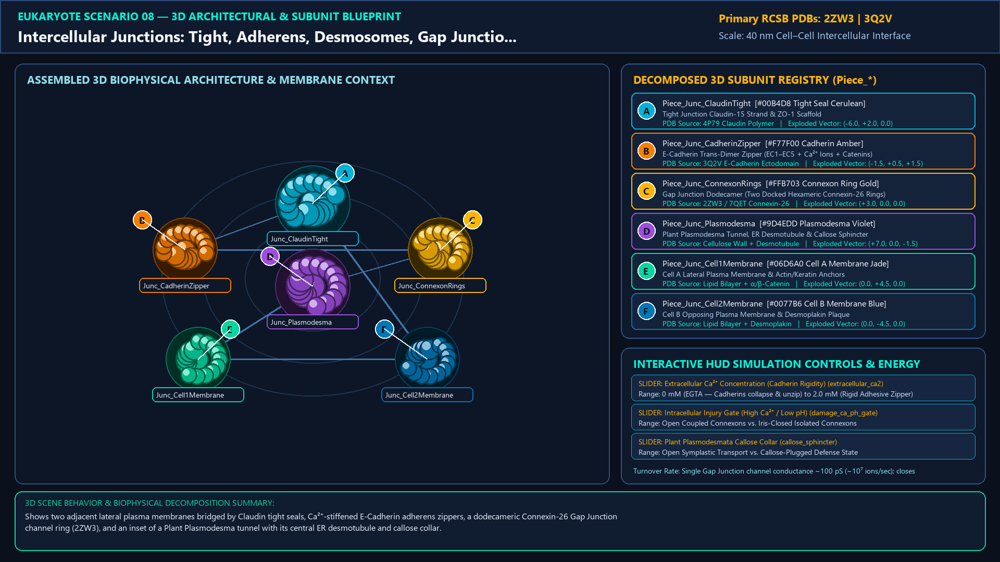
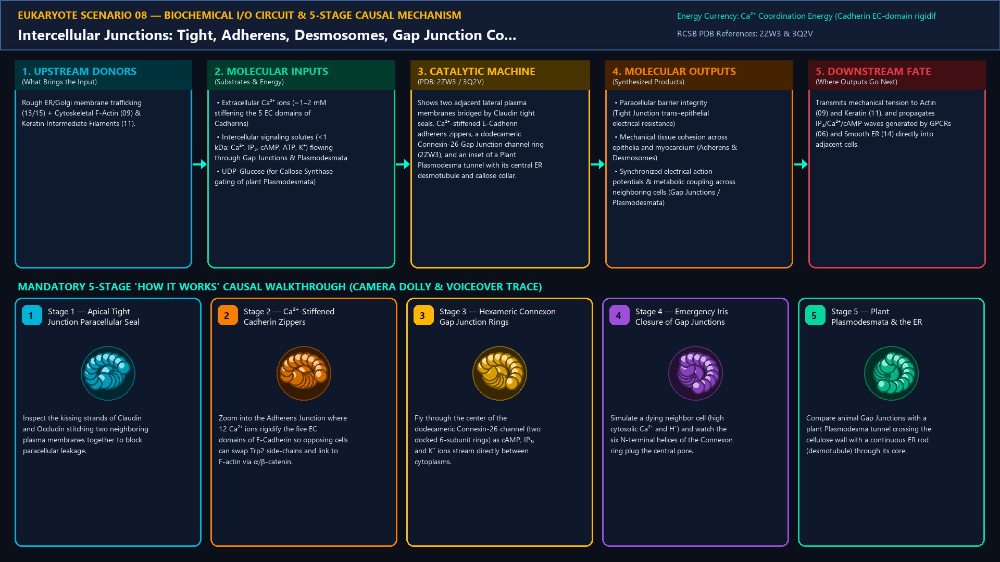
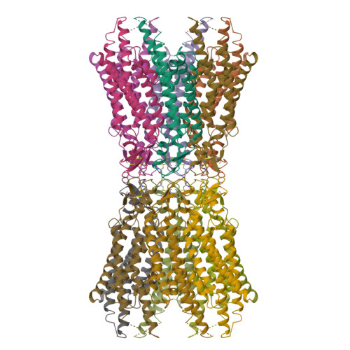
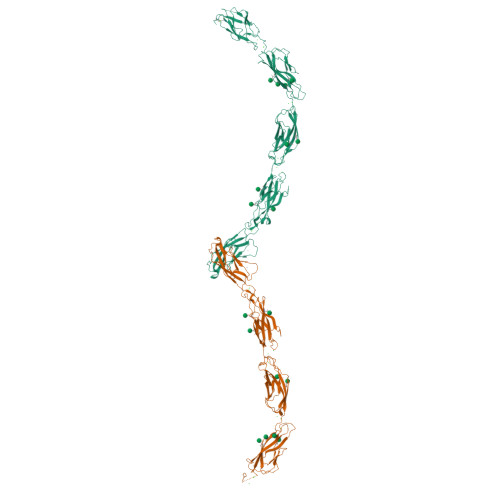
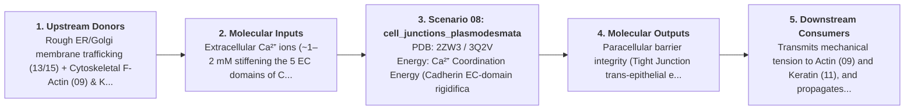

# Scenario 08 — Intercellular Junctions: Tight, Adherens, Desmosomes, Gap Junction Connexons & Plant Plasmodesmata

> **Roadmap Tier:** Tier 2 — Cell Surface, ECM & Plasma Membrane ($10\text{--}200\,\text{nm}$)  
> **Scenario ID:** `08_cell_junctions_plasmodesmata`  
> **Biophysical Scale:** 40 nm Cell–Cell Intercellular Interface  
> **Functional Category:** Multicellular Tissue Architecture & Direct Coupling  
> **Primary RCSB PDB Structures:** [`2ZW3`](https://www.rcsb.org/structure/2ZW3) (Human Connexin-26 Gap Junction Dodecameric Channel (2ZW3)) · [`3Q2V`](https://www.rcsb.org/structure/3Q2V) (E-Cadherin Extracellular Adhesive Zipper (3Q2V))

---

## 1. Visual & Artistic Representations (Manual Verification Reference Plates)

The following four visual reference plates are stored directly inside this folder (`./`) so you can inspect both the **expected 3D scene decomposition**, the **biochemical I/O circuit & 5-stage mechanism**, and the **experimental cryo-EM / X-ray structures** during manual verification:

### 1.1 Expected 3D Scene & Subunit Decomposition Blueprint (`expected_cell_junctions_plasmodesmata.png`)

### 1.2 Biochemical I/O Circuit & 5-Stage Causal Mechanism (`mechanism_cell_junctions_plasmodesmata.png`)

### 1.3 Experimental RCSB PDB Structural References (`rcsb_2ZW3.jpg` & `rcsb_3Q2V.jpg`)
| Primary Structure [`2ZW3`](https://www.rcsb.org/structure/2ZW3) | Companion / Partner Structure [`3Q2V`](https://www.rcsb.org/structure/3Q2V) |
| :---: | :---: |
|  |  |
| **Human Connexin-26 Gap Junction Dodecameric Channel (2ZW3)** | **E-Cadherin Extracellular Adhesive Zipper (3Q2V)** |

---

## 2. Biophysical & Molecular Behavior Overview

Multicellular eukaryotes weld individual cells into polarized epithelia, beating heart muscle, and integrated plant tissues using specialized intercellular junctions: (1) Tight Junctions (Claudin + Occludin strands linked to ZO-1) seal the apical paracellular space; (2) Adherens Junctions & Desmosomes use Ca²⁺-stiffened Cadherin ectodomains (E-cadherin / Desmoglein) that swap N-terminal Trp2 side-chains across the 25 nm intercellular cleft, linking to cortical F-Actin (via α/β-Catenin) or Keratin Intermediate Filaments (via Desmoplakin); (3) Gap Junctions are dodecameric pores formed by two docked hexameric Connexon rings (6 Connexin subunits per cell) that directly pass ions, ATP, IP₃, and cAMP (<1 kDa) between animal cytoplasms; and (4) Plant Plasmodesmata are 40 nm plasma-membrane-lined tunnels traversing the cellulose cell wall with an axial ER Desmotubule, gated by callose (β-1,3-glucan) sphincters.

### How It Behaves in the Interactive 3D Scene
Shows two adjacent lateral plasma membranes bridged by Claudin tight seals, Ca²⁺-stiffened E-Cadherin adherens zippers, a dodecameric Connexin-26 Gap Junction channel ring (2ZW3), and an inset of a Plant Plasmodesma tunnel with its central ER desmotubule and callose collar.

---

## 3. Complete Biochemical I/O & Inter-Element Iteration

This section defines **what brings the input** to this machine (*Upstream Donors*), **what goes in** (*Molecular Inputs*), **what it makes** (*Molecular Outputs*), and **how it iterates with downstream systems** (*Downstream Consumers*):

- **Upstream Donors (What Brings the Input):**  
  Rough ER/Golgi membrane trafficking (13/15) + Cytoskeletal F-Actin (09) & Keratin Intermediate Filaments (11).
- **Molecular Inputs (Substrates, Signals & Co-Factors):**
  - Extracellular Ca²⁺ ions (~1–2 mM stiffening the 5 EC domains of Cadherins)
  - Intercellular signaling solutes (<1 kDa: Ca²⁺, IP₃, cAMP, ATP, K⁺) flowing through Gap Junctions & Plasmodesmata
  - UDP-Glucose (for Callose Synthase gating of plant Plasmodesmata)
- **Molecular Outputs (Synthesized / Translocated Products):**
  - Paracellular barrier integrity (Tight Junction trans-epithelial electrical resistance)
  - Mechanical tissue cohesion across epithelia and myocardium (Adherens & Desmosomes)
  - Synchronized electrical action potentials & metabolic coupling across neighboring cells (Gap Junctions / Plasmodesmata)
- **Downstream Consumers & Cross-Element Iteration:**  
  Transmits mechanical tension to Actin (09) and Keratin (11), and propagates IP₃/Ca²⁺/cAMP waves generated by GPCRs (06) and Smooth ER (14) directly into adjacent cells.
- **Thermodynamic Energy Currency:** `Ca²⁺ Coordination Energy (Cadherin EC-domain rigidification) + Electrochemical Solute Gradients across Connexons`
- **Biophysical Turnover / Kinetics ($k_{\text{cat}}$):** `Single Gap Junction channel conductance ~100 pS (~10⁷ ions/sec); closes within milliseconds upon intracellular H⁺ or high Ca²⁺ overload`

---

## 4. 3D Subunit Decomposition (`Piece_<ID>_*`) & Color Taxonomy

To support continuous **Exploded View (`setExplodedProgress(0.0 → 1.0)`)**, raycast hover inspection, and subpill lock-on targeting, this scenario is decomposed into **6 functional 3D submeshes**:

| # | 3D Submesh ID (`Piece_*`) | Biological & Structural Role | RCSB PDB / Chain Source | Color Taxonomy (`#Hex`) | Exploded Vector $\vec{v}_{\text{dissoc}}$ |
| :--- | :--- | :--- | :--- | :--- | :--- |
| **1** | `Piece_Junc_ClaudinTight` | Tight Junction Claudin-15 Strand & ZO-1 Scaffold | `4P79 Claudin Polymer` | `#00B4D8` (Tight Seal Cerulean) | `(-6.0, +2.0, 0.0)` |
| **2** | `Piece_Junc_CadherinZipper` | E-Cadherin Trans-Dimer Zipper (EC1–EC5 + Ca²⁺ Ions + Catenins) | `3Q2V E-Cadherin Ectodomain` | `#F77F00` (Cadherin Amber) | `(-1.5, +0.5, +1.5)` |
| **3** | `Piece_Junc_ConnexonRings` | Gap Junction Dodecamer (Two Docked Hexameric Connexin-26 Rings) | `2ZW3 / 7QET Connexin-26` | `#FFB703` (Connexon Ring Gold) | `(+3.0, 0.0, 0.0)` |
| **4** | `Piece_Junc_Plasmodesma` | Plant Plasmodesma Tunnel, ER Desmotubule & Callose Sphincter | `Cellulose Wall + Desmotubule` | `#9D4EDD` (Plasmodesma Violet) | `(+7.0, 0.0, -1.5)` |
| **5** | `Piece_Junc_Cell1Membrane` | Cell A Lateral Plasma Membrane & Actin/Keratin Anchors | `Lipid Bilayer + α/β-Catenin` | `#06D6A0` (Cell A Membrane Jade) | `(0.0, +4.5, 0.0)` |
| **6** | `Piece_Junc_Cell2Membrane` | Cell B Opposing Plasma Membrane & Desmoplakin Plaque | `Lipid Bilayer + Desmoplakin` | `#0077B6` (Cell B Membrane Blue) | `(0.0, -4.5, 0.0)` |

---

## 5. Interactive HUD Simulation Controls (`iterationControls`)

| Control ID | HUD Label | Biophysical Permutations & Interactive Behavior |
| :--- | :--- | :--- |
| `extracellular_ca2` | **Extracellular Ca²⁺ Concentration (Cadherin Rigidity)** | 0 mM (EGTA — Cadherins collapse & unzip) to 2.0 mM (Rigid Adhesive Zipper) |
| `damage_ca_ph_gate` | **Intracellular Injury Gate (High Ca²⁺ / Low pH)** | Open Coupled Connexons vs. Iris-Closed Isolated Connexons |
| `callose_sphincter` | **Plant Plasmodesmata Callose Collar** | Open Symplastic Transport vs. Callose-Plugged Defense State |

---

## 6. Mandatory 5-Stage "How It Works" Explanatory Trace

- **Stage 1 — Apical Tight Junction Paracellular Seal:** Inspect the kissing strands of Claudin and Occludin stitching two neighboring plasma membranes together to block paracellular leakage.
- **Stage 2 — Ca²⁺-Stiffened Cadherin Zippers:** Zoom into the Adherens Junction where 12 Ca²⁺ ions rigidify the five EC domains of E-Cadherin so opposing cells can swap Trp2 side-chains and link to F-actin via α/β-catenin.
- **Stage 3 — Hexameric Connexon Gap Junction Rings:** Fly through the center of the dodecameric Connexin-26 channel (two docked 6-subunit rings) as cAMP, IP₃, and K⁺ ions stream directly between cytoplasms.
- **Stage 4 — Emergency Iris Closure of Gap Junctions:** Simulate a dying neighbor cell (high cytosolic Ca²⁺ and H⁺) and watch the six N-terminal helices of the Connexon ring plug the central pore.
- **Stage 5 — Plant Plasmodesmata & the ER Desmotubule:** Compare animal Gap Junctions with a plant Plasmodesma tunnel crossing the cellulose wall with a continuous ER rod (desmotubule) through its core.

---

## 7. Curated Online Resources & Structural References

- [RCSB PDB-101 — Molecule of the Month: Cadherin](https://pdb101.rcsb.org/motm/92)
- [RCSB PDB Structure 2ZW3 — Human Connexin-26 Gap Junction Channel](https://www.rcsb.org/structure/2ZW3)
- [RCSB PDB Structure 3Q2V — E-Cadherin Ectodomain](https://www.rcsb.org/structure/3Q2V)
- [NCBI Bookshelf — Molecular Biology of the Cell: Cell Junctions](https://www.ncbi.nlm.nih.gov/books/NBK26857/)
