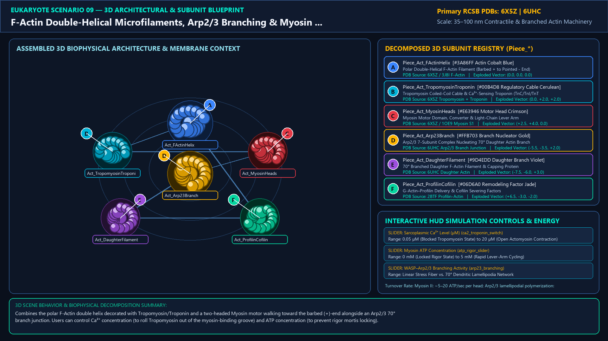
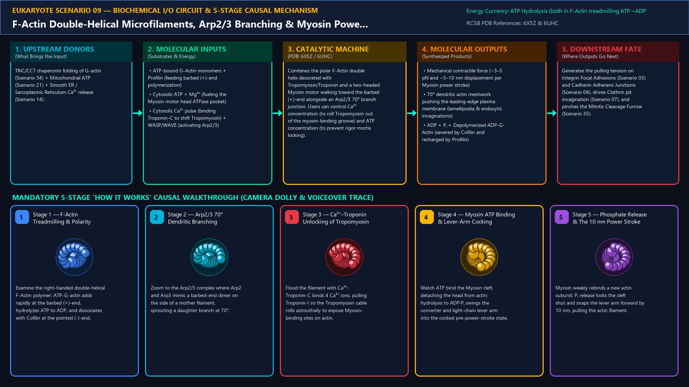
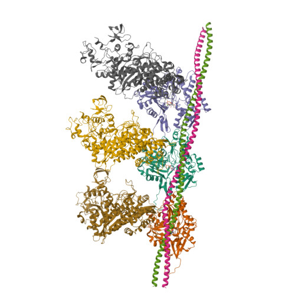
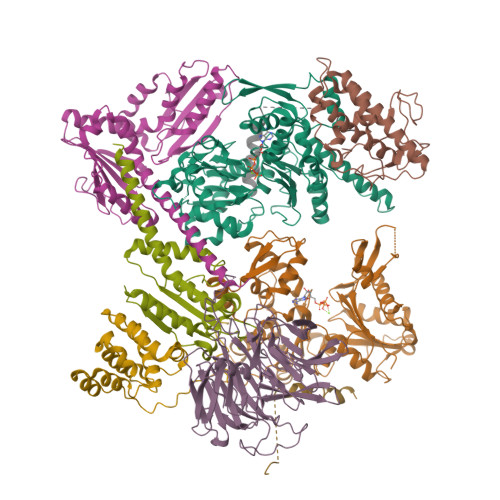
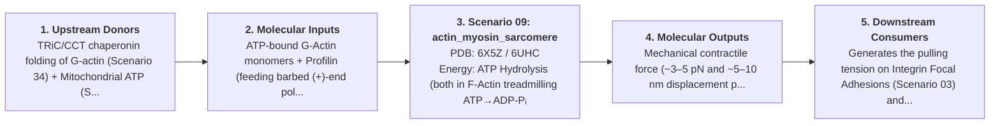
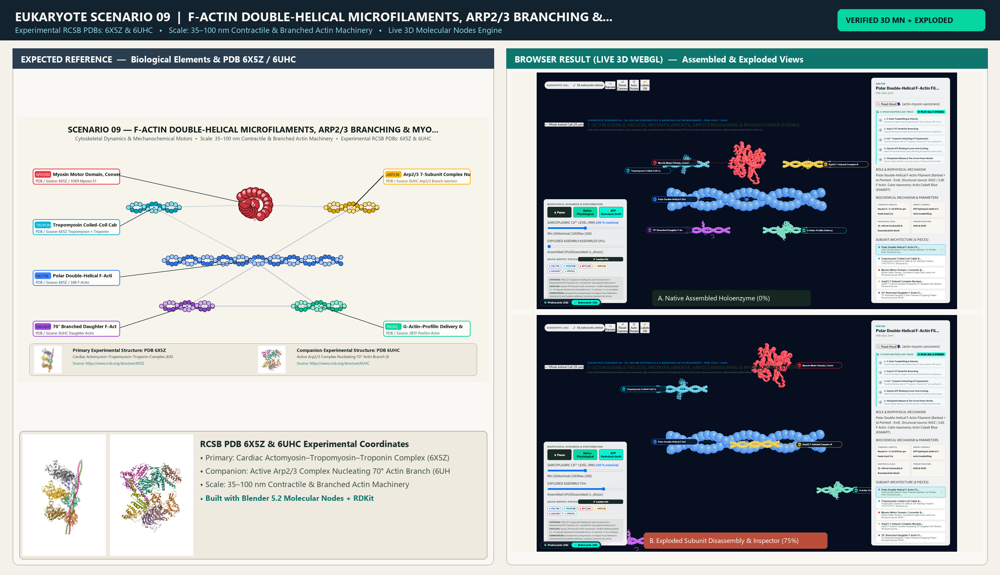

# Scenario 09 — F-Actin Double-Helical Microfilaments, Arp2/3 Branching & Myosin Power Stroke

> **Roadmap Tier:** Tier 3 — Cytoskeleton Highways, Cilia & Molecular Walkers ($20\text{--}500\,\text{nm}$)  
> **Scenario ID:** `09_actin_myosin_sarcomere`  
> **Biophysical Scale:** 35–100 nm Contractile & Branched Actin Machinery  
> **Functional Category:** Cytoskeletal Dynamics & Mechanochemical Motors  
> **Primary RCSB PDB Structures:** [`6X5Z`](https://www.rcsb.org/structure/6X5Z) (Cardiac Actomyosin–Tropomyosin–Troponin Complex (6X5Z)) · [`6UHC`](https://www.rcsb.org/structure/6UHC) (Active Arp2/3 Complex Nucleating 70° Actin Branch (6UHC))

---

## 1. Visual & Artistic Representations (Manual Verification Reference Plates)

The following four visual reference plates are stored directly inside this folder (`./`) so you can inspect both the **expected 3D scene decomposition**, the **biochemical I/O circuit & 5-stage mechanism**, and the **experimental cryo-EM / X-ray structures** during manual verification:

### 1.1 Expected 3D Scene & Subunit Decomposition Blueprint (`expected_actin_myosin_sarcomere.png`)

### 1.2 Biochemical I/O Circuit & 5-Stage Causal Mechanism (`mechanism_actin_myosin_sarcomere.png`)

### 1.3 Experimental RCSB PDB Structural References (`rcsb_6X5Z.jpg` & `rcsb_6UHC.jpg`)
| Primary Structure [`6X5Z`](https://www.rcsb.org/structure/6X5Z) | Companion / Partner Structure [`6UHC`](https://www.rcsb.org/structure/6UHC) |
| :---: | :---: |
|  |  |
| **Cardiac Actomyosin–Tropomyosin–Troponin Complex (6X5Z)** | **Active Arp2/3 Complex Nucleating 70° Actin Branch (6UHC)** |

---

## 2. Biophysical & Molecular Behavior Overview

Actin is the most abundant protein in many eukaryotic cells, assembling from 42 kDa globular ATP-bound G-Actin monomers into polar, right-handed double-helical F-Actin microfilaments (7 nm diameter, 36 nm half-pitch) with a fast-growing Barbed (+)-end and a slow-pointed (-)-end. Two distinct nanomachines harness F-Actin: (1) At the leading edge of crawling cells (lamellipodia), WASP-activated Arp2/3 Complex (containing actin-related proteins Arp2 and Arp3) clamps onto the side of a mother filament to nucleate a daughter F-Actin branch at an exact 70° angle, pushing the plasma membrane forward; (2) In muscle sarcomeres and stress fibers, Tropomyosin cables and Ca²⁺-binding Troponin (TnC/TnI/TnT) gate access for Myosin II / Myosin V motor heads, which execute the Lymn–Taylor ATPase cycle (ATP binding detaches the head → ATP hydrolysis cocks the lever arm by 60° → actin rebinding + Pᵢ release fires the 10 nm Power Stroke).

### How It Behaves in the Interactive 3D Scene
Combines the polar F-Actin double helix decorated with Tropomyosin/Troponin and a two-headed Myosin motor walking toward the barbed (+)-end alongside an Arp2/3 70° branch junction. Users can control Ca²⁺ concentration (to roll Tropomyosin out of the myosin-binding groove) and ATP concentration (to prevent rigor mortis locking).

---

## 3. Complete Biochemical I/O & Inter-Element Iteration

This section defines **what brings the input** to this machine (*Upstream Donors*), **what goes in** (*Molecular Inputs*), **what it makes** (*Molecular Outputs*), and **how it iterates with downstream systems** (*Downstream Consumers*):

- **Upstream Donors (What Brings the Input):**  
  TRiC/CCT chaperonin folding of G-actin (Scenario 34) + Mitochondrial ATP (Scenario 21) + Smooth ER / Sarcoplasmic Reticulum Ca²⁺ release (Scenario 14).
- **Molecular Inputs (Substrates, Signals & Co-Factors):**
  - ATP-bound G-Actin monomers + Profilin (feeding barbed (+)-end polymerization)
  - Cytosolic ATP + Mg²⁺ (fueling the Myosin motor head ATPase pocket)
  - Cytosolic Ca²⁺ pulse (binding Troponin-C to shift Tropomyosin) + WASP/WAVE (activating Arp2/3)
- **Molecular Outputs (Synthesized / Translocated Products):**
  - Mechanical contractile force (~3–5 pN and ~5–10 nm displacement per Myosin power stroke)
  - 70° dendritic actin meshwork pushing the leading-edge plasma membrane (lamellipodia & endocytic invaginations)
  - ADP + Pᵢ + Depolymerized ADP-G-Actin (severed by Cofilin and recharged by Profilin)
- **Downstream Consumers & Cross-Element Iteration:**  
  Generates the pulling tension on Integrin Focal Adhesions (Scenario 03) and Cadherin Adherens Junctions (Scenario 08), drives Clathrin pit invagination (Scenario 07), and pinches the Mitotic Cleavage Furrow (Scenario 35).
- **Thermodynamic Energy Currency:** `ATP Hydrolysis (both in F-Actin treadmilling ATP→ADP-Pᵢ→ADP and Myosin lever-arm cocking)`
- **Biophysical Turnover / Kinetics ($k_{\text{cat}}$):** `Myosin II: ~5–20 ATP/sec per head; Arp2/3 lamellipodial polymerization: ~100–500 monomers/sec at (+)-end`

---

## 4. 3D Subunit Decomposition (`Piece_<ID>_*`) & Color Taxonomy

To support continuous **Exploded View (`setExplodedProgress(0.0 → 1.0)`)**, raycast hover inspection, and subpill lock-on targeting, this scenario is decomposed into **6 functional 3D submeshes**:

| # | 3D Submesh ID (`Piece_*`) | Biological & Structural Role | RCSB PDB / Chain Source | Color Taxonomy (`#Hex`) | Exploded Vector $\vec{v}_{\text{dissoc}}$ |
| :--- | :--- | :--- | :--- | :--- | :--- |
| **1** | `Piece_Act_FActinHelix` | Polar Double-Helical F-Actin Filament (Barbed + to Pointed - End) | `6X5Z / 3J8I F-Actin` | `#3A86FF` (Actin Cobalt Blue) | `(0.0, 0.0, 0.0)` |
| **2** | `Piece_Act_TropomyosinTroponin` | Tropomyosin Coiled-Coil Cable & Ca²⁺-Sensing Troponin (TnC/TnI/TnT) | `6X5Z Tropomyosin + Troponin` | `#00B4D8` (Regulatory Cable Cerulean) | `(0.0, +2.0, +2.0)` |
| **3** | `Piece_Act_MyosinHeads` | Myosin Motor Domain, Converter & Light-Chain Lever Arm | `6X5Z / 1OE9 Myosin S1` | `#E63946` (Motor Head Crimson) | `(+2.5, +4.0, 0.0)` |
| **4** | `Piece_Act_Arp23Branch` | Arp2/3 7-Subunit Complex Nucleating 70° Daughter Actin Branch | `6UHC Arp2/3 Branch Junction` | `#FFB703` (Branch Nucleator Gold) | `(-5.5, -3.5, +2.0)` |
| **5** | `Piece_Act_DaughterFilament` | 70° Branched Daughter F-Actin Filament & Capping Protein | `6UHC Daughter Actin` | `#9D4EDD` (Daughter Branch Violet) | `(-7.5, -6.0, +3.0)` |
| **6** | `Piece_Act_ProfilinCofilin` | G-Actin–Profilin Delivery & Cofilin Severing Factors | `2BTF Profilin-Actin` | `#06D6A0` (Remodeling Factor Jade) | `(+6.5, -3.0, -2.0)` |

---

## 5. Interactive HUD Simulation Controls (`iterationControls`)

| Control ID | HUD Label | Biophysical Permutations & Interactive Behavior |
| :--- | :--- | :--- |
| `ca2_troponin_switch` | **Sarcoplasmic Ca²⁺ Level (µM)** | 0.05 µM (Blocked Tropomyosin State) to 20 µM (Open Actomyosin Contraction) |
| `atp_rigor_slider` | **Myosin ATP Concentration** | 0 mM (Locked Rigor State) to 5 mM (Rapid Lever-Arm Cycling) |
| `arp23_branching` | **WASP–Arp2/3 Branching Activity** | Linear Stress Fiber vs. 70° Dendritic Lamellipodia Network |

---

## 6. Mandatory 5-Stage "How It Works" Explanatory Trace

- **Stage 1 — F-Actin Treadmilling & Polarity:** Examine the right-handed double-helical F-Actin polymer: ATP-G-actin adds rapidly at the barbed (+)-end, hydrolyzes ATP to ADP, and dissociates with Cofilin at the pointed (-)-end.
- **Stage 2 — Arp2/3 70° Dendritic Branching:** Zoom to the Arp2/3 complex where Arp2 and Arp3 mimic a barbed-end dimer on the side of a mother filament, sprouting a daughter branch at 70°.
- **Stage 3 — Ca²⁺–Troponin Unlocking of Tropomyosin:** Flood the filament with Ca²⁺: Troponin-C binds 4 Ca²⁺ ions, pulling Troponin-I so the Tropomyosin cable rolls azimuthally to expose Myosin-binding sites on actin.
- **Stage 4 — Myosin ATP Binding & Lever-Arm Cocking:** Watch ATP bind the Myosin cleft, detaching the head from actin; hydrolysis to ADP·Pᵢ swings the converter and light-chain lever arm into the cocked pre-power-stroke state.
- **Stage 5 — Phosphate Release & The 10 nm Power Stroke:** Myosin weakly rebinds a new actin subunit; Pᵢ release locks the cleft shut and snaps the lever arm forward by 10 nm, pulling the actin filament.

---

## 7. Curated Online Resources & Structural References

- [RCSB PDB-101 — Molecule of the Month: Actin](https://pdb101.rcsb.org/motm/19)
- [RCSB PDB-101 — Molecule of the Month: Myosin](https://pdb101.rcsb.org/motm/18)
- [RCSB PDB Structure 6X5Z — Native Cardiac Thin Filament with Myosin](https://www.rcsb.org/structure/6X5Z)
- [RCSB PDB Structure 6UHC — Active Arp2/3 Actin Branch Junction](https://www.rcsb.org/structure/6UHC)

## 12. 3D Implementation & Visual Verification Assets

- **Status:** `[x] Implemented, Exported to 3D GLB & Visually Verified`
- **3D Model Asset (`.glb`):** [`actin_myosin_sarcomere.glb`](./actin_myosin_sarcomere.glb) (also mirrored in `eukaryote/models/actin_myosin_sarcomere.glb` and `client/public/eukaryote/models/actin_myosin_sarcomere.glb`)
- **Blender 5.2 + Molecular Nodes Generator Script:** [`generate_09_actin_myosin_sarcomere.py`](./generate_09_actin_myosin_sarcomere.py)
- **Live WebGL Assembled Capture (`0%`):** [`browser_actin_myosin_sarcomere_assembled.png`](../../verification/09_actin_myosin_sarcomere/browser_actin_myosin_sarcomere_assembled.png)
- **Live WebGL Exploded Capture (`75%`):** [`browser_actin_myosin_sarcomere_exploded.png`](../../verification/09_actin_myosin_sarcomere/browser_actin_myosin_sarcomere_exploded.png)
- **Side-by-Side Input vs. Output Comparison Plate (`2400×1380`):** [`comparison_actin_myosin_sarcomere.png`](../../verification/09_actin_myosin_sarcomere/comparison_actin_myosin_sarcomere.png)
- **Animated Side-by-Side Comparison Video (`1920×1080 MP4`):** [`comparison_actin_myosin_sarcomere.mp4`](../../verification/09_actin_myosin_sarcomere/comparison_actin_myosin_sarcomere.mp4)

