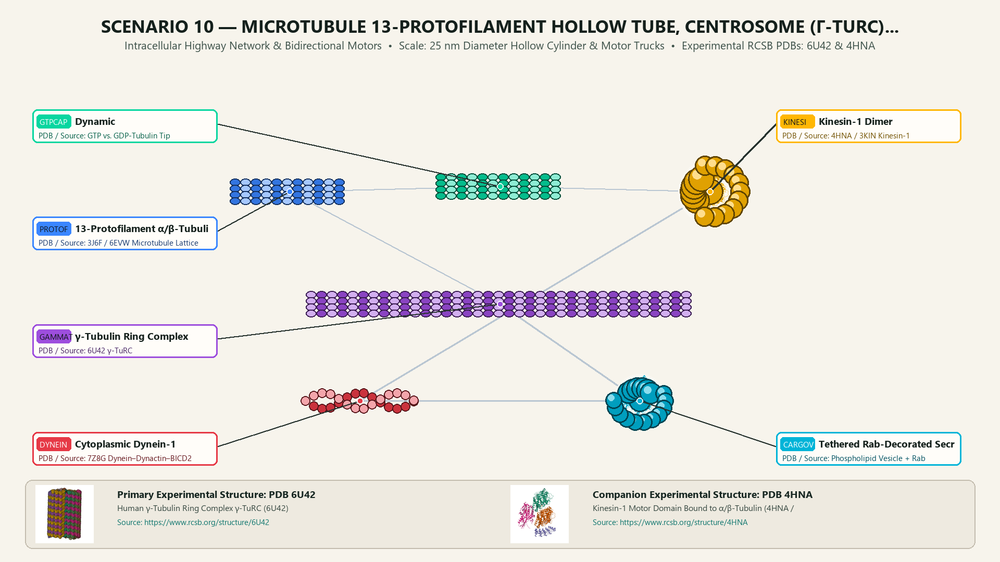
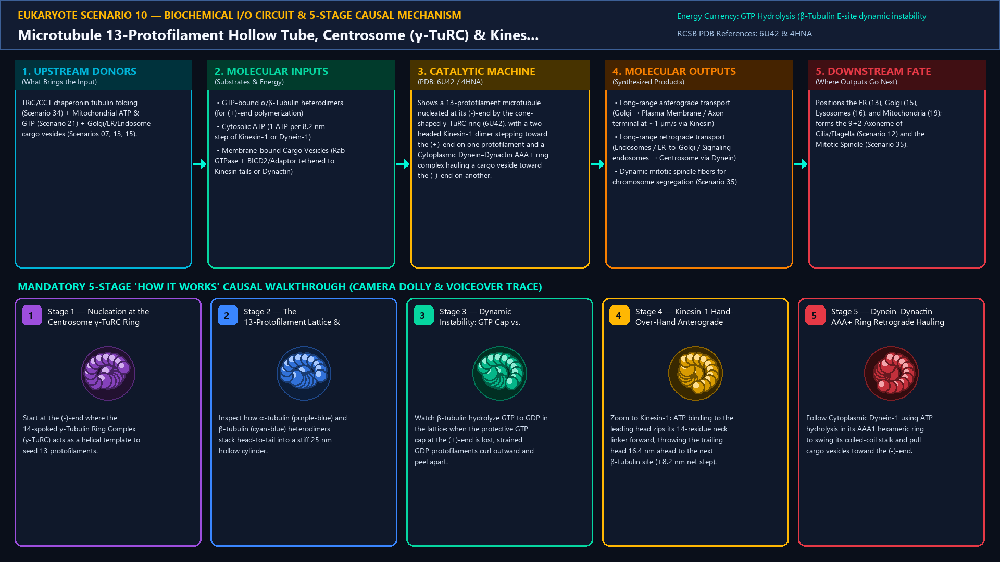
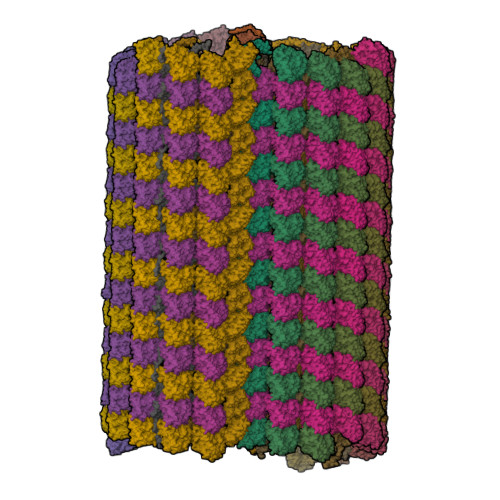
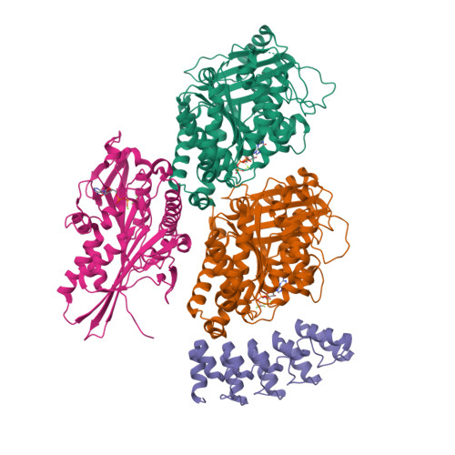
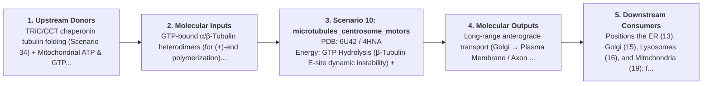
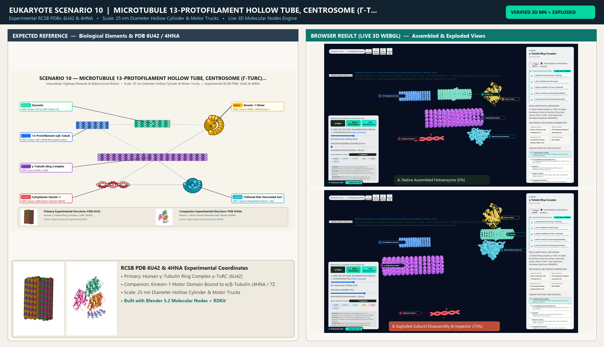

# Scenario 10 — Microtubule 13-Protofilament Hollow Tube, Centrosome (γ-TuRC) & Kinesin / Dynein Walkers

> **Roadmap Tier:** Tier 3 — Cytoskeleton Highways, Cilia & Molecular Walkers ($20\text{--}500\,\text{nm}$)  
> **Scenario ID:** `10_microtubules_centrosome_motors`  
> **Biophysical Scale:** 25 nm Diameter Hollow Cylinder & Motor Trucks  
> **Functional Category:** Intracellular Highway Network & Bidirectional Motors  
> **Primary RCSB PDB Structures:** [`6U42`](https://www.rcsb.org/structure/6U42) (Human γ-Tubulin Ring Complex γ-TuRC (6U42)) · [`4HNA`](https://www.rcsb.org/structure/4HNA) (Kinesin-1 Motor Domain Bound to α/β-Tubulin (4HNA / 7Z8G))

---

## 1. Visual & Artistic Representations (Manual Verification Reference Plates)

The following four visual reference plates are stored directly inside this folder (`./`) so you can inspect both the **expected 3D scene decomposition**, the **biochemical I/O circuit & 5-stage mechanism**, and the **experimental cryo-EM / X-ray structures** during manual verification:

### 1.1 Expected 3D Scene & Subunit Decomposition Blueprint (`expected_microtubules_centrosome_motors.png`)

### 1.2 Biochemical I/O Circuit & 5-Stage Causal Mechanism (`mechanism_microtubules_centrosome_motors.png`)

### 1.3 Experimental RCSB PDB Structural References (`rcsb_6U42.jpg` & `rcsb_4HNA.jpg`)
| Primary Structure [`6U42`](https://www.rcsb.org/structure/6U42) | Companion / Partner Structure [`4HNA`](https://www.rcsb.org/structure/4HNA) |
| :---: | :---: |
|  |  |
| **Human γ-Tubulin Ring Complex γ-TuRC (6U42)** | **Kinesin-1 Motor Domain Bound to α/β-Tubulin (4HNA / 7Z8G)** |

---

## 2. Biophysical & Molecular Behavior Overview

Microtubules are stiff, hollow 25 nm cylindrical highways assembled from 13 parallel protofilaments of α/β-Tubulin heterodimers. In animal cells, their (-)-ends are nucleated and capped at the perinuclear Centrosome by the 14-spoked γ-Tubulin Ring Complex (γ-TuRC, 2.2 MDa) surrounding a pair of orthogonal 9×3 triplet Centrioles, while their (+)-ends radiate outward toward the plasma membrane. As long as newly added β-tubulin retains GTP (the 'GTP Cap'), the tube grows straight; if hydrolysis to GDP catches up to the tip, protofilaments peel outward like curved ram's horns in rapid 'Catastrophe'. Two opposing ATP-powered motor families walk along the outer protofilament ridges in 8.2 nm steps: (1) Kinesin-1 walks hand-over-hand toward the peripheral (+)-end (anterograde); (2) Cytoplasmic Dynein-1 (a giant 6-AAA+ ring motor coupled to the Dynactin ARP1 filament and BICD2 adaptor) walks toward the central (-)-end (retrograde).

### How It Behaves in the Interactive 3D Scene
Shows a 13-protofilament microtubule nucleated at its (-)-end by the cone-shaped γ-TuRC ring (6U42), with a two-headed Kinesin-1 dimer stepping toward the (+)-end on one protofilament and a Cytoplasmic Dynein–Dynactin AAA+ ring complex hauling a cargo vesicle toward the (-)-end on another.

---

## 3. Complete Biochemical I/O & Inter-Element Iteration

This section defines **what brings the input** to this machine (*Upstream Donors*), **what goes in** (*Molecular Inputs*), **what it makes** (*Molecular Outputs*), and **how it iterates with downstream systems** (*Downstream Consumers*):

- **Upstream Donors (What Brings the Input):**  
  TRiC/CCT chaperonin tubulin folding (Scenario 34) + Mitochondrial ATP & GTP (Scenario 21) + Golgi/ER/Endosome cargo vesicles (Scenarios 07, 13, 15).
- **Molecular Inputs (Substrates, Signals & Co-Factors):**
  - GTP-bound α/β-Tubulin heterodimers (for (+)-end polymerization)
  - Cytosolic ATP (1 ATP per 8.2 nm step of Kinesin-1 or Dynein-1)
  - Membrane-bound Cargo Vesicles (Rab GTPase + BICD2/Adaptor tethered to Kinesin tails or Dynactin)
- **Molecular Outputs (Synthesized / Translocated Products):**
  - Long-range anterograde transport (Golgi → Plasma Membrane / Axon terminal at ~1 µm/s via Kinesin)
  - Long-range retrograde transport (Endosomes / ER-to-Golgi / Signaling endosomes → Centrosome via Dynein)
  - Dynamic mitotic spindle fibers for chromosome segregation (Scenario 35)
- **Downstream Consumers & Cross-Element Iteration:**  
  Positions the ER (13), Golgi (15), Lysosomes (16), and Mitochondria (19); forms the 9+2 Axoneme of Cilia/Flagella (Scenario 12) and the Mitotic Spindle (Scenario 35).
- **Thermodynamic Energy Currency:** `GTP Hydrolysis (β-Tubulin E-site dynamic instability) + ATP Hydrolysis (Kinesin neck-linker docking & Dynein AAA1 ring power stroke)`
- **Biophysical Turnover / Kinetics ($k_{\text{cat}}$):** `Kinesin-1 & Dynein-1 take ~100 steps/sec (~800 nm/s velocity, 1 ATP per 8.2 nm tubulin dimer step)`

---

## 4. 3D Subunit Decomposition (`Piece_<ID>_*`) & Color Taxonomy

To support continuous **Exploded View (`setExplodedProgress(0.0 → 1.0)`)**, raycast hover inspection, and subpill lock-on targeting, this scenario is decomposed into **6 functional 3D submeshes**:

| # | 3D Submesh ID (`Piece_*`) | Biological & Structural Role | RCSB PDB / Chain Source | Color Taxonomy (`#Hex`) | Exploded Vector $\vec{v}_{\text{dissoc}}$ |
| :--- | :--- | :--- | :--- | :--- | :--- |
| **1** | `Piece_MT_GammaTuRC` | γ-Tubulin Ring Complex (γ-TuRC 14-Spoke Nucleation Cone) & Centriole | `6U42 γ-TuRC` | `#9D4EDD` (Nucleator Ring Violet) | `(-7.0, 0.0, 0.0)` |
| **2** | `Piece_MT_ProtofilamentTube` | 13-Protofilament α/β-Tubulin Hollow Cylinder (25 nm Outer / 15 nm Inner) | `3J6F / 6EVW Microtubule Lattice` | `#3A86FF` (Tubulin Lattice Blue) | `(0.0, 0.0, 0.0)` |
| **3** | `Piece_MT_GTPCapHorns` | Dynamic (+)-End GTP Cap & Peeling GDP Ram's Horn Protofilaments | `GTP vs. GDP-Tubulin Tip` | `#06D6A0` (GTP Cap Jade) | `(+7.5, +1.0, 0.0)` |
| **4** | `Piece_MT_Kinesin1Walker` | Kinesin-1 Dimer (Two Motor Heads, Neck Linker, Coiled Stalk & Cargo) | `4HNA / 3KIN Kinesin-1` | `#FFB703` (Anterograde Motor Gold) | `(-1.0, +4.0, +2.0)` |
| **5** | `Piece_MT_DyneinDynactin` | Cytoplasmic Dynein-1 (Hexameric AAA+ Ring, Stalk/MTBD & Dynactin) | `7Z8G Dynein–Dynactin–BICD2` | `#E63946` (Retrograde AAA+ Ring Crimson) | `(+2.5, -4.5, +2.0)` |
| **6** | `Piece_MT_CargoVesicle` | Tethered Rab-Decorated Secretory Cargo Vesicle | `Phospholipid Vesicle + Rab` | `#00B4D8` (Cargo Vesicle Cerulean) | `(+1.0, +6.5, +3.0)` |

---

## 5. Interactive HUD Simulation Controls (`iterationControls`)

| Control ID | HUD Label | Biophysical Permutations & Interactive Behavior |
| :--- | :--- | :--- |
| `gtp_cap_stability` | **(+)-End GTP Cap State (Polymerization Rescue ↔ Catastrophe Peel)** | 0.0 (Catastrophe Ram's Horns) to 1.0 (Intact GTP Cap Growth) |
| `motor_traffic_speed` | **Kinesin (+)-End & Dynein (-)-End Stepping Speed** | 0.0x to 2.5x (shows 8.2 nm hand-over-hand stepping) |
| `taxol_colchicine` | **Chemotherapy Drug Toggle** | Normal · Paclitaxel (Taxol stabilizes lattice) · Colchicine (Depolymerizes) |

---

## 6. Mandatory 5-Stage "How It Works" Explanatory Trace

- **Stage 1 — Nucleation at the Centrosome γ-TuRC Ring:** Start at the (-)-end where the 14-spoked γ-Tubulin Ring Complex (γ-TuRC) acts as a helical template to seed 13 protofilaments.
- **Stage 2 — The 13-Protofilament Lattice & Seam:** Inspect how α-tubulin (purple-blue) and β-tubulin (cyan-blue) heterodimers stack head-to-tail into a stiff 25 nm hollow cylinder.
- **Stage 3 — Dynamic Instability: GTP Cap vs. Catastrophe:** Watch β-tubulin hydrolyze GTP to GDP in the lattice: when the protective GTP cap at the (+)-end is lost, strained GDP protofilaments curl outward and peel apart.
- **Stage 4 — Kinesin-1 Hand-Over-Hand Anterograde Walking:** Zoom to Kinesin-1: ATP binding to the leading head zips its 14-residue neck linker forward, throwing the trailing head 16.4 nm ahead to the next β-tubulin site (+8.2 nm net step).
- **Stage 5 — Dynein–Dynactin AAA+ Ring Retrograde Hauling:** Follow Cytoplasmic Dynein-1 using ATP hydrolysis in its AAA1 hexameric ring to swing its coiled-coil stalk and pull cargo vesicles toward the (-)-end.

---

## 7. Curated Online Resources & Structural References

- [RCSB PDB-101 — Molecule of the Month: Microtubules](https://pdb101.rcsb.org/motm/175)
- [RCSB PDB-101 — Molecule of the Month: Kinesin](https://pdb101.rcsb.org/motm/64)
- [RCSB PDB-101 — Molecule of the Month: Dynein](https://pdb101.rcsb.org/motm/214)
- [RCSB PDB Structure 6U42 — Human γ-Tubulin Ring Complex](https://www.rcsb.org/structure/6U42)

## 12. 3D Implementation & Visual Verification Assets

- **Status:** `[x] Implemented, Exported to 3D GLB & Visually Verified`
- **3D Model Asset (`.glb`):** [`microtubules_centrosome_motors.glb`](./microtubules_centrosome_motors.glb) (also mirrored in `eukaryote/models/microtubules_centrosome_motors.glb` and `client/public/eukaryote/models/microtubules_centrosome_motors.glb`)
- **Blender 5.2 + Molecular Nodes Generator Script:** [`generate_10_microtubules_centrosome_motors.py`](./generate_10_microtubules_centrosome_motors.py)
- **Live WebGL Assembled Capture (`0%`):** [`browser_microtubules_centrosome_motors_assembled.png`](../../verification/10_microtubules_centrosome_motors/browser_microtubules_centrosome_motors_assembled.png)
- **Live WebGL Exploded Capture (`75%`):** [`browser_microtubules_centrosome_motors_exploded.png`](../../verification/10_microtubules_centrosome_motors/browser_microtubules_centrosome_motors_exploded.png)
- **Side-by-Side Input vs. Output Comparison Plate (`2400×1380`):** [`comparison_microtubules_centrosome_motors.png`](../../verification/10_microtubules_centrosome_motors/comparison_microtubules_centrosome_motors.png)
- **Animated Side-by-Side Comparison Video (`1920×1080 MP4`):** [`comparison_microtubules_centrosome_motors.mp4`](../../verification/10_microtubules_centrosome_motors/comparison_microtubules_centrosome_motors.mp4)

