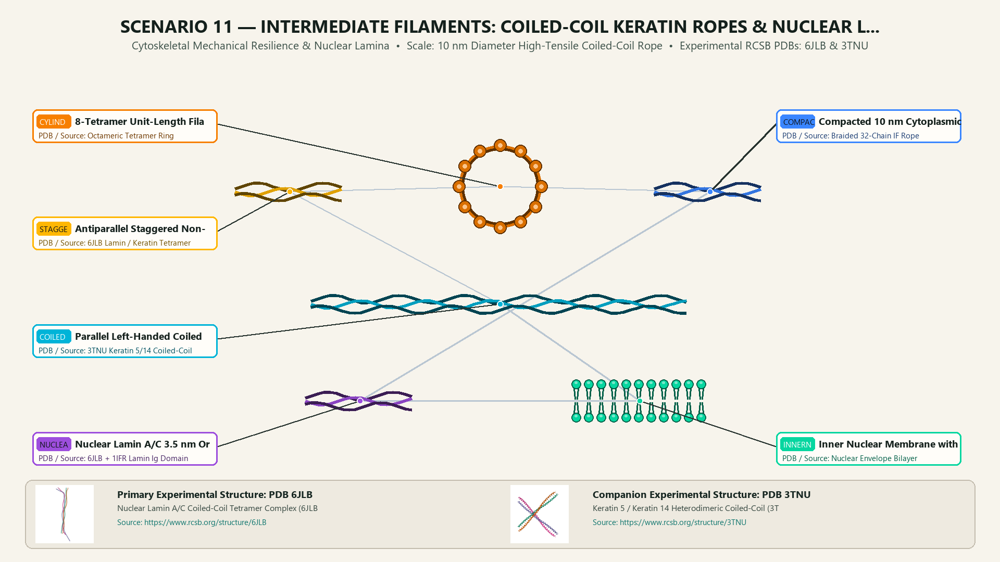
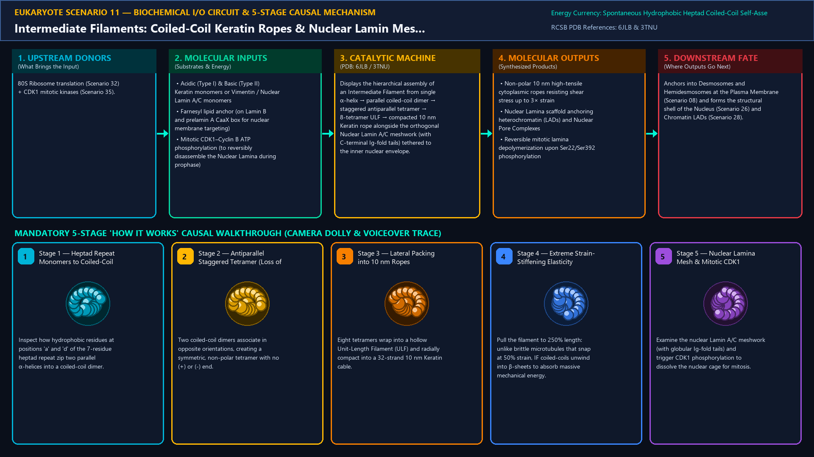
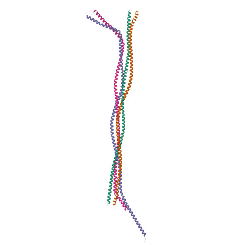
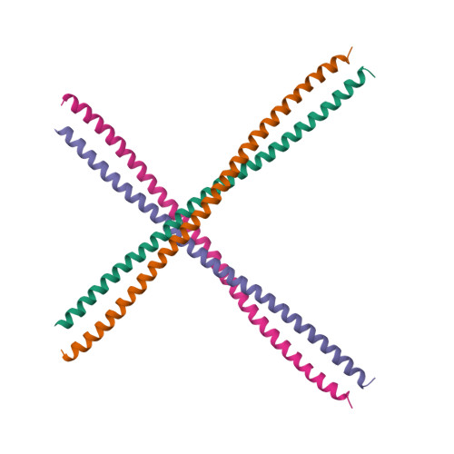
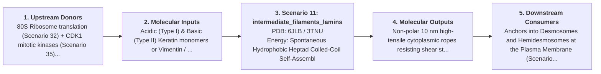

# Scenario 11 — Intermediate Filaments: Coiled-Coil Keratin Ropes & Nuclear Lamin Meshwork

> **Roadmap Tier:** Tier 3 — Cytoskeleton Highways, Cilia & Molecular Walkers ($20\text{--}500\,\text{nm}$)  
> **Scenario ID:** `11_intermediate_filaments_lamins`  
> **Biophysical Scale:** 10 nm Diameter High-Tensile Coiled-Coil Rope  
> **Functional Category:** Cytoskeletal Mechanical Resilience & Nuclear Lamina  
> **Primary RCSB PDB Structures:** [`6JLB`](https://www.rcsb.org/structure/6JLB) (Nuclear Lamin A/C Coiled-Coil Tetramer Complex (6JLB)) · [`3TNU`](https://www.rcsb.org/structure/3TNU) (Keratin 5 / Keratin 14 Heterodimeric Coiled-Coil (3TNU))

---

## 1. Visual & Artistic Representations (Manual Verification Reference Plates)

The following four visual reference plates are stored directly inside this folder (`./`) so you can inspect both the **expected 3D scene decomposition**, the **biochemical I/O circuit & 5-stage mechanism**, and the **experimental cryo-EM / X-ray structures** during manual verification:

### 1.1 Expected 3D Scene & Subunit Decomposition Blueprint (`expected_intermediate_filaments_lamins.png`)

### 1.2 Biochemical I/O Circuit & 5-Stage Causal Mechanism (`mechanism_intermediate_filaments_lamins.png`)

### 1.3 Experimental RCSB PDB Structural References (`rcsb_6JLB.jpg` & `rcsb_3TNU.jpg`)
| Primary Structure [`6JLB`](https://www.rcsb.org/structure/6JLB) | Companion / Partner Structure [`3TNU`](https://www.rcsb.org/structure/3TNU) |
| :---: | :---: |
|  |  |
| **Nuclear Lamin A/C Coiled-Coil Tetramer Complex (6JLB)** | **Keratin 5 / Keratin 14 Heterodimeric Coiled-Coil (3TNU)** |

---

## 2. Biophysical & Molecular Behavior Overview

Unlike F-Actin (7 nm) and Microtubules (25 nm)—which are built from globular nucleotide-hydrolyzing monomers and have structural polarity—Intermediate Filaments (IFs, 10 nm diameter) assemble spontaneously without ATP or GTP from elongated α-helical rod monomers (310-residue heptad repeats). Two parallel monomers wind into a left-handed Coiled-Coil Dimer; two dimers associate antiparallel and staggered into a non-polar Tetramer; eight tetramers pack laterally into a 60 nm Unit-Length Filament (ULF), which anneals end-to-end and radially compacts into an unbreakable 10 nm rope capable of stretching up to 300% of its resting length without snapping! In the cytoplasm, Keratin (epithelia), Vimentin (mesenchyme), and Neurofilaments (axons) absorb extreme mechanical stress via Desmosomes; inside the nucleus, Type V IFs (Lamin A/C and Lamin B1/B2) weave the 3.5 nm thick Nuclear Lamina cage beneath the inner nuclear membrane.

### How It Behaves in the Interactive 3D Scene
Displays the hierarchical assembly of an Intermediate Filament from single α-helix → parallel coiled-coil dimer → staggered antiparallel tetramer → 8-tetramer ULF → compacted 10 nm Keratin rope alongside the orthogonal Nuclear Lamin A/C meshwork (with C-terminal Ig-fold tails) tethered to the inner nuclear envelope.

---

## 3. Complete Biochemical I/O & Inter-Element Iteration

This section defines **what brings the input** to this machine (*Upstream Donors*), **what goes in** (*Molecular Inputs*), **what it makes** (*Molecular Outputs*), and **how it iterates with downstream systems** (*Downstream Consumers*):

- **Upstream Donors (What Brings the Input):**  
  80S Ribosome translation (Scenario 32) + CDK1 mitotic kinases (Scenario 35).
- **Molecular Inputs (Substrates, Signals & Co-Factors):**
  - Acidic (Type I) & Basic (Type II) Keratin monomers or Vimentin / Nuclear Lamin A/C monomers
  - Farnesyl lipid anchor (on Lamin B and prelamin A CaaX box for nuclear membrane targeting)
  - Mitotic CDK1–Cyclin B ATP phosphorylation (to reversibly disassemble the Nuclear Lamina during prophase)
- **Molecular Outputs (Synthesized / Translocated Products):**
  - Non-polar 10 nm high-tensile cytoplasmic ropes resisting shear stress up to 3× strain
  - Nuclear Lamina scaffold anchoring heterochromatin (LADs) and Nuclear Pore Complexes
  - Reversible mitotic lamina depolymerization upon Ser22/Ser392 phosphorylation
- **Downstream Consumers & Cross-Element Iteration:**  
  Anchors into Desmosomes and Hemidesmosomes at the Plasma Membrane (Scenario 08) and forms the structural shell of the Nucleus (Scenario 26) and Chromatin LADs (Scenario 28).
- **Thermodynamic Energy Currency:** `Spontaneous Hydrophobic Heptad Coiled-Coil Self-Assembly (ΔG < 0 without NTP) + ATP (CDK1 mitotic phosphorylation switch)`
- **Biophysical Turnover / Kinetics ($k_{\text{cat}}$):** `Structurally stable for hours to days in interphase; rapid disassembly in <5 minutes upon mitotic CDK1 phosphorylation`

---

## 4. 3D Subunit Decomposition (`Piece_<ID>_*`) & Color Taxonomy

To support continuous **Exploded View (`setExplodedProgress(0.0 → 1.0)`)**, raycast hover inspection, and subpill lock-on targeting, this scenario is decomposed into **6 functional 3D submeshes**:

| # | 3D Submesh ID (`Piece_*`) | Biological & Structural Role | RCSB PDB / Chain Source | Color Taxonomy (`#Hex`) | Exploded Vector $\vec{v}_{\text{dissoc}}$ |
| :--- | :--- | :--- | :--- | :--- | :--- |
| **1** | `Piece_IF_CoiledCoilDimer` | Parallel Left-Handed Coiled-Coil Dimer (Heptad Rod 1A–1B–2A–2B) | `3TNU Keratin 5/14 Coiled-Coil` | `#00B4D8` (Dimer Rod Cerulean) | `(-6.5, +4.0, 0.0)` |
| **2** | `Piece_IF_StaggeredTetramer` | Antiparallel Staggered Non-Polar Tetramer Building Block | `6JLB Lamin / Keratin Tetramer` | `#FFB703` (Tetramer Gold) | `(-2.0, +4.0, +1.5)` |
| **3** | `Piece_IF_ULF_Cylinder` | 8-Tetramer Unit-Length Filament (ULF) Lateral Bundle | `Octameric Tetramer Ring` | `#F77F00` (ULF Bundle Amber) | `(+3.5, +4.0, 0.0)` |
| **4** | `Piece_IF_Compacted10nmRope` | Compacted 10 nm Cytoplasmic Keratin / Vimentin Rope | `Braided 32-Chain IF Rope` | `#3A86FF` (Tensile Rope Cobalt Blue) | `(0.0, 0.0, 0.0)` |
| **5** | `Piece_IF_NuclearLaminMesh` | Nuclear Lamin A/C 3.5 nm Orthogonal Mesh & Ig-Fold Tails | `6JLB + 1IFR Lamin Ig Domain` | `#9D4EDD` (Nuclear Lamina Violet) | `(0.0, -4.0, 0.0)` |
| **6** | `Piece_IF_InnerNuclearMembrane` | Inner Nuclear Membrane with Emerin/SUN LINC Anchors | `Nuclear Envelope Bilayer` | `#06D6A0` (Nuclear Membrane Jade) | `(0.0, -6.0, -2.0)` |

---

## 5. Interactive HUD Simulation Controls (`iterationControls`)

| Control ID | HUD Label | Biophysical Permutations & Interactive Behavior |
| :--- | :--- | :--- |
| `mechanical_strain_pct` | **Mechanical Tensile Stretch (%)** | 0% (Resting Coiled-Coil) to 250% (α-Helix → β-Sheet Strain-Stiffening without Rupture) |
| `cdk1_mitotic_phospho` | **CDK1 Mitotic Phosphorylation (Ser22/Ser392)** | Interphase Intact Nuclear Lamina vs. Mitotic Depolymerized Tetramers |
| `progeria_lmna_mutation` | **HGPS Progeria (Lamin Δ50) Toggle** | Normal Mature Lamin A vs. Permanently Farnesylated Progerin Blebbing |

---

## 6. Mandatory 5-Stage "How It Works" Explanatory Trace

- **Stage 1 — Heptad Repeat Monomers to Coiled-Coil Dimers:** Inspect how hydrophobic residues at positions 'a' and 'd' of the 7-residue heptad repeat zip two parallel α-helices into a coiled-coil dimer.
- **Stage 2 — Antiparallel Staggered Tetramer (Loss of Polarity):** Two coiled-coil dimers associate in opposite orientations, creating a symmetric, non-polar tetramer with no (+) or (-) end.
- **Stage 3 — Lateral Packing into 10 nm Ropes:** Eight tetramers wrap into a hollow Unit-Length Filament (ULF) and radially compact into a 32-strand 10 nm Keratin cable.
- **Stage 4 — Extreme Strain-Stiffening Elasticity:** Pull the filament to 250% length: unlike brittle microtubules that snap at 50% strain, IF coiled-coils unwind into β-sheets to absorb massive mechanical energy.
- **Stage 5 — Nuclear Lamina Mesh & Mitotic CDK1 Disassembly:** Examine the nuclear Lamin A/C meshwork (with globular Ig-fold tails) and trigger CDK1 phosphorylation to dissolve the nuclear cage for mitosis.

---

## 7. Curated Online Resources & Structural References

- [RCSB PDB Structure 6JLB — Human Nuclear Lamin A/C Coiled-Coil](https://www.rcsb.org/structure/6JLB)
- [RCSB PDB Structure 3TNU — Keratin 5/14 Heterodimer](https://www.rcsb.org/structure/3TNU)
- [NCBI Bookshelf — Molecular Biology of the Cell: Intermediate Filaments](https://www.ncbi.nlm.nih.gov/books/NBK26862/)
- [Cold Spring Harbor Perspectives — Intermediate Filaments & Nuclear Lamins](https://cshperspectives.cshlp.org/content/8/11/a018242.full)
