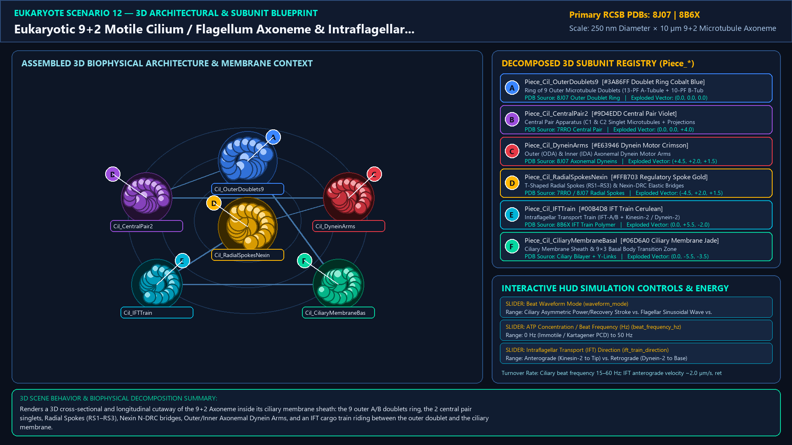
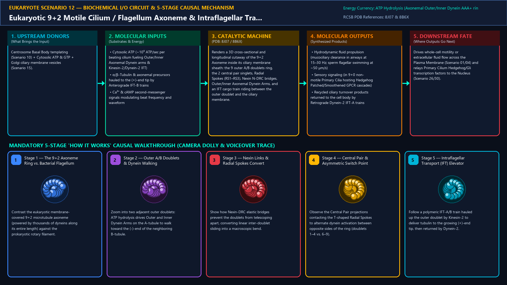
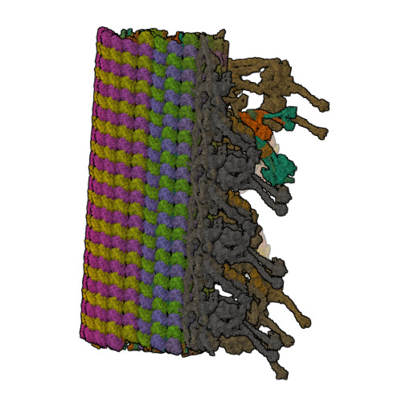
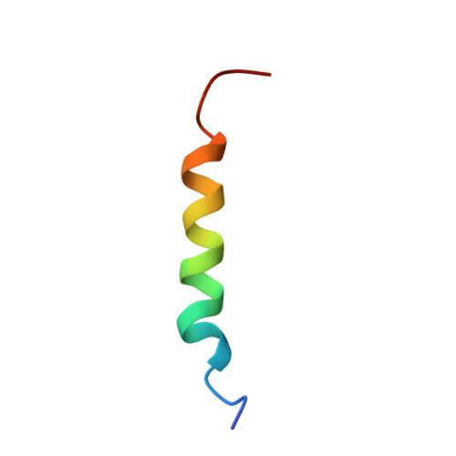
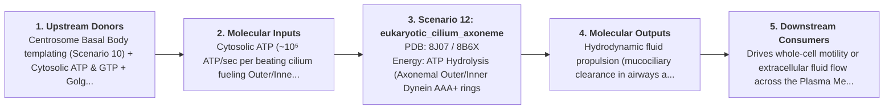
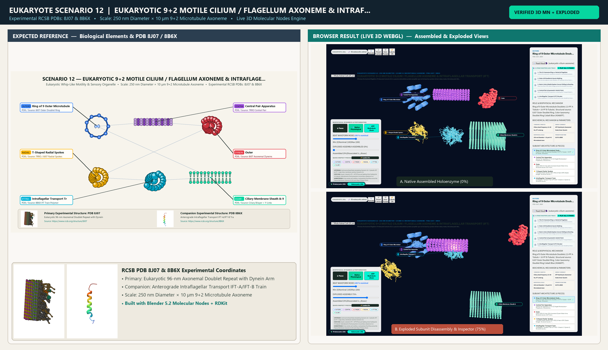

# Scenario 12 — Eukaryotic 9+2 Motile Cilium / Flagellum Axoneme & Intraflagellar Transport (IFT)

> **Roadmap Tier:** Tier 3 — Cytoskeleton Highways, Cilia & Molecular Walkers ($20\text{--}500\,\text{nm}$)  
> **Scenario ID:** `12_eukaryotic_cilium_axoneme`  
> **Biophysical Scale:** 250 nm Diameter × 10 µm 9+2 Microtubule Axoneme  
> **Functional Category:** Eukaryotic Whip-Like Motility & Sensory Organelle  
> **Primary RCSB PDB Structures:** [`8J07`](https://www.rcsb.org/structure/8J07) (Eukaryotic 96-nm Axonemal Doublet Repeat with Dynein Arms (8J07)) · [`8B6X`](https://www.rcsb.org/structure/8B6X) (Anterograde Intraflagellar Transport IFT-A/IFT-B Train (8B6X))

---

## 1. Visual & Artistic Representations (Manual Verification Reference Plates)

The following four visual reference plates are stored directly inside this folder (`./`) so you can inspect both the **expected 3D scene decomposition**, the **biochemical I/O circuit & 5-stage mechanism**, and the **experimental cryo-EM / X-ray structures** during manual verification:

### 1.1 Expected 3D Scene & Subunit Decomposition Blueprint (`expected_eukaryotic_cilium_axoneme.png`)

### 1.2 Biochemical I/O Circuit & 5-Stage Causal Mechanism (`mechanism_eukaryotic_cilium_axoneme.png`)

### 1.3 Experimental RCSB PDB Structural References (`rcsb_8J07.jpg` & `rcsb_8B6X.jpg`)
| Primary Structure [`8J07`](https://www.rcsb.org/structure/8J07) | Companion / Partner Structure [`8B6X`](https://www.rcsb.org/structure/8B6X) |
| :---: | :---: |
|  |  |
| **Eukaryotic 96-nm Axonemal Doublet Repeat with Dynein Arms (8J07)** | **Anterograde Intraflagellar Transport IFT-A/IFT-B Train (8B6X)** |

---

## 2. Biophysical & Molecular Behavior Overview

Whereas the bacterial flagellum (Prokaryote Scenario 02) is a passive extracellular protein propeller spun at its base by a proton-driven rotary motor, the Eukaryotic Motile Cilium / Flagellum is a membrane-enclosed cytoplasmic extension containing the breathtaking 250 nm '9+2 Axoneme' (>600 proteins). Anchored at the cell surface by a 9×3 triplet Basal Body (centriole) and gated by the Y-link Transition Zone, the axoneme consists of 9 outer Microtubule Doublets (each with a complete 13-protofilament A-tubule and an incomplete 10-protofilament B-tubule) surrounding a Central Pair of 2 singlet microtubules. Every 24 nm and 96 nm along each A-tubule sit Outer Dynein Arms (ODA) and Inner Dynein Arms (IDA) that reach across to walk toward the (-)-end of the neighboring B-tubule. Because elastic Nexin–Dynein Regulatory Complex (N-DRC) links and Radial Spokes tie the doublets together, inter-doublet sliding is converted into powerful planar whip-like ciliary power/recovery strokes or sinusoidal flagellar waves. Meanwhile, Intraflagellar Transport (IFT-A/B) trains pulled by Kinesin-2 (up) and Dynein-2 (down) build and maintain the tip.

### How It Behaves in the Interactive 3D Scene
Renders a 3D cross-sectional and longitudinal cutaway of the 9+2 Axoneme inside its ciliary membrane sheath: the 9 outer A/B doublets ring, the 2 central pair singlets, Radial Spokes (RS1–RS3), Nexin N-DRC bridges, Outer/Inner Axonemal Dynein Arms, and an IFT cargo train riding between the outer doublet and the ciliary membrane.

---

## 3. Complete Biochemical I/O & Inter-Element Iteration

This section defines **what brings the input** to this machine (*Upstream Donors*), **what goes in** (*Molecular Inputs*), **what it makes** (*Molecular Outputs*), and **how it iterates with downstream systems** (*Downstream Consumers*):

- **Upstream Donors (What Brings the Input):**  
  Centrosome Basal Body templating (Scenario 10) + Cytosolic ATP & GTP + Golgi ciliary membrane vesicles (Scenario 15).
- **Molecular Inputs (Substrates, Signals & Co-Factors):**
  - Cytosolic ATP (~10⁵ ATP/sec per beating cilium fueling Outer/Inner Axonemal Dynein arms & Kinesin-2/Dynein-2 IFT)
  - α/β-Tubulin & axonemal precursors hauled to the (+)-end tip by Anterograde IFT-B trains
  - Ca²⁺ & cAMP second-messenger signals modulating beat frequency and waveform
- **Molecular Outputs (Synthesized / Translocated Products):**
  - Hydrodynamic fluid propulsion (mucociliary clearance in airways at 15–30 Hz; sperm flagellar swimming at ~50 µm/s)
  - Sensory signaling (in 9+0 non-motile Primary Cilia hosting Hedgehog Patched/Smoothened GPCR cascades)
  - Recycled ciliary turnover products returned to the cell body by Retrograde Dynein-2 IFT-A trains
- **Downstream Consumers & Cross-Element Iteration:**  
  Drives whole-cell motility or extracellular fluid flow across the Plasma Membrane (Scenario 01/04) and relays Primary Cilium Hedgehog/Gli transcription factors to the Nucleus (Scenario 26/30).
- **Thermodynamic Energy Currency:** `ATP Hydrolysis (Axonemal Outer/Inner Dynein AAA+ rings + IFT Kinesin-2 / Dynein-2 motors)`
- **Biophysical Turnover / Kinetics ($k_{\text{cat}}$):** `Ciliary beat frequency 15–60 Hz; IFT anterograde velocity ~2.0 µm/s, retrograde velocity ~3.0 µm/s`

---

## 4. 3D Subunit Decomposition (`Piece_<ID>_*`) & Color Taxonomy

To support continuous **Exploded View (`setExplodedProgress(0.0 → 1.0)`)**, raycast hover inspection, and subpill lock-on targeting, this scenario is decomposed into **6 functional 3D submeshes**:

| # | 3D Submesh ID (`Piece_*`) | Biological & Structural Role | RCSB PDB / Chain Source | Color Taxonomy (`#Hex`) | Exploded Vector $\vec{v}_{\text{dissoc}}$ |
| :--- | :--- | :--- | :--- | :--- | :--- |
| **1** | `Piece_Cil_OuterDoublets9` | Ring of 9 Outer Microtubule Doublets (13-PF A-Tubule + 10-PF B-Tubule) | `8J07 Outer Doublet Ring` | `#3A86FF` (Doublet Ring Cobalt Blue) | `(0.0, 0.0, 0.0)` |
| **2** | `Piece_Cil_CentralPair2` | Central Pair Apparatus (C1 & C2 Singlet Microtubules + Projections) | `7RRO Central Pair` | `#9D4EDD` (Central Pair Violet) | `(0.0, 0.0, +4.0)` |
| **3** | `Piece_Cil_DyneinArms` | Outer (ODA) & Inner (IDA) Axonemal Dynein Motor Arms | `8J07 Axonemal Dyneins` | `#E63946` (Dynein Motor Crimson) | `(+4.5, +2.0, +1.5)` |
| **4** | `Piece_Cil_RadialSpokesNexin` | T-Shaped Radial Spokes (RS1–RS3) & Nexin-DRC Elastic Bridges | `7RRO / 8J07 Radial Spokes` | `#FFB703` (Regulatory Spoke Gold) | `(-4.5, +2.0, +1.5)` |
| **5** | `Piece_Cil_IFTTrain` | Intraflagellar Transport Train (IFT-A/B + Kinesin-2 / Dynein-2) | `8B6X IFT Train Polymer` | `#00B4D8` (IFT Train Cerulean) | `(0.0, +5.5, -2.0)` |
| **6** | `Piece_Cil_CiliaryMembraneBasal` | Ciliary Membrane Sheath & 9×3 Basal Body Transition Zone | `Ciliary Bilayer + Y-Links` | `#06D6A0` (Ciliary Membrane Jade) | `(0.0, -5.5, -3.5)` |

---

## 5. Interactive HUD Simulation Controls (`iterationControls`)

| Control ID | HUD Label | Biophysical Permutations & Interactive Behavior |
| :--- | :--- | :--- |
| `waveform_mode` | **Beat Waveform Mode** | Ciliary Asymmetric Power/Recovery Stroke vs. Flagellar Sinusoidal Wave vs. 9+0 Primary Cilium |
| `beat_frequency_hz` | **ATP Concentration / Beat Frequency (Hz)** | 0 Hz (Immotile / Kartagener PCD) to 50 Hz |
| `ift_train_direction` | **Intraflagellar Transport (IFT) Direction** | Anterograde (Kinesin-2 to Tip) vs. Retrograde (Dynein-2 to Base) |

---

## 6. Mandatory 5-Stage "How It Works" Explanatory Trace

- **Stage 1 — The 9+2 Axoneme Ring vs. Bacterial Flagellum:** Contrast the eukaryotic membrane-covered 9+2 microtubule axoneme (powered by thousands of dyneins along its entire length) against the prokaryotic rotary filament.
- **Stage 2 — Outer A/B Doublets & Dynein Walking:** Zoom into two adjacent outer doublets: ATP hydrolysis drives Outer and Inner Dynein Arms on the A-tubule to walk toward the (-)-end of the neighboring B-tubule.
- **Stage 3 — Nexin Links & Radial Spokes Convert Sliding to Bending:** Show how Nexin-DRC elastic bridges prevent the doublets from telescoping apart, converting linear inter-doublet sliding into a macroscopic bend.
- **Stage 4 — Central Pair & Asymmetric Switch Point:** Observe the Central Pair projections contacting the T-shaped Radial Spokes to alternate dynein activation between opposite sides of the ring (doublets 1–4 vs. 6–9).
- **Stage 5 — Intraflagellar Transport (IFT) Elevator:** Follow a polymeric IFT-A/B train hauled up the outer doublet by Kinesin-2 to deliver tubulin to the growing (+)-end tip, then returned by Dynein-2.

---

## 7. Curated Online Resources & Structural References

- [RCSB PDB Structure 8J07 — 96-nm Modular Repeat of Human Respiratory Doublet Microtubule](https://www.rcsb.org/structure/8J07)
- [RCSB PDB Structure 8B6X — Anterograde Intraflagellar Transport Train](https://www.rcsb.org/structure/8B6X)
- [RCSB PDB-101 — Molecule of the Month: Dynein](https://pdb101.rcsb.org/motm/214)
- [Nature Reviews Molecular Cell Biology — Structure and Function of Cilia and Flagella](https://www.nature.com/articles/s41580-018-0092-2)

## 12. 3D Implementation & Visual Verification Assets

- **Status:** `[x] Implemented, Exported to 3D GLB & Visually Verified`
- **3D Model Asset (`.glb`):** [`eukaryotic_cilium_axoneme.glb`](./eukaryotic_cilium_axoneme.glb) (also mirrored in `eukaryote/models/eukaryotic_cilium_axoneme.glb` and `client/public/eukaryote/models/eukaryotic_cilium_axoneme.glb`)
- **Blender 5.2 + Molecular Nodes Generator Script:** [`generate_12_eukaryotic_cilium_axoneme.py`](./generate_12_eukaryotic_cilium_axoneme.py)
- **Live WebGL Assembled Capture (`0%`):** [`browser_eukaryotic_cilium_axoneme_assembled.png`](../../verification/12_eukaryotic_cilium_axoneme/browser_eukaryotic_cilium_axoneme_assembled.png)
- **Live WebGL Exploded Capture (`75%`):** [`browser_eukaryotic_cilium_axoneme_exploded.png`](../../verification/12_eukaryotic_cilium_axoneme/browser_eukaryotic_cilium_axoneme_exploded.png)
- **Side-by-Side Input vs. Output Comparison Plate (`2400×1380`):** [`comparison_eukaryotic_cilium_axoneme.png`](../../verification/12_eukaryotic_cilium_axoneme/comparison_eukaryotic_cilium_axoneme.png)
- **Animated Side-by-Side Comparison Video (`1920×1080 MP4`):** [`comparison_eukaryotic_cilium_axoneme.mp4`](../../verification/12_eukaryotic_cilium_axoneme/comparison_eukaryotic_cilium_axoneme.mp4)

