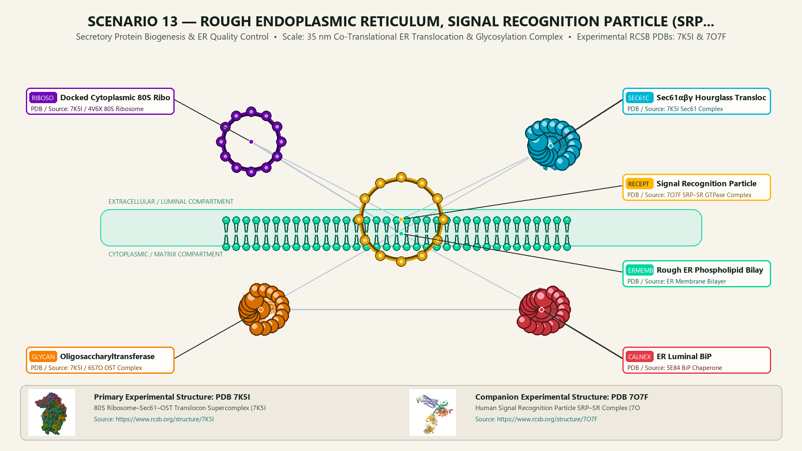
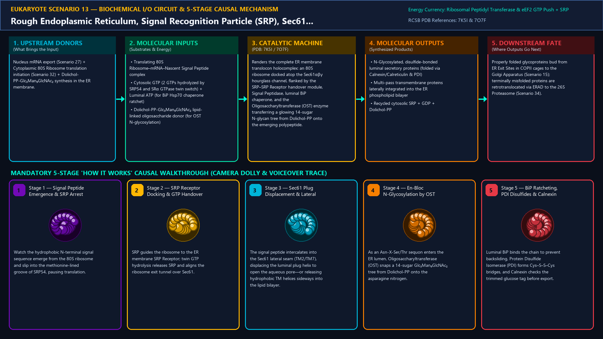
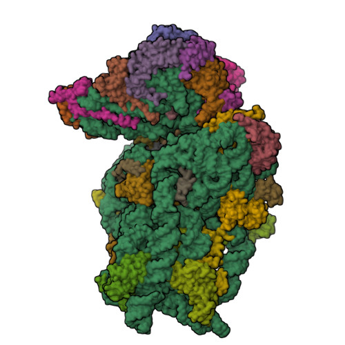
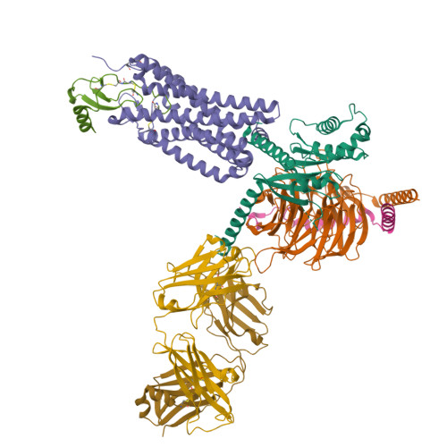
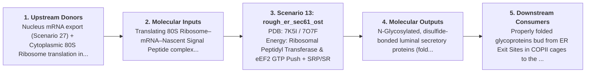
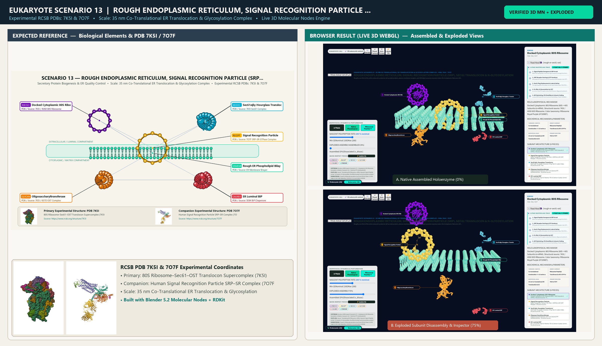

# Scenario 13 — Rough Endoplasmic Reticulum, Signal Recognition Particle (SRP), Sec61 Translocon & N-Glycosylation

> **Roadmap Tier:** Tier 4 — The Endomembrane Secretory & Degradative System ($50\,\text{nm}\text{--}2\,\mu\text{m}$)  
> **Scenario ID:** `13_rough_er_sec61_ost`  
> **Biophysical Scale:** 35 nm Co-Translational ER Translocation & Glycosylation Complex  
> **Functional Category:** Secretory Protein Biogenesis & ER Quality Control  
> **Primary RCSB PDB Structures:** [`7K5I`](https://www.rcsb.org/structure/7K5I) (80S Ribosome–Sec61–OST Translocon Supercomplex (7K5I)) · [`7O7F`](https://www.rcsb.org/structure/7O7F) (Human Signal Recognition Particle SRP–SR Complex (7O7F))

---

## 1. Visual & Artistic Representations (Manual Verification Reference Plates)

The following four visual reference plates are stored directly inside this folder (`./`) so you can inspect both the **expected 3D scene decomposition**, the **biochemical I/O circuit & 5-stage mechanism**, and the **experimental cryo-EM / X-ray structures** during manual verification:

### 1.1 Expected 3D Scene & Subunit Decomposition Blueprint (`expected_rough_er_sec61_ost.png`)

### 1.2 Biochemical I/O Circuit & 5-Stage Causal Mechanism (`mechanism_rough_er_sec61_ost.png`)

### 1.3 Experimental RCSB PDB Structural References (`rcsb_7K5I.jpg` & `rcsb_7O7F.jpg`)
| Primary Structure [`7K5I`](https://www.rcsb.org/structure/7K5I) | Companion / Partner Structure [`7O7F`](https://www.rcsb.org/structure/7O7F) |
| :---: | :---: |
|  |  |
| **80S Ribosome–Sec61–OST Translocon Supercomplex (7K5I)** | **Human Signal Recognition Particle SRP–SR Complex (7O7F)** |

---

## 2. Biophysical & Molecular Behavior Overview

Roughly one-third of the entire eukaryotic proteome (all secreted proteins, plasma membrane receptors, and ER/Golgi/Lysosome enzymes) enters the Endoplasmic Reticulum (ER) co-translationally. As an N-terminal hydrophobic Signal Peptide emerges from the 60S ribosomal exit tunnel, the ribonucleoprotein Signal Recognition Particle (SRP, containing 7SL RNA and the methionine-rich SRP54 M-domain cleft) clamps onto the peptide and pauses elongation. SRP docks onto the ER membrane SRP Receptor (SRα/β); reciprocal GTP hydrolysis hands the 80S ribosome directly onto the hourglass Sec61αβγ Translocon (the eukaryotic homolog of bacterial SecYEG). As translation resumes, the nascent polypeptide threads through the Sec61 pore (or exits its lateral gate into the ER lipid bilayer), Signal Peptidase cleaves the leader sequence, luminal BiP (Hsp70) ratchets the chain inward, and the 8-subunit Oligosaccharyltransferase (OST) complex transfers a pre-assembled 14-sugar oligosaccharide tree (Glc₃Man₉GlcNAc₂) from a Dolichol-pyrophosphate lipid carrier onto Asn-X-Ser/Thr motifs.

### How It Behaves in the Interactive 3D Scene
Renders the complete ER membrane translocon holocomplex: an 80S ribosome docked atop the Sec61αβγ hourglass channel, flanked by the SRP–SRP Receptor handover module, Signal Peptidase, luminal BiP chaperone, and the Oligosaccharyltransferase (OST) enzyme transferring a glowing 14-sugar N-glycan tree from Dolichol-PP onto the emerging polypeptide.

---

## 3. Complete Biochemical I/O & Inter-Element Iteration

This section defines **what brings the input** to this machine (*Upstream Donors*), **what goes in** (*Molecular Inputs*), **what it makes** (*Molecular Outputs*), and **how it iterates with downstream systems** (*Downstream Consumers*):

- **Upstream Donors (What Brings the Input):**  
  Nucleus mRNA export (Scenario 27) + Cytoplasmic 80S Ribosome translation initiation (Scenario 32) + Dolichol-PP-Glc₃Man₉GlcNAc₂ synthesis in the ER membrane.
- **Molecular Inputs (Substrates, Signals & Co-Factors):**
  - Translating 80S Ribosome–mRNA–Nascent Signal Peptide complex
  - Cytosolic GTP (2 GTPs hydrolyzed by SRP54 and SRα GTPase twin switch) + Luminal ATP (for BiP Hsp70 chaperone ratchet)
  - Dolichol-PP-Glc₃Man₉GlcNAc₂ lipid-linked oligosaccharide donor (for OST N-glycosylation)
- **Molecular Outputs (Synthesized / Translocated Products):**
  - N-Glycosylated, disulfide-bonded luminal secretory proteins (folded via Calnexin/Calreticulin & PDI)
  - Multi-pass transmembrane proteins laterally integrated into the ER phospholipid bilayer
  - Recycled cytosolic SRP + GDP + Dolichol-PP
- **Downstream Consumers & Cross-Element Iteration:**  
  Properly folded glycoproteins bud from ER Exit Sites in COPII cages to the Golgi Apparatus (Scenario 15); terminally misfolded proteins are retrotranslocated via ERAD to the 26S Proteasome (Scenario 34).
- **Thermodynamic Energy Currency:** `Ribosomal Peptidyl Transferase & eEF2 GTP Push + SRP/SR GTPase Switch + Luminal BiP ATPase Ratchet`
- **Biophysical Turnover / Kinetics ($k_{\text{cat}}$):** `Co-translational translocation ~5–10 amino acids/sec; OST N-glycosylation transfer within milliseconds of Asn-X-Ser/Thr clearing Sec61`

---

## 4. 3D Subunit Decomposition (`Piece_<ID>_*`) & Color Taxonomy

To support continuous **Exploded View (`setExplodedProgress(0.0 → 1.0)`)**, raycast hover inspection, and subpill lock-on targeting, this scenario is decomposed into **6 functional 3D submeshes**:

| # | 3D Submesh ID (`Piece_*`) | Biological & Structural Role | RCSB PDB / Chain Source | Color Taxonomy (`#Hex`) | Exploded Vector $\vec{v}_{\text{dissoc}}$ |
| :--- | :--- | :--- | :--- | :--- | :--- |
| **1** | `Piece_RER_Ribosome80S` | Docked Cytoplasmic 80S Ribosome (60S + 40S Subunits & mRNA) | `7K5I / 4V6X 80S Ribosome` | `#7209B7` (Ribosome Royal Purple) | `(0.0, +4.5, 0.0)` |
| **2** | `Piece_RER_SRP_Receptor` | Signal Recognition Particle (7SL RNA + SRP54) & ER SRP Receptor | `7O7F SRP–SR GTPase Complex` | `#FFB703` (SRP Targeting Gold) | `(-5.0, +3.0, +2.0)` |
| **3** | `Piece_RER_Sec61Channel` | Sec61αβγ Hourglass Translocon (Plug Helix & Lateral Gate) | `7K5I Sec61 Complex` | `#00B4D8` (Translocon Cerulean) | `(0.0, 0.0, 0.0)` |
| **4** | `Piece_RER_OST_Glycan` | Oligosaccharyltransferase (OST-A) & Dolichol-PP-Glc₃Man₉GlcNAc₂ | `7K5I / 6S7O OST Complex` | `#F77F00` (Glycosyltransferase Amber) | `(+4.5, -0.5, +1.5)` |
| **5** | `Piece_RER_BiP_Calnexin` | ER Luminal BiP (Hsp70) Ratchet, PDI & Calnexin Quality Control | `5E84 BiP Chaperone` | `#E63946` (Luminal Chaperone Crimson) | `(0.0, -4.5, +1.5)` |
| **6** | `Piece_RER_ERMembrane` | Rough ER Phospholipid Bilayer Sheet | `ER Membrane Bilayer` | `#06D6A0` (ER Membrane Jade) | `(0.0, 0.0, -2.5)` |

---

## 5. Interactive HUD Simulation Controls (`iterationControls`)

| Control ID | HUD Label | Biophysical Permutations & Interactive Behavior |
| :--- | :--- | :--- |
| `cargo_topology_mode` | **Nascent Polypeptide Fate** | Soluble Luminal Secretion (Pore Threading) vs. Transmembrane Helix (Sec61 Lateral Gate Exit) |
| `tunicamycin_inhibitor` | **Tunicamycin N-Glycosylation Inhibitor & ER Stress (UPR)** | Normal OST Glycosylation vs. Unfolded Protein Response (BiP overload) |
| `translocation_speed` | **Co-Translational Elongation Rate** | 0.0x to 2.5x |

---

## 6. Mandatory 5-Stage "How It Works" Explanatory Trace

- **Stage 1 — Signal Peptide Emergence & SRP Arrest:** Watch the hydrophobic N-terminal signal sequence emerge from the 80S ribosome and slip into the methionine-lined groove of SRP54, pausing translation.
- **Stage 2 — SRP Receptor Docking & GTP Handover:** SRP guides the ribosome to the ER membrane SRP Receptor; twin GTP hydrolysis releases SRP and aligns the ribosome exit tunnel over Sec61.
- **Stage 3 — Sec61 Plug Displacement & Lateral Gating:** The signal peptide intercalates into the Sec61 lateral seam (TM2/TM7), displacing the luminal plug helix to open the aqueous pore—or releasing hydrophobic TM helices sideways into the lipid bilayer.
- **Stage 4 — En-Bloc N-Glycosylation by OST:** As an Asn-X-Ser/Thr sequon enters the ER lumen, Oligosaccharyltransferase (OST) snaps a 14-sugar Glc₃Man₉GlcNAc₂ tree from Dolichol-PP onto the asparagine nitrogen.
- **Stage 5 — BiP Ratcheting, PDI Disulfides & Calnexin Folding:** Luminal BiP binds the chain to prevent backsliding, Protein Disulfide Isomerase (PDI) forms Cys–S–S–Cys bridges, and Calnexin checks the trimmed glucose tag before export.

---

## 7. Curated Online Resources & Structural References

- [RCSB PDB-101 — Molecule of the Month: Signal Recognition Particle](https://pdb101.rcsb.org/motm/212)
- [RCSB PDB Structure 7K5I — Mammalian 80S Ribosome–Sec61–OST Complex](https://www.rcsb.org/structure/7K5I)
- [RCSB PDB Structure 7O7F — Human SRP–Receptor Pre-Handover Complex](https://www.rcsb.org/structure/7O7F)
- [NCBI Bookshelf — Molecular Biology of the Cell: The Endoplasmic Reticulum](https://www.ncbi.nlm.nih.gov/books/NBK26841/)

## 12. 3D Implementation & Visual Verification Assets

- **Status:** `[x] Implemented, Exported to 3D GLB & Visually Verified`
- **3D Model Asset (`.glb`):** [`rough_er_sec61_ost.glb`](./rough_er_sec61_ost.glb) (also mirrored in `eukaryote/models/rough_er_sec61_ost.glb` and `client/public/eukaryote/models/rough_er_sec61_ost.glb`)
- **Blender 5.2 + Molecular Nodes Generator Script:** [`generate_13_rough_er_sec61_ost.py`](./generate_13_rough_er_sec61_ost.py)
- **Live WebGL Assembled Capture (`0%`):** [`browser_rough_er_sec61_ost_assembled.png`](../../verification/13_rough_er_sec61_ost/browser_rough_er_sec61_ost_assembled.png)
- **Live WebGL Exploded Capture (`75%`):** [`browser_rough_er_sec61_ost_exploded.png`](../../verification/13_rough_er_sec61_ost/browser_rough_er_sec61_ost_exploded.png)
- **Side-by-Side Input vs. Output Comparison Plate (`2400×1380`):** [`comparison_rough_er_sec61_ost.png`](../../verification/13_rough_er_sec61_ost/comparison_rough_er_sec61_ost.png)
- **Animated Side-by-Side Comparison Video (`1920×1080 MP4`):** [`comparison_rough_er_sec61_ost.mp4`](../../verification/13_rough_er_sec61_ost/comparison_rough_er_sec61_ost.mp4)

