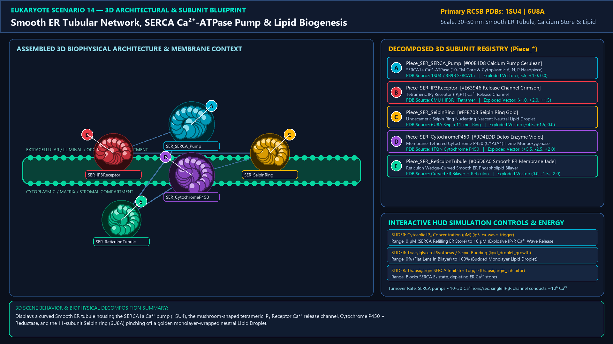
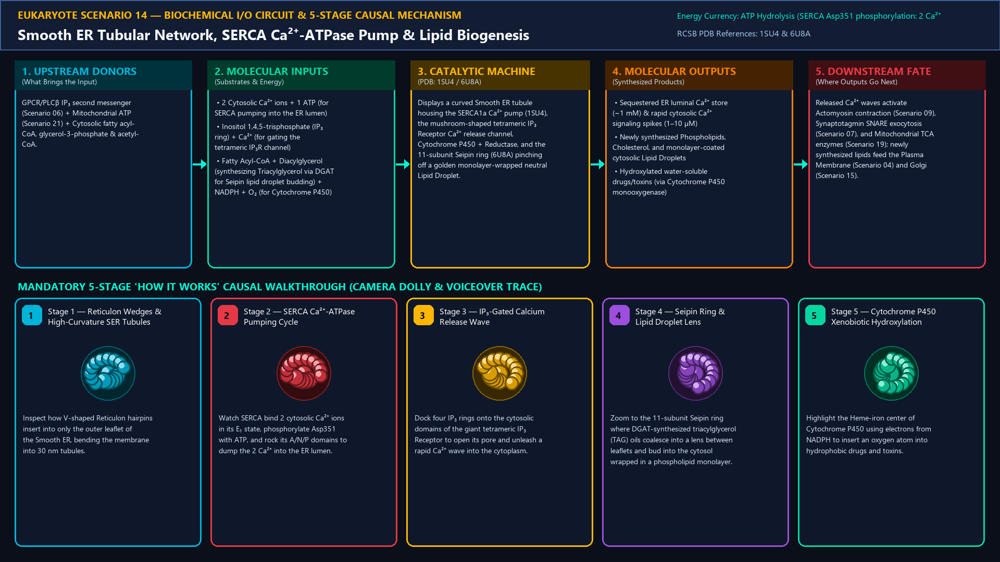
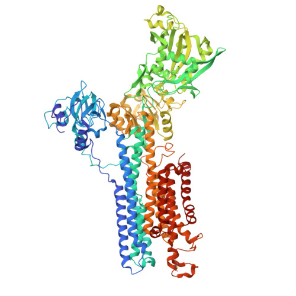
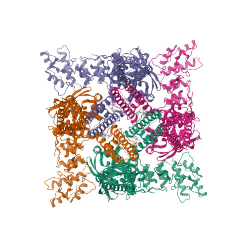
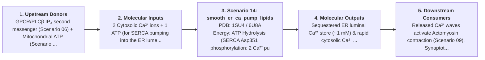
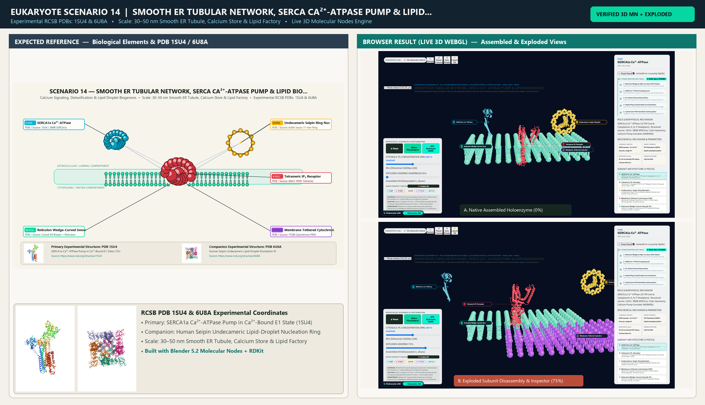

# Scenario 14 — Smooth ER Tubular Network, SERCA Ca²⁺-ATPase Pump & Lipid Biogenesis

> **Roadmap Tier:** Tier 4 — The Endomembrane Secretory & Degradative System ($50\,\text{nm}\text{--}2\,\mu\text{m}$)  
> **Scenario ID:** `14_smooth_er_ca_pump_lipids`  
> **Biophysical Scale:** 30–50 nm Smooth ER Tubule, Calcium Store & Lipid Factory  
> **Functional Category:** Calcium Signaling, Detoxification & Lipid Droplet Biogenesis  
> **Primary RCSB PDB Structures:** [`1SU4`](https://www.rcsb.org/structure/1SU4) (SERCA1a Ca²⁺-ATPase Pump in Ca²⁺-Bound E1 State (1SU4)) · [`6U8A`](https://www.rcsb.org/structure/6U8A) (Human Seipin Undecameric Lipid-Droplet Nucleation Ring (6U8A))

---

## 1. Visual & Artistic Representations (Manual Verification Reference Plates)

The following four visual reference plates are stored directly inside this folder (`./`) so you can inspect both the **expected 3D scene decomposition**, the **biochemical I/O circuit & 5-stage mechanism**, and the **experimental cryo-EM / X-ray structures** during manual verification:

### 1.1 Expected 3D Scene & Subunit Decomposition Blueprint (`expected_smooth_er_ca_pump_lipids.png`)

### 1.2 Biochemical I/O Circuit & 5-Stage Causal Mechanism (`mechanism_smooth_er_ca_pump_lipids.png`)

### 1.3 Experimental RCSB PDB Structural References (`rcsb_1SU4.jpg` & `rcsb_6U8A.jpg`)
| Primary Structure [`1SU4`](https://www.rcsb.org/structure/1SU4) | Companion / Partner Structure [`6U8A`](https://www.rcsb.org/structure/6U8A) |
| :---: | :---: |
|  |  |
| **SERCA1a Ca²⁺-ATPase Pump in Ca²⁺-Bound E1 State (1SU4)** | **Human Seipin Undecameric Lipid-Droplet Nucleation Ring (6U8A)** |

---

## 2. Biophysical & Molecular Behavior Overview

The Smooth Endoplasmic Reticulum (SER) is a ribosome-free labyrinth of high-curvature 30–50 nm membrane tubules sculpted by hair-pin Reticulon wedges. It serves three indispensable metabolic and signaling functions: (1) Intracellular Ca²⁺ Capacitor: The Sarco/Endoplasmic Reticulum Ca²⁺-ATPase (SERCA) burns 1 ATP to pump 2 cytosolic Ca²⁺ ions into the ER lumen (maintaining resting cytosolic Ca²⁺ at ~100 nM vs. ~1 mM inside the ER), while giant tetrameric IP₃ Receptors (IP₃R) and Ryanodine Receptors (RyR) unleash explosive Ca²⁺ waves upon second-messenger arrival; (2) De Novo Lipid & Sterol Synthesis + Lipid Droplet Budding: Synthesizes phospholipids, ceramide, and cholesterol, while the 11-subunit Seipin Cage Ring traps neutral triacylglycerols (TAG) between leaflets to bud cytosolic Lipid Droplets; and (3) Xenobiotic Detoxification via Heme-containing Cytochrome P450 (CYP) monooxygenases.

### How It Behaves in the Interactive 3D Scene
Displays a curved Smooth ER tubule housing the SERCA1a Ca²⁺ pump (1SU4), the mushroom-shaped tetrameric IP₃ Receptor Ca²⁺ release channel, Cytochrome P450 + Reductase, and the 11-subunit Seipin ring (6U8A) pinching off a golden monolayer-wrapped neutral Lipid Droplet.

---

## 3. Complete Biochemical I/O & Inter-Element Iteration

This section defines **what brings the input** to this machine (*Upstream Donors*), **what goes in** (*Molecular Inputs*), **what it makes** (*Molecular Outputs*), and **how it iterates with downstream systems** (*Downstream Consumers*):

- **Upstream Donors (What Brings the Input):**  
  GPCR/PLCβ IP₃ second messenger (Scenario 06) + Mitochondrial ATP (Scenario 21) + Cytosolic fatty acyl-CoA, glycerol-3-phosphate & acetyl-CoA.
- **Molecular Inputs (Substrates, Signals & Co-Factors):**
  - 2 Cytosolic Ca²⁺ ions + 1 ATP (for SERCA pumping into the ER lumen)
  - Inositol 1,4,5-trisphosphate (IP₃ ring) + Ca²⁺ (for gating the tetrameric IP₃R channel)
  - Fatty Acyl-CoA + Diacylglycerol (synthesizing Triacylglycerol via DGAT for Seipin lipid droplet budding) + NADPH + O₂ (for Cytochrome P450)
- **Molecular Outputs (Synthesized / Translocated Products):**
  - Sequestered ER luminal Ca²⁺ store (~1 mM) & rapid cytosolic Ca²⁺ signaling spikes (1–10 µM)
  - Newly synthesized Phospholipids, Cholesterol, and monolayer-coated cytosolic Lipid Droplets
  - Hydroxylated water-soluble drugs/toxins (via Cytochrome P450 monooxygenase)
- **Downstream Consumers & Cross-Element Iteration:**  
  Released Ca²⁺ waves activate Actomyosin contraction (Scenario 09), Synaptotagmin SNARE exocytosis (Scenario 07), and Mitochondrial TCA enzymes (Scenario 19); newly synthesized lipids feed the Plasma Membrane (Scenario 04) and Golgi (Scenario 15).
- **Thermodynamic Energy Currency:** `ATP Hydrolysis (SERCA Asp351 phosphorylation: 2 Ca²⁺ pumped per 1 ATP) + NADPH (Cytochrome P450 electron donor)`
- **Biophysical Turnover / Kinetics ($k_{\text{cat}}$):** `SERCA pumps ~10–30 Ca²⁺ ions/sec; single IP₃R channel conducts ~10⁶ Ca²⁺ ions/sec when open`

---

## 4. 3D Subunit Decomposition (`Piece_<ID>_*`) & Color Taxonomy

To support continuous **Exploded View (`setExplodedProgress(0.0 → 1.0)`)**, raycast hover inspection, and subpill lock-on targeting, this scenario is decomposed into **6 functional 3D submeshes**:

| # | 3D Submesh ID (`Piece_*`) | Biological & Structural Role | RCSB PDB / Chain Source | Color Taxonomy (`#Hex`) | Exploded Vector $\vec{v}_{\text{dissoc}}$ |
| :--- | :--- | :--- | :--- | :--- | :--- |
| **1** | `Piece_SER_SERCA_Pump` | SERCA1a Ca²⁺-ATPase (10-TM Core & Cytoplasmic A, N, P Headpiece) | `1SU4 / 3B9B SERCA1a` | `#00B4D8` (Calcium Pump Cerulean) | `(-5.5, +1.0, 0.0)` |
| **2** | `Piece_SER_IP3Receptor` | Tetrameric IP₃ Receptor (IP₃R1) Ca²⁺ Release Channel | `6MU1 IP3R1 Tetramer` | `#E63946` (Release Channel Crimson) | `(-1.0, +2.0, +1.5)` |
| **3** | `Piece_SER_SeipinRing` | Undecameric Seipin Ring Nucleating Nascent Neutral Lipid Droplet | `6U8A Seipin 11-mer Ring` | `#FFB703` (Seipin Ring Gold) | `(+4.5, +1.5, 0.0)` |
| **4** | `Piece_SER_CytochromeP450` | Membrane-Tethered Cytochrome P450 (CYP3A4) Heme Monooxygenase | `1TQN Cytochrome P450` | `#9D4EDD` (Detox Enzyme Violet) | `(+5.5, -2.5, +2.0)` |
| **5** | `Piece_SER_ReticulonTubule` | Reticulon Wedge-Curved Smooth ER Phospholipid Bilayer | `Curved ER Bilayer + Reticulon` | `#06D6A0` (Smooth ER Membrane Jade) | `(0.0, -1.5, -2.0)` |

---

## 5. Interactive HUD Simulation Controls (`iterationControls`)

| Control ID | HUD Label | Biophysical Permutations & Interactive Behavior |
| :--- | :--- | :--- |
| `ip3_ca_wave_trigger` | **Cytosolic IP₃ Concentration (µM)** | 0 µM (SERCA Refilling ER Store) to 10 µM (Explosive IP₃R Ca²⁺ Wave Release) |
| `lipid_droplet_growth` | **Triacylglycerol Synthesis / Seipin Budding** | 0% (Flat Lens in Bilayer) to 100% (Budded Monolayer Lipid Droplet) |
| `thapsigargin_inhibitor` | **Thapsigargin SERCA Inhibitor Toggle** | Blocks SERCA E₂ state, depleting ER Ca²⁺ stores |

---

## 6. Mandatory 5-Stage "How It Works" Explanatory Trace

- **Stage 1 — Reticulon Wedges & High-Curvature SER Tubules:** Inspect how V-shaped Reticulon hairpins insert into only the outer leaflet of the Smooth ER, bending the membrane into 30 nm tubules.
- **Stage 2 — SERCA Ca²⁺-ATPase Pumping Cycle:** Watch SERCA bind 2 cytosolic Ca²⁺ ions in its E₁ state, phosphorylate Asp351 with ATP, and rock its A/N/P domains to dump the 2 Ca²⁺ into the ER lumen.
- **Stage 3 — IP₃-Gated Calcium Release Wave:** Dock four IP₃ rings onto the cytosolic domains of the giant tetrameric IP₃ Receptor to open its pore and unleash a rapid Ca²⁺ wave into the cytoplasm.
- **Stage 4 — Seipin Ring & Lipid Droplet Lens Nucleation:** Zoom to the 11-subunit Seipin ring where DGAT-synthesized triacylglycerol (TAG) oils coalesce into a lens between leaflets and bud into the cytosol wrapped in a phospholipid monolayer.
- **Stage 5 — Cytochrome P450 Xenobiotic Hydroxylation:** Highlight the Heme-iron center of Cytochrome P450 using electrons from NADPH to insert an oxygen atom into hydrophobic drugs and toxins.

---

## 7. Curated Online Resources & Structural References

- [RCSB PDB-101 — Molecule of the Month: Calcium Pump (SERCA)](https://pdb101.rcsb.org/motm/51)
- [RCSB PDB-101 — Molecule of the Month: Cytochrome P450](https://pdb101.rcsb.org/motm/82)
- [RCSB PDB Structure 1SU4 — Calcium ATPase SERCA1a](https://www.rcsb.org/structure/1SU4)
- [RCSB PDB Structure 6U8A — Human Seipin Lipid-Droplet Assembly Ring](https://www.rcsb.org/structure/6U8A)

## 12. 3D Implementation & Visual Verification Assets

- **Status:** `[x] Implemented, Exported to 3D GLB & Visually Verified`
- **3D Model Asset (`.glb`):** [`smooth_er_ca_pump_lipids.glb`](./smooth_er_ca_pump_lipids.glb) (also mirrored in `eukaryote/models/smooth_er_ca_pump_lipids.glb` and `client/public/eukaryote/models/smooth_er_ca_pump_lipids.glb`)
- **Blender 5.2 + Molecular Nodes Generator Script:** [`generate_14_smooth_er_ca_pump_lipids.py`](./generate_14_smooth_er_ca_pump_lipids.py)
- **Live WebGL Assembled Capture (`0%`):** [`browser_smooth_er_ca_pump_lipids_assembled.png`](../../verification/14_smooth_er_ca_pump_lipids/browser_smooth_er_ca_pump_lipids_assembled.png)
- **Live WebGL Exploded Capture (`75%`):** [`browser_smooth_er_ca_pump_lipids_exploded.png`](../../verification/14_smooth_er_ca_pump_lipids/browser_smooth_er_ca_pump_lipids_exploded.png)
- **Side-by-Side Input vs. Output Comparison Plate (`2400×1380`):** [`comparison_smooth_er_ca_pump_lipids.png`](../../verification/14_smooth_er_ca_pump_lipids/comparison_smooth_er_ca_pump_lipids.png)
- **Animated Side-by-Side Comparison Video (`1920×1080 MP4`):** [`comparison_smooth_er_ca_pump_lipids.mp4`](../../verification/14_smooth_er_ca_pump_lipids/comparison_smooth_er_ca_pump_lipids.mp4)

