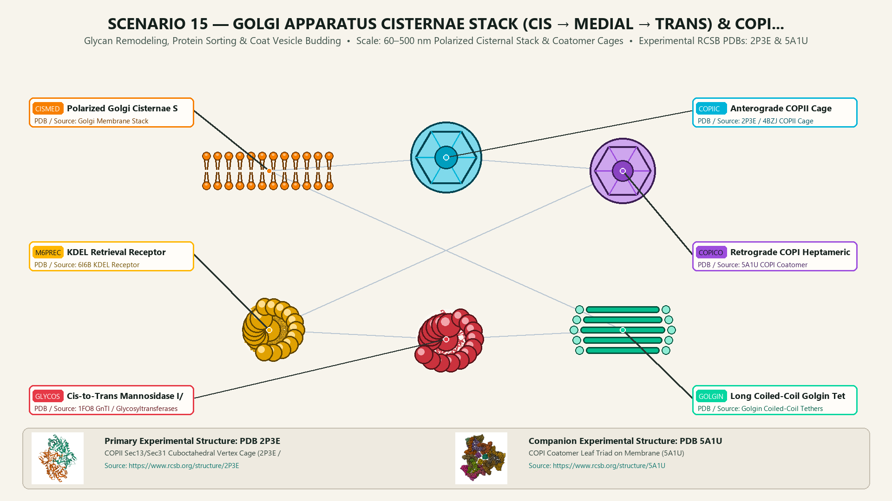
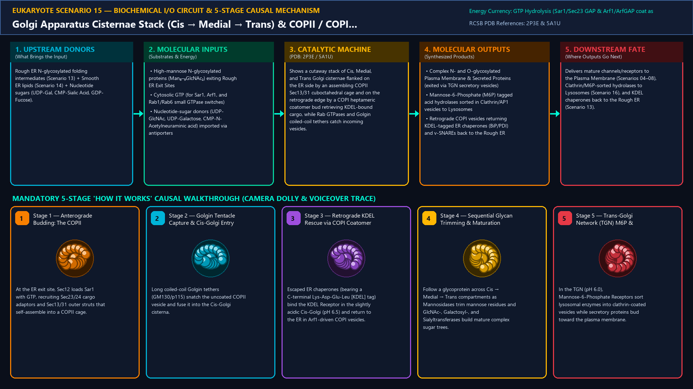
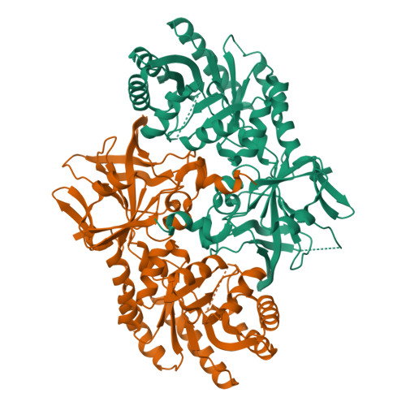
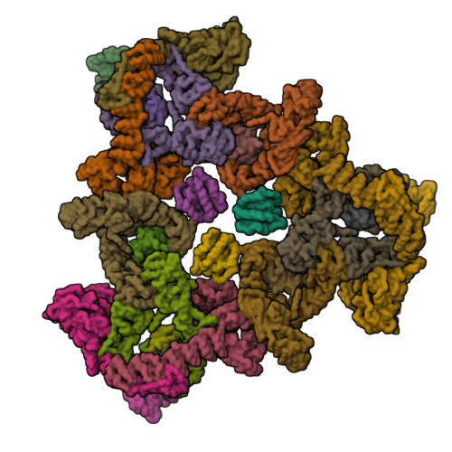
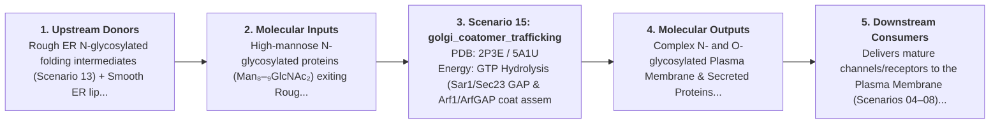

# Scenario 15 — Golgi Apparatus Cisternae Stack (Cis → Medial → Trans) & COPII / COPI Vesicle Coats

> **Roadmap Tier:** Tier 4 — The Endomembrane Secretory & Degradative System ($50\,\text{nm}\text{--}2\,\mu\text{m}$)  
> **Scenario ID:** `15_golgi_coatomer_trafficking`  
> **Biophysical Scale:** 60–500 nm Polarized Cisternal Stack & Coatomer Cages  
> **Functional Category:** Glycan Remodeling, Protein Sorting & Coat Vesicle Budding  
> **Primary RCSB PDB Structures:** [`2P3E`](https://www.rcsb.org/structure/2P3E) (COPII Sec13/Sec31 Cuboctahedral Vertex Cage (2P3E / 4BZJ)) · [`5A1U`](https://www.rcsb.org/structure/5A1U) (COPI Coatomer Leaf Triad on Membrane (5A1U))

---

## 1. Visual & Artistic Representations (Manual Verification Reference Plates)

The following four visual reference plates are stored directly inside this folder (`./`) so you can inspect both the **expected 3D scene decomposition**, the **biochemical I/O circuit & 5-stage mechanism**, and the **experimental cryo-EM / X-ray structures** during manual verification:

### 1.1 Expected 3D Scene & Subunit Decomposition Blueprint (`expected_golgi_coatomer_trafficking.png`)

### 1.2 Biochemical I/O Circuit & 5-Stage Causal Mechanism (`mechanism_golgi_coatomer_trafficking.png`)

### 1.3 Experimental RCSB PDB Structural References (`rcsb_2P3E.jpg` & `rcsb_5A1U.jpg`)
| Primary Structure [`2P3E`](https://www.rcsb.org/structure/2P3E) | Companion / Partner Structure [`5A1U`](https://www.rcsb.org/structure/5A1U) |
| :---: | :---: |
|  |  |
| **COPII Sec13/Sec31 Cuboctahedral Vertex Cage (2P3E / 4BZJ)** | **COPI Coatomer Leaf Triad on Membrane (5A1U)** |

---

## 2. Biophysical & Molecular Behavior Overview

The Golgi Apparatus is the central post-office and carbohydrate-engineering factory of the eukaryotic cell, organized as a polarized ribbon of 4–8 flattened membrane cisternae: Cis-Golgi Network (CGN, receiving cargo from the ER) → Cis → Medial → Trans → Trans-Golgi Network (TGN, sorting cargo to the Plasma Membrane, Secretory Granules, or Lysosomes). Bidirectional vesicle traffic between the ER and Golgi is driven by two small-GTPase-controlled coat cages: (1) Anterograde COPII Vesicles (ER → Cis-Golgi): Sar1-GTP inserts an amphipathic helix into the ER membrane, recruiting bowtie-shaped Sec23/Sec24 inner cargo adaptors and Sec13/Sec31 outer rods that assemble into a 60–100 nm cuboctahedral cage; (2) Retrograde COPI Vesicles (Golgi → ER): Arf1-GTP recruits the heptameric Coatomer (α, β, β', γ, δ, ε, ζ-COP) to retrieve escaped ER-resident chaperones (BiP, PDI) captured by the pH-sensitive KDEL Receptor. Inside the cisternae, resident glycosidases and glycosyltransferases trim high-mannose N-glycans and build complex sialylated oligosaccharides or attach Mannose-6-Phosphate (M6P) tags to lysosomal hydrolases.

### How It Behaves in the Interactive 3D Scene
Shows a cutaway stack of Cis, Medial, and Trans Golgi cisternae flanked on the ER side by an assembling COPII Sec13/31 cuboctahedral cage and on the retrograde edge by a COPI heptameric coatomer bud retrieving KDEL-bound cargo, while Rab GTPases and Golgin coiled-coil tethers catch incoming vesicles.

---

## 3. Complete Biochemical I/O & Inter-Element Iteration

This section defines **what brings the input** to this machine (*Upstream Donors*), **what goes in** (*Molecular Inputs*), **what it makes** (*Molecular Outputs*), and **how it iterates with downstream systems** (*Downstream Consumers*):

- **Upstream Donors (What Brings the Input):**  
  Rough ER N-glycosylated folding intermediates (Scenario 13) + Smooth ER lipids (Scenario 14) + Nucleotide sugars (UDP-Gal, CMP-Sialic Acid, GDP-Fucose).
- **Molecular Inputs (Substrates, Signals & Co-Factors):**
  - High-mannose N-glycosylated proteins (Man₈–₉GlcNAc₂) exiting Rough ER Exit Sites
  - Cytosolic GTP (for Sar1, Arf1, and Rab1/Rab6 small GTPase switches)
  - Nucleotide-sugar donors (UDP-GlcNAc, UDP-Galactose, CMP-N-Acetylneuraminic acid) imported via antiporters
- **Molecular Outputs (Synthesized / Translocated Products):**
  - Complex N- and O-glycosylated Plasma Membrane & Secreted Proteins (exited via TGN secretory vesicles)
  - Mannose-6-Phosphate (M6P) tagged acid hydrolases sorted in Clathrin/AP1 vesicles to Lysosomes
  - Retrograde COPI vesicles returning KDEL-tagged ER chaperones (BiP/PDI) and v-SNAREs back to the Rough ER
- **Downstream Consumers & Cross-Element Iteration:**  
  Delivers mature channels/receptors to the Plasma Membrane (Scenarios 04–08), Clathrin/M6P-sorted hydrolases to Lysosomes (Scenario 16), and KDEL chaperones back to the Rough ER (Scenario 13).
- **Thermodynamic Energy Currency:** `GTP Hydrolysis (Sar1/Sec23 GAP & Arf1/ArfGAP coat assembly/disassembly) + Nucleotide-Sugar Donor Bonds + Cis-to-Trans pH Gradient (pH 6.7 → 6.0)`
- **Biophysical Turnover / Kinetics ($k_{\text{cat}}$):** `Cisternal maturation progresses from Cis to Trans in ~10–15 minutes; single COPII/COPI vesicle buds in ~10–30 seconds`

---

## 4. 3D Subunit Decomposition (`Piece_<ID>_*`) & Color Taxonomy

To support continuous **Exploded View (`setExplodedProgress(0.0 → 1.0)`)**, raycast hover inspection, and subpill lock-on targeting, this scenario is decomposed into **6 functional 3D submeshes**:

| # | 3D Submesh ID (`Piece_*`) | Biological & Structural Role | RCSB PDB / Chain Source | Color Taxonomy (`#Hex`) | Exploded Vector $\vec{v}_{\text{dissoc}}$ |
| :--- | :--- | :--- | :--- | :--- | :--- |
| **1** | `Piece_Gol_CisMedialTrans` | Polarized Golgi Cisternae Stack (Cis → Medial → Trans Lumen) | `Golgi Membrane Stack` | `#F77F00` (Golgi Cisternae Amber) | `(0.0, 0.0, 0.0)` |
| **2** | `Piece_Gol_COPIICage` | Anterograde COPII Cage (Sar1-GTP + Sec23/24 + Sec13/31 Rods) | `2P3E / 4BZJ COPII Cage` | `#00B4D8` (COPII Cage Cerulean) | `(-6.0, -2.5, +2.0)` |
| **3** | `Piece_Gol_COPICoatomer` | Retrograde COPI Heptameric Coatomer Triad & Arf1-GTP | `5A1U COPI Coatomer` | `#9D4EDD` (COPI Coatomer Violet) | `(+6.0, +2.0, +2.0)` |
| **4** | `Piece_Gol_KDEL_M6PReceptors` | KDEL Retrieval Receptor (pH Sensor) & Mannose-6-Phosphate Receptor | `6I6B KDEL Receptor` | `#FFB703` (Sorting Receptor Gold) | `(+2.5, -3.5, +2.5)` |
| **5** | `Piece_Gol_Glycosyltransferases` | Cis-to-Trans Mannosidase I/II & Galactosyl/Sialyltransferases | `1FO8 GnTI / Glycosyltransferases` | `#E63946` (Glycan Enzyme Crimson) | `(-2.0, +3.5, +2.0)` |
| **6** | `Piece_Gol_GolginRabTethers` | Long Coiled-Coil Golgin Tethers (GM130/p115) & TRAPP/COG Complexes | `Golgin Coiled-Coil Tethers` | `#06D6A0` (Tether Cable Jade) | `(0.0, +5.0, -2.0)` |

---

## 5. Interactive HUD Simulation Controls (`iterationControls`)

| Control ID | HUD Label | Biophysical Permutations & Interactive Behavior |
| :--- | :--- | :--- |
| `trafficking_direction` | **Vesicle Coat Focus** | Both · Anterograde COPII (ER → Cis-Golgi) · Retrograde COPI (Golgi → ER KDEL Retrieval) |
| `luminal_ph_gradient` | **Cis-to-Trans Luminal pH Gradient** | Normal (pH 6.7 Cis → 6.0 TGN) vs. Neutralized (Blocks KDEL & M6P sorting) |
| `brefeldin_a_toggle` | **Brefeldin A Fungal Toxin Toggle** | Inhibits Arf1-GEF, collapsing Golgi back into the ER |

---

## 6. Mandatory 5-Stage "How It Works" Explanatory Trace

- **Stage 1 — Anterograde Budding: The COPII Cuboctahedral Cage:** At the ER exit site, Sec12 loads Sar1 with GTP, recruiting Sec23/24 cargo adaptors and Sec13/31 outer struts that self-assemble into a COPII cage.
- **Stage 2 — Golgin Tentacle Capture & Cis-Golgi Entry:** Long coiled-coil Golgin tethers (GM130/p115) snatch the uncoated COPII vesicle and fuse it into the Cis-Golgi cisterna.
- **Stage 3 — Retrograde KDEL Rescue via COPI Coatomer:** Escaped ER chaperones (bearing a C-terminal Lys-Asp-Glu-Leu [KDEL] tag) bind the KDEL Receptor in the slightly acidic Cis-Golgi (pH 6.5) and return to the ER in Arf1-driven COPI vesicles.
- **Stage 4 — Sequential Glycan Trimming & Maturation:** Follow a glycoprotein across Cis → Medial → Trans compartments as Mannosidases trim mannose residues and GlcNAc-, Galactosyl-, and Sialyltransferases build mature complex sugar trees.
- **Stage 5 — Trans-Golgi Network (TGN) M6P & Secretory Sorting:** In the TGN (pH 6.0), Mannose-6-Phosphate Receptors sort lysosomal enzymes into clathrin-coated vesicles while secretory proteins bud toward the plasma membrane.

---

## 7. Curated Online Resources & Structural References

- [RCSB PDB-101 — Molecule of the Month: COPII Vesicle Coat](https://pdb101.rcsb.org/motm/257)
- [RCSB PDB Structure 5A1U — COPI Coat Leaf Triad](https://www.rcsb.org/structure/5A1U)
- [RCSB PDB Structure 6I6B — KDEL Receptor Bound to KDEL Peptide](https://www.rcsb.org/structure/6I6B)
- [NCBI Bookshelf — Molecular Biology of the Cell: Transport from the ER through the Golgi](https://www.ncbi.nlm.nih.gov/books/NBK26941/)
