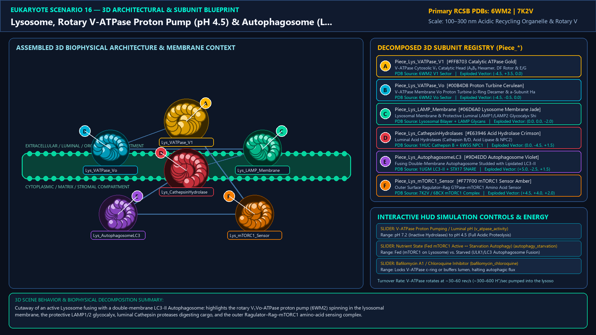
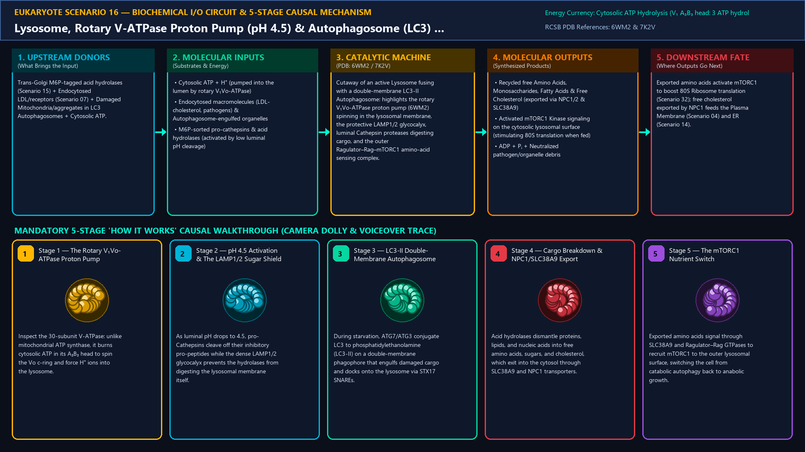
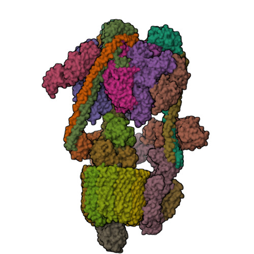
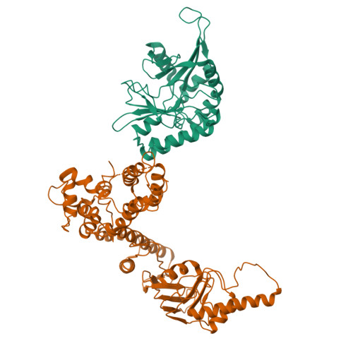
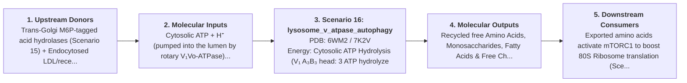

# Scenario 16 — Lysosome, Rotary V-ATPase Proton Pump (pH 4.5) & Autophagosome (LC3) Fusion

> **Roadmap Tier:** Tier 4 — The Endomembrane Secretory & Degradative System ($50\,\text{nm}\text{--}2\,\mu\text{m}$)  
> **Scenario ID:** `16_lysosome_v_atpase_autophagy`  
> **Biophysical Scale:** 100–300 nm Acidic Recycling Organelle & Rotary V-ATPase  
> **Functional Category:** Cellular Degradation, Autophagy & Nutrient Sensing (mTORC1)  
> **Primary RCSB PDB Structures:** [`6WM2`](https://www.rcsb.org/structure/6WM2) (Human Rotary Vacuolar V₁Vo-ATPase Proton Pump (6WM2)) · [`7K2V`](https://www.rcsb.org/structure/7K2V) (Lysosomal Ragulator–Rag–mTORC1 Nutrient Sensor (7K2V / 1ATU))

---

## 1. Visual & Artistic Representations (Manual Verification Reference Plates)

The following four visual reference plates are stored directly inside this folder (`./`) so you can inspect both the **expected 3D scene decomposition**, the **biochemical I/O circuit & 5-stage mechanism**, and the **experimental cryo-EM / X-ray structures** during manual verification:

### 1.1 Expected 3D Scene & Subunit Decomposition Blueprint (`expected_lysosome_v_atpase_autophagy.png`)

### 1.2 Biochemical I/O Circuit & 5-Stage Causal Mechanism (`mechanism_lysosome_v_atpase_autophagy.png`)

### 1.3 Experimental RCSB PDB Structural References (`rcsb_6WM2.jpg` & `rcsb_7K2V.jpg`)
| Primary Structure [`6WM2`](https://www.rcsb.org/structure/6WM2) | Companion / Partner Structure [`7K2V`](https://www.rcsb.org/structure/7K2V) |
| :---: | :---: |
|  |  |
| **Human Rotary Vacuolar V₁Vo-ATPase Proton Pump (6WM2)** | **Lysosomal Ragulator–Rag–mTORC1 Nutrient Sensor (7K2V / 1ATU)** |

---

## 2. Biophysical & Molecular Behavior Overview

The Lysosome is the eukaryotic cell's acidic stomach and metabolic signaling hub (pH 4.5–5.0 vs. cytosolic pH 7.2). Its single membrane is protected from self-digestion on the luminal side by a dense 8 nm carbohydrate brush of heavily glycosylated LAMP1 and LAMP2 proteins. The extreme luminal acidity is generated by the Vacuolar H⁺-ATPase (V₁Vo-ATPase, 6WM2)—an evolutionary cousin of F₁Fo-ATP Synthase run in reverse: cytosolic ATP hydrolysis in the hexameric V₁ head (A₃B₃) spins the central DF rotor stalk and the membrane Vo proteolipid c-ring (c₉c''), pumping protons into the lysosomal lumen (balanced by ClC-7 Cl⁻/H⁺ antiporters). Only at pH 4.5 do the >60 luminal Acid Hydrolases (Cathepsin proteases, DNase II, acid lipases, glycosidases) become catalytically active. During starvation or organelle damage, double-membrane Autophagosomes decorated with lipidated LC3-II (ATG8–PE) fuse with the lysosome via HOPS and STX17 SNAREs to form an Autolysosome, digesting cargo into free amino acids that exit via SLC38A9 to activate mTORC1 on the outer lysosomal surface.

### How It Behaves in the Interactive 3D Scene
Cutaway of an active Lysosome fusing with a double-membrane LC3-II Autophagosome: highlights the rotary V₁Vo-ATPase proton pump (6WM2) spinning in the lysosomal membrane, the protective LAMP1/2 glycocalyx, luminal Cathepsin proteases digesting cargo, and the outer Ragulator–Rag–mTORC1 amino-acid sensing complex.

---

## 3. Complete Biochemical I/O & Inter-Element Iteration

This section defines **what brings the input** to this machine (*Upstream Donors*), **what goes in** (*Molecular Inputs*), **what it makes** (*Molecular Outputs*), and **how it iterates with downstream systems** (*Downstream Consumers*):

- **Upstream Donors (What Brings the Input):**  
  Trans-Golgi M6P-tagged acid hydrolases (Scenario 15) + Endocytosed LDL/receptors (Scenario 07) + Damaged Mitochondria/aggregates in LC3 Autophagosomes + Cytosolic ATP.
- **Molecular Inputs (Substrates, Signals & Co-Factors):**
  - Cytosolic ATP + H⁺ (pumped into the lumen by rotary V₁Vo-ATPase)
  - Endocytosed macromolecules (LDL-cholesterol, pathogens) & Autophagosome-engulfed organelles
  - M6P-sorted pro-cathepsins & acid hydrolases (activated by low luminal pH cleavage)
- **Molecular Outputs (Synthesized / Translocated Products):**
  - Recycled free Amino Acids, Monosaccharides, Fatty Acids & Free Cholesterol (exported via NPC1/2 & SLC38A9)
  - Activated mTORC1 Kinase signaling on the cytosolic lysosomal surface (stimulating 80S translation when fed)
  - ADP + Pᵢ + Neutralized pathogen/organelle debris
- **Downstream Consumers & Cross-Element Iteration:**  
  Exported amino acids activate mTORC1 to boost 80S Ribosome translation (Scenario 32); free cholesterol exported by NPC1 feeds the Plasma Membrane (Scenario 04) and ER (Scenario 14).
- **Thermodynamic Energy Currency:** `Cytosolic ATP Hydrolysis (V₁ A₃B₃ head: 3 ATP hydrolyzed per 360° rotation pumping ~10 H⁺ into lumen)`
- **Biophysical Turnover / Kinetics ($k_{\text{cat}}$):** `V-ATPase rotates at ~30–60 rev/s (~300–600 H⁺/sec pumped into the lysosome)`

---

## 4. 3D Subunit Decomposition (`Piece_<ID>_*`) & Color Taxonomy

To support continuous **Exploded View (`setExplodedProgress(0.0 → 1.0)`)**, raycast hover inspection, and subpill lock-on targeting, this scenario is decomposed into **6 functional 3D submeshes**:

| # | 3D Submesh ID (`Piece_*`) | Biological & Structural Role | RCSB PDB / Chain Source | Color Taxonomy (`#Hex`) | Exploded Vector $\vec{v}_{\text{dissoc}}$ |
| :--- | :--- | :--- | :--- | :--- | :--- |
| **1** | `Piece_Lys_VATPase_V1` | V-ATPase Cytosolic V₁ Catalytic Head (A₃B₃ Hexamer, DF Rotor & E/G Staters) | `6WM2 V1 Sector` | `#FFB703` (Catalytic ATPase Gold) | `(-4.5, +3.5, 0.0)` |
| **2** | `Piece_Lys_VATPase_Vo` | V-ATPase Membrane Vo Proton Turbine (c-Ring Decamer & a-Subunit Half-Channels) | `6WM2 Vo Sector` | `#00B4D8` (Proton Turbine Cerulean) | `(-4.5, -0.5, 0.0)` |
| **3** | `Piece_Lys_LAMP_Membrane` | Lysosomal Membrane & Protective Luminal LAMP1/LAMP2 Glycocalyx Shield | `Lysosomal Bilayer + LAMP Glycans` | `#06D6A0` (Lysosome Membrane Jade) | `(0.0, 0.0, -2.0)` |
| **4** | `Piece_Lys_CathepsinHydrolases` | Luminal Acid Hydrolases (Cathepsin B/D, Acid Lipase & NPC2) | `1HUC Cathepsin B + 6W5S NPC1` | `#E63946` (Acid Hydrolase Crimson) | `(0.0, -4.5, +1.5)` |
| **5** | `Piece_Lys_AutophagosomeLC3` | Fusing Double-Membrane Autophagosome Studded with Lipidated LC3-II | `1UGM LC3-II + STX17 SNARE` | `#9D4EDD` (Autophagosome Violet) | `(+5.0, -2.5, +1.5)` |
| **6** | `Piece_Lys_mTORC1_Sensor` | Outer Surface Ragulator–Rag GTPase–mTORC1 Amino Acid Sensor | `7K2V / 6BCX mTORC1 Complex` | `#F77F00` (mTORC1 Sensor Amber) | `(+4.5, +4.0, +2.0)` |

---

## 5. Interactive HUD Simulation Controls (`iterationControls`)

| Control ID | HUD Label | Biophysical Permutations & Interactive Behavior |
| :--- | :--- | :--- |
| `v_atpase_activity` | **V-ATPase Proton Pumping / Luminal pH** | pH 7.2 (Inactive Hydrolases) to pH 4.5 (Full Acidic Proteolysis) |
| `autophagy_starvation` | **Nutrient State (Fed mTORC1 Active ↔ Starvation Autophagy)** | Fed (mTORC1 on Lysosome) vs. Starved (ULK1/LC3 Autophagosome Fusion) |
| `bafilomycin_chloroquine` | **Bafilomycin A1 / Chloroquine Inhibitor** | Locks V-ATPase c-ring or buffers lumen, halting autophagic flux |

---

## 6. Mandatory 5-Stage "How It Works" Explanatory Trace

- **Stage 1 — The Rotary V₁Vo-ATPase Proton Pump:** Inspect the 30-subunit V-ATPase: unlike mitochondrial ATP synthase, it burns cytosolic ATP in its A₃B₃ head to spin the Vo c-ring and force H⁺ ions into the lysosome.
- **Stage 2 — pH 4.5 Activation & The LAMP1/2 Sugar Shield:** As luminal pH drops to 4.5, pro-Cathepsins cleave off their inhibitory pro-peptides while the dense LAMP1/2 glycocalyx prevents the hydrolases from digesting the lysosomal membrane itself.
- **Stage 3 — LC3-II Double-Membrane Autophagosome Docking:** During starvation, ATG7/ATG3 conjugate LC3 to phosphatidylethanolamine (LC3-II) on a double-membrane phagophore that engulfs damaged cargo and docks onto the lysosome via STX17 SNAREs.
- **Stage 4 — Cargo Breakdown & NPC1/SLC38A9 Export:** Acid hydrolases dismantle proteins, lipids, and nucleic acids into free amino acids, sugars, and cholesterol, which exit into the cytosol through SLC38A9 and NPC1 transporters.
- **Stage 5 — The mTORC1 Nutrient Switch:** Exported amino acids signal through SLC38A9 and Ragulator–Rag GTPases to recruit mTORC1 to the outer lysosomal surface, switching the cell from catabolic autophagy back to anabolic growth.

---

## 7. Curated Online Resources & Structural References

- [RCSB PDB Structure 6WM2 — Complete Human V-ATPase in Rotational State 1](https://www.rcsb.org/structure/6WM2)
- [RCSB PDB-101 — Molecule of the Month: mTOR](https://pdb101.rcsb.org/motm/219)
- [RCSB PDB-101 — Molecule of the Month: Autophagy](https://pdb101.rcsb.org/motm/204)
- [NCBI Bookshelf — Molecular Biology of the Cell: Lysosomes](https://www.ncbi.nlm.nih.gov/books/NBK26844/)
