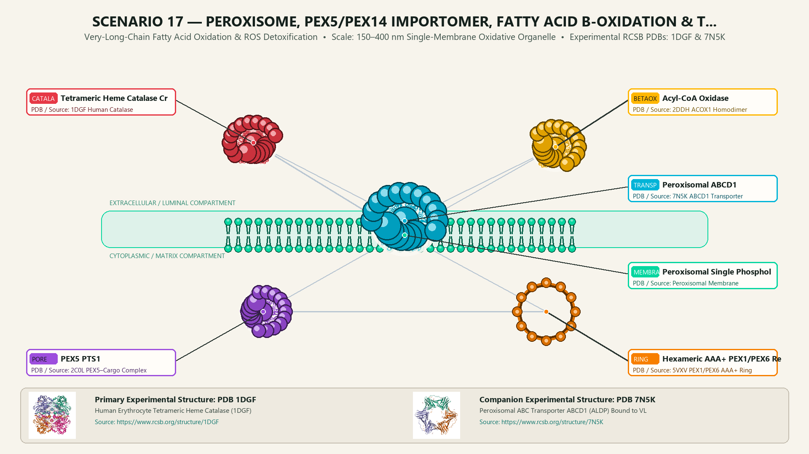
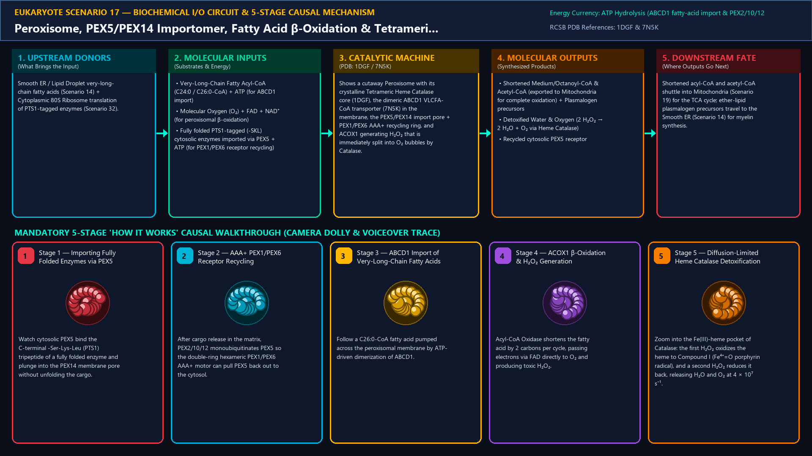
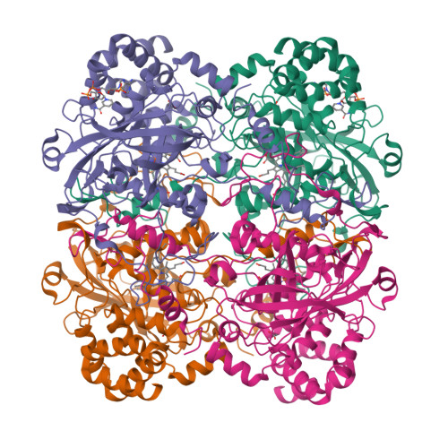
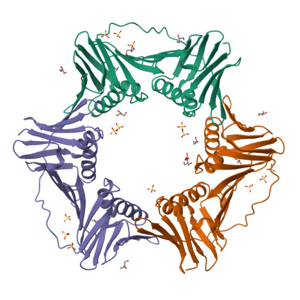
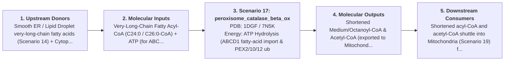
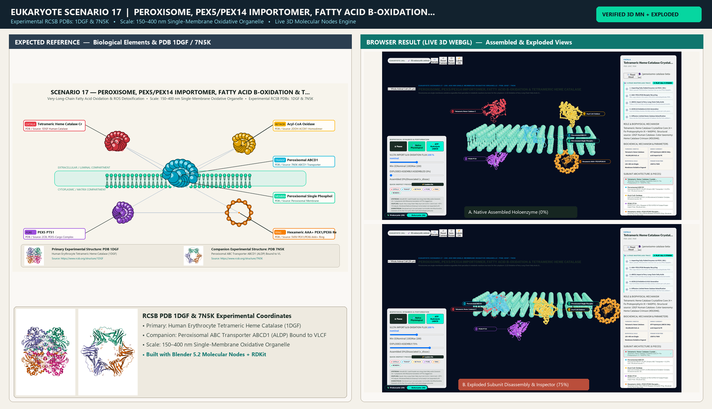

# Scenario 17 — Peroxisome, PEX5/PEX14 Importomer, Fatty Acid β-Oxidation & Tetrameric Heme Catalase

> **Roadmap Tier:** Tier 4 — The Endomembrane Secretory & Degradative System ($50\,\text{nm}\text{--}2\,\mu\text{m}$)  
> **Scenario ID:** `17_peroxisome_catalase_beta_ox`  
> **Biophysical Scale:** 150–400 nm Single-Membrane Oxidative Organelle  
> **Functional Category:** Very-Long-Chain Fatty Acid Oxidation & ROS Detoxification  
> **Primary RCSB PDB Structures:** [`1DGF`](https://www.rcsb.org/structure/1DGF) (Human Erythrocyte Tetrameric Heme Catalase (1DGF)) · [`7N5K`](https://www.rcsb.org/structure/7N5K) (Peroxisomal ABC Transporter ABCD1 (ALDP) Bound to VLCFA-CoA (7N5K))

---

## 1. Visual & Artistic Representations (Manual Verification Reference Plates)

The following four visual reference plates are stored directly inside this folder (`./`) so you can inspect both the **expected 3D scene decomposition**, the **biochemical I/O circuit & 5-stage mechanism**, and the **experimental cryo-EM / X-ray structures** during manual verification:

### 1.1 Expected 3D Scene & Subunit Decomposition Blueprint (`expected_peroxisome_catalase_beta_ox.png`)

### 1.2 Biochemical I/O Circuit & 5-Stage Causal Mechanism (`mechanism_peroxisome_catalase_beta_ox.png`)

### 1.3 Experimental RCSB PDB Structural References (`rcsb_1DGF.jpg` & `rcsb_7N5K.jpg`)
| Primary Structure [`1DGF`](https://www.rcsb.org/structure/1DGF) | Companion / Partner Structure [`7N5K`](https://www.rcsb.org/structure/7N5K) |
| :---: | :---: |
|  |  |
| **Human Erythrocyte Tetrameric Heme Catalase (1DGF)** | **Peroxisomal ABC Transporter ABCD1 (ALDP) Bound to VLCFA-CoA (7N5K)** |

---

## 2. Biophysical & Molecular Behavior Overview

Peroxisomes are single-membrane oxidative organelles that specialize in metabolic reactions too toxic for the cytoplasm: (1) β-Oxidation of Very-Long-Chain Fatty Acids (VLCFAs, ≥C22:0) and branched-chain fatty acids imported by the dimeric ABC transporter ABCD1 (mutated in X-linked Adrenoleukodystrophy), where Acyl-CoA Oxidase (ACOX1) transfers electrons directly to O₂, generating toxic Hydrogen Peroxide (H₂O₂); (2) Instantaneous H₂O₂ Detoxification by Tetrameric Heme Catalase (1DGF)—one of the fastest enzymes in nature (k_cat ≈ 4 × 10⁷ s⁻¹)—which often packs at such high concentration that it forms a para-crystalline core inside the peroxisomal matrix, disproportionating 2 H₂O₂ → 2 H₂O + O₂; (3) Synthesis of myelin Plasmalogen ether-lipids; and (4) Unique Folded-Protein Import via the cycling receptor PEX5, which recognizes C-terminal PTS1 (-Ser-Lys-Leu) tags in the cytosol, docks at the PEX14/PEX13 translocon to drop off fully folded oligomers (even 240 kDa Catalase tetramers!), and is extracted back to the cytosol by the hexameric AAA+ PEX1/PEX6 ring.

### How It Behaves in the Interactive 3D Scene
Shows a cutaway Peroxisome with its crystalline Tetrameric Heme Catalase core (1DGF), the dimeric ABCD1 VLCFA-CoA transporter (7N5K) in the membrane, the PEX5/PEX14 import pore + PEX1/PEX6 AAA+ recycling ring, and ACOX1 generating H₂O₂ that is immediately split into O₂ bubbles by Catalase.

---

## 3. Complete Biochemical I/O & Inter-Element Iteration

This section defines **what brings the input** to this machine (*Upstream Donors*), **what goes in** (*Molecular Inputs*), **what it makes** (*Molecular Outputs*), and **how it iterates with downstream systems** (*Downstream Consumers*):

- **Upstream Donors (What Brings the Input):**  
  Smooth ER / Lipid Droplet very-long-chain fatty acids (Scenario 14) + Cytoplasmic 80S Ribosome translation of PTS1-tagged enzymes (Scenario 32).
- **Molecular Inputs (Substrates, Signals & Co-Factors):**
  - Very-Long-Chain Fatty Acyl-CoA (C24:0 / C26:0-CoA) + ATP (for ABCD1 import)
  - Molecular Oxygen (O₂) + FAD + NAD⁺ (for peroxisomal β-oxidation)
  - Fully folded PTS1-tagged (-SKL) cytosolic enzymes imported via PEX5 + ATP (for PEX1/PEX6 receptor recycling)
- **Molecular Outputs (Synthesized / Translocated Products):**
  - Shortened Medium/Octanoyl-CoA & Acetyl-CoA (exported to Mitochondria for complete oxidation) + Plasmalogen precursors
  - Detoxified Water & Oxygen (2 H₂O₂ → 2 H₂O + O₂ via Heme Catalase)
  - Recycled cytosolic PEX5 receptor
- **Downstream Consumers & Cross-Element Iteration:**  
  Shortened acyl-CoA and acetyl-CoA shuttle into Mitochondria (Scenario 19) for the TCA cycle; ether-lipid plasmalogen precursors travel to the Smooth ER (Scenario 14) for myelin synthesis.
- **Thermodynamic Energy Currency:** `ATP Hydrolysis (ABCD1 fatty-acid import & PEX2/10/12 ubiquitination + PEX1/PEX6 AAA+ extraction of PEX5)`
- **Biophysical Turnover / Kinetics ($k_{\text{cat}}$):** `Tetrameric Heme Catalase: ~40,000,000 H₂O₂ molecules converted per second per tetramer (diffusion-limited!)`

---

## 4. 3D Subunit Decomposition (`Piece_<ID>_*`) & Color Taxonomy

To support continuous **Exploded View (`setExplodedProgress(0.0 → 1.0)`)**, raycast hover inspection, and subpill lock-on targeting, this scenario is decomposed into **6 functional 3D submeshes**:

| # | 3D Submesh ID (`Piece_*`) | Biological & Structural Role | RCSB PDB / Chain Source | Color Taxonomy (`#Hex`) | Exploded Vector $\vec{v}_{\text{dissoc}}$ |
| :--- | :--- | :--- | :--- | :--- | :--- |
| **1** | `Piece_Per_CatalaseTetramer` | Tetrameric Heme Catalase Crystalline Core (4 × Fe-Protoporphyrin IX + NADPH) | `1DGF Human Catalase` | `#E63946` (Heme Catalase Crimson) | `(0.0, -3.5, 0.0)` |
| **2** | `Piece_Per_ABCD1_Transporter` | Peroxisomal ABCD1 (ALDP) Dimeric ABC Transporter + VLCFA-CoA | `7N5K ABCD1 Transporter` | `#00B4D8` (ABC Transporter Cerulean) | `(-5.0, +0.5, 0.0)` |
| **3** | `Piece_Per_ACOX1_BetaOx` | Acyl-CoA Oxidase (ACOX1) & Bifunctional β-Oxidation Complex | `2DDH ACOX1 Homodimer` | `#FFB703` (FAD Oxidase Gold) | `(-3.5, -3.0, +2.0)` |
| **4** | `Piece_Per_PEX5_PEX14_Pore` | PEX5 PTS1 (-SKL) Receptor & PEX13/PEX14 Folded-Protein Import Pore | `2C0L PEX5–Cargo Complex` | `#9D4EDD` (PEX Importomer Violet) | `(+3.5, +1.0, +1.5)` |
| **5** | `Piece_Per_PEX1_PEX6_Ring` | Hexameric AAA+ PEX1/PEX6 Receptor-Extraction Ring | `5VXV PEX1/PEX6 AAA+ Ring` | `#F77F00` (AAA+ Extractor Amber) | `(+5.5, +3.5, 0.0)` |
| **6** | `Piece_Per_MembraneBilayer` | Peroxisomal Single Phospholipid Bilayer | `Peroxisomal Membrane` | `#06D6A0` (Peroxisome Membrane Jade) | `(0.0, +0.5, -2.5)` |

---

## 5. Interactive HUD Simulation Controls (`iterationControls`)

| Control ID | HUD Label | Biophysical Permutations & Interactive Behavior |
| :--- | :--- | :--- |
| `vlcfa_beta_ox_rate` | **VLCFA Import & β-Oxidation Flux** | 0% to 200% (generates H₂O₂ proportional to fatty acid oxidation) |
| `catalase_activity` | **Tetrameric Heme Catalase Activity** | 100% (Instant H₂O₂ → H₂O + O₂) vs. 0% (Acatalasemia Oxidative Stress) |
| `ald_abcd1_mutation` | **X-ALD ABCD1 Mutation Toggle** | Normal VLCFA Import vs. Blocked C26:0 Accumulation |

---

## 6. Mandatory 5-Stage "How It Works" Explanatory Trace

- **Stage 1 — Importing Fully Folded Enzymes via PEX5 (-SKL):** Watch cytosolic PEX5 bind the C-terminal -Ser-Lys-Leu (PTS1) tripeptide of a fully folded enzyme and plunge into the PEX14 membrane pore without unfolding the cargo.
- **Stage 2 — AAA+ PEX1/PEX6 Receptor Recycling:** After cargo release in the matrix, PEX2/10/12 monoubiquitinates PEX5 so the double-ring hexameric PEX1/PEX6 AAA+ motor can pull PEX5 back out to the cytosol.
- **Stage 3 — ABCD1 Import of Very-Long-Chain Fatty Acids:** Follow a C26:0-CoA fatty acid pumped across the peroxisomal membrane by ATP-driven dimerization of ABCD1.
- **Stage 4 — ACOX1 β-Oxidation & H₂O₂ Generation:** Acyl-CoA Oxidase shortens the fatty acid by 2 carbons per cycle, passing electrons via FAD directly to O₂ and producing toxic H₂O₂.
- **Stage 5 — Diffusion-Limited Heme Catalase Detoxification:** Zoom into the Fe(III)-heme pocket of Catalase: the first H₂O₂ oxidizes the heme to Compound I (Fe⁴⁺=O porphyrin radical), and a second H₂O₂ reduces it back, releasing H₂O and O₂ at 4 × 10⁷ s⁻¹.

---

## 7. Curated Online Resources & Structural References

- [RCSB PDB-101 — Molecule of the Month: Catalase](https://pdb101.rcsb.org/motm/57)
- [RCSB PDB Structure 1DGF — Human Erythrocyte Catalase](https://www.rcsb.org/structure/1DGF)
- [RCSB PDB Structure 7N5K — Human Peroxisomal ABCD1 Transporter](https://www.rcsb.org/structure/7N5K)
- [NCBI Bookshelf — Molecular Biology of the Cell: Peroxisomes](https://www.ncbi.nlm.nih.gov/books/NBK26858/)

## 12. 3D Implementation & Visual Verification Assets

- **Status:** `[x] Implemented, Exported to 3D GLB & Visually Verified`
- **3D Model Asset (`.glb`):** [`peroxisome_catalase_beta_ox.glb`](./peroxisome_catalase_beta_ox.glb) (also mirrored in `eukaryote/models/peroxisome_catalase_beta_ox.glb` and `client/public/eukaryote/models/peroxisome_catalase_beta_ox.glb`)
- **Blender 5.2 + Molecular Nodes Generator Script:** [`generate_17_peroxisome_catalase_beta_ox.py`](./generate_17_peroxisome_catalase_beta_ox.py)
- **Live WebGL Assembled Capture (`0%`):** [`browser_peroxisome_catalase_beta_ox_assembled.png`](../../verification/17_peroxisome_catalase_beta_ox/browser_peroxisome_catalase_beta_ox_assembled.png)
- **Live WebGL Exploded Capture (`75%`):** [`browser_peroxisome_catalase_beta_ox_exploded.png`](../../verification/17_peroxisome_catalase_beta_ox/browser_peroxisome_catalase_beta_ox_exploded.png)
- **Side-by-Side Input vs. Output Comparison Plate (`2400×1380`):** [`comparison_peroxisome_catalase_beta_ox.png`](../../verification/17_peroxisome_catalase_beta_ox/comparison_peroxisome_catalase_beta_ox.png)
- **Animated Side-by-Side Comparison Video (`1920×1080 MP4`):** [`comparison_peroxisome_catalase_beta_ox.mp4`](../../verification/17_peroxisome_catalase_beta_ox/comparison_peroxisome_catalase_beta_ox.mp4)

