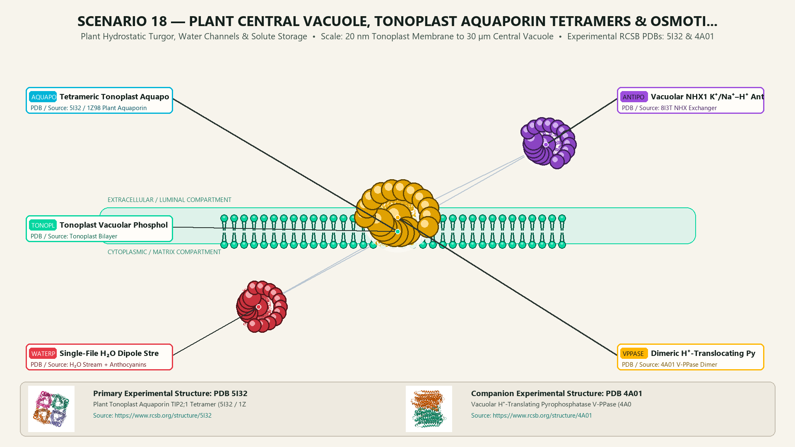
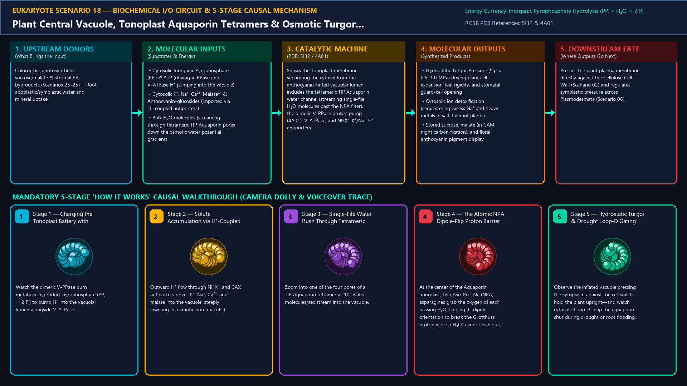
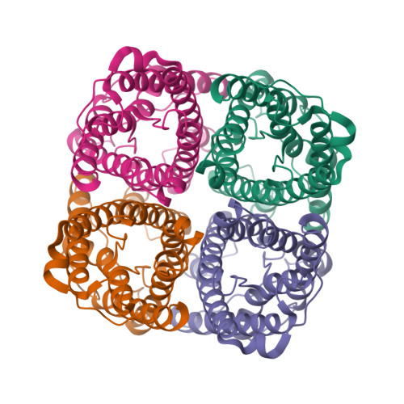
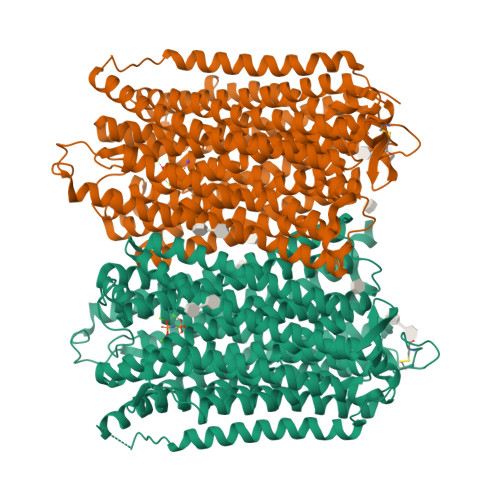
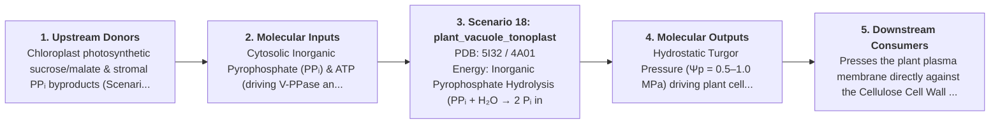
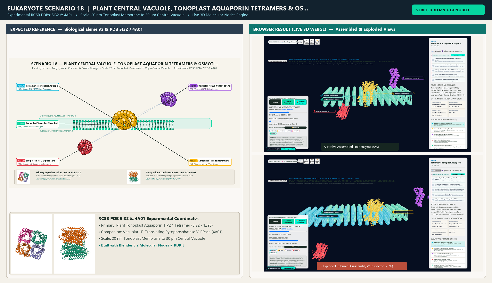

# Scenario 18 — Plant Central Vacuole, Tonoplast Aquaporin Tetramers & Osmotic Turgor Engine

> **Roadmap Tier:** Tier 4 — The Endomembrane Secretory & Degradative System ($50\,\text{nm}\text{--}2\,\mu\text{m}$)  
> **Scenario ID:** `18_plant_vacuole_tonoplast`  
> **Biophysical Scale:** 20 nm Tonoplast Membrane to 30 µm Central Vacuole  
> **Functional Category:** Plant Hydrostatic Turgor, Water Channels & Solute Storage  
> **Primary RCSB PDB Structures:** [`5I32`](https://www.rcsb.org/structure/5I32) (Plant Tonoplast Aquaporin TIP2;1 Tetramer (5I32 / 1Z98)) · [`4A01`](https://www.rcsb.org/structure/4A01) (Vacuolar H⁺-Translating Pyrophosphatase V-PPase (4A01))

---

## 1. Visual & Artistic Representations (Manual Verification Reference Plates)

The following four visual reference plates are stored directly inside this folder (`./`) so you can inspect both the **expected 3D scene decomposition**, the **biochemical I/O circuit & 5-stage mechanism**, and the **experimental cryo-EM / X-ray structures** during manual verification:

### 1.1 Expected 3D Scene & Subunit Decomposition Blueprint (`expected_plant_vacuole_tonoplast.png`)

### 1.2 Biochemical I/O Circuit & 5-Stage Causal Mechanism (`mechanism_plant_vacuole_tonoplast.png`)

### 1.3 Experimental RCSB PDB Structural References (`rcsb_5I32.jpg` & `rcsb_4A01.jpg`)
| Primary Structure [`5I32`](https://www.rcsb.org/structure/5I32) | Companion / Partner Structure [`4A01`](https://www.rcsb.org/structure/4A01) |
| :---: | :---: |
|  |  |
| **Plant Tonoplast Aquaporin TIP2;1 Tetramer (5I32 / 1Z98)** | **Vacuolar H⁺-Translating Pyrophosphatase V-PPase (4A01)** |

---

## 2. Biophysical & Molecular Behavior Overview

Mature plant and fungal cells grow up to 100× larger in volume than animal cells without synthesizing 100× more cytoplasm by inflating a giant Central Vacuole bounded by a single semi-permeable membrane called the Tonoplast. Two proton pumps—the rotary Vacuolar V-ATPase and the homodimeric H⁺-Translocating Pyrophosphatase (V-PPase, 4A01, which burns metabolic byproduct inorganic pyrophosphate PPᵢ)—acidify the vacuolar sap (pH 5.0–5.5) and generate an inside-positive electrochemical gradient (+30 mV). Secondary H⁺-coupled antiporters (NHX1 K⁺/Na⁺-H⁺ exchangers, CAX Ca²⁺/H⁺ exchangers, and ALMT malate channels) pack the vacuole with high concentrations of ions, malate, sucrose, and anthocyanin pigments. Water then rushes into the vacuole at ~10⁹ H₂O molecules/sec through tetrameric Tonoplast Intrinsic Protein Aquaporins (TIP2;1, 5I32), whose central NPA (Asn-Pro-Ala) twin hairpins reorient water dipoles to block proton leakage while generating 0.5–1.0 MPa (5–10 atm) of hydrostatic Turgor Pressure that keeps non-woody plants upright.

### How It Behaves in the Interactive 3D Scene
Shows the Tonoplast membrane separating the cytosol from the anthocyanin-tinted vacuolar lumen: includes the tetrameric TIP Aquaporin water channel (streaming single-file H₂O molecules past the NPA filter), the dimeric V-PPase proton pump (4A01), V-ATPase, and NHX1 K⁺/Na⁺-H⁺ antiporters.

---

## 3. Complete Biochemical I/O & Inter-Element Iteration

This section defines **what brings the input** to this machine (*Upstream Donors*), **what goes in** (*Molecular Inputs*), **what it makes** (*Molecular Outputs*), and **how it iterates with downstream systems** (*Downstream Consumers*):

- **Upstream Donors (What Brings the Input):**  
  Chloroplast photosynthetic sucrose/malate & stromal PPᵢ byproducts (Scenarios 23–25) + Root apoplastic/symplastic water and mineral uptake.
- **Molecular Inputs (Substrates, Signals & Co-Factors):**
  - Cytosolic Inorganic Pyrophosphate (PPᵢ) & ATP (driving V-PPase and V-ATPase H⁺ pumping into the vacuole)
  - Cytosolic K⁺, Na⁺, Ca²⁺, Malate²⁻ & Anthocyanin-glucosides (imported via H⁺-coupled antiporters)
  - Bulk H₂O molecules (streaming through tetrameric TIP Aquaporin pores down the osmotic water potential gradient)
- **Molecular Outputs (Synthesized / Translocated Products):**
  - Hydrostatic Turgor Pressure (Ψp = 0.5–1.0 MPa) driving plant cell expansion, leaf rigidity, and stomatal guard-cell opening
  - Cytosolic ion detoxification (sequestering excess Na⁺ and heavy metals in salt-tolerant plants)
  - Stored sucrose, malate (in CAM night carbon fixation), and floral anthocyanin pigment display
- **Downstream Consumers & Cross-Element Iteration:**  
  Presses the plant plasma membrane directly against the Cellulose Cell Wall (Scenario 02) and regulates symplastic pressure across Plasmodesmata (Scenario 08).
- **Thermodynamic Energy Currency:** `Inorganic Pyrophosphate Hydrolysis (PPᵢ + H₂O → 2 Pᵢ in V-PPase) + ATP (V-ATPase) → Tonoplast Δμ_H+ → Osmotic Turgor Ψp`
- **Biophysical Turnover / Kinetics ($k_{\text{cat}}$):** `Single Aquaporin monomer conducts ~10⁹ H₂O molecules/sec with zero H₃O⁺ proton leakage`

---

## 4. 3D Subunit Decomposition (`Piece_<ID>_*`) & Color Taxonomy

To support continuous **Exploded View (`setExplodedProgress(0.0 → 1.0)`)**, raycast hover inspection, and subpill lock-on targeting, this scenario is decomposed into **6 functional 3D submeshes**:

| # | 3D Submesh ID (`Piece_*`) | Biological & Structural Role | RCSB PDB / Chain Source | Color Taxonomy (`#Hex`) | Exploded Vector $\vec{v}_{\text{dissoc}}$ |
| :--- | :--- | :--- | :--- | :--- | :--- |
| **1** | `Piece_Vac_AquaporinTetramer` | Tetrameric Tonoplast Aquaporin (TIP2;1 / SoPIP2;1) with NPA Water Filter | `5I32 / 1Z98 Plant Aquaporin` | `#00B4D8` (Water Channel Cerulean) | `(-4.5, 0.0, 0.0)` |
| **2** | `Piece_Vac_VPPaseDimer` | Dimeric H⁺-Translocating Pyrophosphatase (AVP1 / V-PPase, 16-TM) | `4A01 V-PPase Dimer` | `#FFB703` (Pyrophosphatase Gold) | `(+1.0, +0.5, +1.5)` |
| **3** | `Piece_Vac_NHX_Antiporter` | Vacuolar NHX1 K⁺/Na⁺–H⁺ Antiporter & Anthocyanin ABC Transporter | `8I3T NHX Exchanger` | `#9D4EDD` (Antiporter Violet) | `(+5.5, 0.0, 0.0)` |
| **4** | `Piece_Vac_WaterProtonStreams` | Single-File H₂O Dipole Stream (NPA Flip) & Luminal H⁺/Anthocyanin Sap | `H₂O Stream + Anthocyanins` | `#E63946` (Vacuolar Sap Crimson) | `(-4.5, -3.5, +2.0)` |
| **5** | `Piece_Vac_TonoplastMembrane` | Tonoplast Vacuolar Phospholipid & Sterol Bilayer | `Tonoplast Bilayer` | `#06D6A0` (Tonoplast Membrane Jade) | `(0.0, 0.0, -2.5)` |

---

## 5. Interactive HUD Simulation Controls (`iterationControls`)

| Control ID | HUD Label | Biophysical Permutations & Interactive Behavior |
| :--- | :--- | :--- |
| `water_potential_turgor` | **Extracellular Water Supply / Turgor Pressure (MPa)** | 0.0 MPa (Wilted / Plasmolyzed) to 1.0 MPa (Full Turgid Expansion) |
| `aquaporin_ph_ca_gate` | **Cytosolic Flooding / Drought Gate (Loop D Phosphorylation)** | Open Ser-Phosphorylated Pore vs. Closed Drought/Anoxic Gate |
| `vacuolar_ph_anthocyanin` | **Vacuolar Lumen pH (Anthocyanin Color Shift)** | pH 4.5 (Vivid Red Flavylium) to pH 6.5 (Blue/Violet Quinonoidal Base) |

---

## 6. Mandatory 5-Stage "How It Works" Explanatory Trace

- **Stage 1 — Charging the Tonoplast Battery with V-PPase & V-ATPase:** Watch the dimeric V-PPase burn metabolic byproduct pyrophosphate (PPᵢ → 2 Pᵢ) to pump H⁺ into the vacuolar lumen alongside V-ATPase.
- **Stage 2 — Solute Accumulation via H⁺-Coupled Antiporters:** Outward H⁺ flow through NHX1 and CAX antiporters drives K⁺, Na⁺, Ca²⁺, and malate into the vacuole, steeply lowering its osmotic potential (Ψs).
- **Stage 3 — Single-File Water Rush Through Tetrameric Aquaporins:** Zoom into one of the four pores of a TIP Aquaporin tetramer as 10⁹ water molecules/sec stream into the vacuole.
- **Stage 4 — The Atomic NPA Dipole-Flip Proton Barrier:** At the center of the Aquaporin hourglass, two Asn-Pro-Ala (NPA) asparagines grab the oxygen of each passing H₂O, flipping its dipole orientation to break the Grotthuss proton wire so H₃O⁺ cannot leak out.
- **Stage 5 — Hydrostatic Turgor & Drought Loop-D Gating:** Observe the inflated vacuole pressing the cytoplasm against the cell wall to hold the plant upright—and watch cytosolic Loop D snap the aquaporin shut during drought or root flooding.

---

## 7. Curated Online Resources & Structural References

- [RCSB PDB-101 — Molecule of the Month: Aquaporin](https://pdb101.rcsb.org/motm/173)
- [RCSB PDB Structure 5I32 — Plant Tonoplast Aquaporin AtTIP2;1](https://www.rcsb.org/structure/5I32)
- [RCSB PDB Structure 4A01 — H⁺-Translocating Pyrophosphatase](https://www.rcsb.org/structure/4A01)
- [Plant Physiology — Vacuolar Transporters & Turgor Regulation](https://academic.oup.com/plphys/article/179/4/1200/6116634)

## 12. 3D Implementation & Visual Verification Assets

- **Status:** `[x] Implemented, Exported to 3D GLB & Visually Verified`
- **3D Model Asset (`.glb`):** [`plant_vacuole_tonoplast.glb`](./plant_vacuole_tonoplast.glb) (also mirrored in `eukaryote/models/plant_vacuole_tonoplast.glb` and `client/public/eukaryote/models/plant_vacuole_tonoplast.glb`)
- **Blender 5.2 + Molecular Nodes Generator Script:** [`generate_18_plant_vacuole_tonoplast.py`](./generate_18_plant_vacuole_tonoplast.py)
- **Live WebGL Assembled Capture (`0%`):** [`browser_plant_vacuole_tonoplast_assembled.png`](../../verification/18_plant_vacuole_tonoplast/browser_plant_vacuole_tonoplast_assembled.png)
- **Live WebGL Exploded Capture (`75%`):** [`browser_plant_vacuole_tonoplast_exploded.png`](../../verification/18_plant_vacuole_tonoplast/browser_plant_vacuole_tonoplast_exploded.png)
- **Side-by-Side Input vs. Output Comparison Plate (`2400×1380`):** [`comparison_plant_vacuole_tonoplast.png`](../../verification/18_plant_vacuole_tonoplast/comparison_plant_vacuole_tonoplast.png)
- **Animated Side-by-Side Comparison Video (`1920×1080 MP4`):** [`comparison_plant_vacuole_tonoplast.mp4`](../../verification/18_plant_vacuole_tonoplast/comparison_plant_vacuole_tonoplast.mp4)

