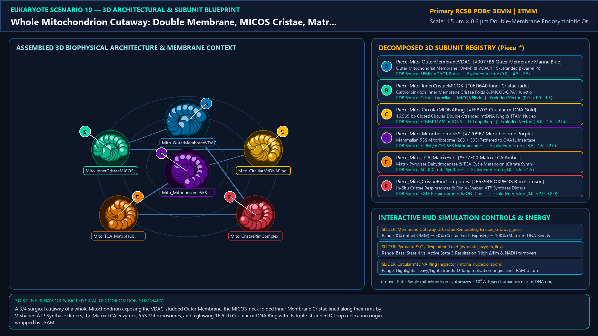
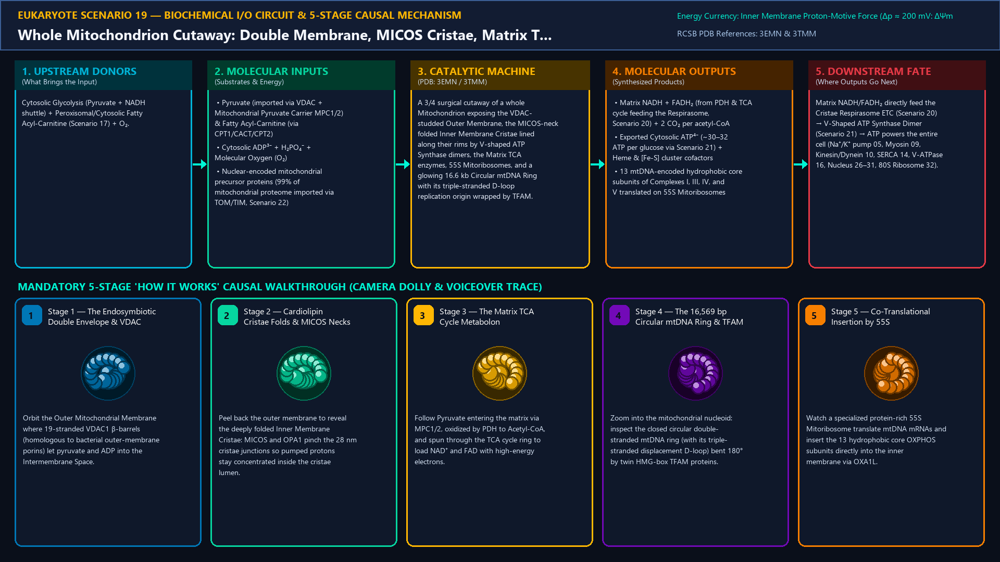
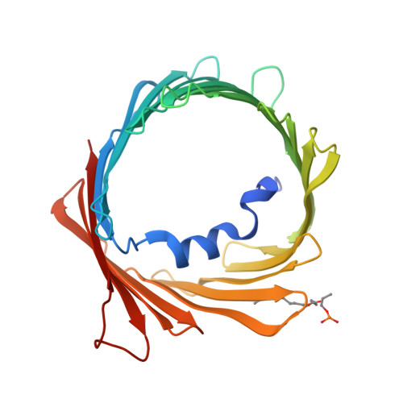
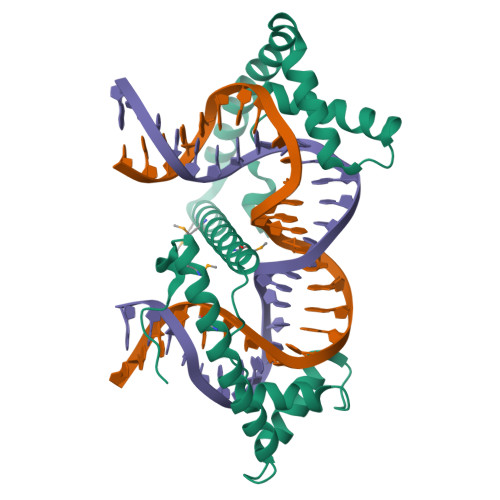
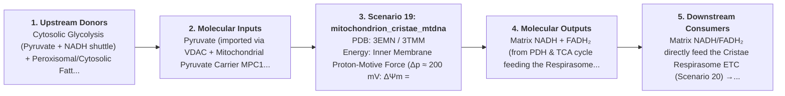

# Scenario 19 — Whole Mitochondrion Cutaway: Double Membrane, MICOS Cristae, Matrix TCA & Circular mtDNA Ring

> **Roadmap Tier:** Tier 5 — Endosymbiotic Bioenergetic Powerhouses: Mitochondria & Chloroplasts ($20\,\text{nm}\text{--}3\,\mu\text{m}$)  
> **Scenario ID:** `19_mitochondrion_cristae_mtdna`  
> **Biophysical Scale:** 1.5 µm × 0.6 µm Double-Membrane Endosymbiotic Organelle  
> **Functional Category:** Bioenergetic Organelle Architecture & Mitochondrial Genome  
> **Primary RCSB PDB Structures:** [`3EMN`](https://www.rcsb.org/structure/3EMN) (Mitochondrial Outer Membrane VDAC-1 β-Barrel Porin (3EMN)) · [`3TMM`](https://www.rcsb.org/structure/3TMM) (TFAM Packaging Mitochondrial DNA (mtDNA) U-Turn (3TMM))

---

## 1. Visual & Artistic Representations (Manual Verification Reference Plates)

The following four visual reference plates are stored directly inside this folder (`./`) so you can inspect both the **expected 3D scene decomposition**, the **biochemical I/O circuit & 5-stage mechanism**, and the **experimental cryo-EM / X-ray structures** during manual verification:

### 1.1 Expected 3D Scene & Subunit Decomposition Blueprint (`expected_mitochondrion_cristae_mtdna.png`)

### 1.2 Biochemical I/O Circuit & 5-Stage Causal Mechanism (`mechanism_mitochondrion_cristae_mtdna.png`)

### 1.3 Experimental RCSB PDB Structural References (`rcsb_3EMN.jpg` & `rcsb_3TMM.jpg`)
| Primary Structure [`3EMN`](https://www.rcsb.org/structure/3EMN) | Companion / Partner Structure [`3TMM`](https://www.rcsb.org/structure/3TMM) |
| :---: | :---: |
|  |  |
| **Mitochondrial Outer Membrane VDAC-1 β-Barrel Porin (3EMN)** | **TFAM Packaging Mitochondrial DNA (mtDNA) U-Turn (3TMM)** |

---

## 2. Biophysical & Molecular Behavior Overview

Descended from an ancient α-proteobacterial endosymbiont >1.5 billion years ago, the Mitochondrion is a double-membraned bioenergetic powerhouse with its own independent circular genome and translation apparatus: (1) The Outer Mitochondrial Membrane (OMM) is perforated by 19-stranded β-barrel Voltage-Dependent Anion Channels (VDAC1, 3EMN) that freely pass metabolites (<5 kDa: pyruvate, ADP, ATP, Pᵢ) into the Intermembrane Space (IMS); (2) The Inner Mitochondrial Membrane (IMM) is an ion-impermeable, Cardiolipin-rich (20% tetra-acyl phospholipid) barrier divided into the Inner Boundary Membrane and deeply invaginated tubular/lamellar Cristae, whose narrow 28 nm necks are stabilized by the MICOS (Mitochondrial Contact Site and Cristae Organizing System) complex and OPA1 oligomers to trap pumped protons inside the Cristae Lumen; (3) The central Mitochondrial Matrix houses the Pyruvate Dehydrogenase & TCA/Krebs Cycle enzymes, specialized 55S Mammalian Mitoribosomes, and multiple copies of the 16,569 bp Closed Circular Double-Stranded Mitochondrial DNA (mtDNA) Ring, compacted by TFAM (Mitochondrial Transcription Factor A, 3TMM) into nucleoids and encoding 13 essential hydrophobic OXPHOS subunits, 22 tRNAs, and 2 rRNAs.

### How It Behaves in the Interactive 3D Scene
A 3/4 surgical cutaway of a whole Mitochondrion exposing the VDAC-studded Outer Membrane, the MICOS-neck folded Inner Membrane Cristae lined along their rims by V-shaped ATP Synthase dimers, the Matrix TCA enzymes, 55S Mitoribosomes, and a glowing 16.6 kb Circular mtDNA Ring with its triple-stranded D-loop replication origin wrapped by TFAM.

---

## 3. Complete Biochemical I/O & Inter-Element Iteration

This section defines **what brings the input** to this machine (*Upstream Donors*), **what goes in** (*Molecular Inputs*), **what it makes** (*Molecular Outputs*), and **how it iterates with downstream systems** (*Downstream Consumers*):

- **Upstream Donors (What Brings the Input):**  
  Cytosolic Glycolysis (Pyruvate + NADH shuttle) + Peroxisomal/Cytosolic Fatty Acyl-Carnitine (Scenario 17) + O₂.
- **Molecular Inputs (Substrates, Signals & Co-Factors):**
  - Pyruvate (imported via VDAC + Mitochondrial Pyruvate Carrier MPC1/2) & Fatty Acyl-Carnitine (via CPT1/CACT/CPT2)
  - Cytosolic ADP³⁻ + H₂PO₄⁻ + Molecular Oxygen (O₂)
  - Nuclear-encoded mitochondrial precursor proteins (99% of mitochondrial proteome imported via TOM/TIM, Scenario 22)
- **Molecular Outputs (Synthesized / Translocated Products):**
  - Matrix NADH + FADH₂ (from PDH & TCA cycle feeding the Respirasome, Scenario 20) + 2 CO₂ per acetyl-CoA
  - Exported Cytosolic ATP⁴⁻ (~30–32 ATP per glucose via Scenario 21) + Heme & [Fe-S] cluster cofactors
  - 13 mtDNA-encoded hydrophobic core subunits of Complexes I, III, IV, and V translated on 55S Mitoribosomes
- **Downstream Consumers & Cross-Element Iteration:**  
  Matrix NADH/FADH₂ directly feed the Cristae Respirasome ETC (Scenario 20) → V-Shaped ATP Synthase Dimer (Scenario 21) → ATP powers the entire cell (Na⁺/K⁺ pump 05, Myosin 09, Kinesin/Dynein 10, SERCA 14, V-ATPase 16, Nucleus 26–31, 80S Ribosome 32).
- **Thermodynamic Energy Currency:** `Inner Membrane Proton-Motive Force (Δp ≈ 200 mV: ΔΨm = -160 mV, ΔpH = -0.7) → Matrix NADH/FADH₂ → ATP`
- **Biophysical Turnover / Kinetics ($k_{\text{cat}}$):** `Single mitochondrion synthesizes ~10⁶ ATP/sec; human circular mtDNA ring (16,569 bp) replicates in ~1 hour via Pol γ & Twinkle helicase`

---

## 4. 3D Subunit Decomposition (`Piece_<ID>_*`) & Color Taxonomy

To support continuous **Exploded View (`setExplodedProgress(0.0 → 1.0)`)**, raycast hover inspection, and subpill lock-on targeting, this scenario is decomposed into **6 functional 3D submeshes**:

| # | 3D Submesh ID (`Piece_*`) | Biological & Structural Role | RCSB PDB / Chain Source | Color Taxonomy (`#Hex`) | Exploded Vector $\vec{v}_{\text{dissoc}}$ |
| :--- | :--- | :--- | :--- | :--- | :--- |
| **1** | `Piece_Mito_OuterMembraneVDAC` | Outer Mitochondrial Membrane (OMM) & VDAC1 19-Stranded β-Barrel Porins | `3EMN VDAC1 Porin` | `#0077B6` (Outer Membrane Marine Blue) | `(0.0, +4.5, -2.5)` |
| **2** | `Piece_Mito_InnerCristaeMICOS` | Cardiolipin-Rich Inner Membrane Cristae Folds & MICOS/OPA1 Junctions | `Cristae Lamellae + MICOS Neck` | `#06D6A0` (Inner Cristae Jade) | `(0.0, +1.0, -1.5)` |
| **3** | `Piece_Mito_CircularMtDNARing` | 16,569 bp Closed Circular Double-Stranded mtDNA Ring & TFAM Nucleoid | `3TMM TFAM–mtDNA + D-Loop Ring` | `#FFB703` (Circular mtDNA Gold) | `(-3.0, -1.5, +2.0)` |
| **4** | `Piece_Mito_Mitoribosome55S` | Mammalian 55S Mitoribosome (28S + 39S) Tethered to OXA1L Insertase | `3J9M / 6ZSG 55S Mitoribosome` | `#7209B7` (Mitoribosome Purple) | `(+3.5, -1.5, +2.0)` |
| **5** | `Piece_Mito_TCA_MatrixHub` | Matrix Pyruvate Dehydrogenase & TCA Cycle Metabolon (Citrate Synthase/IDH) | `6CT0 Citrate Synthase` | `#F77F00` (Matrix TCA Amber) | `(0.0, -3.5, +1.5)` |
| **6** | `Piece_Mito_CristaeRimComplexes` | In-Situ Cristae Respirasomes & Rim V-Shaped ATP Synthase Dimers | `5XTE Respirasome + 6ZQN Dimer` | `#E63946` (OXPHOS Rim Crimson) | `(0.0, +2.0, +2.0)` |

---

## 5. Interactive HUD Simulation Controls (`iterationControls`)

| Control ID | HUD Label | Biophysical Permutations & Interactive Behavior |
| :--- | :--- | :--- |
| `cristae_cutaway_peel` | **Membrane Cutaway & Cristae Remodeling** | 0% (Intact OMM) → 50% (Cristae Folds Exposed) → 100% (Matrix mtDNA Ring & TCA Focus) |
| `pyruvate_oxygen_flux` | **Pyruvate & O₂ Respiration Load** | Basal State 4 vs. Active State 3 Respiration (High ΔΨm & NADH turnover) |
| `mtdna_nucleoid_zoom` | **Circular mtDNA Ring Inspector** | Highlights Heavy/Light strands, D-loop replication origin, and TFAM U-turn bends |

---

## 6. Mandatory 5-Stage "How It Works" Explanatory Trace

- **Stage 1 — The Endosymbiotic Double Envelope & VDAC Porins:** Orbit the Outer Mitochondrial Membrane where 19-stranded VDAC1 β-barrels (homologous to bacterial outer-membrane porins) let pyruvate and ADP into the Intermembrane Space.
- **Stage 2 — Cardiolipin Cristae Folds & MICOS Necks:** Peel back the outer membrane to reveal the deeply folded Inner Membrane Cristae: MICOS and OPA1 pinch the 28 nm cristae junctions so pumped protons stay concentrated inside the cristae lumen.
- **Stage 3 — The Matrix TCA Cycle Metabolon:** Follow Pyruvate entering the matrix via MPC1/2, oxidized by PDH to Acetyl-CoA, and spun through the TCA cycle ring to load NAD⁺ and FAD with high-energy electrons.
- **Stage 4 — The 16,569 bp Circular mtDNA Ring & TFAM:** Zoom into the mitochondrial nucleoid: inspect the closed circular double-stranded mtDNA ring (with its triple-stranded displacement D-loop) bent 180° by twin HMG-box TFAM proteins.
- **Stage 5 — Co-Translational Insertion by 55S Mitoribosomes:** Watch a specialized protein-rich 55S Mitoribosome translate mtDNA mRNAs and insert the 13 hydrophobic core OXPHOS subunits directly into the inner membrane via OXA1L.

---

## 7. Curated Online Resources & Structural References

- [RCSB PDB-101 — Molecule of the Month: Voltage-Dependent Anion Channel (VDAC)](https://pdb101.rcsb.org/motm/250)
- [RCSB PDB Structure 3EMN — Mitochondrial VDAC-1 Porin](https://www.rcsb.org/structure/3EMN)
- [RCSB PDB Structure 3TMM — Human TFAM Bound to Mitochondrial DNA](https://www.rcsb.org/structure/3TMM)
- [RCSB PDB Structure 3J9M — Complete Human 55S Mitochondrial Ribosome](https://www.rcsb.org/structure/3J9M)
