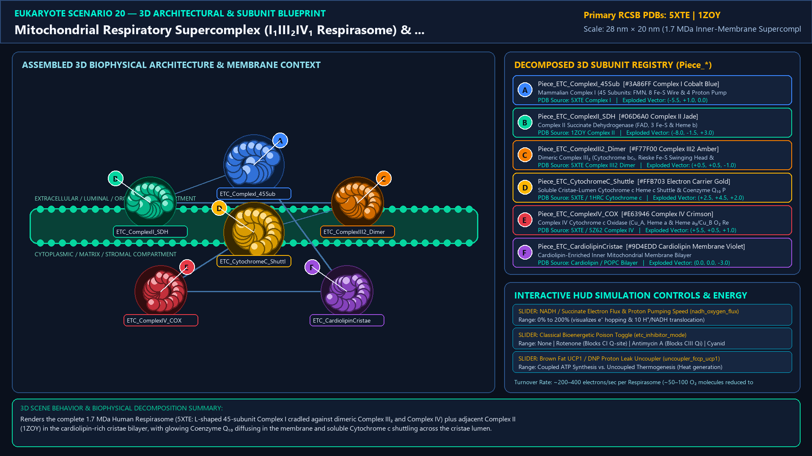
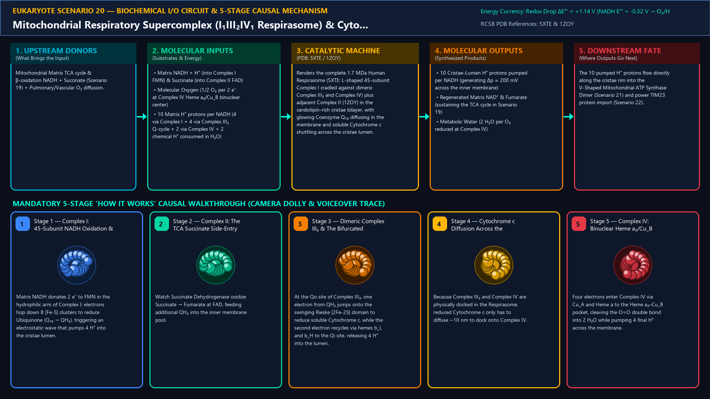
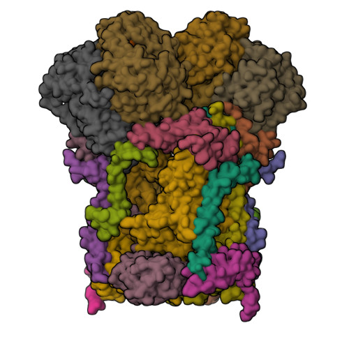
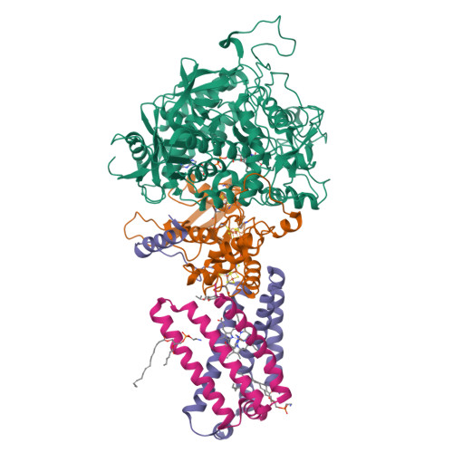
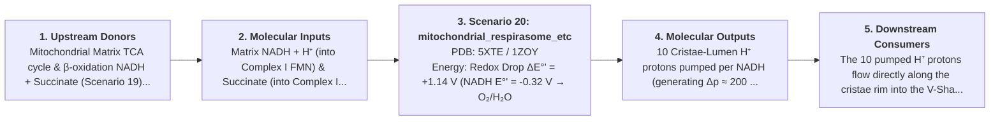
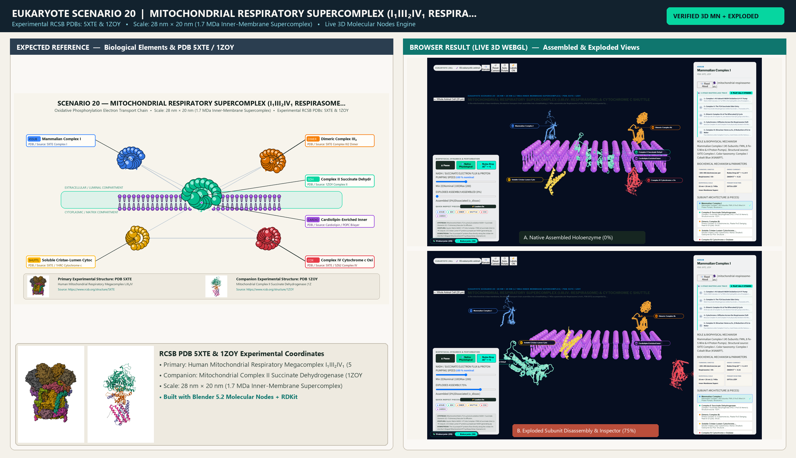

# Scenario 20 — Mitochondrial Respiratory Supercomplex (I₁III₂IV₁ Respirasome) & Cytochrome c Shuttle

> **Roadmap Tier:** Tier 5 — Endosymbiotic Bioenergetic Powerhouses: Mitochondria & Chloroplasts ($20\,\text{nm}\text{--}3\,\mu\text{m}$)  
> **Scenario ID:** `20_mitochondrial_respirasome_etc`  
> **Biophysical Scale:** 28 nm × 20 nm (1.7 MDa Inner-Membrane Supercomplex)  
> **Functional Category:** Oxidative Phosphorylation Electron Transport Chain  
> **Primary RCSB PDB Structures:** [`5XTE`](https://www.rcsb.org/structure/5XTE) (Human Mitochondrial Respiratory Megacomplex I₁III₂IV₁ (5XTE)) · [`1ZOY`](https://www.rcsb.org/structure/1ZOY) (Mitochondrial Complex II Succinate Dehydrogenase (1ZOY))

---

## 1. Visual & Artistic Representations (Manual Verification Reference Plates)

The following four visual reference plates are stored directly inside this folder (`./`) so you can inspect both the **expected 3D scene decomposition**, the **biochemical I/O circuit & 5-stage mechanism**, and the **experimental cryo-EM / X-ray structures** during manual verification:

### 1.1 Expected 3D Scene & Subunit Decomposition Blueprint (`expected_mitochondrial_respirasome_etc.png`)

### 1.2 Biochemical I/O Circuit & 5-Stage Causal Mechanism (`mechanism_mitochondrial_respirasome_etc.png`)

### 1.3 Experimental RCSB PDB Structural References (`rcsb_5XTE.jpg` & `rcsb_1ZOY.jpg`)
| Primary Structure [`5XTE`](https://www.rcsb.org/structure/5XTE) | Companion / Partner Structure [`1ZOY`](https://www.rcsb.org/structure/1ZOY) |
| :---: | :---: |
|  |  |
| **Human Mitochondrial Respiratory Megacomplex I₁III₂IV₁ (5XTE)** | **Mitochondrial Complex II Succinate Dehydrogenase (1ZOY)** |

---

## 2. Biophysical & Molecular Behavior Overview

In the mitochondrial cristae membrane, the electron transport chain assembles into a breathtaking 1.7 MDa supramolecular Respirasome (I₁III₂IV₁, PDB 5XTE) accompanied by Complex II (1ZOY): (1) Mammalian Complex I (45 subunits, 1 MDa—31 supernumerary subunits wrapped around the 14-subunit bacterial core!) oxidizes Matrix NADH at FMN, passes 2 e⁻ down an 8-cluster [Fe-S] wire to Ubiquinone (Coenzyme Q₁₀), and pumps 4 H⁺ across the inner membrane; (2) Complex II (Succinate Dehydrogenase) oxidizes TCA Succinate → Fumarate via FAD and 3 [Fe-S] clusters, feeding additional Ubiquinol (QH₂) into the membrane pool without pumping protons; (3) Dimeric Complex III₂ (Cytochrome bc₁, 22 subunits) executes Mitchell's Q-Cycle: one e⁻ from QH₂ jumps onto the swinging Rieske [2Fe-2S] head domain → Cytochrome c₁ → soluble intermembrane Heme-protein Cytochrome c, while the second e⁻ recycles through hemes b_L and b_H to reduce a quinone at the Qi site, translocating 4 H⁺ per 2 e⁻; (4) Complex IV (Cytochrome c Oxidase, 14 subunits) accepts 4 e⁻ one at a time from Cytochrome c via its binuclear Cu_A center → Heme a → Heme a₃/Cu_B catalytic site, reducing 1 O₂ + 4 H⁺ → 2 H₂O while pumping 4 more H⁺ into the cristae lumen (total 10 H⁺ pumped per NADH!).

### How It Behaves in the Interactive 3D Scene
Renders the complete 1.7 MDa Human Respirasome (5XTE: L-shaped 45-subunit Complex I cradled against dimeric Complex III₂ and Complex IV) plus adjacent Complex II (1ZOY) in the cardiolipin-rich cristae bilayer, with glowing Coenzyme Q₁₀ diffusing in the membrane and soluble Cytochrome c shuttling across the cristae lumen.

---

## 3. Complete Biochemical I/O & Inter-Element Iteration

This section defines **what brings the input** to this machine (*Upstream Donors*), **what goes in** (*Molecular Inputs*), **what it makes** (*Molecular Outputs*), and **how it iterates with downstream systems** (*Downstream Consumers*):

- **Upstream Donors (What Brings the Input):**  
  Mitochondrial Matrix TCA cycle & β-oxidation NADH + Succinate (Scenario 19) + Pulmonary/Vascular O₂ diffusion.
- **Molecular Inputs (Substrates, Signals & Co-Factors):**
  - Matrix NADH + H⁺ (into Complex I FMN) & Succinate (into Complex II FAD)
  - Molecular Oxygen (1/2 O₂ per 2 e⁻ at Complex IV Heme a₃/Cu_B binuclear center)
  - 10 Matrix H⁺ protons per NADH (4 via Complex I + 4 via Complex III₂ Q-cycle + 2 via Complex IV + 2 chemical H⁺ consumed in H₂O)
- **Molecular Outputs (Synthesized / Translocated Products):**
  - 10 Cristae-Lumen H⁺ protons pumped per NADH (generating Δp ≈ 200 mV across the inner membrane)
  - Regenerated Matrix NAD⁺ & Fumarate (sustaining the TCA cycle in Scenario 19)
  - Metabolic Water (2 H₂O per O₂ reduced at Complex IV)
- **Downstream Consumers & Cross-Element Iteration:**  
  The 10 pumped H⁺ protons flow directly along the cristae rim into the V-Shaped Mitochondrial ATP Synthase Dimer (Scenario 21) and power TIM23 protein import (Scenario 22).
- **Thermodynamic Energy Currency:** `Redox Drop ΔE°' = +1.14 V (NADH E°' = -0.32 V → O₂/H₂O E°' = +0.82 V, ΔG°' = -220 kJ/mol) → Proton Motive Force Δp`
- **Biophysical Turnover / Kinetics ($k_{\text{cat}}$):** `~200–400 electrons/sec per Respirasome (~50–100 O₂ molecules reduced to H₂O per second)`

---

## 4. 3D Subunit Decomposition (`Piece_<ID>_*`) & Color Taxonomy

To support continuous **Exploded View (`setExplodedProgress(0.0 → 1.0)`)**, raycast hover inspection, and subpill lock-on targeting, this scenario is decomposed into **6 functional 3D submeshes**:

| # | 3D Submesh ID (`Piece_*`) | Biological & Structural Role | RCSB PDB / Chain Source | Color Taxonomy (`#Hex`) | Exploded Vector $\vec{v}_{\text{dissoc}}$ |
| :--- | :--- | :--- | :--- | :--- | :--- |
| **1** | `Piece_ETC_ComplexI_45Sub` | Mammalian Complex I (45 Subunits: FMN, 8 Fe-S Wire & 4 Proton Pumps) | `5XTE Complex I` | `#3A86FF` (Complex I Cobalt Blue) | `(-5.5, +1.0, 0.0)` |
| **2** | `Piece_ETC_ComplexII_SDH` | Complex II Succinate Dehydrogenase (FAD, 3 Fe-S & Heme b) | `1ZOY Complex II` | `#06D6A0` (Complex II Jade) | `(-8.0, -1.5, +3.0)` |
| **3** | `Piece_ETC_ComplexIII2_Dimer` | Dimeric Complex III₂ (Cytochrome bc₁, Rieske Fe-S Swinging Head & Q-Cycle) | `5XTE Complex III2 Dimer` | `#F77F00` (Complex III2 Amber) | `(+0.5, +0.5, -1.0)` |
| **4** | `Piece_ETC_CytochromeC_Shuttle` | Soluble Cristae-Lumen Cytochrome c Heme c Shuttle & Coenzyme Q₁₀ Pool | `5XTE / 1HRC Cytochrome c` | `#FFB703` (Electron Carrier Gold) | `(+2.5, +4.5, +2.0)` |
| **5** | `Piece_ETC_ComplexIV_COX` | Complex IV Cytochrome c Oxidase (Cu_A, Heme a & Heme a₃/Cu_B O₂ Reducer) | `5XTE / 5Z62 Complex IV` | `#E63946` (Complex IV Crimson) | `(+5.5, +0.5, +1.0)` |
| **6** | `Piece_ETC_CardiolipinCristae` | Cardiolipin-Enriched Inner Mitochondrial Membrane Bilayer | `Cardiolipin / POPC Bilayer` | `#9D4EDD` (Cardiolipin Membrane Violet) | `(0.0, 0.0, -3.0)` |

---

## 5. Interactive HUD Simulation Controls (`iterationControls`)

| Control ID | HUD Label | Biophysical Permutations & Interactive Behavior |
| :--- | :--- | :--- |
| `nadh_oxygen_flux` | **NADH / Succinate Electron Flux & Proton Pumping Speed** | 0% to 200% (visualizes e⁻ hopping & 10 H⁺/NADH translocation) |
| `etc_inhibitor_mode` | **Classical Bioenergetic Poison Toggle** | None · Rotenone (Blocks CI Q-site) · Antimycin A (Blocks CIII Qi) · Cyanide (Blocks CIV Heme a₃) |
| `uncoupler_fccp_ucp1` | **Brown Fat UCP1 / DNP Proton Leak Uncoupler** | Coupled ATP Synthesis vs. Uncoupled Thermogenesis (Heat generation) |

---

## 6. Mandatory 5-Stage "How It Works" Explanatory Trace

- **Stage 1 — Complex I: 45-Subunit NADH Oxidation & 4 H⁺ Pump:** Matrix NADH donates 2 e⁻ to FMN in the hydrophilic arm of Complex I; electrons hop down 8 [Fe-S] clusters to reduce Ubiquinone (Q₁₀ → QH₂), triggering an electrostatic wave that pumps 4 H⁺ into the cristae lumen.
- **Stage 2 — Complex II: The TCA Succinate Side-Entry:** Watch Succinate Dehydrogenase oxidize Succinate → Fumarate at FAD, feeding additional QH₂ into the inner membrane pool.
- **Stage 3 — Dimeric Complex III₂ & The Bifurcated Q-Cycle:** At the Qo site of Complex III₂, one electron from QH₂ jumps onto the swinging Rieske [2Fe-2S] domain to reduce soluble Cytochrome c, while the second electron recycles via hemes b_L and b_H to the Qi site, releasing 4 H⁺ into the lumen.
- **Stage 4 — Cytochrome c Diffusion Across the Respirasome Cleft:** Because Complex III₂ and Complex IV are physically docked in the Respirasome, reduced Cytochrome c only has to diffuse ~10 nm to dock onto Complex IV.
- **Stage 5 — Complex IV: Binuclear Heme a₃/Cu_B Reduction of O₂ to Water:** Four electrons enter Complex IV via Cu_A and Heme a to the Heme a₃–Cu_B pocket, cleaving the O=O double bond into 2 H₂O while pumping 4 final H⁺ across the membrane.

---

## 7. Curated Online Resources & Structural References

- [RCSB PDB-101 — Molecule of the Month: Respiratory Supercomplex](https://pdb101.rcsb.org/motm/299)
- [RCSB PDB-101 — Molecule of the Month: Cytochrome c Oxidase](https://pdb101.rcsb.org/motm/5)
- [RCSB PDB Structure 5XTE — Human Mitochondrial Respiratory Megacomplex I₁III₂IV₁](https://www.rcsb.org/structure/5XTE)
- [RCSB PDB Structure 1ZOY — Mitochondrial Respiratory Complex II](https://www.rcsb.org/structure/1ZOY)

## 12. 3D Implementation & Visual Verification Assets

- **Status:** `[x] Implemented, Exported to 3D GLB & Visually Verified`
- **3D Model Asset (`.glb`):** [`mitochondrial_respirasome_etc.glb`](./mitochondrial_respirasome_etc.glb) (also mirrored in `eukaryote/models/mitochondrial_respirasome_etc.glb` and `client/public/eukaryote/models/mitochondrial_respirasome_etc.glb`)
- **Blender 5.2 + Molecular Nodes Generator Script:** [`generate_20_mitochondrial_respirasome_etc.py`](./generate_20_mitochondrial_respirasome_etc.py)
- **Live WebGL Assembled Capture (`0%`):** [`browser_mitochondrial_respirasome_etc_assembled.png`](../../verification/20_mitochondrial_respirasome_etc/browser_mitochondrial_respirasome_etc_assembled.png)
- **Live WebGL Exploded Capture (`75%`):** [`browser_mitochondrial_respirasome_etc_exploded.png`](../../verification/20_mitochondrial_respirasome_etc/browser_mitochondrial_respirasome_etc_exploded.png)
- **Side-by-Side Input vs. Output Comparison Plate (`2400×1380`):** [`comparison_mitochondrial_respirasome_etc.png`](../../verification/20_mitochondrial_respirasome_etc/comparison_mitochondrial_respirasome_etc.png)
- **Animated Side-by-Side Comparison Video (`1920×1080 MP4`):** [`comparison_mitochondrial_respirasome_etc.mp4`](../../verification/20_mitochondrial_respirasome_etc/comparison_mitochondrial_respirasome_etc.mp4)

