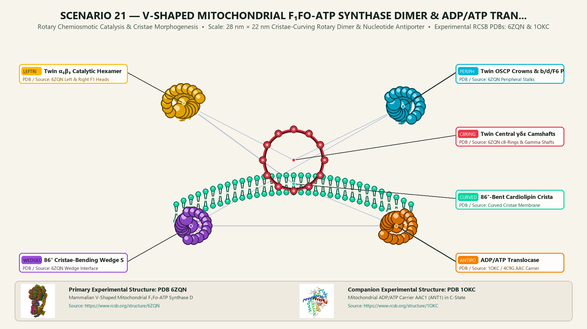
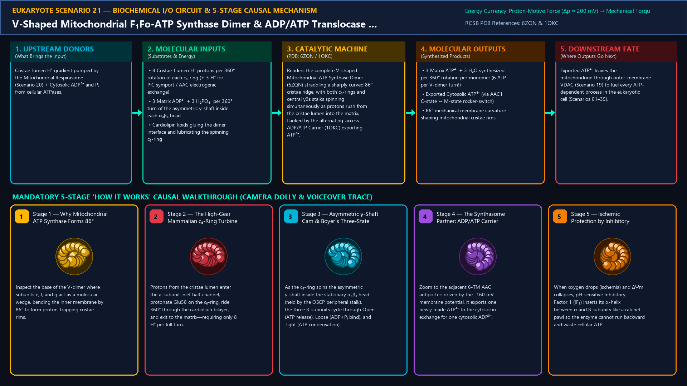
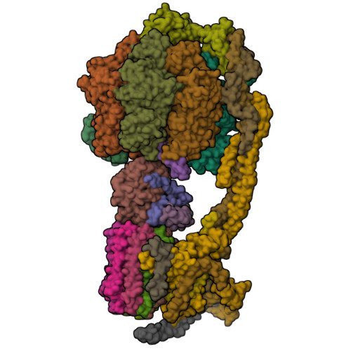
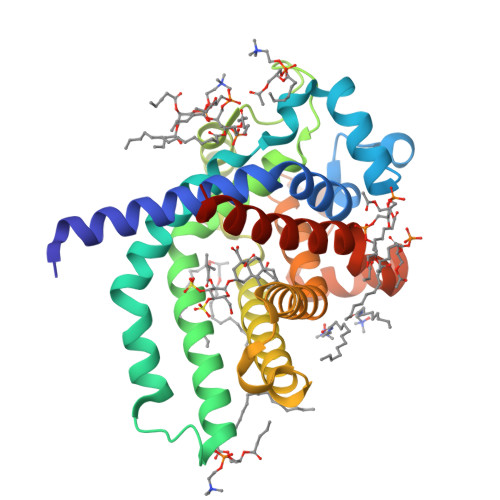
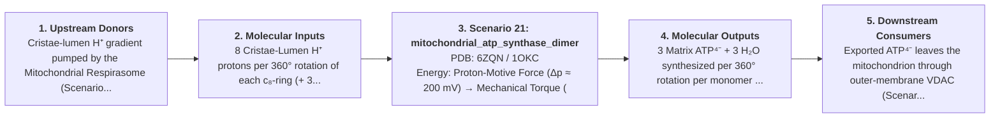
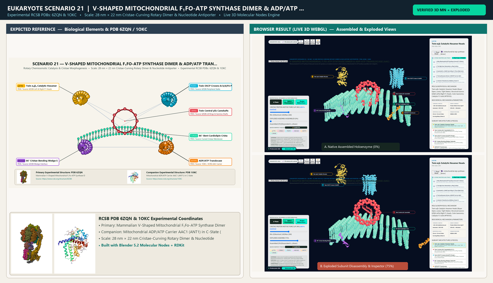

# Scenario 21 — V-Shaped Mitochondrial F₁Fo-ATP Synthase Dimer & ADP/ATP Translocase (AAC)

> **Roadmap Tier:** Tier 5 — Endosymbiotic Bioenergetic Powerhouses: Mitochondria & Chloroplasts ($20\,\text{nm}\text{--}3\,\mu\text{m}$)  
> **Scenario ID:** `21_mitochondrial_atp_synthase_dimer`  
> **Biophysical Scale:** 28 nm × 22 nm Cristae-Curving Rotary Dimer & Nucleotide Antiporter  
> **Functional Category:** Rotary Chemiosmotic Catalysis & Cristae Morphogenesis  
> **Primary RCSB PDB Structures:** [`6ZQN`](https://www.rcsb.org/structure/6ZQN) (Mammalian V-Shaped Mitochondrial F₁Fo-ATP Synthase Dimer (6ZQN / 7AJB)) · [`1OKC`](https://www.rcsb.org/structure/1OKC) (Mitochondrial ADP/ATP Carrier AAC1 (ANT1) in C-State (1OKC))

---

## 1. Visual & Artistic Representations (Manual Verification Reference Plates)

The following four visual reference plates are stored directly inside this folder (`./`) so you can inspect both the **expected 3D scene decomposition**, the **biochemical I/O circuit & 5-stage mechanism**, and the **experimental cryo-EM / X-ray structures** during manual verification:

### 1.1 Expected 3D Scene & Subunit Decomposition Blueprint (`expected_mitochondrial_atp_synthase_dimer.png`)

### 1.2 Biochemical I/O Circuit & 5-Stage Causal Mechanism (`mechanism_mitochondrial_atp_synthase_dimer.png`)

### 1.3 Experimental RCSB PDB Structural References (`rcsb_6ZQN.jpg` & `rcsb_1OKC.jpg`)
| Primary Structure [`6ZQN`](https://www.rcsb.org/structure/6ZQN) | Companion / Partner Structure [`1OKC`](https://www.rcsb.org/structure/1OKC) |
| :---: | :---: |
|  |  |
| **Mammalian V-Shaped Mitochondrial F₁Fo-ATP Synthase Dimer (6ZQN / 7AJB)** | **Mitochondrial ADP/ATP Carrier AAC1 (ANT1) in C-State (1OKC)** |

---

## 2. Biophysical & Molecular Behavior Overview

Whereas bacterial F₁Fo-ATP Synthase (Prokaryote Scenario 04) operates as an isolated monomer in a flat membrane, Mitochondrial F₁Fo-ATP Synthase assembles into V-shaped Dimers (angled at ~86°–90° by specialized membrane-wedging subunits e, f, g, k, and 8/A6L) that self-organize into long double rows along the tightly curved ridges of mitochondrial cristae! This dimerization physically bends the inner membrane into tubular/lamellar cristae that act as proton traps. Furthermore, the mammalian mitochondrial Fo rotor ring contains only 8 c-subunits (c₈-ring vs. 10–15 in bacteria/chloroplasts), meaning a full 360° rotation requires only 8 H⁺ to synthesize 3 ATP in the α₃β₃ catalytic head—a remarkable bioenergetic gear ratio of 2.67 H⁺ per ATP! Immediately adjacent in the inner membrane sits the Mitochondrial Synthasome partner: the ADP/ATP Carrier (AAC / ANT, 1OKC) and Phosphate Carrier (PiC), which use the -160 mV membrane voltage to export newly made ATP⁴⁻ to the cytosol in 1:1 exchange for cytosolic ADP³⁻ (adding 1 H⁺ electrogenic cost → total 3.67 H⁺/ATP).

### How It Behaves in the Interactive 3D Scene
Renders the complete V-shaped Mitochondrial ATP Synthase Dimer (6ZQN) straddling a sharply curved 86° cristae ridge, with both c₈-rings and central γδε stalks spinning simultaneously as protons rush from the cristae lumen into the matrix, flanked by the alternating-access ADP/ATP Carrier (1OKC) exporting ATP⁴⁻.

---

## 3. Complete Biochemical I/O & Inter-Element Iteration

This section defines **what brings the input** to this machine (*Upstream Donors*), **what goes in** (*Molecular Inputs*), **what it makes** (*Molecular Outputs*), and **how it iterates with downstream systems** (*Downstream Consumers*):

- **Upstream Donors (What Brings the Input):**  
  Cristae-lumen H⁺ gradient pumped by the Mitochondrial Respirasome (Scenario 20) + Cytosolic ADP³⁻ and Pᵢ from cellular ATPases.
- **Molecular Inputs (Substrates, Signals & Co-Factors):**
  - 8 Cristae-Lumen H⁺ protons per 360° rotation of each c₈-ring (+ 3 H⁺ for PiC symport / AAC electrogenic exchange)
  - 3 Matrix ADP³⁻ + 3 H₂PO₄⁻ per 360° turn of the asymmetric γ-shaft inside each α₃β₃ head
  - Cardiolipin lipids gluing the dimer interface and lubricating the spinning c₈-ring
- **Molecular Outputs (Synthesized / Translocated Products):**
  - 3 Matrix ATP⁴⁻ + 3 H₂O synthesized per 360° rotation per monomer (6 ATP per V-dimer turn!)
  - Exported Cytosolic ATP⁴⁻ (via AAC1 C-state ↔ M-state rocker-switch)
  - 86° mechanical membrane curvature shaping mitochondrial cristae rims
- **Downstream Consumers & Cross-Element Iteration:**  
  Exported ATP⁴⁻ leaves the mitochondrion through outer-membrane VDAC (Scenario 19) to fuel every ATP-dependent process in the eukaryotic cell (Scenarios 01–35).
- **Thermodynamic Energy Currency:** `Proton-Motive Force (Δp ≈ 200 mV) → Mechanical Torque (~40 pN·nm on γ-shaft) → Boyer Binding-Change ATP Synthesis (ΔG ≈ +50 kJ/mol)`
- **Biophysical Turnover / Kinetics ($k_{\text{cat}}$):** `~100–150 rotations/sec per monomer (~300–450 ATP/sec per monomer; ~600–900 ATP/sec per V-dimer)`

---

## 4. 3D Subunit Decomposition (`Piece_<ID>_*`) & Color Taxonomy

To support continuous **Exploded View (`setExplodedProgress(0.0 → 1.0)`)**, raycast hover inspection, and subpill lock-on targeting, this scenario is decomposed into **6 functional 3D submeshes**:

| # | 3D Submesh ID (`Piece_*`) | Biological & Structural Role | RCSB PDB / Chain Source | Color Taxonomy (`#Hex`) | Exploded Vector $\vec{v}_{\text{dissoc}}$ |
| :--- | :--- | :--- | :--- | :--- | :--- |
| **1** | `Piece_mATP_F1Heads_LeftRight` | Twin α₃β₃ Catalytic Hexamer Heads (Boyer Open, Loose, Tight States) | `6ZQN Left & Right F1 Heads` | `#FFB703` (Catalytic F1 Gold) | `(0.0, +4.5, 0.0)` |
| **2** | `Piece_mATP_GammaRotors_c8Rings` | Twin Central γδε Camshafts & 8-Subunit Fo c₈-Ring Turbines | `6ZQN c8-Rings & Gamma Shafts` | `#E63946` (Rotary Turbine Crimson) | `(0.0, +0.5, +1.5)` |
| **3** | `Piece_mATP_OSCP_PeripheralStalks` | Twin OSCP Crowns & b/d/F6 Peripheral Stator Stalks | `6ZQN Peripheral Stalks` | `#00B4D8` (Stator Stalk Cerulean) | `(-5.5, +2.5, 0.0)` |
| **4** | `Piece_mATP_WedgeDimerInterface` | 86° Cristae-Bending Wedge Subunits (e, f, g, a/ATP6 & 8/A6L) | `6ZQN Wedge Interface` | `#9D4EDD` (Dimer Wedge Violet) | `(0.0, -2.5, 0.0)` |
| **5** | `Piece_mATP_AAC_Antiporter` | ADP/ATP Translocase (AAC1 / ANT1) 6-TM Rocker-Switch Carrier | `1OKC / 4C9G AAC Carrier` | `#F77F00` (Nucleotide Carrier Amber) | `(+6.5, -1.0, +1.5)` |
| **6** | `Piece_mATP_CurvedCristaeRidge` | 86°-Bent Cardiolipin Cristae Rim Bilayer | `Curved Cristae Membrane` | `#06D6A0` (Cristae Rim Jade) | `(0.0, -2.0, -2.5)` |

---

## 5. Interactive HUD Simulation Controls (`iterationControls`)

| Control ID | HUD Label | Biophysical Permutations & Interactive Behavior |
| :--- | :--- | :--- |
| `pmf_voltage_mV` | **Cristae Proton-Motive Force Δp (mV)** | 0 mV (Stalled / IF₁ Inhibited) to 220 mV (150 Hz Twin Rotor Spin) |
| `dimer_angle_wedge` | **Subunit e/g Dimerization Wedge** | 86° Native V-Dimer Ridge vs. Dissociated Monomers (Flat Cristae Collapse) |
| `bongkrekic_atractyloside` | **AAC Translocase Toxin Toggle** | Normal ADP/ATP Exchange · Bongkrekic Acid (Locks M-state) · Carboxyatractyloside (Locks C-state) |

---

## 6. Mandatory 5-Stage "How It Works" Explanatory Trace

- **Stage 1 — Why Mitochondrial ATP Synthase Forms 86° V-Dimers:** Inspect the base of the V-dimer where subunits e, f, and g act as a molecular wedge, bending the inner membrane by 86° to form proton-trapping cristae rims.
- **Stage 2 — The High-Gear Mammalian c₈-Ring Turbine:** Protons from the cristae lumen enter the a-subunit inlet half-channel, protonate Glu58 on the c₈-ring, ride 360° through the cardiolipin bilayer, and exit to the matrix—requiring only 8 H⁺ per full turn.
- **Stage 3 — Asymmetric γ-Shaft Cam & Boyer's Three-State Cycle:** As the c₈-ring spins the asymmetric γ-shaft inside the stationary α₃β₃ head (held by the OSCP peripheral stalk), the three β-subunits cycle through Open (ATP release), Loose (ADP+Pᵢ bind), and Tight (ATP condensation).
- **Stage 4 — The Synthasome Partner: ADP/ATP Carrier (AAC):** Zoom to the adjacent 6-TM AAC antiporter: driven by the -160 mV membrane potential, it exports one newly made ATP⁴⁻ to the cytosol in exchange for one cytosolic ADP³⁻.
- **Stage 5 — Ischemic Protection by Inhibitory Factor IF₁:** When oxygen drops (ischemia) and ΔΨm collapses, pH-sensitive Inhibitory Factor 1 (IF₁) inserts its α-helix between α and β subunits like a ratchet pawl so the enzyme cannot run backward and waste cellular ATP.

---

## 7. Curated Online Resources & Structural References

- [RCSB PDB Structure 6ZQN — Mammalian Mitochondrial ATP Synthase Dimer](https://www.rcsb.org/structure/6ZQN)
- [RCSB PDB Structure 1OKC — Mitochondrial ADP/ATP Carrier](https://www.rcsb.org/structure/1OKC)
- [RCSB PDB-101 — Molecule of the Month: ATP Synthase](https://pdb101.rcsb.org/motm/72)
- [RCSB PDB-101 — Molecule of the Month: ADP/ATP Carrier](https://pdb101.rcsb.org/motm/260)

## 12. 3D Implementation & Visual Verification Assets

- **Status:** `[x] Implemented, Exported to 3D GLB & Visually Verified`
- **3D Model Asset (`.glb`):** [`mitochondrial_atp_synthase_dimer.glb`](./mitochondrial_atp_synthase_dimer.glb) (also mirrored in `eukaryote/models/mitochondrial_atp_synthase_dimer.glb` and `client/public/eukaryote/models/mitochondrial_atp_synthase_dimer.glb`)
- **Blender 5.2 + Molecular Nodes Generator Script:** [`generate_21_mitochondrial_atp_synthase_dimer.py`](./generate_21_mitochondrial_atp_synthase_dimer.py)
- **Live WebGL Assembled Capture (`0%`):** [`browser_mitochondrial_atp_synthase_dimer_assembled.png`](../../verification/21_mitochondrial_atp_synthase_dimer/browser_mitochondrial_atp_synthase_dimer_assembled.png)
- **Live WebGL Exploded Capture (`75%`):** [`browser_mitochondrial_atp_synthase_dimer_exploded.png`](../../verification/21_mitochondrial_atp_synthase_dimer/browser_mitochondrial_atp_synthase_dimer_exploded.png)
- **Side-by-Side Input vs. Output Comparison Plate (`2400×1380`):** [`comparison_mitochondrial_atp_synthase_dimer.png`](../../verification/21_mitochondrial_atp_synthase_dimer/comparison_mitochondrial_atp_synthase_dimer.png)
- **Animated Side-by-Side Comparison Video (`1920×1080 MP4`):** [`comparison_mitochondrial_atp_synthase_dimer.mp4`](../../verification/21_mitochondrial_atp_synthase_dimer/comparison_mitochondrial_atp_synthase_dimer.mp4)

