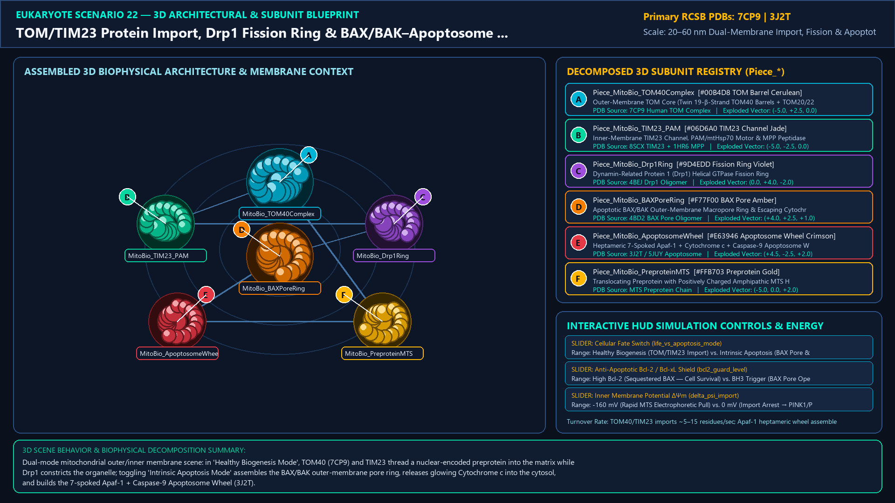
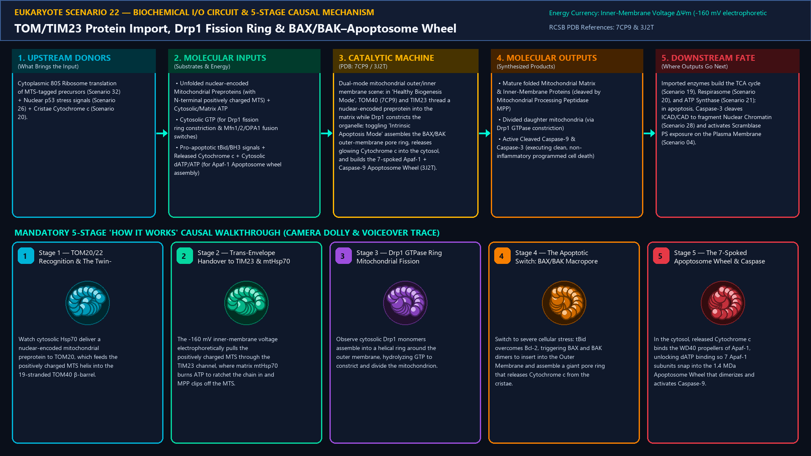
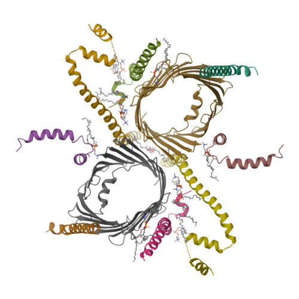
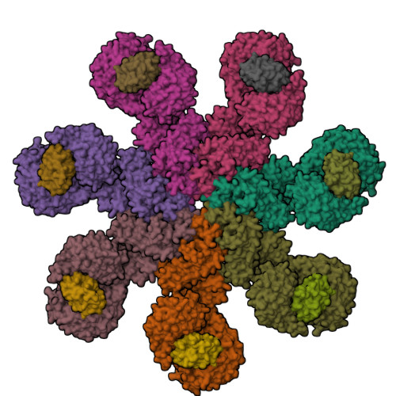
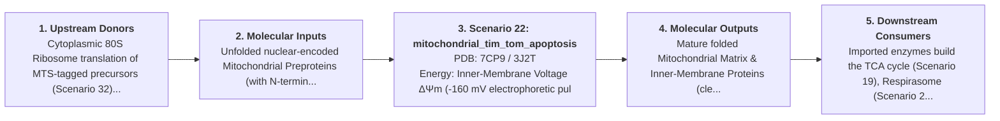
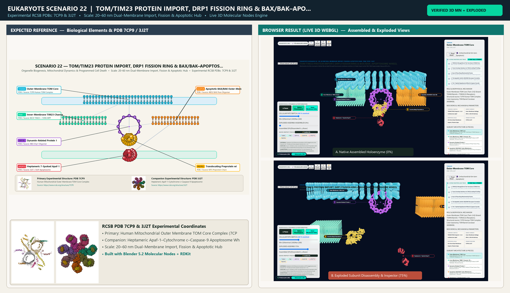

# Scenario 22 — TOM/TIM23 Protein Import, Drp1 Fission Ring & BAX/BAK–Apoptosome Wheel

> **Roadmap Tier:** Tier 5 — Endosymbiotic Bioenergetic Powerhouses: Mitochondria & Chloroplasts ($20\,\text{nm}\text{--}3\,\mu\text{m}$)  
> **Scenario ID:** `22_mitochondrial_tim_tom_apoptosis`  
> **Biophysical Scale:** 20–60 nm Dual-Membrane Import, Fission & Apoptotic Hub  
> **Functional Category:** Organelle Biogenesis, Mitochondrial Dynamics & Programmed Cell Death  
> **Primary RCSB PDB Structures:** [`7CP9`](https://www.rcsb.org/structure/7CP9) (Human Mitochondrial Outer Membrane TOM Core Complex (7CP9)) · [`3J2T`](https://www.rcsb.org/structure/3J2T) (Heptameric Apaf-1–Cytochrome c–Caspase-9 Apoptosome Wheel (3J2T))

---

## 1. Visual & Artistic Representations (Manual Verification Reference Plates)

The following four visual reference plates are stored directly inside this folder (`./`) so you can inspect both the **expected 3D scene decomposition**, the **biochemical I/O circuit & 5-stage mechanism**, and the **experimental cryo-EM / X-ray structures** during manual verification:

### 1.1 Expected 3D Scene & Subunit Decomposition Blueprint (`expected_mitochondrial_tim_tom_apoptosis.png`)

### 1.2 Biochemical I/O Circuit & 5-Stage Causal Mechanism (`mechanism_mitochondrial_tim_tom_apoptosis.png`)

### 1.3 Experimental RCSB PDB Structural References (`rcsb_7CP9.jpg` & `rcsb_3J2T.jpg`)
| Primary Structure [`7CP9`](https://www.rcsb.org/structure/7CP9) | Companion / Partner Structure [`3J2T`](https://www.rcsb.org/structure/3J2T) |
| :---: | :---: |
|  |  |
| **Human Mitochondrial Outer Membrane TOM Core Complex (7CP9)** | **Heptameric Apaf-1–Cytochrome c–Caspase-9 Apoptosome Wheel (3J2T)** |

---

## 2. Biophysical & Molecular Behavior Overview

Mitochondria sit at the crossroads of cellular life and death through three dynamic membrane machines: (1) Protein Import via the TOM–TIM23 Supercomplex: Because 99% of mitochondrial proteins (~1,500 proteins) are encoded in the Nucleus and translated on cytosolic 80S ribosomes, they carry an N-terminal amphipathic α-helical Matrix Targeting Sequence (MTS). Cytosolic Hsp70/Hsp90 chaperones deliver the unfolded precursor to TOM20/TOM22 receptors on the dimeric 19-stranded β-barrel TOM40 Pore (7CP9) in the Outer Membrane, which threads the chain across the intermembrane space directly into the Inner-Membrane TIM23 channel (driven by ΔΨm and pulled into the matrix by the ATP-powered PAM/mtHsp70 motor before MPP cleaves the MTS); (2) Mitochondrial Fission via the Drp1 Helical Ring: Cytosolic Dynamin-Related Protein 1 (Drp1) oligomers wrap around ER-constricted mitochondria and hydrolyze GTP to divide the organelle; and (3) Intrinsic Apoptosis via the BAX/BAK Pore & Apoptosome Wheel (3J2T): Upon severe DNA damage or cellular stress, BH3-only proteins (Bid/Bim) trigger BAX and BAK to oligomerize into a giant toroidal macropore in the Outer Membrane, releasing soluble Cytochrome c (from Scenario 20) into the cytosol. Cytosolic Cytochrome c binds Apaf-1, triggering dATP/ATP-dependent assembly of the 7-spoked Apoptosome Wheel (1.4 MDa) that activates Caspase-9 → Caspase-3.

### How It Behaves in the Interactive 3D Scene
Dual-mode mitochondrial outer/inner membrane scene: in 'Healthy Biogenesis Mode', TOM40 (7CP9) and TIM23 thread a nuclear-encoded preprotein into the matrix while Drp1 constricts the organelle; toggling 'Intrinsic Apoptosis Mode' assembles the BAX/BAK outer-membrane pore ring, releases glowing Cytochrome c into the cytosol, and builds the 7-spoked Apaf-1 + Caspase-9 Apoptosome Wheel (3J2T).

---

## 3. Complete Biochemical I/O & Inter-Element Iteration

This section defines **what brings the input** to this machine (*Upstream Donors*), **what goes in** (*Molecular Inputs*), **what it makes** (*Molecular Outputs*), and **how it iterates with downstream systems** (*Downstream Consumers*):

- **Upstream Donors (What Brings the Input):**  
  Cytoplasmic 80S Ribosome translation of MTS-tagged precursors (Scenario 32) + Nuclear p53 stress signals (Scenario 26) + Cristae Cytochrome c (Scenario 20).
- **Molecular Inputs (Substrates, Signals & Co-Factors):**
  - Unfolded nuclear-encoded Mitochondrial Preproteins (with N-terminal positively charged MTS) + Cytosolic/Matrix ATP
  - Cytosolic GTP (for Drp1 fission ring constriction & Mfn1/2/OPA1 fusion switches)
  - Pro-apoptotic tBid/BH3 signals + Released Cytochrome c + Cytosolic dATP/ATP (for Apaf-1 Apoptosome wheel assembly)
- **Molecular Outputs (Synthesized / Translocated Products):**
  - Mature folded Mitochondrial Matrix & Inner-Membrane Proteins (cleaved by Mitochondrial Processing Peptidase MPP)
  - Divided daughter mitochondria (via Drp1 GTPase constriction)
  - Active Cleaved Caspase-9 & Caspase-3 (executing clean, non-inflammatory programmed cell death)
- **Downstream Consumers & Cross-Element Iteration:**  
  Imported enzymes build the TCA cycle (Scenario 19), Respirasome (Scenario 20), and ATP Synthase (Scenario 21); in apoptosis, Caspase-3 cleaves ICAD/CAD to fragment Nuclear Chromatin (Scenario 28) and activates Scramblase PS exposure on the Plasma Membrane (Scenario 04).
- **Thermodynamic Energy Currency:** `Inner-Membrane Voltage ΔΨm (-160 mV electrophoretic pull on +MTS) + Matrix mtHsp70 ATP Ratchet + Cytosolic dATP (Apoptosome)`
- **Biophysical Turnover / Kinetics ($k_{\text{cat}}$):** `TOM40/TIM23 imports ~5–15 residues/sec; Apaf-1 heptameric wheel assembles within minutes of Cytochrome c release`

---

## 4. 3D Subunit Decomposition (`Piece_<ID>_*`) & Color Taxonomy

To support continuous **Exploded View (`setExplodedProgress(0.0 → 1.0)`)**, raycast hover inspection, and subpill lock-on targeting, this scenario is decomposed into **6 functional 3D submeshes**:

| # | 3D Submesh ID (`Piece_*`) | Biological & Structural Role | RCSB PDB / Chain Source | Color Taxonomy (`#Hex`) | Exploded Vector $\vec{v}_{\text{dissoc}}$ |
| :--- | :--- | :--- | :--- | :--- | :--- |
| **1** | `Piece_MitoBio_TOM40Complex` | Outer-Membrane TOM Core (Twin 19-β-Strand TOM40 Barrels + TOM20/22 Receptors) | `7CP9 Human TOM Complex` | `#00B4D8` (TOM Barrel Cerulean) | `(-5.0, +2.5, 0.0)` |
| **2** | `Piece_MitoBio_TIM23_PAM` | Inner-Membrane TIM23 Channel, PAM/mtHsp70 Motor & MPP Peptidase | `8SCX TIM23 + 1HR6 MPP` | `#06D6A0` (TIM23 Channel Jade) | `(-5.0, -2.5, 0.0)` |
| **3** | `Piece_MitoBio_Drp1Ring` | Dynamin-Related Protein 1 (Drp1) Helical GTPase Fission Ring | `4BEJ Drp1 Oligomer` | `#9D4EDD` (Fission Ring Violet) | `(0.0, +4.0, -2.0)` |
| **4** | `Piece_MitoBio_BAXPoreRing` | Apoptotic BAX/BAK Outer-Membrane Macropore Ring & Escaping Cytochrome c | `4BD2 BAX Pore Oligomer` | `#F77F00` (BAX Pore Amber) | `(+4.0, +2.5, +1.0)` |
| **5** | `Piece_MitoBio_ApoptosomeWheel` | Heptameric 7-Spoked Apaf-1 + Cytochrome c + Caspase-9 Apoptosome Wheel | `3J2T / 5JUY Apoptosome` | `#E63946` (Apoptosome Wheel Crimson) | `(+4.5, -2.5, +2.0)` |
| **6** | `Piece_MitoBio_PreproteinMTS` | Translocating Preprotein with Positively Charged Amphipathic MTS Helix | `MTS Preprotein Chain` | `#FFB703` (Preprotein Gold) | `(-5.0, 0.0, +2.0)` |

---

## 5. Interactive HUD Simulation Controls (`iterationControls`)

| Control ID | HUD Label | Biophysical Permutations & Interactive Behavior |
| :--- | :--- | :--- |
| `life_vs_apoptosis_mode` | **Cellular Fate Switch** | Healthy Biogenesis (TOM/TIM23 Import) vs. Intrinsic Apoptosis (BAX Pore & 7-Spoked Apoptosome) |
| `bcl2_guard_level` | **Anti-Apoptotic Bcl-2 / Bcl-xL Shield** | High Bcl-2 (Sequestered BAX — Cell Survival) vs. BH3 Trigger (BAX Pore Opening) |
| `delta_psi_import` | **Inner Membrane Potential ΔΨm** | -160 mV (Rapid MTS Electrophoretic Pull) vs. 0 mV (Import Arrest → PINK1/Parkin Mitophagy) |

---

## 6. Mandatory 5-Stage "How It Works" Explanatory Trace

- **Stage 1 — TOM20/22 Recognition & The Twin-Barrel TOM40 Pore:** Watch cytosolic Hsp70 deliver a nuclear-encoded mitochondrial preprotein to TOM20, which feeds the positively charged MTS helix into the 19-stranded TOM40 β-barrel.
- **Stage 2 — Trans-Envelope Handover to TIM23 & mtHsp70 Pulling:** The -160 mV inner-membrane voltage electrophoretically pulls the positively charged MTS through the TIM23 channel, where matrix mtHsp70 burns ATP to ratchet the chain in and MPP clips off the MTS.
- **Stage 3 — Drp1 GTPase Ring Mitochondrial Fission:** Observe cytosolic Drp1 monomers assemble into a helical ring around the outer membrane, hydrolyzing GTP to constrict and divide the mitochondrion.
- **Stage 4 — The Apoptotic Switch: BAX/BAK Macropore Formation:** Switch to severe cellular stress: tBid overcomes Bcl-2, triggering BAX and BAK dimers to insert into the Outer Membrane and assemble a giant pore ring that releases Cytochrome c from the cristae.
- **Stage 5 — The 7-Spoked Apoptosome Wheel & Caspase Cascade:** In the cytosol, released Cytochrome c binds the WD40 propellers of Apaf-1, unlocking dATP binding so 7 Apaf-1 subunits snap into the 1.4 MDa Apoptosome Wheel that dimerizes and activates Caspase-9.

---

## 7. Curated Online Resources & Structural References

- [RCSB PDB-101 — Molecule of the Month: Apoptosome](https://pdb101.rcsb.org/motm/215)
- [RCSB PDB Structure 7CP9 — Human Mitochondrial TOM Core Complex](https://www.rcsb.org/structure/7CP9)
- [RCSB PDB Structure 3J2T — Human Apaf-1 Apoptosome Holoenzyme](https://www.rcsb.org/structure/3J2T)
- [Nature Reviews Molecular Cell Biology — Mitochondrial Protein Import Machinery](https://www.nature.com/articles/nrm.2016.127)

## 12. 3D Implementation & Visual Verification Assets

- **Status:** `[x] Implemented, Exported to 3D GLB & Visually Verified`
- **3D Model Asset (`.glb`):** [`mitochondrial_tim_tom_apoptosis.glb`](./mitochondrial_tim_tom_apoptosis.glb) (also mirrored in `eukaryote/models/mitochondrial_tim_tom_apoptosis.glb` and `client/public/eukaryote/models/mitochondrial_tim_tom_apoptosis.glb`)
- **Blender 5.2 + Molecular Nodes Generator Script:** [`generate_22_mitochondrial_tim_tom_apoptosis.py`](./generate_22_mitochondrial_tim_tom_apoptosis.py)
- **Live WebGL Assembled Capture (`0%`):** [`browser_mitochondrial_tim_tom_apoptosis_assembled.png`](../../verification/22_mitochondrial_tim_tom_apoptosis/browser_mitochondrial_tim_tom_apoptosis_assembled.png)
- **Live WebGL Exploded Capture (`75%`):** [`browser_mitochondrial_tim_tom_apoptosis_exploded.png`](../../verification/22_mitochondrial_tim_tom_apoptosis/browser_mitochondrial_tim_tom_apoptosis_exploded.png)
- **Side-by-Side Input vs. Output Comparison Plate (`2400×1380`):** [`comparison_mitochondrial_tim_tom_apoptosis.png`](../../verification/22_mitochondrial_tim_tom_apoptosis/comparison_mitochondrial_tim_tom_apoptosis.png)
- **Animated Side-by-Side Comparison Video (`1920×1080 MP4`):** [`comparison_mitochondrial_tim_tom_apoptosis.mp4`](../../verification/22_mitochondrial_tim_tom_apoptosis/comparison_mitochondrial_tim_tom_apoptosis.mp4)

