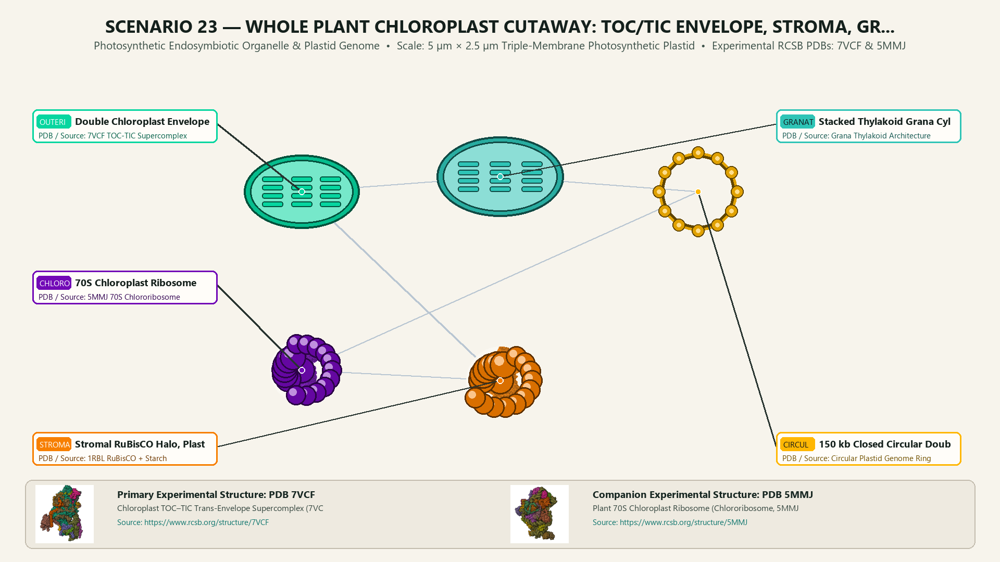
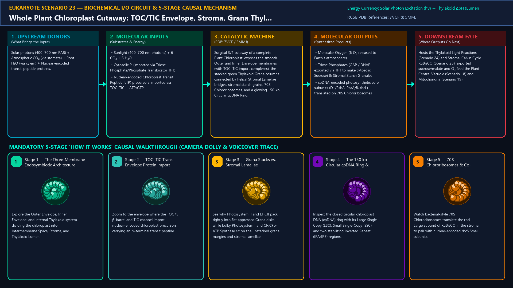
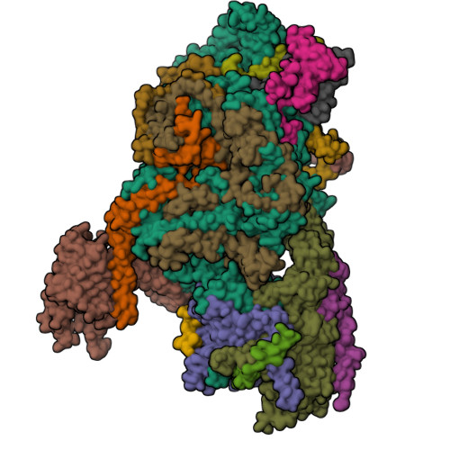
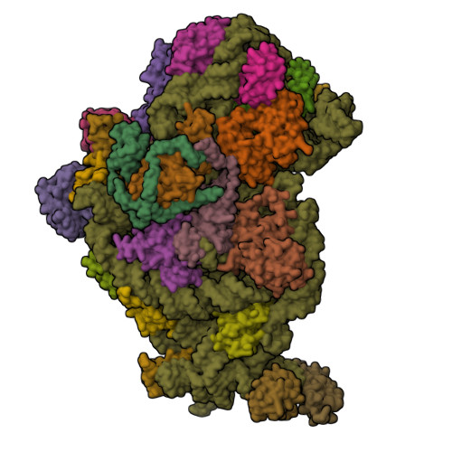
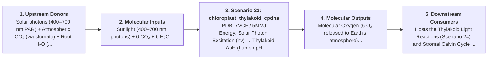

# Scenario 23 — Whole Plant Chloroplast Cutaway: TOC/TIC Envelope, Stroma, Grana Thylakoids & Circular cpDNA Ring

> **Roadmap Tier:** Tier 5 — Endosymbiotic Bioenergetic Powerhouses: Mitochondria & Chloroplasts ($20\,\text{nm}\text{--}3\,\mu\text{m}$)  
> **Scenario ID:** `23_chloroplast_thylakoid_cpdna`  
> **Biophysical Scale:** 5 µm × 2.5 µm Triple-Membrane Photosynthetic Plastid  
> **Functional Category:** Photosynthetic Endosymbiotic Organelle & Plastid Genome  
> **Primary RCSB PDB Structures:** [`7VCF`](https://www.rcsb.org/structure/7VCF) (Chloroplast TOC–TIC Trans-Envelope Supercomplex (7VCF)) · [`5MMJ`](https://www.rcsb.org/structure/5MMJ) (Plant 70S Chloroplast Ribosome (Chlororibosome, 5MMJ))

---

## 1. Visual & Artistic Representations (Manual Verification Reference Plates)

The following four visual reference plates are stored directly inside this folder (`./`) so you can inspect both the **expected 3D scene decomposition**, the **biochemical I/O circuit & 5-stage mechanism**, and the **experimental cryo-EM / X-ray structures** during manual verification:

### 1.1 Expected 3D Scene & Subunit Decomposition Blueprint (`expected_chloroplast_thylakoid_cpdna.png`)

### 1.2 Biochemical I/O Circuit & 5-Stage Causal Mechanism (`mechanism_chloroplast_thylakoid_cpdna.png`)

### 1.3 Experimental RCSB PDB Structural References (`rcsb_7VCF.jpg` & `rcsb_5MMJ.jpg`)
| Primary Structure [`7VCF`](https://www.rcsb.org/structure/7VCF) | Companion / Partner Structure [`5MMJ`](https://www.rcsb.org/structure/5MMJ) |
| :---: | :---: |
|  |  |
| **Chloroplast TOC–TIC Trans-Envelope Supercomplex (7VCF)** | **Plant 70S Chloroplast Ribosome (Chlororibosome, 5MMJ)** |

---

## 2. Biophysical & Molecular Behavior Overview

Derived from an ancient photosynthetic cyanobacterial endosymbiont, the Plant and Algal Chloroplast is a 5 µm solar-powered organelle featuring three distinct membranes and three aqueous compartments: (1) A Double Outer/Inner Envelope Membrane spanned by the 1.5 MDa TOC–TIC Protein Import Supercomplex (7VCF, importing ~3,000 nuclear-encoded transit-peptide proteins across the intermembrane space); (2) The aqueous Stroma (pH 8.0 in light), which houses millions of hexadecameric RuBisCO barrels (Scenario 25), starch granules, bacterial-type 70S Chlororibosomes (5MMJ), and 20–100 copies of the 120–160 kb Closed Circular Double-Stranded Chloroplast DNA (cpDNA) Ring (organized into two Single-Copy regions separated by two large Inverted Repeats IRA/IRB encoding ~120 genes for PSII, PSI, Cyt b₆f, ATP synthase, RuBisCO Large subunit rbcL, rRNAs, and tRNAs); and (3) The internal Thylakoid Membrane Network, folded into tightly stacked cylindrical Grana disks (enriched in PSII & LHCII) interconnected by unstacked Stromal Lamellae (enriched in PSI & CF₁CFo-ATP Synthase) enclosing a continuous acidic Thylakoid Lumen (pH 5.5 in light).

### How It Behaves in the Interactive 3D Scene
Surgical 3/4 cutaway of a complete Plant Chloroplast: exposes the smooth Outer and Inner Envelope membranes (with TOC–TIC import complexes), the stacked green Thylakoid Grana columns connected by helical Stromal Lamellae bridges, stromal starch grains, 70S Chlororibosomes, and a glowing 150 kb Circular cpDNA Ring.

---

## 3. Complete Biochemical I/O & Inter-Element Iteration

This section defines **what brings the input** to this machine (*Upstream Donors*), **what goes in** (*Molecular Inputs*), **what it makes** (*Molecular Outputs*), and **how it iterates with downstream systems** (*Downstream Consumers*):

- **Upstream Donors (What Brings the Input):**  
  Solar photons (400–700 nm PAR) + Atmospheric CO₂ (via stomata) + Root H₂O (via xylem) + Nuclear-encoded transit-peptide proteins.
- **Molecular Inputs (Substrates, Signals & Co-Factors):**
  - Sunlight (400–700 nm photons) + 6 CO₂ + 6 H₂O
  - Cytosolic Pᵢ (imported via Triose-Phosphate/Phosphate Translocator TPT)
  - Nuclear-encoded Chloroplast Transit Peptide (cTP) precursors imported via TOC–TIC + ATP/GTP
- **Molecular Outputs (Synthesized / Translocated Products):**
  - Molecular Oxygen (6 O₂ released to Earth's atmosphere)
  - Triose Phosphates (GAP / DHAP exported via TPT to make cytosolic Sucrose) & Stromal Starch Granules
  - cpDNA-encoded photosynthetic core subunits (D1/PsbA, PsaA/B, rbcL) translated on 70S Chlororibosomes
- **Downstream Consumers & Cross-Element Iteration:**  
  Hosts the Thylakoid Light Reactions (Scenario 24) and Stromal Calvin Cycle RuBisCO (Scenario 25); exported sucrose/malate and O₂ feed the Plant Central Vacuole (Scenario 18) and Mitochondria (Scenario 19).
- **Thermodynamic Energy Currency:** `Solar Photon Excitation (hν) → Thylakoid ΔpH (Lumen pH 5.5 vs. Stroma pH 8.0) → Stromal ATP + NADPH → C–C Covalent Bonds`
- **Biophysical Turnover / Kinetics ($k_{\text{cat}}$):** `Single leaf cell contains ~50–100 chloroplasts fixing ~10⁸ CO₂ molecules/sec in full sunlight`

---

## 4. 3D Subunit Decomposition (`Piece_<ID>_*`) & Color Taxonomy

To support continuous **Exploded View (`setExplodedProgress(0.0 → 1.0)`)**, raycast hover inspection, and subpill lock-on targeting, this scenario is decomposed into **6 functional 3D submeshes**:

| # | 3D Submesh ID (`Piece_*`) | Biological & Structural Role | RCSB PDB / Chain Source | Color Taxonomy (`#Hex`) | Exploded Vector $\vec{v}_{\text{dissoc}}$ |
| :--- | :--- | :--- | :--- | :--- | :--- |
| **1** | `Piece_Chl_OuterInnerEnvelope` | Double Chloroplast Envelope & TOC75–TIC214 Import Supercomplex | `7VCF TOC-TIC Supercomplex` | `#06D6A0` (Envelope Membrane Jade) | `(0.0, +4.5, -2.5)` |
| **2** | `Piece_Chl_GranaThylakoidStacks` | Stacked Thylakoid Grana Cylinders & Helical Stromal Lamellae | `Grana Thylakoid Architecture` | `#2EC4B6` (Thylakoid Chlorophyll Teal) | `(0.0, +0.5, 0.0)` |
| **3** | `Piece_Chl_CircularCpDNARing` | 150 kb Closed Circular Double-Stranded cpDNA Ring (LSC, SSC, IRA/IRB) | `Circular Plastid Genome Ring` | `#FFB703` (Circular cpDNA Gold) | `(-3.5, -2.5, +2.0)` |
| **4** | `Piece_Chl_Chlororibosome70S` | 70S Chloroplast Ribosome (30S + 50S) Translating rbcL & D1 | `5MMJ 70S Chlororibosome` | `#7209B7` (Chlororibosome Purple) | `(+3.5, -2.5, +2.0)` |
| **5** | `Piece_Chl_StromalRuBisCOStarch` | Stromal RuBisCO Halo, Plastoglobules & Semicrystalline Starch Grain | `1RBL RuBisCO + Starch` | `#F77F00` (Stromal Carbon Amber) | `(0.0, -3.5, -1.5)` |

---

## 5. Interactive HUD Simulation Controls (`iterationControls`)

| Control ID | HUD Label | Biophysical Permutations & Interactive Behavior |
| :--- | :--- | :--- |
| `chloroplast_cutaway_peel` | **Envelope & Grana Cutaway Depth** | 0% (Whole Plastid) → 50% (Grana Stacks & Stroma) → 100% (Circular cpDNA Ring & Lumen) |
| `day_night_cycle` | **Illumination State (Daylight PAR ↔ Night Dark Adaptation)** | Daylight (Stroma pH 8.0 / Lumen pH 5.5 / Starch Synthesis) vs. Night (Starch Mobilization) |
| `grana_stacking_state` | **LHCII State Transition (Grana Stacking)** | State 1 (Tightly Stacked Grana) vs. State 2 (Phosphorylated LHCII Migration to PSI) |

---

## 6. Mandatory 5-Stage "How It Works" Explanatory Trace

- **Stage 1 — The Three-Membrane Endosymbiotic Architecture:** Explore the Outer Envelope, Inner Envelope, and internal Thylakoid system dividing the chloroplast into Intermembrane Space, Stroma, and Thylakoid Lumen.
- **Stage 2 — TOC–TIC Trans-Envelope Protein Import:** Zoom to the envelope where the TOC75 β-barrel and TIC channel import nuclear-encoded chloroplast precursors carrying an N-terminal transit peptide.
- **Stage 3 — Grana Stacks vs. Stromal Lamellae Partitioning:** See why Photosystem II and LHCII pack tightly into flat appressed Grana disks while bulky Photosystem I and CF₁CFo-ATP Synthase sit on the unstacked grana margins and stromal lamellae.
- **Stage 4 — The 150 kb Circular cpDNA Ring & Inverted Repeats:** Inspect the closed circular chloroplast DNA (cpDNA) ring with its Large Single-Copy (LSC), Small Single-Copy (SSC), and two stabilizing Inverted Repeat (IRA/IRB) regions.
- **Stage 5 — 70S Chlororibosomes & Co-Evolution with the Nucleus:** Watch bacterial-style 70S Chlororibosomes translate the rbcL Large subunit of RuBisCO in the stroma to pair with nuclear-encoded rbcS Small subunits.

---

## 7. Curated Online Resources & Structural References

- [RCSB PDB Structure 7VCF — Chloroplast TOC-TIC Translocon Supercomplex](https://www.rcsb.org/structure/7VCF)
- [RCSB PDB Structure 5MMJ — Spinach 70S Chloroplast Ribosome](https://www.rcsb.org/structure/5MMJ)
- [NCBI Bookshelf — Molecular Biology of the Cell: Chloroplasts and Photosynthesis](https://www.ncbi.nlm.nih.gov/books/NBK26819/)
- [Cell — Cryo-ET Architecture of Native Plant Thylakoid Grana Membranes](https://www.cell.com/cell/fulltext/S0092-8674(19)31271-1)
