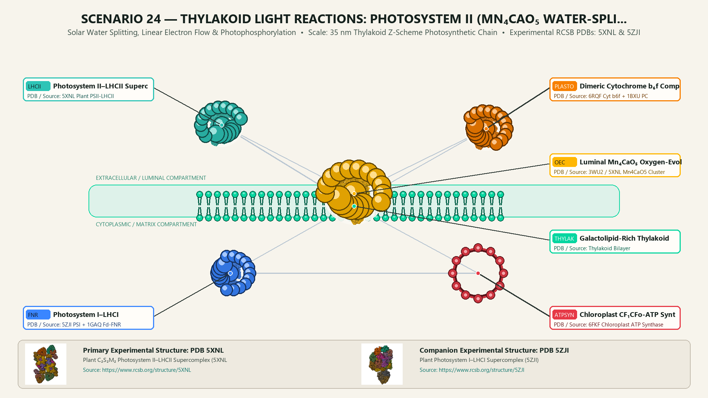
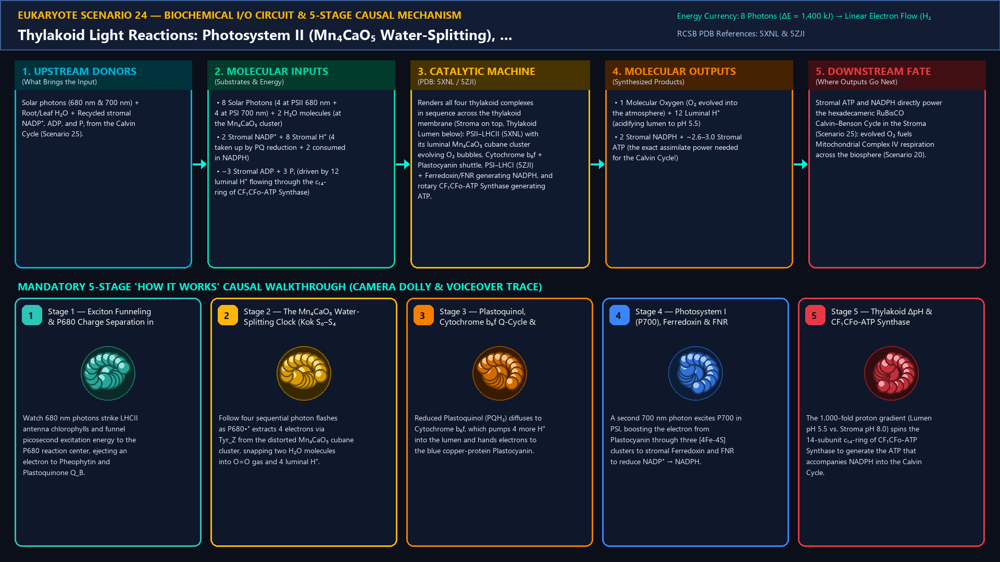
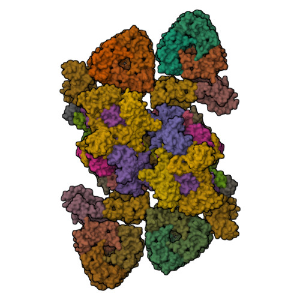
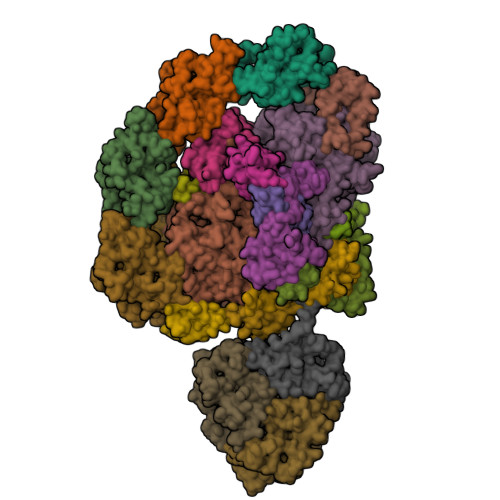
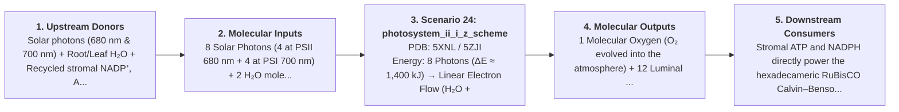

# Scenario 24 — Thylakoid Light Reactions: Photosystem II (Mn₄CaO₅ Water-Splitting), Cytochrome b₆f, Photosystem I & CF₁CFo-ATP Synthase

> **Roadmap Tier:** Tier 5 — Endosymbiotic Bioenergetic Powerhouses: Mitochondria & Chloroplasts ($20\,\text{nm}\text{--}3\,\mu\text{m}$)  
> **Scenario ID:** `24_photosystem_ii_i_z_scheme`  
> **Biophysical Scale:** 35 nm Thylakoid Z-Scheme Photosynthetic Chain  
> **Functional Category:** Solar Water Splitting, Linear Electron Flow & Photophosphorylation  
> **Primary RCSB PDB Structures:** [`5XNL`](https://www.rcsb.org/structure/5XNL) (Plant C₂S₂M₂ Photosystem II–LHCII Supercomplex (5XNL)) · [`5ZJI`](https://www.rcsb.org/structure/5ZJI) (Plant Photosystem I–LHCI Supercomplex (5ZJI))

---

## 1. Visual & Artistic Representations (Manual Verification Reference Plates)

The following four visual reference plates are stored directly inside this folder (`./`) so you can inspect both the **expected 3D scene decomposition**, the **biochemical I/O circuit & 5-stage mechanism**, and the **experimental cryo-EM / X-ray structures** during manual verification:

### 1.1 Expected 3D Scene & Subunit Decomposition Blueprint (`expected_photosystem_ii_i_z_scheme.png`)

### 1.2 Biochemical I/O Circuit & 5-Stage Causal Mechanism (`mechanism_photosystem_ii_i_z_scheme.png`)

### 1.3 Experimental RCSB PDB Structural References (`rcsb_5XNL.jpg` & `rcsb_5ZJI.jpg`)
| Primary Structure [`5XNL`](https://www.rcsb.org/structure/5XNL) | Companion / Partner Structure [`5ZJI`](https://www.rcsb.org/structure/5ZJI) |
| :---: | :---: |
|  |  |
| **Plant C₂S₂M₂ Photosystem II–LHCII Supercomplex (5XNL)** | **Plant Photosystem I–LHCI Supercomplex (5ZJI)** |

---

## 2. Biophysical & Molecular Behavior Overview

The Thylakoid Membrane executes the most important photochemical reaction on Earth—the Z-Scheme of Oxygenic Photosynthesis—across four coupled nanomachines: (1) Dimeric Photosystem II–LHCII Supercomplex (5XNL): Light-Harvesting Complex II (LHCII) chlorophyll a/b trimers funnel 680 nm excitons to the P680 special pair in the D1/D2 core, driving charge separation (P680* → Pheophytin → Plastoquinone Q_A → Q_B). Oxidized P680•⁺ (E°' = +1.25 V, the strongest biological oxidant known!) strips electrons via Tyr_Z (D1-Tyr161) from the cubane-like Mn₄CaO₅ Oxygen-Evolving Complex, stepping through the 5-state Kok Cycle (S₀→S₁→S₂→S₃→[S₄]→S₀) to split 2 H₂O → O₂ + 4 luminal H⁺; (2) Dimeric Cytochrome b₆f Complex oxidizes Plastoquinol (PQH₂) via the Q-cycle, pumping 4 more H⁺ into the thylakoid lumen and reducing soluble luminal copper-protein Plastocyanin (PC); (3) Monomeric Photosystem I–LHCI (5ZJI) absorbs 700 nm photons at P700 to boost electrons from Plastocyanin through phylloquinone and [4Fe-4S] clusters F_X/F_A/F_B to soluble stromal Ferredoxin (Fd), which Ferredoxin–NADP⁺ Reductase (FNR) uses to reduce NADP⁺ + H⁺ → NADPH; (4) Chloroplast CF₁CFo-ATP Synthase uses the massive ΔpH across the thylakoid membrane to spin its 14-subunit c₁₄-ring and synthesize stromal ATP.

### How It Behaves in the Interactive 3D Scene
Renders all four thylakoid complexes in sequence across the thylakoid membrane (Stroma on top, Thylakoid Lumen below): PSII–LHCII (5XNL) with its luminal Mn₄CaO₅ cubane cluster evolving O₂ bubbles, Cytochrome b₆f + Plastocyanin shuttle, PSI–LHCI (5ZJI) + Ferredoxin/FNR generating NADPH, and rotary CF₁CFo-ATP Synthase generating ATP.

---

## 3. Complete Biochemical I/O & Inter-Element Iteration

This section defines **what brings the input** to this machine (*Upstream Donors*), **what goes in** (*Molecular Inputs*), **what it makes** (*Molecular Outputs*), and **how it iterates with downstream systems** (*Downstream Consumers*):

- **Upstream Donors (What Brings the Input):**  
  Solar photons (680 nm & 700 nm) + Root/Leaf H₂O + Recycled stromal NADP⁺, ADP, and Pᵢ from the Calvin Cycle (Scenario 25).
- **Molecular Inputs (Substrates, Signals & Co-Factors):**
  - 8 Solar Photons (4 at PSII 680 nm + 4 at PSI 700 nm) + 2 H₂O molecules (at the Mn₄CaO₅ cluster)
  - 2 Stromal NADP⁺ + 8 Stromal H⁺ (4 taken up by PQ reduction + 2 consumed in NADPH)
  - ~3 Stromal ADP + 3 Pᵢ (driven by 12 luminal H⁺ flowing through the c₁₄-ring of CF₁CFo-ATP Synthase)
- **Molecular Outputs (Synthesized / Translocated Products):**
  - 1 Molecular Oxygen (O₂ evolved into the atmosphere) + 12 Luminal H⁺ (acidifying lumen to pH 5.5)
  - 2 Stromal NADPH + ~2.6–3.0 Stromal ATP (the exact assimilate power needed for the Calvin Cycle!)
- **Downstream Consumers & Cross-Element Iteration:**  
  Stromal ATP and NADPH directly power the hexadecameric RuBisCO Calvin–Benson Cycle in the Stroma (Scenario 25); evolved O₂ fuels Mitochondrial Complex IV respiration across the biosphere (Scenario 20).
- **Thermodynamic Energy Currency:** `8 Photons (ΔE ≈ 1,400 kJ) → Linear Electron Flow (H₂O +0.82 V → NADPH -0.32 V) + Thylakoid ΔpH (~2.5 pH units)`
- **Biophysical Turnover / Kinetics ($k_{\text{cat}}$):** `PSII Kok S-state water-splitting cycle completes in ~1.5 ms (up to ~250 O₂/sec per PSII); CF₁CFo-ATP Synthase makes ~400 ATP/sec`

---

## 4. 3D Subunit Decomposition (`Piece_<ID>_*`) & Color Taxonomy

To support continuous **Exploded View (`setExplodedProgress(0.0 → 1.0)`)**, raycast hover inspection, and subpill lock-on targeting, this scenario is decomposed into **6 functional 3D submeshes**:

| # | 3D Submesh ID (`Piece_*`) | Biological & Structural Role | RCSB PDB / Chain Source | Color Taxonomy (`#Hex`) | Exploded Vector $\vec{v}_{\text{dissoc}}$ |
| :--- | :--- | :--- | :--- | :--- | :--- |
| **1** | `Piece_Photo_PSII_LHCII` | Photosystem II–LHCII Supercomplex (D1/D2, P680 & Chlorophyll Antennae) | `5XNL Plant PSII-LHCII` | `#2EC4B6` (Photosystem II Teal) | `(-6.0, +0.5, 0.0)` |
| **2** | `Piece_Photo_Mn4CaO5_OEC` | Luminal Mn₄CaO₅ Oxygen-Evolving Cubane Cluster & PsbO/P/Q Cap | `3WU2 / 5XNL Mn4CaO5 Cluster` | `#FFB703` (Water-Splitting Gold) | `(-6.0, -3.5, +2.0)` |
| **3** | `Piece_Photo_CytB6f_Plastocyanin` | Dimeric Cytochrome b₆f Complex, Plastoquinol Pool & Cu-Plastocyanin | `6RQF Cyt b6f + 1BXU PC` | `#F77F00` (Cytochrome b6f Amber) | `(-1.0, -0.5, +1.5)` |
| **4** | `Piece_Photo_PSI_LHCI_FNR` | Photosystem I–LHCI (P700, Fe-S Wire), Ferredoxin & FNR (NADPH Generator) | `5ZJI PSI + 1GAQ Fd-FNR` | `#3A86FF` (Photosystem I Cobalt Blue) | `(+3.5, +1.0, 0.0)` |
| **5** | `Piece_Photo_CF1CFo_ATPSynthase` | Chloroplast CF₁CFo-ATP Synthase (Redox γ-Switch & 14-Subunit c₁₄-Ring) | `6FKF Chloroplast ATP Synthase` | `#E63946` (Rotary Synthase Crimson) | `(+7.5, +1.5, -1.0)` |
| **6** | `Piece_Photo_ThylakoidBilayer` | Galactolipid-Rich Thylakoid Membrane (MGDG/DGDG Bilayer) | `Thylakoid Bilayer` | `#06D6A0` (Thylakoid Membrane Jade) | `(0.0, 0.0, -2.5)` |

---

## 5. Interactive HUD Simulation Controls (`iterationControls`)

| Control ID | HUD Label | Biophysical Permutations & Interactive Behavior |
| :--- | :--- | :--- |
| `photon_flux_par` | **Solar Photon Flux Intensity (PAR µmol/m²/s)** | 0 (Dark — Thioredoxin γ-disulfide locks ATP Synthase) to 1500 (Full Z-Scheme Water Splitting) |
| `linear_vs_cyclic_cef` | **Electron Flow Mode** | Linear Electron Flow (PSII→PSI: ATP + NADPH + O₂) vs. Cyclic Electron Flow (PSI→Cyt b₆f: Extra ATP Only) |
| `kok_s_state_stepper` | **Mn₄CaO₅ Kok Cycle Stepper (S₀ → S₁ → S₂ → S₃ → S₄)** | Single-flash photon stepping showing 4-flash O₂ release |

---

## 6. Mandatory 5-Stage "How It Works" Explanatory Trace

- **Stage 1 — Exciton Funneling & P680 Charge Separation in PSII:** Watch 680 nm photons strike LHCII antenna chlorophylls and funnel picosecond excitation energy to the P680 reaction center, ejecting an electron to Pheophytin and Plastoquinone Q_B.
- **Stage 2 — The Mn₄CaO₅ Water-Splitting Clock (Kok S₀–S₄ Cycle):** Follow four sequential photon flashes as P680•⁺ extracts 4 electrons via Tyr_Z from the distorted Mn₄CaO₅ cubane cluster, snapping two H₂O molecules into O=O gas and 4 luminal H⁺.
- **Stage 3 — Plastoquinol, Cytochrome b₆f Q-Cycle & Plastocyanin:** Reduced Plastoquinol (PQH₂) diffuses to Cytochrome b₆f, which pumps 4 more H⁺ into the lumen and hands electrons to the blue copper-protein Plastocyanin.
- **Stage 4 — Photosystem I (P700), Ferredoxin & FNR NADPH Synthesis:** A second 700 nm photon excites P700 in PSI, boosting the electron from Plastocyanin through three [4Fe-4S] clusters to stromal Ferredoxin and FNR to reduce NADP⁺ → NADPH.
- **Stage 5 — Thylakoid ΔpH & CF₁CFo-ATP Synthase Photophosphorylation:** The 1,000-fold proton gradient (Lumen pH 5.5 vs. Stroma pH 8.0) spins the 14-subunit c₁₄-ring of CF₁CFo-ATP Synthase to generate the ATP that accompanies NADPH into the Calvin Cycle.

---

## 7. Curated Online Resources & Structural References

- [RCSB PDB-101 — Molecule of the Month: Photosystem II](https://pdb101.rcsb.org/motm/59)
- [RCSB PDB-101 — Molecule of the Month: Photosystem I](https://pdb101.rcsb.org/motm/22)
- [RCSB PDB Structure 5XNL — Plant C₂S₂M₂ PSII–LHCII Supercomplex](https://www.rcsb.org/structure/5XNL)
- [RCSB PDB Structure 5ZJI — Plant PSI–LHCI Supercomplex](https://www.rcsb.org/structure/5ZJI)
