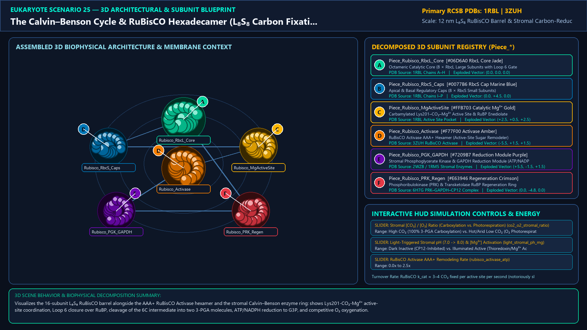
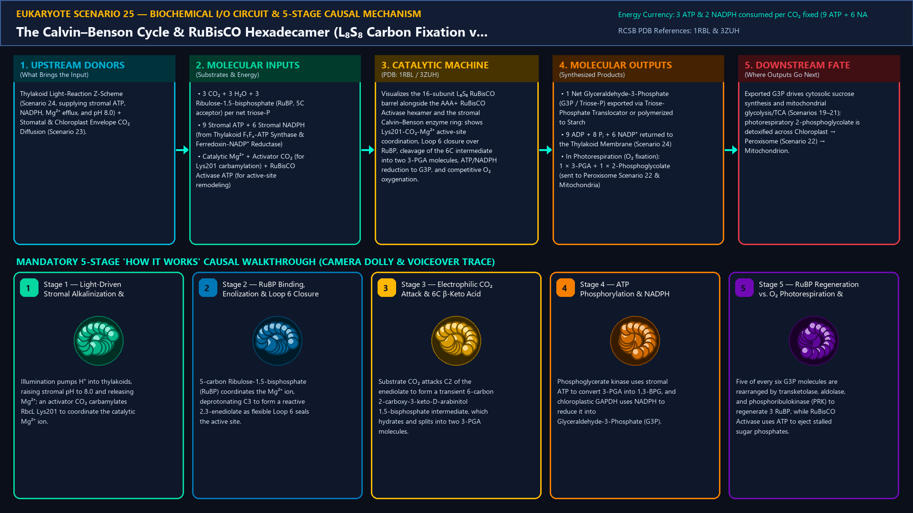
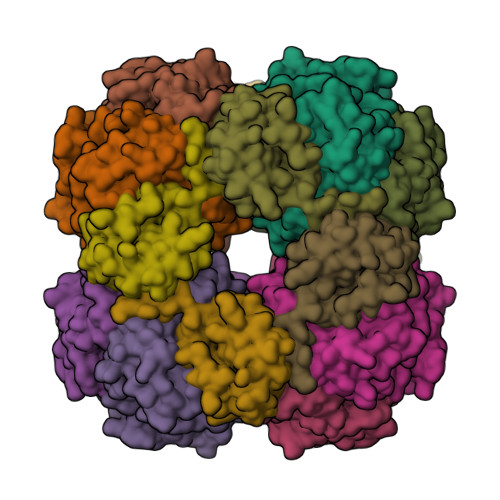
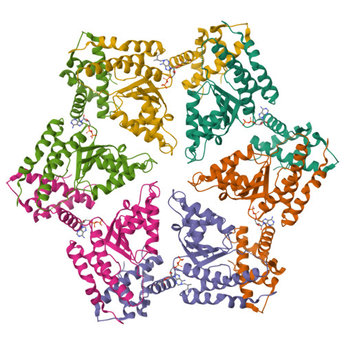
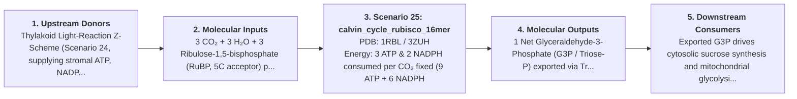

# Scenario 25 — The Calvin–Benson Cycle & RuBisCO Hexadecamer (L₈S₈ Carbon Fixation vs. Photorespiration)

> **Roadmap Tier:** Tier 5 — Bioenergetic Organelles: Mitochondria, Chloroplasts & Peroxisomes ($10\,\text{nm}\text{--}5\,\mu\text{m}$)  
> **Scenario ID:** `25_calvin_cycle_rubisco_16mer`  
> **Biophysical Scale:** 12 nm L₈S₈ RuBisCO Barrel & Stromal Carbon-Reduction Cycle  
> **Functional Category:** Photosynthetic Carbon Fixation & Stromal Carbohydrate Biosynthesis  
> **Primary RCSB PDB Structures:** [`1RBL`](https://www.rcsb.org/structure/1RBL) (Spinach L₈S₈ RuBisCO Hexadecamer Holoenzyme (1RBL)) · [`3ZUH`](https://www.rcsb.org/structure/3ZUH) (AAA+ Chaperone RuBisCO Activase Hexamer (3ZUH))

---

## 1. Visual & Artistic Representations (Manual Verification Reference Plates)

The following four visual reference plates are stored directly inside this folder (`./`) so you can inspect both the **expected 3D scene decomposition**, the **biochemical I/O circuit & 5-stage mechanism**, and the **experimental cryo-EM / X-ray structures** during manual verification:

### 1.1 Expected 3D Scene & Subunit Decomposition Blueprint (`expected_calvin_cycle_rubisco_16mer.png`)

### 1.2 Biochemical I/O Circuit & 5-Stage Causal Mechanism (`mechanism_calvin_cycle_rubisco_16mer.png`)

### 1.3 Experimental RCSB PDB Structural References (`rcsb_1RBL.jpg` & `rcsb_3ZUH.jpg`)
| Primary Structure [`1RBL`](https://www.rcsb.org/structure/1RBL) | Companion / Partner Structure [`3ZUH`](https://www.rcsb.org/structure/3ZUH) |
| :---: | :---: |
|  |  |
| **Spinach L₈S₈ RuBisCO Hexadecamer Holoenzyme (1RBL)** | **AAA+ Chaperone RuBisCO Activase Hexamer (3ZUH)** |

---

## 2. Biophysical & Molecular Behavior Overview

Ribulose-1,5-bisphosphate carboxylase/oxygenase (RuBisCO) is the most abundant enzyme in the terrestrial biosphere and the primary gateway by which inorganic atmospheric CO₂ enters organic life. In the stroma of plant chloroplasts (Scenario 23), Form I RuBisCO assembles as a 550 kDa L₈S₈ hexadecamer: an octameric barrel of 8 chloroplast-encoded Large (RbcL) catalytic subunits capped at top and bottom by two tetramers of 8 nuclear-encoded Small (RbcS) subunits. Activation of each RbcL active site requires carbamylation of Lys201 by an activator CO₂ molecule, which coordinates a catalytic Mg²⁺ ion. When ribulose-1,5-bisphosphate (RuBP) binds, Loop 6 closes over the pocket, enolizing RuBP into a 2,3-enediolate intermediate that attacks substrate CO₂ to form an unstable 6-carbon β-keto acid (2-carboxy-3-keto-D-arabinitol 1,5-bisphosphate), which hydrates and cleaves into two molecules of 3-phosphoglycerate (3-PGA). Using 9 ATP and 6 NADPH from the thylakoid light reactions (Scenario 24), Phosphoglycerate Kinase and GAPDH reduce 3-PGA into Glyceraldehyde-3-Phosphate (G3P), while the stromal transketolase/aldolase/phosphoribulokinase network regenerates RuBP. However, O₂ competitively attacks the enediolate (~25% of turnovers in C3 plants), producing toxic 2-phosphoglycolate (photorespiration), while inhibitory sugar phosphates are re-opened by the AAA+ chaperone ring RuBisCO Activase.

### How It Behaves in the Interactive 3D Scene
Visualizes the 16-subunit L₈S₈ RuBisCO barrel alongside the AAA+ RuBisCO Activase hexamer and the stromal Calvin–Benson enzyme ring: shows Lys201-CO₂-Mg²⁺ active-site coordination, Loop 6 closure over RuBP, cleavage of the 6C intermediate into two 3-PGA molecules, ATP/NADPH reduction to G3P, and competitive O₂ oxygenation.

---

## 3. Complete Biochemical I/O & Inter-Element Iteration

This section defines **what brings the input** to this machine (*Upstream Donors*), **what goes in** (*Molecular Inputs*), **what it makes** (*Molecular Outputs*), and **how it iterates with downstream systems** (*Downstream Consumers*):

- **Upstream Donors (What Brings the Input):**  
  Thylakoid Light-Reaction Z-Scheme (Scenario 24, supplying stromal ATP, NADPH, Mg²⁺ efflux, and pH 8.0) + Stomatal & Chloroplast Envelope CO₂ Diffusion (Scenario 23).
- **Molecular Inputs (Substrates, Signals & Co-Factors):**
  - 3 CO₂ + 3 H₂O + 3 Ribulose-1,5-bisphosphate (RuBP, 5C acceptor) per net triose-P
  - 9 Stromal ATP + 6 Stromal NADPH (from Thylakoid F₁Fₒ-ATP Synthase & Ferredoxin-NADP⁺ Reductase)
  - Catalytic Mg²⁺ + Activator CO₂ (for Lys201 carbamylation) + RuBisCO Activase ATP (for active-site remodeling)
- **Molecular Outputs (Synthesized / Translocated Products):**
  - 1 Net Glyceraldehyde-3-Phosphate (G3P / Triose-P) exported via Triose-Phosphate Translocator or polymerized to Starch
  - 9 ADP + 8 Pᵢ + 6 NADP⁺ returned to the Thylakoid Membrane (Scenario 24)
  - In Photorespiration (O₂ fixation): 1 × 3-PGA + 1 × 2-Phosphoglycolate (sent to Peroxisome Scenario 22 & Mitochondria)
- **Downstream Consumers & Cross-Element Iteration:**  
  Exported G3P drives cytosolic sucrose synthesis and mitochondrial glycolysis/TCA (Scenarios 19–21); photorespiratory 2-phosphoglycolate is detoxified across Chloroplast → Peroxisome (Scenario 22) → Mitochondrion.
- **Thermodynamic Energy Currency:** `3 ATP & 2 NADPH consumed per CO₂ fixed (9 ATP + 6 NADPH per net G3P)`
- **Biophysical Turnover / Kinetics ($k_{\text{cat}}$):** `RuBisCO k_cat ≈ 3–4 CO₂ fixed per active site per second (notoriously slow, compensated by ~50% of stromal protein mass)`

---

## 4. 3D Subunit Decomposition (`Piece_<ID>_*`) & Color Taxonomy

To support continuous **Exploded View (`setExplodedProgress(0.0 → 1.0)`)**, raycast hover inspection, and subpill lock-on targeting, this scenario is decomposed into **6 functional 3D submeshes**:

| # | 3D Submesh ID (`Piece_*`) | Biological & Structural Role | RCSB PDB / Chain Source | Color Taxonomy (`#Hex`) | Exploded Vector $\vec{v}_{\text{dissoc}}$ |
| :--- | :--- | :--- | :--- | :--- | :--- |
| **1** | `Piece_Rubisco_RbcL_Core` | Octameric Catalytic Core (8 × RbcL Large Subunits with Loop 6 Gates) | `1RBL Chains A–H` | `#06D6A0` (RbcL Core Jade) | `(0.0, 0.0, 0.0)` |
| **2** | `Piece_Rubisco_RbcS_Caps` | Apical & Basal Regulatory Caps (8 × RbcS Small Subunits) | `1RBL Chains I–P` | `#0077B6` (RbcS Cap Marine Blue) | `(0.0, +4.5, 0.0)` |
| **3** | `Piece_Rubisco_MgActiveSite` | Carbamylated Lys201–CO₂–Mg²⁺ Active Site & RuBP Enediolate | `1RBL Active Site Pocket` | `#FFB703` (Catalytic Mg²⁺ Gold) | `(+2.5, +0.5, +2.5)` |
| **4** | `Piece_Rubisco_Activase` | RuBisCO Activase AAA+ Hexamer (Active-Site Sugar Remodeler) | `3ZUH RuBisCO Activase` | `#F77F00` (Activase Amber) | `(-5.5, +1.5, +1.5)` |
| **5** | `Piece_Rubisco_PGK_GAPDH` | Stromal Phosphoglycerate Kinase & GAPDH Reduction Module (ATP/NADPH) | `2WZB / 1RM5 Stromal Enzymes` | `#7209B7` (Reduction Module Purple) | `(+5.5, -1.5, +1.5)` |
| **6** | `Piece_Rubisco_PRK_Regen` | Phosphoribulokinase (PRK) & Transketolase RuBP Regeneration Ring | `6H7G PRK–GAPDH–CP12 Complex` | `#E63946` (Regeneration Crimson) | `(0.0, -4.8, 0.0)` |

---

## 5. Interactive HUD Simulation Controls (`iterationControls`)

| Control ID | HUD Label | Biophysical Permutations & Interactive Behavior |
| :--- | :--- | :--- |
| `co2_o2_stromal_ratio` | **Stromal [CO₂] / [O₂] Ratio (Carboxylation vs. Photorespiration)** | High CO₂ (100% 3-PGA Carboxylation) vs. Hot/Arid Low CO₂ (O₂ Photorespiration -> 2-Phosphoglycolate) |
| `light_stromal_ph_mg` | **Light-Triggered Stromal pH (7.0 -> 8.0) & [Mg²⁺] Activation** | Dark Inactive (CP12-Inhibited) vs. Illuminated Active (Thioredoxin/Mg²⁺ Activated) |
| `rubisco_activase_atp` | **RuBisCO Activase AAA+ Remodeling Rate** | 0.0x to 2.5x |

---

## 6. Mandatory 5-Stage "How It Works" Explanatory Trace

- **Stage 1 — Light-Driven Stromal Alkalinization & Lys201 Carbamylation:** Illumination pumps H⁺ into thylakoids, raising stromal pH to 8.0 and releasing Mg²⁺; an activator CO₂ carbamylates RbcL Lys201 to coordinate the catalytic Mg²⁺ ion.
- **Stage 2 — RuBP Binding, Enolization & Loop 6 Closure:** 5-carbon Ribulose-1,5-bisphosphate (RuBP) coordinates the Mg²⁺ ion, deprotonating C3 to form a reactive 2,3-enediolate as flexible Loop 6 seals the active site.
- **Stage 3 — Electrophilic CO₂ Attack & 6C β-Keto Acid Cleavage:** Substrate CO₂ attacks C2 of the enediolate to form a transient 6-carbon 2-carboxy-3-keto-D-arabinitol 1,5-bisphosphate intermediate, which hydrates and splits into two 3-PGA molecules.
- **Stage 4 — ATP Phosphorylation & NADPH Reduction to G3P:** Phosphoglycerate kinase uses stromal ATP to convert 3-PGA into 1,3-BPG, and chloroplastic GAPDH uses NADPH to reduce it into Glyceraldehyde-3-Phosphate (G3P).
- **Stage 5 — RuBP Regeneration vs. O₂ Photorespiration & Activase Rescue:** Five of every six G3P molecules are rearranged by transketolase, aldolase, and phosphoribulokinase (PRK) to regenerate 3 RuBP, while RuBisCO Activase uses ATP to eject stalled sugar phosphates.

---

## 7. Curated Online Resources & Structural References

- [RCSB PDB-101 — Molecule of the Month: RuBisCO](https://pdb101.rcsb.org/motm/11)
- [RCSB PDB Structure 1RBL — Spinach L₈S₈ RuBisCO Hexadecamer](https://www.rcsb.org/structure/1RBL)
- [RCSB PDB Structure 3ZUH — Chloroplast RuBisCO Activase AAA+ Hexamer](https://www.rcsb.org/structure/3ZUH)
- [NCBI Bookshelf — Biochemistry: The Calvin Cycle & Photosynthetic Carbon Assimilation](https://www.ncbi.nlm.nih.gov/books/NBK22468/)
