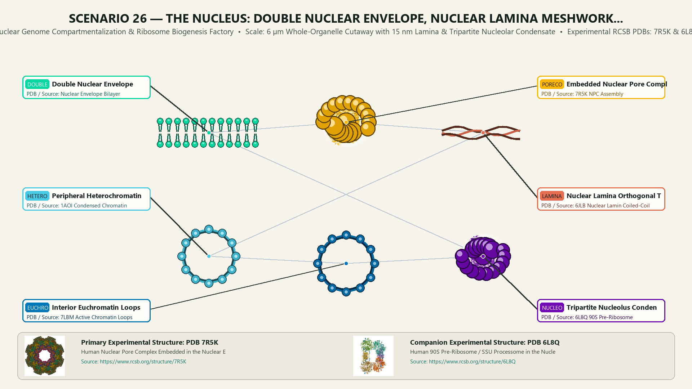
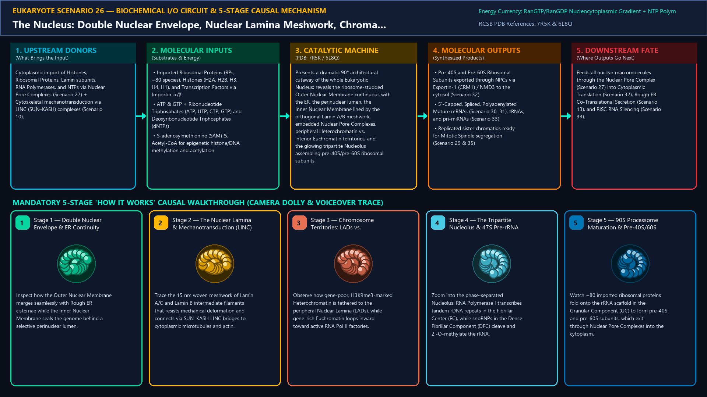
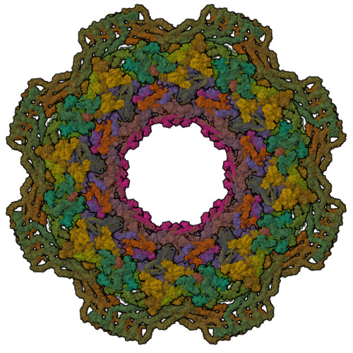
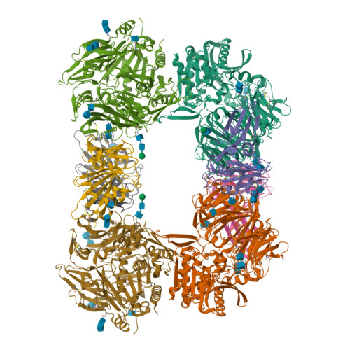
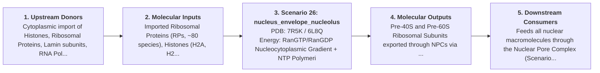
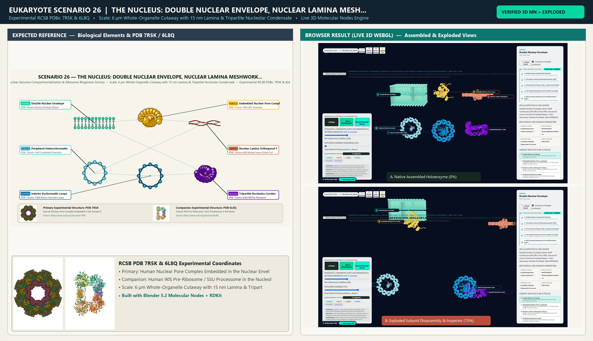

# Scenario 26 — The Nucleus: Double Nuclear Envelope, Nuclear Lamina Meshwork, Chromatin Territories & Tripartite Nucleolus

> **Roadmap Tier:** Tier 6 — The Nucleus, Epigenetic Chromatin & Nuclear RNA Factories ($10\,\text{nm}\text{--}6\,\mu\text{m}$)  
> **Scenario ID:** `26_nucleus_envelope_nucleolus`  
> **Biophysical Scale:** 6 µm Whole-Organelle Cutaway with 15 nm Lamina & Tripartite Nucleolar Condensate  
> **Functional Category:** Nuclear Genome Compartmentalization & Ribosome Biogenesis Factory  
> **Primary RCSB PDB Structures:** [`7R5K`](https://www.rcsb.org/structure/7R5K) (Human Nuclear Pore Complex Embedded in the Nuclear Envelope (7R5K)) · [`6L8Q`](https://www.rcsb.org/structure/6L8Q) (Human 90S Pre-Ribosome / SSU Processome in the Nucleolus (6L8Q))

---

## 1. Visual & Artistic Representations (Manual Verification Reference Plates)

The following four visual reference plates are stored directly inside this folder (`./`) so you can inspect both the **expected 3D scene decomposition**, the **biochemical I/O circuit & 5-stage mechanism**, and the **experimental cryo-EM / X-ray structures** during manual verification:

### 1.1 Expected 3D Scene & Subunit Decomposition Blueprint (`expected_nucleus_envelope_nucleolus.png`)

### 1.2 Biochemical I/O Circuit & 5-Stage Causal Mechanism (`mechanism_nucleus_envelope_nucleolus.png`)

### 1.3 Experimental RCSB PDB Structural References (`rcsb_7R5K.jpg` & `rcsb_6L8Q.jpg`)
| Primary Structure [`7R5K`](https://www.rcsb.org/structure/7R5K) | Companion / Partner Structure [`6L8Q`](https://www.rcsb.org/structure/6L8Q) |
| :---: | :---: |
|  |  |
| **Human Nuclear Pore Complex Embedded in the Nuclear Envelope (7R5K)** | **Human 90S Pre-Ribosome / SSU Processome in the Nucleolus (6L8Q)** |

---

## 2. Biophysical & Molecular Behavior Overview

The Nucleus (~5–10 µm diameter) is the defining organelle of eukaryotic life, physically decoupling transcription and RNA processing (Scenarios 30–31) from cytoplasmic translation (Scenario 32). It is bounded by a double lipid bilayer Nuclear Envelope: the Outer Nuclear Membrane (ONM) is continuous with the Rough ER (Scenario 13) and studded with 80S ribosomes, while the Inner Nuclear Membrane (INM) anchors a tough, woven 2D intermediate filament meshwork—the Nuclear Lamina (Lamins A/C, B1, B2)—that provides mechanical stiffness and tethers transcriptionally silent, heterochromatic Lamina-Associated Domains (LADs) at the nuclear periphery. Spanning both bilayers are ~3,000–4,000 Nuclear Pore Complexes (NPCs, Scenario 27) and LINC complexes (SUN–KASH bridges) that transmit cytoskeletal forces (Scenarios 08–10) directly to chromosomes. Inside the nucleoplasm, each chromosome occupies a non-random 3D Chromosome Territory: dense H3K9me3/H3K27me3 Heterochromatin clusters near the lamina, while open H3K4me3/acetylated Euchromatin loops into the interior toward transcription factories. At the center sits the Nucleolus—the largest biomolecular condensate in the nucleus—organized by liquid–liquid phase separation around rDNA repeats into three concentric subcompartments: the Fibrillar Center (FC, RNA Pol I transcription), Dense Fibrillar Component (DFC, fibrillarin/snoRNP rRNA cleavage & modification), and Granular Component (GC, nucleophosmin-driven assembly of 90S/pre-40S and pre-60S ribosomal subunits).

### How It Behaves in the Interactive 3D Scene
Presents a dramatic 90° architectural cutaway of the whole Eukaryotic Nucleus: reveals the ribosome-studded Outer Nuclear Membrane continuous with the ER, the perinuclear lumen, the Inner Nuclear Membrane lined by the orthogonal Lamin A/B meshwork, embedded Nuclear Pore Complexes, peripheral Heterochromatin vs. interior Euchromatin territories, and the glowing tripartite Nucleolus assembling pre-40S/pre-60S ribosomal subunits.

---

## 3. Complete Biochemical I/O & Inter-Element Iteration

This section defines **what brings the input** to this machine (*Upstream Donors*), **what goes in** (*Molecular Inputs*), **what it makes** (*Molecular Outputs*), and **how it iterates with downstream systems** (*Downstream Consumers*):

- **Upstream Donors (What Brings the Input):**  
  Cytoplasmic import of Histones, Ribosomal Proteins, Lamin subunits, RNA Polymerases, and NTPs via Nuclear Pore Complexes (Scenario 27) + Cytoskeletal mechanotransduction via LINC (SUN–KASH) complexes (Scenario 10).
- **Molecular Inputs (Substrates, Signals & Co-Factors):**
  - Imported Ribosomal Proteins (RPs, ~80 species), Histones (H2A, H2B, H3, H4, H1), and Transcription Factors via Importin-α/β
  - ATP & GTP + Ribonucleotide Triphosphates (ATP, UTP, CTP, GTP) and Deoxyribonucleotide Triphosphates (dNTPs)
  - S-adenosylmethionine (SAM) & Acetyl-CoA for epigenetic histone/DNA methylation and acetylation
- **Molecular Outputs (Synthesized / Translocated Products):**
  - Pre-40S and Pre-60S Ribosomal Subunits exported through NPCs via Exportin-1 (CRM1) / NMD3 to the cytosol (Scenario 32)
  - 5'-Capped, Spliced, Polyadenylated Mature mRNAs (Scenario 30–31), tRNAs, and pri-miRNAs (Scenario 33)
  - Replicated sister chromatids ready for Mitotic Spindle segregation (Scenario 29 & 35)
- **Downstream Consumers & Cross-Element Iteration:**  
  Feeds all nuclear macromolecules through the Nuclear Pore Complex (Scenario 27) into Cytoplasmic Translation (Scenario 32), Rough ER Co-Translational Secretion (Scenario 13), and RISC RNA Silencing (Scenario 33).
- **Thermodynamic Energy Currency:** `RanGTP/RanGDP Nucleocytoplasmic Gradient + NTP Polymerization + ATP-Dependent Chromatin Remodeling`
- **Biophysical Turnover / Kinetics ($k_{\text{cat}}$):** `A proliferating human nucleus synthesizes ~7,500 new pre-ribosomal subunits per minute in the nucleolus and exports ~10–20 mRNAs/NPC/min`

---

## 4. 3D Subunit Decomposition (`Piece_<ID>_*`) & Color Taxonomy

To support continuous **Exploded View (`setExplodedProgress(0.0 → 1.0)`)**, raycast hover inspection, and subpill lock-on targeting, this scenario is decomposed into **6 functional 3D submeshes**:

| # | 3D Submesh ID (`Piece_*`) | Biological & Structural Role | RCSB PDB / Chain Source | Color Taxonomy (`#Hex`) | Exploded Vector $\vec{v}_{\text{dissoc}}$ |
| :--- | :--- | :--- | :--- | :--- | :--- |
| **1** | `Piece_Nuc_DoubleEnvelope` | Double Nuclear Envelope (Outer ONM continuous with ER & Inner INM) | `Nuclear Envelope Bilayer` | `#06D6A0` (Nuclear Envelope Jade) | `(0.0, +4.8, 0.0)` |
| **2** | `Piece_Nuc_PoreComplexes` | Embedded Nuclear Pore Complexes (NPCs) & LINC SUN–KASH Bridges | `7R5K NPC Assembly` | `#FFB703` (Nuclear Pore Gold) | `(-4.8, +2.5, +1.5)` |
| **3** | `Piece_Nuc_LaminaMesh` | Nuclear Lamina Orthogonal Tetramer Meshwork (Lamins A/C & B1/B2) | `6JLB Nuclear Lamin Coiled-Coil` | `#E76F51` (Lamina Terracotta) | `(+4.8, +2.5, -1.5)` |
| **4** | `Piece_Nuc_Heterochromatin` | Peripheral Heterochromatin (LADs, H3K9me3 Condensed Chromatin) | `1AOI Condensed Chromatin` | `#48CAE4` (Heterochromatin Cyan) | `(-3.8, -1.8, +1.5)` |
| **5** | `Piece_Nuc_Euchromatin` | Interior Euchromatin Loops & Transcription Factories (Active Chromatin) | `7LBM Active Chromatin Loops` | `#0077B6` (Euchromatin Marine Blue) | `(+3.8, -1.8, +1.5)` |
| **6** | `Piece_Nuc_Nucleolus` | Tripartite Nucleolus Condensate (FC, DFC, GC) & 90S Pre-Ribosome | `6L8Q 90S Pre-Ribosome` | `#7209B7` (Nucleolus Royal Purple) | `(0.0, -3.5, 0.0)` |

---

## 5. Interactive HUD Simulation Controls (`iterationControls`)

| Control ID | HUD Label | Biophysical Permutations & Interactive Behavior |
| :--- | :--- | :--- |
| `chromatin_compaction_state` | **Epigenetic Chromatin State (Euchromatin vs. Heterochromatin)** | Open Acetylated Euchromatin (Active Transcription) vs. Condensed Methylated Heterochromatin |
| `nucleolar_ribosome_flux` | **Nucleolar rRNA Transcription (Pol I) & Pre-40S/60S Assembly Rate** | 0.2x (Serum Starved / Stress) to 2.5x (MYC-Driven Proliferation) |
| `lamin_mechanics_progeria` | **Nuclear Lamina Stiffness (Wild-Type Lamin A vs. Hutchinson–Gilford Progerin)** | Elastic Mechanoprotective Mesh vs. Blebbed Progeroid Envelope |

---

## 6. Mandatory 5-Stage "How It Works" Explanatory Trace

- **Stage 1 — Double Nuclear Envelope & ER Continuity:** Inspect how the Outer Nuclear Membrane merges seamlessly with Rough ER cisternae while the Inner Nuclear Membrane seals the genome behind a selective perinuclear lumen.
- **Stage 2 — The Nuclear Lamina & Mechanotransduction (LINC):** Trace the 15 nm woven meshwork of Lamin A/C and Lamin B intermediate filaments that resists mechanical deformation and connects via SUN–KASH LINC bridges to cytoplasmic microtubules and actin.
- **Stage 3 — Chromosome Territories: LADs vs. Interior Euchromatin:** Observe how gene-poor, H3K9me3-marked Heterochromatin is tethered to the peripheral Nuclear Lamina (LADs), while gene-rich Euchromatin loops inward toward active RNA Pol II factories.
- **Stage 4 — The Tripartite Nucleolus & 47S Pre-rRNA Transcription:** Zoom into the phase-separated Nucleolus: RNA Polymerase I transcribes tandem rDNA repeats in the Fibrillar Center (FC), while snoRNPs in the Dense Fibrillar Component (DFC) cleave and 2'-O-methylate the rRNA.
- **Stage 5 — 90S Processome Maturation & Pre-40S/60S Nuclear Export:** Watch ~80 imported ribosomal proteins fold onto the rRNA scaffold in the Granular Component (GC) to form pre-40S and pre-60S subunits, which exit through Nuclear Pore Complexes into the cytoplasm.

---

## 7. Curated Online Resources & Structural References

- [RCSB PDB-101 — Molecule of the Month: Nuclear Pore Complex](https://pdb101.rcsb.org/motm/205)
- [RCSB PDB Structure 7R5K — Human Nuclear Pore Complex in the Nuclear Envelope](https://www.rcsb.org/structure/7R5K)
- [RCSB PDB Structure 6L8Q — Human Nucleolar 90S Pre-Ribosome (SSU Processome)](https://www.rcsb.org/structure/6L8Q)
- [NCBI Bookshelf — Molecular Biology of the Cell: The Compartmentalization of the Nucleus](https://www.ncbi.nlm.nih.gov/books/NBK26865/)

## 12. 3D Implementation & Visual Verification Assets

- **Status:** `[x] Implemented, Exported to 3D GLB & Visually Verified`
- **3D Model Asset (`.glb`):** [`nucleus_envelope_nucleolus.glb`](./nucleus_envelope_nucleolus.glb) (also mirrored in `eukaryote/models/nucleus_envelope_nucleolus.glb` and `client/public/eukaryote/models/nucleus_envelope_nucleolus.glb`)
- **Blender 5.2 + Molecular Nodes Generator Script:** [`generate_26_nucleus_envelope_nucleolus.py`](./generate_26_nucleus_envelope_nucleolus.py)
- **Live WebGL Assembled Capture (`0%`):** [`browser_nucleus_envelope_nucleolus_assembled.png`](../../verification/26_nucleus_envelope_nucleolus/browser_nucleus_envelope_nucleolus_assembled.png)
- **Live WebGL Exploded Capture (`75%`):** [`browser_nucleus_envelope_nucleolus_exploded.png`](../../verification/26_nucleus_envelope_nucleolus/browser_nucleus_envelope_nucleolus_exploded.png)
- **Side-by-Side Input vs. Output Comparison Plate (`2400×1380`):** [`comparison_nucleus_envelope_nucleolus.png`](../../verification/26_nucleus_envelope_nucleolus/comparison_nucleus_envelope_nucleolus.png)
- **Animated Side-by-Side Comparison Video (`1920×1080 MP4`):** [`comparison_nucleus_envelope_nucleolus.mp4`](../../verification/26_nucleus_envelope_nucleolus/comparison_nucleus_envelope_nucleolus.mp4)

