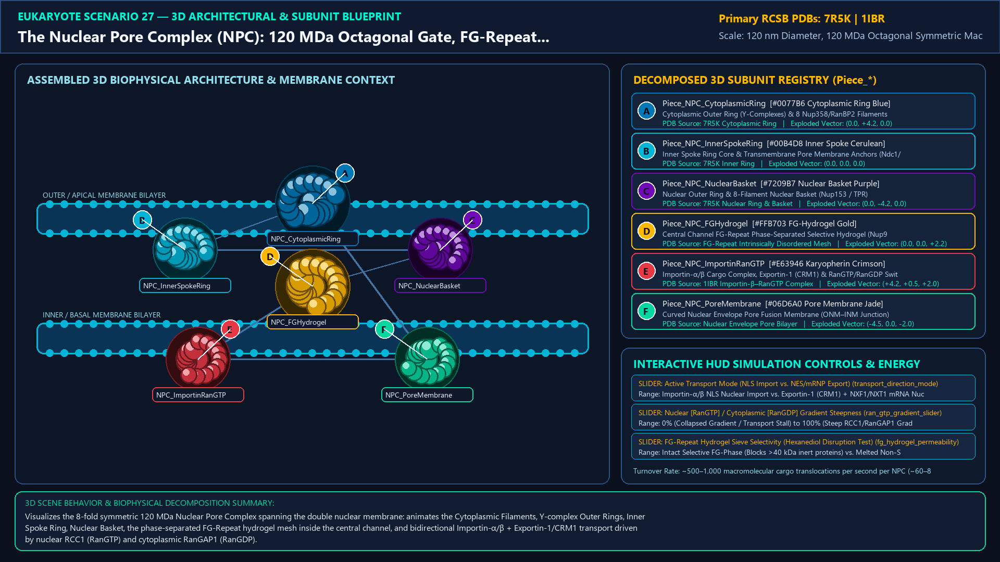
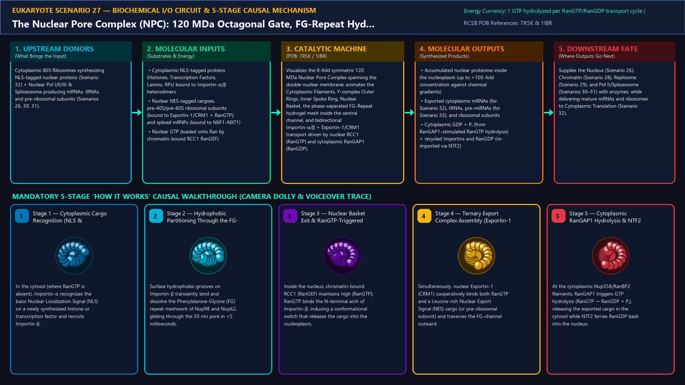
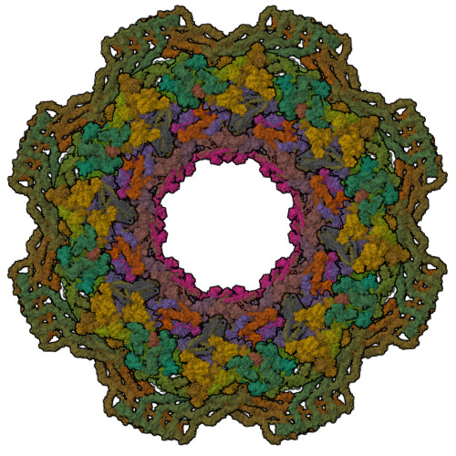
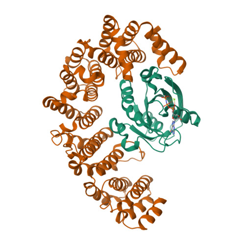
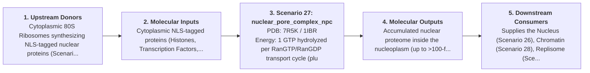
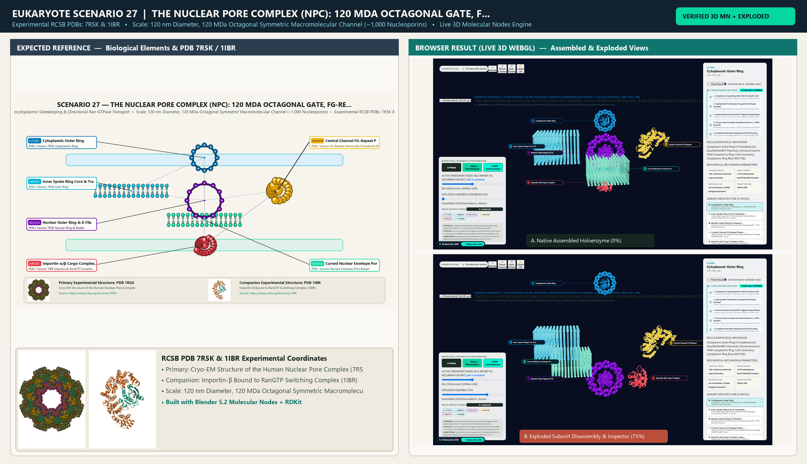

# Scenario 27 — The Nuclear Pore Complex (NPC): 120 MDa Octagonal Gate, FG-Repeat Hydrogel & RanGTP/RanGDP Transport Cycle

> **Roadmap Tier:** Tier 6 — The Nucleus, Epigenetic Chromatin & Nuclear RNA Factories ($10\,\text{nm}\text{--}6\,\mu\text{m}$)  
> **Scenario ID:** `27_nuclear_pore_complex_npc`  
> **Biophysical Scale:** 120 nm Diameter, 120 MDa Octagonal Symmetric Macromolecular Channel (~1,000 Nucleoporins)  
> **Functional Category:** Nucleocytoplasmic Gatekeeping & Directional Ran-GTPase Transport  
> **Primary RCSB PDB Structures:** [`7R5K`](https://www.rcsb.org/structure/7R5K) (Cryo-EM Structure of the Human Nuclear Pore Complex (7R5K)) · [`1IBR`](https://www.rcsb.org/structure/1IBR) (Importin-β Bound to RanGTP Switching Complex (1IBR))

---

## 1. Visual & Artistic Representations (Manual Verification Reference Plates)

The following four visual reference plates are stored directly inside this folder (`./`) so you can inspect both the **expected 3D scene decomposition**, the **biochemical I/O circuit & 5-stage mechanism**, and the **experimental cryo-EM / X-ray structures** during manual verification:

### 1.1 Expected 3D Scene & Subunit Decomposition Blueprint (`expected_nuclear_pore_complex_npc.png`)

### 1.2 Biochemical I/O Circuit & 5-Stage Causal Mechanism (`mechanism_nuclear_pore_complex_npc.png`)

### 1.3 Experimental RCSB PDB Structural References (`rcsb_7R5K.jpg` & `rcsb_1IBR.jpg`)
| Primary Structure [`7R5K`](https://www.rcsb.org/structure/7R5K) | Companion / Partner Structure [`1IBR`](https://www.rcsb.org/structure/1IBR) |
| :---: | :---: |
|  |  |
| **Cryo-EM Structure of the Human Nuclear Pore Complex (7R5K)** | **Importin-β Bound to RanGTP Switching Complex (1IBR)** |

---

## 2. Biophysical & Molecular Behavior Overview

At ~120 Megadaltons and ~1,000 individual protein subunits (composed of ~30 distinct Nucleoporins or Nups in 8-fold rotational symmetry), the vertebrate Nuclear Pore Complex (NPC) is the largest protein complex in the eukaryotic cell. Anchored into the curved pore membrane where the Outer and Inner Nuclear Membranes fuse (via transmembrane Nups POM121, NDC1, GP210), the NPC scaffold consists of three stacked concentric rings: the Cytoplasmic Ring (with 8 Nup358/RanBP2 filaments), the Inner Ring (spoke-channel core), and the Nuclear Ring (capped by the 8-filament Nuclear Basket with TPR/Nup153). Projecting into the 40–60 nm central channel are hundreds of intrinsically disordered Phenylalanine-Glycine (FG) repeat domains (Nup98, Nup62, Nup153) that phase-separate into a cohesive, hydrophobic sieve-like hydrogel. Molecules <40 kDa (<5 nm) diffuse passively, whereas larger cargoes require Karyopherins (Importin-α/β for NLS-tagged import; Exportin-1/CRM1 for NES-tagged export) whose hydrophobic surface patches transiently melt through FG-repeats at ~1,000 translocations/sec. Directionality is enforced by the steep RanGTP/RanGDP gradient: chromatin-tethered RCC1 (RanGEF) maintains high nuclear RanGTP (which dissociates Importin–cargo complexes and assembles Exportin–cargo–RanGTP ternary complexes), while cytoplasmic filaments carry RanGAP1/RanBP2 to hydrolyze RanGTP → RanGDP + Pᵢ upon exit.

### How It Behaves in the Interactive 3D Scene
Visualizes the 8-fold symmetric 120 MDa Nuclear Pore Complex spanning the double nuclear membrane: animates the Cytoplasmic Filaments, Y-complex Outer Rings, Inner Spoke Ring, Nuclear Basket, the phase-separated FG-Repeat hydrogel mesh inside the central channel, and bidirectional Importin-α/β + Exportin-1/CRM1 transport driven by nuclear RCC1 (RanGTP) and cytoplasmic RanGAP1 (RanGDP).

---

## 3. Complete Biochemical I/O & Inter-Element Iteration

This section defines **what brings the input** to this machine (*Upstream Donors*), **what goes in** (*Molecular Inputs*), **what it makes** (*Molecular Outputs*), and **how it iterates with downstream systems** (*Downstream Consumers*):

- **Upstream Donors (What Brings the Input):**  
  Cytoplasmic 80S Ribosomes synthesizing NLS-tagged nuclear proteins (Scenario 32) + Nuclear Pol I/II/III & Spliceosome producing mRNAs, tRNAs, and pre-ribosomal subunits (Scenarios 26, 30, 31).
- **Molecular Inputs (Substrates, Signals & Co-Factors):**
  - Cytoplasmic NLS-tagged proteins (Histones, Transcription Factors, Lamins, RPs) bound to Importin-α/β heterodimers
  - Nuclear NES-tagged cargoes, pre-40S/pre-60S ribosomal subunits (bound to Exportin-1/CRM1 + RanGTP), and spliced mRNPs (bound to NXF1–NXT1)
  - Nuclear GTP (loaded onto Ran by chromatin-bound RCC1 RanGEF)
- **Molecular Outputs (Synthesized / Translocated Products):**
  - Accumulated nuclear proteome inside the nucleoplasm (up to >100-fold concentration against chemical gradients)
  - Exported cytoplasmic mRNAs (for Scenario 32), tRNAs, pre-miRNAs (for Scenario 33), and ribosomal subunits
  - Cytoplasmic GDP + Pᵢ (from RanGAP1-stimulated RanGTP hydrolysis) + recycled Importins and RanGDP (re-imported via NTF2)
- **Downstream Consumers & Cross-Element Iteration:**  
  Supplies the Nucleus (Scenario 26), Chromatin (Scenario 28), Replisome (Scenario 29), and Pol II/Spliceosome (Scenarios 30–31) with enzymes, while delivering mature mRNAs and ribosomes to Cytoplasmic Translation (Scenario 32).
- **Thermodynamic Energy Currency:** `1 GTP hydrolyzed per RanGTP/RanGDP transport cycle (plus Dbp5/GLE1 ATPase RNA helicase ratchet for mRNP export)`
- **Biophysical Turnover / Kinetics ($k_{\text{cat}}$):** `~500–1,000 macromolecular cargo translocations per second per NPC (~60–80 MDa/sec mass flux through a single pore)`

---

## 4. 3D Subunit Decomposition (`Piece_<ID>_*`) & Color Taxonomy

To support continuous **Exploded View (`setExplodedProgress(0.0 → 1.0)`)**, raycast hover inspection, and subpill lock-on targeting, this scenario is decomposed into **6 functional 3D submeshes**:

| # | 3D Submesh ID (`Piece_*`) | Biological & Structural Role | RCSB PDB / Chain Source | Color Taxonomy (`#Hex`) | Exploded Vector $\vec{v}_{\text{dissoc}}$ |
| :--- | :--- | :--- | :--- | :--- | :--- |
| **1** | `Piece_NPC_CytoplasmicRing` | Cytoplasmic Outer Ring (Y-Complexes) & 8 Nup358/RanBP2 Filaments | `7R5K Cytoplasmic Ring` | `#0077B6` (Cytoplasmic Ring Blue) | `(0.0, +4.2, 0.0)` |
| **2** | `Piece_NPC_InnerSpokeRing` | Inner Spoke Ring Core & Transmembrane Pore Membrane Anchors (Ndc1/Pom121) | `7R5K Inner Ring` | `#00B4D8` (Inner Spoke Cerulean) | `(0.0, 0.0, 0.0)` |
| **3** | `Piece_NPC_NuclearBasket` | Nuclear Outer Ring & 8-Filament Nuclear Basket (Nup153 / TPR) | `7R5K Nuclear Ring & Basket` | `#7209B7` (Nuclear Basket Purple) | `(0.0, -4.2, 0.0)` |
| **4** | `Piece_NPC_FGHydrogel` | Central Channel FG-Repeat Phase-Separated Selective Hydrogel (Nup98/Nup62) | `FG-Repeat Intrinsically Disordered Mesh` | `#FFB703` (FG-Hydrogel Gold) | `(0.0, 0.0, +2.2)` |
| **5** | `Piece_NPC_ImportinRanGTP` | Importin-α/β Cargo Complex, Exportin-1 (CRM1) & RanGTP/RanGDP Switch | `1IBR Importin-β–RanGTP Complex` | `#E63946` (Karyopherin Crimson) | `(+4.2, +0.5, +2.0)` |
| **6** | `Piece_NPC_PoreMembrane` | Curved Nuclear Envelope Pore Fusion Membrane (ONM–INM Junction) | `Nuclear Envelope Pore Bilayer` | `#06D6A0` (Pore Membrane Jade) | `(-4.5, 0.0, -2.0)` |

---

## 5. Interactive HUD Simulation Controls (`iterationControls`)

| Control ID | HUD Label | Biophysical Permutations & Interactive Behavior |
| :--- | :--- | :--- |
| `transport_direction_mode` | **Active Transport Mode (NLS Import vs. NES/mRNP Export)** | Importin-α/β NLS Nuclear Import vs. Exportin-1 (CRM1) + NXF1/NXT1 mRNA Nuclear Export |
| `ran_gtp_gradient_slider` | **Nuclear [RanGTP] / Cytoplasmic [RanGDP] Gradient Steepness** | 0% (Collapsed Gradient / Transport Stall) to 100% (Steep RCC1/RanGAP1 Gradient) |
| `fg_hydrogel_permeability` | **FG-Repeat Hydrogel Sieve Selectivity (Hexanediol Disruption Test)** | Intact Selective FG-Phase (Blocks >40 kDa inert proteins) vs. Melted Non-Selective Pore |

---

## 6. Mandatory 5-Stage "How It Works" Explanatory Trace

- **Stage 1 — Cytoplasmic Cargo Recognition (NLS & Importin-α/β):** In the cytosol (where RanGTP is absent), Importin-α recognizes the basic Nuclear Localization Signal (NLS) on a newly synthesized histone or transcription factor and recruits Importin-β.
- **Stage 2 — Hydrophobic Partitioning Through the FG-Repeat Hydrogel:** Surface hydrophobic grooves on Importin-β transiently bind and dissolve the Phenylalanine-Glycine (FG) repeat meshwork of Nup98 and Nup62, gliding through the 50 nm pore in <5 milliseconds.
- **Stage 3 — Nuclear Basket Exit & RanGTP-Triggered Cargo Release:** Inside the nucleus, chromatin-bound RCC1 (RanGEF) maintains high [RanGTP]; RanGTP binds the N-terminal arch of Importin-β, inducing a conformational switch that releases the cargo into the nucleoplasm.
- **Stage 4 — Ternary Export Complex Assembly (Exportin-1 / CRM1 + RanGTP):** Simultaneously, nuclear Exportin-1 (CRM1) cooperatively binds both RanGTP and a Leucine-rich Nuclear Export Signal (NES) cargo (or pre-ribosomal subunit) and traverses the FG-channel outward.
- **Stage 5 — Cytoplasmic RanGAP1 Hydrolysis & NTF2 Recycling:** At the cytoplasmic Nup358/RanBP2 filaments, RanGAP1 triggers GTP hydrolysis (RanGTP → RanGDP + Pᵢ), releasing the exported cargo in the cytosol while NTF2 ferries RanGDP back into the nucleus.

---

## 7. Curated Online Resources & Structural References

- [RCSB PDB-101 — Molecule of the Month: Karyopherins (Importins & Exportins)](https://pdb101.rcsb.org/motm/85)
- [RCSB PDB Structure 7R5K — Cryo-EM Structure of the Human Nuclear Pore Complex](https://www.rcsb.org/structure/7R5K)
- [RCSB PDB Structure 1IBR — Complex of Importin-β with RanGTP](https://www.rcsb.org/structure/1IBR)
- [NCBI Bookshelf — Molecular Biology of the Cell: The Transport of Molecules Between the Nucleus and the Cytosol](https://www.ncbi.nlm.nih.gov/books/NBK26932/)

## 12. 3D Implementation & Visual Verification Assets

- **Status:** `[x] Implemented, Exported to 3D GLB & Visually Verified`
- **3D Model Asset (`.glb`):** [`nuclear_pore_complex_npc.glb`](./nuclear_pore_complex_npc.glb) (also mirrored in `eukaryote/models/nuclear_pore_complex_npc.glb` and `client/public/eukaryote/models/nuclear_pore_complex_npc.glb`)
- **Blender 5.2 + Molecular Nodes Generator Script:** [`generate_27_nuclear_pore_complex_npc.py`](./generate_27_nuclear_pore_complex_npc.py)
- **Live WebGL Assembled Capture (`0%`):** [`browser_nuclear_pore_complex_npc_assembled.png`](../../verification/27_nuclear_pore_complex_npc/browser_nuclear_pore_complex_npc_assembled.png)
- **Live WebGL Exploded Capture (`75%`):** [`browser_nuclear_pore_complex_npc_exploded.png`](../../verification/27_nuclear_pore_complex_npc/browser_nuclear_pore_complex_npc_exploded.png)
- **Side-by-Side Input vs. Output Comparison Plate (`2400×1380`):** [`comparison_nuclear_pore_complex_npc.png`](../../verification/27_nuclear_pore_complex_npc/comparison_nuclear_pore_complex_npc.png)
- **Animated Side-by-Side Comparison Video (`1920×1080 MP4`):** [`comparison_nuclear_pore_complex_npc.mp4`](../../verification/27_nuclear_pore_complex_npc/comparison_nuclear_pore_complex_npc.mp4)

