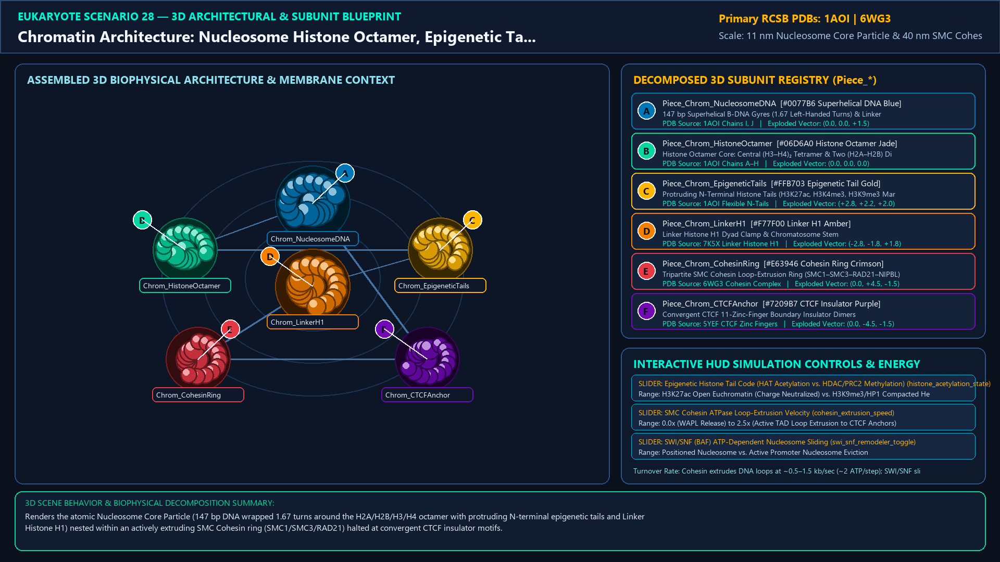
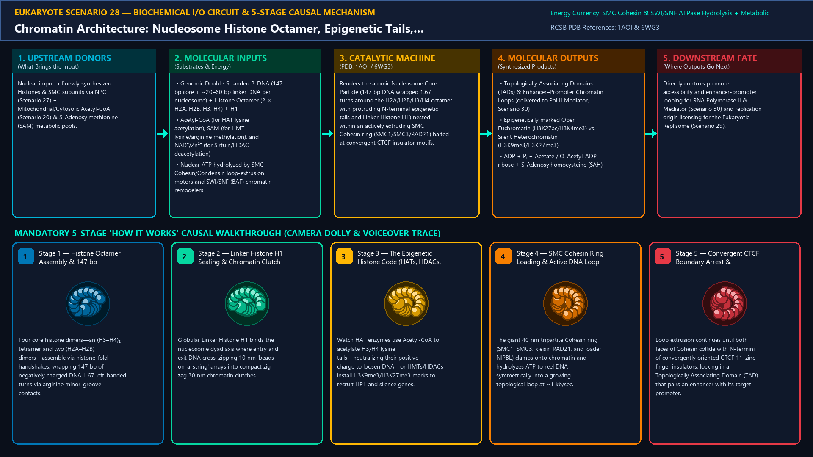
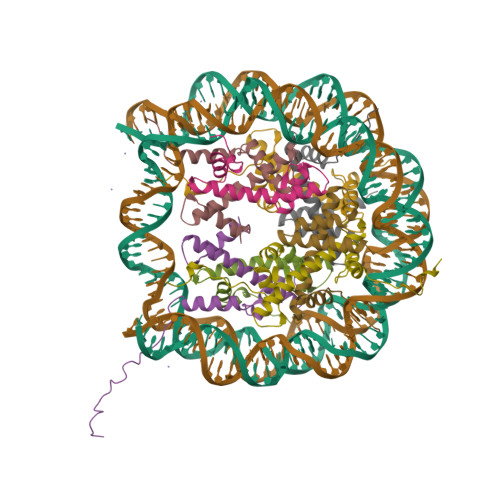
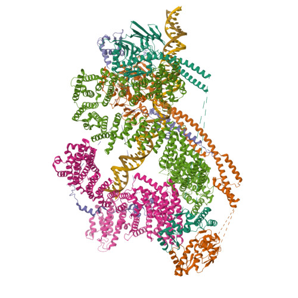
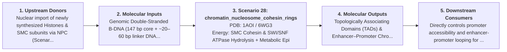
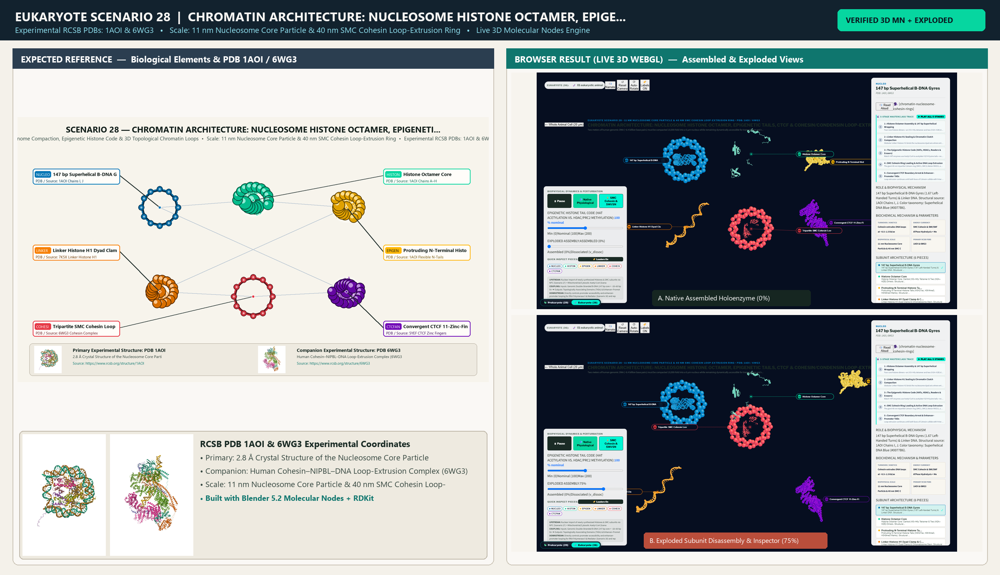

# Scenario 28 — Chromatin Architecture: Nucleosome Histone Octamer, Epigenetic Tails, CTCF & Cohesin/Condensin Loop-Extrusion Rings

> **Roadmap Tier:** Tier 6 — The Nucleus, Epigenetic Chromatin & Nuclear RNA Factories ($10\,\text{nm}\text{--}6\,\mu\text{m}$)  
> **Scenario ID:** `28_chromatin_nucleosome_cohesin_rings`  
> **Biophysical Scale:** 11 nm Nucleosome Core Particle & 40 nm SMC Cohesin Loop-Extrusion Ring  
> **Functional Category:** Genome Compaction, Epigenetic Histone Code & 3D Topological Chromatin Loops  
> **Primary RCSB PDB Structures:** [`1AOI`](https://www.rcsb.org/structure/1AOI) (2.8 Å Crystal Structure of the Nucleosome Core Particle (1AOI)) · [`6WG3`](https://www.rcsb.org/structure/6WG3) (Human Cohesin–NIPBL–DNA Loop-Extrusion Complex (6WG3))

---

## 1. Visual & Artistic Representations (Manual Verification Reference Plates)

The following four visual reference plates are stored directly inside this folder (`./`) so you can inspect both the **expected 3D scene decomposition**, the **biochemical I/O circuit & 5-stage mechanism**, and the **experimental cryo-EM / X-ray structures** during manual verification:

### 1.1 Expected 3D Scene & Subunit Decomposition Blueprint (`expected_chromatin_nucleosome_cohesin_rings.png`)

### 1.2 Biochemical I/O Circuit & 5-Stage Causal Mechanism (`mechanism_chromatin_nucleosome_cohesin_rings.png`)

### 1.3 Experimental RCSB PDB Structural References (`rcsb_1AOI.jpg` & `rcsb_6WG3.jpg`)
| Primary Structure [`1AOI`](https://www.rcsb.org/structure/1AOI) | Companion / Partner Structure [`6WG3`](https://www.rcsb.org/structure/6WG3) |
| :---: | :---: |
|  |  |
| **2.8 Å Crystal Structure of the Nucleosome Core Particle (1AOI)** | **Human Cohesin–NIPBL–DNA Loop-Extrusion Complex (6WG3)** |

---

## 2. Biophysical & Molecular Behavior Overview

Two meters of human genomic DNA (~6.4 billion base pairs) must be compacted 10,000-fold into a 6 µm nucleus while remaining dynamically accessible for transcription and replication. The fundamental repeating unit of eukaryotic chromatin is the Nucleosome Core Particle (11 nm diameter): exactly 147 bp of B-DNA wrapped 1.67 left-handed superhelical turns around a positively charged, Arg/Lys-rich Histone Octamer core composed of a central (H3–H4)₂ tetramer flanked by two H2A–H2B dimers, sealed at the entry/exit dyad by Linker Histone H1 to form a 10 nm 'beads-on-a-string' fiber and higher-order clutches. Projecting from the octamer are flexible N-terminal Histone Tails (especially H3 and H4) whose post-translational modifications form the Epigenetic Histone Code: Histone Acetyltransferases (HATs/p300) neutralize lysine positive charges (H3K27ac, H3K9ac) to open Euchromatin (read by Bromodomains), while Histone Deacetylases (HDACs) and Methyltransferases (PRC2 H3K27me3, SUV39H1 H3K9me3, read by HP1 Chromodomains) compact silent Heterochromatin. At the 100 kb–1 Mb scale, ring-shaped SMC ATPase complexes —Cohesin (SMC1–SMC3–RAD21–STAG1/2 + NIPBL) in interphase and Condensin I/II in mitosis—topologically embrace DNA and actively extrude chromatin loops at ~1 kb/sec until arrested by convergent CTCF zinc-finger boundary insulators, organizing the genome into Topologically Associating Domains (TADs) that bring distal enhancers into direct physical contact with target promoters.

### How It Behaves in the Interactive 3D Scene
Renders the atomic Nucleosome Core Particle (147 bp DNA wrapped 1.67 turns around the H2A/H2B/H3/H4 octamer with protruding N-terminal epigenetic tails and Linker Histone H1) nested within an actively extruding SMC Cohesin ring (SMC1/SMC3/RAD21) halted at convergent CTCF insulator motifs.

---

## 3. Complete Biochemical I/O & Inter-Element Iteration

This section defines **what brings the input** to this machine (*Upstream Donors*), **what goes in** (*Molecular Inputs*), **what it makes** (*Molecular Outputs*), and **how it iterates with downstream systems** (*Downstream Consumers*):

- **Upstream Donors (What Brings the Input):**  
  Nuclear import of newly synthesized Histones & SMC subunits via NPC (Scenario 27) + Mitochondrial/Cytosolic Acetyl-CoA (Scenario 20) & S-Adenosylmethionine (SAM) metabolic pools.
- **Molecular Inputs (Substrates, Signals & Co-Factors):**
  - Genomic Double-Stranded B-DNA (147 bp core + ~20–60 bp linker DNA per nucleosome) + Histone Octamer (2 × H2A, H2B, H3, H4) + H1
  - Acetyl-CoA (for HAT lysine acetylation), SAM (for HMT lysine/arginine methylation), and NAD⁺/Zn²⁺ (for Sirtuin/HDAC deacetylation)
  - Nuclear ATP hydrolyzed by SMC Cohesin/Condensin loop-extrusion motors and SWI/SNF (BAF) chromatin remodelers
- **Molecular Outputs (Synthesized / Translocated Products):**
  - Topologically Associating Domains (TADs) & Enhancer–Promoter Chromatin Loops (delivered to Pol II Mediator, Scenario 30)
  - Epigenetically marked Open Euchromatin (H3K27ac/H3K4me3) vs. Silent Heterochromatin (H3K9me3/H3K27me3)
  - ADP + Pᵢ + Acetate / O-Acetyl-ADP-ribose + S-Adenosylhomocysteine (SAH)
- **Downstream Consumers & Cross-Element Iteration:**  
  Directly controls promoter accessibility and enhancer-promoter looping for RNA Polymerase II & Mediator (Scenario 30) and replication origin licensing for the Eukaryotic Replisome (Scenario 29).
- **Thermodynamic Energy Currency:** `SMC Cohesin & SWI/SNF ATPase Hydrolysis + Metabolic Epigenetic Cofactors (Acetyl-CoA, SAM, NAD⁺)`
- **Biophysical Turnover / Kinetics ($k_{\text{cat}}$):** `Cohesin extrudes DNA loops at ~0.5–1.5 kb/sec (~2 ATP/step); SWI/SNF slides nucleosomes at ~10–50 bp/sec`

---

## 4. 3D Subunit Decomposition (`Piece_<ID>_*`) & Color Taxonomy

To support continuous **Exploded View (`setExplodedProgress(0.0 → 1.0)`)**, raycast hover inspection, and subpill lock-on targeting, this scenario is decomposed into **6 functional 3D submeshes**:

| # | 3D Submesh ID (`Piece_*`) | Biological & Structural Role | RCSB PDB / Chain Source | Color Taxonomy (`#Hex`) | Exploded Vector $\vec{v}_{\text{dissoc}}$ |
| :--- | :--- | :--- | :--- | :--- | :--- |
| **1** | `Piece_Chrom_NucleosomeDNA` | 147 bp Superhelical B-DNA Gyres (1.67 Left-Handed Turns) & Linker DNA | `1AOI Chains I, J` | `#0077B6` (Superhelical DNA Blue) | `(0.0, 0.0, +1.5)` |
| **2** | `Piece_Chrom_HistoneOctamer` | Histone Octamer Core: Central (H3–H4)₂ Tetramer & Two (H2A–H2B) Dimers | `1AOI Chains A–H` | `#06D6A0` (Histone Octamer Jade) | `(0.0, 0.0, 0.0)` |
| **3** | `Piece_Chrom_EpigeneticTails` | Protruding N-Terminal Histone Tails (H3K27ac, H3K4me3, H3K9me3 Marks) | `1AOI Flexible N-Tails` | `#FFB703` (Epigenetic Tail Gold) | `(+2.8, +2.2, +2.0)` |
| **4** | `Piece_Chrom_LinkerH1` | Linker Histone H1 Dyad Clamp & Chromatosome Stem | `7K5X Linker Histone H1` | `#F77F00` (Linker H1 Amber) | `(-2.8, -1.8, +1.8)` |
| **5** | `Piece_Chrom_CohesinRing` | Tripartite SMC Cohesin Loop-Extrusion Ring (SMC1–SMC3–RAD21–NIPBL) | `6WG3 Cohesin Complex` | `#E63946` (Cohesin Ring Crimson) | `(0.0, +4.5, -1.5)` |
| **6** | `Piece_Chrom_CTCFAnchor` | Convergent CTCF 11-Zinc-Finger Boundary Insulator Dimers | `5YEF CTCF Zinc Fingers` | `#7209B7` (CTCF Insulator Purple) | `(0.0, -4.5, -1.5)` |

---

## 5. Interactive HUD Simulation Controls (`iterationControls`)

| Control ID | HUD Label | Biophysical Permutations & Interactive Behavior |
| :--- | :--- | :--- |
| `histone_acetylation_state` | **Epigenetic Histone Tail Code (HAT Acetylation vs. HDAC/PRC2 Methylation)** | H3K27ac Open Euchromatin (Charge Neutralized) vs. H3K9me3/HP1 Compacted Heterochromatin |
| `cohesin_extrusion_speed` | **SMC Cohesin ATPase Loop-Extrusion Velocity** | 0.0x (WAPL Release) to 2.5x (Active TAD Loop Extrusion to CTCF Anchors) |
| `swi_snf_remodeler_toggle` | **SWI/SNF (BAF) ATP-Dependent Nucleosome Sliding** | Positioned Nucleosome vs. Active Promoter Nucleosome Eviction |

---

## 6. Mandatory 5-Stage "How It Works" Explanatory Trace

- **Stage 1 — Histone Octamer Assembly & 147 bp Superhelical Wrapping:** Four core histone dimers—an (H3–H4)₂ tetramer and two (H2A–H2B) dimers—assemble via histone-fold handshakes, wrapping 147 bp of negatively charged DNA 1.67 left-handed turns via arginine minor-groove contacts.
- **Stage 2 — Linker Histone H1 Sealing & Chromatin Clutch Compaction:** Globular Linker Histone H1 binds the nucleosome dyad axis where entry and exit DNA cross, zipping 10 nm 'beads-on-a-string' arrays into compact zig-zag 30 nm chromatin clutches.
- **Stage 3 — The Epigenetic Histone Code (HATs, HDACs, Readers & Erasers):** Watch HAT enzymes use Acetyl-CoA to acetylate H3/H4 lysine tails—neutralizing their positive charge to loosen DNA—or HMTs/HDACs install H3K9me3/H3K27me3 marks to recruit HP1 and silence genes.
- **Stage 4 — SMC Cohesin Ring Loading & Active DNA Loop Extrusion:** The giant 40 nm tripartite Cohesin ring (SMC1, SMC3, kleisin RAD21, and loader NIPBL) clamps onto chromatin and hydrolyzes ATP to reel DNA symmetrically into a growing topological loop at ~1 kb/sec.
- **Stage 5 — Convergent CTCF Boundary Arrest & Enhancer–Promoter TADs:** Loop extrusion continues until both faces of Cohesin collide with N-termini of convergently oriented CTCF 11-zinc-finger insulators, locking in a Topologically Associating Domain (TAD) that pairs an enhancer with its target promoter.

---

## 7. Curated Online Resources & Structural References

- [RCSB PDB-101 — Molecule of the Month: Nucleosome](https://pdb101.rcsb.org/motm/7)
- [RCSB PDB Structure 1AOI — 2.8 Å Crystal Structure of the Nucleosome Core Particle](https://www.rcsb.org/structure/1AOI)
- [RCSB PDB Structure 6WG3 — Human Cohesin–NIPBL–DNA Loop-Extrusion Complex](https://www.rcsb.org/structure/6WG3)
- [NCBI Bookshelf — Molecular Biology of the Cell: Chromosomal DNA and Its Packaging in the Chromatin Fiber](https://www.ncbi.nlm.nih.gov/books/NBK26834/)

## 12. 3D Implementation & Visual Verification Assets

- **Status:** `[x] Implemented, Exported to 3D GLB & Visually Verified`
- **3D Model Asset (`.glb`):** [`chromatin_nucleosome_cohesin_rings.glb`](./chromatin_nucleosome_cohesin_rings.glb) (also mirrored in `eukaryote/models/chromatin_nucleosome_cohesin_rings.glb` and `client/public/eukaryote/models/chromatin_nucleosome_cohesin_rings.glb`)
- **Blender 5.2 + Molecular Nodes Generator Script:** [`generate_28_chromatin_nucleosome_cohesin_rings.py`](./generate_28_chromatin_nucleosome_cohesin_rings.py)
- **Live WebGL Assembled Capture (`0%`):** [`browser_chromatin_nucleosome_cohesin_rings_assembled.png`](../../verification/28_chromatin_nucleosome_cohesin_rings/browser_chromatin_nucleosome_cohesin_rings_assembled.png)
- **Live WebGL Exploded Capture (`75%`):** [`browser_chromatin_nucleosome_cohesin_rings_exploded.png`](../../verification/28_chromatin_nucleosome_cohesin_rings/browser_chromatin_nucleosome_cohesin_rings_exploded.png)
- **Side-by-Side Input vs. Output Comparison Plate (`2400×1380`):** [`comparison_chromatin_nucleosome_cohesin_rings.png`](../../verification/28_chromatin_nucleosome_cohesin_rings/comparison_chromatin_nucleosome_cohesin_rings.png)
- **Animated Side-by-Side Comparison Video (`1920×1080 MP4`):** [`comparison_chromatin_nucleosome_cohesin_rings.mp4`](../../verification/28_chromatin_nucleosome_cohesin_rings/comparison_chromatin_nucleosome_cohesin_rings.mp4)

