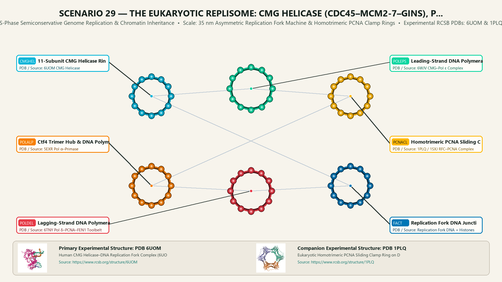
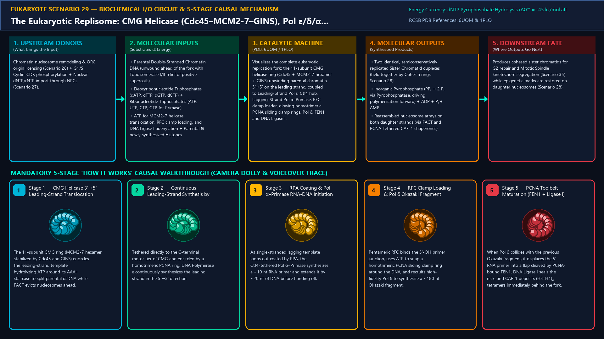
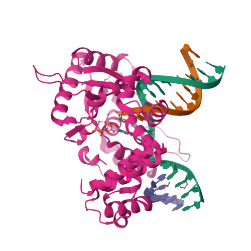
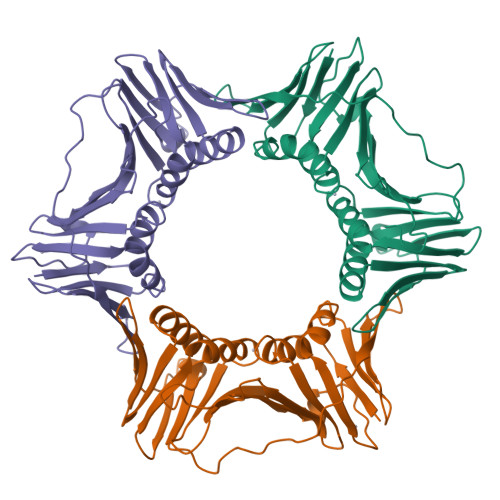
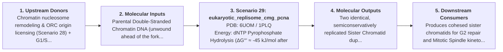

# Scenario 29 — The Eukaryotic Replisome: CMG Helicase (Cdc45–MCM2-7–GINS), Pol ε/δ/α, RFC & homotrimeric PCNA Sliding Clamp Rings

> **Roadmap Tier:** Tier 6 — The Nucleus, Epigenetic Chromatin & Nuclear RNA Factories ($10\,\text{nm}\text{--}6\,\mu\text{m}$)  
> **Scenario ID:** `29_eukaryotic_replisome_cmg_pcna`  
> **Biophysical Scale:** 35 nm Asymmetric Replication Fork Machine & Homotrimeric PCNA Clamp Rings  
> **Functional Category:** S-Phase Semiconservative Genome Replication & Chromatin Inheritance  
> **Primary RCSB PDB Structures:** [`6UOM`](https://www.rcsb.org/structure/6UOM) (Human CMG Helicase–DNA Replication Fork Complex (6UOM)) · [`1PLQ`](https://www.rcsb.org/structure/1PLQ) (Eukaryotic Homotrimeric PCNA Sliding Clamp Ring on DNA (1PLQ))

---

## 1. Visual & Artistic Representations (Manual Verification Reference Plates)

The following four visual reference plates are stored directly inside this folder (`./`) so you can inspect both the **expected 3D scene decomposition**, the **biochemical I/O circuit & 5-stage mechanism**, and the **experimental cryo-EM / X-ray structures** during manual verification:

### 1.1 Expected 3D Scene & Subunit Decomposition Blueprint (`expected_eukaryotic_replisome_cmg_pcna.png`)

### 1.2 Biochemical I/O Circuit & 5-Stage Causal Mechanism (`mechanism_eukaryotic_replisome_cmg_pcna.png`)

### 1.3 Experimental RCSB PDB Structural References (`rcsb_6UOM.jpg` & `rcsb_1PLQ.jpg`)
| Primary Structure [`6UOM`](https://www.rcsb.org/structure/6UOM) | Companion / Partner Structure [`1PLQ`](https://www.rcsb.org/structure/1PLQ) |
| :---: | :---: |
|  |  |
| **Human CMG Helicase–DNA Replication Fork Complex (6UOM)** | **Eukaryotic Homotrimeric PCNA Sliding Clamp Ring on DNA (1PLQ)** |

---

## 2. Biophysical & Molecular Behavior Overview

To duplicate 6.4 billion base pairs during S-phase in just ~8 hours, eukaryotic cells fire ~30,000–50,000 replication origins licensed in G1 by the Origin Recognition Complex (ORC1-6), Cdc6, and Cdt1 as inactive head-to-head double hexamers of the AAA+ motor MCM2-7. At the G1/S transition, S-CDK and DDK kinases recruit Cdc45 and the GINS tetramer (Psf1/2/3, Sld5) to activate two 11-subunit CMG Helicase rings (Cdc45–MCM2-7–GINS). Unlike bacterial DnaB (which translocates 5'→3' on the lagging strand), eukaryotic CMG translocates 3'→5' along the Leading-Strand template, sterically excluding the lagging strand. Directly docked to the C-tier of CMG is DNA Polymerase ε (Pol ε), which synthesizes the Leading Strand continuously. On the exposed Lagging Strand, single-strand binding protein RPA coats ssDNA until the Ctf4 trimer hub coordinates DNA Polymerase α–Primase to synthesize a hybrid ~10 nt RNA + ~20 nt DNA initiator primer every ~150–200 nt (nucleosome repeat length!). The pentameric AAA+ clamp loader Replication Factor C (RFC) uses ATP to crack open the homotrimeric PCNA (Proliferating Cell Nuclear Antigen) sliding clamp ring around each primer-template junction, recruiting DNA Polymerase δ (Pol δ) to extend Okazaki fragments, followed by Flap Endonuclease 1 (FEN1) primer excision, DNA Ligase I sealing, and FACT/CAF-1 histone chaperone nucleosome reassembly.

### How It Behaves in the Interactive 3D Scene
Visualizes the complete eukaryotic replication fork: the 11-subunit CMG helicase ring (Cdc45 + MCM2-7 hexamer + GINS) unwinding parental chromatin 3'→5' on the leading strand, coupled to Leading-Strand Pol ε, Ctf4 hub, Lagging-Strand Pol α–Primase, RFC clamp loader, glowing homotrimeric PCNA sliding clamp rings, Pol δ, FEN1, and DNA Ligase I.

---

## 3. Complete Biochemical I/O & Inter-Element Iteration

This section defines **what brings the input** to this machine (*Upstream Donors*), **what goes in** (*Molecular Inputs*), **what it makes** (*Molecular Outputs*), and **how it iterates with downstream systems** (*Downstream Consumers*):

- **Upstream Donors (What Brings the Input):**  
  Chromatin nucleosome remodeling & ORC origin licensing (Scenario 28) + G1/S Cyclin-CDK phosphorylation + Nuclear dNTP/rNTP import through NPCs (Scenario 27).
- **Molecular Inputs (Substrates, Signals & Co-Factors):**
  - Parental Double-Stranded Chromatin DNA (unwound ahead of the fork with Topoisomerase I/II relief of positive supercoils)
  - Deoxyribonucleotide Triphosphates (dATP, dTTP, dGTP, dCTP) + Ribonucleotide Triphosphates (ATP, UTP, CTP, GTP for Primase)
  - ATP for MCM2-7 helicase translocation, RFC clamp loading, and DNA Ligase I adenylation + Parental & newly synthesized Histones
- **Molecular Outputs (Synthesized / Translocated Products):**
  - Two identical, semiconservatively replicated Sister Chromatid duplexes (held together by Cohesin rings, Scenario 28)
  - Inorganic Pyrophosphate (PPᵢ → 2 Pᵢ via Pyrophosphatase, driving polymerization forward) + ADP + Pᵢ + AMP
  - Reassembled nucleosome arrays on both daughter strands (via FACT and PCNA-tethered CAF-1 chaperones)
- **Downstream Consumers & Cross-Element Iteration:**  
  Produces cohesed sister chromatids for G2 repair and Mitotic Spindle kinetochore segregation (Scenario 35) while epigenetic marks are restored on daughter nucleosomes (Scenario 28).
- **Thermodynamic Energy Currency:** `dNTP Pyrophosphate Hydrolysis (ΔG°' ≈ -45 kJ/mol after PPᵢ cleavage) + MCM2-7 & RFC ATP Hydrolysis`
- **Biophysical Turnover / Kinetics ($k_{\text{cat}}$):** `~30–50 bp/sec per eukaryotic fork (~2–3 kb/min, ~20× slower than E. coli Replisome due to chromatin nucleosome traversal, compensated by ~50,000 parallel origins)`

---

## 4. 3D Subunit Decomposition (`Piece_<ID>_*`) & Color Taxonomy

To support continuous **Exploded View (`setExplodedProgress(0.0 → 1.0)`)**, raycast hover inspection, and subpill lock-on targeting, this scenario is decomposed into **6 functional 3D submeshes**:

| # | 3D Submesh ID (`Piece_*`) | Biological & Structural Role | RCSB PDB / Chain Source | Color Taxonomy (`#Hex`) | Exploded Vector $\vec{v}_{\text{dissoc}}$ |
| :--- | :--- | :--- | :--- | :--- | :--- |
| **1** | `Piece_Rep_CMGHelicase` | 11-Subunit CMG Helicase Ring (MCM2-7 AAA+ Hexamer + Cdc45 + GINS) | `6UOM CMG Helicase` | `#00B4D8` (CMG Helicase Cerulean) | `(0.0, 0.0, 0.0)` |
| **2** | `Piece_Rep_PolEpsilon` | Leading-Strand DNA Polymerase ε (Pol2–Dpb2–Dpb3–Dpb4) Docked to CMG | `6WJV CMG–Pol ε Complex` | `#06D6A0` (Pol ε Leading Jade) | `(+4.2, +2.0, +1.5)` |
| **3** | `Piece_Rep_PCNAClamps` | Homotrimeric PCNA Sliding Clamp Rings & Pentameric RFC Clamp Loader | `1PLQ / 1SXJ RFC–PCNA Complex` | `#FFB703` (PCNA Clamp Ring Gold) | `(+2.5, -2.5, +2.2)` |
| **4** | `Piece_Rep_PolAlphaPrimase` | Ctf4 Trimer Hub & DNA Polymerase α–Primase (RNA-DNA Initiator) | `5EXR Pol α–Primase` | `#F77F00` (Primase Amber) | `(-4.0, -1.5, +1.8)` |
| **5** | `Piece_Rep_PolDeltaLigase` | Lagging-Strand DNA Polymerase δ, RPA, FEN1 Flap Endonuclease & Ligase I | `6TNY Pol δ–PCNA–FEN1 Toolbelt` | `#E63946` (Pol δ Lagging Crimson) | `(-2.5, -4.2, 0.0)` |
| **6** | `Piece_Rep_ForkDNA_FACT` | Replication Fork DNA Junction & FACT/CAF-1 Histone Chaperone Shuttle | `Replication Fork DNA + Histones` | `#0077B6` (Fork DNA Marine Blue) | `(0.0, +4.2, -1.5)` |

---

## 5. Interactive HUD Simulation Controls (`iterationControls`)

| Control ID | HUD Label | Biophysical Permutations & Interactive Behavior |
| :--- | :--- | :--- |
| `fork_progression_speed` | **CMG Helicase Unwinding & Pol ε/δ Synthesis Rate** | 0.0x (Hydroxyurea dNTP Depletion / ATR Checkpoint Stall) to 2.5x |
| `okazaki_maturation_view` | **Lagging-Strand Okazaki Fragment Cycle (~180 nt Nucleosome-Sized Steps)** | Pol α-Primase Initiation -> RFC Loads PCNA -> Pol δ Extension -> FEN1/Ligase I Sealing |
| `proofreading_3_5_exo` | **Pol ε / Pol δ 3'→5' Exonuclease Proofreading & Mismatch Repair** | High-Fidelity Proofreading (10⁻⁹ error rate) vs. Exonuclease-Deficient Mutator |

---

## 6. Mandatory 5-Stage "How It Works" Explanatory Trace

- **Stage 1 — CMG Helicase 3'→5' Leading-Strand Translocation:** The 11-subunit CMG ring (MCM2-7 hexamer stabilized by Cdc45 and GINS) encircles the leading-strand template, hydrolyzing ATP around its AAA+ staircase to split parental dsDNA while FACT evicts nucleosomes ahead.
- **Stage 2 — Continuous Leading-Strand Synthesis by Pol ε:** Tethered directly to the C-terminal motor tier of CMG and encircled by a homotrimeric PCNA ring, DNA Polymerase ε continuously synthesizes the leading strand in the 5'→3' direction.
- **Stage 3 — RPA Coating & Pol α–Primase RNA-DNA Initiation:** As single-stranded lagging template loops out coated by RPA, the Ctf4-tethered Pol α–Primase synthesizes a ~10 nt RNA primer and extends it by ~20 nt of DNA before handing off.
- **Stage 4 — RFC Clamp Loading & Pol δ Okazaki Fragment Extension:** Pentameric RFC binds the 3'-OH primer junction, uses ATP to snap a homotrimeric PCNA sliding clamp ring around the DNA, and recruits high-fidelity Pol δ to synthesize a ~180 nt Okazaki fragment.
- **Stage 5 — PCNA Toolbelt Maturation (FEN1 + Ligase I) & Chromatin Assembly:** When Pol δ collides with the previous Okazaki fragment, it displaces the 5' RNA primer into a flap cleaved by PCNA-bound FEN1, DNA Ligase I seals the nick, and CAF-1 deposits (H3–H4)₂ tetramers immediately behind the fork.

---

## 7. Curated Online Resources & Structural References

- [RCSB PDB-101 — Molecule of the Month: DNA Polymerase & Sliding Clamps](https://pdb101.rcsb.org/motm/3)
- [RCSB PDB Structure 6UOM — Human CMG Helicase on a Replication Fork](https://www.rcsb.org/structure/6UOM)
- [RCSB PDB Structure 1PLQ — Eukaryotic PCNA Homotrimeric Sliding Clamp Ring](https://www.rcsb.org/structure/1PLQ)
- [NCBI Bookshelf — Molecular Biology of the Cell: DNA Replication Mechanisms](https://www.ncbi.nlm.nih.gov/books/NBK26850/)
