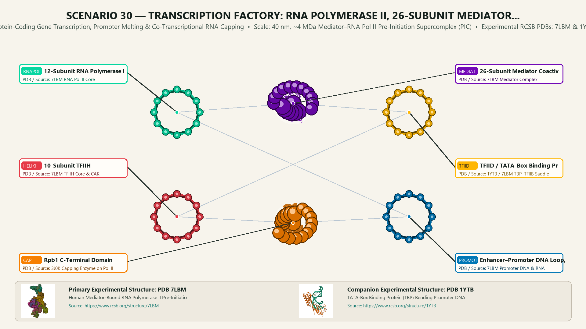
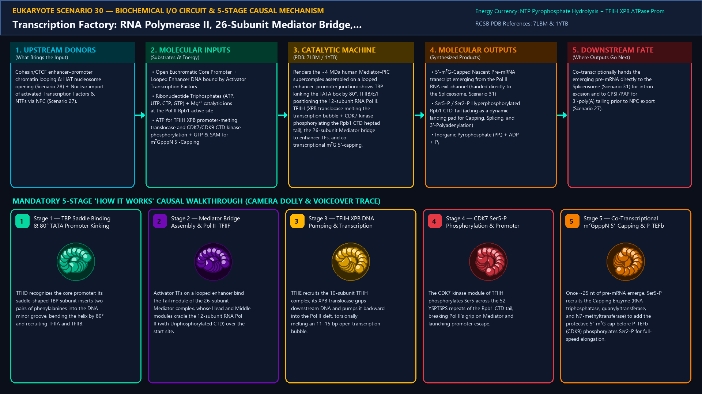
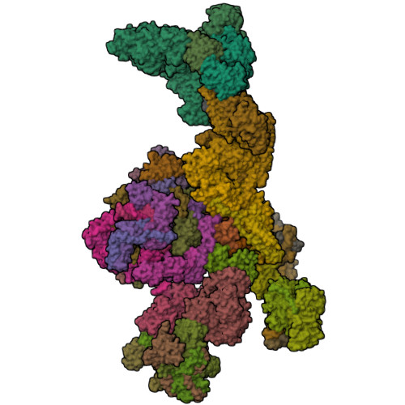
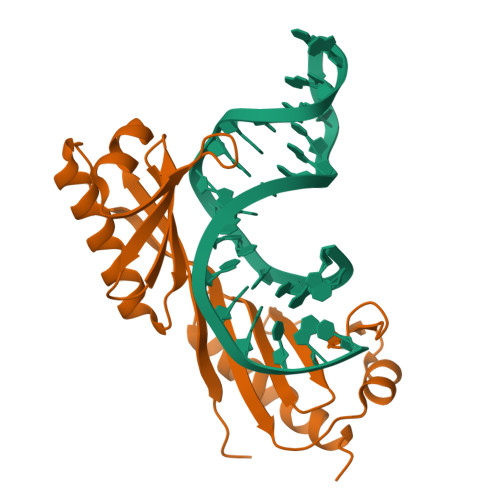
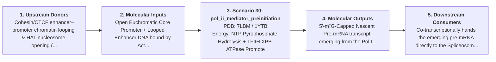
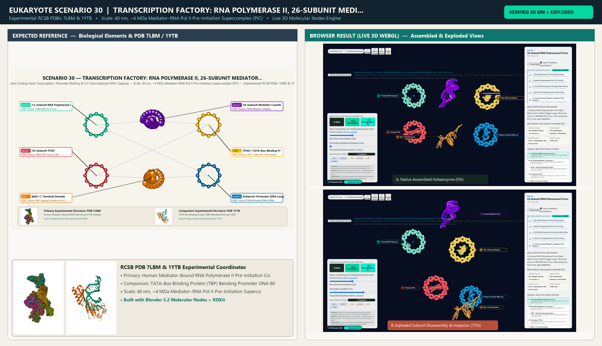

# Scenario 30 — Transcription Factory: RNA Polymerase II, 26-Subunit Mediator Bridge, TFIID/TFIIH Pre-Initiation Complex & 5'-Capping

> **Roadmap Tier:** Tier 6 — The Nucleus, Epigenetic Chromatin & Nuclear RNA Factories ($10\,\text{nm}\text{--}6\,\mu\text{m}$)  
> **Scenario ID:** `30_pol_ii_mediator_preinitiation`  
> **Biophysical Scale:** 40 nm, ~4 MDa Mediator–RNA Pol II Pre-Initiation Supercomplex (PIC)  
> **Functional Category:** Protein-Coding Gene Transcription, Promoter Melting & Co-Transcriptional RNA Capping  
> **Primary RCSB PDB Structures:** [`7LBM`](https://www.rcsb.org/structure/7LBM) (Human Mediator-Bound RNA Polymerase II Pre-Initiation Complex (7LBM)) · [`1YTB`](https://www.rcsb.org/structure/1YTB) (TATA-Box Binding Protein (TBP) Bending Promoter DNA 80° (1YTB))

---

## 1. Visual & Artistic Representations (Manual Verification Reference Plates)

The following four visual reference plates are stored directly inside this folder (`./`) so you can inspect both the **expected 3D scene decomposition**, the **biochemical I/O circuit & 5-stage mechanism**, and the **experimental cryo-EM / X-ray structures** during manual verification:

### 1.1 Expected 3D Scene & Subunit Decomposition Blueprint (`expected_pol_ii_mediator_preinitiation.png`)

### 1.2 Biochemical I/O Circuit & 5-Stage Causal Mechanism (`mechanism_pol_ii_mediator_preinitiation.png`)

### 1.3 Experimental RCSB PDB Structural References (`rcsb_7LBM.jpg` & `rcsb_1YTB.jpg`)
| Primary Structure [`7LBM`](https://www.rcsb.org/structure/7LBM) | Companion / Partner Structure [`1YTB`](https://www.rcsb.org/structure/1YTB) |
| :---: | :---: |
|  |  |
| **Human Mediator-Bound RNA Polymerase II Pre-Initiation Complex (7LBM)** | **TATA-Box Binding Protein (TBP) Bending Promoter DNA 80° (1YTB)** |

---

## 2. Biophysical & Molecular Behavior Overview

Unlike bacterial RNA Polymerase (which directly recognizes -35/-10 promoters via a single σ-factor), eukaryotic RNA Polymerase II (a 12-subunit, 550 kDa enzyme that transcribes all protein-coding mRNAs and most lncRNAs/miRNAs) requires a massive ~4 MDa, >70-polypeptide Pre-Initiation Complex (PIC) and the 26-subunit Mediator coactivator bridge. Transcription begins when sequence-specific Transcription Factors bound to distal Enhancers (looped in by Cohesin, Scenario 28) recruit the Head, Middle, Tail, and CDK8 Kinase modules of Mediator. At the core promoter, TFIID—via its saddle-shaped TATA-Binding Protein (TBP) subunit—inserts two phenylalanine wedges into the minor groove of the TATA box (or Inr/DPE elements via TAFs), kinking the DNA by a dramatic ~80°. TFIIA and TFIIB stabilize the TBP-DNA saddle and position the 12-subunit RNA Pol II (associated with TFIIF) over the transcription start site (+1). Next, TFIIE recruits the 10-subunit TFIIH complex: its XPB ATP-dependent DNA translocase pumps downstream DNA into the Pol II cleft to melt an 11–15 bp Transcription Bubble, while its CDK7 kinase module phosphorylates Serine-5 (Ser5-P) of the 52 tandem heptad repeats (Y₁S₂P₃T₄S₅P₆S₇) on the Rpb1 C-Terminal Domain (CTD) tail. Ser5-P releases Pol II from Mediator (promoter escape) and immediately recruits the 5'-Capping Enzyme to install the 7-methylguanosine (m⁷GpppN) cap as the nascent pre-mRNA emerges at ~25 nt, before P-TEFb (CDK9) phosphorylates Ser2-P for productive elongation and Spliceosome recruitment (Scenario 31).

### How It Behaves in the Interactive 3D Scene
Renders the ~4 MDa human Mediator–PIC supercomplex assembled on a looped enhancer–promoter junction: shows TBP kinking the TATA box by 80°, TFIIB/E/F positioning the 12-subunit RNA Pol II, TFIIH (XPB translocase melting the transcription bubble + CDK7 kinase phosphorylating the Rpb1 CTD heptad tail), the 26-subunit Mediator bridge to enhancer TFs, and co-transcriptional m⁷G 5'-capping.

---

## 3. Complete Biochemical I/O & Inter-Element Iteration

This section defines **what brings the input** to this machine (*Upstream Donors*), **what goes in** (*Molecular Inputs*), **what it makes** (*Molecular Outputs*), and **how it iterates with downstream systems** (*Downstream Consumers*):

- **Upstream Donors (What Brings the Input):**  
  Cohesin/CTCF enhancer–promoter chromatin looping & HAT nucleosome opening (Scenario 28) + Nuclear import of activated Transcription Factors & NTPs via NPC (Scenario 27).
- **Molecular Inputs (Substrates, Signals & Co-Factors):**
  - Open Euchromatic Core Promoter + Looped Enhancer DNA bound by Activator Transcription Factors
  - Ribonucleotide Triphosphates (ATP, UTP, CTP, GTP) + Mg²⁺ catalytic ions at the Pol II Rpb1 active site
  - ATP for TFIIH XPB promoter-melting translocase and CDK7/CDK9 CTD kinase phosphorylation + GTP & SAM for m⁷GpppN 5'-Capping
- **Molecular Outputs (Synthesized / Translocated Products):**
  - 5'-m⁷G-Capped Nascent Pre-mRNA transcript emerging from the Pol II RNA exit channel (handed directly to the Spliceosome, Scenario 31)
  - Ser5-P / Ser2-P Hyperphosphorylated Rpb1 CTD Tail (acting as a dynamic landing pad for Capping, Splicing, and 3'-Polyadenylation)
  - Inorganic Pyrophosphate (PPᵢ) + ADP + Pᵢ
- **Downstream Consumers & Cross-Element Iteration:**  
  Co-transcriptionally hands the emerging pre-mRNA directly to the Spliceosome (Scenario 31) for intron excision and to CPSF/PAP for 3'-poly(A) tailing prior to NPC export (Scenario 27).
- **Thermodynamic Energy Currency:** `NTP Pyrophosphate Hydrolysis + TFIIH XPB ATPase Promoter Melting + CDK7/CDK9 Kinase ATP + GTP/SAM Capping`
- **Biophysical Turnover / Kinetics ($k_{\text{cat}}$):** `Pol II elongation velocity ~30–70 nt/sec (~2–4 kb/min) across chromatinized gene bodies`

---

## 4. 3D Subunit Decomposition (`Piece_<ID>_*`) & Color Taxonomy

To support continuous **Exploded View (`setExplodedProgress(0.0 → 1.0)`)**, raycast hover inspection, and subpill lock-on targeting, this scenario is decomposed into **6 functional 3D submeshes**:

| # | 3D Submesh ID (`Piece_*`) | Biological & Structural Role | RCSB PDB / Chain Source | Color Taxonomy (`#Hex`) | Exploded Vector $\vec{v}_{\text{dissoc}}$ |
| :--- | :--- | :--- | :--- | :--- | :--- |
| **1** | `Piece_PIC_RNAPolII` | 12-Subunit RNA Polymerase II Core (Rpb1–Rpb12 Active Cleft & Trigger Loop) | `7LBM RNA Pol II Core` | `#06D6A0` (Pol II Core Jade) | `(0.0, 0.0, 0.0)` |
| **2** | `Piece_PIC_Mediator26` | 26-Subunit Mediator Coactivator Bridge (Head, Middle & Tail Modules) | `7LBM Mediator Complex` | `#7209B7` (Mediator Bridge Purple) | `(0.0, +4.2, -1.0)` |
| **3** | `Piece_PIC_TBP_TFIID` | TFIID / TATA-Box Binding Protein (TBP Saddle Bending DNA 80°) & TFIIA/B/F | `1YTB / 7LBM TBP–TFIIB Saddle` | `#FFB703` (TBP Saddle Gold) | `(-4.2, -1.0, +1.8)` |
| **4** | `Piece_PIC_TFIIH_HeliKin` | 10-Subunit TFIIH (XPB DNA Translocase + CDK7/Cyclin H CTD Kinase Module) | `7LBM TFIIH Core & CAK` | `#E63946` (TFIIH Helicase Crimson) | `(+4.2, -1.0, +1.8)` |
| **5** | `Piece_PIC_CTDTail_Cap` | Rpb1 C-Terminal Domain (52 × YSPTSPS Heptads) & m⁷G 5'-Capping Enzyme | `3J0K Capping Enzyme on Pol II` | `#F77F00` (CTD & Capping Amber) | `(+3.0, -3.8, +2.0)` |
| **6** | `Piece_PIC_PromoterBubble` | Enhancer–Promoter DNA Loop, Melted 13 bp Transcription Bubble & Pre-mRNA | `7LBM Promoter DNA & RNA` | `#0077B6` (Promoter DNA Blue) | `(-2.5, -3.8, -1.5)` |

---

## 5. Interactive HUD Simulation Controls (`iterationControls`)

| Control ID | HUD Label | Biophysical Permutations & Interactive Behavior |
| :--- | :--- | :--- |
| `ctd_phosphorylation_code` | **Rpb1 CTD Heptad Tail Phosphorylation State (Y₁S₂P₃T₄S₅P₆S₇)** | Unphosphorylated (PIC Recruitment) -> Ser5-P (Promoter Escape & 5'-Capping) -> Ser2-P (Elongation & Splicing) |
| `enhancer_mediator_coupling` | **Enhancer TF–Mediator Coactivator Bridge & Phase-Separated Condensate** | Basal Promoter Only (Low Firing) vs. Super-Enhancer Mediator Condensate (High Transcriptional Bursting) |
| `alpha_amanitin_inhibitor` | **α-Amanitin Death-Cap Mushroom Toxin (Bridge Helix / Trigger Loop Lock)** | Uninhibited Pol II Translocation (~50 nt/s) vs. α-Amanitin Jammed Trigger Loop |

---

## 6. Mandatory 5-Stage "How It Works" Explanatory Trace

- **Stage 1 — TBP Saddle Binding & 80° TATA Promoter Kinking:** TFIID recognizes the core promoter; its saddle-shaped TBP subunit inserts two pairs of phenylalanines into the DNA minor groove, bending the helix by 80° and recruiting TFIIA and TFIIB.
- **Stage 2 — Mediator Bridge Assembly & Pol II–TFIIF Docking:** Activator TFs on a looped enhancer bind the Tail module of the 26-subunit Mediator complex, whose Head and Middle modules cradle the 12-subunit RNA Pol II (with Unphosphorylated CTD) over the start site.
- **Stage 3 — TFIIH XPB DNA Pumping & Transcription Bubble Melting:** TFIIE recruits the 10-subunit TFIIH complex; its XPB translocase grips downstream DNA and pumps it backward into the Pol II cleft, torsionally melting an 11–15 bp open transcription bubble.
- **Stage 4 — CDK7 Ser5-P Phosphorylation & Promoter Escape:** The CDK7 kinase module of TFIIH phosphorylates Ser5 across the 52 YSPTSPS repeats of the Rpb1 CTD tail, breaking Pol II's grip on Mediator and launching promoter escape.
- **Stage 5 — Co-Transcriptional m⁷GpppN 5'-Capping & P-TEFb Elongation:** Once ~25 nt of pre-mRNA emerge, Ser5-P recruits the Capping Enzyme (RNA triphosphatase, guanylyltransferase, and N7-methyltransferase) to add the protective 5'-m⁷G cap before P-TEFb (CDK9) phosphorylates Ser2-P for full-speed elongation.

---

## 7. Curated Online Resources & Structural References

- [RCSB PDB-101 — Molecule of the Month: RNA Polymerase II & TATA-Binding Protein](https://pdb101.rcsb.org/motm/67)
- [RCSB PDB Structure 7LBM — Human Mediator-Bound RNA Pol II Pre-Initiation Complex](https://www.rcsb.org/structure/7LBM)
- [RCSB PDB Structure 1YTB — TATA-Box Binding Protein (TBP)–DNA Complex](https://www.rcsb.org/structure/1YTB)
- [NCBI Bookshelf — Molecular Biology of the Cell: From DNA to RNA (Eukaryotic Transcription)](https://www.ncbi.nlm.nih.gov/books/NBK26887/)

## 12. 3D Implementation & Visual Verification Assets

- **Status:** `[x] Implemented, Exported to 3D GLB & Visually Verified`
- **3D Model Asset (`.glb`):** [`pol_ii_mediator_preinitiation.glb`](./pol_ii_mediator_preinitiation.glb) (also mirrored in `eukaryote/models/pol_ii_mediator_preinitiation.glb` and `client/public/eukaryote/models/pol_ii_mediator_preinitiation.glb`)
- **Blender 5.2 + Molecular Nodes Generator Script:** [`generate_30_pol_ii_mediator_preinitiation.py`](./generate_30_pol_ii_mediator_preinitiation.py)
- **Live WebGL Assembled Capture (`0%`):** [`browser_pol_ii_mediator_preinitiation_assembled.png`](../../verification/30_pol_ii_mediator_preinitiation/browser_pol_ii_mediator_preinitiation_assembled.png)
- **Live WebGL Exploded Capture (`75%`):** [`browser_pol_ii_mediator_preinitiation_exploded.png`](../../verification/30_pol_ii_mediator_preinitiation/browser_pol_ii_mediator_preinitiation_exploded.png)
- **Side-by-Side Input vs. Output Comparison Plate (`2400×1380`):** [`comparison_pol_ii_mediator_preinitiation.png`](../../verification/30_pol_ii_mediator_preinitiation/comparison_pol_ii_mediator_preinitiation.png)
- **Animated Side-by-Side Comparison Video (`1920×1080 MP4`):** [`comparison_pol_ii_mediator_preinitiation.mp4`](../../verification/30_pol_ii_mediator_preinitiation/comparison_pol_ii_mediator_preinitiation.mp4)

