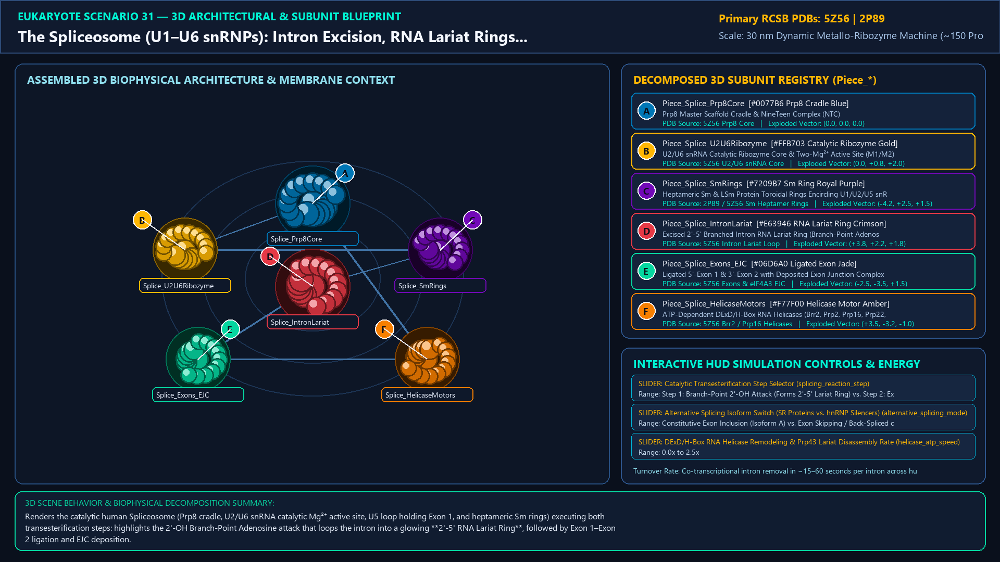
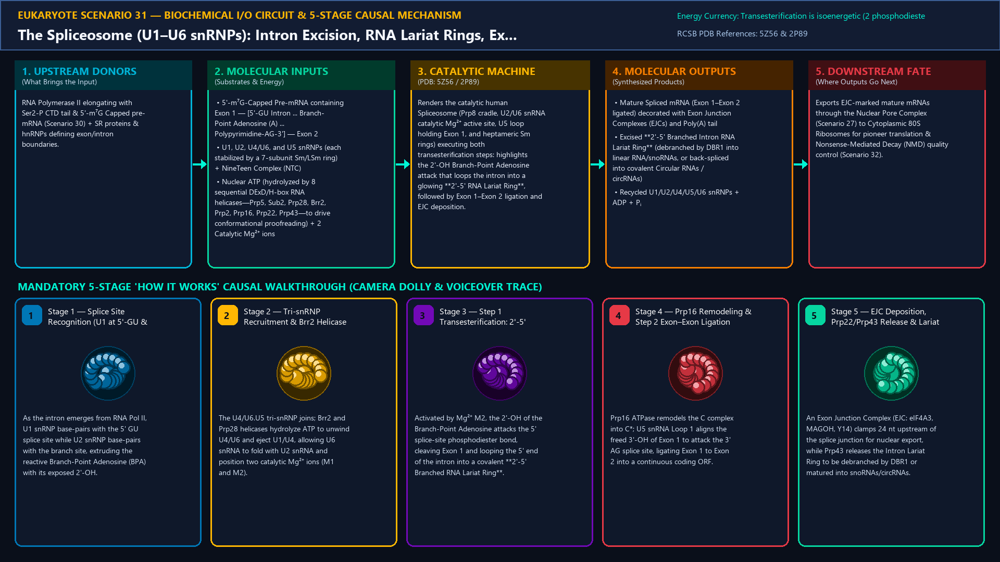
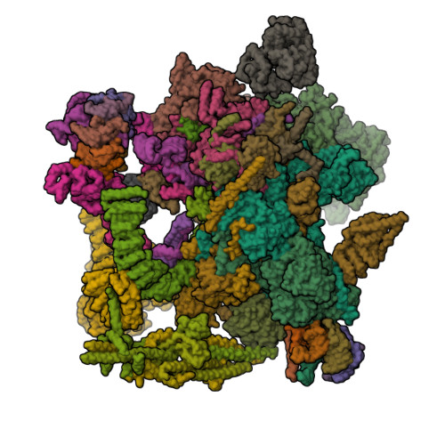
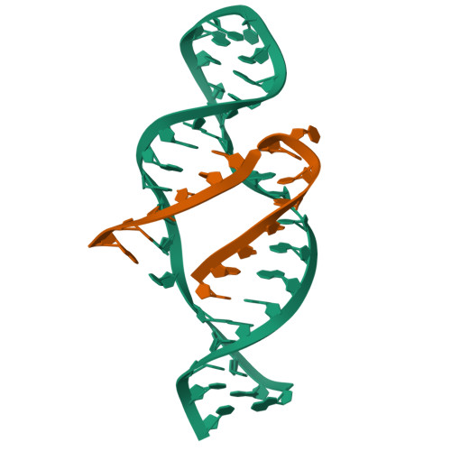
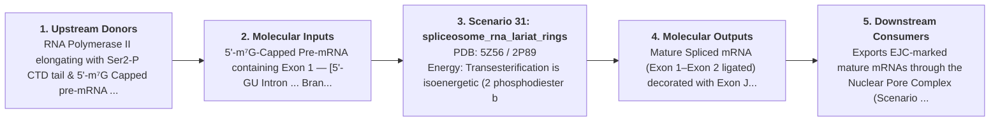

# Scenario 31 — The Spliceosome (U1–U6 snRNPs): Intron Excision, RNA Lariat Rings, Exon Ligation & Exon Junction Complex (EJC)

> **Roadmap Tier:** Tier 6 — The Nucleus, Epigenetic Chromatin & Nuclear RNA Factories ($10\,\text{nm}\text{--}6\,\mu\text{m}$)  
> **Scenario ID:** `31_spliceosome_rna_lariat_rings`  
> **Biophysical Scale:** 30 nm Dynamic Metallo-Ribozyme Machine (~150 Proteins + 5 snRNAs) & 2'-5' RNA Lariat Ring  
> **Functional Category:** Co-Transcriptional Pre-mRNA Splicing, Alternative Splicing & RNA Lariat Ring Topology  
> **Primary RCSB PDB Structures:** [`5Z56`](https://www.rcsb.org/structure/5Z56) (Human Catalytic Step I / B* Spliceosome Cryo-EM Structure (5Z56)) · [`2P89`](https://www.rcsb.org/structure/2P89) (Heptameric Sm Protein Ring Encircling U-snRNA (2P89))

---

## 1. Visual & Artistic Representations (Manual Verification Reference Plates)

The following four visual reference plates are stored directly inside this folder (`./`) so you can inspect both the **expected 3D scene decomposition**, the **biochemical I/O circuit & 5-stage mechanism**, and the **experimental cryo-EM / X-ray structures** during manual verification:

### 1.1 Expected 3D Scene & Subunit Decomposition Blueprint (`expected_spliceosome_rna_lariat_rings.png`)

### 1.2 Biochemical I/O Circuit & 5-Stage Causal Mechanism (`mechanism_spliceosome_rna_lariat_rings.png`)

### 1.3 Experimental RCSB PDB Structural References (`rcsb_5Z56.jpg` & `rcsb_2P89.jpg`)
| Primary Structure [`5Z56`](https://www.rcsb.org/structure/5Z56) | Companion / Partner Structure [`2P89`](https://www.rcsb.org/structure/2P89) |
| :---: | :---: |
|  |  |
| **Human Catalytic Step I / B* Spliceosome Cryo-EM Structure (5Z56)** | **Heptameric Sm Protein Ring Encircling U-snRNA (2P89)** |

---

## 2. Biophysical & Molecular Behavior Overview

Over 95% of human multi-exon pre-mRNAs contain non-coding Introns (often 10× longer than coding Exons) that must be excised with single-nucleotide precision by the Spliceosome—a dynamic multi-megadalton ribonucleoprotein machine assembled de novo on each intron from five Small Nuclear Ribonucleoproteins (U1, U2, U4, U5, and U6 snRNPs, each built around a heptameric Sm or LSm protein ring encircling a structured snRNA) plus ~100 DExD/H-box RNA helicases and Prp8/NTC scaffold proteins. Recruited directly from the Ser2-phosphorylated CTD tail of elongating RNA Pol II (Scenario 30), U1 snRNP base-pairs with the 5' Splice Site (GU), while SF1/U2AF and U2 snRNP base-pair with the Branch-Point Sequence, bulging out the invariant Branch-Point Adenosine (BPA). Recruitment of the U4/U6.U5 tri-snRNP forms the pre-catalytic B complex; ATP-dependent RNA helicases (Brr2, Prp28, Prp2) eject U1 and U4, allowing U6 snRNA to fold with U2 snRNA into an intramolecular stem-loop (ISL) that coordinates two catalytic Mg²⁺ ions (M1 and M2)—identical in geometry to Group II self-splicing introns! In Step 1 (Branching), the 2'-OH of the Branch-Point Adenosine performs a nucleophilic attack on the 5' Splice Site phosphate, forming a covalent 2'-5' phosphodiester bond that loops the intron into a closed **RNA Lariat Ring** and frees the 5' Exon 3'-OH. In Step 2 (Exon Ligation), the 5' Exon 3'-OH attacks the 3' Splice Site (AG), ligating Exon 1 to Exon 2, depositing an Exon Junction Complex (EJC) 24 nt upstream, and releasing the Intron Lariat Ring (either debranched by DBR1 or processed into snoRNAs/stable circular intronic RNAs, circRNAs).

### How It Behaves in the Interactive 3D Scene
Renders the catalytic human Spliceosome (Prp8 cradle, U2/U6 snRNA catalytic Mg²⁺ active site, U5 loop holding Exon 1, and heptameric Sm rings) executing both transesterification steps: highlights the 2'-OH Branch-Point Adenosine attack that loops the intron into a glowing **2'-5' RNA Lariat Ring**, followed by Exon 1–Exon 2 ligation and EJC deposition.

---

## 3. Complete Biochemical I/O & Inter-Element Iteration

This section defines **what brings the input** to this machine (*Upstream Donors*), **what goes in** (*Molecular Inputs*), **what it makes** (*Molecular Outputs*), and **how it iterates with downstream systems** (*Downstream Consumers*):

- **Upstream Donors (What Brings the Input):**  
  RNA Polymerase II elongating with Ser2-P CTD tail & 5'-m⁷G Capped pre-mRNA (Scenario 30) + SR proteins & hnRNPs defining exon/intron boundaries.
- **Molecular Inputs (Substrates, Signals & Co-Factors):**
  - 5'-m⁷G-Capped Pre-mRNA containing Exon 1 — [5'-GU Intron ... Branch-Point Adenosine (A) ... Polypyrimidine-AG-3'] — Exon 2
  - U1, U2, U4/U6, and U5 snRNPs (each stabilized by a 7-subunit Sm/LSm ring) + NineTeen Complex (NTC)
  - Nuclear ATP (hydrolyzed by 8 sequential DExD/H-box RNA helicases—Prp5, Sub2, Prp28, Brr2, Prp2, Prp16, Prp22, Prp43—to drive conformational proofreading) + 2 Catalytic Mg²⁺ ions
- **Molecular Outputs (Synthesized / Translocated Products):**
  - Mature Spliced mRNA (Exon 1–Exon 2 ligated) decorated with Exon Junction Complexes (EJCs) and Poly(A) tail
  - Excised **2'-5' Branched Intron RNA Lariat Ring** (debranched by DBR1 into linear RNA/snoRNAs, or back-spliced into covalent Circular RNAs / circRNAs)
  - Recycled U1/U2/U4/U5/U6 snRNPs + ADP + Pᵢ
- **Downstream Consumers & Cross-Element Iteration:**  
  Exports EJC-marked mature mRNAs through the Nuclear Pore Complex (Scenario 27) to Cytoplasmic 80S Ribosomes for pioneer translation & Nonsense-Mediated Decay (NMD) quality control (Scenario 32).
- **Thermodynamic Energy Currency:** `Transesterification is isoenergetic (2 phosphodiester bonds in = 2 bonds out); ~8–10 ATP molecules hydrolyzed by RNA helicases for directional fidelity & remodeling`
- **Biophysical Turnover / Kinetics ($k_{\text{cat}}$):** `Co-transcriptional intron removal in ~15–60 seconds per intron across human genes`

---

## 4. 3D Subunit Decomposition (`Piece_<ID>_*`) & Color Taxonomy

To support continuous **Exploded View (`setExplodedProgress(0.0 → 1.0)`)**, raycast hover inspection, and subpill lock-on targeting, this scenario is decomposed into **6 functional 3D submeshes**:

| # | 3D Submesh ID (`Piece_*`) | Biological & Structural Role | RCSB PDB / Chain Source | Color Taxonomy (`#Hex`) | Exploded Vector $\vec{v}_{\text{dissoc}}$ |
| :--- | :--- | :--- | :--- | :--- | :--- |
| **1** | `Piece_Splice_Prp8Core` | Prp8 Master Scaffold Cradle & NineTeen Complex (NTC) | `5Z56 Prp8 Core` | `#0077B6` (Prp8 Cradle Blue) | `(0.0, 0.0, 0.0)` |
| **2** | `Piece_Splice_U2U6Ribozyme` | U2/U6 snRNA Catalytic Ribozyme Core & Two-Mg²⁺ Active Site (M1/M2) | `5Z56 U2/U6 snRNA Core` | `#FFB703` (Catalytic Ribozyme Gold) | `(0.0, +0.8, +2.0)` |
| **3** | `Piece_Splice_SmRings` | Heptameric Sm & LSm Protein Toroidal Rings Encircling U1/U2/U5 snRNAs | `2P89 / 5Z56 Sm Heptamer Rings` | `#7209B7` (Sm Ring Royal Purple) | `(-4.2, +2.5, +1.5)` |
| **4** | `Piece_Splice_IntronLariat` | Excised 2'-5' Branched Intron RNA Lariat Ring (Branch-Point Adenosine) | `5Z56 Intron Lariat Loop` | `#E63946` (RNA Lariat Ring Crimson) | `(+3.8, +2.2, +1.8)` |
| **5** | `Piece_Splice_Exons_EJC` | Ligated 5'-Exon 1 & 3'-Exon 2 with Deposited Exon Junction Complex (EJC) | `5Z56 Exons & eIF4A3 EJC` | `#06D6A0` (Ligated Exon Jade) | `(-2.5, -3.5, +1.5)` |
| **6** | `Piece_Splice_HelicaseMotors` | ATP-Dependent DExD/H-Box RNA Helicases (Brr2, Prp2, Prp16, Prp22, Prp43) | `5Z56 Brr2 / Prp16 Helicases` | `#F77F00` (Helicase Motor Amber) | `(+3.5, -3.2, -1.0)` |

---

## 5. Interactive HUD Simulation Controls (`iterationControls`)

| Control ID | HUD Label | Biophysical Permutations & Interactive Behavior |
| :--- | :--- | :--- |
| `splicing_reaction_step` | **Catalytic Transesterification Step Selector** | Step 1: Branch-Point 2'-OH Attack (Forms 2'-5' Lariat Ring) vs. Step 2: Exon 1–Exon 2 Ligation |
| `alternative_splicing_mode` | **Alternative Splicing Isoform Switch (SR Proteins vs. hnRNP Silencers)** | Constitutive Exon Inclusion (Isoform A) vs. Exon Skipping / Back-Spliced circRNA Ring |
| `helicase_atp_speed` | **DExD/H-Box RNA Helicase Remodeling & Prp43 Lariat Disassembly Rate** | 0.0x to 2.5x |

---

## 6. Mandatory 5-Stage "How It Works" Explanatory Trace

- **Stage 1 — Splice Site Recognition (U1 at 5'-GU & U2 at Branch-Point A):** As the intron emerges from RNA Pol II, U1 snRNP base-pairs with the 5' GU splice site while U2 snRNP base-pairs with the branch site, extruding the reactive Branch-Point Adenosine (BPA) with its exposed 2'-OH.
- **Stage 2 — Tri-snRNP Recruitment & Brr2 Helicase Activation (B → B*):** The U4/U6.U5 tri-snRNP joins; Brr2 and Prp28 helicases hydrolyze ATP to unwind U4/U6 and eject U1/U4, allowing U6 snRNA to fold with U2 snRNA and position two catalytic Mg²⁺ ions (M1 and M2).
- **Stage 3 — Step 1 Transesterification: 2'-5' RNA Lariat Ring Formation:** Activated by Mg²⁺ M2, the 2'-OH of the Branch-Point Adenosine attacks the 5' splice-site phosphodiester bond, cleaving Exon 1 and looping the 5' end of the intron into a covalent **2'-5' Branched RNA Lariat Ring**.
- **Stage 4 — Prp16 Remodeling & Step 2 Exon–Exon Ligation:** Prp16 ATPase remodels the C complex into C*; U5 snRNA Loop 1 aligns the freed 3'-OH of Exon 1 to attack the 3' AG splice site, ligating Exon 1 to Exon 2 into a continuous coding ORF.
- **Stage 5 — EJC Deposition, Prp22/Prp43 Release & Lariat Ring Debranching:** An Exon Junction Complex (EJC: eIF4A3, MAGOH, Y14) clamps 24 nt upstream of the splice junction for nuclear export, while Prp43 releases the Intron Lariat Ring to be debranched by DBR1 or matured into snoRNAs/circRNAs.

---

## 7. Curated Online Resources & Structural References

- [RCSB PDB-101 — Molecule of the Month: Spliceosomes](https://pdb101.rcsb.org/motm/210)
- [RCSB PDB Structure 5Z56 — Cryo-EM Structure of the Human Catalytic Step I Spliceosome](https://www.rcsb.org/structure/5Z56)
- [RCSB PDB Structure 2P89 — Heptameric Sm Core Ring of Human Spliceosomal snRNPs](https://www.rcsb.org/structure/2P89)
- [NCBI Bookshelf — Molecular Biology of the Cell: RNA Splicing & the Spliceosome](https://www.ncbi.nlm.nih.gov/books/NBK26887/#_A1095_)
