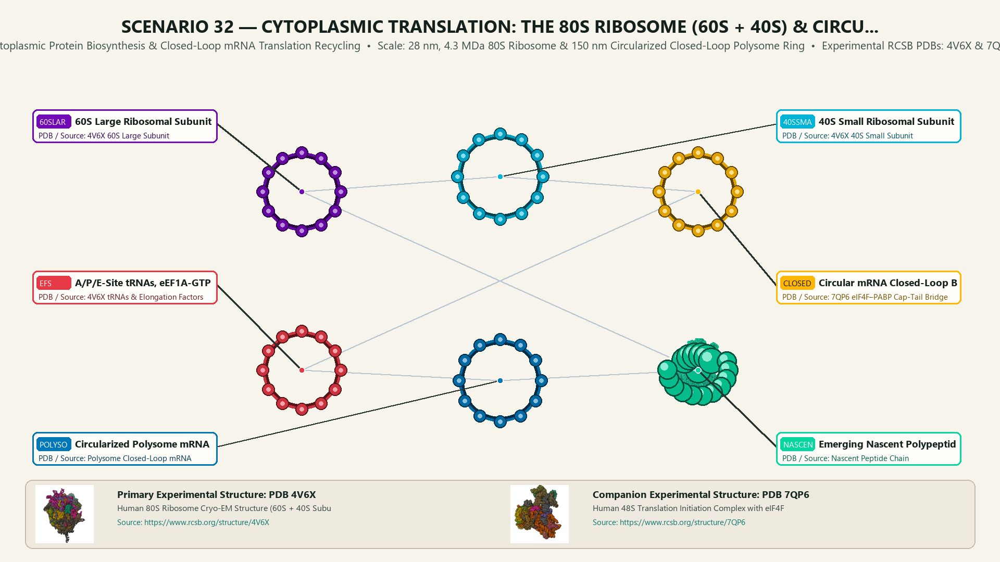
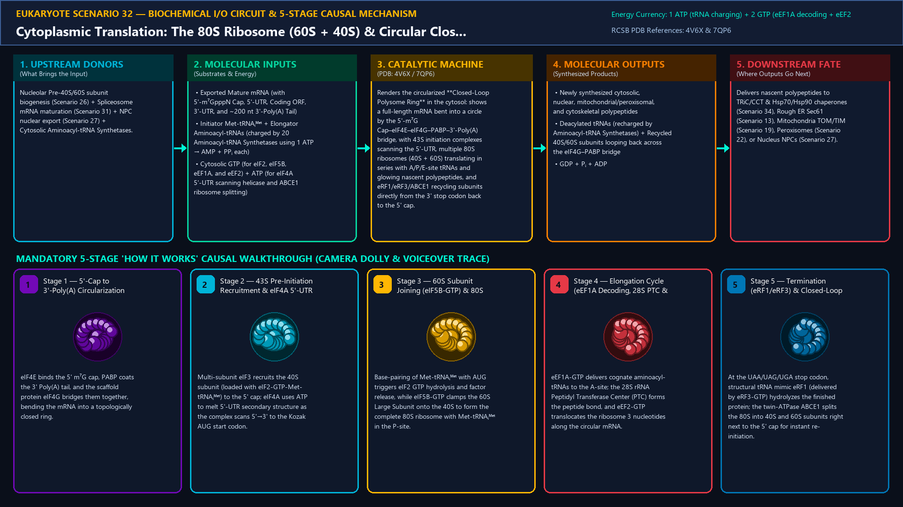
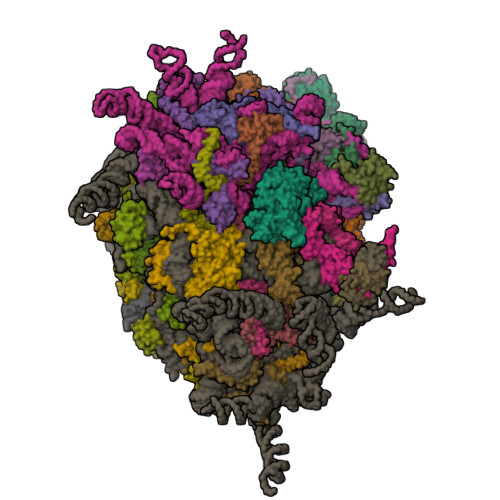
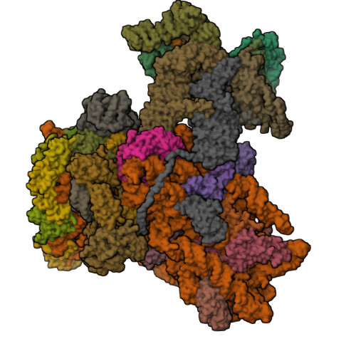
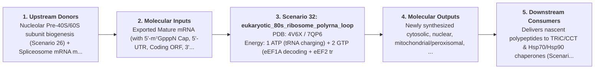

# Scenario 32 — Cytoplasmic Translation: The 80S Ribosome (60S + 40S) & Circular Closed-Loop Polysome (m⁷G–eIF4E–eIF4G–PABP–PolyA)

> **Roadmap Tier:** Tier 7 — Cytoplasmic Translation, RNA Silencing, Proteostasis & Cell Division ($10\,\text{nm}\text{--}10\,\mu\text{m}$)  
> **Scenario ID:** `32_eukaryotic_80s_ribosome_polyrna_loop`  
> **Biophysical Scale:** 28 nm, 4.3 MDa 80S Ribosome & 150 nm Circularized Closed-Loop Polysome Ring  
> **Functional Category:** Cytoplasmic Protein Biosynthesis & Closed-Loop mRNA Translation Recycling  
> **Primary RCSB PDB Structures:** [`4V6X`](https://www.rcsb.org/structure/4V6X) (Human 80S Ribosome Cryo-EM Structure (60S + 40S Subunits, 4V6X)) · [`7QP6`](https://www.rcsb.org/structure/7QP6) (Human 48S Translation Initiation Complex with eIF4F & eIF3 (7QP6))

---

## 1. Visual & Artistic Representations (Manual Verification Reference Plates)

The following four visual reference plates are stored directly inside this folder (`./`) so you can inspect both the **expected 3D scene decomposition**, the **biochemical I/O circuit & 5-stage mechanism**, and the **experimental cryo-EM / X-ray structures** during manual verification:

### 1.1 Expected 3D Scene & Subunit Decomposition Blueprint (`expected_eukaryotic_80s_ribosome_polyrna_loop.png`)

### 1.2 Biochemical I/O Circuit & 5-Stage Causal Mechanism (`mechanism_eukaryotic_80s_ribosome_polyrna_loop.png`)

### 1.3 Experimental RCSB PDB Structural References (`rcsb_4V6X.jpg` & `rcsb_7QP6.jpg`)
| Primary Structure [`4V6X`](https://www.rcsb.org/structure/4V6X) | Companion / Partner Structure [`7QP6`](https://www.rcsb.org/structure/7QP6) |
| :---: | :---: |
|  |  |
| **Human 80S Ribosome Cryo-EM Structure (60S + 40S Subunits, 4V6X)** | **Human 48S Translation Initiation Complex with eIF4F & eIF3 (7QP6)** |

---

## 2. Biophysical & Molecular Behavior Overview

Whereas prokaryotic 70S ribosomes (2.5 MDa) initiate translation directly on nascent mRNAs via Shine–Dalgarno base-pairing, eukaryotic cytoplasmic translation uses a larger 4.3 MDa **80S Ribosome**—composed of a **40S Small Subunit** (18S rRNA + 33 RPS proteins) and a **60S Large Subunit** (28S, 5.8S, and 5S rRNAs + 47 RPL proteins)—operating on a **Circularized Closed-Loop mRNA Ring**. Once a spliced mRNA exits the Nuclear Pore (Scenario 27), its 5' m⁷GpppN cap is bound by eIF4E and its 3' Poly(A) tail is coated by Poly(A)-Binding Protein (PABP). The giant scaffold protein eIF4G simultaneously binds both eIF4E (at the 5' end) and PABP (at the 3' end), bending the entire mRNA into a physical **Closed-Loop Polysome Ring**! This circular topology ensures that only intact, non-degraded mRNAs (containing both cap and tail) are translated and allows terminating ribosomes at the 3' stop codon to immediately re-initiate at the adjacent 5' cap. Initiation proceeds via 5'→3' scanning: the 43S Pre-Initiation Complex (40S + eIF1/1A/3/5 + eIF2–GTP–Met-tRNAᵢᴹᵉᵗ) is recruited to the 5' cap while the DEAD-box helicase eIF4A unwinds 5'-UTR hairpins until the anticodon recognizes the Kozak AUG start codon; eIF5B-GTP then joins the 60S subunit to form the elongation-competent 80S ribosome. Elongation cycles via eEF1A-GTP (aminoacyl-tRNA delivery), the 28S rRNA Peptidyl Transferase Center (PTC), and eEF2-GTP (translocation), until eRF1/eRF3-GTP recognizes UAA/UAG/UGA and ABCE1 splits the subunits for immediate recycling around the closed mRNA loop.

### How It Behaves in the Interactive 3D Scene
Renders the circularized **Closed-Loop Polysome Ring** in the cytosol: shows a full-length mRNA bent into a circle by the 5'-m⁷G Cap–eIF4E–eIF4G–PABP–3'-Poly(A) bridge, with 43S initiation complexes scanning the 5'-UTR, multiple 80S ribosomes (40S + 60S) translating in series with A/P/E-site tRNAs and glowing nascent polypeptides, and eRF1/eRF3/ABCE1 recycling subunits directly from the 3' stop codon back to the 5' cap.

---

## 3. Complete Biochemical I/O & Inter-Element Iteration

This section defines **what brings the input** to this machine (*Upstream Donors*), **what goes in** (*Molecular Inputs*), **what it makes** (*Molecular Outputs*), and **how it iterates with downstream systems** (*Downstream Consumers*):

- **Upstream Donors (What Brings the Input):**  
  Nucleolar Pre-40S/60S subunit biogenesis (Scenario 26) + Spliceosome mRNA maturation (Scenario 31) + NPC nuclear export (Scenario 27) + Cytosolic Aminoacyl-tRNA Synthetases.
- **Molecular Inputs (Substrates, Signals & Co-Factors):**
  - Exported Mature mRNA (with 5'-m⁷GpppN Cap, 5'-UTR, Coding ORF, 3'-UTR, and ~200 nt 3'-Poly(A) Tail)
  - Initiator Met-tRNAᵢᴹᵉᵗ + Elongator Aminoacyl-tRNAs (charged by 20 Aminoacyl-tRNA Synthetases using 1 ATP → AMP + PPᵢ each)
  - Cytosolic GTP (for eIF2, eIF5B, eEF1A, and eEF2) + ATP (for eIF4A 5'-UTR scanning helicase and ABCE1 ribosome splitting)
- **Molecular Outputs (Synthesized / Translocated Products):**
  - Newly synthesized cytosolic, nuclear, mitochondrial/peroxisomal, and cytoskeletal polypeptides
  - Deacylated tRNAs (recharged by Aminoacyl-tRNA Synthetases) + Recycled 40S/60S subunits looping back across the eIF4G–PABP bridge
  - GDP + Pᵢ + ADP
- **Downstream Consumers & Cross-Element Iteration:**  
  Delivers nascent polypeptides to TRiC/CCT & Hsp70/Hsp90 chaperones (Scenario 34), Rough ER Sec61 (Scenario 13), Mitochondria TOM/TIM (Scenario 19), Peroxisomes (Scenario 22), or Nucleus NPCs (Scenario 27).
- **Thermodynamic Energy Currency:** `1 ATP (tRNA charging) + 2 GTP (eEF1A decoding + eEF2 translocation) ≈ 4 high-energy phosphate bonds per peptide bond`
- **Biophysical Turnover / Kinetics ($k_{\text{cat}}$):** `Eukaryotic 80S ribosome translates at ~5–9 amino acids/sec (slower but higher accuracy and co-translational folding complexity than bacterial 70S at ~15–20 aa/sec)`

---

## 4. 3D Subunit Decomposition (`Piece_<ID>_*`) & Color Taxonomy

To support continuous **Exploded View (`setExplodedProgress(0.0 → 1.0)`)**, raycast hover inspection, and subpill lock-on targeting, this scenario is decomposed into **6 functional 3D submeshes**:

| # | 3D Submesh ID (`Piece_*`) | Biological & Structural Role | RCSB PDB / Chain Source | Color Taxonomy (`#Hex`) | Exploded Vector $\vec{v}_{\text{dissoc}}$ |
| :--- | :--- | :--- | :--- | :--- | :--- |
| **1** | `Piece_Rib80_60SLarge` | 60S Large Ribosomal Subunit (28S, 5.8S, 5S rRNA + 47 RPLs & PTC) | `4V6X 60S Large Subunit` | `#7209B7` (60S Subunit Purple) | `(0.0, +1.8, 0.0)` |
| **2** | `Piece_Rib80_40SSmall` | 40S Small Ribosomal Subunit (18S rRNA + 33 RPSs & Decoding Center) | `4V6X 40S Small Subunit` | `#00B4D8` (40S Subunit Cerulean) | `(0.0, -1.8, +1.0)` |
| **3** | `Piece_Rib80_ClosedLoop` | Circular mRNA Closed-Loop Bridge (5'-m⁷G Cap + eIF4E–eIF4G–PABP + 3'-PolyA) | `7QP6 eIF4F–PABP Cap-Tail Bridge` | `#FFB703` (Closed-Loop Bridge Gold) | `(-4.5, 0.0, +1.8)` |
| **4** | `Piece_Rib80_tRNAs_EFs` | A/P/E-Site tRNAs, eEF1A-GTP Ternary Complex & eEF2 Translocase | `4V6X tRNAs & Elongation Factors` | `#E63946` (tRNA & eEF Crimson) | `(+2.2, 0.0, +2.2)` |
| **5** | `Piece_Rib80_PolysomeRing` | Circularized Polysome mRNA Track & ABCE1 Termination/Recycling Splitter | `Polysome Closed-Loop mRNA` | `#0077B6` (Polysome mRNA Blue) | `(+4.2, -2.5, 0.0)` |
| **6** | `Piece_Rib80_NascentChain` | Emerging Nascent Polypeptide Chain & Co-Translational NAC/Hsp70 Chaperone | `Nascent Peptide Chain` | `#06D6A0` (Nascent Chain Jade) | `(0.0, +4.5, +1.5)` |

---

## 5. Interactive HUD Simulation Controls (`iterationControls`)

| Control ID | HUD Label | Biophysical Permutations & Interactive Behavior |
| :--- | :--- | :--- |
| `closed_loop_integrity` | **eIF4E–eIF4G–PABP Circular mRNA Closed-Loop State (mTORC1 / 4E-BP1 Control)** | Intact Circular Polysome (High Re-Initiation) vs. 4E-BP1 Cap-Blocked Linear mRNA |
| `translation_elongation_rate` | **80S Ribosome Scanning & eEF1A/eEF2 Elongation Speed** | 0.0x (Cycloheximide E-Site Block) to 2.5x |
| `nmd_surveillance_toggle` | **Pioneer Round Exon Junction Complex (EJC) & Nonsense-Mediated Decay (NMD)** | Normal ORF (EJC Stripped -> Stable Translation) vs. Premature Stop Codon (UPF1 Triggers Decay) |

---

## 6. Mandatory 5-Stage "How It Works" Explanatory Trace

- **Stage 1 — 5'-Cap to 3'-Poly(A) Circularization (The Closed-Loop mRNA Ring):** eIF4E binds the 5' m⁷G cap, PABP coats the 3' Poly(A) tail, and the scaffold protein eIF4G bridges them together, bending the mRNA into a topologically closed ring.
- **Stage 2 — 43S Pre-Initiation Recruitment & eIF4A 5'-UTR Scanning:** Multi-subunit eIF3 recruits the 40S subunit (loaded with eIF2-GTP-Met-tRNAᵢᴹᵉᵗ) to the 5' cap; eIF4A uses ATP to melt 5'-UTR secondary structure as the complex scans 5'→3' to the Kozak AUG start codon.
- **Stage 3 — 60S Subunit Joining (eIF5B-GTP) & 80S Assembly:** Base-pairing of Met-tRNAᵢᴹᵉᵗ with AUG triggers eIF2 GTP hydrolysis and factor release, while eIF5B-GTP clamps the 60S Large Subunit onto the 40S to form the complete 80S ribosome with Met-tRNAᵢᴹᵉᵗ in the P-site.
- **Stage 4 — Elongation Cycle (eEF1A Decoding, 28S PTC & eEF2 Translocation):** eEF1A-GTP delivers cognate aminoacyl-tRNAs to the A-site; the 28S rRNA Peptidyl Transferase Center (PTC) forms the peptide bond, and eEF2-GTP translocates the ribosome 3 nucleotides along the circular mRNA.
- **Stage 5 — Termination (eRF1/eRF3) & Closed-Loop Subunit Recycling (ABCE1):** At the UAA/UAG/UGA stop codon, structural tRNA mimic eRF1 (delivered by eRF3-GTP) hydrolyzes the finished protein; the twin-ATPase ABCE1 splits the 80S into 40S and 60S subunits right next to the 5' cap for instant re-initiation.

---

## 7. Curated Online Resources & Structural References

- [RCSB PDB-101 — Molecule of the Month: Eukaryotic Ribosomes & Initiation Factors](https://pdb101.rcsb.org/motm/121)
- [RCSB PDB Structure 4V6X — High-Resolution Cryo-EM Structure of the Human 80S Ribosome](https://www.rcsb.org/structure/4V6X)
- [RCSB PDB Structure 7QP6 — Human 48S Translation Initiation Complex](https://www.rcsb.org/structure/7QP6)
- [NCBI Bookshelf — Molecular Biology of the Cell: From RNA to Protein (Eukaryotic Translation)](https://www.ncbi.nlm.nih.gov/books/NBK26829/)
