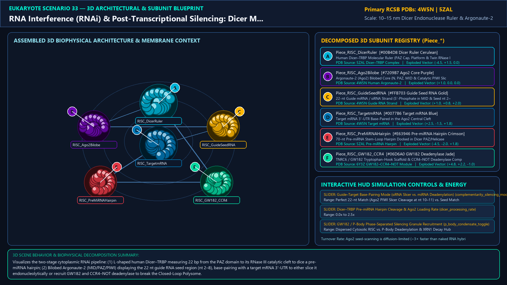
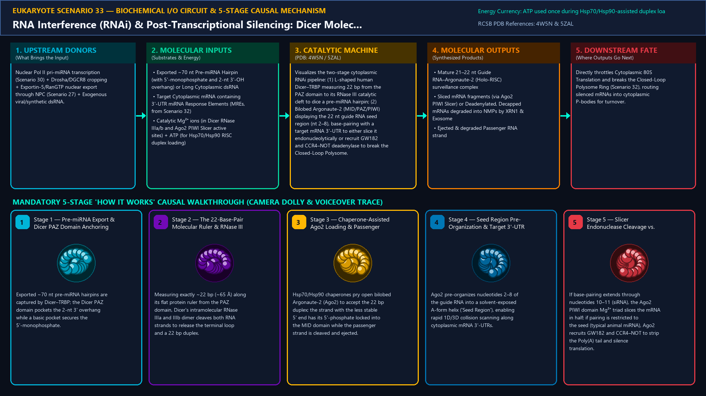
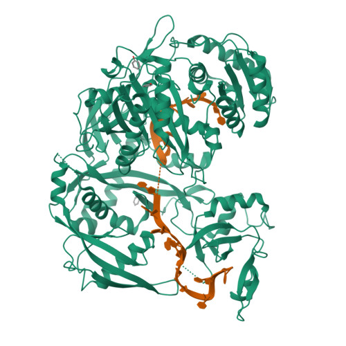
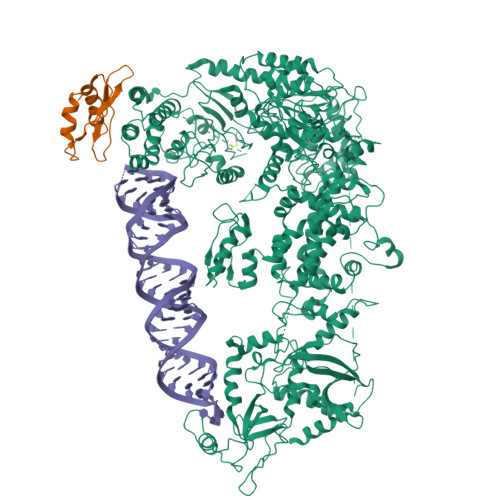
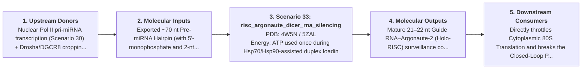
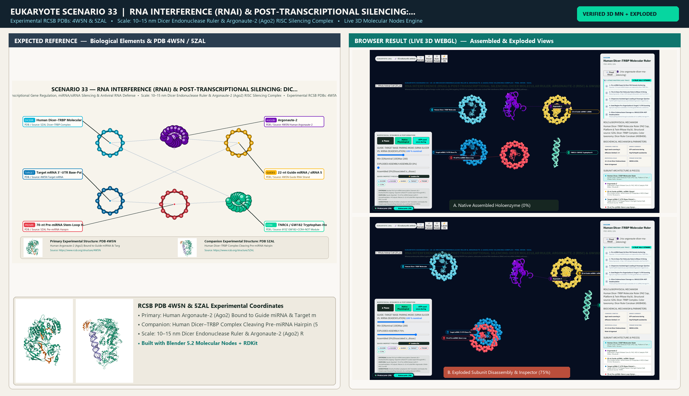

# Scenario 33 — RNA Interference (RNAi) & Post-Transcriptional Silencing: Dicer Molecular Ruler, Argonaute-2 (RISC) & GW182

> **Roadmap Tier:** Tier 7 — Cytoplasmic Translation, RNA Silencing, Proteostasis & Cell Division ($10\,\text{nm}\text{--}10\,\mu\text{m}$)  
> **Scenario ID:** `33_risc_argonaute_dicer_rna_silencing`  
> **Biophysical Scale:** 10–15 nm Dicer Endonuclease Ruler & Argonaute-2 (Ago2) RISC Silencing Complex  
> **Functional Category:** Post-Transcriptional Gene Regulation, miRNA/siRNA Silencing & Antiviral RNA Defense  
> **Primary RCSB PDB Structures:** [`4W5N`](https://www.rcsb.org/structure/4W5N) (Human Argonaute-2 (Ago2) Bound to Guide miRNA & Target mRNA (4W5N)) · [`5ZAL`](https://www.rcsb.org/structure/5ZAL) (Human Dicer–TRBP Complex Cleaving Pre-miRNA Hairpin (5ZAL))

---

## 1. Visual & Artistic Representations (Manual Verification Reference Plates)

The following four visual reference plates are stored directly inside this folder (`./`) so you can inspect both the **expected 3D scene decomposition**, the **biochemical I/O circuit & 5-stage mechanism**, and the **experimental cryo-EM / X-ray structures** during manual verification:

### 1.1 Expected 3D Scene & Subunit Decomposition Blueprint (`expected_risc_argonaute_dicer_rna_silencing.png`)

### 1.2 Biochemical I/O Circuit & 5-Stage Causal Mechanism (`mechanism_risc_argonaute_dicer_rna_silencing.png`)

### 1.3 Experimental RCSB PDB Structural References (`rcsb_4W5N.jpg` & `rcsb_5ZAL.jpg`)
| Primary Structure [`4W5N`](https://www.rcsb.org/structure/4W5N) | Companion / Partner Structure [`5ZAL`](https://www.rcsb.org/structure/5ZAL) |
| :---: | :---: |
|  |  |
| **Human Argonaute-2 (Ago2) Bound to Guide miRNA & Target mRNA (4W5N)** | **Human Dicer–TRBP Complex Cleaving Pre-miRNA Hairpin (5ZAL)** |

---

## 2. Biophysical & Molecular Behavior Overview

Whereas prokaryotes defend against foreign nucleic acids using DNA-targeting CRISPR-Cas systems, eukaryotes evolved RNA Interference (RNAi) and microRNA (miRNA) pathways that regulate over 60% of all human protein-coding mRNAs in the cytoplasm. In the nucleus, RNA Pol II transcribes stem-loop primary miRNAs (pri-miRNAs) that are cropped by the Microprocessor complex (Drosha + DGCR8) into ~70 nt pre-miRNA hairpins and exported through the Nuclear Pore by Exportin-5/RanGTP (Scenario 27). In the cytosol, the L-shaped RNase III enzyme **Dicer** (complexed with TRBP) acts as a precise molecular ruler: its PAZ domain binds the 2-nt 3' overhang at the base of the hairpin and measures ~21–22 base pairs up the stem to its twin RNase IIIa/b catalytic domains, dicing off the terminal loop to yield a ~22 bp miRNA/siRNA duplex. The duplex is loaded with Hsp70/Hsp90 chaperone assistance into **Argonaute-2 (Ago2)**—the bilobed core of the **RNA-Induced Silencing Complex (RISC)** (containing N, PAZ, MID, and RNase H-like PIWI domains). Ago2 ejects the passenger strand, pre-organizing nucleotides 2–8 of the retained 22 nt Guide Strand into an A-form helix ('Seed Region'). When Ago2 encounters a complementary sequence in the 3'-UTR of a target mRNA (Scenario 32): (1) **Perfect Complementarity (siRNA)** triggers the Ago2 PIWI domain Mg²⁺ 'Slicer' active site to cleave the mRNA backbone between nucleotides 10 and 11; (2) **Seed-Matched Partial Complementarity (animal miRNA)** recruits the scaffold protein **TNRC6/GW182**, which summons the CCR4–NOT deadenylase complex to strip the 3' Poly(A) tail, break the Closed-Loop Polysome, and trigger DCP1/DCP2 decapping and XRN1 5'→3' decay inside P-bodies.

### How It Behaves in the Interactive 3D Scene
Visualizes the two-stage cytoplasmic RNAi pipeline: (1) L-shaped human Dicer–TRBP measuring 22 bp from the PAZ domain to its RNase III catalytic cleft to dice a pre-miRNA hairpin; (2) Bilobed Argonaute-2 (MID/PAZ/PIWI) displaying the 22 nt guide RNA seed region (nt 2–8), base-pairing with a target mRNA 3'-UTR to either slice it endonucleolytically or recruit GW182 and CCR4–NOT deadenylase to break the Closed-Loop Polysome.

---

## 3. Complete Biochemical I/O & Inter-Element Iteration

This section defines **what brings the input** to this machine (*Upstream Donors*), **what goes in** (*Molecular Inputs*), **what it makes** (*Molecular Outputs*), and **how it iterates with downstream systems** (*Downstream Consumers*):

- **Upstream Donors (What Brings the Input):**  
  Nuclear Pol II pri-miRNA transcription (Scenario 30) + Drosha/DGCR8 cropping + Exportin-5/RanGTP nuclear export through NPC (Scenario 27) + Exogenous viral/synthetic dsRNA.
- **Molecular Inputs (Substrates, Signals & Co-Factors):**
  - Exported ~70 nt Pre-miRNA Hairpin (with 5'-monophosphate and 2-nt 3'-OH overhang) or Long Cytoplasmic dsRNA
  - Target Cytoplasmic mRNA containing 3'-UTR miRNA Response Elements (MREs, from Scenario 32)
  - Catalytic Mg²⁺ ions (in Dicer RNase IIIa/b and Ago2 PIWI Slicer active sites) + ATP (for Hsp70/Hsp90 RISC duplex loading)
- **Molecular Outputs (Synthesized / Translocated Products):**
  - Mature 21–22 nt Guide RNA–Argonaute-2 (Holo-RISC) surveillance complex
  - Sliced mRNA fragments (via Ago2 PIWI Slicer) or Deadenylated, Decapped mRNAs degraded into NMPs by XRN1 & Exosome
  - Ejected & degraded Passenger RNA strand
- **Downstream Consumers & Cross-Element Iteration:**  
  Directly throttles Cytoplasmic 80S Translation and breaks the Closed-Loop Polysome Ring (Scenario 32), routing silenced mRNAs into cytoplasmic P-bodies for turnover.
- **Thermodynamic Energy Currency:** `ATP used once during Hsp70/Hsp90-assisted duplex loading into Ago2; subsequent seed-scanning and Ago2 Slicer cleavage are ATP-independent (driven by base-pairing ΔG and Mg²⁺ catalysis)`
- **Biophysical Turnover / Kinetics ($k_{\text{cat}}$):** `Ago2 seed-scanning is diffusion-limited (~3× faster than naked RNA hybridization); Slicer cleavage k_cat ≈ 1–2 mRNAs/min per RISC`

---

## 4. 3D Subunit Decomposition (`Piece_<ID>_*`) & Color Taxonomy

To support continuous **Exploded View (`setExplodedProgress(0.0 → 1.0)`)**, raycast hover inspection, and subpill lock-on targeting, this scenario is decomposed into **6 functional 3D submeshes**:

| # | 3D Submesh ID (`Piece_*`) | Biological & Structural Role | RCSB PDB / Chain Source | Color Taxonomy (`#Hex`) | Exploded Vector $\vec{v}_{\text{dissoc}}$ |
| :--- | :--- | :--- | :--- | :--- | :--- |
| **1** | `Piece_RISC_DicerRuler` | Human Dicer–TRBP Molecular Ruler (PAZ Cap, Platform & Twin RNase IIIa/b) | `5ZAL Dicer–TRBP Complex` | `#00B4D8` (Dicer Ruler Cerulean) | `(-4.5, +1.5, 0.0)` |
| **2** | `Piece_RISC_Ago2Bilobe` | Argonaute-2 (Ago2) Bilobed Core (N, PAZ, MID & Catalytic PIWI Slicer) | `4W5N Human Argonaute-2` | `#7209B7` (Ago2 Core Purple) | `(+1.0, 0.0, 0.0)` |
| **3** | `Piece_RISC_GuideSeedRNA` | 22-nt Guide miRNA / siRNA Strand (5'-Phosphate in MID & Seed nt 2–8) | `4W5N Guide RNA Strand` | `#FFB703` (Guide Seed RNA Gold) | `(+1.0, +0.8, +2.0)` |
| **4** | `Piece_RISC_TargetmRNA` | Target mRNA 3'-UTR Base-Paired in the Ago2 Central Cleft | `4W5N Target mRNA` | `#0077B6` (Target mRNA Blue) | `(+2.5, -1.5, +1.8)` |
| **5** | `Piece_RISC_PreMiRNAHairpin` | 70-nt Pre-miRNA Stem-Loop Hairpin Docked in Dicer PAZ/Helicase | `5ZAL Pre-miRNA Hairpin` | `#E63946` (Pre-miRNA Hairpin Crimson) | `(-4.5, -2.0, +1.8)` |
| **6** | `Piece_RISC_GW182_CCR4` | TNRC6 / GW182 Tryptophan-Hook Scaffold & CCR4–NOT Deadenylase Complex | `6Y3Z GW182–CCR4–NOT Module` | `#06D6A0` (GW182 Deadenylase Jade) | `(+4.8, +2.2, -1.0)` |

---

## 5. Interactive HUD Simulation Controls (`iterationControls`)

| Control ID | HUD Label | Biophysical Permutations & Interactive Behavior |
| :--- | :--- | :--- |
| `complementarity_silencing_mode` | **Guide–Target Base-Pairing Mode (siRNA Slicer vs. miRNA Deadenylation)** | Perfect 22-nt Match (Ago2 PIWI Slicer Cleavage at nt 10–11) vs. Seed Match nt 2–8 (GW182 + CCR4–NOT PolyA Stripping) |
| `dicer_processing_rate` | **Dicer–TRBP Pre-miRNA Hairpin Cleavage & Ago2 Loading Rate** | 0.0x to 2.5x |
| `p_body_condensate_toggle` | **GW182 / P-Body Phase-Separated Silencing Granule Recruitment** | Dispersed Cytosolic RISC vs. P-Body Deadenylation & XRN1 Decay Hub |

---

## 6. Mandatory 5-Stage "How It Works" Explanatory Trace

- **Stage 1 — Pre-miRNA Export & Dicer PAZ Domain Anchoring:** Exported ~70 nt pre-miRNA hairpins are captured by Dicer–TRBP; the Dicer PAZ domain pockets the 2-nt 3' overhang while a basic pocket secures the 5'-monophosphate.
- **Stage 2 — The 22-Base-Pair Molecular Ruler & RNase III Dicing:** Measuring exactly ~22 bp (~65 Å) along its flat protein ruler from the PAZ domain, Dicer's intramolecular RNase IIIa and IIIb dimer cleaves both RNA strands to release the terminal loop and a 22 bp duplex.
- **Stage 3 — Chaperone-Assisted Ago2 Loading & Passenger Ejection:** Hsp70/Hsp90 chaperones pry open bilobed Argonaute-2 (Ago2) to accept the 22 bp duplex; the strand with the less stable 5' end has its 5'-phosphate locked into the MID domain while the passenger strand is cleaved and ejected.
- **Stage 4 — Seed Region Pre-Organization & Target 3'-UTR Scanning:** Ago2 pre-organizes nucleotides 2–8 of the guide RNA into a solvent-exposed A-form helix ('Seed Region'), enabling rapid 1D/3D collision scanning along cytoplasmic mRNA 3'-UTRs.
- **Stage 5 — Slicer Endonuclease Cleavage vs. GW182/CCR4–NOT Deadenylation:** If base-pairing extends through nucleotides 10–11 (siRNA), the Ago2 PIWI domain Mg²⁺ triad slices the mRNA in half; if pairing is restricted to the seed (typical animal miRNA), Ago2 recruits GW182 and CCR4–NOT to strip the Poly(A) tail and silence translation.

---

## 7. Curated Online Resources & Structural References

- [RCSB PDB-101 — Molecule of the Month: Argonaute & Dicer (RNA Interference)](https://pdb101.rcsb.org/motm/218)
- [RCSB PDB Structure 4W5N — Human Argonaute-2 Bound to Guide and Target RNAs](https://www.rcsb.org/structure/4W5N)
- [RCSB PDB Structure 5ZAL — Cryo-EM Structure of Human Dicer–TRBP–Pre-let-7 Complex](https://www.rcsb.org/structure/5ZAL)
- [NCBI Bookshelf — Molecular Biology of the Cell: Post-Transcriptional Controls & RNA Interference](https://www.ncbi.nlm.nih.gov/books/NBK26896/)

## 12. 3D Implementation & Visual Verification Assets

- **Status:** `[x] Implemented, Exported to 3D GLB & Visually Verified`
- **3D Model Asset (`.glb`):** [`risc_argonaute_dicer_rna_silencing.glb`](./risc_argonaute_dicer_rna_silencing.glb) (also mirrored in `eukaryote/models/risc_argonaute_dicer_rna_silencing.glb` and `client/public/eukaryote/models/risc_argonaute_dicer_rna_silencing.glb`)
- **Blender 5.2 + Molecular Nodes Generator Script:** [`generate_33_risc_argonaute_dicer_rna_silencing.py`](./generate_33_risc_argonaute_dicer_rna_silencing.py)
- **Live WebGL Assembled Capture (`0%`):** [`browser_risc_argonaute_dicer_rna_silencing_assembled.png`](../../verification/33_risc_argonaute_dicer_rna_silencing/browser_risc_argonaute_dicer_rna_silencing_assembled.png)
- **Live WebGL Exploded Capture (`75%`):** [`browser_risc_argonaute_dicer_rna_silencing_exploded.png`](../../verification/33_risc_argonaute_dicer_rna_silencing/browser_risc_argonaute_dicer_rna_silencing_exploded.png)
- **Side-by-Side Input vs. Output Comparison Plate (`2400×1380`):** [`comparison_risc_argonaute_dicer_rna_silencing.png`](../../verification/33_risc_argonaute_dicer_rna_silencing/comparison_risc_argonaute_dicer_rna_silencing.png)
- **Animated Side-by-Side Comparison Video (`1920×1080 MP4`):** [`comparison_risc_argonaute_dicer_rna_silencing.mp4`](../../verification/33_risc_argonaute_dicer_rna_silencing/comparison_risc_argonaute_dicer_rna_silencing.mp4)

