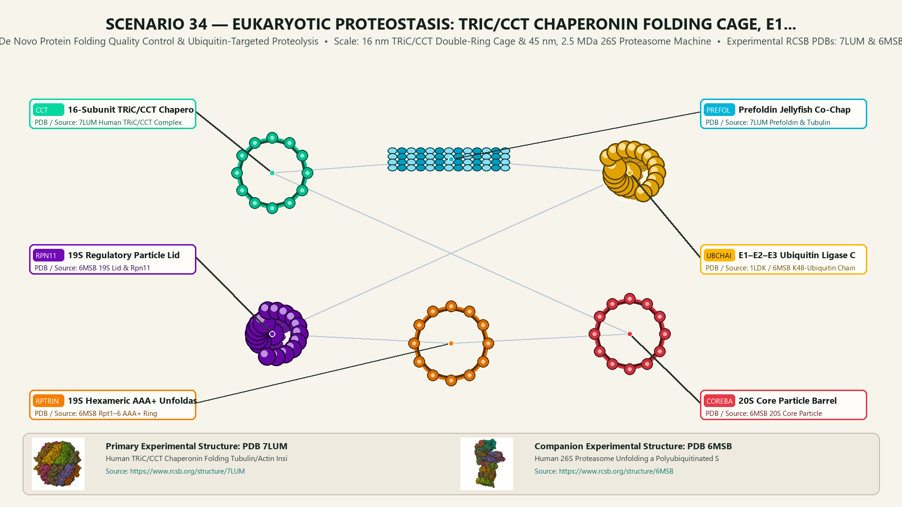
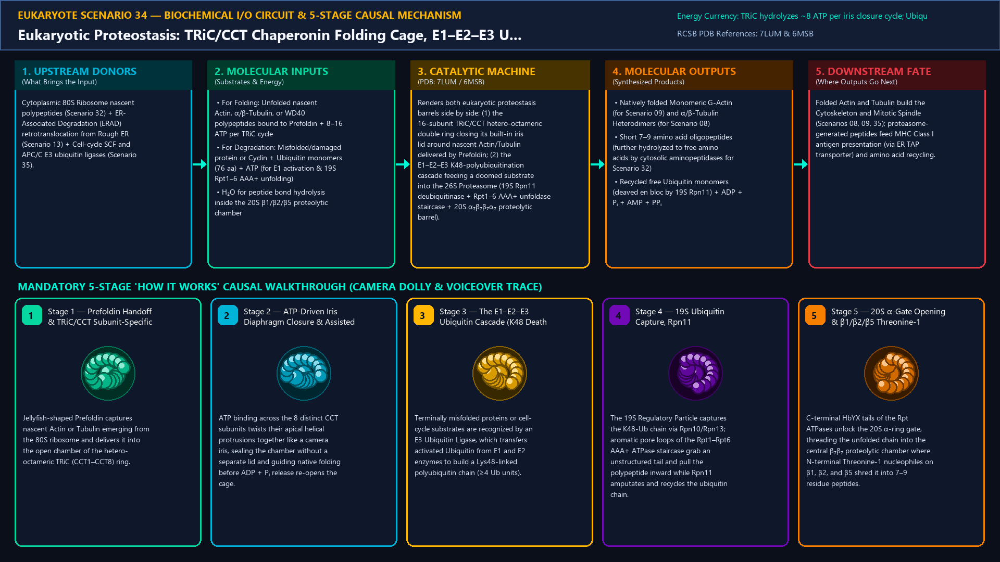
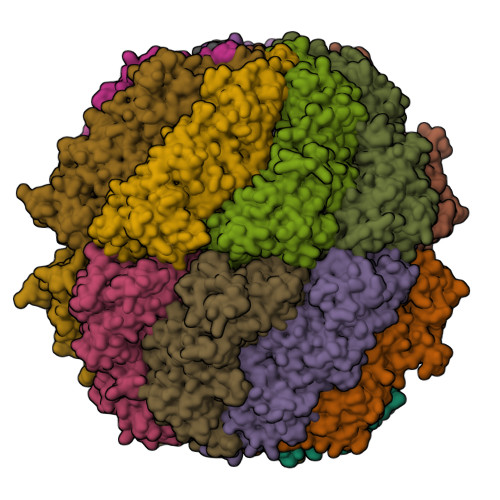
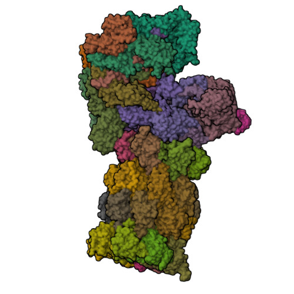
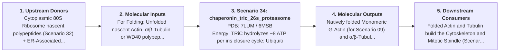

# Scenario 34 — Eukaryotic Proteostasis: TRiC/CCT Chaperonin Folding Cage, E1–E2–E3 Ubiquitin Cascade & The 26S Proteasome

> **Roadmap Tier:** Tier 7 — Cytoplasmic Translation, RNA Silencing, Proteostasis & Cell Division ($10\,\text{nm}\text{--}10\,\mu\text{m}$)  
> **Scenario ID:** `34_chaperonin_tric_26s_proteasome`  
> **Biophysical Scale:** 16 nm TRiC/CCT Double-Ring Cage & 45 nm, 2.5 MDa 26S Proteasome Machine  
> **Functional Category:** De Novo Protein Folding Quality Control & Ubiquitin-Targeted Proteolysis  
> **Primary RCSB PDB Structures:** [`7LUM`](https://www.rcsb.org/structure/7LUM) (Human TRiC/CCT Chaperonin Folding Tubulin/Actin Inside Its Cage (7LUM)) · [`6MSB`](https://www.rcsb.org/structure/6MSB) (Human 26S Proteasome Unfolding a Polyubiquitinated Substrate (6MSB))

---

## 1. Visual & Artistic Representations (Manual Verification Reference Plates)

The following four visual reference plates are stored directly inside this folder (`./`) so you can inspect both the **expected 3D scene decomposition**, the **biochemical I/O circuit & 5-stage mechanism**, and the **experimental cryo-EM / X-ray structures** during manual verification:

### 1.1 Expected 3D Scene & Subunit Decomposition Blueprint (`expected_chaperonin_tric_26s_proteasome.png`)

### 1.2 Biochemical I/O Circuit & 5-Stage Causal Mechanism (`mechanism_chaperonin_tric_26s_proteasome.png`)

### 1.3 Experimental RCSB PDB Structural References (`rcsb_7LUM.jpg` & `rcsb_6MSB.jpg`)
| Primary Structure [`7LUM`](https://www.rcsb.org/structure/7LUM) | Companion / Partner Structure [`6MSB`](https://www.rcsb.org/structure/6MSB) |
| :---: | :---: |
|  |  |
| **Human TRiC/CCT Chaperonin Folding Tubulin/Actin Inside Its Cage (7LUM)** | **Human 26S Proteasome Unfolding a Polyubiquitinated Substrate (6MSB)** |

---

## 2. Biophysical & Molecular Behavior Overview

Eukaryotic proteostasis balances two giant barrel-shaped nanomachines that determine the life or death of every cytoplasmic protein: the **TRiC/CCT Chaperonin** (which folds complex cytoskeletal and WD40 proteins) and the **26S Proteasome** (which destroys misfolded or short-lived regulatory proteins). Unlike bacterial GroEL/GroES (which uses a detachable GroES lid), eukaryotic Group II chaperonin **TRiC (TCP-1 Ring Complex / CCT)** is a 1 MDa hetero-oligomeric double ring of 2 × 8 paralogous subunits (CCT1–CCT8) whose built-in apical helical protrusions twist shut like an **iris diaphragm** upon ATP binding, encapsulating nascent Actin (Scenario 09) and α/β-Tubulin (Scenario 08) in a charge-patterned folding chamber with the co-chaperone Prefoldin and PhLP. Conversely, proteins that fail quality control (or cell-cycle cyclins/securin timed for destruction) are tagged with chains of the 76-amino-acid protein **Ubiquitin (Ub)** linked via Lys48 (K48) isopeptide bonds by an enzymatic cascade: **E1** (Ubiquitin-activating enzyme, using ATP → AMP + PPᵢ to form a thioester), **E2** (Ubiquitin-conjugating enzyme), and **E3** (Ubiquitin ligase, e.g., SCF or APC/C). K48-polyubiquitinated substrates are captured by the 2.5 MDa **26S Proteasome**: its **19S Regulatory Particle (RP)** binds ubiquitin via Rpn1/Rpn10/Rpn13, recycles the ubiquitin chain via the Zn²⁺ deubiquitinase **Rpn11**, and uses a hexameric AAA+ ATPase staircase (**Rpt1–Rpt6**) to mechanically unfold and thread the polypeptide through the gated α-ring into the **20S Core Particle (CP, α₇β₇β₇α₇)**, where N-terminal Threonine-1 active sites on β1 (caspase-like), β2 (trypsin-like), and β5 (chymotrypsin-like) chop the protein into 7–9 aa peptides.

### How It Behaves in the Interactive 3D Scene
Renders both eukaryotic proteostasis barrels side by side: (1) the 16-subunit TRiC/CCT hetero-octameric double ring closing its built-in iris lid around nascent Actin/Tubulin delivered by Prefoldin; (2) the E1–E2–E3 K48-polyubiquitination cascade feeding a doomed substrate into the 26S Proteasome (19S Rpn11 deubiquitinase + Rpt1–6 AAA+ unfoldase staircase + 20S α₇β₇β₇α₇ proteolytic barrel).

---

## 3. Complete Biochemical I/O & Inter-Element Iteration

This section defines **what brings the input** to this machine (*Upstream Donors*), **what goes in** (*Molecular Inputs*), **what it makes** (*Molecular Outputs*), and **how it iterates with downstream systems** (*Downstream Consumers*):

- **Upstream Donors (What Brings the Input):**  
  Cytoplasmic 80S Ribosome nascent polypeptides (Scenario 32) + ER-Associated Degradation (ERAD) retrotranslocation from Rough ER (Scenario 13) + Cell-cycle SCF and APC/C E3 ubiquitin ligases (Scenario 35).
- **Molecular Inputs (Substrates, Signals & Co-Factors):**
  - For Folding: Unfolded nascent Actin, α/β-Tubulin, or WD40 polypeptides bound to Prefoldin + 8–16 ATP per TRiC cycle
  - For Degradation: Misfolded/damaged protein or Cyclin + Ubiquitin monomers (76 aa) + ATP (for E1 activation & 19S Rpt1–6 AAA+ unfolding)
  - H₂O for peptide bond hydrolysis inside the 20S β1/β2/β5 proteolytic chamber
- **Molecular Outputs (Synthesized / Translocated Products):**
  - Natively folded Monomeric G-Actin (for Scenario 09) and α/β-Tubulin Heterodimers (for Scenario 08)
  - Short 7–9 amino acid oligopeptides (further hydrolyzed to free amino acids by cytosolic aminopeptidases for Scenario 32)
  - Recycled free Ubiquitin monomers (cleaved en bloc by 19S Rpn11) + ADP + Pᵢ + AMP + PPᵢ
- **Downstream Consumers & Cross-Element Iteration:**  
  Folded Actin and Tubulin build the Cytoskeleton and Mitotic Spindle (Scenarios 08, 09, 35); proteasome-generated peptides feed MHC Class I antigen presentation (via ER TAP transporter) and amino acid recycling.
- **Thermodynamic Energy Currency:** `TRiC hydrolyzes ~8 ATP per iris closure cycle; Ubiquitination uses 1 ATP → AMP + PPᵢ per Ub; 26S Proteasome Rpt1–6 uses ~50–150 ATP to mechanically unfold and translocate a substrate`
- **Biophysical Turnover / Kinetics ($k_{\text{cat}}$):** `TRiC folding cycle ~30–60 sec; 26S Proteasome degrades a polyubiquitinated protein in ~20–40 sec (~10–20 aa/sec translocation)`

---

## 4. 3D Subunit Decomposition (`Piece_<ID>_*`) & Color Taxonomy

To support continuous **Exploded View (`setExplodedProgress(0.0 → 1.0)`)**, raycast hover inspection, and subpill lock-on targeting, this scenario is decomposed into **6 functional 3D submeshes**:

| # | 3D Submesh ID (`Piece_*`) | Biological & Structural Role | RCSB PDB / Chain Source | Color Taxonomy (`#Hex`) | Exploded Vector $\vec{v}_{\text{dissoc}}$ |
| :--- | :--- | :--- | :--- | :--- | :--- |
| **1** | `Piece_Prot_TRiC_CCT` | 16-Subunit TRiC/CCT Chaperonin Barrel (CCT1–8 Double Ring & Iris Lid) | `7LUM Human TRiC/CCT Complex` | `#06D6A0` (TRiC Chaperonin Jade) | `(-4.8, +0.5, 0.0)` |
| **2** | `Piece_Prot_PrefoldinClient` | Prefoldin Jellyfish Co-Chaperone & Encapsulated Actin/Tubulin Client | `7LUM Prefoldin & Tubulin` | `#00B4D8` (Prefoldin Client Cerulean) | `(-4.8, +3.8, +1.5)` |
| **3** | `Piece_Prot_E1E2E3_UbChain` | E1–E2–E3 Ubiquitin Ligase Cascade & K48-Linked Polyubiquitin Tag | `1LDK / 6MSB K48-Ubiquitin Chain` | `#FFB703` (Ubiquitin Tag Gold) | `(+0.2, +3.8, +1.8)` |
| **4** | `Piece_Prot_19S_Lid_Rpn11` | 19S Regulatory Particle Lid (Ubiquitin Receptors & Rpn11 Deubiquitinase) | `6MSB 19S Lid & Rpn11` | `#7209B7` (19S Lid Purple) | `(+4.2, +3.5, 0.0)` |
| **5** | `Piece_Prot_19S_RptRing` | 19S Hexameric AAA+ Unfoldase Staircase (Rpt1–Rpt6 Mechanical Puller) | `6MSB Rpt1–6 AAA+ Ring` | `#F77F00` (Rpt AAA+ Unfoldase Amber) | `(+4.2, +0.8, +1.2)` |
| **6** | `Piece_Prot_20S_CoreBarrel` | 20S Core Particle Barrel (α₇β₇β₇α₇ Rings with β1/β2/β5 Thr1 Active Sites) | `6MSB 20S Core Particle` | `#E63946` (20S Proteolytic Crimson) | `(+4.2, -2.8, 0.0)` |

---

## 5. Interactive HUD Simulation Controls (`iterationControls`)

| Control ID | HUD Label | Biophysical Permutations & Interactive Behavior |
| :--- | :--- | :--- |
| `proteostasis_branch_focus` | **Proteostasis Pathway Focus (TRiC Folding vs. Ubiquitin–Proteasome Degradation)** | TRiC/CCT Iris-Cage Folding of Actin/Tubulin vs. E1-E2-E3 K48-Ubiquitination & 26S Proteolysis |
| `bortezomib_inhibitor_toggle` | **Bortezomib (Velcade) Clinical 20S β5 Active-Site Inhibitor** | Active 20S Peptide Cleavage vs. Bortezomib-Blocked Thr1 Catalytic Chamber |
| `aaa_atpase_cycle_speed` | **TRiC Iris Closure & 19S Rpt1–6 AAA+ Staircase Translocation Speed** | 0.0x to 2.5x |

---

## 6. Mandatory 5-Stage "How It Works" Explanatory Trace

- **Stage 1 — Prefoldin Handoff & TRiC/CCT Subunit-Specific Recognition:** Jellyfish-shaped Prefoldin captures nascent Actin or Tubulin emerging from the 80S ribosome and delivers it into the open chamber of the hetero-octameric TRiC (CCT1–CCT8) ring.
- **Stage 2 — ATP-Driven Iris Diaphragm Closure & Assisted Folding:** ATP binding across the 8 distinct CCT subunits twists their apical helical protrusions together like a camera iris, sealing the chamber without a separate lid and guiding native folding before ADP + Pᵢ release re-opens the cage.
- **Stage 3 — The E1–E2–E3 Ubiquitin Cascade (K48 Death Tagging):** Terminally misfolded proteins or cell-cycle substrates are recognized by an E3 Ubiquitin Ligase, which transfers activated Ubiquitin from E1 and E2 enzymes to build a Lys48-linked polyubiquitin chain (≥4 Ub units).
- **Stage 4 — 19S Ubiquitin Capture, Rpn11 Deubiquitination & Rpt1–6 Unfolding:** The 19S Regulatory Particle captures the K48-Ub chain via Rpn10/Rpn13; aromatic pore loops of the Rpt1–Rpt6 AAA+ ATPase staircase grab an unstructured tail and pull the polypeptide inward while Rpn11 amputates and recycles the ubiquitin chain.
- **Stage 5 — 20S α-Gate Opening & β1/β2/β5 Threonine-1 Proteolysis:** C-terminal HbYX tails of the Rpt ATPases unlock the 20S α-ring gate, threading the unfolded chain into the central β₇β₇ proteolytic chamber where N-terminal Threonine-1 nucleophiles on β1, β2, and β5 shred it into 7–9 residue peptides.

---

## 7. Curated Online Resources & Structural References

- [RCSB PDB-101 — Molecule of the Month: Proteasome & Ubiquitin](https://pdb101.rcsb.org/motm/166)
- [RCSB PDB-101 — Molecule of the Month: Chaperonins](https://pdb101.rcsb.org/motm/32)
- [RCSB PDB Structure 7LUM — Human TRiC/CCT Chaperonin Folding Tubulin](https://www.rcsb.org/structure/7LUM)
- [RCSB PDB Structure 6MSB — Substrate-Engaged Human 26S Proteasome Cryo-EM Structure](https://www.rcsb.org/structure/6MSB)
