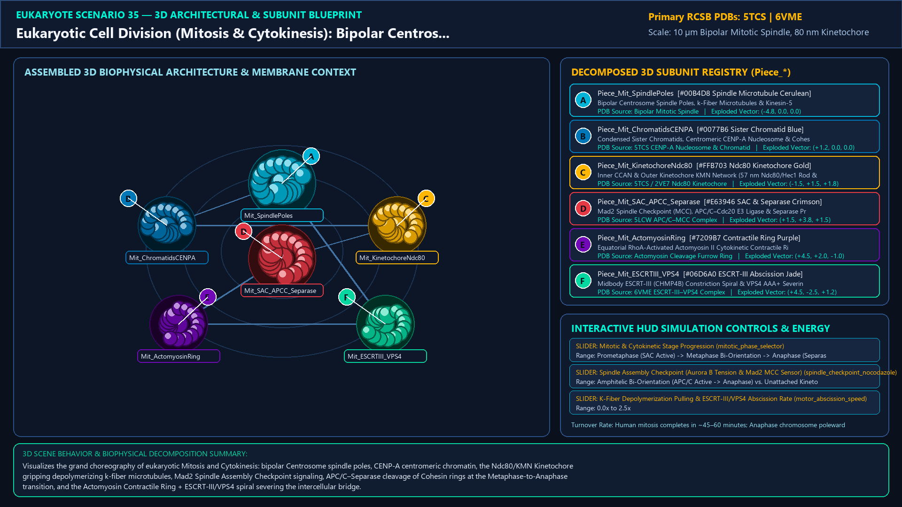
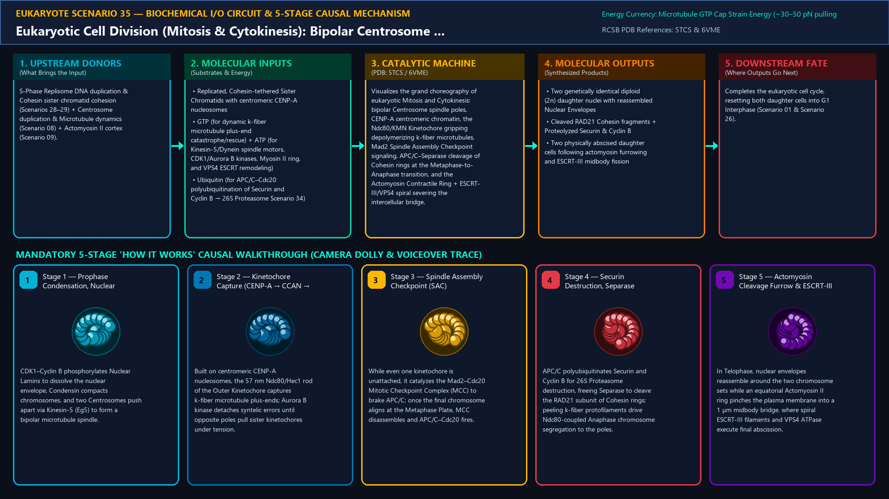
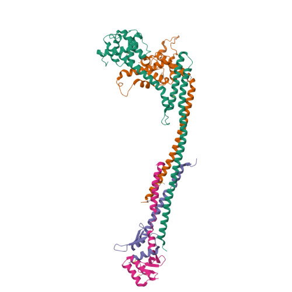
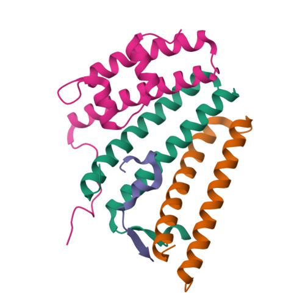
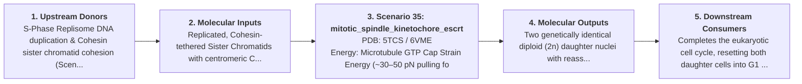
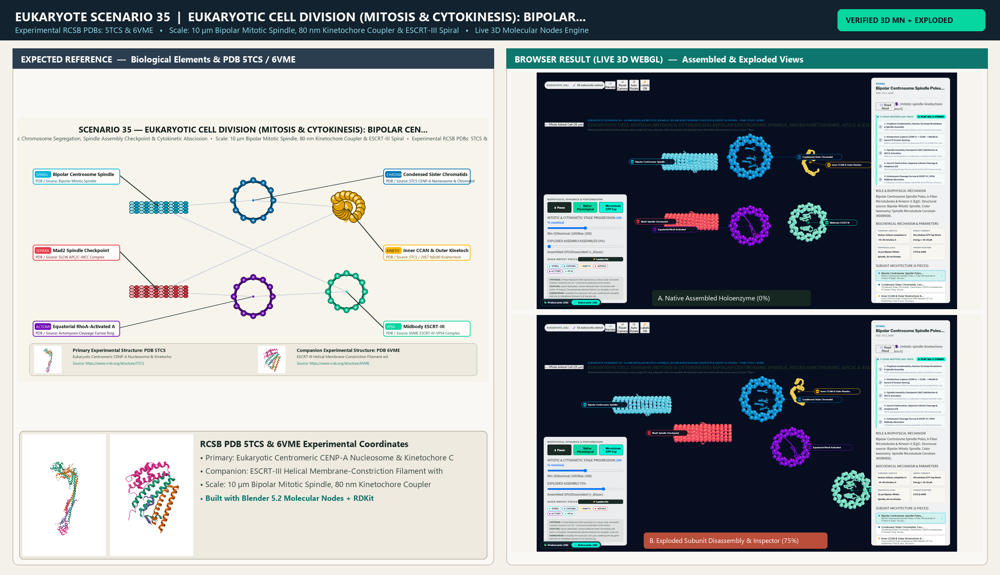

# Scenario 35 — Eukaryotic Cell Division (Mitosis & Cytokinesis): Bipolar Centrosome Spindle, Ndc80 Kinetochore, APC/C & ESCRT-III Abscission

> **Roadmap Tier:** Tier 7 — Cytoplasmic Translation, RNA Silencing, Proteostasis & Cell Division ($10\,\text{nm}\text{--}10\,\mu\text{m}$)  
> **Scenario ID:** `35_mitotic_spindle_kinetochore_escrt`  
> **Biophysical Scale:** 10 µm Bipolar Mitotic Spindle, 80 nm Kinetochore Coupler & ESCRT-III Spiral  
> **Functional Category:** Mitotic Chromosome Segregation, Spindle Assembly Checkpoint & Cytokinetic Abscission  
> **Primary RCSB PDB Structures:** [`5TCS`](https://www.rcsb.org/structure/5TCS) (Eukaryotic Centromeric CENP-A Nucleosome & Kinetochore CCAN (5TCS)) · [`6VME`](https://www.rcsb.org/structure/6VME) (ESCRT-III Helical Membrane-Constriction Filament with VPS4 (6VME))

---

## 1. Visual & Artistic Representations (Manual Verification Reference Plates)

The following four visual reference plates are stored directly inside this folder (`./`) so you can inspect both the **expected 3D scene decomposition**, the **biochemical I/O circuit & 5-stage mechanism**, and the **experimental cryo-EM / X-ray structures** during manual verification:

### 1.1 Expected 3D Scene & Subunit Decomposition Blueprint (`expected_mitotic_spindle_kinetochore_escrt.png`)

### 1.2 Biochemical I/O Circuit & 5-Stage Causal Mechanism (`mechanism_mitotic_spindle_kinetochore_escrt.png`)

### 1.3 Experimental RCSB PDB Structural References (`rcsb_5TCS.jpg` & `rcsb_6VME.jpg`)
| Primary Structure [`5TCS`](https://www.rcsb.org/structure/5TCS) | Companion / Partner Structure [`6VME`](https://www.rcsb.org/structure/6VME) |
| :---: | :---: |
|  |  |
| **Eukaryotic Centromeric CENP-A Nucleosome & Kinetochore CCAN (5TCS)** | **ESCRT-III Helical Membrane-Constriction Filament with VPS4 (6VME)** |

---

## 2. Biophysical & Molecular Behavior Overview

Whereas bacteria divide by binary fission using a single FtsZ ring, eukaryotic cells must partition 46 replicated sister chromatids with zero errors across a 10 µm **Bipolar Mitotic Spindle** before severing the plasma membrane. In Prophase/Prometaphase, CDK1–Cyclin B phosphorylates Nuclear Lamins (dissolving the Nuclear Envelope, Scenario 26) and activates **Condensin I/II** rings to compact sister chromatids (held together along their arms and centromeres by **Cohesin** rings, Scenario 28). Two duplicated **Centrosomes** (9×3 centriole barrels in pericentriolar material, Scenario 08) nucleate astral, interpolab (slid apart by tetrameric **Kinesin-5 / Eg5**), and kinetochore microtubules (k-fibers). Assembled specifically on centromeric **CENP-A** nucleosomes is the >100-protein **Kinetochore**: the Inner Kinetochore (CCAN) anchors the 57 nm rod-like Outer Kinetochore **KMN Network** (Knl1, Mis12, and the **Ndc80/Hec1** calponin-homology tetramer) which grips peeling microtubule plus-ends (assisted by the human **Ska complex** or yeast Dam1 ring) and couples GTP-tubulin depolymerization energy directly into chromosome-pulling force! Until every single kinetochore achieves amphitelic **bi-orientation** under tension (sensed by Aurora B kinase), unattached kinetochores generate the **Mitotic Checkpoint Complex (MCC: Mad2–Cdc20–BubR1–Bub3)** to inhibit the E3 ubiquitin ligase **APC/C**. Once the last kinetochore attaches, APC/C–Cdc20 polyubiquitinates **Securin** and **Cyclin B** (for 26S Proteasome destruction, Scenario 34), unleashing the protease **Separase** to cleave the RAD21 kleisin subunit of Cohesin rings and trigger synchronous **Anaphase A/B** chromosome segregation! Finally, in Telophase/Cytokinesis, an equatorial **Actomyosin II Contractile Ring** (activated by RhoA) pinches the cell into an intercellular midbody bridge, which is constricted from the inside to complete membrane fission by **ESCRT-III (CHMP4B)** helical filaments remodeled by the AAA+ ATPase **VPS4**.

### How It Behaves in the Interactive 3D Scene
Visualizes the grand choreography of eukaryotic Mitosis and Cytokinesis: bipolar Centrosome spindle poles, CENP-A centromeric chromatin, the Ndc80/KMN Kinetochore gripping depolymerizing k-fiber microtubules, Mad2 Spindle Assembly Checkpoint signaling, APC/C–Separase cleavage of Cohesin rings at the Metaphase-to-Anaphase transition, and the Actomyosin Contractile Ring + ESCRT-III/VPS4 spiral severing the intercellular bridge.

---

## 3. Complete Biochemical I/O & Inter-Element Iteration

This section defines **what brings the input** to this machine (*Upstream Donors*), **what goes in** (*Molecular Inputs*), **what it makes** (*Molecular Outputs*), and **how it iterates with downstream systems** (*Downstream Consumers*):

- **Upstream Donors (What Brings the Input):**  
  S-Phase Replisome DNA duplication & Cohesin sister chromatid cohesion (Scenarios 28–29) + Centrosome duplication & Microtubule dynamics (Scenario 08) + Actomyosin II cortex (Scenario 09).
- **Molecular Inputs (Substrates, Signals & Co-Factors):**
  - Replicated, Cohesin-tethered Sister Chromatids with centromeric CENP-A nucleosomes
  - GTP (for dynamic k-fiber microtubule plus-end catastrophe/rescue) + ATP (for Kinesin-5/Dynein spindle motors, CDK1/Aurora B kinases, Myosin II ring, and VPS4 ESCRT remodeling)
  - Ubiquitin (for APC/C–Cdc20 polyubiquitination of Securin and Cyclin B → 26S Proteasome Scenario 34)
- **Molecular Outputs (Synthesized / Translocated Products):**
  - Two genetically identical diploid (2n) daughter nuclei with reassembled Nuclear Envelopes
  - Cleaved RAD21 Cohesin fragments + Proteolyzed Securin & Cyclin B
  - Two physically abscised daughter cells following actomyosin furrowing and ESCRT-III midbody fission
- **Downstream Consumers & Cross-Element Iteration:**  
  Completes the eukaryotic cell cycle, resetting both daughter cells into G1 Interphase (Scenario 01 & Scenario 26).
- **Thermodynamic Energy Currency:** `Microtubule GTP Cap Strain Energy (~30–50 pN pulling force per k-fiber via Ndc80 coupler) + Kinesin/Dynein/Myosin II/VPS4 ATPase + CDK1/APC-C Ubiquitin-Proteasome Switch`
- **Biophysical Turnover / Kinetics ($k_{\text{cat}}$):** `Human mitosis completes in ~45–60 minutes; Anaphase chromosome poleward movement proceeds at ~1–2 µm/min`

---

## 4. 3D Subunit Decomposition (`Piece_<ID>_*`) & Color Taxonomy

To support continuous **Exploded View (`setExplodedProgress(0.0 → 1.0)`)**, raycast hover inspection, and subpill lock-on targeting, this scenario is decomposed into **6 functional 3D submeshes**:

| # | 3D Submesh ID (`Piece_*`) | Biological & Structural Role | RCSB PDB / Chain Source | Color Taxonomy (`#Hex`) | Exploded Vector $\vec{v}_{\text{dissoc}}$ |
| :--- | :--- | :--- | :--- | :--- | :--- |
| **1** | `Piece_Mit_SpindlePoles` | Bipolar Centrosome Spindle Poles, k-Fiber Microtubules & Kinesin-5 (Eg5) | `Bipolar Mitotic Spindle` | `#00B4D8` (Spindle Microtubule Cerulean) | `(-4.8, 0.0, 0.0)` |
| **2** | `Piece_Mit_ChromatidsCENPA` | Condensed Sister Chromatids, Centromeric CENP-A Nucleosome & Cohesin Ring | `5TCS CENP-A Nucleosome & Chromatid` | `#0077B6` (Sister Chromatid Blue) | `(+1.2, 0.0, 0.0)` |
| **3** | `Piece_Mit_KinetochoreNdc80` | Inner CCAN & Outer Kinetochore KMN Network (57 nm Ndc80/Hec1 Rod & Ska) | `5TCS / 2VE7 Ndc80 Kinetochore` | `#FFB703` (Ndc80 Kinetochore Gold) | `(-1.5, +1.5, +1.8)` |
| **4** | `Piece_Mit_SAC_APCC_Separase` | Mad2 Spindle Checkpoint (MCC), APC/C–Cdc20 E3 Ligase & Separase Protease | `5LCW APC/C–MCC Complex` | `#E63946` (SAC & Separase Crimson) | `(+1.5, +3.8, +1.5)` |
| **5** | `Piece_Mit_ActomyosinRing` | Equatorial RhoA-Activated Actomyosin II Cytokinetic Contractile Ring | `Actomyosin Cleavage Furrow Ring` | `#7209B7` (Contractile Ring Purple) | `(+4.5, +2.0, -1.0)` |
| **6** | `Piece_Mit_ESCRTIII_VPS4` | Midbody ESCRT-III (CHMP4B) Constriction Spiral & VPS4 AAA+ Severing Ring | `6VME ESCRT-III–VPS4 Complex` | `#06D6A0` (ESCRT-III Abscission Jade) | `(+4.5, -2.5, +1.2)` |

---

## 5. Interactive HUD Simulation Controls (`iterationControls`)

| Control ID | HUD Label | Biophysical Permutations & Interactive Behavior |
| :--- | :--- | :--- |
| `mitotic_phase_selector` | **Mitotic & Cytokinetic Stage Progression** | Prometaphase (SAC Active) -> Metaphase Bi-Orientation -> Anaphase (Separase Cleaves Cohesin) -> Telophase/ESCRT Abscission |
| `spindle_checkpoint_nocodazole` | **Spindle Assembly Checkpoint (Aurora B Tension & Mad2 MCC Sensor)** | Amphitelic Bi-Orientation (APC/C Active -> Anaphase) vs. Unattached Kinetochore (Mad2 Blocks APC/C) |
| `motor_abscission_speed` | **K-Fiber Depolymerization Pulling & ESCRT-III/VPS4 Abscission Rate** | 0.0x to 2.5x |

---

## 6. Mandatory 5-Stage "How It Works" Explanatory Trace

- **Stage 1 — Prophase Condensation, Nuclear Envelope Breakdown & Spindle Assembly:** CDK1–Cyclin B phosphorylates Nuclear Lamins to dissolve the nuclear envelope, Condensin compacts chromosomes, and two Centrosomes push apart via Kinesin-5 (Eg5) to form a bipolar microtubule spindle.
- **Stage 2 — Kinetochore Capture (CENP-A → CCAN → Ndc80) & Aurora B Tension Sensing:** Built on centromeric CENP-A nucleosomes, the 57 nm Ndc80/Hec1 rod of the Outer Kinetochore captures k-fiber microtubule plus-ends; Aurora B kinase detaches syntelic errors until opposite poles pull sister kinetochores under tension.
- **Stage 3 — Spindle Assembly Checkpoint (SAC) Satisfaction & APC/C Activation:** While even one kinetochore is unattached, it catalyzes the Mad2–Cdc20 Mitotic Checkpoint Complex (MCC) to brake APC/C; once the final chromosome aligns at the Metaphase Plate, MCC disassembles and APC/C–Cdc20 fires.
- **Stage 4 — Securin Destruction, Separase Cohesin Cleavage & Anaphase A/B:** APC/C polyubiquitinates Securin and Cyclin B for 26S Proteasome destruction, freeing Separase to cleave the RAD21 subunit of Cohesin rings; peeling k-fiber protofilaments drive Ndc80-coupled Anaphase chromosome segregation to the poles.
- **Stage 5 — Actomyosin Cleavage Furrow & ESCRT-III / VPS4 Midbody Abscission:** In Telophase, nuclear envelopes reassemble around the two chromosome sets while an equatorial Actomyosin II ring pinches the plasma membrane into a 1 µm midbody bridge, where spiral ESCRT-III filaments and VPS4 ATPase execute final abscission.

---

## 7. Curated Online Resources & Structural References

- [RCSB PDB-101 — Molecule of the Month: Kinetochore & Centromere](https://pdb101.rcsb.org/motm/220)
- [RCSB PDB Structure 5TCS — Human Centromeric CENP-A Nucleosome Complex](https://www.rcsb.org/structure/5TCS)
- [RCSB PDB Structure 6VME — Cryo-EM Structure of ESCRT-III Helical Filaments with VPS4](https://www.rcsb.org/structure/6VME)
- [NCBI Bookshelf — Molecular Biology of the Cell: Mitosis & Cytokinesis](https://www.ncbi.nlm.nih.gov/books/NBK26934/)

## 12. 3D Implementation & Visual Verification Assets

- **Status:** `[x] Implemented, Exported to 3D GLB & Visually Verified`
- **3D Model Asset (`.glb`):** [`mitotic_spindle_kinetochore_escrt.glb`](./mitotic_spindle_kinetochore_escrt.glb) (also mirrored in `eukaryote/models/mitotic_spindle_kinetochore_escrt.glb` and `client/public/eukaryote/models/mitotic_spindle_kinetochore_escrt.glb`)
- **Blender 5.2 + Molecular Nodes Generator Script:** [`generate_35_mitotic_spindle_kinetochore_escrt.py`](./generate_35_mitotic_spindle_kinetochore_escrt.py)
- **Live WebGL Assembled Capture (`0%`):** [`browser_mitotic_spindle_kinetochore_escrt_assembled.png`](../../verification/35_mitotic_spindle_kinetochore_escrt/browser_mitotic_spindle_kinetochore_escrt_assembled.png)
- **Live WebGL Exploded Capture (`75%`):** [`browser_mitotic_spindle_kinetochore_escrt_exploded.png`](../../verification/35_mitotic_spindle_kinetochore_escrt/browser_mitotic_spindle_kinetochore_escrt_exploded.png)
- **Side-by-Side Input vs. Output Comparison Plate (`2400×1380`):** [`comparison_mitotic_spindle_kinetochore_escrt.png`](../../verification/35_mitotic_spindle_kinetochore_escrt/comparison_mitotic_spindle_kinetochore_escrt.png)
- **Animated Side-by-Side Comparison Video (`1920×1080 MP4`):** [`comparison_mitotic_spindle_kinetochore_escrt.mp4`](../../verification/35_mitotic_spindle_kinetochore_escrt/comparison_mitotic_spindle_kinetochore_escrt.mp4)

