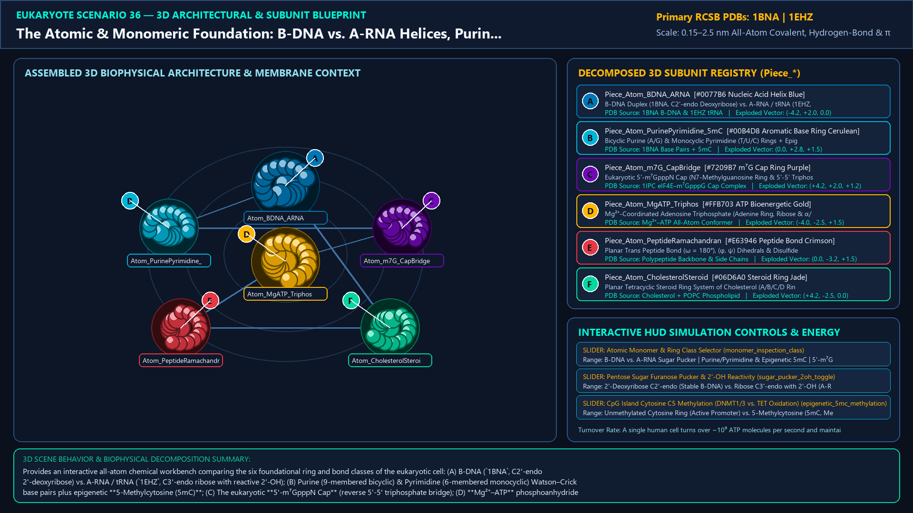
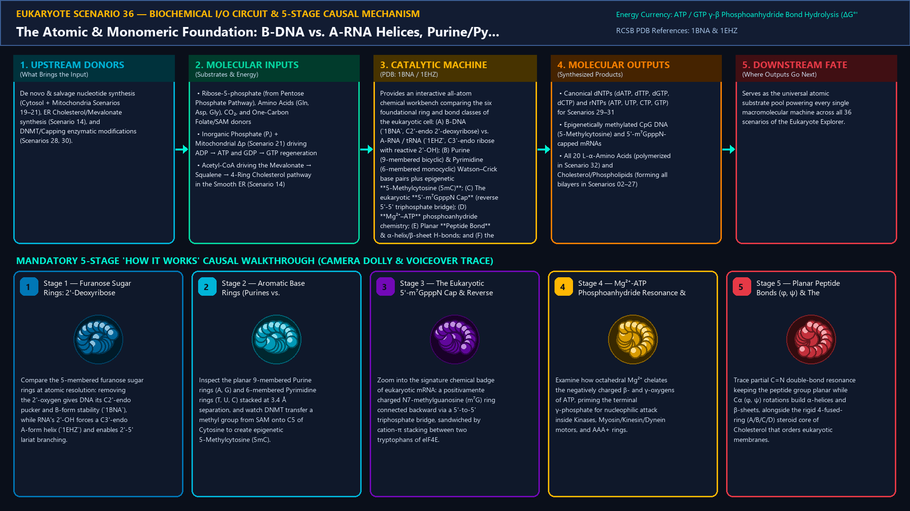
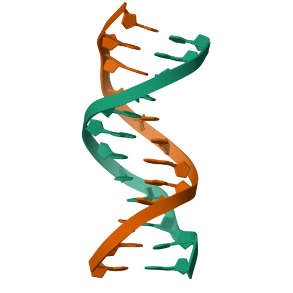
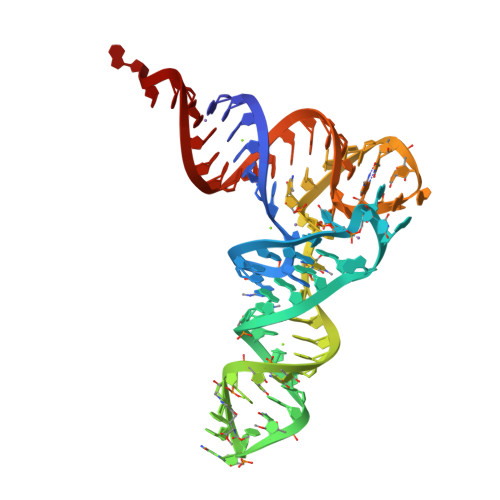
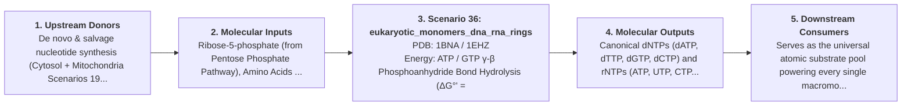
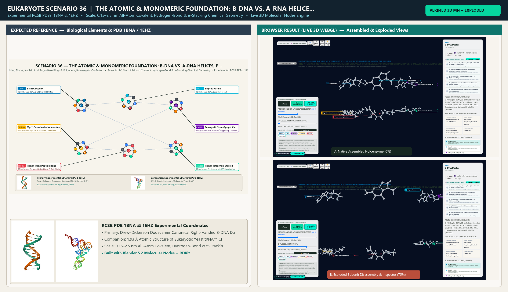

# Scenario 36 — The Atomic & Monomeric Foundation: B-DNA vs. A-RNA Helices, Purine/Pyrimidine Rings, 5-MeC, m⁷G Cap, ATP & Cholesterol

> **Roadmap Tier:** Tier 8 — Atomic Chemistry, Epigenetic Bases, Nucleotide Rings & Membrane Lipids ($0.1\text{--}2\,\text{nm}$)  
> **Scenario ID:** `36_eukaryotic_monomers_dna_rna_rings`  
> **Biophysical Scale:** 0.15–2.5 nm All-Atom Covalent, Hydrogen-Bond & π-Stacking Chemical Geometry  
> **Functional Category:** Atomic Building Blocks, Nucleic Acid Sugar-Base Rings & Epigenetic/Bioenergetic Co-Factors  
> **Primary RCSB PDB Structures:** [`1BNA`](https://www.rcsb.org/structure/1BNA) (Drew–Dickerson Dodecamer Canonical Right-Handed B-DNA Duplex (1BNA)) · [`1EHZ`](https://www.rcsb.org/structure/1EHZ) (1.93 Å Atomic Structure of Eukaryotic Yeast tRNAᴾʰᵉ Cloverleaf (1EHZ))

---

## 1. Visual & Artistic Representations (Manual Verification Reference Plates)

The following four visual reference plates are stored directly inside this folder (`./`) so you can inspect both the **expected 3D scene decomposition**, the **biochemical I/O circuit & 5-stage mechanism**, and the **experimental cryo-EM / X-ray structures** during manual verification:

### 1.1 Expected 3D Scene & Subunit Decomposition Blueprint (`expected_eukaryotic_monomers_dna_rna_rings.png`)

### 1.2 Biochemical I/O Circuit & 5-Stage Causal Mechanism (`mechanism_eukaryotic_monomers_dna_rna_rings.png`)

### 1.3 Experimental RCSB PDB Structural References (`rcsb_1BNA.jpg` & `rcsb_1EHZ.jpg`)
| Primary Structure [`1BNA`](https://www.rcsb.org/structure/1BNA) | Companion / Partner Structure [`1EHZ`](https://www.rcsb.org/structure/1EHZ) |
| :---: | :---: |
|  |  |
| **Drew–Dickerson Dodecamer Canonical Right-Handed B-DNA Duplex (1BNA)** | **1.93 Å Atomic Structure of Eukaryotic Yeast tRNAᴾʰᵉ Cloverleaf (1EHZ)** |

---

## 2. Biophysical & Molecular Behavior Overview

At the base of the 36-element eukaryotic hierarchy lies the atomic chemistry ($0.1\text{--}2\,\text{nm}$) that governs every macromolecular machine from Scenarios 01 through 35. Here we inspect the covalent bonds, furanose sugar ring puckers, heterocyclic aromatic rings, and non-covalent hydrogen-bonding/π-π stacking geometries of the cell's core monomers: (1) **Pentose Sugar Rings (2'-Deoxyribose vs. Ribose)**: The absence of a single oxygen atom at C2' allows DNA's deoxyribose ring to adopt the **C2'-endo** envelope pucker, producing the wide 22 Å major groove and 10.5 bp/turn geometry of canonical **B-DNA** (`1BNA`, Scenarios 28–30), whereas RNA's **2'-OH** group sterically forces a **C3'-endo** pucker (producing the compact 11 bp/turn **A-RNA** helix of tRNAs `1EHZ`, rRNAs, and miRNAs, Scenarios 31–33) and acts as the reactive nucleophile in Spliceosome **2'-5' RNA Lariat Ring** formation! (2) **Heterocyclic Nitrogenous Base Rings & Epigenetic 5-Methylcytosine**: Bicyclic **Purine Rings** (Adenine, Guanine) pair via Watson–Crick hydrogen bonds with monocyclic **Pyrimidine Rings** (Thymine/Uracil: 2 H-bonds; Cytosine: 3 H-bonds), while DNA Methyltransferases (DNMT1/3A/3B) add a methyl group to C5 of the cytosine ring at CpG islands to form **5-Methylcytosine (5mC)**, the primary eukaryotic epigenetic DNA silencing mark. (3) **The Eukaryotic 5'-m⁷GpppN Cap & ATP/GTP Triphosphates**: The positively charged **7-Methylguanosine (m⁷G)** purine ring linked via a reverse **5'-5' triphosphate bridge** protects every eukaryotic mRNA (Scenarios 30–32) and stacks between two tryptophan indole rings in eIF4E, while **Mg²⁺-ATP** and **Mg²⁺-GTP** supply universal phosphoanhydride bond energy. (4) **Peptide Bonds & Steroid Rings**: Planar resonance-stabilized `C–N` peptide bonds (`ω = 180°`) with Ramachandran `(φ, ψ)` rotations fold proteins (Scenario 34), while the rigid **4-Ring Steroid Nucleus of Cholesterol** orders the eukaryotic plasma membrane (Scenario 02).

### How It Behaves in the Interactive 3D Scene
Provides an interactive all-atom chemical workbench comparing the six foundational ring and bond classes of the eukaryotic cell: (A) B-DNA (`1BNA`, C2'-endo 2'-deoxyribose) vs. A-RNA / tRNA (`1EHZ`, C3'-endo ribose with reactive 2'-OH); (B) Purine (9-membered bicyclic) & Pyrimidine (6-membered monocyclic) Watson–Crick base pairs plus epigenetic **5-Methylcytosine (5mC)**; (C) The eukaryotic **5'-m⁷GpppN Cap** (reverse 5'-5' triphosphate bridge); (D) **Mg²⁺–ATP** phosphoanhydride chemistry; (E) Planar **Peptide Bond** & α-helix/β-sheet H-bonds; and (F) the planar **4-Ring Steroid Core of Cholesterol**.

---

## 3. Complete Biochemical I/O & Inter-Element Iteration

This section defines **what brings the input** to this machine (*Upstream Donors*), **what goes in** (*Molecular Inputs*), **what it makes** (*Molecular Outputs*), and **how it iterates with downstream systems** (*Downstream Consumers*):

- **Upstream Donors (What Brings the Input):**  
  De novo & salvage nucleotide synthesis (Cytosol + Mitochondria Scenarios 19–21), ER Cholesterol/Mevalonate synthesis (Scenario 14), and DNMT/Capping enzymatic modifications (Scenarios 28, 30).
- **Molecular Inputs (Substrates, Signals & Co-Factors):**
  - Ribose-5-phosphate (from Pentose Phosphate Pathway), Amino Acids (Gln, Asp, Gly), CO₂, and One-Carbon Folate/SAM donors
  - Inorganic Phosphate (Pᵢ) + Mitochondrial Δp (Scenario 21) driving ADP → ATP and GDP → GTP regeneration
  - Acetyl-CoA driving the Mevalonate → Squalene → 4-Ring Cholesterol pathway in the Smooth ER (Scenario 14)
- **Molecular Outputs (Synthesized / Translocated Products):**
  - Canonical dNTPs (dATP, dTTP, dGTP, dCTP) and rNTPs (ATP, UTP, CTP, GTP) for Scenarios 29–31
  - Epigenetically methylated CpG DNA (5-Methylcytosine) and 5'-m⁷GpppN-capped mRNAs
  - All 20 L-α-Amino Acids (polymerized in Scenario 32) and Cholesterol/Phospholipids (forming all bilayers in Scenarios 02–27)
- **Downstream Consumers & Cross-Element Iteration:**  
  Serves as the universal atomic substrate pool powering every single macromolecular machine across all 36 scenarios of the Eukaryote Explorer.
- **Thermodynamic Energy Currency:** `ATP / GTP γ-β Phosphoanhydride Bond Hydrolysis (ΔG°' = -30.5 kJ/mol; cellular ΔG ≈ -50 to -54 kJ/mol) + S-Adenosylmethionine (SAM) Methyl Transfer`
- **Biophysical Turnover / Kinetics ($k_{\text{cat}}$):** `A single human cell turns over ~10⁹ ATP molecules per second and maintains ~6.4 × 10⁹ base pairs of hydrated B-DNA`

---

## 4. 3D Subunit Decomposition (`Piece_<ID>_*`) & Color Taxonomy

To support continuous **Exploded View (`setExplodedProgress(0.0 → 1.0)`)**, raycast hover inspection, and subpill lock-on targeting, this scenario is decomposed into **6 functional 3D submeshes**:

| # | 3D Submesh ID (`Piece_*`) | Biological & Structural Role | RCSB PDB / Chain Source | Color Taxonomy (`#Hex`) | Exploded Vector $\vec{v}_{\text{dissoc}}$ |
| :--- | :--- | :--- | :--- | :--- | :--- |
| **1** | `Piece_Atom_BDNA_ARNA` | B-DNA Duplex (1BNA, C2'-endo Deoxyribose) vs. A-RNA / tRNA (1EHZ, C3'-endo Ribose 2'-OH) | `1BNA B-DNA & 1EHZ tRNA` | `#0077B6` (Nucleic Acid Helix Blue) | `(-4.2, +2.0, 0.0)` |
| **2** | `Piece_Atom_PurinePyrimidine_5mC` | Bicyclic Purine (A/G) & Monocyclic Pyrimidine (T/U/C) Rings + Epigenetic 5-Methylcytosine (5mC) | `1BNA Base Pairs + 5mC` | `#00B4D8` (Aromatic Base Ring Cerulean) | `(0.0, +2.8, +1.5)` |
| **3** | `Piece_Atom_m7G_CapBridge` | Eukaryotic 5'-m⁷GpppN Cap (N7-Methylguanosine Ring & 5'-5' Triphosphate Bridge) | `1IPC eIF4E–m⁷GpppG Cap Complex` | `#7209B7` (m⁷G Cap Ring Purple) | `(+4.2, +2.0, +1.2)` |
| **4** | `Piece_Atom_MgATP_Triphos` | Mg²⁺-Coordinated Adenosine Triphosphate (Adenine Ring, Ribose & α/β/γ Phosphates) | `Mg²⁺–ATP All-Atom Conformer` | `#FFB703` (ATP Bioenergetic Gold) | `(-4.0, -2.5, +1.5)` |
| **5** | `Piece_Atom_PeptideRamachandran` | Planar Trans Peptide Bond (ω = 180°), (φ, ψ) Dihedrals & Disulfide/Histone Lysine Side Chains | `Polypeptide Backbone & Side Chains` | `#E63946` (Peptide Bond Crimson) | `(0.0, -3.2, +1.5)` |
| **6** | `Piece_Atom_CholesterolSteroid` | Planar Tetracyclic Steroid Ring System of Cholesterol (A/B/C/D Rings + 3β-OH) | `Cholesterol + POPC Phospholipid` | `#06D6A0` (Steroid Ring Jade) | `(+4.2, -2.5, 0.0)` |

---

## 5. Interactive HUD Simulation Controls (`iterationControls`)

| Control ID | HUD Label | Biophysical Permutations & Interactive Behavior |
| :--- | :--- | :--- |
| `monomer_inspection_class` | **Atomic Monomer & Ring Class Selector** | B-DNA vs. A-RNA Sugar Pucker · Purine/Pyrimidine & Epigenetic 5mC · 5'-m⁷GpppN Cap · Mg²⁺-ATP · Peptide Bond · Cholesterol 4-Ring Steroid |
| `sugar_pucker_2oh_toggle` | **Pentose Sugar Furanose Pucker & 2'-OH Reactivity** | 2'-Deoxyribose C2'-endo (Stable B-DNA) vs. Ribose C3'-endo with 2'-OH (A-RNA & 2'-5' Lariat Nucleophile) |
| `epigenetic_5mc_methylation` | **CpG Island Cytosine C5 Methylation (DNMT1/3 vs. TET Oxidation)** | Unmethylated Cytosine Ring (Active Promoter) vs. 5-Methylcytosine (5mC, MeCP2 Silenced) |

---

## 6. Mandatory 5-Stage "How It Works" Explanatory Trace

- **Stage 1 — Furanose Sugar Rings: 2'-Deoxyribose (C2'-endo B-DNA) vs. Ribose (C3'-endo A-RNA):** Compare the 5-membered furanose sugar rings at atomic resolution: removing the 2'-oxygen gives DNA its C2'-endo pucker and B-form stability (`1BNA`), while RNA's 2'-OH forces a C3'-endo A-form helix (`1EHZ`) and enables 2'-5' lariat branching.
- **Stage 2 — Aromatic Base Rings (Purines vs. Pyrimidines) & Epigenetic 5-Methylcytosine (5mC):** Inspect the planar 9-membered Purine rings (A, G) and 6-membered Pyrimidine rings (T, U, C) stacked at 3.4 Å separation, and watch DNMT transfer a methyl group from SAM onto C5 of Cytosine to create epigenetic 5-Methylcytosine (5mC).
- **Stage 3 — The Eukaryotic 5'-m⁷GpppN Cap & Reverse 5'-5' Triphosphate Bridge:** Zoom into the signature chemical badge of eukaryotic mRNA: a positivamente charged N7-methylguanosine (m⁷G) ring connected backward via a 5'-to-5' triphosphate bridge, sandwiched by cation-π stacking between two tryptophans of eIF4E.
- **Stage 4 — Mg²⁺-ATP Phosphoanhydride Resonance & Universal Energy Coupling:** Examine how octahedral Mg²⁺ chelates the negatively charged β- and γ-oxygens of ATP, priming the terminal γ-phosphate for nucleophilic attack inside Kinases, Myosin/Kinesin/Dynein motors, and AAA+ rings.
- **Stage 5 — Planar Peptide Bonds (φ, ψ) & The Tetracyclic Steroid Ring of Cholesterol:** Trace partial C=N double-bond resonance keeping the peptide group planar while Cα (φ, ψ) rotations build α-helices and β-sheets, alongside the rigid 4-fused-ring (A/B/C/D) steroid core of Cholesterol that orders eukaryotic membranes.

---

## 7. Curated Online Resources & Structural References

- [RCSB PDB-101 — Molecule of the Month: DNA & Watson-Crick Base Pairing](https://pdb101.rcsb.org/motm/23)
- [RCSB PDB-101 — Molecule of the Month: Transfer RNA (tRNA)](https://pdb101.rcsb.org/motm/15)
- [RCSB PDB Structure 1BNA — Structure of a B-DNA Dodecamer (Drew–Dickerson)](https://www.rcsb.org/structure/1BNA)
- [RCSB PDB Structure 1EHZ — Atomic Resolution Structure of Yeast Phenylalanine tRNA](https://www.rcsb.org/structure/1EHZ)

## 12. 3D Implementation & Visual Verification Assets

- **Status:** `[x] Implemented, Exported to 3D GLB & Visually Verified`
- **3D Model Asset (`.glb`):** [`eukaryotic_monomers_dna_rna_rings.glb`](./eukaryotic_monomers_dna_rna_rings.glb) (also mirrored in `eukaryote/models/eukaryotic_monomers_dna_rna_rings.glb` and `client/public/eukaryote/models/eukaryotic_monomers_dna_rna_rings.glb`)
- **Blender 5.2 + Molecular Nodes Generator Script:** [`generate_36_eukaryotic_monomers_dna_rna_rings.py`](./generate_36_eukaryotic_monomers_dna_rna_rings.py)
- **Live WebGL Assembled Capture (`0%`):** [`browser_eukaryotic_monomers_dna_rna_rings_assembled.png`](../../verification/36_eukaryotic_monomers_dna_rna_rings/browser_eukaryotic_monomers_dna_rna_rings_assembled.png)
- **Live WebGL Exploded Capture (`75%`):** [`browser_eukaryotic_monomers_dna_rna_rings_exploded.png`](../../verification/36_eukaryotic_monomers_dna_rna_rings/browser_eukaryotic_monomers_dna_rna_rings_exploded.png)
- **Side-by-Side Input vs. Output Comparison Plate (`2400×1380`):** [`comparison_eukaryotic_monomers_dna_rna_rings.png`](../../verification/36_eukaryotic_monomers_dna_rna_rings/comparison_eukaryotic_monomers_dna_rna_rings.png)
- **Animated Side-by-Side Comparison Video (`1920×1080 MP4`):** [`comparison_eukaryotic_monomers_dna_rna_rings.mp4`](../../verification/36_eukaryotic_monomers_dna_rna_rings/comparison_eukaryotic_monomers_dna_rna_rings.mp4)

