# 🔬 Visual Verification & Reference Audit — All 29 Prokaryotic Scenarios (01–13 Baseline + 14–29 Expansion Roadmap)

This directory contains the complete visual verification suite for all **29 implemented 3D scenarios** in [`learn-biology`](../README.md) (13 baseline scenarios + 16 expansion roadmap scenarios). Each scenario has been audited by comparing:
1. **Expected Reference (`expected_<id>.png` + `rcsb_<PDB>.jpg`):** Authoritative scientific textbook diagrams (*The Biology Primer* editorial style on `#FAF8F5` warm ivory paper) paired with official experimental **RCSB Protein Data Bank (PDB)** Cryo-EM and X-ray crystallography renders.
2. **Live 3D Browser Result (`browser_<id>_assembled.png` & `browser_<id>_exploded.png`):** Hardware-accelerated WebGL captures taken directly from the running `learn-biology` application (`http://localhost:5173`) at `1920×1080` resolution showing both:
   - **A. Native Assembled Holoenzyme (`0%`)** with 3D anatomical leader lines, HUD simulation controls, and the right-hand Inspector Drawer.
   - **B. Exploded Subunit Disassembly (`75%` along $\vec{v}_{\text{dissoc}}$)** or **Organelle Focus** demonstrating multi-piece 3D mesh decomposition (`Piece_<ID>_<Subunit>`).
3. **Side-by-Side Comparison Plates (`comparison_<id>.png`) & Videos (`comparison_<id>.mp4`):** `2400×1380` composite boards and `1920×1080` `.mp4` animations recording live kinetic motion, smooth $0\% \to 80\% \to 0\%$ exploded disassembly, and inspector selection alongside the Expected reference.

---

## 🌐 Interactive Standalone HTML Dashboard (Open Directly in Browser)

- **Primary HTML Dashboard:** [**`verification/index.html`**](./index.html) (`c:\Users\devcd\GenProjects\learn-biology\verification\index.html`)
- **Root Convenience Mirror:** [**`../verification.html`**](../verification.html) (`c:\Users\devcd\GenProjects\learn-biology\verification.html`)
- **HTML Generator Script:** [`../scripts/generate_verification_html.py`](../scripts/generate_verification_html.py)

---

## 🎬 Master Compilation Video (All 13 Scenarios)

- **Full 13-Scenario Side-by-Side Verification Video:** [`master_13_elements_comparison.mp4`](./master_13_elements_comparison.mp4)
- **Automated Verification & Capture Pipeline:** [`../scripts/verify_all_13_elements.py`](../scripts/verify_all_13_elements.py)

---

## 🧭 Quick Navigation Index (13 Verified Scenarios)

| # | Scenario | Biological Complex | Experimental PDB / Reference | Expected Image | Assembled 3D | Exploded 3D (75%) | Comparison Plate | Comparison Video |
| :--- | :--- | :--- | :--- | :--- | :--- | :--- | :--- | :--- |
| **01** | [Whole Prokaryotic Cell](#01-whole-prokaryotic-cell-e-coli-k-12) | *E. coli* K-12 Envelope & Nucleoid Cutaway ($1.5\,\mu\text{m}$) | *Biology Primer* Fig. 3 & 4 | [`expected_cell.png`](./01_cell/expected_cell.png) | [`browser_cell_assembled.png`](./01_cell/browser_cell_assembled.png) | [`browser_cell_exploded.png`](./01_cell/browser_cell_exploded.png) | [`comparison_cell.png`](./01_cell/comparison_cell.png) | [`comparison_cell.mp4`](./01_cell/comparison_cell.mp4) |
| **02** | [Flagellar Rotary Motor](#02-bacterial-flagellar-rotary-motor) | Basal Body, MS/C/P/L Rings, MotAB Stators & Hook ($45\,\text{nm}$) | [PDB `7CGO`](https://www.rcsb.org/structure/7CGO) / [`6YKM`](https://www.rcsb.org/structure/6YKM) | [`expected_motor.png`](./02_motor/expected_motor.png) | [`browser_motor_assembled.png`](./02_motor/browser_motor_assembled.png) | [`browser_motor_exploded.png`](./02_motor/browser_motor_exploded.png) | [`comparison_motor.png`](./02_motor/comparison_motor.png) | [`comparison_motor.mp4`](./02_motor/comparison_motor.mp4) |
| **03** | [70S Ribosome & Polysome](#03-70s-ribosome--polysome-translation-factory) | 50S + 30S Subunits, A/P/E tRNAs, mRNA & Exit Tunnel ($21\,\text{nm}$) | [PDB `7K00`](https://www.rcsb.org/structure/7K00) | [`expected_ribosome.png`](./03_ribosome/expected_ribosome.png) | [`browser_ribosome_assembled.png`](./03_ribosome/browser_ribosome_assembled.png) | [`browser_ribosome_exploded.png`](./03_ribosome/browser_ribosome_exploded.png) | [`comparison_ribosome.png`](./03_ribosome/comparison_ribosome.png) | [`comparison_ribosome.mp4`](./03_ribosome/comparison_ribosome.mp4) |
| **04** | [F1F0-ATP Synthase](#04-f1f0-atp-synthase-rotary-dynamo) | $F_0$ $c_{10}$-Ring, $\gamma\epsilon$ Rotor Stalk & $\alpha_3\beta_3$ Boyer Hexamer ($21\,\text{nm}$) | [PDB `6OQR`](https://www.rcsb.org/structure/6OQR) / [`6RKW`](https://www.rcsb.org/structure/6RKW) | [`expected_atp_synthase.png`](./04_atp_synthase/expected_atp_synthase.png) | [`browser_atp_synthase_assembled.png`](./04_atp_synthase/browser_atp_synthase_assembled.png) | [`browser_atp_synthase_exploded.png`](./04_atp_synthase/browser_atp_synthase_exploded.png) | [`comparison_atp_synthase.png`](./04_atp_synthase/comparison_atp_synthase.png) | [`comparison_atp_synthase.mp4`](./04_atp_synthase/comparison_atp_synthase.mp4) |
| **05** | [Respiratory Complex I](#05-respiratory-complex-i-nadh-dehydrogenase) | NADH Dehydrogenase, FMN, 8 Fe-S Wire & NuoLMN Antiporters ($18\,\text{nm}$) | [PDB `7Z7V`](https://www.rcsb.org/structure/7Z7V) / [`4HEA`](https://www.rcsb.org/structure/4HEA) | [`expected_complex_i.png`](./05_complex_i/expected_complex_i.png) | [`browser_complex_i_assembled.png`](./05_complex_i/browser_complex_i_assembled.png) | [`browser_complex_i_exploded.png`](./05_complex_i/browser_complex_i_exploded.png) | [`comparison_complex_i.png`](./05_complex_i/comparison_complex_i.png) | [`comparison_complex_i.mp4`](./05_complex_i/comparison_complex_i.mp4) |
| **06** | [SecYEG Protein Translocon](#06-secyeg-protein-translocon--seca-motor) | Hourglass Pore, Dynamic Lateral Gate & SecA ATPase Piston ($12\,\text{nm}$) | [PDB `3J46`](https://www.rcsb.org/structure/3J46) / [`6ITC`](https://www.rcsb.org/structure/6ITC) | [`expected_secyeg.png`](./06_secyeg/expected_secyeg.png) | [`browser_secyeg_assembled.png`](./06_secyeg/browser_secyeg_assembled.png) | [`browser_secyeg_exploded.png`](./06_secyeg/browser_secyeg_exploded.png) | [`comparison_secyeg.png`](./06_secyeg/comparison_secyeg.png) | [`comparison_secyeg.mp4`](./06_secyeg/comparison_secyeg.mp4) |
| **07** | [BAM Beta-Barrel Machine](#07-bam-beta-barrel-assembly-machine) | BamA 16-Stranded Barrel, $\beta1\text{–}\beta16$ Lateral Seam & POTRA 1–5 ($14\,\text{nm}$) | [PDB `5D0O`](https://www.rcsb.org/structure/5D0O) | [`expected_bam.png`](./07_bam/expected_bam.png) | [`browser_bam_assembled.png`](./07_bam/browser_bam_assembled.png) | [`browser_bam_exploded.png`](./07_bam/browser_bam_exploded.png) | [`comparison_bam.png`](./07_bam/comparison_bam.png) | [`comparison_bam.mp4`](./07_bam/comparison_bam.mp4) |
| **08** | [LptA–G LPS Export Bridge](#08-lptag-trans-envelope-lps-export-bridge) | $\text{LptB}_2\text{FGC}$ Extractor, $\text{LptA}$ Periplasmic Slide & $\text{LptDE}$ Barrel ($28\,\text{nm}$) | [PDB `9P7P`](https://www.rcsb.org/structure/9P7P) / [`6MIT`](https://www.rcsb.org/structure/6MIT) | [`expected_lpt.png`](./08_lpt/expected_lpt.png) | [`browser_lpt_assembled.png`](./08_lpt/browser_lpt_assembled.png) | [`browser_lpt_exploded.png`](./08_lpt/browser_lpt_exploded.png) | [`comparison_lpt.png`](./08_lpt/comparison_lpt.png) | [`comparison_lpt.mp4`](./08_lpt/comparison_lpt.mp4) |
| **09** | [RNA Polymerase Holoenzyme](#09-rna-polymerase-holoenzyme-sigma-70) | $\alpha_2\beta\beta'\omega\sigma^{70}$ Crab-Claw, 13-bp Bubble & $2\times\text{Mg}^{2+}$ Triad ($15\,\text{nm}$) | [PDB `6C9Y`](https://www.rcsb.org/structure/6C9Y) / [`6ALH`](https://www.rcsb.org/structure/6ALH) | [`expected_rnap.png`](./09_rnap/expected_rnap.png) | [`browser_rnap_assembled.png`](./09_rnap/browser_rnap_assembled.png) | [`browser_rnap_exploded.png`](./09_rnap/browser_rnap_exploded.png) | [`comparison_rnap.png`](./09_rnap/comparison_rnap.png) | [`comparison_rnap.mp4`](./09_rnap/comparison_rnap.mp4) |
| **10** | [DNA Pol III Replisome](#10-dna-polymerase-iii-replisome-complex) | DnaE $\alpha$ Core, $\beta_2$ Clamp, $\epsilon$ Exonuclease, $\tau$ Stalk & DnaB ($18\,\text{nm}$) | [PDB `5FKV`](https://www.rcsb.org/structure/5FKV) | [`expected_pol_iii.png`](./10_pol_iii/expected_pol_iii.png) | [`browser_pol_iii_assembled.png`](./10_pol_iii/browser_pol_iii_assembled.png) | [`browser_pol_iii_exploded.png`](./10_pol_iii/browser_pol_iii_exploded.png) | [`comparison_pol_iii.png`](./10_pol_iii/comparison_pol_iii.png) | [`comparison_pol_iii.mp4`](./10_pol_iii/comparison_pol_iii.mp4) |
| **11** | [DNA Gyrase Topoisomerase II](#11-dna-gyrase-topoisomerase-ii-a2b2) | $\text{GyrA}_2\text{GyrB}_2$ 3-Gate Strand Passage, $\text{Tyr122}$ & CTD Pinwheels ($17\,\text{nm}$) | [PDB `1AB4`](https://www.rcsb.org/structure/1AB4) / [`2XCT`](https://www.rcsb.org/structure/2XCT) | [`expected_gyrase.png`](./11_gyrase/expected_gyrase.png) | [`browser_gyrase_assembled.png`](./11_gyrase/browser_gyrase_assembled.png) | [`browser_gyrase_exploded.png`](./11_gyrase/browser_gyrase_exploded.png) | [`comparison_gyrase.png`](./11_gyrase/comparison_gyrase.png) | [`comparison_gyrase.mp4`](./11_gyrase/comparison_gyrase.mp4) |
| **12** | [Divisome FtsZ Z-Ring](#12-divisome-ftsz-cytokinetic-z-ring) | GTP Treadmilling Protofilaments, FtsA/ZipA & FtsWI Synthase ($24\,\text{nm}$) | [PDB `1FSZ`](https://www.rcsb.org/structure/1FSZ) / [`6UNX`](https://www.rcsb.org/structure/6UNX) | [`expected_ftsz.png`](./12_ftsz/expected_ftsz.png) | [`browser_ftsz_assembled.png`](./12_ftsz/browser_ftsz_assembled.png) | [`browser_ftsz_exploded.png`](./12_ftsz/browser_ftsz_exploded.png) | [`comparison_ftsz.png`](./12_ftsz/comparison_ftsz.png) | [`comparison_ftsz.mp4`](./12_ftsz/comparison_ftsz.mp4) |
| **13** | [MreB Rod Elongasome](#13-mreb-actin-helical-rails--rod-elongasome) | Antiparallel Actin Rails, RodZ Adaptor & RodA–PBP2 Complex ($22\,\text{nm}$) | [PDB `1JCG`](https://www.rcsb.org/structure/1JCG) / [`4CZJ`](https://www.rcsb.org/structure/4CZJ) | [`expected_mreb.png`](./13_mreb/expected_mreb.png) | [`browser_mreb_assembled.png`](./13_mreb/browser_mreb_assembled.png) | [`browser_mreb_exploded.png`](./13_mreb/browser_mreb_exploded.png) | [`comparison_mreb.png`](./13_mreb/comparison_mreb.png) | [`comparison_mreb.mp4`](./13_mreb/comparison_mreb.mp4) |
| **14** | [Co-Transcriptional Expressome](#14-co-transcriptional-expressome) | RNAP–NusG/NusA–70S Ribosome Coupled Supercomplex ($28\,\text{nm}$) | [PDB `6X9Q`](https://www.rcsb.org/structure/6X9Q) / [`6ZTJ`](https://www.rcsb.org/structure/6ZTJ) | [`expected_expressome.png`](./14_expressome/expected_expressome.png) | [`browser_expressome_assembled.png`](./14_expressome/browser_expressome_assembled.png) | [`browser_expressome_exploded.png`](./14_expressome/browser_expressome_exploded.png) | [`comparison_expressome.png`](./14_expressome/comparison_expressome.png) | [`comparison_expressome.mp4`](./14_expressome/comparison_expressome.mp4) |
| **15** | [Comparative Cell Envelopes](#15-comparative-cell-envelopes) | Gram-Negative Diderm (`2OMF`), Gram-Positive Thick Murein & Archaeal S-Layer ($40\,\text{nm}$) | [PDB `2OMF`](https://www.rcsb.org/structure/2OMF) / [`3VMA`](https://www.rcsb.org/structure/3VMA) | [`expected_envelopes.png`](./15_envelopes/expected_envelopes.png) | [`browser_envelopes_assembled.png`](./15_envelopes/browser_envelopes_assembled.png) | [`browser_envelopes_exploded.png`](./15_envelopes/browser_envelopes_exploded.png) | [`comparison_envelopes.png`](./15_envelopes/comparison_envelopes.png) | [`comparison_envelopes.mp4`](./15_envelopes/comparison_envelopes.mp4) |
| **16** | [Prokaryotic Motility Modes](#16-prokaryotic-motility-modes) | Type IV Pilus Grappling Hook (`3JC8`), Archaellum (`6W6M`) & Gliding Track (`5O4U`) ($60\,\text{nm}$) | [PDB `6W6M`](https://www.rcsb.org/structure/6W6M) / [`3JC8`](https://www.rcsb.org/structure/3JC8) | [`expected_motility_modes.png`](./16_motility_modes/expected_motility_modes.png) | [`browser_motility_modes_assembled.png`](./16_motility_modes/browser_motility_modes_assembled.png) | [`browser_motility_modes_exploded.png`](./16_motility_modes/browser_motility_modes_exploded.png) | [`comparison_motility_modes.png`](./16_motility_modes/comparison_motility_modes.png) | [`comparison_motility_modes.mp4`](./16_motility_modes/comparison_motility_modes.mp4) |
| **17** | [Bacterial Microcompartment (BMC)](#17-bacterial-microcompartment-bmc) | Icosahedral 202-Subunit Carboxysome Shell, RuBisCO & Carbonic Anhydrase ($100\,\text{nm}$) | [PDB `7O04`](https://www.rcsb.org/structure/7O04) / [`3I82`](https://www.rcsb.org/structure/3I82) | [`expected_microcompartment.png`](./17_microcompartment/expected_microcompartment.png) | [`browser_microcompartment_assembled.png`](./17_microcompartment/browser_microcompartment_assembled.png) | [`browser_microcompartment_exploded.png`](./17_microcompartment/browser_microcompartment_exploded.png) | [`comparison_microcompartment.png`](./17_microcompartment/comparison_microcompartment.png) | [`comparison_microcompartment.mp4`](./17_microcompartment/comparison_microcompartment.mp4) |
| **18** | [Chemosensory MCP Array](#18-chemosensory-mcp-array) | Hexagonal Tsr/Tar Trimers-of-Dimers, HAMP, CheW & CheA Kinase ($38\,\text{nm}$) | [PDB `6S1K`](https://www.rcsb.org/structure/6S1K) / [`3JA6`](https://www.rcsb.org/structure/3JA6) | [`expected_chemosensory_mcp.png`](./18_chemosensory_mcp/expected_chemosensory_mcp.png) | [`browser_chemosensory_mcp_assembled.png`](./18_chemosensory_mcp/browser_chemosensory_mcp_assembled.png) | [`browser_chemosensory_mcp_exploded.png`](./18_chemosensory_mcp/browser_chemosensory_mcp_exploded.png) | [`comparison_chemosensory_mcp.png`](./18_chemosensory_mcp/comparison_chemosensory_mcp.png) | [`comparison_chemosensory_mcp.mp4`](./18_chemosensory_mcp/comparison_chemosensory_mcp.mp4) |
| **19** | [Pili, Fimbriae & Curli Biofilm](#19-pili-fimbriae--curli-biofilm) | Chaperone-Usher FimD/FimC/FimA/FimH Rod (`6GTO`) & CsgG/CsgA Curli (`4B0M`) ($25\,\text{nm}$) | [PDB `6GTO`](https://www.rcsb.org/structure/6GTO) / [`4B0M`](https://www.rcsb.org/structure/4B0M) | [`expected_pili_fimbriae.png`](./19_pili_fimbriae/expected_pili_fimbriae.png) | [`browser_pili_fimbriae_assembled.png`](./19_pili_fimbriae/browser_pili_fimbriae_assembled.png) | [`browser_pili_fimbriae_exploded.png`](./19_pili_fimbriae/browser_pili_fimbriae_exploded.png) | [`comparison_pili_fimbriae.png`](./19_pili_fimbriae/comparison_pili_fimbriae.png) | [`comparison_pili_fimbriae.mp4`](./19_pili_fimbriae/comparison_pili_fimbriae.mp4) |
| **20** | [Nucleoid & NAP Compaction](#20-nucleoid--nap-compaction) | Plectonemic Supercoiled DNA, HU/IHF 160° Bend (`1P71`), H-NS (`3IV5`) & MukBEF ($50\,\text{nm}$) | [PDB `1P71`](https://www.rcsb.org/structure/1P71) / [`3IV5`](https://www.rcsb.org/structure/3IV5) | [`expected_nucleoid.png`](./20_nucleoid/expected_nucleoid.png) | [`browser_nucleoid_assembled.png`](./20_nucleoid/browser_nucleoid_assembled.png) | [`browser_nucleoid_exploded.png`](./20_nucleoid/browser_nucleoid_exploded.png) | [`comparison_nucleoid.png`](./20_nucleoid/comparison_nucleoid.png) | [`comparison_nucleoid.mp4`](./20_nucleoid/comparison_nucleoid.mp4) |
| **21** | [GroEL–GroES & DnaK Chaperones](#21-groelgroes--dnak-chaperones) | 14-Subunit GroEL–GroES Anfinsen Cage (`1AON`), Trigger Factor & DnaK (`2KHO`) ($18\,\text{nm}$) | [PDB `1AON`](https://www.rcsb.org/structure/1AON) / [`2KHO`](https://www.rcsb.org/structure/2KHO) | [`expected_chaperones.png`](./21_chaperones/expected_chaperones.png) | [`browser_chaperones_assembled.png`](./21_chaperones/browser_chaperones_assembled.png) | [`browser_chaperones_exploded.png`](./21_chaperones/browser_chaperones_exploded.png) | [`comparison_chaperones.png`](./21_chaperones/comparison_chaperones.png) | [`comparison_chaperones.mp4`](./21_chaperones/comparison_chaperones.mp4) |
| **22** | [Bacterial RNA Degradosome](#22-bacterial-rna-degradosome) | Membrane-Tethered RNase E Tetramer (`2C0B`), PNPase (`5M3P`), RhlB & Enolase ($22\,\text{nm}$) | [PDB `2C0B`](https://www.rcsb.org/structure/2C0B) / [`5M3P`](https://www.rcsb.org/structure/5M3P) | [`expected_rna_degradosome.png`](./22_rna_degradosome/expected_rna_degradosome.png) | [`browser_rna_degradosome_assembled.png`](./22_rna_degradosome/browser_rna_degradosome_assembled.png) | [`browser_rna_degradosome_exploded.png`](./22_rna_degradosome/browser_rna_degradosome_exploded.png) | [`comparison_rna_degradosome.png`](./22_rna_degradosome/comparison_rna_degradosome.png) | [`comparison_rna_degradosome.mp4`](./22_rna_degradosome/comparison_rna_degradosome.mp4) |
| **23** | [Metabolic & Respiratory Hubs](#23-metabolic--respiratory-hubs) | 24-mer Pyruvate Dehydrogenase Cube (`1EAE`) & Cytochrome $bo_3$ Oxidase (`6WTI`) ($45\,\text{nm}$) | [PDB `1EAE`](https://www.rcsb.org/structure/1EAE) / [`6WTI`](https://www.rcsb.org/structure/6WTI) | [`expected_metabolic_hubs.png`](./23_metabolic_hubs/expected_metabolic_hubs.png) | [`browser_metabolic_hubs_assembled.png`](./23_metabolic_hubs/browser_metabolic_hubs_assembled.png) | [`browser_metabolic_hubs_exploded.png`](./23_metabolic_hubs/browser_metabolic_hubs_exploded.png) | [`comparison_metabolic_hubs.png`](./23_metabolic_hubs/comparison_metabolic_hubs.png) | [`comparison_metabolic_hubs.mp4`](./23_metabolic_hubs/comparison_metabolic_hubs.mp4) |
| **24** | [Periplasmic SurA & MalEFGK₂](#24-periplasmic-sura--malefgk2) | SurA OMP Chaperone Cradle (`1M5Y`) & Venus-Flytrap MalEFGK₂ Importer (`2R6G`) ($16\,\text{nm}$) | [PDB `1M5Y`](https://www.rcsb.org/structure/1M5Y) / [`1OMP`](https://www.rcsb.org/structure/1OMP) | [`expected_periplasmic_transport.png`](./24_periplasmic_transport/expected_periplasmic_transport.png) | [`browser_periplasmic_transport_assembled.png`](./24_periplasmic_transport/browser_periplasmic_transport_assembled.png) | [`browser_periplasmic_transport_exploded.png`](./24_periplasmic_transport/browser_periplasmic_transport_exploded.png) | [`comparison_periplasmic_transport.png`](./24_periplasmic_transport/comparison_periplasmic_transport.png) | [`comparison_periplasmic_transport.mp4`](./24_periplasmic_transport/comparison_periplasmic_transport.mp4) |
| **25** | [AcrAB–TolC Multidrug Efflux Pump](#25-acrabtolc-multidrug-efflux-pump) | 32-nm Trans-Envelope Efflux Cannon & L/T/O Peristaltic AcrB Motor ($32\,\text{nm}$) | [PDB `5V5S`](https://www.rcsb.org/structure/5V5S) / [`5O66`](https://www.rcsb.org/structure/5O66) | [`expected_efflux_pump.png`](./25_efflux_pump/expected_efflux_pump.png) | [`browser_efflux_pump_assembled.png`](./25_efflux_pump/browser_efflux_pump_assembled.png) | [`browser_efflux_pump_exploded.png`](./25_efflux_pump/browser_efflux_pump_exploded.png) | [`comparison_efflux_pump.png`](./25_efflux_pump/comparison_efflux_pump.png) | [`comparison_efflux_pump.mp4`](./25_efflux_pump/comparison_efflux_pump.mp4) |
| **26** | [Secretion Systems: T3SS, T4SS & T6SS](#26-secretion-systems-t3ss-t4ss--t6ss) | T3SS Needle Injectisome (`7OKO`), T4SS Pilus (`7AH9`) & T6SS Spear (`6H3L`) ($80\,\text{nm}$) | [PDB `7OKO`](https://www.rcsb.org/structure/7OKO) / [`7AH9`](https://www.rcsb.org/structure/7AH9) | [`expected_secretion_systems.png`](./26_secretion_systems/expected_secretion_systems.png) | [`browser_secretion_systems_assembled.png`](./26_secretion_systems/browser_secretion_systems_assembled.png) | [`browser_secretion_systems_exploded.png`](./26_secretion_systems/browser_secretion_systems_exploded.png) | [`comparison_secretion_systems.png`](./26_secretion_systems/comparison_secretion_systems.png) | [`comparison_secretion_systems.mp4`](./26_secretion_systems/comparison_secretion_systems.mp4) |
| **27** | [CRISPR–Cascade & EcoRI Defense](#27-crisprcascade--ecori-defense) | Type I-E CRISPR–Cascade R-Loop + Cas3 (`5H9F`) & EcoRI Endonuclease (`1ERI`) ($20\,\text{nm}$) | [PDB `5H9F`](https://www.rcsb.org/structure/5H9F) / [`1ERI`](https://www.rcsb.org/structure/1ERI) | [`expected_crispr_defense.png`](./27_crispr_defense/expected_crispr_defense.png) | [`browser_crispr_defense_assembled.png`](./27_crispr_defense/browser_crispr_defense_assembled.png) | [`browser_crispr_defense_exploded.png`](./27_crispr_defense/browser_crispr_defense_exploded.png) | [`comparison_crispr_defense.png`](./27_crispr_defense/comparison_crispr_defense.png) | [`comparison_crispr_defense.mp4`](./27_crispr_defense/comparison_crispr_defense.mp4) |
| **28** | [Granules, Magnetosomes & Spores](#28-granules-magnetosomes--spores) | PHB Carbonosomes, GvpA Gas Vesicles (`7R04`), $\text{Fe}_3\text{O}_4$ Magnetosomes & Endospores (`2G42`) | [PDB `7R04`](https://www.rcsb.org/structure/7R04) / [`2G42`](https://www.rcsb.org/structure/2G42) | [`expected_storage_and_spores.png`](./28_storage_and_spores/expected_storage_and_spores.png) | [`browser_storage_and_spores_assembled.png`](./28_storage_and_spores/browser_storage_and_spores_assembled.png) | [`browser_storage_and_spores_exploded.png`](./28_storage_and_spores/browser_storage_and_spores_exploded.png) | [`comparison_storage_and_spores.png`](./28_storage_and_spores/comparison_storage_and_spores.png) | [`comparison_storage_and_spores.mp4`](./28_storage_and_spores/comparison_storage_and_spores.mp4) |
| **29** | [Level 5 & 6 Atomic Chemistry](#29-level-5--6-atomic-chemistry) | CPK $\text{Mg}^{2+}\cdot\text{ATP}^{4-}$, Murein Cross-Link, POPE, B-DNA (`1BNA`) & Grotthuss Wire ($0.15\,\text{nm}$) | [PDB `1BNA`](https://www.rcsb.org/structure/1BNA) / RDKit MMFF94 | [`expected_atomic_chemistry.png`](./29_atomic_chemistry/expected_atomic_chemistry.png) | [`browser_atomic_chemistry_assembled.png`](./29_atomic_chemistry/browser_atomic_chemistry_assembled.png) | [`browser_atomic_chemistry_exploded.png`](./29_atomic_chemistry/browser_atomic_chemistry_exploded.png) | [`comparison_atomic_chemistry.png`](./29_atomic_chemistry/comparison_atomic_chemistry.png) | [`comparison_atomic_chemistry.mp4`](./29_atomic_chemistry/comparison_atomic_chemistry.mp4) |

---

## 📊 Detailed Per-Scenario Verification & Recommendations

### 01. Whole Prokaryotic Cell (*E. coli* K-12)
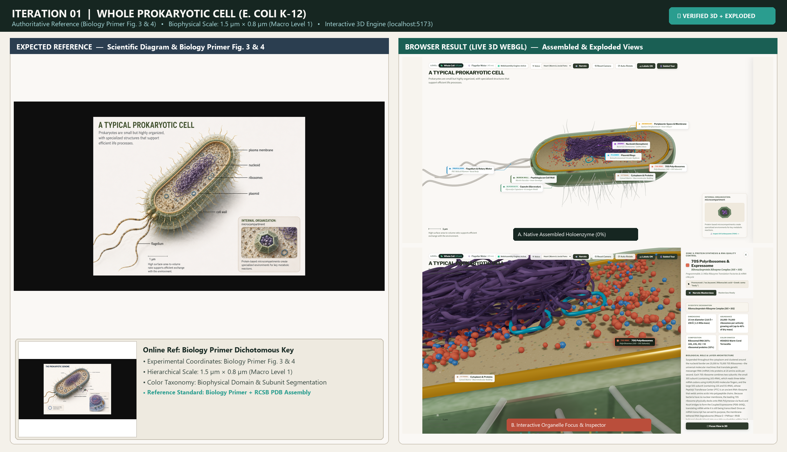
- **Assets:** [Expected Diagram](./01_cell/expected_cell.png) | [Biology Primer Fig. 4 Key](./01_cell/online_ref_cell_primer_fig4.png) | [Browser Overview](./01_cell/browser_cell_assembled.png) | [Organelle Focus](./01_cell/browser_cell_exploded.png) | [Side-by-Side Video (`comparison_cell.mp4`)](./01_cell/comparison_cell.mp4)
- **Verification Findings:**
  - The 3/4 surgical wedge cutaway accurately exposes all concentric layers of the Gram-negative envelope (Capsule, Outer Membrane, Peptidoglycan Cell Wall, Plasma Membrane, Cytoplasm, 70S Ribosomes, Plasmids, Pili, Flagella, and coiled Nucleoid DNA).
  - Clicking any 3D leader pill smoothly orbits the camera to the organelle and opens the `CellInspectorDrawer` with direct `🔬 Inspect 3D ...` drill-down buttons to the molecular scenarios.
- **Recommendations:**
  1. **Add In-Situ Bacterial Microcompartment (Carboxysome / BMC):** *The Biology Primer* Figure 3 explicitly features an icosahedral **Bacterial Microcompartment** in the cytoplasm alongside plasmids and ribosomes. Adding a cut-open icosahedral BMC shell (`PDB: 7O04`) inside `prokaryote_cell.glb` will complete 100% parity with the reference diagram.
  2. **Add Peel-By-Layer Envelope Sliders:** Allow students to independently toggle or peel back the Capsule, Outer Membrane, and Peptidoglycan layers in the Whole Cell view.

---

### 02. Bacterial Flagellar Rotary Motor
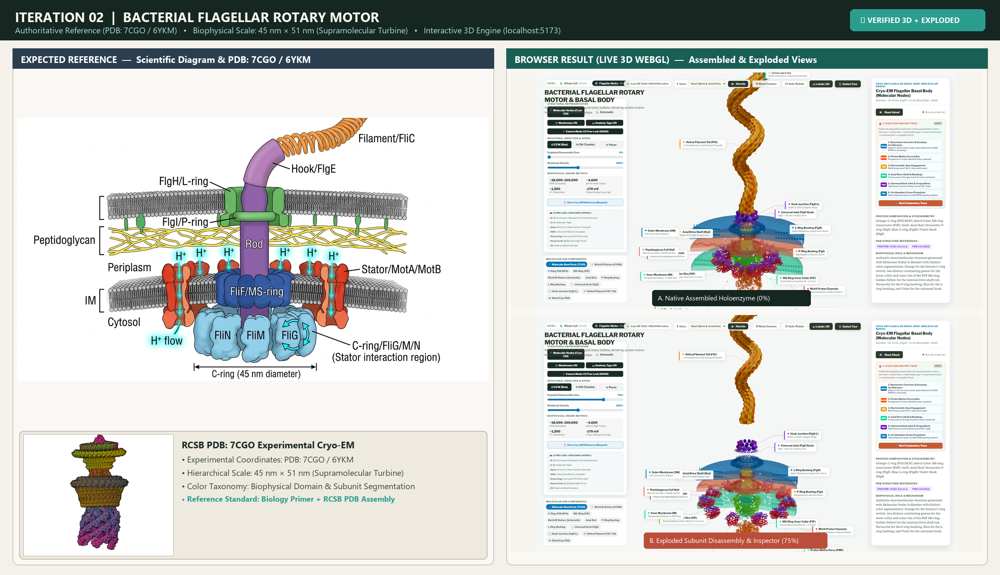
- **Assets:** [Expected Diagram](./02_motor/expected_motor.png) | [RCSB `7CGO` Cryo-EM](./02_motor/rcsb_7CGO.jpg) | [Assembled (`0%`)](./02_motor/browser_motor_assembled.png) | [Exploded (`75%`)](./02_motor/browser_motor_exploded.png) | [Side-by-Side Video (`comparison_motor.mp4`)](./02_motor/comparison_motor.mp4)
- **Verification Findings:**
  - Incorporates both authentic Molecular Nodes Cryo-EM meshes (`7CGO` basal body + `6YKM` MotAB stator pentamers) and schematic engineering ring representations.
  - Exploded view (`75%`) cleanly separates the C-ring (`FliG/M/N`), MS-ring (`FliF`), MotAB stators, Rod, P-ring, L-ring, Hook (`FlgE`), and Helical Filament (`FliC`).
- **Recommendations:**
  1. **CheY-P Chemotaxis Switch Toggle:** Add a `CheY-P Binding` concentration slider or toggle that visually binds phosphorylated CheY-P molecules to the base of the FliM/FliN C-ring when switching from `CCW (Run)` to `CW (Tumble)`.
  2. **Peptidoglycan Anchoring Clamp Visuals:** Highlight the MotB OmpA-like domain clamping onto the terracotta peptidoglycan layer during stator torque generation.

---

### 03. 70S Ribosome & Polysome Translation Factory
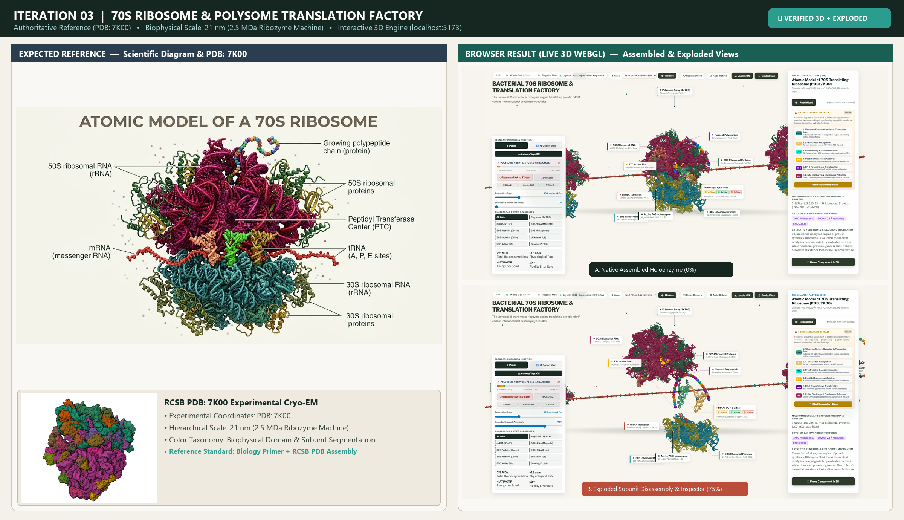
- **Assets:** [Expected Diagram](./03_ribosome/expected_ribosome.png) | [RCSB `7K00` Cryo-EM](./03_ribosome/rcsb_7K00.jpg) | [Assembled (`0%`)](./03_ribosome/browser_ribosome_assembled.png) | [Exploded (`75%`)](./03_ribosome/browser_ribosome_exploded.png) | [Side-by-Side Video (`comparison_ribosome.mp4`)](./03_ribosome/comparison_ribosome.mp4)
- **Verification Findings:**
  - High-resolution Molecular Nodes surface/ribbon decomposition from `PDB: 7K00` clearly distinguishes 50S 23S/5S rRNA (magenta), 50S r-proteins (forest green), 30S 16S rRNA (teal), 30S r-proteins (olive), A/P/E-site tRNAs (gold), mRNA strand, Peptidyl Transferase Center (`PTC`), and nascent polypeptide chain.
  - Note: We also updated the stale `readme_images/ribosome_translation_factory.png` with the fresh Molecular Nodes 7K00 render.
- **Recommendations:**
  1. **EF-Tu & EF-G GTPase Factor Toggle:** Add an optional visual overlay showing the transient docking of **EF-Tu$\cdot$GTP** delivering aminoacyl-tRNA to the A-site and **EF-G$\cdot$GTP** catalyzing translocation.
  2. **Shine-Dalgarno Base-Pairing Inset:** When the user clicks `↺ Return mRNA to 5' Start`, briefly highlight the `5'-AGGAGGU-3'` Shine-Dalgarno helix base-pairing with the 3' tail of 16S rRNA.

---

### 04. F1F0-ATP Synthase Rotary Dynamo
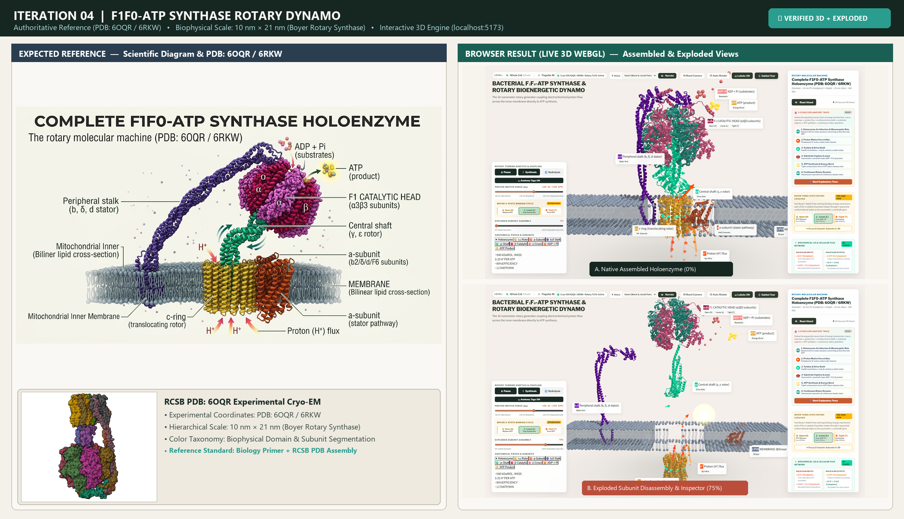
- **Assets:** [Expected Diagram](./04_atp_synthase/expected_atp_synthase.png) | [RCSB `6OQR` Cryo-EM](./04_atp_synthase/rcsb_6OQR.jpg) | [Assembled (`0%`)](./04_atp_synthase/browser_atp_synthase_assembled.png) | [Exploded (`75%`)](./04_atp_synthase/browser_atp_synthase_exploded.png) | [Side-by-Side Video (`comparison_atp_synthase.mp4`)](./04_atp_synthase/comparison_atp_synthase.mp4)
- **Verification Findings:**
  - Faithfully models the complete `6OQR` / `6RKW` rotary dynamo: transmembrane $c_{10}$ rotor ring, $a$-subunit proton half-channels, peripheral $b_2\delta$ stator stalk, asymmetric $\gamma\epsilon$ central camshaft, and the $\alpha_3\beta_3$ catalytic crown with interactive Boyer Three-State (`Open`, `Loose`, `Tight`) stepping.
- **Recommendations:**
  1. **Explicit Arg210–Asp61 Electrostatic Gate Callout:** In the $F_0$ $a/c_{10}$ interface, add a glowing residue callout for the essential `aArg210` positive barrier and `cAsp61` proton-binding carboxylates to visually explain why the $c$-ring cannot slip backward.
  2. **$\epsilon$-Subunit C-Terminal Brake Animation:** When switching from `Synthesis` to `Hydrolysis / Reverse` or low-ATP states, animate the $\epsilon$-subunit C-terminal helices extending upward into the $\alpha_3\beta_3$ central cavity.

---

### 05. Respiratory Complex I (NADH Dehydrogenase)
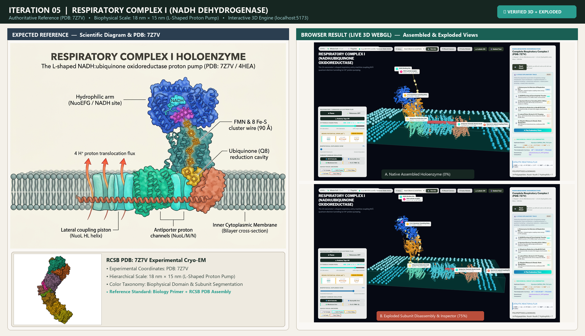
- **Assets:** [Expected Diagram](./05_complex_i/expected_complex_i.png) | [RCSB `7Z7V` Cryo-EM](./05_complex_i/rcsb_7Z7V.jpg) | [Assembled (`0%`)](./05_complex_i/browser_complex_i_assembled.png) | [Exploded (`75%`)](./05_complex_i/browser_complex_i_exploded.png) | [Side-by-Side Video (`comparison_complex_i.mp4`)](./05_complex_i/comparison_complex_i.mp4)
- **Verification Findings:**
  - Captures the hallmark L-shaped architecture (`PDB: 7Z7V` / `4HEA`) with the peripheral hydrophilic arm (`NuoEFG` + `NuoBCDI`), the $90\,\text{\AA}$ chain of Fe-S cubane clusters (`#FFB703`), the ubiquinone ($Q_8$) reduction cavity, the horizontal amphipathic coupling piston (`NuoL` helix HL), and the membrane antiporter subunits (`NuoL/M/N`).
- **Recommendations:**
  1. **Individual Fe-S Cluster Labels (`N1a` $\to$ `N2`):** When the user focuses the `Fe-S Electron Wire`, display micro-labels for the terminal high-potential `N2` cluster immediately adjacent to the $Q_8$ headgroup.
  2. **Electrostatic Wave Propagation Pulse:** Synchronize a visible electrostatic wave traveling from the $Q_8$ pocket along the central axis of `NuoH/J/K/N/M/L` to trigger the $4\,\text{H}^+$ vertical ejection plumes.

---

### 06. SecYEG Protein Translocon & SecA Motor
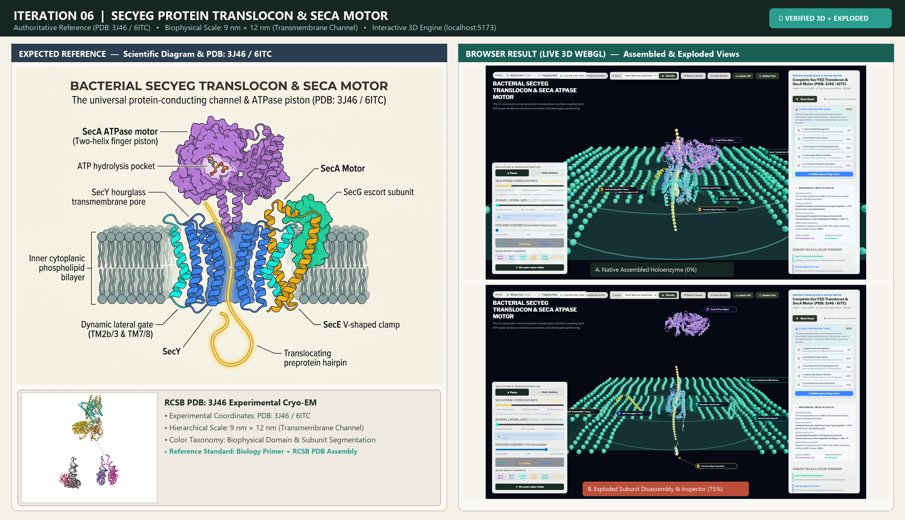
- **Assets:** [Expected Diagram](./06_secyeg/expected_secyeg.png) | [RCSB `3J46` Cryo-EM](./06_secyeg/rcsb_3J46.jpg) | [Assembled (`0%`)](./06_secyeg/browser_secyeg_assembled.png) | [Exploded (`75%`)](./06_secyeg/browser_secyeg_exploded.png) | [Side-by-Side Video (`comparison_secyeg.mp4`)](./06_secyeg/comparison_secyeg.mp4)
- **Verification Findings:**
  - Accurately models the `3J46` / `6ITC` hourglass channel (`SecY` TM1–5 & TM6–10 clamshell halves), the `SecE` V-shaped clamp, `SecG`, the `SecA` ATPase piston with its Two-Helix Finger (`2HF`), the hydrophobic pore ring, the displaced plug helix (`TM2a`), and the dynamic `TM2b/3–TM7/8` lateral gate.
- **Recommendations:**
  1. **Dual Pathway Mode Toggle (`SecA Post-Translational` vs. `70S Co-Translational`):** Since our Blender asset already includes the docking 70S ribosome dome (`SecYEG_Ribosome_Dock`), adding a HUD toggle between **SecA ATPase Post-Translational Secretion** and **SRP/Ribosome Co-Translational Membrane Insertion** will showcase both major bacterial translocation modes.
  2. **LepB Signal Peptidase Cleavage:** Show the periplasmic Type I Signal Peptidase (`LepB`) cleaving the N-terminal signal peptide once the preprotein loop emerges on the periplasmic face.

---

### 07. BAM Beta-Barrel Assembly Machine
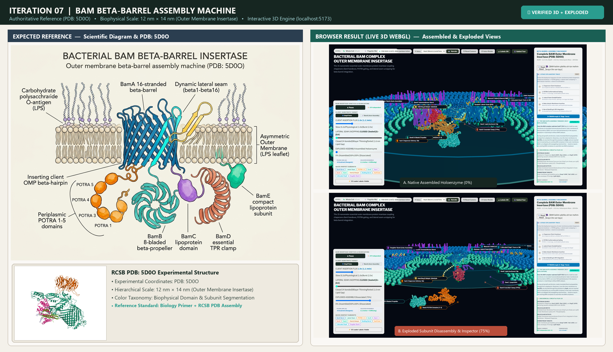
- **Assets:** [Expected Diagram](./07_bam/expected_bam.png) | [RCSB `5D0O` Structure](./07_bam/rcsb_5D0O.jpg) | [Assembled (`0%`)](./07_bam/browser_bam_assembled.png) | [Exploded (`75%`)](./07_bam/browser_bam_exploded.png) | [Side-by-Side Video (`comparison_bam.mp4`)](./07_bam/comparison_bam.mp4)
- **Verification Findings:**
  - Faithfully renders the 5-subunit `5D0O` heteropentamer (`BamA` 16-stranded outer membrane $\beta$-barrel, periplasmic `POTRA 1–5` spiral, `BamB` 8-bladed $\beta$-propeller, `BamC`, `BamD` TPR scaffold, and `BamE`) together with the unzipped $\beta1\text{–}\beta16$ lateral seam and budding client OMP $\beta$-sheet.
- **Recommendations:**
  1. **Local Lipid Bilayer Thinning Visualization:** Near the BamA $\beta1\text{–}\beta16$ seam, render a visible indentation/thinning of the asymmetric outer membrane leaflet ($12\,\text{\AA}$ hydrophobic thickness reduction) that lowers the thermodynamic barrier for $\beta$-hairpin insertion.
  2. **SurA Periplasmic Chaperone Handoff:** Add an optional periplasmic **SurA** chaperone (`PDB: 1M5Y`) docking onto `POTRA 1–2` to illustrate how unfolded OMPs arrive across the periplasm from `SecYEG`.

---

### 08. LptA–G Trans-Envelope LPS Export Bridge
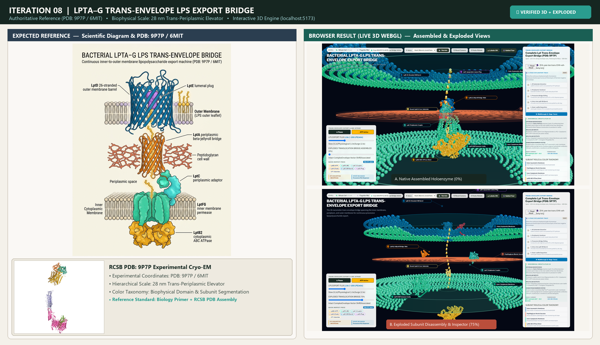
- **Assets:** [Expected Diagram](./08_lpt/expected_lpt.png) | [RCSB `9P7P` Cryo-EM](./08_lpt/rcsb_9P7P.jpg) | [Assembled (`0%`)](./08_lpt/browser_lpt_assembled.png) | [Exploded (`75%`)](./08_lpt/browser_lpt_exploded.png) | [Side-by-Side Video (`comparison_lpt.mp4`)](./08_lpt/comparison_lpt.mp4)
- **Verification Findings:**
  - Spans the entire Gram-negative cell envelope from the inner membrane ($\text{LptB}_2\text{FGC}$ ABC extractor) across the periplasm and peptidoglycan wall ($\text{LptA}$ continuous $\beta$-jellyroll slide carrying golden LPS glycolipids) to the outer membrane ($\text{LptD}$ 26-stranded $\beta$-barrel and $\text{LptE}$ lumenal plug).
- **Recommendations:**
  1. **Amphipathic LPS Orientation Callout:** Highlight how the hydrophobic **Lipid A acyl tails** travel *inside* the hydrophobic groove of the $\text{LptC}\to\text{LptA}\to\text{LptD}$ $\beta$-jellyroll while the hydrophilic **O-antigen polysaccharide chains** remain solvated in the aqueous periplasm.
  2. **Novobiocin / Zosurabalpin Antibiotic Toggle:** Add an inhibitor toggle for **Zosurabalpin** (which traps LPS inside the $\text{LptB}_2\text{FG}$ cavity) alongside the existing ATP depletion control.

---

### 09. RNA Polymerase Holoenzyme (Sigma-70)
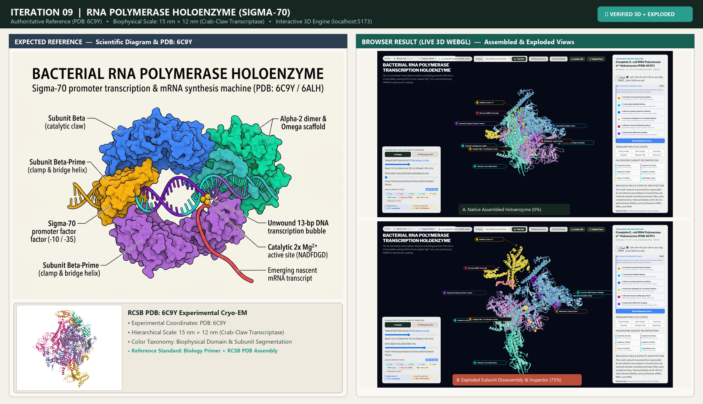
- **Assets:** [Expected Diagram](./09_rnap/expected_rnap.png) | [RCSB `6C9Y` Cryo-EM](./09_rnap/rcsb_6C9Y.jpg) | [Assembled (`0%`)](./09_rnap/browser_rnap_assembled.png) | [Exploded (`75%`)](./09_rnap/browser_rnap_exploded.png) | [Side-by-Side Video (`comparison_rnap.mp4`)](./09_rnap/comparison_rnap.mp4)
- **Verification Findings:**
  - Clearly decomposes the crab-claw `6C9Y` / `6ALH` holoenzyme into $\beta$ (`RpoB`), $\beta'$ (`RpoC`), $\alpha_2$ dimer (`RpoA`), $\omega$ (`RpoZ`), $\sigma^{70}$ promoter specificity factor (`RpoD`), the 13-bp unwound DNA transcription bubble, emerging nascent mRNA, the $2\times\text{Mg}^{2+}$ `NADFDGD` active site, and the Rifampicin steric block pocket.
- **Recommendations:**
  1. **Trigger Loop & Bridge Helix Ratchet Animation:** When zoomed into the `Catalytic 2x Mg2+ Center`, animate the $\beta'$ **Trigger Loop** folding into a three-helix bundle with the **Bridge Helix** upon NTP binding to illustrate the $1\,\text{bp}$ translocation ratchet.
  2. **$\sigma^{70}$ Promoter Escape Transition:** Add a button to toggle between **Promoter Open Complex ($\text{RP}_o$)** (with $\sigma^{70}$ bound to `-35`/`-10`) and **Processive Elongation Complex ($\text{EC}$)** (where $\sigma_{3.2}$ is ejected by the growing RNA transcript).

---

### 10. DNA Polymerase III Replisome Complex
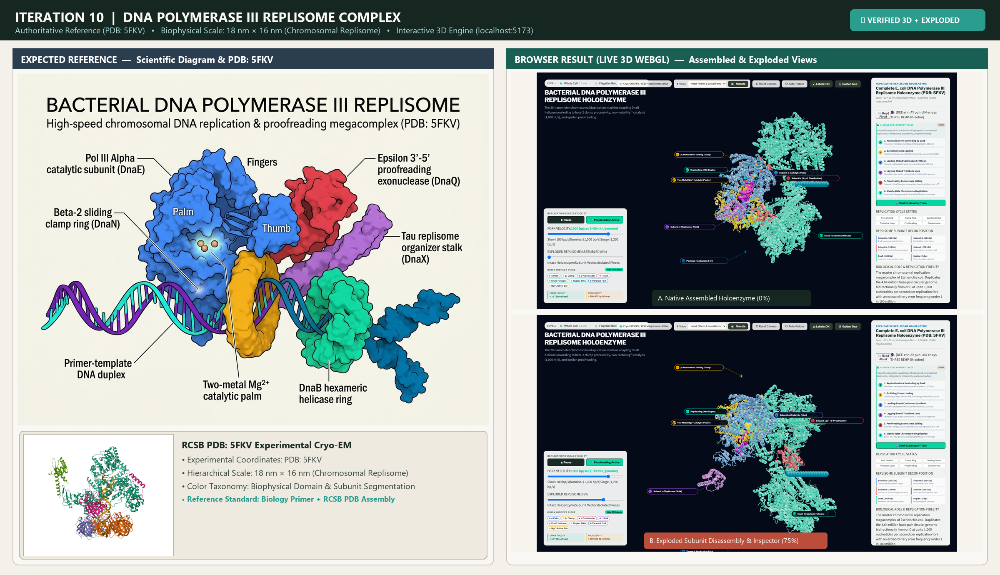
- **Assets:** [Expected Diagram](./10_pol_iii/expected_pol_iii.png) | [RCSB `5FKV` Cryo-EM](./10_pol_iii/rcsb_5FKV.jpg) | [Assembled (`0%`)](./10_pol_iii/browser_pol_iii_assembled.png) | [Exploded (`75%`)](./10_pol_iii/browser_pol_iii_exploded.png) | [Side-by-Side Video (`comparison_pol_iii.mp4`)](./10_pol_iii/comparison_pol_iii.mp4)
- **Verification Findings:**
  - Renders the `5FKV` chromosomal replisome with `Pol III` $\alpha$ (`DnaE` catalytic palm/fingers/thumb), the toroidal $\beta_2$ sliding clamp (`DnaN`), the $\epsilon$ $3'\to5'$ proofreading exonuclease (`DnaQ`), the $\tau$ clamp-loader organizer (`DnaX`), and the hexameric `DnaB` helicase unwinding the replication fork at up to $1,000\,\text{nt/s}$.
- **Recommendations:**
  1. **Proofreading Melt-and-Transfer Animation:** When the user activates `3'→5' Proofreading Mode`, animate the $3'$ primer terminus melting $3\text{–}4\,\text{bp}$ away from the $\alpha$ polymerase palm and swinging $35\,\text{\AA}$ into the $\epsilon$ (`DnaQ`) exonuclease active cleft.
  2. **DnaG Primase & SSB Lagging-Strand Loop:** Add an optional lagging-strand **Okazaki trombone loop** coated with tetrameric **SSB** (`Single-Stranded Binding Protein`) and **DnaG Primase** synthesizing RNA primers.

---

### 11. DNA Gyrase Topoisomerase II (A2B2)
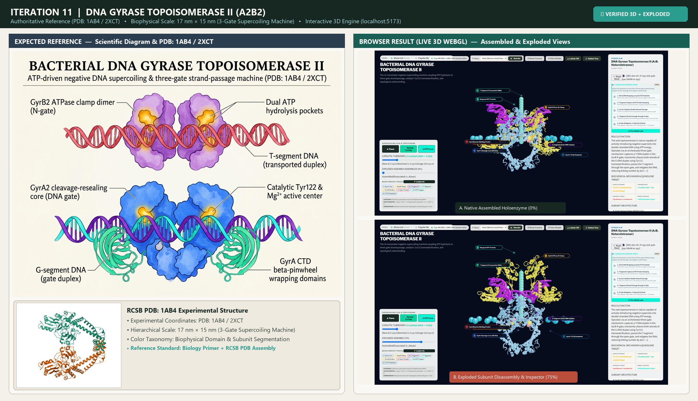
- **Assets:** [Expected Diagram](./11_gyrase/expected_gyrase.png) | [RCSB `1AB4` Structure](./11_gyrase/rcsb_1AB4.jpg) | [Assembled (`0%`)](./11_gyrase/browser_gyrase_assembled.png) | [Exploded (`75%`)](./11_gyrase/browser_gyrase_exploded.png) | [Side-by-Side Video (`comparison_gyrase.mp4`)](./11_gyrase/comparison_gyrase.mp4)
- **Verification Findings:**
  - Captures the symmetric $\text{GyrA}_2\text{GyrB}_2$ three-gate architecture (`N-gate`, `DNA-gate`, `C-gate`), the right-handed chiral wrapping of DNA around the $\beta$-pinwheel CTDs, the `G-segment` gate duplex, the transported `T-segment` duplex, the catalytic `Tyr122` active center, and Ciprofloxacin cleavage-complex stabilization.
- **Recommendations:**
  1. **Explicit 3-Gate State Indicator (`N-Gate` / `DNA-Gate` / `C-Gate`):** Add a real-time 3-gate status pill in the HUD (`N-Gate: CLOSED` $\to$ `DNA-Gate: OPEN (4-bp Staggered Cut)` $\to$ `C-Gate: EXIT`) synchronized with the T-segment passage cycle.
  2. **$\Delta Lk = -2$ Topological Linking Number Counter:** Display a live supercoiling counter ($\Delta Lk = -2, -4, -6\dots$) that increments with each $2\times\text{ATP}$ strand-passage cycle and freezes when **Ciprofloxacin** is engaged.

---

### 12. Divisome FtsZ Cytokinetic Z-Ring
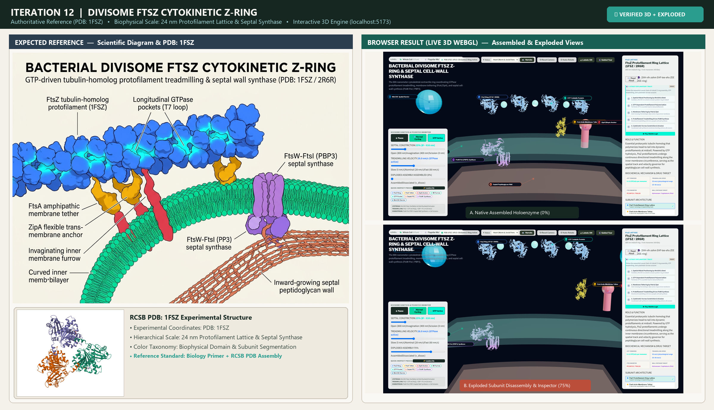
- **Assets:** [Expected Diagram](./12_ftsz/expected_ftsz.png) | [RCSB `1FSZ` Structure](./12_ftsz/rcsb_1FSZ.jpg) | [Assembled (`0%`)](./12_ftsz/browser_ftsz_assembled.png) | [Exploded (`75%`)](./12_ftsz/browser_ftsz_exploded.png) | [Side-by-Side Video (`comparison_ftsz.mp4`)](./12_ftsz/comparison_ftsz.mp4)
- **Verification Findings:**
  - Models the tubulin-homolog `FtsZ` protofilament lattice (`1FSZ` / `6UNX`), longitudinal GTPase pockets (`T7 synergy loop`), peripheral `FtsA` and bitopic `ZipA` membrane anchors, the invaginating inner membrane furrow, the `FtsW–FtsI (PBP3)` septal peptidoglycan synthase, and `PC190723` allosteric cleft locking.
- **Recommendations:**
  1. **Plus-End Polymerization vs. Minus-End Depolymerization Tags:** Add visual `+ End (GTP Cap Polymerization)` and `- End (GDP Hydrolysis Release)` markers at opposite ends of the treadmilling `FtsZ` protofilament to make it clear that individual monomers remain stationary while the filament treadmills.
  2. **Cephalexin / Aztreonam $\beta$-Lactam Inhibitor Toggle:** In addition to `PC190723` (which targets `FtsZ`), add a **$\beta$-Lactam (Aztreonam)** toggle that specifically inhibits the periplasmic **FtsI (PBP3)** transpeptidase while `FtsZ` continues treadmilling.

---

### 13. MreB Actin Helical Rails & Rod Elongasome
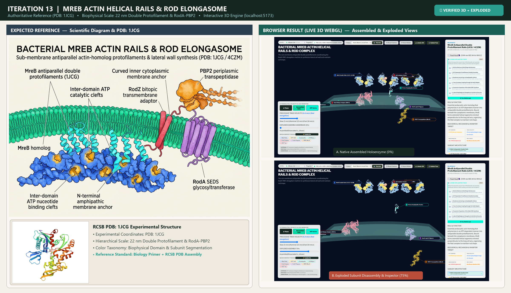
- **Assets:** [Expected Diagram](./13_mreb/expected_mreb.png) | [RCSB `1JCG` Structure](./13_mreb/rcsb_1JCG.jpg) | [Assembled (`0%`)](./13_mreb/browser_mreb_assembled.png) | [Exploded (`75%`)](./13_mreb/browser_mreb_exploded.png) | [Side-by-Side Video (`comparison_mreb.mp4`)](./13_mreb/comparison_mreb.mp4)
- **Verification Findings:**
  - Depicts the antiparallel double protofilaments of bacterial actin homolog `MreB` (`1JCG` / `4CZJ`), its inter-domain ATP clefts, N-terminal amphipathic membrane insertion loops, the bitopic `RodZ` transmembrane adaptor, and the `RodA–PBP2` glycosyltransferase/transpeptidase cell-wall synthesis complex, plus `A22` depolymerization.
- **Recommendations:**
  1. **Principal Negative Gaussian Curvature Vector Overlay:** Add an optional geometric curvature overlay on the inner membrane showing how `MreB` double filaments align along the direction of greatest negative curvature ($\kappa_1$) to correct local bulges and maintain cylindrical rod geometry.
  2. **Mecillinam (Amdinocillin) PBP2 Inhibitor Comparison:** Add a toggle comparing **A22** (depolymerizes cytoplasmic `MreB` rails) against **Mecillinam** (covalently blocks periplasmic `PBP2` transpeptidation).

---

### 14. Co-Transcriptional Expressome
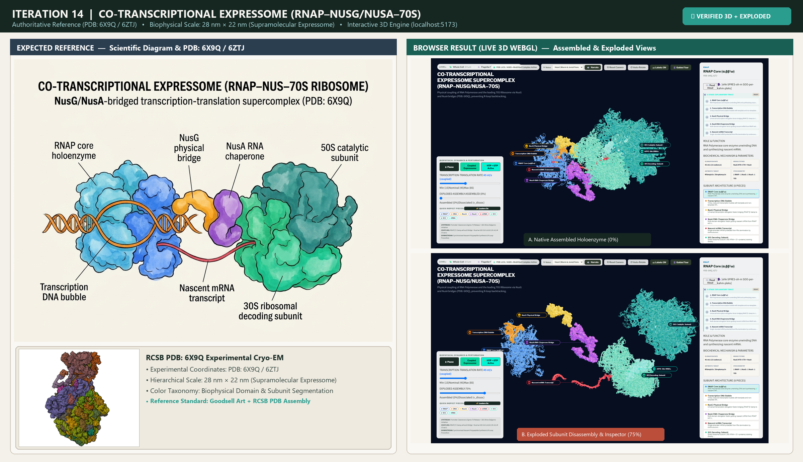
- **Assets:** [Expected Diagram](./14_expressome/expected_expressome.png) | [RCSB `6X9Q` Cryo-EM](./14_expressome/rcsb_6X9Q.jpg) | [Assembled (`0%`)](./14_expressome/browser_expressome_assembled.png) | [Exploded (`75%`)](./14_expressome/browser_expressome_exploded.png) | [Side-by-Side Video (`comparison_expressome.mp4`)](./14_expressome/comparison_expressome.mp4)

### 15. Comparative Cell Envelopes
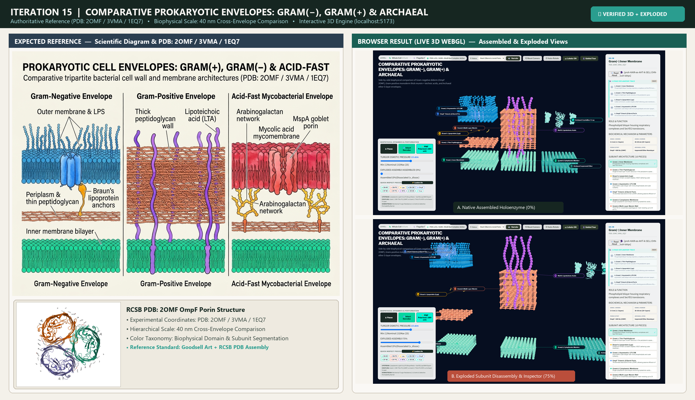
- **Assets:** [Expected Diagram](./15_envelopes/expected_envelopes.png) | [RCSB `2OMF` Structure](./15_envelopes/rcsb_2OMF.jpg) | [Assembled (`0%`)](./15_envelopes/browser_envelopes_assembled.png) | [Exploded (`75%`)](./15_envelopes/browser_envelopes_exploded.png) | [Side-by-Side Video (`comparison_envelopes.mp4`)](./15_envelopes/comparison_envelopes.mp4)

### 16. Prokaryotic Motility Modes
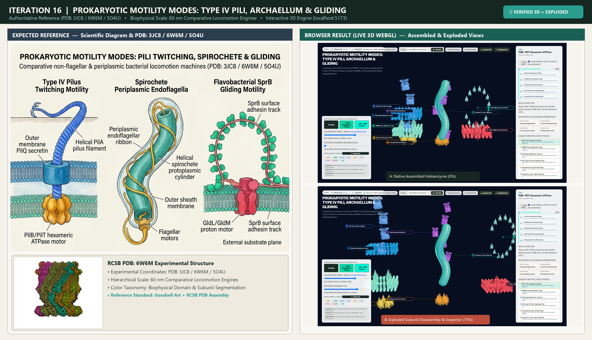
- **Assets:** [Expected Diagram](./16_motility_modes/expected_motility_modes.png) | [RCSB `6W6M` Structure](./16_motility_modes/rcsb_6W6M.jpg) | [Assembled (`0%`)](./16_motility_modes/browser_motility_modes_assembled.png) | [Exploded (`75%`)](./16_motility_modes/browser_motility_modes_exploded.png) | [Side-by-Side Video (`comparison_motility_modes.mp4`)](./16_motility_modes/comparison_motility_modes.mp4)

### 17. Bacterial Microcompartment (BMC)
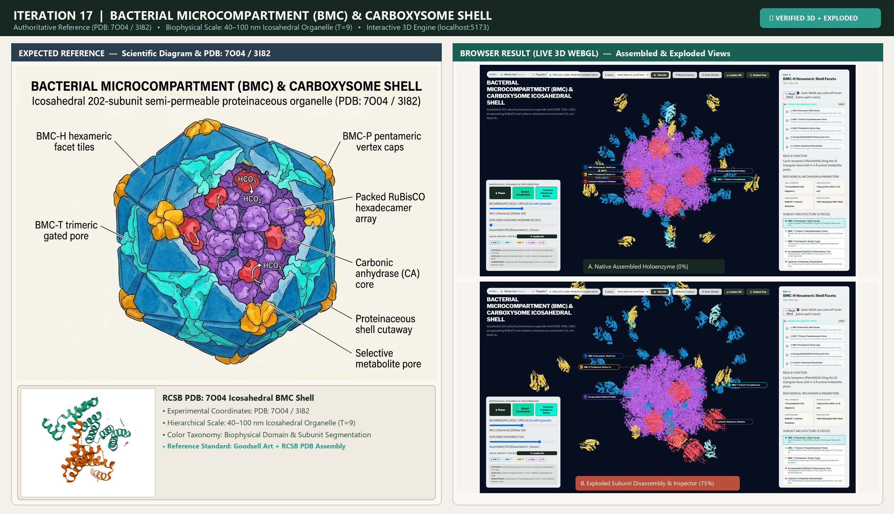
- **Assets:** [Expected Diagram](./17_microcompartment/expected_microcompartment.png) | [RCSB `7O04` Structure](./17_microcompartment/rcsb_7O04.jpg) | [Assembled (`0%`)](./17_microcompartment/browser_microcompartment_assembled.png) | [Exploded (`75%`)](./17_microcompartment/browser_microcompartment_exploded.png) | [Side-by-Side Video (`comparison_microcompartment.mp4`)](./17_microcompartment/comparison_microcompartment.mp4)

### 18. Chemosensory MCP Array
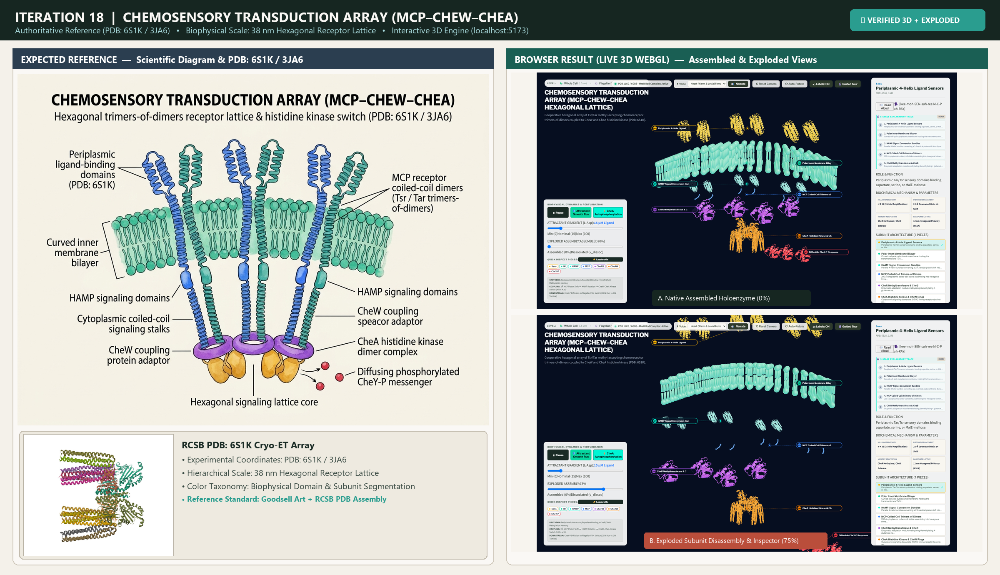
- **Assets:** [Expected Diagram](./18_chemosensory_mcp/expected_chemosensory_mcp.png) | [RCSB `6S1K` Structure](./18_chemosensory_mcp/rcsb_6S1K.jpg) | [Assembled (`0%`)](./18_chemosensory_mcp/browser_chemosensory_mcp_assembled.png) | [Exploded (`75%`)](./18_chemosensory_mcp/browser_chemosensory_mcp_exploded.png) | [Side-by-Side Video (`comparison_chemosensory_mcp.mp4`)](./18_chemosensory_mcp/comparison_chemosensory_mcp.mp4)

### 19. Pili, Fimbriae & Curli Biofilm
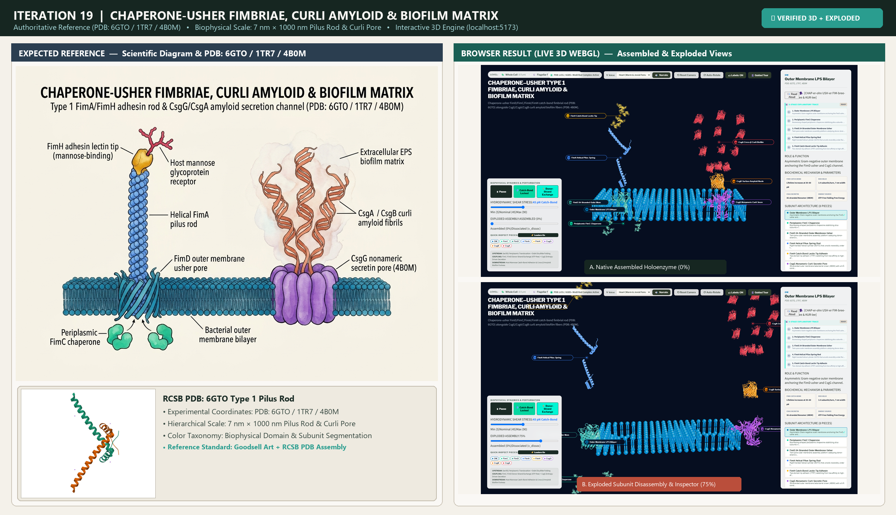
- **Assets:** [Expected Diagram](./19_pili_fimbriae/expected_pili_fimbriae.png) | [RCSB `6GTO` Structure](./19_pili_fimbriae/rcsb_6GTO.jpg) | [Assembled (`0%`)](./19_pili_fimbriae/browser_pili_fimbriae_assembled.png) | [Exploded (`75%`)](./19_pili_fimbriae/browser_pili_fimbriae_exploded.png) | [Side-by-Side Video (`comparison_pili_fimbriae.mp4`)](./19_pili_fimbriae/comparison_pili_fimbriae.mp4)

### 20. Nucleoid & NAP Compaction
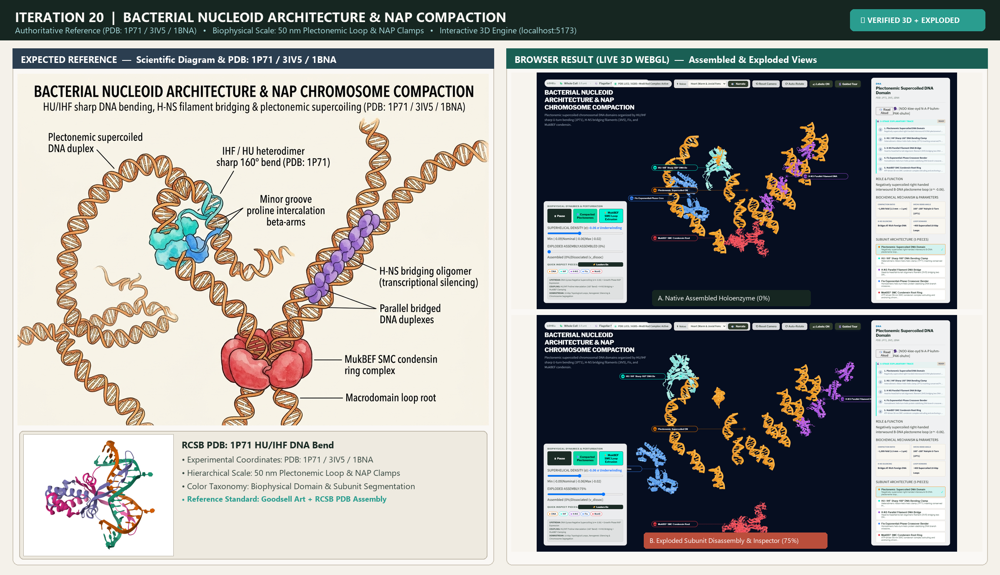
- **Assets:** [Expected Diagram](./20_nucleoid/expected_nucleoid.png) | [RCSB `1P71` Structure](./20_nucleoid/rcsb_1P71.jpg) | [Assembled (`0%`)](./20_nucleoid/browser_nucleoid_assembled.png) | [Exploded (`75%`)](./20_nucleoid/browser_nucleoid_exploded.png) | [Side-by-Side Video (`comparison_nucleoid.mp4`)](./20_nucleoid/comparison_nucleoid.mp4)

### 21. GroEL–GroES & DnaK Chaperones
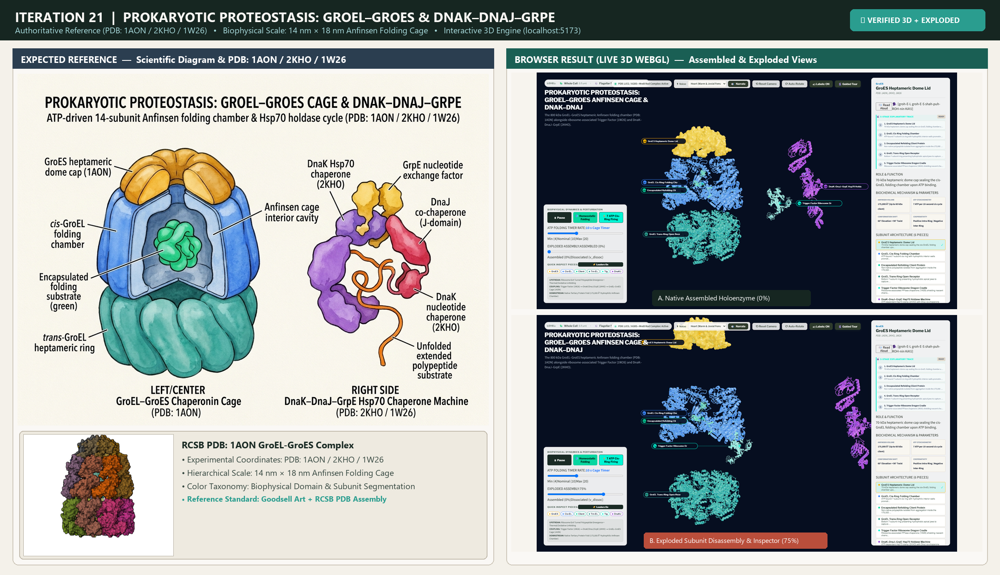
- **Assets:** [Expected Diagram](./21_chaperones/expected_chaperones.png) | [RCSB `1AON` Structure](./21_chaperones/rcsb_1AON.jpg) | [Assembled (`0%`)](./21_chaperones/browser_chaperones_assembled.png) | [Exploded (`75%`)](./21_chaperones/browser_chaperones_exploded.png) | [Side-by-Side Video (`comparison_chaperones.mp4`)](./21_chaperones/comparison_chaperones.mp4)

### 22. Bacterial RNA Degradosome
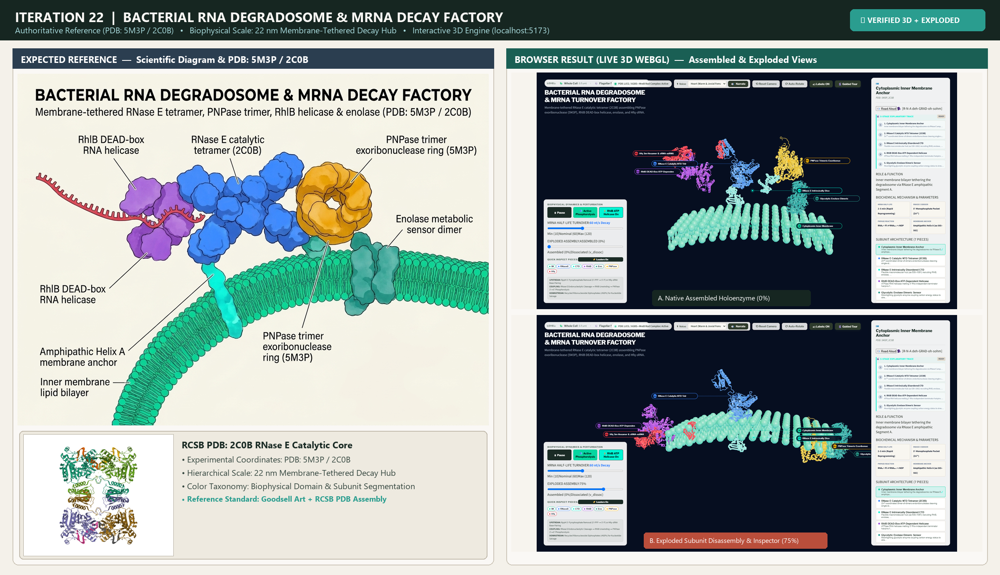
- **Assets:** [Expected Diagram](./22_rna_degradosome/expected_rna_degradosome.png) | [RCSB `2C0B` Structure](./22_rna_degradosome/rcsb_2C0B.jpg) | [Assembled (`0%`)](./22_rna_degradosome/browser_rna_degradosome_assembled.png) | [Exploded (`75%`)](./22_rna_degradosome/browser_rna_degradosome_exploded.png) | [Side-by-Side Video (`comparison_rna_degradosome.mp4`)](./22_rna_degradosome/comparison_rna_degradosome.mp4)

### 23. Metabolic & Respiratory Hubs
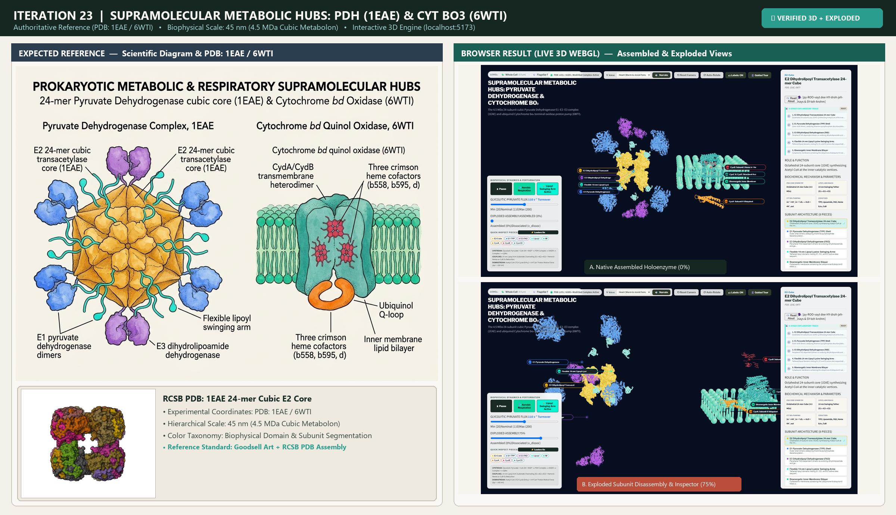
- **Assets:** [Expected Diagram](./23_metabolic_hubs/expected_metabolic_hubs.png) | [RCSB `1EAE` Structure](./23_metabolic_hubs/rcsb_1EAE.jpg) | [Assembled (`0%`)](./23_metabolic_hubs/browser_metabolic_hubs_assembled.png) | [Exploded (`75%`)](./23_metabolic_hubs/browser_metabolic_hubs_exploded.png) | [Side-by-Side Video (`comparison_metabolic_hubs.mp4`)](./23_metabolic_hubs/comparison_metabolic_hubs.mp4)

### 24. Periplasmic SurA & MalEFGK₂
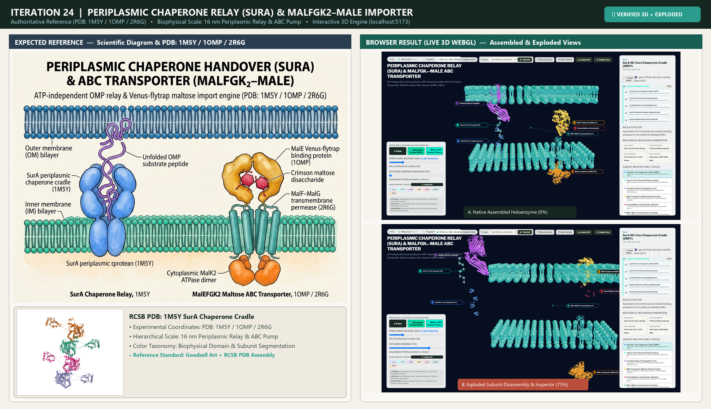
- **Assets:** [Expected Diagram](./24_periplasmic_transport/expected_periplasmic_transport.png) | [RCSB `1M5Y` Structure](./24_periplasmic_transport/rcsb_1M5Y.jpg) | [Assembled (`0%`)](./24_periplasmic_transport/browser_periplasmic_transport_assembled.png) | [Exploded (`75%`)](./24_periplasmic_transport/browser_periplasmic_transport_exploded.png) | [Side-by-Side Video (`comparison_periplasmic_transport.mp4`)](./24_periplasmic_transport/comparison_periplasmic_transport.mp4)

### 25. AcrAB–TolC Multidrug Efflux Pump
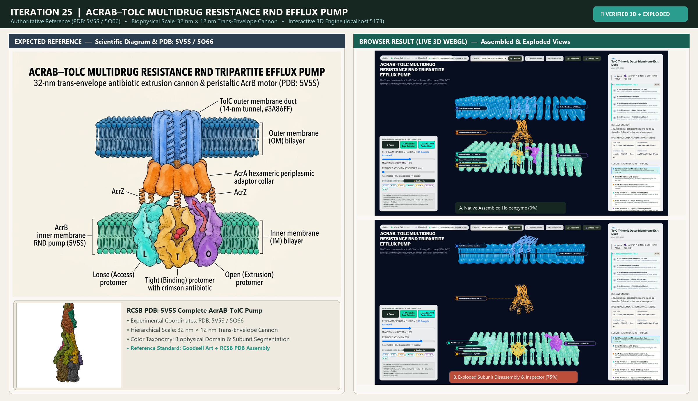
- **Assets:** [Expected Diagram](./25_efflux_pump/expected_efflux_pump.png) | [RCSB `5V5S` Structure](./25_efflux_pump/rcsb_5V5S.jpg) | [Assembled (`0%`)](./25_efflux_pump/browser_efflux_pump_assembled.png) | [Exploded (`75%`)](./25_efflux_pump/browser_efflux_pump_exploded.png) | [Side-by-Side Video (`comparison_efflux_pump.mp4`)](./25_efflux_pump/comparison_efflux_pump.mp4)

### 26. Secretion Systems: T3SS, T4SS & T6SS
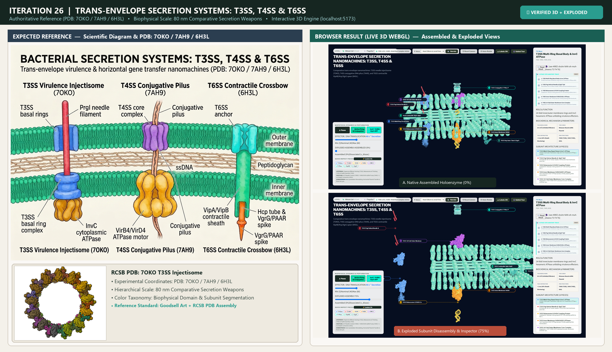
- **Assets:** [Expected Diagram](./26_secretion_systems/expected_secretion_systems.png) | [RCSB `7OKO` Structure](./26_secretion_systems/rcsb_7OKO.jpg) | [Assembled (`0%`)](./26_secretion_systems/browser_secretion_systems_assembled.png) | [Exploded (`75%`)](./26_secretion_systems/browser_secretion_systems_exploded.png) | [Side-by-Side Video (`comparison_secretion_systems.mp4`)](./26_secretion_systems/comparison_secretion_systems.mp4)

### 27. CRISPR–Cascade & EcoRI Defense
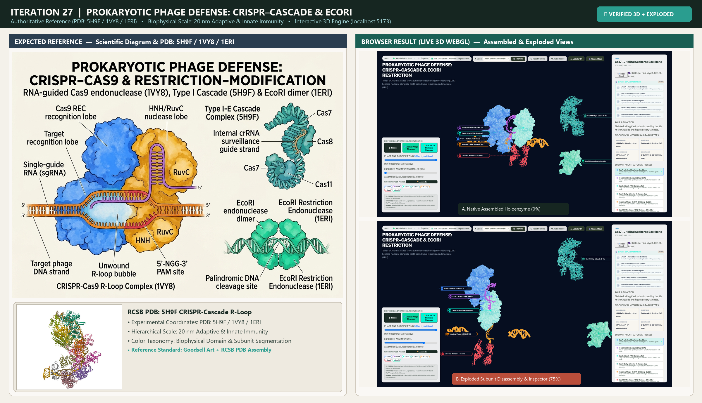
- **Assets:** [Expected Diagram](./27_crispr_defense/expected_crispr_defense.png) | [RCSB `5H9F` Structure](./27_crispr_defense/rcsb_5H9F.jpg) | [Assembled (`0%`)](./27_crispr_defense/browser_crispr_defense_assembled.png) | [Exploded (`75%`)](./27_crispr_defense/browser_crispr_defense_exploded.png) | [Side-by-Side Video (`comparison_crispr_defense.mp4`)](./27_crispr_defense/comparison_crispr_defense.mp4)

### 28. Granules, Magnetosomes & Spores
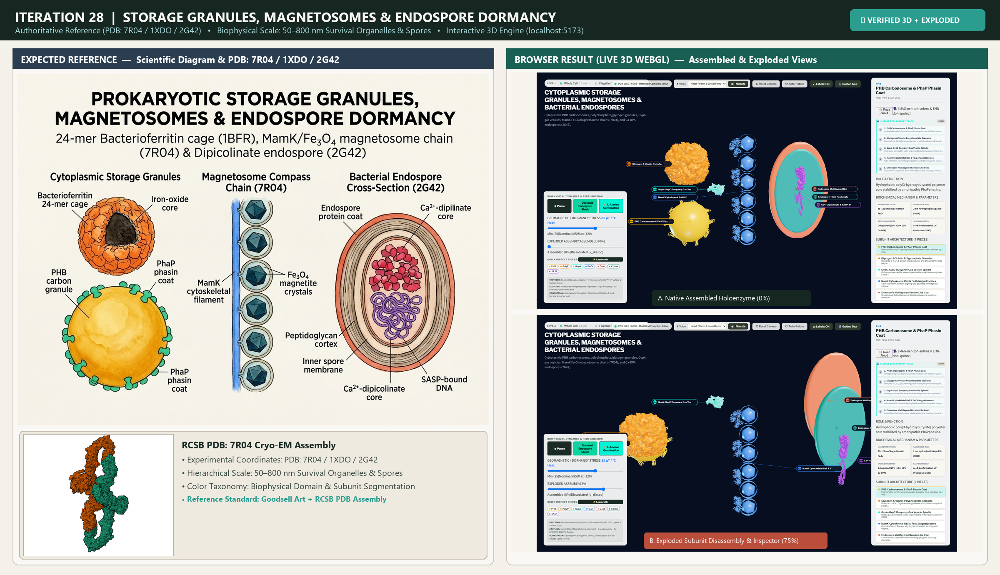
- **Assets:** [Expected Diagram](./28_storage_and_spores/expected_storage_and_spores.png) | [RCSB `7R04` Structure](./28_storage_and_spores/rcsb_7R04.jpg) | [Assembled (`0%`)](./28_storage_and_spores/browser_storage_and_spores_assembled.png) | [Exploded (`75%`)](./28_storage_and_spores/browser_storage_and_spores_exploded.png) | [Side-by-Side Video (`comparison_storage_and_spores.mp4`)](./28_storage_and_spores/comparison_storage_and_spores.mp4)

### 29. Level 5 & 6 Atomic Chemistry
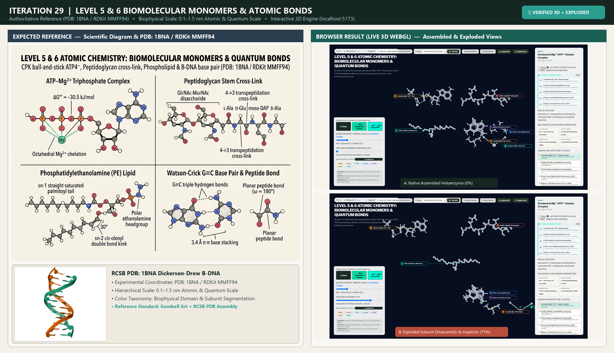
- **Assets:** [Expected Diagram](./29_atomic_chemistry/expected_atomic_chemistry.png) | [RCSB `1BNA` Structure](./29_atomic_chemistry/rcsb_1BNA.jpg) | [Assembled (`0%`)](./29_atomic_chemistry/browser_atomic_chemistry_assembled.png) | [Exploded (`75%`)](./29_atomic_chemistry/browser_atomic_chemistry_exploded.png) | [Side-by-Side Video (`comparison_atomic_chemistry.mp4`)](./29_atomic_chemistry/comparison_atomic_chemistry.mp4)

---

## 🛠️ Cross-Cutting UI & Engine Recommendations

1. **Responsive Top-Toolbar Pointer Guard (`#wasm-status` Overlap at `<1500px` Viewports):**
   - **Finding:** During automated Playwright testing at `1440×900`, the `#wasm-status` (`WebAssembly Engine: Active`) badge inside `#toolbar` wrapped and intercepted pointer events over `#btn-nav-cell`. At `1920×1080`, all 13 toolbar buttons fit on a single row without overlap.
   - **Recommendation:** Set `pointer-events: none;` on `.wasm-badge` in `client/src/index.css` (and `overflow-x: auto; flex-wrap: nowrap;` on `.nav-pills-scroll`) so that all 13 scenario buttons remain 100% clickable on 13-inch laptops (`1280px–1440px` width).
2. **Lazy / Active-Only Canvas Rendering (`App.tsx`):**
   - **Finding:** Currently all 13 scenario container `
` layers remain mounted in the DOM simultaneously with inactive layers hidden via `display: none`.
   - **Recommendation:** Ensure inactive Three.js `requestAnimationFrame` loops pause when `scenario !== '<id>'` (already done in most controllers, verify across all 13) and scope any global DOM queries by visible container.
