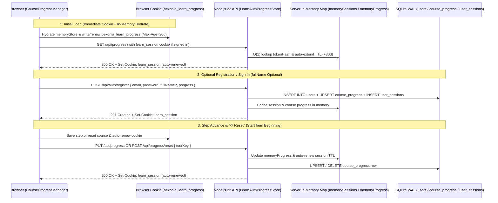

# 04 — Optional User Accounts, In-Memory & Auto-Renewed Cookies, and Per-Model Course Progress Sync

**Iteration:** `04` (Non-Blocking Optional Registration, In-Memory + Auto-Renewing Cookies, & Per-Cell/Virus Step Resume + Reset)  
**Status:** ✅ **Completed & Verified**  
**Parent Index:** [`roadmap/README.md`](./README.md)  
**Previous Step:** [`03-guided-tour-voice-cloning-and-tts-narration.md`](./03-guided-tour-voice-cloning-and-tts-narration.md)

---

## 1. Executive Summary & Completed Goals

Implemented a **100% optional, non-blocking user account, cookie auto-renewal, and course progress tracking system** for `learn-biology` (`https://learn.bexonia.com`):

1. **Never Blocks the Explorer (100% Optional Login):**
   - All 10 cells and viruses and all guided tours remain **completely open without any login wall**.
   - A subtle header button ([`#accountBtn`](../cell_explorer.html)) lets visitors open the **Course Progress & Optional Account** modal ([`#accountModal`](../cell_explorer.html)) only if they want to register, sign in, renew their cookie, or jump between courses.
2. **In-Memory + Auto-Renewed Cookie Architecture (Client & Server):**
   - **Browser Progress Cookie (`bexonia_learn_progress`):** Created automatically on initial page load and kept synchronized in memory ([`CourseProgressManager.memoryStore`](../src/core/progress_service.ts)), in `document.cookie` (`bexonia_learn_progress`), and in `localStorage` (`bexonia_learn_progress_v1`). Every step transition or click on **`↻ Renew Cookie & Session`** (`#renewCookieBtn`) automatically renews its 30-day (`Max-Age=2592000`) expiration.
   - **Server Session Cookie (`learn_session`):** Kept in an **in-memory `Map` cache** ([`LearnAuthProgressStore.memorySessions`](../src/server/auth_progress_server.ts)) for $O(1)$ sub-millisecond lookup AND persisted in SQLite WAL (`user_sessions`). Every authenticated request (`GET /api/progress`, `PUT /api/progress`, `POST /api/progress/reset`, or `POST /api/auth/renew`) **automatically renews** the session expiration in memory, in SQLite, and via a fresh `Set-Cookie` header.
3. **Saves Email, Optional Reference Name & Salted Password Hash:**
   - Persists `email` (`TEXT UNIQUE NOT NULL`), `full_name` (`TEXT`, **optional** reference field), `preferred_lang` (`en` / `es`), and a 64-byte `scrypt` password digest with a 16-byte random salt.
4. **Per-Cell & Per-Virus Resume + `"↺ Reset"` (Start From Beginning) Button:**
   - Tracks progress independently across all **10 biological courses** (`real-cell`, `real-plant`, `real-fungal`, `real-bacterium`, `real-phage`, `real-coronavirus`, `real-hiv`, `real-adenovirus`, `real-tmv`, `viruses`).
   - Added the **`↺ Reset`** (`#tReset` · `↺ Reiniciar` · keyboard shortcut `R`) button directly inside the active Tour Controls bar (`#tourCtl`), plus **`↺ Start from beginning`** on the tour intro/resume card (`#tCard`) and per-course **`↺ Reset`** buttons inside `#accountModal`, allowing users to return any cell or virus tutorial to Chapter 1 · Step 1 at any time.

---

## 2. Implemented Architecture (`src/server/auth_progress_server.ts` & `src/core/progress_service.ts`)



---

## 3. Database Schema (`node:sqlite` WAL + In-Memory Cache)

Implemented in [`src/server/auth_progress_server.ts`](../src/server/auth_progress_server.ts):

```sql
CREATE TABLE IF NOT EXISTS users (
  id              INTEGER PRIMARY KEY AUTOINCREMENT,
  email           TEXT UNIQUE NOT NULL,
  full_name       TEXT,                         -- Optional reference name (nullable)
  password_salt   BLOB NOT NULL,                -- 16 random bytes
  password_hash   BLOB NOT NULL,                -- 64-byte scrypt digest
  preferred_lang  TEXT NOT NULL DEFAULT 'en',
  created_at      TEXT NOT NULL,
  last_login_at   TEXT NOT NULL
);

CREATE TABLE IF NOT EXISTS course_progress (
  user_id         INTEGER NOT NULL REFERENCES users(id) ON DELETE CASCADE,
  tour_key        TEXT NOT NULL,                -- One of the 10 cell/virus roots
  step_id         TEXT,
  chapter_idx     INTEGER NOT NULL DEFAULT 0,
  step_idx        INTEGER NOT NULL DEFAULT 0,
  cue_idx         INTEGER NOT NULL DEFAULT 0,
  completed_mask  INTEGER NOT NULL DEFAULT 0,
  is_completed    INTEGER NOT NULL DEFAULT 0,
  last_node_id    TEXT,
  updated_at      TEXT NOT NULL,
  PRIMARY KEY (user_id, tour_key)
);

CREATE TABLE IF NOT EXISTS user_sessions (
  token_hash      TEXT PRIMARY KEY,             -- SHA-256(raw_session_token)
  user_id         INTEGER NOT NULL REFERENCES users(id) ON DELETE CASCADE,
  expires_at_ms   INTEGER NOT NULL,
  created_at      TEXT NOT NULL
);
```

---

## 4. REST API Endpoints

| Method & Path | Request Body | Response | Purpose |
| :--- | :--- | :--- | :--- |
| `POST /api/auth/register` | `{ email, password, fullName?, lang?, progress? }` | `201 { authenticated: true, user, sessionExpiresAt, progress }` | Registers account (`fullName` optional), hashes password with `scrypt`, caches session in memory + SQLite, merges local progress, and sets `learn_session` cookie. |
| `POST /api/auth/login` | `{ email, password, progress? }` | `200 { authenticated: true, user, sessionExpiresAt, progress }` | Verifies `scrypt` password in constant time, merges local progress, caches session in memory, and sets `learn_session` cookie. |
| `POST /api/auth/renew` | `{}` | `200 { authenticated: true, renewed: true, sessionExpiresAt, progress }` | Explicitly renews the active session in memory, SQLite, and `Set-Cookie`. |
| `POST /api/auth/logout` | `{}` | `200 { authenticated: false }` | Removes session from memory + SQLite and clears `learn_session` cookie. |
| `GET /api/progress` | *(Session Cookie)* | `200 { authenticated, user, sessionExpiresAt, progress }` | Hydrates saved checkpoints for all 10 models and auto-renews `learn_session`. |
| `PUT /api/progress` | `{ tourKey, stepId, chapterIdx, stepIdx, cueIdx, ... }` | `200 { ok: true, checkpoint, progress, sessionExpiresAt }` | Upserts the user's checkpoint in memory + SQLite and auto-renews `learn_session`. |
| `POST /api/progress/reset` | `{ tourKey }` | `200 { ok: true, tourKey, progress, sessionExpiresAt }` | Clears the saved checkpoint for `tourKey` so the course starts from the beginning. |

---

## 5. Verification Gates (`tests/verify_all.ts`)

- [x] **Unit & Store Verification (`LearnAuthProgressStore`):**
  - Verified registration **with** optional `fullName` (`'Ada Lovelace'`) and **without** `fullName` (`null`).
  - Verified in-memory session caching (`memorySessions.size`) and automatic sliding expiration renewal (`resolveSession(token, true)`).
  - Verified independent multi-course progress (`real-cell` at Step 3, `real-hiv` at Step 4) and verified that `resetCourseProgress(userId, 'real-cell')` resets `real-cell` without affecting `real-hiv`.
- [x] **Headless Chrome WebGL E2E Verification (`cell_explorer.html`):**
  - Verified `bexonia_learn_progress` cookie is created on load and synced with `window.__progress.memoryStore`.
  - Verified advancing `real-cell` tour to Step 2 enables `#tReset` (`↺ Reset`), and clicking `#tReset` immediately returns the tour to Step 0 (`window.__tour.state.step === eukSteps[0].id`) and disables `#tReset`.
  - Verified end-to-end account registration, `real-hiv` progress sync, and `window.__progress.renewCookies()` against the live backend server.
