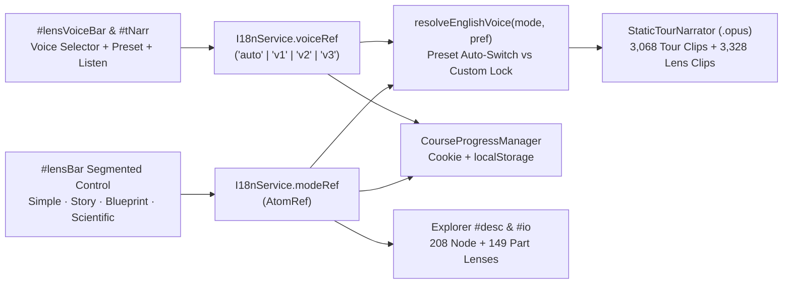

# 05 — Multi-Mode Explanation Lenses (`Simple`, `Story`, `Blueprint`, `Scientific`), Connected Cellular Stories & Multi-Voice Narration

**Iteration:** `05` (Reactive 4-Mode Reading Lenses, End-to-End Supply-Chain Storytelling & Public-Domain Multi-Voice Narration in `EN` & `ES`)  
**Status:** ✅ **Completed & Verified**  
**Parent Index:** [`roadmap/README.md`](./README.md)  
**Previous Step:** [`04-optional-user-accounts-and-course-progress-sync.md`](./04-optional-user-accounts-and-course-progress-sync.md)

---

## 1. Executive Summary & Completed Goals

Implemented a **reactive 4-Mode Explanation Lens** (`Simple` · `Story` · `Blueprint` · `Scientific`) paired with **pre-generated Public-Domain (`CC0` / LibriVox) Multi-Voice Narration** across `learn-biology` (`https://learn.bexonia.com`) so scientists, engineers, students, and young learners can read and listen to every interactive 3D WebGL model in the style and voice that fits them best:

1. **Four Distinct Lenses Without Scene Reloads (`0` WebGL Overhead):**
   - **`Simple` (`Sencillo`):** 10-second everyday intuition in 1–2 sentences with minimal jargon.
   - **`Story` (`Historia` — Default):** Connected narrative prose where every whole cell or virus forms an overarching plot and every internal organelle or macromolecule acts as a chapter — naturally weaving **where its inputs arrived from**, **the physical transformation inside**, and **which downstream neighbors spend or recycle its outputs next**.
   - **`Blueprint` (`Esquema`):** Systems-architecture dependency circuit (`Role` · `Arrives from` · `Inside` · `Delivers to` · `Closes the loop`) for visual and engineering-minded learners.
   - **`Scientific` (`Científico`):** Dense, direct quantitative reference (dimensions, subunit stoichiometry, enzyme complexes, electrochemical gradients, and experimental PDB accessions) with zero narrative framing.
2. **100% Coverage Across All `208` Explorer Nodes & `149` Realistic 3D Parts (`EN` + `ES`):**
   - Every one of the `208` zoomable `NODES` in [`cell_explorer.ts`](../src/pages/cell_explorer.ts) and every one of the `149` interactive 3D parts across all `9` standalone realistic pages (`animal_cell_realistic.html`, `plant_cell_realistic.html`, `fungal_cell_realistic.html`, `prokaryote_cell_realistic.html`, `bacteriophage_realistic.html`, `coronavirus_realistic.html`, `hiv_realistic.html`, `adenovirus_realistic.html`, `tmv_realistic.html`) includes bespoke entries for all 4 modes in both **English (`EN`)** and **Spanish (`ES`)**.
3. **Public-Domain (`CC0` / LibriVox) Multi-Voice Narration with Automatic Preset & Custom Voice Selector:**
   - **Four Public-Domain Studio Reference Voices** ([`tools/voices/ATTRIBUTION.md`](../tools/voices/ATTRIBUTION.md)) synthesized offline via **GPT-SoVITS v2ProPlus** into `6,396` `.opus` clips (`3,068` Guided Tour clips across all 10 tours + `3,328` Explorer Lens clips across all `208` nodes × `4` modes):
     - **English Voice 1 (`v1`, David Clarke — LibriVox `CC0`):** Preset narrator for **`Scientific`** mode (scientists & biologists inspecting specifics).
     - **English Voice 2 (`v2`, Peter Yearsley — LibriVox `CC0`):** Preset narrator for **`Blueprint`** mode (engineers & systems thinkers).
     - **English Voice 3 (`v3`, Martin Geeson — LibriVox `CC0`):** Preset narrator for **`Simple`** & **`Story`** modes (kids, newcomers & curious learners).
     - **Spanish Voice (`es`, Víctor Villarraza — LibriVox `CC0`):** Unified Spanish narrator across all 4 explanation modes and all 10 Guided Tours.
   - **Automatic Preset vs Custom Voice Lock (`#voiceSelect` + `#voicePresetBtn`):**
     - By default (`voicePreference = 'auto'`, `Preset` active), switching explanation styles in English automatically redirects narration to that style's preset voice (`Simple`/`Story` → `v3`, `Blueprint` → `v2`, `Scientific` → `v1`).
     - Selecting a specific voice (`v1`, `v2`, or `v3`) from the selector locks that custom voice across all modes and Guided Tours until the user clicks **`Preset`** to re-enable automatic per-mode voice switching.
   - **Explorer Read-Aloud (`#lensSpeakBtn` `🔊 Listen` / `⏹ Stop`):** Plays the active mode's narration for any of the `208` Explorer nodes on demand and seamlessly switches audio if the user changes mode, voice, or language mid-playback.
4. **Interactive Inline Character Links & Supply-Chain Navigation:**
   - Inline `[[Label|nodeId]]` references and upstream (`← From`) / downstream (`Next →`) supply-chain chips highlight structures on hover and navigate directly to the linked organelle, protein complex, or molecule on click.
5. **Automatic Persistence (`CourseProgressManager` + `I18nService`):**
   - Reactive `modeRef` (`AtomRef<ExplanationMode>`) and `voiceRef` (`AtomRef<VoicePreference>`) in [`i18n.ts`](../src/core/i18n.ts) synchronized with [`CourseProgressManager`](../src/core/progress_service.ts) (`bexonia_learn_progress` cookie `m` & `vp` fields + `localStorage` `learnBioMode` & `learnBioVoice`).

---

## 2. Implemented Architecture (`src/content/`, `src/core/i18n.ts` & `src/core/narrator_service.ts`)

### Modular Content & Audio Layout
- [`src/content/types.ts`](../src/content/types.ts) — Strongly typed `ExplanationMode`, `EnglishVoiceId`, `VoicePreference`, `PRESET_VOICE_BY_MODE`, `resolveEnglishVoice`, `NodeLensEntry`, `PartLensEntry`, `PartBlueprintLens`, and `PartFlowLink`.
- [`src/content/parser.ts`](../src/content/parser.ts) — Zero-dependency parser converting paragraph breaks and `[[Label|nodeId]]` tokens into safe DOM token trees (no `innerHTML` injection).
- [`src/core/narrator_service.ts`](../src/core/narrator_service.ts) — Multi-voice `.opus` URL resolver (`audio/en/{v1,v2,v3}/...`, `audio/es/...`, `audio/lenses/en/{v1,v2,v3}/{mode}/{nodeId}.opus`, `audio/lenses/es/{mode}/{nodeId}.opus`), `speakLens()` read-aloud controller, next-cue prefetcher, and scientific speech normalizer.
- Domain modules:
  - [`src/content/lenses_animal.ts`](../src/content/lenses_animal.ts) (`71` nodes + `23` animal cell parts)
  - [`src/content/lenses_plant_fungal.ts`](../src/content/lenses_plant_fungal.ts) (`48` nodes + `29` plant & `25` fungal parts)
  - [`src/content/lenses_prokaryote.ts`](../src/content/lenses_prokaryote.ts) (`35` nodes + `21` *E. coli* parts)
  - [`src/content/lenses_phage_dna_viruses.ts`](../src/content/lenses_phage_dna_viruses.ts) (`33` nodes + `19` T4, `8` Adenovirus & `6` TMV parts)
  - [`src/content/lenses_enveloped_viruses.ts`](../src/content/lenses_enveloped_viruses.ts) (`21` nodes + `9` SARS-CoV-2 & `9` HIV-1 parts)
- Sharded Git-tracked audio archives (`< 40 MB` each, extracted into `audio/` via `make unpack-audio` and `Dockerfile` `ADD`):
  - `audio.tar.gz` — `3,068` Guided Tour `.opus` clips (`v1`, `v2`, `v3`, `es`)
  - `audio_lenses_v1_a.tar.gz` & `audio_lenses_v1_b.tar.gz` — `832` English Voice 1 (`Scientific` preset) node lens `.opus` clips
  - `audio_lenses_v2_a.tar.gz` & `audio_lenses_v2_b.tar.gz` — `832` English Voice 2 (`Blueprint` preset) node lens `.opus` clips
  - `audio_lenses_v3_a.tar.gz` & `audio_lenses_v3_b.tar.gz` — `832` English Voice 3 (`Simple` & `Story` preset) node lens `.opus` clips
  - `audio_lenses_es_a.tar.gz` & `audio_lenses_es_b.tar.gz` — `832` Spanish Voice #7 node lens `.opus` clips

---

## 3. Verification Gates (`tests/verify_all.ts`)

- **Completeness & Distinctness:** Verified all `208` Explorer nodes and all `149` realistic 3D parts define non-empty, mode-distinct entries for `simple`, `story`, `blueprint`, and `scientific` in both `en` and `es`.
- **Multi-Voice Preset & Custom Lock Logic:** Verified `PRESET_VOICE_BY_MODE` (`simple`/`story` → `v3`, `blueprint` → `v2`, `scientific` → `v1`), custom voice override (`v1` | `v2` | `v3`), `Preset` reset back to `'auto'`, and all `6,396` `.opus` files (`OggS` headers).
- **Headless Chrome WebGL E2E:** Verified live switching across all 4 modes, automatic preset voice redirection, custom voice locking + `Preset` reset, and HTTP `200` `OggS` streaming for both Guided Tour and Explorer Lens `.opus` endpoints.
