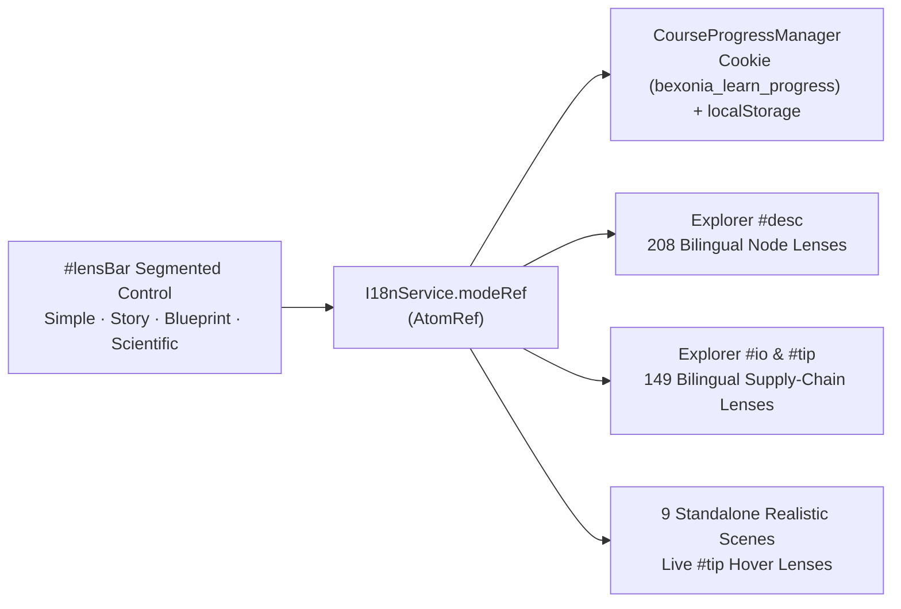

# 05 — Multi-Mode Explanation Lenses (`Simple`, `Story`, `Blueprint`, `Scientific`) & Connected Cellular Stories

**Iteration:** `05` (Reactive 4-Mode Reading Lenses & End-to-End Supply-Chain Storytelling in `EN` & `ES`)  
**Status:** ✅ **Completed & Verified**  
**Parent Index:** [`roadmap/README.md`](./README.md)  
**Previous Step:** [`04-optional-user-accounts-and-course-progress-sync.md`](./04-optional-user-accounts-and-course-progress-sync.md)

---

## 1. Executive Summary & Completed Goals

Implemented a **reactive 4-Mode Explanation Lens** (`Simple` · `Story` · `Blueprint` · `Scientific`) across `learn-biology` (`https://learn.bexonia.com`) so researchers, systems thinkers, curious learners, and newcomers can explore the exact same interactive 3D WebGL scene through the lens that fits them best:

1. **Four Distinct Lenses Without Scene Reloads (`0` WebGL Overhead):**
   - **`Simple` (`Sencillo`):** 10-second everyday intuition in 1–2 sentences with minimal jargon.
   - **`Story` (`Historia` — Default):** Connected narrative prose where every whole cell or virus forms an overarching plot and every internal organelle or macromolecule acts as a chapter — naturally weaving **where its inputs arrived from**, **the physical transformation inside**, and **which downstream neighbors spend or recycle its outputs next**.
   - **`Blueprint` (`Esquema`):** Systems-architecture dependency circuit (`Role` · `Arrives from` · `Inside` · `Delivers to` · `Closes the loop`) for visual and engineering-minded learners.
   - **`Scientific` (`Científico`):** Dense, direct quantitative reference (dimensions, subunit stoichiometry, enzyme complexes, electrochemical gradients, and experimental PDB accessions) with zero narrative framing.
2. **100% Coverage Across All `208` Explorer Nodes & `149` Realistic 3D Parts (`EN` + `ES`):**
   - Every one of the `208` zoomable `NODES` in [`cell_explorer.ts`](../src/pages/cell_explorer.ts) and every one of the `149` interactive 3D parts across all `9` standalone realistic pages (`animal_cell_realistic.html`, `plant_cell_realistic.html`, `fungal_cell_realistic.html`, `prokaryote_cell_realistic.html`, `bacteriophage_realistic.html`, `coronavirus_realistic.html`, `hiv_realistic.html`, `adenovirus_realistic.html`, `tmv_realistic.html`) includes bespoke entries for all 4 modes in both **English (`EN`)** and **Spanish (`ES`)**.
3. **Interactive Inline Character Links & Supply-Chain Navigation:**
   - Inline `[[Label|nodeId]]` references and upstream (`← From`) / downstream (`Next →`) supply-chain chips highlight structures on hover and navigate directly to the linked organelle, protein complex, or molecule on click.
4. **Automatic Persistence (`CourseProgressManager` + `I18nService`):**
   - Reactive `modeRef` (`AtomRef<ExplanationMode>`) in [`i18n.ts`](../src/core/i18n.ts) synchronized with [`CourseProgressManager`](../src/core/progress_service.ts) (`bexonia_learn_progress` cookie + `localStorage` `learnBioMode`).

---

## 2. Implemented Architecture (`src/content/` & `src/core/i18n.ts`)

### Modular Content Layout
- [`src/content/types.ts`](../src/content/types.ts) — Strongly typed `ExplanationMode`, `NodeLensEntry`, `PartLensEntry`, `PartBlueprintLens`, and `PartFlowLink` interfaces.
- [`src/content/parser.ts`](../src/content/parser.ts) — Zero-dependency parser converting paragraph breaks and `[[Label|nodeId]]` tokens into safe DOM token trees (no `innerHTML` injection).
- Domain modules:
  - [`src/content/lenses_animal.ts`](../src/content/lenses_animal.ts) (`71` nodes + `23` animal cell parts)
  - [`src/content/lenses_plant_fungal.ts`](../src/content/lenses_plant_fungal.ts) (`48` nodes + `29` plant & `25` fungal parts)
  - [`src/content/lenses_prokaryote.ts`](../src/content/lenses_prokaryote.ts) (`35` nodes + `21` *E. coli* parts)
  - [`src/content/lenses_phage_dna_viruses.ts`](../src/content/lenses_phage_dna_viruses.ts) (`33` nodes + `19` T4, `8` Adenovirus & `6` TMV parts)
  - [`src/content/lenses_enveloped_viruses.ts`](../src/content/lenses_enveloped_viruses.ts) (`21` nodes + `9` SARS-CoV-2 & `9` HIV-1 parts)
- [`src/content/index.ts`](../src/content/index.ts) — Unified lookup (`ALL_NODE_LENSES`, `ALL_PART_LENSES`, `getNodeLensText`, `getPartLensEntry`).

---

## 3. Verification Gates (`tests/verify_all.ts`)

- **Completeness & Distinctness:** Verified all `208` Explorer nodes and all `149` realistic 3D parts define non-empty, mode-distinct entries for `simple`, `story`, `blueprint`, and `scientific` in both `en` and `es`.
- **Link Referential Integrity:** Verified every `[[Label|nodeId]]` token and every `from` / `to` supply-chain `nodeId` resolves to an existing Explorer node.
- **Headless Chrome WebGL E2E:** Verified live switching across all 4 modes and both locales (`EN` / `ES`) updates `#desc`, `#io`, and `#tip` immediately without WebGL errors or scene reloads, and persists across sessions.
