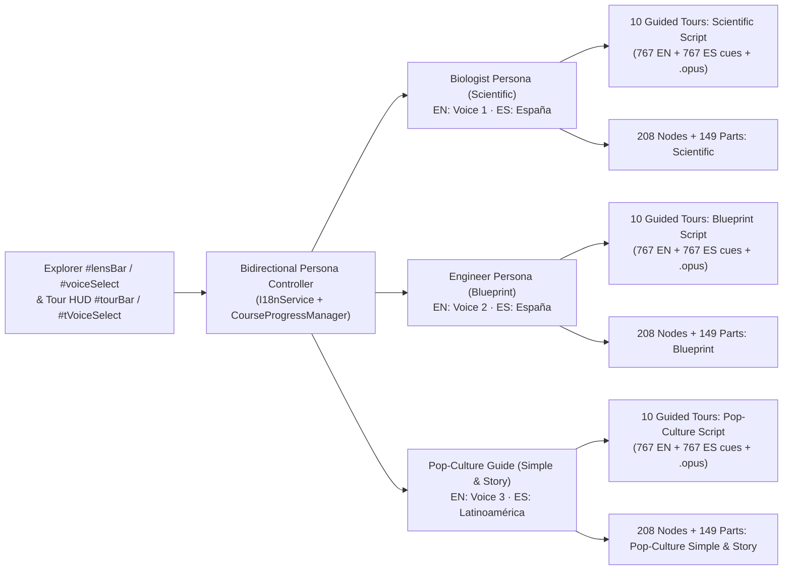

# 06 — Adaptive Narrator Personas, Multi-Script Guided Tours & Pop-Culture Analogies

**Iteration:** `06` (Bidirectional Narrator ↔ Content Persona Coupling, 3-Persona Guided Tour Scripts Across All `10` Tours, & Anime / Cartoon / Movie Analogies in `EN` & `ES`)  
**Status:** ✅ **Completed & Verified**  
**Parent Index:** [`roadmap/README.md`](./README.md)  
**Previous Step:** [`05-multi-mode-lenses-and-connected-stories.md`](./05-multi-mode-lenses-and-connected-stories.md)

---

## 1. Executive Summary & Goals

While **Phase 05** introduced 4 reading lenses (`Simple` · `Story` · `Blueprint` · `Scientific`) on Explorer sidebar descriptions (`#desc` / `#io`) and 5 Public-Domain (`CC0`) voices (`3` English + `2` Spanish), two gaps remain:
1. **All `10` Guided Tours (`767` timed cues) still speak a single shared script**, meaning a molecular biologist, a systems engineer, and a complete newcomer all hear the exact same introductory lines during animated tours.
2. **Selecting a Narrator (`#voiceSelect` / `#tVoiceSelect`) currently swaps only the audio voice** rather than adapting the written & spoken explanation to match that narrator's specialist or storytelling persona, and newcomer explanations use general metaphors rather than memorable pop-culture, anime, cartoon, and movie references.

**Phase 06** upgrades `learn-biology` (`https://learn.bexonia.com`) so every Narrator acts as a complete **Voice + Content Persona** across **all `10` Guided Tours (`767` cues × `3` scripts), all `208` Explorer Nodes, and all `149` 3D Hover Cards** in both **English (`EN`)** and **Spanish (`ES`)**:

1. **Three Audience-Tailored Guided Tour Scripts (`4,602` Localized Tour Cues Across `EN` & `ES`):**
   - **`Pop-Culture & Story` (`pop` — active in `Simple` & `Story` modes):** Witty, high-clarity newcomer tour script using recognizable **anime, cartoon, and movie references** (*Cells at Work!*, *Attack on Titan*, *Star Wars*, *The Matrix*, *Pokémon*, *Dragon Ball Z*, *Monsters, Inc.*, *Avengers*, *Neon Genesis Evangelion*, *One Piece*, *SpongeBob*) so learners with zero biology background grasp real mechanisms immediately.
   - **`Systems Blueprint` (`blueprint` — active in `Blueprint` mode):** Engineering & systems-architecture tour script framing organelles and virions as input/output ports, rotary ATP turbines, mRNA instruction buses, error-correcting polymerases, pressure vessels (`~60 atm`), and two-factor receptor handshakes.
   - **`Specialist Scientific` (`scientific` — active in `Scientific` mode):** High-density quantitative molecular biology tour script delivering exact dimensions (`nm` / `µm`), subunit stoichiometry, enzyme complexes, electrochemical gradients (`Δp`), and experimental `PDB` accessions with zero narrative filler.
2. **Pop-Culture `Simple` & `Story` Upgrade Across All `208` Explorer Nodes & `149` 3D Hover Cards:**
   - Infuses funny, accurate anime, cartoon, and movie analogies into every `simple` and `story` entry (`EN` + `ES`) across [`src/content/lenses_*.ts`](../src/content/) while preserving every interactive `[[Label|nodeId]]` upstream/downstream supply-chain link (and keeping the already-complete `blueprint` and `scientific` node lenses intact).
3. **Bidirectional Narrator ↔ Content Sync (with Optional Custom Voice Lock):**
   - Picking a Narrator in `#voiceSelect` or `#tVoiceSelect` automatically switches **both the active voice and its matching explanation mode/script** (`EN`: `Voice 1` → `Scientific`, `Voice 2` → `Blueprint`, `Voice 3` → `Story` Pop-Culture; `ES`: `Latinoamérica` → `Historia` Pop-Culture, `España` → `Científico` / `Esquema`), including live mid-Tour subtitle + `.opus` updates.
   - Users who want a specific voice paired with a different reading mode can toggle **`🔒 Lock Voice`** (`Custom Voice Lock`), and click **`Preset` / `Preajuste`** at any time to restore automatic Persona + Voice synchronization.
   - Adds a compact 4-mode lens switcher directly inside the **Guided Tour HUD (`#tourBar` & `#tCard`)** so visitors can switch personas without leaving a tour.

---

## 2. Target Architecture & Persona Mapping

### Persona-to-Mode & Voice Matrix

| Persona | Active Mode(s) | Preset `EN` Voice | Preset `ES` Voice | Target Audience & Script Style |
| :--- | :--- | :--- | :--- | :--- |
| **Molecular Biologist** | `scientific` (`Científico`) | `v1` (David Clarke — LibriVox `CC0`) | `spain` (Castilian Baritone — Common Voice `CC0`) | Biologists, clinicians & advanced researchers inspecting immediate quantitative specs, complexes, stoichiometry, and `PDB` codes. |
| **Systems Engineer** | `blueprint` (`Esquema`) | `v2` (Peter Yearsley — LibriVox `CC0`) | `spain` (Castilian Baritone — Common Voice `CC0`) | Engineers & systems thinkers inspecting `Arrives from → Inside → Delivers to` circuits, energy budgets, valves, and state machines. |
| **Pop-Culture Storyteller** | `story` (`Historia`) & `simple` (`Sencillo`) | `v3` (Martin Geeson — LibriVox `CC0`) | `latam` (Latin American Baritone — Common Voice `CC0`) | Newcomers, students & curious explorers learning through memorable *Cells at Work!*, *Star Wars*, *Attack on Titan*, *The Matrix*, *Pokémon*, *Dragon Ball Z*, *Avengers*, and *Monsters, Inc.* analogies. |

---

## 3. Side-by-Side Content Specification

### A. Guided Tour Cues (`src/tours/personas_*.ts`) — *Example: Bacteriophage T4 Injection*
Every persona script preserves the exact 3D camera choreography, cue count (`767`), and `[[label|part]]` mesh highlight tokens of the base tour:

| Cue ID | `Pop-Culture` (`Simple` / `Story` — `EN v3` · `ES latam`) | `Blueprint` (`EN v2` · `ES spain`) | `Scientific` (`EN v1` · `ES spain`) |
| :--- | :--- | :--- | :--- |
| `ch0.intro.01` | Meet [[Bacteriophage T4\|capsid]]—like a *Star Wars* lunar lander crossed with a syringe. | [[Bacteriophage T4\|capsid]]: spring-loaded mechanical payload injector; zero onboard metabolism. | *Caudoviricetes* myovirus [[T4 virion\|capsid]] (`~200 × 90 nm`; prolate $T=13\text{ laevo}$ gp23*/gp24* head). |
| `ch2.land.01` | Six [[long tail fibers\|fibers]] sweep *E. coli* like *Spider-Man* tripwires hunting `OmpC` ports. | Six [[long tail fibers\|fibers]] execute a reversible two-factor receptor handshake on `LPS` and `OmpC`. | Distal gp37 [[long tail fibers\|fibers]] reversibly bind `OmpC`/LPS before gp12 short fibers lock the baseplate. |
| `ch2.inject.01` | Target locked! The [[sheath\|sheath]] fires like an *Evangelion* pile-bunker in milliseconds. | Baseplate trigger contracts the [[helical sheath\|sheath]] 55%, driving the inner tube across peptidoglycan. | Dome-to-star transition contracts the 138-subunit gp18 [[tail sheath\|sheath]] (`92.5 → 42 nm`) + gp5 lysozyme tip. |
| `ch2.inject.02` | Viral [[DNA\|dna]] blasts in—pulling a *Matrix* Agent Smith takeover on host ribosomes! | Internal `~60 atm` pressure flushes the `169 kbp` [[dsDNA payload\|dna]] into the host execution bus. | Pressurized `168.9 kbp` glucosylated hmC [[dsDNA\|dna]] translocates across the inner membrane at `~4 kbp/s`. |

### B. Pop-Culture Analogy Anchors Across the 10 Organisms (`Simple` & `Story`)
- **Animal Cell (`real-cell`):** ***Cells at Work!*** bustling metropolis — **Tony Stark Arc Reactor / Goku Senzu Bean** `Mitochondria`, ***Monsters, Inc.* door-vault** `Nuclear Pores`, **Amazon / *Cells at Work!* courier walkers** (`Kinesin` & `Dynein` marching down `Microtubule` highways), **Pac-Man / acid chop-shop** `Lysosomes`.
- **Plant Cell (`real-plant`):** ***Attack on Titan* Wall Maria** crisscrossed `Cell Wall` holding back high-pressure `Central Vacuole` turgor, **Superman solar-fortress** `Chloroplasts` splitting water with starlight.
- **Fungal Cell (`real-fungal`):** **Dwarven pressure-brewery** armored in `Chitin` & `β-glucan`, inflating a daughter bud through a `Septin` hourglass portal.
- **Prokaryotic Cell (`real-bacterium`):** **Millennium Falcon open-cockpit speedrunner** — translating mRNA while it is still being printed and spinning `100,000 RPM` proton-driven `Flagella` pod-racer turbines.
- **Viruses (`T4`, `SARS-CoV-2`, `HIV-1`, `Adenovirus`, `TMV`, & comparative `viruses`):** ***Star Wars* / *Evangelion*** T4 lander, **Mystique / *Predator* glycan-camouflaged** SARS-CoV-2 `6VSB` spikes, **Trojan Horse + *Matrix* Agent Smith** HIV-1 `p24` fullerene cone & Integrase, **Kryptonian crystal fortress** Adenovirus icosahedron, and ***Dune* sandworm / tunnel-heist** TMV co-translational uncoating + `MP30` plasmodesmata widening.

---

## 4. Implementation Steps & File Plan

### Step 1: Bidirectional Persona State & Tour HUD Controls
- Extend [`src/content/types.ts`](../src/content/types.ts) with `TourPersona = 'pop' | 'blueprint' | 'scientific'`, `MODE_TO_TOUR_PERSONA`, `DEFAULT_MODE_BY_ENGLISH_VOICE` (`v1 → 'scientific'`, `v2 → 'blueprint'`, `v3 → 'story'`), and `DEFAULT_MODE_BY_SPANISH_VOICE` (`latam → 'story'`, `spain → 'scientific'`), plus a boolean `voiceLocked` state in [`src/core/i18n.ts`](../src/core/i18n.ts) and [`src/core/progress_service.ts`](../src/core/progress_service.ts).
- Update [`cell_explorer.html`](../cell_explorer.html) and [`src/pages/cell_explorer.ts`](../src/pages/cell_explorer.ts) to:
  1. Render compact 4-mode pills (`Simple` · `Story` · `Blueprint` · `Scientific`) inside `#tourBar` and `#tCard` so Guided Tour viewers can switch content + narrator live.
  2. Make `#voiceSelect` and `#tVoiceSelect` switch **both** the voice and its signature explanation mode when `voiceLocked === false`, while providing a **`🔒 Lock` / `Preset`** button for custom voice overrides.

### Step 2: Multi-Persona Tour Script Modules (`src/tours/`)
- Create [`src/tours/tour_personas.ts`](../src/tours/tour_personas.ts) and modular bilingual persona scripts covering all `10` tours (`767` cues × `3` personas × `2` locales = `4,602` cues, each `<= 110` chars for clean 2-line subtitle display and preserving exact `[[label|part]]` tokens):
  - `src/tours/personas_eukaryote.ts` (`real-cell`, `real-plant`, `real-fungal`)
  - `src/tours/personas_prokaryote_phage.ts` (`real-bacterium`, `real-phage`)
  - `src/tours/personas_viruses.ts` (`real-coronavirus`, `real-hiv`, `real-adenovirus`, `real-tmv`, `viruses`)
- Update cue lookup in [`src/pages/cell_explorer.ts`](../src/pages/cell_explorer.ts) (`renderCue`, `speak`, `renderMenu`, `showCard`) so active Tour subtitles, chapter transcripts, and spoken cues dynamically resolve from `(tourRoot, cueId, locale, tourPersona)`.

### Step 3: Pop-Culture Upgrade for Explorer `Simple` & `Story` Lenses (`src/content/`)
- Upgrade `en.simple`, `en.story`, `es.simple`, and `es.story` across all `208` nodes and `149` realistic 3D parts in:
  - [`src/content/lenses_animal.ts`](../src/content/lenses_animal.ts)
  - [`src/content/lenses_plant_fungal.ts`](../src/content/lenses_plant_fungal.ts)
  - [`src/content/lenses_prokaryote.ts`](../src/content/lenses_prokaryote.ts)
  - [`src/content/lenses_phage_dna_viruses.ts`](../src/content/lenses_phage_dna_viruses.ts)
  - [`src/content/lenses_enveloped_viruses.ts`](../src/content/lenses_enveloped_viruses.ts)
- Leave `blueprint` and `scientific` node/part lenses (and their `2,080` existing `.opus` files) untouched.

### Step 4: Offline Multi-Persona `.opus` Synthesis & `< 48 MB` Sharded Packaging
- Update [`scripts/export_tour_cues.ts`](../scripts/export_tour_cues.ts) and [`src/core/narrator_service.ts`](../src/core/narrator_service.ts):
  - Route English Tour audio (`audio.tar.gz`, `~27 MB`) by persona/voice: `audio/en/v1/{root}/{cueId}.opus` (`scientific` script), `audio/en/v2/{root}/{cueId}.opus` (`blueprint` script), `audio/en/v3/{root}/{cueId}.opus` (`pop` script) — zero extra archive count in English!
  - Route Spanish Tour audio across two `< 38 MB` shards (`audio_tours_es_pop.tar.gz` for `audio/es/latam/{root}/{cueId}.opus` `pop` script, and `audio_tours_es_tech.tar.gz` for `audio/es/spain/{blueprint,scientific}/{root}/{cueId}.opus`).
  - Re-synthesize only the `_a` (`simple` + `story`) Explorer node lens shards (`audio_lenses_v{1,2,3}_a.tar.gz`, `audio_lenses_es_{latam,spain}_a.tar.gz`) via [`tools/generate_narration_gptsovits.py`](../tools/generate_narration_gptsovits.py) and [`tools/generate_narration_f5_es.py`](../tools/generate_narration_f5_es.py), keeping all `.tar.gz` files strictly `< 48 MB` and updating [`Makefile`](../Makefile) + [`Dockerfile`](../Dockerfile).

---

## 5. Verification Gates (`tests/verify_all.ts`)

1. **Multi-Persona Tour Integrity:**
   - Assert every one of the `767` cues across all `10` Guided Tours defines non-empty, distinct `pop`, `blueprint`, and `scientific` texts in both `en` and `es` (`4,602` total cues), each `<= 110` plain characters and preserving exact `[[...|part]]` 3D highlight targets.
2. **Explorer Pop-Culture Lens Integrity:**
   - Assert all `208` Explorer nodes and `149` realistic 3D parts pass `[[Label|nodeId]]` link validation and mode distinctness across `simple`, `story`, `blueprint`, and `scientific` in `en` and `es`.
3. **Bidirectional Narrator ↔ Persona Reactivity:**
   - Assert selecting a narrator in unlocked (`Preset`) mode updates `i18n.mode` and active Tour/Explorer text automatically, while enabling `voiceLocked` preserves a custom voice across mode switches until reset to `Preset`.
4. **Static `.opus` & Archive Verification:**
   - Verify `100%` of Tour Persona and 4-Mode Explorer `.opus` files exist on disk with valid `OggS` headers and every `audio*.tar.gz` archive is `< 48 MB`.
5. **Headless Chrome WebGL E2E (`make test`):**
   - Verify live switching between `Pop-Culture Guide`, `Systems Engineer`, and `Molecular Biologist` mid-Tour updates `#subs` subtitle text and streams the matching `.opus` audio (`HTTP 200`, `OggS`) across `EN` and `ES` with `0` console/page errors.

---

## 6. Shipped Verification Summary

- **Bidirectional Narrator ↔ Persona Controls:** Shipped `TourPersona` (`pop` | `blueprint` | `scientific`), `MODE_TO_TOUR_PERSONA`, `selectNarrator` / `selectSpanishNarrator`, `voiceLocked` (`🔓 Lock Voice` / `🔒 Voice Locked` + `Preset` / `Preajuste`), and live 4-mode pills (`#tourLensBar` & `#tCardLensBar`) inside the Guided Tour HUD.
- **4,602 Multi-Persona Guided Tour Cues (`10` Tours × `767` Cues × `3` Personas × `2` Locales):** Authored and verified across `src/tours/personas_eukaryote.ts` (`247` cues), `src/tours/personas_prokaryote_phage.ts` (`176` cues), and `src/tours/personas_viruses.ts` (`344` cues), preserving `100%` of `[[label|part]]` 3D mesh highlight targets (`<= 110` plain chars).
- **Pop-Culture `Simple` & `Story` Lenses (`208` Explorer Nodes + `149` 3D Hover Cards in `EN` & `ES`):** Upgraded across all `5` content modules while preserving `100%` of interactive `[[Label|nodeId]]` links and leaving `blueprint` / `scientific` lenses intact.
- **8,762 Pre-Generated `.opus` Clips Across `15` `< 48 MB` Sharded Archives:** Synthesized locally on RTX 4080 GPU via `GPT-SoVITS` (`EN` `v1`/`v2`/`v3`) and `F5-Spanish` (`ES` `latam` + `spain/{blueprint,scientific}`) using Public-Domain (`CC0`) studio voices (`17–39 MB` per archive) and verified 100% green via `make test`.
