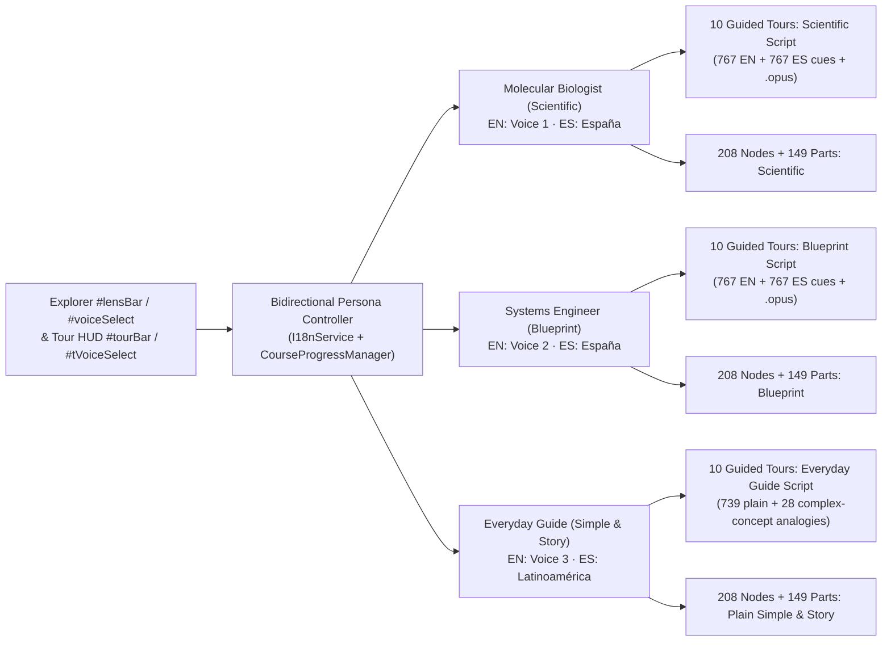

# 06 — Adaptive Narrator Personas, Multi-Script Guided Tours & Purposeful Analogies

**Iteration:** `06` (Bidirectional Narrator ↔ Content Persona Coupling, 3-Persona Guided Tour Scripts Across All `10` Tours, & Sparse Complex-Mechanism Analogies in `EN` & `ES`)  
**Status:** ✅ **Completed & Verified**  
**Parent Index:** [`roadmap/README.md`](./README.md)  
**Previous Step:** [`05-multi-mode-lenses-and-connected-stories.md`](./05-multi-mode-lenses-and-connected-stories.md)  
**Next Step:** [`07-biology-introduction-stage-and-sequential-curriculum-tree.md`](./07-biology-introduction-stage-and-sequential-curriculum-tree.md)

---

## 1. Executive Summary & Shipped Design

**Phase 06** upgrades `learn-biology` (`https://learn.bexonia.com`) so every Narrator acts as a complete **Voice + Content Persona** across **all `10` Guided Tours (`767` cues × `3` scripts), all `208` Explorer Nodes, and all `149` 3D Hover Cards** in both **English (`EN`)** and **Spanish (`ES`)**:

1. **Three Audience-Tailored Guided Tour Scripts (`4,602` Localized Tour Cues Across `EN` & `ES`):**
   - **`Everyday Guide` (`pop` — active in `Simple` & `Story` modes):** Clear, direct newcomer tour script (`96.4%` = `739` of `767` cues written in plain, distraction-free prose) paired with **sparse, purposeful analogies (`28` cues across all `10` tours, ~1 every 2 minutes)** reserved strictly for genuinely important, conceptually complex biological mechanisms.
   - **`Systems Blueprint` (`blueprint` — active in `Blueprint` mode):** Engineering & systems-architecture tour script framing organelles and virions as input/output ports, rotary ATP turbines, mRNA instruction buses, error-correcting polymerases, pressure vessels (`~60 atm`), and two-factor receptor handshakes.
   - **`Specialist Scientific` (`scientific` — active in `Scientific` mode):** High-density quantitative molecular biology tour script delivering exact dimensions (`nm` / `µm`), subunit stoichiometry, enzyme complexes, electrochemical gradients (`Δp`), and experimental `PDB` accessions with zero narrative filler.
2. **Restrained Functional Analogies Across All `208` Explorer Nodes & `149` 3D Hover Cards:**
   - Keeps `simple` and `story` entries (`EN` + `ES`) across [`src/content/lenses_*.ts`](../src/content/) direct and distraction-free on straightforward structures (membranes, small molecules, basic compartments) while using clear functional metaphors only on complex molecular machines, preserving `100%` of interactive `[[Label|nodeId]]` supply-chain links.
3. **Bidirectional Narrator ↔ Content Sync (with Optional Custom Voice Lock):**
   - Picking a Narrator in `#voiceSelect` or `#tVoiceSelect` automatically switches **both the active voice and its matching explanation mode/script** (`EN`: `Voice 1` → `Scientific`, `Voice 2` → `Blueprint`, `Voice 3` → `Story`; `ES`: `Latinoamérica` → `Historia`, `España` → `Científico` / `Esquema`), including live mid-Tour subtitle + `.opus` updates.
   - Users who want a specific voice paired with a different reading mode can toggle **`🔒 Lock Voice`**, and click **`Preset` / `Preajuste`** at any time to restore automatic Persona + Voice synchronization.
   - Adds a compact 4-mode lens switcher directly inside the **Guided Tour HUD (`#tourBar` & `#tCard`)** so visitors can switch personas live mid-Tour.

> [!IMPORTANT]
> **Editorial Rule — Strict Analogy Restraint (Mandatory for All Current & Future Tours/Lenses):**
> - **Never add an analogy just because it is fun or entertaining.** Analogies on intros, dimensions, camera cutaways, UI instructions, simple shapes, or rapid-fire recaps create cognitive noise and fatigue.
> - **Frequency cap in Guided Tours:** At most **1 analogy every ~1.5–2.5 minutes** (`1–4` cues per tour; `< 5%` of total cues). The remaining `> 95%` of cues in `Everyday Guide` (`Simple` / `Story`) must explain the biology directly and clearly in plain language.
> - **Selection test:** Include an analogy **only** when (a) the part or process is **biologically central**, and (b) its mechanism is **conceptually complex or counterintuitive** so a concrete functional mental model makes the mechanism click immediately.

---

## 2. Architecture & Persona Mapping

### Persona-to-Mode & Voice Matrix

| Persona | Active Mode(s) | Preset `EN` Voice | Preset `ES` Voice | Target Audience & Script Style |
| :--- | :--- | :--- | :--- | :--- |
| **Molecular Biologist** | `scientific` (`Científico`) | `v1` (David Clarke — LibriVox `CC0`) | `spain` (Castilian Baritone — Common Voice `CC0`) | Biologists, clinicians & advanced researchers inspecting immediate quantitative specs, complexes, stoichiometry, and `PDB` codes. |
| **Systems Engineer** | `blueprint` (`Esquema`) | `v2` (Peter Yearsley — LibriVox `CC0`) | `spain` (Castilian Baritone — Common Voice `CC0`) | Engineers & systems thinkers inspecting `Arrives from → Inside → Delivers to` circuits, energy budgets, valves, and state machines. |
| **Everyday Guide** | `story` (`Historia`) & `simple` (`Sencillo`) | `v3` (Martin Geeson — LibriVox `CC0`) | `latam` (Latin American Baritone — Common Voice `CC0`) | Newcomers & students learning through plain, clear biology explanations with **sparse analogies (~1 every 2 minutes)** reserved strictly for complex mechanisms. |

---

## 3. Side-by-Side Content Specification

### A. Plain Cue vs. Complex-Mechanism Analogy Cue (`src/tours/personas_*.ts`)

| Cue Type | Cue ID | `Everyday Guide` (`Simple` / `Story`) | `Blueprint` (`EN v2` · `ES spain`) | `Scientific` (`EN v1` · `ES spain`) |
| :--- | :--- | :--- | :--- | :--- |
| **Standard Cue (`96.4%` — Zero Analogy)** | `ch0.intro.01` | This is an animal cell, like the ones that make up your body. | System overview: a self-contained eukaryotic chassis running your body tissues. | Eukaryotic somatic animal cell: a compartmentalized, membrane-bound living unit. |
| **Complex Mechanism (`3.6%` — Sparse Analogy)** | `ch4.ribosome.01` | [[Ribosomes]] work like 3D factory printers, reading 3-letter mRNA codes to snap amino acids together. | [[Ribosomes]]: two-subunit translation engines decoding 3-bit mRNA codons into polypeptides. | `80S` [[ribosomes]] (`40S` + `60S`, ~4.3 MDa) catalyze peptidyl transfer across A/P/E tRNA sites. |
| **Complex Mechanism (`3.6%` — Sparse Analogy)** | `t4.ch2.sheath.02` | With zero ATP on board, this sleeve comes pre-cocked from the host factory like a spring syringe. | Mechanical actuator pre-tensioned during assembly; fires without onboard ATP supply. | Metastable extended gp18 lattice stores elastic free energy during morphogenesis for ATP-free firing. |

### B. Curated Complex-Mechanism Analogies Across the `10` Tours (`28` of `767` Cues)
- **Animal Cell (`4` cues in ~8.5 min):** Walking motor couriers vs. random diffusion (`ch2.mt.02`), nuclear-pore ID customs gates (`ch3.pores.02`), 3D-printer ribosomes (`ch4.ribosome.01`), and cristae hydroelectric ATP turbines (`ch5.mito.04`).
- **Plant, Fungal & Bacterial Cells (`3` cues each):** Vacuolar tire-inner-tube turgor pressure, thylakoid dam-spillway ATP turbines, RuBisCO welding invisible CO₂ gas into solid sugar, fungal proton-battery symport, septin hourglass airlock, yeast closed "ship-in-a-bottle" mitosis, tripartite bilge efflux pump, flagellar clutch reversal, and coupled transcription–translation while mRNA is still printing.
- **Viruses (`1–4` cues per tour):** Phage champagne-pressure capsid + pre-cocked spring syringe + lunar-lander receptor feelers, SARS-CoV-2 hidden-key RBD flip + S2 harpoon-winch fusion, HIV Trojan-horse capsid pores + RNase H self-erasing template + permanent chromosome stitch, Adenovirus mooring-line tether + backfiring acid-trap escape, TMV calcium safety pins + movement-protein wall-tunnel crowbar, and virus as an unplugged USB drive outside a host cell.

---

## 4. Verification Gates (`tests/verify_all.ts`)

1. **Multi-Persona Tour & Analogy-Restraint Integrity:**
   - Asserts every one of the `767` cues across all `10` Guided Tours defines non-empty, pairwise-distinct `pop`, `blueprint`, and `scientific` texts in both `en` and `es` (`4,602` total cues, `<= 110` plain chars, `100%` `[[...|part]]` highlight preservation).
   - Enforces an automated **Analogy Restraint bound (`20..45` of `767` cues)** so analogies remain sparse (`~1` every 2 minutes on complex mechanisms) and never regress into per-cue filler.
2. **Explorer Lens Integrity:**
   - Asserts all `208` Explorer nodes and `149` realistic 3D parts pass `[[Label|nodeId]]` link validation and 4-mode distinctness in `en` and `es`.
3. **Bidirectional Narrator ↔ Persona Reactivity:**
   - Asserts selecting a narrator in unlocked (`Preset`) mode updates `i18n.mode` and active Tour/Explorer text automatically, while `voiceLocked` preserves a custom voice across mode switches until reset to `Preset`.
4. **Static `.opus` & Archive Verification + Headless Chrome WebGL E2E (`make test`):**
   - Verifies all `8,762` `.opus` files have valid `OggS` headers across `15` `< 48 MB` archives, and live mid-Tour switching across `Everyday Guide`, `Systems Engineer`, and `Molecular Biologist` updates `#subs` subtitles and streams matching `.opus` audio (`HTTP 200`, `OggS`) in `EN` and `ES` with `0` console/page errors.

---

## 5. Shipped Verification Summary

- **Bidirectional Narrator ↔ Persona Controls:** Shipped `TourPersona` (`pop` | `blueprint` | `scientific`), `MODE_TO_TOUR_PERSONA`, `selectNarrator` / `selectSpanishNarrator`, `voiceLocked` (`🔓 Lock Voice` / `🔒 Voice Locked` + `Preset` / `Preajuste`), and live 4-mode pills (`#tourLensBar` & `#tCardLensBar`) inside the Guided Tour HUD.
- **4,602 Multi-Persona Guided Tour Cues (`10` Tours × `767` Cues × `3` Personas × `2` Locales):** Verified across `src/tours/personas_eukaryote.ts`, `src/tours/personas_prokaryote_phage.ts`, and `src/tours/personas_viruses.ts` (`739` clean direct newcomer cues + `28` sparse complex-mechanism analogies, `0` errors).
- **8,762 Pre-Generated `.opus` Clips Across `15` `< 48 MB` Sharded Archives:** Synthesized locally on RTX 4080 GPU via `GPT-SoVITS` (`EN` `v1`/`v2`/`v3`) and `F5-Spanish` (`ES` `latam` + `spain/{blueprint,scientific}`) using Public-Domain (`CC0`) studio voices and verified 100% green via `make test` (`29/29` checks).
