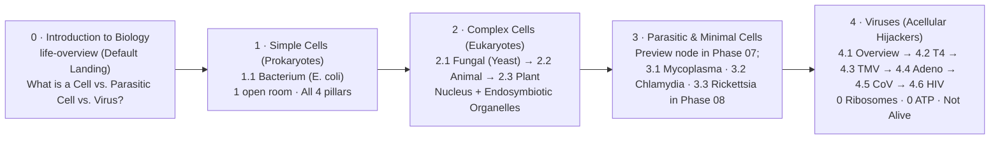

# 07 — `0 · Introduction to Biology` 3D Stage & Reclassified Sequential Curriculum Tree

**Iteration:** `07` (4-Pedestal Comparative 3D Introduction Stage, 5-Chapter Guided Biology Primer Tour, Hierarchical `0 → 4` Structure Tree & Sequential Course Progression in `EN` & `ES`)  
**Status:** ✅ **Completed & Verified**  
**Parent Index:** [`roadmap/README.md`](./README.md)  
**Previous Step:** [`06-adaptive-narrator-personas-and-pop-culture-analogies.md`](./06-adaptive-narrator-personas-and-pop-culture-analogies.md)  
**Next Step:** [`08-parasitic-and-minimal-cells-mycoplasma-chlamydia-rickettsia.md`](./08-parasitic-and-minimal-cells-mycoplasma-chlamydia-rickettsia.md)

---

## 1. Executive Summary & Pedagogical Goals

Currently, visitors opening `learn-biology` (`https://learn.bexonia.com`) land directly inside a complex mammalian **Animal Cell** (`15+` internal compartments) under a flat 2-bucket sidebar (`Cells` / `Viruses`). Two pedagogical gaps make this harder than necessary for newcomers:
1. **No Big-Picture Primer Before Deep Dives:** First-time learners never get a clear, visual 3-minute answer to *"What is a cell? Why start with prokaryotes? What are incomplete/parasitic cells? And why are viruses NOT alive?"* before zooming into individual molecular machines.
2. **Unordered Flat Sidebar (`Animal Cell` First Instead of `Prokaryote` First):** Starting with the most complex multicellular tissue cell hides the core 4-pillar logic of life (**Membrane · DNA · Ribosomes · Own ATP**), whereas starting with a 1-room **Prokaryote (*E. coli*)** makes every subsequent organism an intuitive addition (organelles in **Eukaryotes**) or subtraction (lost ATP autonomy in **Parasitic/Minimal Cells**, and zero ribosomes/metabolism in **Viruses**).

**Phase 07** transforms `cell_explorer.html` into a **guided sequential curriculum (`Stage 0 → Stage 4`)** while preserving instant free-jump access for advanced researchers:

1. **`Stage 0 · Introduction to Biology` Comparative 3D Scene (`life-overview`):**
   - Default landing scene (`buildBiologyIntro` in [`src/pages/cell_explorer.ts`](../src/pages/cell_explorer.ts)) presenting the **4 Tiers of Biological Organization** side-by-side on one 3D WebGL2 stage with live **4-Pillar Autonomy Badges** (`Membrane` · `dsDNA` · `Ribosomes` · `Own ATP`):
     - **Pedestal ① — Simple Cell (*Prokaryote: E. coli*):** `✅ Membrane · ✅ dsDNA · ✅ 70S Ribosomes · ✅ Own ATP` (all 4 pillars in 1 open room).
     - **Pedestal ② — Complex Cells (*Eukaryotes: Yeast, Animal, Plant*):** `✅ Membrane · ✅ Nuclear DNA · ✅ 80S Ribosomes · ✅ Organelles (Mitochondria / Chloroplasts)`.
     - **Pedestal ③ — Parasitic & Minimal Cells (*Mycoplasma, Chlamydia, Rickettsia*):** `✅ Membrane · ✅ dsDNA · ✅ 70S Ribosomes · ❌ Steals Host ATP` (true cells that lost metabolic self-sufficiency; deep-dive 3D pages ship in [Phase 08](./08-parasitic-and-minimal-cells-mycoplasma-chlamydia-rickettsia.md), with interactive preview models on Pedestal ③ right away).
     - **Pedestal ④ — Viruses (*Phage T4, SARS-CoV-2, HIV-1, Adenovirus, TMV*):** `⚠️ Capsid/Envelope · ⚠️ DNA or RNA · ❌ 0 Ribosomes · ❌ 0 ATP` (acellular genetic hijackers—inert outside a living host).
2. **Narrated 5-Chapter Guided Primer Tour (`src/tours/biology_intro.ts`):**
   - A ~3-minute (`~32`-cue) narrated Guided Tour (`EN` & `ES`) across all `3` personas (`Everyday Guide`, `Systems Engineer`, `Molecular Biologist`) flying across the 4 pedestals to establish the rules of biology before Lesson 1.
   - **Strict Analogy Restraint:** Follows the Phase 06 standard—`>= 90%` clean, direct prose with **at most 2 purposeful analogies across the entire tour**, used strictly where a complex distinction (e.g., *why losing ATP synthesis differs fundamentally from lacking ribosomes*) needs a concrete mental model.
3. **Reclassified Hierarchical Sidebar (`#tree`: Groups `0 → 4` with Subgroups & Autonomy Pills):**
   - Reorganizes `MENU_GROUPS` from flat `[Cells, Viruses]` into a numbered curriculum tree (`0 · Introduction` → `1 · Prokaryotes` → `2 · Eukaryotes` → `3 · Parasitic & Minimal Cells` → `4 · Viruses`), ordered from simplest autonomous cell (*E. coli*) upward and outward.
4. **Sequential Course Progression (`Next in Course →` CTA & Completion Checkmarks):**
   - Extends [`CourseProgressManager`](../src/core/progress_service.ts) with `COURSE_SEQUENCE` so finishing any Guided Tour presents a one-click **`Next in Course →`** button on `#tCard` alongside `✓` completion indicators in `#tree`.

---

## 2. Target Curriculum Architecture (`Stage 0 → Stage 4`)



### The 4-Pillar Autonomy Matrix (Displayed Visually on Stage 0 & Sidebar Header)

| Curriculum Group | Representative Models | Boundary | Genome | Protein Factory (Ribosomes) | Energy Grid (Own ATP) | Biological Status |
| :--- | :--- | :---: | :---: | :---: | :---: | :--- |
| **`1 · Simple Cells (Prokaryotes)`** | *E. coli* | Lipid + Peptidoglycan Envelope | Circular `dsDNA` (`4.6 Mbp`) | ✅ `70S` Ribosomes | ✅ Membrane `ATP Synthase` | **Alive & Autonomous** (1 open compartment) |
| **`2 · Complex Cells (Eukaryotes)`** | Budding Yeast, Animal, Plant | Plasma Membrane (+ Wall in Yeast/Plant) | Nuclear `dsDNA` (`12 Mbp – 6.4 Gbp`) | ✅ `80S` Cytosolic + `70S` Organellar | ✅ Mitochondria (+ Chloroplasts) | **Alive & Compartmentalized** (specialized organelles) |
| **`3 · Parasitic & Minimal Cells`** | *Mycoplasma*, *Chlamydia*, *Rickettsia* | Reduced Membrane / Envelope | Reduced Circular `dsDNA` (`0.58–1.1 Mbp`) | ✅ `70S` Ribosomes | ❌ Incomplete / Steals Host `ATP` | **Cellular Life, Host-Dependent** ("incomplete" metabolism) |
| **`4 · Viruses (Acellular)`** | Phage T4, TMV, Adenovirus, SARS-CoV-2, HIV-1 | Protein Capsid (± Stolen Lipid Envelope) | Compact `DNA` *or* `RNA` (`6–170 kb`) | ❌ **None (`0`)** | ❌ **None (`0`)** | **Not Alive** (inert packaged code outside host) |

---

## 3. Reclassified Structure Tree Specification (`MENU_GROUPS`)

```text
0 · Introduction to Biology           [Start Here · The Rules of Life]
  └── 0.1 · Cells, parasitic cells & viruses (3D overview)   (root: 'life-overview', default)

1 · Simple Cells — Prokaryotes        [1 Open Room · Fully Autonomous]
  └── 1.1 · Bacterium (E. coli)                              (root: 'real-bacterium')

2 · Complex Cells — Eukaryotes        [Internal Organelles & Symbionts]
  ├── 2.1 · Fungal cell (budding yeast)                      (root: 'real-fungal')
  ├── 2.2 · Animal cell                                      (root: 'real-cell')
  └── 2.3 · Plant cell                                       (root: 'real-plant')

3 · Parasitic & Minimal Cells         [Has DNA + Ribosomes · Steals Host ATP]
  └── 3.0 · Incomplete & intracellular bacteria (3D preview) (root: 'parasitic-cells-overview' in Phase 07;
                                                              expanded to 3.1 Mycoplasma, 3.2 Chlamydia,
                                                              3.3 Rickettsia realistic pages in Phase 08)

4 · Viruses — Code Without Cells      [0 Ribosomes · 0 ATP · Hijacks Host]
  ├── 4.1 · All virus architectures (3D comparison)          (root: 'viruses')
  ├── 4.2 · Bacteriophage T4 (attacks bacteria)              (root: 'real-phage')
  ├── 4.3 · Tobacco mosaic virus (attacks plants)            (root: 'real-tmv')
  ├── 4.4 · Human adenovirus (naked DNA capsid)              (root: 'real-adenovirus')
  ├── 4.5 · SARS-CoV-2 coronavirus (enveloped RNA)           (root: 'real-coronavirus')
  └── 4.6 · HIV-1 retrovirus (integrates into host DNA)      (root: 'real-hiv')
```

> [!NOTE]
> **Backward Compatibility for Deep Links:** Existing URL hashes (`#real-cell`, `#real-bacterium`, `#viruses`, `#tour=ch0`, etc.) continue resolving identically via `validPath()` in [`src/pages/cell_explorer.ts`](../src/pages/cell_explorer.ts). Only bare `/` with no hash (or first-visit default) opens `life-overview` so newcomers get the guided orientation first while saved links and tests remain 100% compatible.

---

## 4. Implementation Steps & File Plan

### Step 1: `buildBiologyIntro` & `buildParasiticPreview` 3D Scenes (`src/pages/cell_explorer.ts`)
- Add `NODES['life-overview']` (`buildBiologyIntro`) in [`src/pages/cell_explorer.ts`](../src/pages/cell_explorer.ts) following the proven multi-model stage pattern of `buildViruses()`:
  - Composes scaled procedural 3D miniatures on 4 glowing ring pedestals across `x ∈ [-15, +15]`:
    1. Rod-shaped flagellated **Prokaryote** (`partModel('prokaryote')`) showing open nucleoid + `70S` ribosomes + membrane ATP turbines.
    2. Cutaway **Eukaryote trio** (`partModel('cell')`, `partModel('plant-cell')`, yeast bud) showing nucleus, mitochondria, and chloroplasts.
    3. Cutaway **Host Vacuole with Intracellular *Chlamydia* / *Rickettsia*** (`buildParasiticPreview`) showing circular `dsDNA` + `70S` dots inside the bacterium while glowing yellow host `ATP` spheres stream inward across `Npt1`/`Tlc` membrane transporters.
    4. **Viral Trio** (`partModel('bacteriophage')`, `partModel('coronavirus')`, `partModel('hiv')`) showing pure capsid/envelope + nucleic acid with zero ribosomes and zero ATP.
  - Adds clickable 3D anchors (`A(...)`) above and below each pedestal so clicking any pedestal zooms straight into that tier (`real-bacterium`, `real-fungal`/`real-cell`/`real-plant`, `parasitic-cells-overview`, or `viruses`).
- Add `NODES['parasitic-cells-overview']` (`buildParasiticPreview`) comparing *Mycoplasma* (wall-less minimal flask), *Chlamydia* (Elementary vs. Reticulate body stealing ATP inside an inclusion), and *Rickettsia* (cytosolic ATP thief with actin tail), acting as the bridge node that [Phase 08](./08-parasitic-and-minimal-cells-mycoplasma-chlamydia-rickettsia.md) expands into 3 full standalone realistic pages.

### Step 2: `Tour 0` — Guided Biology Primer (`src/tours/biology_intro.ts` & `src/tours/personas_intro.ts`)
- Create [`src/tours/biology_intro.ts`](../src/tours/biology_intro.ts) (`root: 'life-overview'`, `5` chapters, `~32` cues):
  - `ch0` (*What makes something alive?*): Introduces the 4 pillars (`Membrane`, `DNA`, `Ribosomes`, `ATP`).
  - `ch1` (*1 · Prokaryotes — Life in one open room*): Frames Pedestal ① (*E. coli*) and explains why learning starts here.
  - `ch2` (*2 · Eukaryotes — Scaling up with internal rooms*): Frames Pedestal ② (Yeast → Animal → Plant; Nucleus, Mitochondria, Chloroplasts).
  - `ch3` (*3 · Parasitic & minimal cells — Complete code, borrowed fuel*): Frames Pedestal ③ (*Mycoplasma*, *Chlamydia*, *Rickettsia*—why having `dsDNA` + `70S` ribosomes makes them true cells even though they steal host ATP).
  - `ch4` (*4 · Viruses — Why code alone is not alive*): Frames Pedestal ④ (contrasts viruses against *Chlamydia* and *E. coli*: zero ribosomes, zero ATP, inert outside a host; invites viewer to click **`Next in Course → Bacterium (E. coli)`**).
- Create [`src/tours/personas_intro.ts`](../src/tours/personas_intro.ts) with `EN` & `ES` scripts across `pop` (`Everyday Guide`), `blueprint` (`Systems Engineer`), and `scientific` (`Molecular Biologist`), enforcing `<= 110` plain chars and **at most 2 analogies across the entire tour**.
- Register `biology_intro` in [`src/tours/index.ts`](../src/tours/index.ts), [`src/core/locales/es_tours.ts`](../src/core/locales/es_tours.ts), and [`src/content/`](../src/content/) (`4`-mode Explorer lenses for `life-overview` and `parasitic-cells-overview` + child sub-nodes).

### Step 3: Reclassified `#tree` UI, Autonomy Badges & Sequential `Next Lesson →` Flow
- Update `MENU_GROUPS` in [`src/pages/cell_explorer.ts`](../src/pages/cell_explorer.ts) to the 5 numbered curriculum stages (`0` through `4`) with localized group subtitles and compact autonomy badges in `#info` (`✅ DNA · ✅ 70S Ribosomes · ❌ Own ATP`).
- Extend [`src/core/progress_service.ts`](../src/core/progress_service.ts) with `COURSE_SEQUENCE` (`['life-overview', 'real-bacterium', 'real-fungal', 'real-cell', 'real-plant', 'parasitic-cells-overview', 'viruses', 'real-phage', 'real-tmv', 'real-adenovirus', 'real-coronavirus', 'real-hiv']`), completion tracking (`markTourCompleted`), `✓` badges in `#tree`, and a **`Next in Course →`** button in `#tCard` / tour completion state.

### Step 4: Offline GPU `.opus` Synthesis (`< 48 MB` Shards)
- Export updated manifest (`npm run export:cues`) and synthesize only the new `life-overview` + `parasitic-cells-overview` Tour and Explorer lens clips on GPU via `GPT-SoVITS` (`EN` `v1`/`v2`/`v3`) and `F5-Spanish` (`ES` `latam`/`spain`), keeping all `audio*.tar.gz` archives strictly `< 48 MB`.

---

## 5. Verification Gates (`tests/verify_all.ts`)

1. **Curriculum Tree & Sequence Integrity:**
   - Assert `MENU_GROUPS` renders all `5` ordered stages (`0` → `4`) in both `EN` and `ES`, with `life-overview` first and `real-bacterium` leading cellular deep dives, while preserving 100% of existing hash deep links (`#real-cell`, `#real-hiv`, etc.).
2. **`Tour 0` Multi-Persona & Analogy-Restraint Checks:**
   - Assert all `life-overview` cues have valid `EN`/`ES` `pop`, `blueprint`, and `scientific` entries (`<= 110` plain chars, exact `[[...|part]]` parity) and adhere to the sparse analogy bound (`<= 2` analogies in `Tour 0`).
3. **4-Mode Lenses & `.opus` Coverage:**
   - Assert `life-overview` and `parasitic-cells-overview` nodes pass 4-mode distinctness, `[[Label|nodeId]]` validation, valid `OggS` `.opus` headers across all 5 voices, and `< 48 MB` tarball limits.
4. **Headless Chrome WebGL E2E (`make test`):**
   - Verify opening `cell_explorer.html` renders the 4-pedestal `0 · Introduction to Biology` WebGL scene with `0` console/page errors, plays `Tour 0`, displays `4`-Pillar Autonomy badges, and advances via **`Next in Course →`** into `1.1 Bacterium (E. coli)`.
