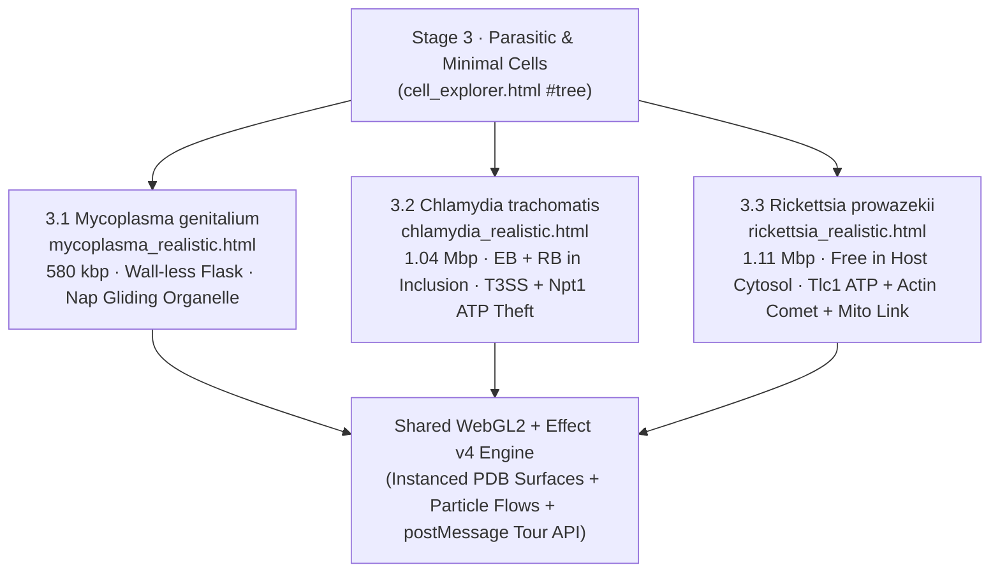

# 08 — `3 · Parasitic & Minimal Cells`: *Mycoplasma*, *Chlamydia* & *Rickettsia* Realistic 3D Models & Tours

**Iteration:** `08` (Three Standalone Realistic WebGL2 Intracellular/Minimal Bacteria Models, Host-ATP-Theft Molecular Simulations, 3-Persona Guided Tours & GPU `.opus` Narration in `EN` & `ES`)  
**Status:** 📋 **Planned**  
**Parent Index:** [`roadmap/README.md`](./README.md)  
**Previous Step:** [`07-biology-introduction-stage-and-sequential-curriculum-tree.md`](./07-biology-introduction-stage-and-sequential-curriculum-tree.md)

---

## 1. Executive Summary & Biological Rationale

Between **autonomous free-living cells** (`Stage 1: E. coli` and `Stage 2: Eukaryotes`) and **acellular viruses** (`Stage 4: Viruses`) sits one of the most illuminating tiers in biology: **Reduced, Minimal & Obligate Intracellular Bacteria (`Stage 3`)**.

Students frequently confuse organisms like ***Chlamydia*** or ***Rickettsia*** with viruses because they cannot replicate outside a host cell. Modelling them in interactive 3D resolves that confusion permanently:
- **Why they ARE true cells (unlike viruses):** Every one of them encloses its own cytoplasm in a lipid membrane, carries a complete double-stranded **DNA chromosome** (`580 kbp – 1.1 Mbp`), builds its own proteins on **`70S` bacterial ribosomes**, and divides by **binary fission**.
- **Why they CANNOT live alone (unlike *E. coli*):** Evolution inside nutrient-rich host tissues stripped away their biosynthetic and energy pathways—leaving *Mycoplasma* without a cell wall (`~480` genes total) and turning *Chlamydia* and *Rickettsia* into **"energy parasites"** whose membrane **ATP/ADP translocases (`Npt1` / `Tlc1`)** import host ATP directly in exchange for spent ADP.
- **Why they unlock Eukaryotic Evolution:** Seeing *Rickettsia* respire and trade ATP directly inside a eukaryotic cytoplasm gives learners a living window into the **alphaproteobacterial ancestor of Mitochondria**.

**Phase 08** expands `Stage 3 · Parasitic & Minimal Cells` from its Phase 07 preview node into **three full standalone realistic WebGL2 pages, Explorer node subtrees, 3-persona Guided Tours, and GPU `.opus` audio shards**:

1. **`3.1 · Mycoplasma genitalium` (`mycoplasma_realistic.html`, `root: 'real-mycoplasma'`):**
   - The **smallest known self-replicating cell** (`~300 nm` flask, `580 kbp` circular dsDNA, `~482` protein-coding genes—smaller than giant viruses like *Mimivirus*, yet genuinely alive!).
   - Procedural + cryo-EM/PDB 3D anatomy: **zero peptidoglycan cell wall** (single cholesterol-stiffened bilayer scavenged from human airway membranes), polarized **terminal attachment organelle** (`Nap` adhesin complex `P1`/`P140`/`P110` gripping a host epithelial cilium + internal segmented `rod` cytoskeleton), gliding motility motors, minimal supercoiled nucleoid, and `~150` `70S` ribosomes.
2. **`3.2 · Chlamydia trachomatis` (`chlamydia_realistic.html`, `root: 'real-chlamydia'`):**
   - The classic **biphasic obligate intracellular "energy parasite"** (`1.04 Mbp` dsDNA) shown inside a cutaway **human epithelial inclusion vacuole**:
     - **Elementary Body (`EB`, `~300 nm`):** Dense, spore-like infectious form cross-linked by disulfide-bonded `OmcB`/`MOMP` outer armor, firing **Type III Secretion System (`T3SS`)** injectisome needles across the vacuole membrane to block host lysosome fusion (`Inc` proteins).
     - **Reticulate Body (`RB`, `~1,000 nm`):** Osmotically fragile dividing form inside the inclusion lumen, actively importing glowing host **ATP** and exporting **ADP + Pᵢ** through **`Npt1` ATP/ADP antiporters**, translating proteins on `70S` ribosomes, and dividing by `MreB`-guided polarized budding/fission.
3. **`3.3 · Rickettsia prowazekii` (`rickettsia_realistic.html`, `root: 'real-rickettsia'`):**
   - The **cytosolic obligate intracellular bacterium** (`1.11 Mbp` dsDNA; agent of epidemic typhus and closest extant bacterial relative of **Mitochondria**):
     - Escapes the phagosome via phospholipases (`Pat1`/`TlyC`) to live **naked in the host cytosol**.
     - Imports host ATP via **`Tlc1` ATP/ADP translocase** early in infection while also carrying an inner-membrane **electron transport chain + `F₁F₀` ATP synthase** virtually homologous to mitochondrial cristae.
     - Nucleates host **F-actin comet tails** (`RickA` / `Sca2` formin-like autotransporter) at one pole to rocket directly into neighboring host cells without touching extracellular antibodies.

---

## 2. Stage 3 Architecture & Host–Parasite Scene Layout

### Comparative Structural & Metabolic Spec Sheet

| Feature | `3.1 Mycoplasma genitalium` | `3.2 Chlamydia trachomatis` | `3.3 Rickettsia prowazekii` |
| :--- | :--- | :--- | :--- |
| **Cell Dimensions** | `~300 × 600 nm` piriform flask | `EB`: `~300 nm` sphere · `RB`: `~800–1,000 nm` | `~350 × 1,100 nm` coccobacillus |
| **Genome & Genes** | `580,076 bp` dsDNA (`~482` genes) | `1,042,519 bp` dsDNA (`~895` genes) | `1,111,523 bp` dsDNA (`~834` genes) |
| **Cell Wall** | **None** (cholesterol-rich single bilayer; β-lactam immune) | Disulfide-crosslinked `MOMP` outer membrane; minimal septal peptidoglycan ring only during division | Thin Gram-negative inner + outer membrane + microcapsular slime layer |
| **Host Niche** | Extracellular surface parasite gripping airway/urogenital **cilia** | Inside non-lysosomal membrane-bound **Inclusion Vacuole** | Free directly inside **Host Cytosol** (escapes vacuole) |
| **Energy / ATP Strategy** | Glycolysis only (no TCA cycle, no quinones; scavenges nucleosides, fatty acids & sterols) | **`Npt1` ATP/ADP translocase** steals host ATP into the inclusion (`Npt2` imports GTP/CTP/UTP) | **`Tlc1` ATP/ADP translocase** steals host ATP + retains **mitochondria-like ETC & `F₁F₀` ATPase** |
| **Signature Nanomachine** | **Terminal Attachment Organelle** (`Nap` `P140/P110` + electron-dense core rod) | **Type III Secretion Injectisome (`T3SS`)** + **`Inc` inclusion shield** + `EB ↔ RB` cycle | **Polar Actin Comet Tail (`Sca2`/`RickA`)** propelling cell-to-cell spread |

---

## 3. Implementation Steps & File Plan

### Step 1: Standalone Realistic 3D Pages & Bundles (`src/pages/`)
- Create three standalone HTML + TypeScript WebGL2 pages implementing the full `postMessage` tour protocol (`track`, `fly`, `free`, `blink`, `ghost`, `set`, `arrived`, `focusOf`) and live particle flows (`ATP`, `ADP`, `mRNA`, `actin` monomers):
  1. [`mycoplasma_realistic.html`](../mycoplasma_realistic.html) + `src/pages/mycoplasma_realistic.ts` (`18–20` inspectable parts, host cilium surface synapse, `P140/P110` Nap adhesin PDB surface, internal terminal rod, `580 kbp` nucleoid, `70S` ribosomes, lipid/nucleoside importers).
  2. [`chlamydia_realistic.html`](../chlamydia_realistic.html) + `src/pages/chlamydia_realistic.ts` (`20–22` inspectable parts, cutaway host inclusion membrane studded with `Inc` proteins, docking `300 nm` `EB` firing `T3SS` needles, replicating `1 µm` `RB`, `Npt1` ATP/ADP antiporters with live bidirectional yellow `ATP` in / blue `ADP` out particle streams, `70S` polysomes, `MreB` division ring).
  3. [`rickettsia_realistic.html`](../rickettsia_realistic.html) + `src/pages/rickettsia_realistic.ts` (`18–20` inspectable parts, cutaway host cytosol + adjacent host mitochondrion for direct evolutionary visual comparison, `Tlc1` ATP importer, inner-membrane `ETC` + `F₁F₀` ATP synthase, `Type IV` secretion system, polar `Sca2` nucleator + polymerizing host F-actin comet tail).
- Register the 3 pages in `HTML_PAGES`, `sitemap.xml`, and `esbuild` page bundles.

### Step 2: Explorer Subtrees (`NODES`) & 4-Mode Lenses (`src/content/lenses_parasitic_cells.ts`)
- Expand `Stage 3 · Parasitic & Minimal Cells` in [`src/pages/cell_explorer.ts`](../src/pages/cell_explorer.ts) (`MENU_GROUPS[3]`) to list `3.0 Overview`, `3.1 Mycoplasma genitalium`, `3.2 Chlamydia trachomatis`, and `3.3 Rickettsia prowazekii`, plus `~24` zoomable molecular child nodes (`nap-adhesin`, `terminal-organelle`, `elementary-body`, `reticulate-body`, `atp-adp-translocase`, `t3ss-injectisome`, `actin-comet-tail`, etc.).
- Author [`src/content/lenses_parasitic_cells.ts`](../src/content/lenses_parasitic_cells.ts) with complete `EN` & `ES` `Simple`, `Story`, `Blueprint`, and `Scientific` lenses for all new Explorer nodes and standalone 3D hover parts, preserving `100%` `[[Label|nodeId]]` supply-chain links and distraction-free prose.
- Update `COURSE_SEQUENCE` in [`src/core/progress_service.ts`](../src/core/progress_service.ts) so the sequential path walks `2.3 Plant Cell → 3.0 Stage 3 Overview → 3.1 Mycoplasma → 3.2 Chlamydia → 3.3 Rickettsia → 4.1 All Virus Architectures`.

### Step 3: Three Guided Tours & Multi-Persona Scripts (`src/tours/`)
- Create [`src/tours/mycoplasma.ts`](../src/tours/mycoplasma.ts), [`src/tours/chlamydia.ts`](../src/tours/chlamydia.ts), and [`src/tours/rickettsia.ts`](../src/tours/rickettsia.ts) (`~45–55` cues each) plus [`src/tours/personas_parasitic_cells.ts`](../src/tours/personas_parasitic_cells.ts) (`EN` & `ES` × `pop`, `blueprint`, `scientific`).
- **Strict Analogy Restraint:** At most **`2–3` purposeful analogies per tour (~1 every 2 minutes)**, reserved strictly for non-obvious mechanisms:
  - *Mycoplasma:* How stripping away redundant genes down to ~480 works only when living inside a climate-controlled host supplies ready-made parts, and why lacking a peptidoglycan wall makes penicillin harmless (no target wall to break).
  - *Chlamydia:* Why `EB` (armored courier spore) vs. `RB` (fragile indoor factory) splits survival and replication into two bodies, and how `Npt1` swaps spent ADP for fresh host ATP like exchanging empty batteries for charged ones.
  - *Rickettsia:* How `Sca2` hijacks host actin bricks into a jet-propulsion tail to punch straight into the next cell, and how an ancient *Rickettsia*-like cousin settled permanently inside our ancestor to become **Mitochondria**.

### Step 4: Sharded `< 48 MB` GPU `.opus` Packaging (`Makefile`, `Dockerfile`, `.github/workflows/deploy.yml`)
- Synthesize all new Tour (`EN` `v1`/`v2`/`v3`, `ES` `latam` + `spain/{blueprint,scientific}`) and Explorer Lens `.opus` clips locally on RTX GPU via `GPT-SoVITS` and `F5-Spanish` using Public-Domain (`CC0`) studio voices in `tools/voices/`.
- Package Stage 3 narration into dedicated `< 48 MB` archives (`audio_stage3_en.tar.gz`, `audio_stage3_es.tar.gz`) wired cleanly into `Makefile`, `Dockerfile`, and `.github/workflows/deploy.yml`.

---

## 4. Verification Gates (`tests/verify_all.ts`)

1. **Standalone WebGL2 Rendering & Part Verification (`make test`):**
   - Headless Chrome WebGL2 E2E renders `mycoplasma_realistic.html`, `chlamydia_realistic.html`, and `rickettsia_realistic.html` with `0` console/page errors and verifies 100% of declared interactive parts, cameras, and particle flows.
2. **Multi-Persona Tour & Analogy-Restraint Validation:**
   - Verifies all new Tour cues across `EN` & `ES` (`pop`, `blueprint`, `scientific`) stay `<= 110` plain chars, preserve exact `[[...|part]]` highlight targets, and maintain the sparse complex-concept analogy bound (`2–3` analogies per tour).
3. **Explorer Node & Part Lenses + `.opus` Integrity:**
   - Verifies 100% `[[Label|nodeId]]` integrity, 4-mode distinctness, valid `OggS` `.opus` headers for every new Tour cue and Explorer node across all 5 voices, and `< 48 MB` archive limits.
