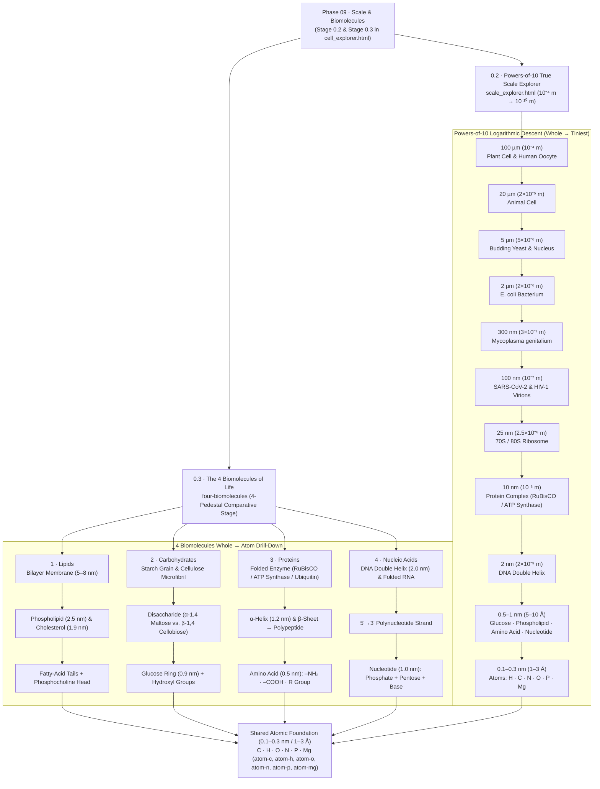

# 09 — Powers-of-10 True Scale Explorer & The 4 Biomolecules of Life

**Iteration:** `09` (Interactive Logarithmic Powers-of-10 True Scale Comparator, 4-Biomolecule Whole-to-Atom Comparative Stage, Multi-Persona Guided Tour & GPU `.opus` Narration in `EN` & `ES`)  
**Status:** 📋 **Planned**  
**Parent Index:** [`roadmap/README.md`](./README.md)  
**Previous Step:** [`08-parasitic-and-minimal-cells-mycoplasma-chlamydia-rickettsia.md`](./08-parasitic-and-minimal-cells-mycoplasma-chlamydia-rickettsia.md)  
**Next Step:** [`10-archaea-third-domain-and-endosymbiosis.md`](./10-archaea-third-domain-and-endosymbiosis.md)

---

## 1. Executive Summary & Pedagogical Goals

Across **Phases 01–08**, `learn-biology` built realistic, interactive WebGL2 models spanning **Plant and Animal Cells**, **Budding Yeast**, ***E. coli***, **Parasitic & Minimal Bacteria** (*Mycoplasma*, *Chlamydia*, *Rickettsia*), and **Five Virus Families**—alongside `222` zoomable Explorer nodes down to individual `H, C, N, O, P, Mg` atoms. Yet two foundational conceptual gaps remain for newcomers entering cellular biology:

1. **Scale Blindness Across Organism Pages:** Each standalone realistic page uses a local unit scale suited to its subject (`1 unit = 1 µm` in Animal/Plant cells, `100 nm` in *E. coli*, `10 nm` in Viruses). Because a `100 µm` plant cell and a `100 nm` coronavirus both fill the viewport when opened separately, students rarely internalize that the plant cell is **`1,000×` wider** (and **`1,000,000,000×` larger in volume**) than the virus, or that a `2 nm` DNA double helix is **`50,000×` narrower** than the cell enclosing it.
2. **Fragmented Molecular Vocabulary:** Learners encounter lipid membranes, starch grains, cellulose walls, enzyme motors, and DNA/RNA helices scattered across `12` organism scenes, without a single side-by-side chemical workbench showing that **every living cell and virus on Earth is constructed from just 4 biomolecule families built out of the same `6` core biogenic atoms (`C, H, N, O, P, Mg`, plus `S`)**.

**Phase 09** closes both gaps strictly from **Whole → Tiniest** right inside `Stage 0 · Introduction to Biology` (bridging `0.1 · Cells, parasitic cells & viruses` into `1.1 · Bacterium (E. coli)` and laying the lipid/macromolecule groundwork for [Phase 10 — Archaea & Endosymbiosis](./10-archaea-third-domain-and-endosymbiosis.md)):

1. **Interactive Powers-of-10 True Scale Comparator (`scale-explorer`, [`scale_explorer.html`](../scale_explorer.html) + [`src/pages/scale_explorer.ts`](../src/pages/scale_explorer.ts)):**
   - A continuous logarithmic WebGL2 camera rail spanning **6 full orders of magnitude (`10⁻⁴ m` → `10⁻¹⁰ m`, i.e., `100 µm` down to `0.1 nm` / `1 Å`)**, placing existing repository models side by side at **exact true relative size**—never distorted or rescaled unless the user explicitly toggles an inspect-highlight lens.
   - Walks through `11` calibrated stops from macroscopic cellular scale down to atomic orbitals: **`100 µm`** (plant cell / human oocyte) → **`20 µm`** (animal cell) → **`5 µm`** (budding yeast / eukaryotic nucleus) → **`2 µm`** (*E. coli*) → **`300 nm`** (*Mycoplasma genitalium*) → **`100 nm`** (SARS-CoV-2 / HIV-1) → **`25 nm`** (ribosome) → **`10 nm`** (protein complex / ATP synthase & RuBisCO) → **`2 nm`** (DNA double helix) → **`0.5–1 nm`** (glucose, phospholipid, amino acid, nucleotide) → **`0.1–0.3 nm`** (`H, C, N, O, P, Mg` atoms).
   - Includes a live dynamic scale bar (`µm → nm → Å`), an imaging-limit overlay (naked eye `~100 µm` · light microscope diffraction limit `~200 nm` · cryo-EM / X-ray crystallography `~0.1–0.3 nm`), a **1:1 True-Size Pair Comparator** lock (snapping any two adjacent stops together at exact ratio), and click-through links jumping directly into each full realistic page or Explorer node.
2. **Side-by-Side 4 Biomolecules of Life Stage (`four-biomolecules` in [`src/pages/cell_explorer.ts`](../src/pages/cell_explorer.ts)):**
   - A 4-pedestal comparative 3D stage (`buildFourBiomolecules`, matching the proven layout of `buildBiologyIntro` from [Phase 07](./07-biology-introduction-stage-and-sequential-curriculum-tree.md)) displaying **Lipids**, **Carbohydrates**, **Proteins**, and **Nucleic Acids** side by side with uniform elemental color-coding (`C` charcoal, `H` white, `O` red, `N` blue, `P` orange, `Mg` emerald).
   - Each pedestal drills strictly **Whole Macromolecule → Polymer / Assembly → Monomer → Functional Groups → Atoms**, reusing existing procedural & PDB node builders (`partModel`, `nest`, `tagFrom` per `AGENTS.md` Rule 1) and adding missing intermediate nodes (`disaccharide`, `beta-sheet`, `polynucleotide-strand`) so no jump in chemical hierarchy is skipped.

---

## 2. Whole-to-Tiniest Drill-Down Architecture

Every visual path in Phase 09 obeys a strict top-down **Whole → Tiniest** zoom hierarchy: learners first see intact cells at `100 µm`, descend decade by decade through organelles, viruses, and nanomachines into the 4 macromolecule assemblies (`2–25 nm`), break each assembly into polymers, monomers, and reactive functional groups (`0.3–2.5 nm`), and converge on the same universal set of `0.1–0.3 nm` biogenic atoms.



### Powers-of-10 True Scale Comparator Spec Sheet (`scale_explorer.html`)

| Stop | Logarithmic Scale | True Dimension (`µm` / `nm` / `Å`) | Linear Ratio vs. H Atom (`1 Å`) | Representative Repo Model(s) | Explorer / Page Target | Reference PDB / Cryo-EM Data |
| :---: | :---: | :--- | :---: | :--- | :--- | :--- |
| **1** | `10⁻⁴ m` | **`100 µm`** (`100,000 nm`, `10⁶ Å`) | `1,000,000×` | Plant leaf cell (`40–100 µm`) & Human oocyte (`~100–120 µm` reference sphere) | `real-plant` / `plant-cell` | Cellular cryo-tomography & light microscopy |
| **2** | `2 × 10⁻⁵ m` | **`20 µm`** (`20,000 nm`, `2 × 10⁵ Å`) | `200,000×` | Mammalian Animal Cell (`15–30 µm` typical somatic diameter) | `real-cell` / `cell` | Mammalian cell ultrastructure atlas |
| **3** | `5 × 10⁻⁶ m` | **`5 µm`** (`5,000 nm`, `5 × 10⁴ Å`) | `50,000×` | Budding Yeast (*S. cerevisiae*, `~5 × 4 µm`) & Eukaryotic Nucleus (`~5–6 µm`) | `real-fungal`, `nucleus` | Yeast FIB-SEM & nuclear lamina cryo-ET |
| **4** | `2 × 10⁻⁶ m` | **`2 µm`** (`2,000 nm`, `2 × 10⁴ Å`) | `20,000×` | Bacterium *E. coli* (`~1 × 2 µm` rod; `4.6 Mbp` circular dsDNA) | `real-bacterium` / `prokaryote` | Bacterial cryo-ET + embedded `BPDB` set |
| **5** | `3 × 10⁻⁷ m` | **`300 nm`** (`0.3 µm`, `3,000 Å`) | `3,000×` | *Mycoplasma genitalium* (`~300 × 600 nm` minimal wall-less flask) | `real-mycoplasma` | PDB `6RUT` (P140/P110 Nap adhesin) |
| **6** | `10⁻⁷ m` | **`100 nm`** (`0.1 µm`, `1,000 Å`) | `1,000×` | SARS-CoV-2 (`~100–120 nm`) & HIV-1 (`~110–120 nm` enveloped virions) | `real-coronavirus`, `real-hiv` | PDB `6VXX`, `6M71`, `4TVP`, `3H4E`, `3P05` |
| **7** | `2.5 × 10⁻⁸ m` | **`25 nm`** (`250 Å`) | `250×` | *E. coli* `70S` Ribosome (`~21–25 nm`) & Eukaryotic `80S` Ribosome (`~25–30 nm`) | `ribosome-ecoli`, `ribosome` | PDB `4YBB` (*E. coli* `70S`, `10,398` beads) |
| **8** | `10⁻⁸ m` | **`10 nm`** (`100 Å`) | `100×` | RuBisCO (`~11 nm`) & `F₁F₀` ATP Synthase (`~10 nm` rotor/head width, `~22–25 nm` tall) | `rubisco-real`, `atp-synthase-ecoli`, `catp-real` | PDB `1RCX`, `6OQR`, `6FKF` |
| **9** | `2 × 10⁻⁹ m` | **`2 nm`** (`20 Å`) | `20×` | B-form DNA Double Helix (`2.0 nm` diameter, `3.4 nm` helical pitch, `3.4 Å` rise/bp) | `dna` | PDB `1BNA` (Drew–Dickerson B-DNA dodecamer) |
| **10** | `5 × 10⁻¹⁰ – 10⁻⁹ m` | **`0.5–1 nm`** (`5–10 Å`) | `5–10×` | Glucose (`~0.9 nm`), Phospholipid head (`~0.8 nm`, full length `~2.5 nm`), Amino acid (`~0.5 nm`), Nucleotide (`~1.0 nm`) | `glucose`, `phospholipid`, `amino-acid`, `nucleotide` | Standard covalent bond geometries (`1.2–1.54 Å`) |
| **11** | `1–3 × 10⁻¹⁰ m` | **`0.1–0.3 nm`** (`1.0–3.0 Å`) | `1–3×` | Biogenic Atoms: `H` (`1.0 Å`), `C`/`N`/`O` (`1.5 Å`), `P` (`2.0 Å`), `Mg` (`3.0 Å` van der Waals / ionic shell) | `atom-h`, `atom-c`, `atom-n`, `atom-o`, `atom-p`, `atom-mg` | IUPAC covalent & van der Waals atomic radii |

### The 4 Biomolecules Whole-to-Atom Matrix (`four-biomolecules` Stage)

| Pedestal & Family | Whole Macromolecule / Assembly | Polymer / Repeating Motif | Core Monomer & True Size | Key Functional Groups & Linkages | Elemental Formula | Reference PDB / Repo Nodes |
| :--- | :--- | :--- | :--- | :--- | :---: | :--- |
| **① Lipids** | Fluid Lipid Bilayer (`plasma-membrane`, `~5–8 nm` thick; non-covalent hydrophobic assembly) | Leaflet of Phospholipids (`~2.5 nm`) + intercalated Cholesterol (`~1.9 nm`) | Glycerol-3-phosphate + 2 Fatty-acid acyl chains (16–18 C; cis-double-bond kink) | Ester link (`–COO–`), polar phosphocholine head (`–PO₄⁻–CH₂CH₂N⁺(CH₃)₃`), sterol `–OH` | `C, H, O, P` *(+ `N` in choline)* | `plasma-membrane` → `phospholipid` / `cholesterol` → `fatty-acid-tail` & `head-group` → `atom-c/h/o/p/n` |
| **② Carbohydrates** | Branched Starch Grain (`starch`, `1–100 µm` plastid granule) & Cellulose Microfibril (`cellulose-microfibril`, `3–5 nm` wide cable) | α-1,4 / α-1,6 coiled amylose/amylopectin vs. β-1,4 flat H-bonded cellulose chains; Disaccharide (`disaccharide`: maltose vs. cellobiose, `~1.4 nm`) | D-Glucose pyranose ring (`glucose`, `C₆H₁₂O₆`, `~0.9 nm` / `9 Å`) | Hydroxyls (`–OH`), hemiacetal ring oxygen, α- vs. β-glycosidic ether bond (`C1–O–C4`) | `C, H, O` *(`1:2:1` empirical ratio)* | PDB `6WLB` (`cesa-real` cellulose synthase); `starch` / `cellulose` → `disaccharide` → `glucose` → `atom-c/h/o` |
| **③ Proteins** | Folded Globular Enzyme (`rubisco-real` `~11 nm`, `atp-synthase-ecoli` `~25 nm`, `ubiquitin` `~3.2 nm`) | Secondary folds: α-Helix (`alpha-helix`, `1.2 nm` wide, `3.6` res/turn) & β-Sheet (`beta-sheet`, `3.5 Å`/residue) along Polypeptide (`polypeptide`) | L-Amino Acid (`amino-acid`, `~0.5 nm` / `5 Å`; `20` genetically encoded R-groups) | Planar amide peptide bond (`–CO–NH–`), N-terminal `–NH₂`, C-terminal `–COOH`, backbone `i→i+4` H-bonds | `C, H, O, N` *(+ `S` in Cys/Met)* | PDB `1UBQ` (Ubiquitin α+β fold), `1RCX` (RuBisCO), `6OQR` (ATP synthase); `protein` → `alpha-helix`/`beta-sheet` → `polypeptide` → `amino-acid` → `atom-c/h/o/n` |
| **④ Nucleic Acids** | Antiparallel B-DNA Double Helix (`dna`, `2.0 nm` wide) & Folded Catalytic/Transfer RNA (`rna`, `~7–8 nm` L-shape tRNA) | Directional `5' → 3'` Polynucleotide Strand (`polynucleotide-strand`) stabilized by base stacking & `A=T`/`G≡C` H-bonds | Nucleotide (`nucleotide`, `~1.0 nm` / `10 Å`: dNTP / NTP monomer) | `3'–5'` phosphodiester bridge (`–O–PO₂⁻–O–`), pentose `2'-H` (DNA) vs. `2'-OH` (RNA), purine/pyrimidine rings | `C, H, O, N, P` *(+ `Mg²⁺` counterions)* | PDB `1BNA` (B-DNA), `1EHZ` (tRNA^Phe), `4YBB` (rRNA); `dna`/`rna` → `polynucleotide-strand` → `nucleotide` → `phosphate`/`sugar`/`base` → `atom-c/h/o/n/p/mg` |

---

## 3. Interactive Guided Tour / Tutorial Spec

Phase 09 adds a narrated bilingual Guided Tour defined in [`src/tours/scale_biomolecules.ts`](../src/tours/scale_biomolecules.ts) (`scale_biomoleculesTour`, `root: 'scale-explorer'`, with linked walkthrough transitions into `four-biomolecules`) and its 3-persona script map in [`src/tours/personas_scale_biomolecules.ts`](../src/tours/personas_scale_biomolecules.ts).

### Tour Structure (`6` Chapters · `46` Cues · ~4 Minutes)

1. **`ch0` — Six Powers of Ten (`100 µm` → `2 µm`):** Sweeps the logarithmic rail from the `100 µm` plant cell / human oocyte past animal cell (`20 µm`), yeast & nucleus (`5 µm`), and *E. coli* (`2 µm`), highlighting why linear diagrams mislead and why naked-eye resolution ends around `100 µm`.
2. **`ch1` — Crossing the Light-Microscope Barrier (`300 nm` → `0.1 nm`):** Descends past the `200 nm` optical diffraction limit through *Mycoplasma* (`300 nm`), SARS-CoV-2 & HIV-1 (`100 nm`), `70S` ribosome (`25 nm`), ATP synthase & RuBisCO (`10 nm`), DNA double helix (`2 nm`), monomers (`0.5–1 nm`), and `H, C, N, O, P, Mg` atoms (`0.1–0.3 nm`).
3. **`ch2` — Pedestal ① Lipids (`Bilayer → Phospholipid → Tails & Head → C/H/O/P`):** Transitions to `four-biomolecules`, focuses on the fluid bilayer, isolates one phospholipid and cholesterol, and shows how amphipathic polarity drives spontaneous membrane closure.
4. **`ch3` — Pedestal ② Carbohydrates (`Starch & Cellulose → Disaccharide → Glucose → C/H/O`):** Compares coiled α-1,4 starch against rigid β-1,4 cellulose cables down to a single `0.9 nm` glucose ring and its hydroxyl groups.
5. **`ch4` — Pedestal ③ Proteins (`Folded Enzyme → α-Helix & β-Sheet → Polypeptide → Amino Acid → C/H/O/N`):** Unpacks PDB `1UBQ` / `6OQR` into α-helices, β-sheets, peptide bonds, and the `20` variable R-groups around the α-carbon.
6. **`ch5` — Pedestal ④ Nucleic Acids & Shared Atoms (`DNA/RNA → Strand → Nucleotide → C/H/O/N/P/Mg`):** Drills from B-DNA (`2 nm`) and folded RNA into phosphate, pentose (`2'-H` vs. `2'-OH`), and base pairs, converging on the 6 shared atoms and inviting the learner to click **`Next in Course → Bacterium (E. coli)`**.

### Persona Authoring & Strict Analogy Restraint (`AGENTS.md` Rule 8)

- **Three Bilingual Personas (`EN` & `ES`):** Every cue in [`src/tours/personas_scale_biomolecules.ts`](../src/tours/personas_scale_biomolecules.ts) authors synchronized `pop` (`Everyday Guide` — active in `Simple` & `Story`), `blueprint` (`Systems Engineer`), and `scientific` (`Molecular Biologist`) lines.
- **Hard Formatting Constraints:**
  - Every cue across all `3` personas and both languages stays strictly **`<= 110` plain characters** (measured after `stripTourMarkup()`).
  - Base `text` strings in [`src/tours/scale_biomolecules.ts`](../src/tours/scale_biomolecules.ts) use clean ASCII for deterministic TTS pronunciation; localized `es` entries in [`src/tours/personas_scale_biomolecules.ts`](../src/tours/personas_scale_biomolecules.ts) use natural Spanish orthography matching [`src/tours/personas_intro.ts`](../src/tours/personas_intro.ts).
  - **100% `[[label|part]]` Highlight Parity:** Every persona (`pop`, `blueprint`, `scientific`) in `EN` and `ES` preserves the exact same `part` target IDs as the base cue so camera blink/focus highlights trigger identically regardless of persona or language.
- **Strict Analogy Restraint (`> 95%` Direct Prose · Exact `2–3` Complex-Concept Analogies ONLY):**
  - Zero analogies on introductions, dimensions, scale numbers, UI instructions, camera transitions, or recaps (`44` of `46` cues = `95.7%` pure direct prose; if expanded across both stages to `>= 62` cues, at most `3` analogies = `>= 95.2%` direct prose).
  - Analogies are strictly reserved for genuinely counterintuitive physical mechanisms:
    1. **Analogy 1 (`sb.ch0.log.04`) — Logarithmic orders of magnitude across 6 powers of 10:** Scaling a `0.1 nm` hydrogen atom up to a `1 mm` grain of sand would stretch a `100 µm` plant cell `1 km` wide—clarifying why six orders of magnitude require a logarithmic zoom lens.
    2. **Analogy 2 (`sb.ch2.lipids.05`) — Amphipathic phospholipid self-assembly:** Hydrophobic tails flee water while polar heads face it, snapping two sheets tail-to-tail like oil sealing away from water to form a self-healing membrane with zero covalent glue.
    3. *(Optional 3rd analogy when total cue count is `>= 62`, `sb.ch3.carbs.04`)* — **α-1,4 vs. β-1,4 glycosidic geometry:** Flipping one hydroxyl bond angle turns the exact same glucose monomer from coiled storage starch into rigid interlocking cellulose beams, explaining why humans digest starch yet cannot digest wood.

### Representative Multi-Persona Cues (`<= 110` Plain Chars · Exact `[[label|part]]` Parity)

```ts
// Excerpt from src/tours/personas_scale_biomolecules.ts (verified <= 110 plain chars)
"sb.ch0.log.01": { // Direct prose (no analogy)
  en: {
    pop:        "From a [[100 um plant cell|plant-cell]] down to one [[hydrogen atom|atom-h]], life spans six powers of ten.",
    blueprint:  "Traverse six logarithmic decades from a [[100 um plant chassis|plant-cell]] to a [[1 A hydrogen node|atom-h]].",
    scientific: "Biological architecture spans 10^-4 m in a [[plant cell|plant-cell]] to 10^-10 m in [[atomic hydrogen|atom-h]]."
  },
  es: {
    pop:        "De una [[célula vegetal de 100 µm|plant-cell]] a un [[átomo de hidrógeno|atom-h]], la vida abarca seis potencias.",
    blueprint:  "Recorre seis décadas logarítmicas de una [[célula vegetal de 100 µm|plant-cell]] al [[hidrógeno de 1 Å|atom-h]].",
    scientific: "La biología abarca desde 10^-4 m en una [[célula vegetal|plant-cell]] hasta 10^-10 m en el [[hidrógeno|atom-h]]."
  }
},
"sb.ch0.log.04": { // Analogy #1 — 6 powers of 10 logarithmic scale
  en: {
    pop:        "If a [[hydrogen atom|atom-h]] grew to a 1 mm sand grain, a [[plant cell|plant-cell]] would span one kilometer.",
    blueprint:  "Linear scaling fails: 10^6x turns a 1 A [[hydrogen node|atom-h]] into 1 mm and a [[plant cell|plant-cell]] into 1 km.",
    scientific: "A 10^6 linear span separates 1 A [[atomic hydrogen|atom-h]] from a 100 um [[plant cell|plant-cell]], requiring log zoom."
  },
  es: {
    pop:        "Si un [[átomo de hidrógeno|atom-h]] midiera 1 mm como arena, la [[célula vegetal|plant-cell]] mediría un kilómetro.",
    blueprint:  "La escala lineal falla: 10^6x lleva el [[hidrógeno|atom-h]] a 1 mm y la [[célula vegetal|plant-cell]] a 1 km.",
    scientific: "Un factor de 10^6 separa el [[hidrógeno|atom-h]] de 1 Å de la [[célula vegetal|plant-cell]] de 100 µm."
  }
},
"sb.ch2.lipids.05": { // Analogy #2 — Amphipathic bilayer self-assembly
  en: {
    pop:        "[[Phospholipid|phospholipid]] tails flee water like oil, sealing into a self-healing bilayer with no glue.",
    blueprint:  "Amphipathic [[phospholipids|phospholipid]] auto-assemble tail-to-tail into a 5 nm hydrophobic barrier.",
    scientific: "The hydrophobic effect drives [[phospholipid|phospholipid]] acyl chains inward, closing a ~5 nm bilayer."
  },
  es: {
    pop:        "Las colas del [[fosfolípido|phospholipid]] huyen del agua como aceite y sellan una bicapa sin pegamento.",
    blueprint:  "Los [[fosfolípidos|phospholipid]] anfipáticos se autoensamblan cola con cola en una barrera de 5 nm.",
    scientific: "El efecto hidrofóbico orienta las colas del [[fosfolípido|phospholipid]] al centro de una bicapa de 5 nm."
  }
},
"sb.ch5.dna.02": { // Direct prose (no analogy)
  en: {
    pop:        "A [[DNA double helix|dna]] is just 2 nm wide, built from repeating [[nucleotides|nucleotide]] of C, H, O, N, P.",
    blueprint:  "The 2 nm [[DNA duplex|dna]] encodes instructions along a directional bus of [[nucleotide|nucleotide]] monomers.",
    scientific: "Antiparallel B-form [[DNA|dna]] (2.0 nm, PDB 1BNA) polymerizes [[dNTP monomers|nucleotide]] via P-O links."
  },
  es: {
    pop:        "La [[doble hélice de ADN|dna]] mide solo 2 nm y repite [[nucleótidos|nucleotide]] hechos de C, H, O, N y P.",
    blueprint:  "El [[dúplex de ADN|dna]] de 2 nm codifica datos en un bus direccional de [[nucleótidos|nucleotide]].",
    scientific: "El [[ADN|dna]] forma B antiparalelo (2.0 nm, PDB 1BNA) polimeriza [[monómeros dNTP|nucleotide]] por enlace P-O."
  }
}
```

---

## 4. Implementation Steps & File Plan

### Step 1: Standalone & Embeddable Powers-of-10 Scale Comparator (`scale_explorer.html` & `src/pages/scale_explorer.ts`)
- Create [`scale_explorer.html`](../scale_explorer.html) and [`src/pages/scale_explorer.ts`](../src/pages/scale_explorer.ts) compiled automatically into `dist/pages/scale_explorer.js` by the existing `esbuild src/pages/*.ts` pipeline in [`package.json`](../package.json).
- Implement the logarithmic scale engine (`10⁻⁴ m` to `10⁻¹⁰ m`, continuous exponent `e ∈ [-4, -10]`):
  - **Model Composition (`AGENTS.md` Rule 1):** Instantiates existing procedural geometries and `BPDB` / `src/molecules/*` structures (`plant-cell` + `human-oocyte` reference sphere at `100 µm`, `cell` at `20 µm`, yeast + `nucleus` at `5 µm`, `prokaryote` at `2 µm`, `real-mycoplasma` at `300 nm`, `coronavirus` + `hiv` at `100 nm`, `ribosome-ecoli` PDB `4YBB` at `25 nm`, `rubisco-real` PDB `1RCX` & `atp-synthase-ecoli` PDB `6OQR` at `10 nm`, `dna` B-helix PDB `1BNA` at `2 nm`, `glucose`/`phospholipid`/`amino-acid`/`nucleotide` at `0.5–1 nm`, and `atom-h/c/n/o/p/mg` at `0.1–0.3 nm`).
  - **Floating-Point Precision Safety:** Instead of placing `100 µm` and `0.1 nm` objects simultaneously in raw single-precision WebGL world units (which causes Z-fighting across a `10⁶` dynamic range), rescale active visible window meshes around the current camera decade (`±2` orders of magnitude visible at any instant with smooth opacity fade-in/out) so every visible pair renders at **exact 1:1 true relative ratio** with crisp depth buffering.
  - **Interactive Controls & HUD:** Smooth logarithmic slider (`100 µm ↔ 0.1 nm`), decade jump buttons, calibrated dynamic scale bar (`µm` / `nm` / `Å`), imaging-limit markers (Eye / Light Microscope / Cryo-EM & X-Ray), and **Compare Adjacent Pair (1:1)** toggle.
  - **Explorer `postMessage` & Debug API:** Implement the full realistic-page bridge (`to: 'realistic-cell'` / `from: 'realistic-cell'`, `track`, `fly`, `free`, `blink`, `ghost`, `set`, `arrived`, `focusOf`) and expose `window.__cell` (`shot`, `step`, `VIEWS`, `setExponent`, `parts`, `focusOf`).
- Register `scale_explorer.html` in `HTML_PAGES` ([`tests/verify_all.ts`](../tests/verify_all.ts)), [`Dockerfile`](../Dockerfile), [`sitemap.xml`](../sitemap.xml), and [`README.md`](../README.md), and write its agent manual [`docs/scale_explorer_manual.md`](../docs/scale_explorer_manual.md) per `AGENTS.md` Rule 7.

### Step 2: 4-Biomolecules Comparative Stage, Sub-Nodes, `MENU_GROUPS` & `COURSE_SEQUENCE`
- Update [`src/pages/cell_explorer.ts`](../src/pages/cell_explorer.ts):
  - Add `NODES['scale-explorer']` (`real: 'cell'`, `page: 'scale_explorer.html'`, linking clickable tags to `real-plant`, `real-cell`, `real-fungal`, `real-bacterium`, `real-mycoplasma`, `real-coronavirus`, `real-hiv`, `ribosome-ecoli`, `atp-synthase-ecoli`, `rubisco-real`, `dna`, `glucose`, `phospholipid`, `amino-acid`, `nucleotide`, and `atom-h/c/n/o/p/mg`).
  - Add `NODES['four-biomolecules']` (`buildFourBiomolecules`), composing 4 labeled pedestals across `x ∈ [-15, +15]` using `partModel(...)` and `tameMiniature(...)`:
    - **Pedestal ① (Lipids):** `plasma-membrane` bilayer cutaway + `phospholipid` + `cholesterol` → children `['plasma-membrane', 'phospholipid', 'cholesterol', 'fatty-acid-tail', 'head-group']`.
    - **Pedestal ② (Carbohydrates):** `starch` helix + `cellulose-microfibril` cable + `disaccharide` + `glucose` → children `['starch', 'cellulose-microfibril', 'cellulose', 'disaccharide', 'glucose']`.
    - **Pedestal ③ (Proteins):** `rubisco-real` / `ubiquitin` (`1UBQ`) + `alpha-helix` + `beta-sheet` + `polypeptide` + `amino-acid` → children `['protein', 'rubisco-real', 'atp-synthase-ecoli', 'alpha-helix', 'beta-sheet', 'polypeptide', 'amino-acid']`.
    - **Pedestal ④ (Nucleic Acids):** `dna` + `rna` + `polynucleotide-strand` + `nucleotide` → children `['dna', 'rna', 'polynucleotide-strand', 'nucleotide', 'phosphate', 'sugar', 'base']`.
  - Add the three new intermediate molecular `NODES` builders (`buildDisaccharide` showing α-1,4 maltose vs. β-1,4 cellobiose side by side, `buildBetaSheet` showing antiparallel H-bonded β-strands with pleated side chains, and `buildPolynucleotideStrand` showing directional `5' → 3'` phosphodiester linkages) wired into existing parent/child chains (`starch`/`cellulose` → `disaccharide` → `glucose`; `protein` → `alpha-helix`/`beta-sheet` → `polypeptide` → `amino-acid`; `dna`/`rna` → `polynucleotide-strand` → `nucleotide` → `phosphate`/`sugar`/`base` → `atom-*`).
  - Update `MENU_GROUPS[0]` (`0 · Introduction to Biology`) in [`src/pages/cell_explorer.ts`](../src/pages/cell_explorer.ts):
    ```text
    0 · Introduction to Biology           [Start Here · The Rules, Scale & Chemistry of Life]
      ├── 0.1 · Cells, parasitic cells & viruses (3D overview)   (root: 'life-overview', default)
      ├── 0.2 · Powers of 10: True Scale Explorer (100 µm → 1 Å) (root: 'scale-explorer')
      └── 0.3 · The 4 Biomolecules of Life (Whole → Atoms)       (root: 'four-biomolecules')
    ```
- Update `COURSE_SEQUENCE` in [`src/core/progress_service.ts`](../src/core/progress_service.ts) to insert `'scale-explorer'` and `'four-biomolecules'` directly between `'life-overview'` and `'real-bacterium'` so finishing the Introduction Primer advances smoothly through Scale & Biomolecules before diving into `1.1 Bacterium (E. coli)`, while maintaining 100% compatibility with existing URL hashes and saved progress cookies.

### Step 3: Guided Tour, 4-Mode Reading Lenses & Bilingual Localization (`EN` / `ES`)
- Create [`src/tours/scale_biomolecules.ts`](../src/tours/scale_biomolecules.ts) (`scale_biomoleculesTour`) and [`src/tours/personas_scale_biomolecules.ts`](../src/tours/personas_scale_biomolecules.ts) (`SCALE_BIOMOLECULES_TOUR_PERSONAS`), and register them in [`src/tours/index.ts`](../src/tours/index.ts) (`ALL_TOURS`) and [`src/tours/tour_personas.ts`](../src/tours/tour_personas.ts) (`TOUR_PERSONA_REGISTRY`).
- Create [`src/content/lenses_scale_biomolecules.ts`](../src/content/lenses_scale_biomolecules.ts) exporting `SCALE_BIOMOLECULES_NODE_LENSES` (all `5` new Explorer nodes: `scale-explorer`, `four-biomolecules`, `disaccharide`, `beta-sheet`, `polynucleotide-strand`) and `SCALE_BIOMOLECULES_PART_LENSES` (all `11` scale-stop hover parts + comparator controls in `scale_explorer.html`) across all `4` lenses (`Simple`, `Story`, `Blueprint`, `Scientific`) in `EN` and `ES` with validated `[[Label|nodeId]]` cross-links. Register in [`src/content/index.ts`](../src/content/index.ts) and add `'scale_explorer.html'` part keys to `STANDALONE_PAGE_PART_KEYS` in [`src/content/registry.ts`](../src/content/registry.ts).
- Add complete Spanish (`ES`) translations for every new node name, scale tag, 3D anchor, HUD label, and tour cue/chapter title in [`src/core/locales/es_nodes.ts`](../src/core/locales/es_nodes.ts), [`src/core/locales/es_tours.ts`](../src/core/locales/es_tours.ts), and [`src/core/locales/es_phrases.ts`](../src/core/locales/es_phrases.ts).

### Step 4: Offline GPU `.opus` Synthesis & `< 48 MB` Sharded Packaging
- Run `npm run export:cues` ([`scripts/export_tour_cues.ts`](../scripts/export_tour_cues.ts)) to regenerate `dist/tour_cues_manifest.json` including all Phase 09 Tour cues (`EN` `v1`/`v2`/`v3`, `ES` `latam` + `spain/{blueprint,scientific}`) and Explorer Lens clips.
- Synthesize only the new Phase 09 audio clips locally on GPU via `GPT-SoVITS` (`EN`) and `F5-Spanish` (`ES`) using the Public-Domain (`CC0`) reference voices in `tools/voices/`.
- Package Phase 09 clips into dedicated `< 48 MB` shards (`audio_phase09_en.tar.gz` and `audio_phase09_es.tar.gz`):
  - Add `PHASE09_EXCLUDE` to `BASE_EXCLUDE`, extend `AUDIO_ARCHIVES`, `unpack-audio`, and `pack-audio` in [`Makefile`](../Makefile).
  - Add both tarballs to `ADD` in [`Dockerfile`](../Dockerfile) and release packaging in [`.github/workflows/deploy.yml`](../.github/workflows/deploy.yml).

---

## 5. Verification Gates (`tests/verify_all.ts` & Visual Eye-Check)

Before Phase 09 is marked complete, `make typecheck && make build && make test` and visual inspection (`AGENTS.md` Rules 6 & 9) must pass 100% of the following gates:

1. **Logarithmic True-Scale Math & Precision Unit Tests (`tests/verify_all.ts`):**
   - Assert exact `10⁶` linear ratio between `100 µm` (`10⁻⁴ m`) and `0.1 nm` (`10⁻¹⁰ m`), monotonic ordering of all `11` scale stops (`100 µm → 20 µm → 5 µm → 2 µm → 300 nm → 100 nm → 25 nm → 10 nm → 2 nm → 0.5–1 nm → 0.1–0.3 nm`), and exact `1:1` relative scaling between any adjacent stop pair in comparator mode without bounding-sphere overlap.
   - Verify the floating-point window re-centering math keeps active mesh scales inside `[10⁻², 10³]` WebGL world units at every exponent `e ∈ [-4, -10]` so zero Z-fighting occurs.
2. **Whole-to-Tiniest Biomolecule Graph & Curriculum Tree Integrity:**
   - Assert `four-biomolecules` exposes all `4` biomolecule families and every drill-down chain reaches atomic leaf nodes (`atom-h`, `atom-c`, `atom-n`, `atom-o`, `atom-p`, `atom-mg`) with `0` orphan or missing `NODES` references.
   - Assert `MENU_GROUPS[0]` renders `0.1`, `0.2`, and `0.3` in both `EN` and `ES`, `COURSE_SEQUENCE` flows `life-overview → scale-explorer → four-biomolecules → real-bacterium`, and 100% of existing hash deep links remain unbroken.
3. **Guided Tour, Multi-Persona & Rule 8 Analogy-Restraint Checks:**
   - Assert every cue in `scale_biomoleculesTour` and `SCALE_BIOMOLECULES_TOUR_PERSONAS` (`EN` & `ES` × `pop`, `blueprint`, `scientific`) has `<= 110` plain characters, valid ASCII base text, `100%` `[[label|part]]` highlight-target parity across all personas and locales, and strictly `> 95%` direct prose with **`2–3` complex-concept analogies maximum** (zero analogies on intros, dimensions, UI instructions, or recaps).
4. **4-Mode Lenses, Bilingual Parity & `< 48 MB` `.opus` Coverage:**
   - Assert all `5` new Explorer nodes and all `scale_explorer.html` parts pass 4-mode distinctness (`Simple` / `Story` / `Blueprint` / `Scientific`), `[[Label|nodeId]]` validation, 100% `ES` dictionary coverage (`es_nodes.ts`, `es_tours.ts`, `es_phrases.ts`), valid `OggS` `.opus` headers across all `5` voices, and `< 48 MB` tarball size enforcement on `audio_phase09_en.tar.gz` and `audio_phase09_es.tar.gz`.
5. **Headless Chrome WebGL2 E2E & Visual Eye-Check (`AGENTS.md` Rule 6):**
   - Serve locally with `python3 tools/serve.py "$(pwd)" 8765`, render screenshots via `__cell.shot(...)` across all `11` Powers-of-10 stops plus adjacent `1:1` comparison frames and via `__explorer.showNow(...)` on `four-biomolecules`, `disaccharide`, `beta-sheet`, and `polynucleotide-strand`.
   - Visually verify crisp rendering, zero overlapping 3D tags, accurate live `µm / nm / Å` scale-bar readouts, smooth frame render times, working `Next in Course →` transition into `1.1 Bacterium (E. coli)`, and `0` console or WebGL errors.
