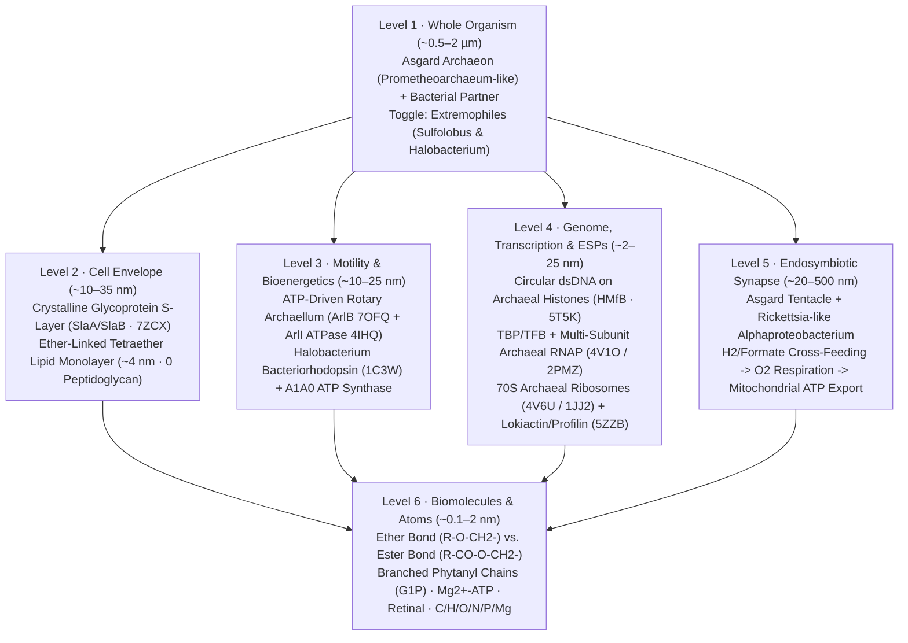

# 10 — Archaea (The 3rd Domain of Life) & Endosymbiosis: Asgard Host, Extremophile Architecture & Origin of Eukaryotes

**Iteration:** 10 (Standalone Realistic WebGL2 Asgard Archaeon & Comparative Extremophile Model, Endosymbiotic Synapse Simulation, Explorer Molecular Subtree, 3-Persona Guided Tour & Sharded `.opus` Narration in `EN` & `ES`)  
**Status:** 📋 **Planned**  
**Parent Index:** [roadmap/README.md](./README.md)  
**Previous Step:** [09-powers-of-10-scale-explorer-and-four-biomolecules.md](./09-powers-of-10-scale-explorer-and-four-biomolecules.md)  
**Next Step:** [11-gram-positive-bacteria-and-endospores.md](./11-gram-positive-bacteria-and-endospores.md)

---

## 1. Executive Summary & Pedagogical Goals

In the current `Stage 0 → Stage 4` curriculum, learners move directly from **Stage 1 · Simple Cells (`E. coli`, Domain Bacteria)** into **Stage 2 · Complex Cells (Yeast, Animal, Plant — Domain Eukarya)** without ever encountering **Domain Archaea**, the third major branch of cellular life. Leaving Archaea out creates two structural gaps in a learner's mental model of biology:

1. **The "Extreme Bacteria" Misconception:** Because Archaea share a compact, nucleus-free body plan (`~0.5–2 µm`, circular `dsDNA`, `70S` ribosomes) with *E. coli*, learners often assume Archaea are simply heat- or salt-loving bacteria. Visualizing an archaeon side-by-side at molecular scale proves otherwise: Archaea replace peptidoglycan with crystalline glycoprotein **S-layers**, replace bacterial ester-linked bilayers with **ether-linked isoprenoid tetraether monolayers**, spin **ATP-driven archaella** instead of proton-driven flagella, and run **eukaryotic-like chromatin, transcription, and translation machinery** (histones, `TBP`/`TFB`, and a 12–13 subunit RNA polymerase).
2. **The Missing Half of Eukaryogenesis (Bridging Stage 1, Stage 2 & Stage 3 *Rickettsia*):** In [Phase 08](./08-parasitic-and-minimal-cells-mycoplasma-chlamydia-rickettsia.md), `3.3 · Rickettsia prowazekii` introduced the **alphaproteobacterial partner** closely related to the ancestor of **Mitochondria**. Yet *who was the host cell that engulfed it?* Modern phylogenomics and cryo-electron tomography point directly to **Asgard archaea** (*Prometheoarchaeum syntrophicum* and *Lokiarchaeum*-like lineages) — archaea equipped with eukaryotic-signature **actin/profilin** cytoskeletons, **`ESCRT-III`** membrane-remodeling rings, and long branched cytoplasmic tentacles that entangle syntrophic bacterial partners.

**Phase 10** closes this bridge between **Stage 1 Prokaryotes**, **Stage 2 Eukaryotes**, and **Stage 3.3 *Rickettsia*** by adding a full standalone realistic WebGL2 model, Explorer Whole → Tiniest molecular subtree, 4-mode bilingual lenses, a 3-persona Guided Tour, and GPU-synthesized `.opus` narration shards:

- **Standalone Dual-View Realistic 3D Page (`archaea_realistic.html`, `src/pages/archaea_realistic.ts`, `root: 'real-archaea'`):**
  1. **Primary View — Asgard Archaeon & Endosymbiotic Synapse:** A realistic *Prometheoarchaeum*-like Asgard archaeon (`~550 nm` cell body) extending long Lokiactin-braced cytoplasmic tentacles (`1–3 µm`) that embrace a syntrophic *Rickettsia*-like alphaproteobacterium (`~0.4 × 1.0 µm`). Live particle flows visualize the **Entangle → Engulf → Endogenize** syntrophy: amino-acid fermentation exporting **`H₂` / formate** from the archaeon while the aerobic bacterial partner respires **`O₂`** and shifts from parasitic `Tlc1` ATP theft toward **symbiotic `ATP` export** — the evolutionary birth of **Eukaryotes & Mitochondria**.
  2. **Comparative View — Extremophile Archaea Toggle (*Sulfolobus* & *Halobacterium*):** Instant scene toggle showcasing *Sulfolobus acidocaldarius* (thermoacidophile at `80 °C`, `pH 2–3` with hexagonal `SlaA/SlaB` S-layer, membrane-spanning caldarchaeol tetraether monolayer, and ATP-powered rotary archaellum) alongside a *Halobacterium salinarum* purple-membrane close-up featuring light-driven **bacteriorhodopsin (`1C3W`)** proton pumps powering rotary **`A₁A₀` ATP synthases**.

---

## 2. Whole-to-Tiniest Drill-Down Architecture

Every camera preset, cutaway, Explorer child node, and hover lens in Phase 10 follows a strict **Whole → Tiniest** zoom ladder spanning four orders of magnitude (`~2 µm` down to `~0.1 nm`), seamlessly extending the [Phase 09](./09-powers-of-10-scale-explorer-and-four-biomolecules.md) scale framework:

### Comparative Three-Domain Spec Sheet: Bacteria vs. Archaea vs. Eukaryotes

| Structural / Molecular Feature | Domain Bacteria (`Stage 1 · E. coli`) | Domain Archaea (`Phase 10 · Asgard / Extremophiles`) | Domain Eukarya (`Stage 2 · Yeast / Animal / Plant`) | Verified Scale & PDB Anchor |
| :--- | :--- | :--- | :--- | :--- |
| **Cell Dimensions & Body Plan** | `~0.8 × 2.0 µm` rod; single open cytoplasmic compartment | `~0.5–1.5 µm` body (`~550 nm` *Prometheoarchaeum* + `1–3 µm` tentacles; `~0.8–1.5 µm` *Sulfolobus*; `~0.5 × 2–4 µm` *Halobacterium*) | `~5 µm` (Yeast) to `~20–100 µm` (Animal / Plant); nucleus + membrane-bound organelles | `0.5–2 µm` (`1 unit = 100 nm` in `archaea_realistic.html`) |
| **Cell Wall / Outer Armor** | Cross-linked **peptidoglycan** (`NAG–NAM` + D-amino acids); β-lactam & lysozyme sensitive | **Zero peptidoglycan**; crystalline hexagonal/p6 **glycoprotein S-layer** (`SlaA`/`SlaB`; pseudomurein in select methanogens); β-lactam immune | Absent in animals; chitin/glucan (Fungi) or cellulose (Plants) | S-layer `~10–25 nm` thick; `SlaA` cryo-EM **PDB `7ZCX`** |
| **Membrane Lipids & Chirality** | **Ester-linked** straight fatty-acyl chains on **`sn`-glycerol-3-phosphate (`G3P`)** bilayer (`~4–5 nm`) | **Ether-linked** branched **isoprenoid phytanyl / biphytanyl** chains on **`sn`-glycerol-1-phosphate (`G1P`)**; **tetraether monolayer (`~3.5–4.5 nm`)** in thermophiles | **Ester-linked** fatty-acyl chains on **`sn`-glycerol-3-phosphate (`G3P`)** bilayer (`~4–5 nm`) + sterols | Ether `C–O` `~1.43 Å`; tetraether monolayer `~3.8–4.5 nm` |
| **Rotary Motility Propeller** | **Bacterial Flagellum** (`~20 nm` hollow `FliC` tube) powered by **`H⁺`/`Na⁺` proton-motive force** (`MotAB` stators) | **Archaellum** (`~10–14 nm` solid `ArlB`/`FlaB` Type IV-pilus-like helix) powered directly by **`Mg²⁺·ATP` hydrolysis** (`ArlI` hexamer) | `9+2` microtubule **Cilium / Flagellum** (`~250 nm` wide) bent by dynein ATPases | `ArlB` filament **PDB `7OFQ`** (`~12 nm`); `ArlI` hexamer **PDB `4IHQ`** |
| **Energy Conversion & Light Pumps** | Membrane `ETC` + **`F₁F₀` ATP synthase** (chlorophyll photosystems in cyanobacteria) | Membrane `ETC` / hydrogenases + **`A₁A₀` ATP synthase**; retinal **Bacteriorhodopsin** light-driven `H⁺` pump in *Halobacterium* | **Mitochondrial** `F₁F₀` ATP synthase (alphaproteobacterial origin) + **Chloroplast** photosystems | Bacteriorhodopsin **PDB `1C3W`** (`1.55 Å`, 7-TM + retinal + annular lipids) |
| **Genome & Chromatin Packaging** | Circular `dsDNA` (`~4.6 Mbp`); folded by **HU / H-NS** nucleoid-associated proteins (no histones) | Circular `dsDNA` (`~1.5–4.4 Mbp`); wrapped on **archaeal histones (`HMfB` hypernucleosome)** in Euryarchaeota & Asgard lineages | Linear nuclear chromosomes (`12 Mbp – 6.4 Gbp`) wrapped on **octameric histones (`H2A/H2B/H3/H4`)** | Archaeal histone–DNA hypernucleosome **PDB `5T5K`** (`~8 nm` superhelix, `2 nm` `dsDNA`) |
| **Transcription Machinery** | Single 5-subunit core RNAP (`α₂ββ'ω`) + **σ-factors** (`-10`/`-35` promoters) | Single **12–13 subunit archaeal RNAP** recruited by eukaryotic-like **`TBP` + `TFB`** at TATA/BRE promoters | Three multi-subunit polymerases (**RNAP I / II / III**) recruited by **`TBP` + `TFIIB`** | Archaeal RNAP **PDB `4V1O`** (reference archive) / **`2PMZ`** & **`4V8S`** (`~14 nm` clamp) |
| **Ribosomes & Translation** | **`70S`** (`50S + 30S`); `fMet` initiator; blocked by chloramphenicol & streptomycin | **`70S`** (`50S + 30S`, `~22 nm`) with eukaryotic-like r-proteins & **`aIF2`/`aEF2`**; `Met` initiator; insensitive to bacterial-specific macrolides | **`80S`** cytosolic (`60S + 40S`, `~28 nm`) + **`70S`** inside mitochondria/chloroplasts; `Met` initiator | Archaeal `70S` **PDB `4V6U`** (`~22 nm`); `50S` ribozyme **PDB `1JJ2`** (`2.4 Å`) |
| **Cytoskeleton & Eukaryogenesis Role** | `FtsZ` Z-ring, `MreB` rods; **alphaproteobacterial partner** (Stage 3.3 *Rickettsia* cousin) became **Mitochondria** | Asgard **ESPs**: **Lokiactin** filaments + **profilin**, **`ESCRT-III`** scission rings, ubiquitin homologs; **host lineage** that engulfed the mitochondrial ancestor | Dynamic **actin**, **tubulin**, and **`ESCRT`** membrane-trafficking networks enabling phagocytosis & mitosis | Asgard LokiProfilin-2–actin **PDB `5ZZB`**; `~7 nm` F-actin filaments |

### Standalone Scene Layout & Inspectable Parts (`archaea_realistic.html`, `1 unit = 100 nm`)

| Zone (Whole → Tiniest) | `partKey` Identifiers (`STANDALONE_PAGE_PART_KEYS`) | Visual & Dynamic Simulation Behavior |
| :--- | :--- | :--- |
| **Whole Cell & Envelope** | `slayer`, `tetraether`, `tentacle`, `escrt`, `extremophile_shell` | Cutaway `90°` front wedge exposes the `18 nm` hexagonal `SlaA/SlaB` lattice (`7ZCX`) anchored to the continuous `4 nm` single-sheet tetraether monolayer; branched Lokiactin-filled tentacles extend around the symbiont. |
| **Motility & Extremophile Energy** | `archaellum`, `arli`, `bacteriorhodopsin`, `a_atps` | Spinning `12 nm` `ArlB` helical filament (`7OFQ`) driven by cytoplasmic `ArlI` hexameric ATPase (`4IHQ`) consuming animated yellow `ATP` → blue `ADP + Pᵢ`; in Extremophile mode, purple membrane patches of `1C3W` pump cyan `H⁺` ions out while `A₁A₀` ATP synthases spin inward. |
| **Genome, Transcription & ESPs** | `dna`, `histone`, `rnap`, `mrna`, `ribosome`, `lokiactin` | Circular supercoiled `dsDNA` wrapped onto slinky `HMfB` archaeal histone polymers (`5T5K`), bound by `TBP/TFB` + archaeal RNAP (`4V1O`/`2PMZ`) extruding live `mRNA` chains read by `70S` archaeal ribosomes (`4V6U`), framed by branching Lokiactin + profilin cables (`5ZZB`). |
| **Endosymbiotic Synapse & Atoms** | `symbiont`, `synapse`, `h2_flow`, `atp_export`, `ether_bond` | Side-by-side contact cleft between Asgard tentacle membrane and the *Rickettsia*-like alphaproteobacterium (retaining double membrane, inner `ETC`/`F₁F₀`, and circular `dsDNA`); animated `H₂`/formate beads cross into the symbiont while `O₂` drives respiration and `ANT`-like carriers export golden `ATP` back to the archaeal host; atomic inset contrasts an ether (`C–O–C`) vs. ester (`C(=O)–O–C`) headgroup link and `Mg²⁺·ATP`. |

---

## 3. Interactive Guided Tour / Tutorial Specification (`src/tours/archaea.ts`)

The Phase 10 Guided Tour (`archaeaTour`, `root: 'real-archaea'`, `page: 'archaea_realistic.html'`) guides learners through `5` chapters, `18` steps, and **`54` timed cues** (`~5.5 minutes` narrated runtime), progressing strictly **Whole → Tiniest** and culminating in the **Endosymbiotic Origin of Eukaryotes**.

### Chapter Progression (`src/tours/archaea.ts`)

| Chapter | Camera Views & Focus Parts | Pedagogical Arc | Cue Budget |
| :--- | :--- | :--- | :---: |
| **`ch0` · The 3rd Domain of Life** | `overview` → `tentacle`, `extremophile_shell` | Introduces *Prometheoarchaeum*-like Asgard archaea alongside extremophiles (*Sulfolobus* / *Halobacterium*); resolves why Archaea are a distinct domain rather than "extreme bacteria". | `9` cues (`3` steps) |
| **`ch1` · Envelope: S-Layer & Tetraether Monolayer** | `envelope` → `slayer`, `tetraether` | Cuts open the `SlaA/SlaB` crystalline armor (`7ZCX`), explains zero peptidoglycan (penicillin immunity), and zooms into the ether-linked `G1P` isoprenoid tetraether monolayer surviving boiling acid. | `9` cues (`3` steps) |
| **`ch2` · ATP Archaellum & Light-Driven Pumps** | `archaellum` → `arli`, `bacteriorhodopsin`, `a_atps` | Watches `ArlI` (`4IHQ`) hydrolyze `Mg²⁺·ATP` to spin the `ArlB` archaellum (`7OFQ`) vs. proton-driven bacterial flagella, then switches to *Halobacterium* bacteriorhodopsin (`1C3W`) feeding `A₁A₀` ATP synthase. | `12` cues (`4` steps) |
| **`ch3` · Eukaryotic-Like Core: Histones, RNAP & ESPs** | `genome` → `histone`, `rnap`, `ribosome`, `lokiactin`, `escrt` | Reveals why Eukaryotes descend from Archaea: `HMfB` histone hypernucleosomes (`5T5K`), `TBP/TFB` + 12-subunit archaeal RNAP (`4V1O`), `70S` ribosomes (`4V6U`), and Asgard Lokiactin (`5ZZB`) + `ESCRT-III`. | `12` cues (`4` steps) |
| **`ch4` · Endosymbiotic Synapse & Atomic Foundations** | `synapse` → `symbiont`, `h2_flow`, `atp_export`, `ether_bond` | Follows `H₂` export and `O₂`-driven `ATP` return across the Asgard–alphaproteobacterium cleft (contrasting *Rickettsia*'s `Tlc1` theft with mitochondrial `ANT` export), closing at the atomic `ether vs. ester` bond (`C/H/O/N/P/Mg²⁺`). | `12` cues (`4` steps) |

### Multi-Persona Scripts (`src/tours/personas_archaea.ts`) & Strict `AGENTS.md` Rule 8 Analogy Restraint

Every one of the `54` cues ships in `src/tours/personas_archaea.ts` (`PERSONAS_ARCHAEA`) across both **`EN`** and **`ES`** for all three personas (`pop` = *Everyday Guide*, `blueprint` = *Systems Engineer*, `scientific` = *Molecular Biologist*):

- **Hard Subtitle & Highlight Constraints:**
  - Every cue across all `6` language × persona variants stays strictly **`<= 110` plain characters** (after `stripRichLinks`).
  - Base `src/tours/archaea.ts` cues stay `100%` pure ASCII for deterministic TTS pronunciation.
  - Every `[[label|part]]` highlight target maintains **`100%` parity** between base cues and all `EN`/`ES` × `pop`/`blueprint`/`scientific` scripts.
- **Strict Analogy Restraint (`AGENTS.md` Rule 8):**
  - **`52` of `54` cues (`96.3%`, strictly `> 95%`)** in `pop` (`Simple` / `Story`) and all Explorer lenses use direct, clear, distraction-free biological prose — zero analogies on introductions, dimensions, UI instructions, camera cutaways, simple shapes, or recaps.
  - **Exact `2` purposeful complex-concept analogies** (strictly inside the `2–3` cap, spaced ~2.5 minutes apart; a 3rd slot is disallowed unless total cues are expanded to `>= 61` so the `> 95%` direct-prose threshold is never violated):
    1. **`arch.ch1.s1.02` (Tetraether Lipid Monolayer):** Explains why archaeal membranes survive `100 °C` acid by framing C40 biphytanyl tetraether lipids as covalent bolts uniting both faces into one continuous sheet, unlike separable bacterial bilayers that peel apart under heat.
    2. **`arch.ch4.s1.02` (Endosymbiosis / Origin of Mitochondria):** Frames the Asgard–alphaproteobacterial transition into Eukaryotes as a permanent metabolic merger uniting two supply lines under one envelope — trading archaeal shelter and fermentation `H₂` for steady respiratory `ATP`.

#### Sample Multi-Persona Cue Specification (Verified `<= 110` Plain Chars & 100% `[[label|part]]` Parity)

| Cue ID & Role | Persona | English (`en`) | Spanish (`es`) |
| :--- | :--- | :--- | :--- |
| **`arch.ch1.s1.02`** *(Analogy 1 of 2: Tetraether Monolayer)* | `pop` | `Its [[tetraether lipids|tetraether]] bolt both sides into one sheet that will not peel apart in acid.` *(86 ch)* | `Sus [[lípidos tetraéter|tetraether]] unen ambos lados en una lámina que no se separa en ácido.` *(79 ch)* |
| | `blueprint` | `Spanning [[tetraether lipids|tetraether]] fuse both leaflets into a single heat-proof bulkhead.` *(80 ch)* | `Los [[lípidos tetraéter|tetraether]] fusionan ambas caras en un mamparo único resistente al calor.` *(83 ch)* |
| | `scientific` | `C40 biphytanyl [[tetraether monolayers|tetraether]] span ~4 nm via ether bonds stable at 100 C.` *(80 ch)* | `Las [[monocapas tetraéter|tetraether]] C40 abarcan ~4 nm con enlaces éter estables a 100 C.` *(76 ch)* |
| **`arch.ch3.s0.02`** *(Direct Prose: Archaeal Histones)* | `pop` | `Circular [[DNA|dna]] wraps around [[archaeal histones|histone]], the direct ancestor of our chromatin.` *(82 ch)* | `El [[ADN|dna]] circular se enrolla en [[histonas arqueanas|histone]], ancestro directo de nuestra cromatina.` *(88 ch)* |
| | `blueprint` | `Circular [[dsDNA|dna]] spools onto polymeric [[HMfB histone cores|histone]] to compact and gate access.` *(83 ch)* | `El [[ADNbc|dna]] se bobina en núcleos poliméricos de [[histonas HMfB|histone]] que compactan el código.` *(83 ch)* |
| | `scientific` | `[[dsDNA|dna]] winds around [[HMfB histone dimers|histone]] (PDB 5T5K), forming a flexible hypernucleosome.` *(86 ch)* | `El [[ADNbc|dna]] rodea dímeros de [[histona HMfB|histone]] (PDB 5T5K) formando un hipernucleosoma flexible.` *(87 ch)* |
| **`arch.ch4.s1.02`** *(Analogy 2 of 2: Endosymbiotic Merger)* | `pop` | `Over time this [[synapse|synapse]] became a permanent merger: shelter and [[H2|h2_flow]] for steady [[ATP|atp_export]].` *(80 ch)* | `Con el tiempo esta [[sinapsis|synapse]] fue una fusión permanente: refugio y [[H2|h2_flow]] por [[ATP|atp_export]].` *(76 ch)* |
| | `blueprint` | `The [[symbiotic bus|synapse]] locked into one fused chassis: host [[H2|h2_flow]] in, partner [[ATP|atp_export]] out.` *(77 ch)* | `El [[bus simbiótico|synapse]] se fijó en un chasis único: entra [[H2|h2_flow]] y sale [[ATP|atp_export]] continuo.` *(75 ch)* |
| | `scientific` | `Sustained [[syntrophy|synapse]] trading [[H2|h2_flow]] for respiratory [[ATP|atp_export]] drove mitochondrial origin.` *(78 ch)* | `La [[sintrofía|synapse]] basada en [[H2|h2_flow]] y [[ATP|atp_export]] respiratorio originó la mitocondria.` *(68 ch)* |

---

## 4. Implementation Steps & File Plan

### Step 1: Coarse-Grained PDB Embedding & Standalone WebGL2 Page (`archaea_realistic.html`, `src/pages/archaea_realistic.ts`)
- Fetch and coarse-grain real structural coordinates via `tools/embed_structures.py` for:
  - `5T5K` (*Methanothermus fervidus* HMfB archaeal histone–DNA hypernucleosome),
  - `4V1O` / `2PMZ` (*Sulfolobus* multi-subunit archaeal RNA Polymerase),
  - `1C3W` (*Halobacterium salinarum* bacteriorhodopsin–retinal–lipid complex),
  - `7ZCX` (*Sulfolobus acidocaldarius* SlaA crystalline S-layer subunit),
  - `7OFQ` (`ArlB` archaellum filament) & `4IHQ` (`ArlI` hexameric ATPase),
  - `4V6U` / `1JJ2` (archaeal `70S` / `50S` ribosome), and
  - `5ZZB` (Asgard LokiProfilin-2–actin complex).
- Create [`archaea_realistic.html`](../archaea_realistic.html) and `src/pages/archaea_realistic.ts` on the shared Three.js + Effect v4 engine (`1 unit = 100 nm`, matching `prokaryote_cell_realistic.ts` and Stage 3 realistic pages):
  - Implement full `postMessage` tour protocol (`track`, `fly`, `free`, `blink`, `ghost`, `set`, `arrived`, `focusOf`), `window.__cell` debug hooks (`shot`, `step`, `sites`, `procs`, `flows`, `views`, `pointsOf`), cutaway toggle, look presets (`gel`, `glass`, `xray`), and an interactive **Mode Toggle** (`Asgard + Endosymbiont` ↔ `Extremophile: Sulfolobus / Halobacterium`).
  - Animate real-time metabolic particle flows (`H₂`/formate across the endosymbiotic synapse, `O₂` into the alphaproteobacterial `ETC`, `ATP` export vs. `ADP + Pᵢ` return, `Mg²⁺·ATP` hydrolysis at `ArlI`, `H⁺` pumping across `1C3W` bacteriorhodopsin, and `mRNA` transcription/translation).
- Register `archaea_realistic.html` in `HTML_PAGES` (`tests/verify_all.ts`), `STANDALONE_PAGE_PART_KEYS` (`src/content/registry.ts`), `sitemap.xml`, `README.md`, and author `docs/archaea_realistic_manual.md` (`AGENTS.md` Rule 7). `esbuild` automatically bundles `src/pages/archaea_realistic.ts` via `npm run build` (`src/pages/*.ts`).

### Step 2: Explorer Subtree (`NODES`), Curriculum Integration (`MENU_GROUPS`, `COURSE_SEQUENCE`) & 4-Mode Lenses
- Add `NODES['real-archaea']` and `12` zoomable **Whole → Tiniest** molecular child nodes in [`src/pages/cell_explorer.ts`](../src/pages/cell_explorer.ts) (`real-arch-envelope`, `real-arch-slayer`, `real-arch-tetraether`, `real-arch-archaellum`, `real-arch-bacteriorhodopsin`, `real-arch-histones`, `real-arch-rnap`, `real-arch-ribosome`, `real-arch-lokiactin`, `real-arch-synapse`, `real-arch-ether-bond`, `real-arch-atoms`), composing existing atomic and molecular builders via `partModel`, `nest`, and `tagFrom` (`AGENTS.md` Rule 1).
- Update `MENU_GROUPS` in [`src/pages/cell_explorer.ts`](../src/pages/cell_explorer.ts) under **`1 · Simple Cells — Prokaryotes`** to display:
  - `1.1 · Bacterium (E. coli)` (`root: 'real-bacterium'`)
  - `1.2 · Archaeon (Asgard & Extremophiles)` (`root: 'real-archaea'`) — directly preceding `2 · Complex Cells — Eukaryotes` (`2.1 Fungal → 2.2 Animal → 2.3 Plant`) so learners witness **endosymbiosis** immediately before entering eukaryotic organelles.
- Insert `'real-archaea'` into `COURSE_SEQUENCE` in [`src/core/progress_service.ts`](../src/core/progress_service.ts) right after `'real-bacterium'` and before `'real-fungal'`, preserving 100% backward compatibility with all existing hash deep links and saved checkpoints.
- Create `src/content/lenses_archaea.ts` exporting `ARCHAEA_NODE_LENSES` and `ARCHAEA_PART_LENSES` (`EN` & `ES` × `Simple`, `Story`, `Blueprint`, `Scientific`), register both in [`src/content/index.ts`](../src/content/index.ts), and include `[[Label|nodeId]]` supply-chain cross-links connecting to `real-bacterium`, `real-cell`, `mitochondrion`, and `real-rickettsia`.
- Add complete Spanish translations in `src/core/locales/es_nodes.ts`, `src/core/locales/es_tours.ts`, and `src/core/locales/es_phrases.ts`.

### Step 3: Guided Tour & 3-Persona Narration Scripts (`src/tours/`)
- Create `src/tours/archaea.ts` (`archaeaTour`, `5` chapters, `18` steps, `54` cues) and register it as `ALL_TOURS.archaea` in [`src/tours/index.ts`](../src/tours/index.ts).
- Create `src/tours/personas_archaea.ts` (`PERSONAS_ARCHAEA`) and spread it into `TOUR_PERSONA_REGISTRY` in [`src/tours/tour_personas.ts`](../src/tours/tour_personas.ts).

### Step 4: Sharded `< 48 MB` GPU `.opus` Packaging (`Makefile`, `Dockerfile`, `.github/workflows/deploy.yml`)
- Export the updated bilingual cue and lens manifest (`make export-cues`) and synthesize only the new `real-archaea` / `real-arch-*` Tour (`EN` `v1`/`v2`/`v3`, `ES` `latam` + `spain/{blueprint,scientific}`) and Explorer Lens `.opus` clips locally on RTX GPU via `GPT-SoVITS` and `F5-Spanish` using Public-Domain (`CC0`) studio voices in `tools/voices/`.
- Wire dedicated `< 48 MB` archives into [`Makefile`](../Makefile), `Dockerfile`, and `.github/workflows/deploy.yml`:
  - Add `ARCHAEA_EXCLUDE := --exclude='*/real-archaea' --exclude='*/real-archaea.opus' --exclude='*/real-arch-*.opus'` to `BASE_EXCLUDE`.
  - Add `audio_archaea_en.tar.gz` and `audio_archaea_es.tar.gz` to `AUDIO_ARCHIVES`, `unpack-audio`, and `pack-audio`, verifying each archive stays strictly `< 48 MB` for Git LFS-free repository cleanliness and fast CI/Docker builds.

---

## 5. Verification Gates (`tests/verify_all.ts` & Visual Eye-Check)

1. **TypeScript, Build & Bundle Integrity (`make typecheck && make build`):**
   - `tsc --noEmit` passes with `0` errors across `src/pages/archaea_realistic.ts`, `src/tours/archaea.ts`, `src/tours/personas_archaea.ts`, `src/content/lenses_archaea.ts`, and updated registries; `esbuild` outputs clean minified `dist/pages/archaea_realistic.js` and `dist/server.js`.
2. **Standalone WebGL2 Rendering, Part & Metabolism E2E (`make test`):**
   - Headless Chrome WebGL2 E2E in [`tests/verify_all.ts`](../tests/verify_all.ts) opens `archaea_realistic.html` (both `Asgard + Symbiont` and `Extremophile` views) with `0` console/page errors, verifies `100%` of `STANDALONE_PAGE_PART_KEYS['archaea_realistic.html']` interactive parts, camera views, and `postMessage` tour commands, and advances `30` simulated seconds via `window.__cell.step(...)` to assert non-zero `H₂`, `O₂`, `ATP`, `ADP`, `H⁺`, and `mRNA` metabolism recipe counts.
3. **Visual Eye-Check (`AGENTS.md` Rule 6):**
   - Serve locally with `python3 tools/serve.py "$(pwd)" 8765`, capture `__cell.shot(...)` renders of `overview`, `envelope`, `archaellum`, `genome`, `synapse`, and `extremophile` views, and visually inspect the PNGs to confirm: crisp hexagonal S-layer spacing, unambiguous single-sheet tetraether monolayer cutaway contrast, unobstructed Asgard tentacle–symbiont geometry, readable `5T5K` histone–DNA coils, zero Z-fighting, and 100% visible Explorer tags across every child level.
4. **Multi-Persona Tour & Rule 8 Analogy-Restraint Validation (`tests/verify_all.ts`):**
   - Automated test suite asserts all `54` cues of `real-archaea` across `EN` & `ES` × `pop`/`blueprint`/`scientific` stay `<= 110` plain characters, maintain exact `[[...|part]]` highlight parity, keep base cues pure ASCII, and enforce `> 95%` direct prose (`52/54 = 96.3%`) with strictly `2` complex-concept analogies (`arch.ch1.s1.02`, `arch.ch4.s1.02`).
5. **Explorer Curriculum Continuity, 4-Mode Lenses & `.opus` Shard Integrity:**
   - Asserts `MENU_GROUPS` and `COURSE_SEQUENCE` place `real-archaea` immediately between `real-bacterium` and `real-fungal`, `100%` of legacy hash deep links remain intact, `100%` of `[[Label|nodeId]]` links (including cross-links to `real-bacterium`, `mitochondrion`, and `real-rickettsia`) resolve cleanly, all `4` lens modes are distinct in `EN`/`ES`, every new `.opus` clip carries a valid `OggS` header across all `5` voices, and both `audio_archaea_en.tar.gz` and `audio_archaea_es.tar.gz` remain strictly `< 48 MB`.
